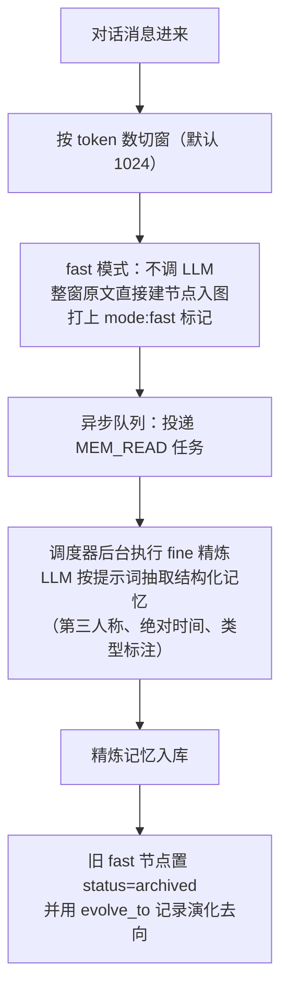

# MemOS

| 源仓库 | [MemTensor/MemOS](https://github.com/MemTensor/MemOS) |
|---|---|
| 协议 | Apache-2.0 |
| 主语言 | Python（另有 TypeScript 插件包） |
| 笔记基准 | commit `64388b5`（2026-10-29，v2.0.33） |

MemOS 自称"记忆操作系统"（Memory Operating System），由 MemTensor 团队开源，GitHub star 约 1.2 万，有配套论文（arXiv:2507.03724）。名字取自操作系统这个比喻：记忆像系统资源一样被统一管理——申请、调度、换入换出，应用（agent）不直接操心记忆存在哪、什么时候精炼、怎么回收。README 的表述是统一 store / retrieve / manage（`README.md:43`）。

这个项目有两点需要先交代。第一，它现在是 2.0（代号 Stardust），网上大量资料基于 1.x，结构已经对不上（包名 `MemoryOS`、导入名 `memos`）。第二，它的 README 叙事和代码实况有差距——论文里的"三类记忆"中，参数记忆在开源代码里只是占位文件，激活记忆默认关闭且只支持本地模型，检索流程里有一个文档提到但从未接入的推理组件。本笔记如实区分"实现了的"和"宣称了的"，差距本身放在"设计原则"节讨论——对一个研究味很重的项目，这层差距是理解它的必要材料。

另一个值得注意的连接：MemOS 的 TypeScript 插件直接适配了本笔记系列已覆盖的三个 agent 项目——deepseek-harness、openclaw、hermes-agent（`apps/` 下的 `memos-local-plugin` 等插件，近期大部分提交也在这条线上）。想给这三个 agent 接记忆后端，MemOS 是现成的一站。

这份笔记按问题组织，不按 MemOS 的开发时间线：每个问题讲清 MemOS 现在是怎么解的、为什么这么解、代价是什么。项目演进过程放在文末修订记录里。笔记起于 commit `64388b5`（2026-10-29），跟进到 commit `64388b5`（2026-10-29）。

## 它要解决什么问题

把记忆做成一张向量表（mem0 路线）或一张图谱（cognee/graphiti 路线）之后，还有些问题悬着：记忆有不同种类（用户偏好、工作上下文、工具用法），混在一起检索会互相干扰；检索结果直接塞提示词，每次都要重算一遍模型的注意力；重要记忆和临时记忆没有被区别对待。MemOS 的切入点是把这些"管理"问题单独拎出来做成一层：记忆按类型分容器，检索按类型分路径，常用的热记忆自动换进"工作区"，对话历史可以预计算成模型内部的缓存状态（KV 缓存，模型处理文本时产生的中间张量，复用它等于让模型"预读"过这段话）跳过重复计算。

## 仓库怎么分工

- `src/memos/`——Python 核心包。`mem_os/` 是编排层（MOS 类）；`memories/` 是三类记忆的数据结构与其存储实现（textual 下有树形图存储和扁平向量存储两套）；`mem_reader/` 是记忆抽取；`mem_scheduler/` 是记忆调度器；`graph_dbs/`、`vec_dbs/`、`llms/`、`embedders/` 是四类后端；`api/` 是 REST 和 MCP 服务。
- `packages/` 与 `apps/`——TypeScript 侧：适配器基础库和各 agent 的本地插件（deepseek-harness/openclaw/hermes 适配在这里），含本地嵌入模型与 SQLite 存储。
- `evaluation/`——五套基准（LoCoMo、LongMemEval、PrefEval、LongBench-v2、PersonaMem）的评测脚本，独立于主包，pip 安装不包含。

核心包的依赖方向：mem_os 编排层向下调用 memories 和 mem_scheduler，两者再向下调用各后端工厂。后端选择全部走配置（pydantic 配置类 + 工厂函数），没有插件发现机制之外的隐式耦合。

## 主轴：记忆是统一调度的系统资源

MemOS 的核心抽象有两个。**MemCube**（记忆容器，`src/memos/mem_cube/general.py:21`）是记忆的装载单位，内部四个槽位：`_text_mem`（明文记忆）、`_act_mem`（激活记忆，即 KV 缓存形态）、`_para_mem`（参数记忆）、`_pref_mem`（偏好记忆）——论文说"三类"，代码里是四槽位，偏好记忆常被漏掉。**MOS**（`src/memos/mem_os/main.py:24`）是编排入口，持有记忆读取器、用户管理、调度器。

"资源调度"的实义落在三件事上：

1. **一切明文记忆是带类型标签的图节点**。每条记忆是 `TextualMemoryItem`（`src/memos/memories/textual/item.py:299`），元数据里的 `memory_type` 枚举了十类作用域（WorkingMemory/LongTermMemory/UserMemory/ToolSchemaMemory/SkillMemory/PreferenceMemory 等，`:178-189`）——检索时按类型分流，工作记忆不会和工具说明书抢排名。
2. **写入即双写冷热两层**。每次 add，长记忆同时写进长期层（冷，持久）和工作记忆层（热，容量受限的快速区），两边用 `working_binding` 互相关联（`src/memos/memories/textual/tree_text_memory/organize/manager.py:160-214`）。检索的第一路直接取工作记忆全量——热点问题不用翻冷库。
3. **调度器驱动记忆的换血**。`mem_scheduler` 把对话事件（query、answer）当消息流处理，触发"工作记忆重排"：按历史查询的相关性重新挑选工作记忆成员，过滤粗糙的原始记忆，写回工作区（`src/memos/mem_scheduler/base_mixins/memory_ops.py:57-162`）。类似操作系统按访问模式换页。

这三件事的代价也要说清楚：调度器、图结构重组这类高级机制**默认全是关闭的**（`enable_mem_scheduler` 默认 False，`core.py:72`；`reorganize` 默认 False），开箱跑的是最简路径（见下节）。"操作系统"的完整形态需要显式开启各开关。

## 模型接入

LLM 工厂（`src/memos/llms/factory.py:20-31`）支持 10 种后端：openai、azure、ollama、huggingface（本地）、vllm、qwen、deepseek、minimax 等。嵌入工厂（`src/memos/embedders/factory.py:17-22`）4 种，其中 `universal_api` 可接任意 OpenAI 兼容端点。配置全走 pydantic 配置工厂；不带任何配置启动 MOS 时从环境变量自动组装（需要 `OPENAI_API_KEY`，`mem_os/main.py:57-77`）。

## 记忆写入

一轮对话变成记忆的路径，核心是 fast/fine 双模式加异步流程：

同步调用时一次做 fine 不走中间态（`core.py:759-764`）。抽取提示词（`src/memos/templates/mem_reader_prompts.py:1` 起，中英双份）要求输出带 key、memory_type、value、tags 的 JSON 列表加一段摘要。有两道可选的质量闸：幻觉过滤（让模型自查抽出的记忆是否有原文依据，环境变量门控，`simple_struct.py:709`）和改写（把口语化表述重写规范）。

这个设计的收益：写入路径的延迟和不调模型的 fast 持平（对话不被记忆加工阻塞），质量靠后台补。代价是存在一个中间态——fast 节点是未经提炼的原文，检索侧要靠过滤规则不让它们混进最终结果（`memory_ops.py:74-91` 过滤 `mode:fast`），等于把一致性问题的处理放在了读取侧。

## 记忆组织与存储

明文记忆有两套存储实现，按配置二选一：

- **general_text**（默认，`MOS.simple()` 用的就是它，`main.py:67`）：Qdrant 向量库 + JSON 文件，扁平结构，没有图。
- **tree_text**：Neo4j（或 Postgres 等）图库里的树。记忆按类型分层组织，节点间有从属和演化关系。README 里"图谱可检查可编辑"说的是这套。

两类记忆的差别要记准：**默认不是图**——快速上手的示例跑的是"向量 + JSON 文件"，图形态要显式配置 `tree_text`。README 的 docker 自托管路径才默认 Neo4j + Qdrant 双件套。

激活记忆（`src/memos/memories/activation/item.py:32`）是 KV 缓存形态：把若干条文本记忆拼成一段文本（`MEMORY_ASSEMBLY_TEMPLATE`），调 `build_kv_cache` 预计算成 HuggingFace 的 `DynamicCache` 张量。它只在本地模型后端生效——OpenAI 这类 API 模型收不到现成的 KV 张量，直接跳过（`core.py:314-316`）；vLLM 路径是服务端 prompt 预载。参数记忆是占位：`src/memos/memories/parametric/lora.py:1-6` 文件头明确写着 placeholder、不要当功能用，`dump` 方法写入的字面量就是 `b"Placeholder"`。论文里的"记忆注入参数"在开源实现里不存在。

## 记忆检索

`MOSCore.search`（`core.py:546`）对每个有权限的 MemCube 并行执行。单 cube 内部（`src/memos/memories/textual/tree_text_memory/retrieve/searcher.py`）：先让 LLM 解析查询意图（改写查询、提取记忆类型和关键词，`retrieve/task_goal_parser.py:30`），然后按类型六路并行召回——工作记忆路、长期+用户记忆路、工具记忆路、技能路、偏好路、关键词全文路；联网检索路存在但默认关闭。每路召回后过重排（默认本地余弦相似度重排，`tree.py:63-73`），最后按 id 去重合并、排序截断。

多路融合的实现值得注意：`GraphMemoryRetriever` 并行跑图匹配、向量、BM25、全文四路，然后**按 id 去重取并集**（`retrieve/recall.py:179-184`）——没有 RRF 那样的分数级融合，一条记忆被多路命中也不会加权。这是一个"实现比叙事朴素"的例子：文档读起来像精密的混合检索，代码是无权重的合并。另外检索代码的注释里宣称流程终点是 MemoryReasoner（推理精选组件），但该组件在主管道中从未被调用（`searcher.py:211-213` 对比 `:69`）——又一个文档与实现的落差。

## 更新与遗忘

- **冲突检测与合并**：新记忆入库前，用嵌入相似度（阈值 0.8）找相似旧节点，再让 LLM 判定是否冲突（`organize/handler.py:22-44`）；能融合则 LLM 融合，不能则按时间戳硬更新并归档旧节点；图上把旧节点的边继承到合并后的节点（`_resolve_in_graph`，`:151-174`）。
- **版本链**：每条记忆的元数据带 `history`（`item.py:125`），归档的旧版本记录变更类型（conflict/duplicate/extract/feedback 等，`:72`）和演化去向（`evolve_to`）——记忆为什么变成现在这样，链上可查。
- **工作记忆容量**：FIFO 上限默认 20 条，满了移除最旧的（`organize/manager.py:250-261`）。
- **没有遗忘曲线**。全仓库没有按时间衰减、按热度淡忘的实现；"遗忘"由三件事代替：status 生命周期（activated/archived/deleted）、工作记忆 FIFO、fast 标记过滤。论文式的"记忆衰减"不存在于代码。

## 隔离与多租户

权限三层：SQLAlchemy 表管用户和 MemCube 的归属与共享（多对多关联表，`src/memos/mem_user/user_manager.py:47-51`）；MOS 每个读写操作先校验用户存在、再校验 cube 访问权（`core.py:200-231`）；数据层按 `user_name` 标签过滤——单库模式下所有图查询强制带上 `AND n.user_name = $user_name`（`src/memos/graph_dbs/neo4j.py:164-165`）。企业版可切换每用户一个物理数据库（`configs/graph_db.py:58-64`）；Neo4j 社区版只能用单库标签模式（代码注释明确警告）。

## 服务化与扩展

- **REST**：FastAPI，路由前缀 `/product`（不是 `/v1`）：search、add（支持异步模式）、create_cube、chat、feedback 等（`src/memos/api/routers/server_router.py:68` 起）。
- **MCP**：FastMCP 实现的 stdio 服务，约 17 个工具（chat、search_memories、add_memory、dump_cube、share_cube、控制调度器等，`src/memos/api/mcp_serve.py:129-568`）。
- **插件**：`src/memos/plugins/` 有基于钩子的插件系统（内置的 dream 插件即由此挂载）；面向 agent 的适配在 TS 侧（前文提到的三个 agent 插件）。
- **后端注册**：四类后端（图/向量/LLM/嵌入）都是工厂 + 配置，新增后端写实现类、注册进工厂表。

## 可观测性与评估

Python 核心包没有接入任何第三方遥测（没有 PostHog/Sentry/OTel 的引用）——六个记忆项目里唯一默认零外传的。库内自有的观测是调度器的 web 日志和监控模块。评测在顶层 `evaluation/` 目录，五套基准各带运行脚本；README 的成绩表出自 OmniMemEval（外部基准），注意与本仓库脚本的区别。

## Agent Loop

没有。`MOSCore.chat` 是固定三步（检索、拼提示词、单次生成，`core.py:251-352`），PRO_MODE 的"分解-逐子问检索-合成"也是固定管道、失败即回退，不是自主循环。真正的 agent 循环来自宿主——TS 插件接入的 deepseek-harness/openclaw/hermes 提供循环，MemOS 提供记忆。

## 设计原则

- **类型化的记忆作用域**：十类 `memory_type` 让检索、权限、容量策略都能按类型分别设置。对照 mem0 的三个 id 作用域（用户/agent/运行），MemOS 的分类更细，代价是抽取时要判对类型，判错了记忆会落到错误的检索路径。
- **写入快、精炼慢的双模**：与 supermemory 的"先可搜后成忆"同构，只是实现粒度在消息窗口级而非文档级。
- **诚实的差距**（README 宣称 vs 代码实况，如实对照）：参数记忆是占位文件；激活记忆默认关、仅限本地模型、每次全量重建单条缓存；检索的 MemoryReasoner 组件未接入主流程；调度器与重组默认关闭；开箱默认形态是向量+JSON 而非图谱。这些不是贬义——研究项目的代码跟不上论文叙事是常态——但引用 MemOS 能力时要按代码实况，不能按 README。
- **与 agent 生态的接口在 TS 侧**：核心库 Python、agent 插件 TypeScript，近期开发火力集中在插件线——它把自己定位成"给现成 agent 供记忆"的后端，而不是自成一体。

## 可复用的做法

- **fast/fine 双模写入**（`simple_struct.py:374-429`）：记忆（或任何加工产物）先以零成本原始形态落库保底，后台异步精炼并归档原始版本、记录演化去向。延迟敏感的写入路径普遍适用。
- **记忆类型分容器检索**（`item.py:178-189`）：检索前先按类型分流，比全库统一排序更可控；实现成本低（一个枚举字段加检索过滤），收益立竿见影。
- **冷热双写加调度换血**（`manager.py:160-214`、`memory_ops.py:57-162`）：热点数据自动进快速区、按使用情况换血，这是操作系统页面缓存的思路在记忆系统里的移植，适用于"读写比悬殊、热点会漂移"的存储场景。
- **冲突合并时继承图上的边**（`handler.py:151-174`）：合并重复节点时把旧节点的关联边迁到幸存节点，这个细节决定了合并后图谱是否还连通——做实体合并的系统都该处理这一步。
- **版本链记变更类型**（`item.py:49-91`）：归档旧版本时标注变更原因（冲突/重复/抽取/反馈），事后审计和调试抽取质量时价值很大。
- **内核沙箱跑无人值守组件**：MemOS 的 agent 插件把无人值守的记忆任务放进受限沙箱（fail-closed）——任何"后台自动干活"的组件都值得这么包。

## 修订记录

- 2026-10-30 初版：基于 commit `64388b5` 完整成文。覆盖 MemCube 四槽位、fast/fine 异步写入、冷热双写与调度换血、六路检索、冲突合并与版本链；如实记录 README 宣称与代码实现的差距（参数记忆占位、激活记忆限制、未接入的推理组件）。
