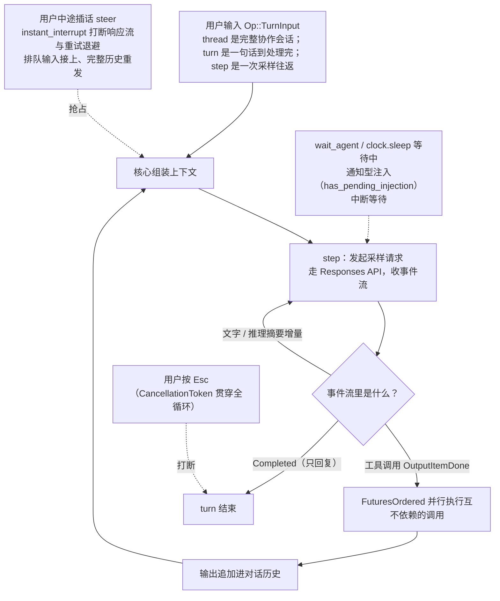
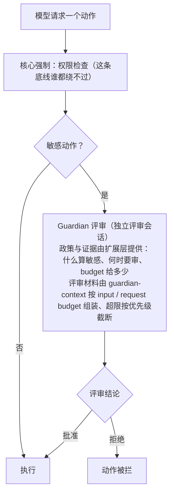

# Codex

| 源仓库 | [openai/codex](https://github.com/openai/codex) |
|---|---|
| 协议 | Apache-2.0 |
| 主语言 | Rust |
| 笔记基准 | commit `3e9264fb`（2026-10-27） |

Codex 是 OpenAI 开源的编码 agent（agent 指能自主多步行动、调用工具完成任务的 AI 程序），主体用 Rust 编写，跑在用户自己的电脑上：终端里敲 `codex` 进入交互界面，让它读代码、改文件、跑命令、跑测试。规模不小：`codex-rs/` 目录下一百多个 crate（Rust 的模块/零件单位），四千六百多个 Rust 源文件，近两百万行代码（含测试）。在同类工具（Claude Code、opencode、Gemini CLI 这类终端编码 agent）里，Codex 的位置是官方出品、生产级强度的参考实现：一套 Rust 核心同时支撑终端界面、IDE 插件、桌面应用和云上服务，安全机制和上下文管理都做得非常系统。

这份笔记按问题组织，不按 Codex 的开发时间线：每个问题讲清它现在是怎么解的、为什么这么解、代价是什么。项目演进过程放在文末修订记录里。笔记起于 commit `4ca8e7aff` 前后（2026-09-21），跟进到 commit `3e9264fb`（2026-10-27）。

## 它要解决什么问题

把一个语言模型变成能干活的编程助手，中间隔着四个实际问题，Codex 的全部工程都围绕它们展开。

**第一，模型只会输出文字，不会动手。** 模型说"我帮你改一下 `main.rs`"，它自己改不了文件，也跑不了测试。需要一个程序替它执行：它说"读这个文件"，程序读了把内容喂回去；它说"跑这个命令"，程序跑了把输出喂回去。这个"模型出主意、程序跑腿、结果再喂回去"的循环就是 agent loop（智能体循环），是所有此类工具的心脏。

**第二，动手就有风险。** AI 执行的命令如果没有任何限制，一条 `rm -rf` 就可能闯祸。Codex 用沙箱（sandbox，把程序关进一个隔离房间，房间里能碰什么、能连什么网络都受系统级限制）加审批（approval，敏感动作先问用户）来解决。这是 Codex 投入工程量最大的部分之一。

**第三，模型的"工作记忆"有限。** 模型一次能"看到"的内容总量有上限，这个上限叫上下文窗口（context window），按 token（模型处理文本的最小单位，一个英文单词大约一两个 token）计费计量。编码任务动辄读几十个文件，对话一长窗口就满了。Codex 有一整套上下文管理：往窗口里放什么、放多大、什么时候把旧内容压缩成摘要。

**第四，用户出现在不同的地方。** 有人用终端，有人用 VS Code，有人用桌面应用。如果每端各写一套核心逻辑，成本和不一致都会失控。Codex 把核心做成一个独立的服务层（app-server），所有前端通过统一的协议跟它对话，一套逻辑处处复用。

## 一套核心，多个前端

整个仓库是一个 Rust workspace（把多个 crate 组成一个工程统一编译的机制），按职责分四层：

1. **协议层（protocol）**：定义前端和核心之间说什么"话"。两个核心类型：`Op`（用户/前端发给核心的请求，比如"开始一轮对话""打断当前任务""批准这条命令"）和 `Event`（核心发给前端的通知，比如"模型输出了一个字""命令执行完了"）。这层不干活，只定义数据形状，所有层共享。
2. **核心层（core 及其卫星 crate）**：真正干活的逻辑。agent 循环、工具调度、沙箱决策、上下文压缩、会话记录、审批把关都在这里。核心又拆出几十个专门的 crate，比如管压缩的 `compact` 系列、管会话记录的 `rollout`、管功能开关的 `features`、管 git 工作树的 `worktree`。
3. **服务层（app-server）**：把核心包装成一个 JSON-RPC 服务（JSON-RPC 是一种"用 JSON 格式一来一回调函数"的通信约定）。前端不直接调用核心的 Rust 函数，而是向 app-server 发请求、收事件。传输通道支持三种：stdio（标准输入输出管道）、Unix domain socket（同一台机器上进程间的本地通信插座，下文简称 UDS）、WebSocket（网络上保持长开的双向通道）。
4. **前端层**：`tui` 是终端交互界面；`exec` 是非交互模式（一条命令跑完任务，适合脚本和 CI）；IDE 插件和桌面应用是仓库外的官方前端，同样走 app-server 协议。`codex-cli` 目录是 npm 上的启动器，`sdk/` 里是给 JS 应用嵌入 Codex 用的 TypeScript SDK。

| crate | 职责 |
|---|---|
| `protocol` | Op/Event 等通信数据类型，前端与核心的公共语言 |
| `core` | agent 循环、会话（thread）管理、上下文与压缩、工具路由、审批安全判断 |
| `tui` | 终端界面，基于 ratatui 库（一个用文字在终端里画界面的 Rust 库） |
| `exec` | 非交互模式入口，输出最终结果或 JSONL 事件流 |
| `app-server` + `app-server-protocol` + `app-server-transport` | JSON-RPC 服务本体、协议类型、stdio/UDS/WebSocket 三种传输 |
| `tools` | 工具的定义、规格（ToolSpec）、输出格式 |
| `sandboxing` + `linux-sandbox` + `execpolicy` + `windows-sandbox-*` | 三大平台的沙箱实现与命令执行策略 |
| `codex-mcp` + `rmcp-client` | 接入外部 MCP 工具服务器的连接管理与客户端 |
| `features` | 集中式功能开关注册表 |
| `rollout` | 会话记录的写入、读取、压缩、检索 |
| `worktree` | git 工作树的创建与清理 |
| `guardian-context`（配合 core 里的 guardian 模块） | 审批把关与独立评审的上下文组织 |
| `config` | 配置文件加载、profile、权限档位 |
| `login` + `keyring-store` | 账号登录与密钥保管 |

这套"一套核心、多个前端"的拆分是 Codex 架构上最重要的决定。代价是要维护一个严谨的协议（仓库里专门有工具从 Rust 类型自动生成 TypeScript 类型定义，保证两端不脱节）；好处是 IDE 插件、桌面端、终端的行为和功能完全同源。依赖方向上也有一条成文纪律：`AGENTS.md`（这个仓库给 AI 贡献者的开发守则，他们自己用 Codex 开发 Codex）写着"抵制往 codex-core 里加代码"——core 已经是最大的 crate，什么都往里放会越来越臃肿，新功能先找现有的合适 crate，实在没有就新开一个。核心越小、越稳定，上层越敢改。

## 主轴：模型要动手，动手就得有围栏

模型说"跑这条命令"，命令就会真的在你的机器上执行，一条 `rm -rf` 就可能闯祸；仓库里藏着的恶意提示（提示注入：藏在文档或代码注释里诱导模型干坏事的文本）也能诱导模型做出用户不想做的动作。Codex 对这个问题的答案分三层：

- **沙箱**管"物理上做不了"：文件、网络、进程的访问由操作系统级机制限制，越权动作在系统层面就通不过。
- **审批**管"做之前先问人"：合法但敏感的动作（沙箱外跑命令、上传文件），先弹出带命令内容和原因的确认。
- **Guardian**管"旁人替你看一眼"：一个独立的模型评审会话对动作做评审，与执行会话分开——执行者不给自己放行。

三层之外还有一层自指的：**围栏自己也是文件，也会被写坏**。沙箱能起作用，依赖构成防线的那些文件本身不被篡改。于是有沙箱完整性检查、写死的绝对路径、MCP 子进程的文件描述符隔离。"沙箱与审批"一节是这条主轴的完整展开。

## Agent 循环

三个层级概念撑起整个运行模型：thread（线程）是一次完整的协作会话，对应一份可恢复的记录；turn（回合）是用户说一句话到模型彻底处理完的过程；turn 内部每次"向模型发起采样请求、拿回结果"是一次 step（步）。用户的一次提问，通常经历多个 step。

入口在 `core/src/session/turn.rs` 的 `run_turn` 函数（三千多行，是该仓库最大的文件之一），主干是一个循环：前端通过 `Op::TurnInput` 提交用户输入，核心组装上下文，发起第一次采样请求；请求走 OpenAI 的 Responses API（由 `codex-api` crate 处理通信细节），返回一个事件流，流里可能出现文字增量、推理摘要增量、完整的工具调用（`OutputItemDone`）、回合结束标记（`Completed`）；如果模型请求了工具调用，核心执行工具，把输出追加进对话历史，发起下一次采样请求；如果模型只输出了一条给用户看的回复，这一 turn 结束。

两个实现细节值得展开。其一，工具调用可以并行：模型一次返回多个工具调用时，核心用 `FuturesOrdered`（一种保持完成顺序的并发容器）同时执行互不依赖的调用，全部完成后再一起喂回模型。其二，回合可以被"插话"（steer）：用户不必等模型跑完当前回合，可以中途追加输入，核心把新输入排队或注入当前回合。插话还能进一步变成**抢占**：`instant_interrupt`（2026-10-07 起默认启用）打开后，新用户输入到达时可以打断还在进行的模型响应——打断请求发起、响应流、连重试的退避等待也一并打断，然后把排队的输入接上继续回合；被抢占的请求重置连接和续写状态，下一请求带完整历史重发。配套地，code-mode（把工具调用折叠成代码执行的执行方式，见"特色模块"）里长时间运行的 `exec`/`wait` 调用会收到一个共享的抢占信号，**提前让出**：注意不是杀掉——正在跑的单元格继续跑，只是不再霸着回合，后续的 `wait` 调用还能照常收集它们的结果。插话解决"话能递进去"，抢占解决"话能马上被听进去"，代价是打断的响应作废重来——这个代价曾让团队把开关默认关着，最初的保守默认后来被换掉了。

注入的输入也能叫醒等待中的 agent。模型调用 `wait_agent`（等子 agent 干完）或 `clock.sleep`（定时睡眠）时，等待开始之前就排进队的通知型注入同样会中断等待、进入下一次模型请求。输入队列用 `has_pending_injection` 标记区分"通知型注入"与"被动上下文"（`core/src/session/input_queue.rs:92-93`）：前者算作待处理的插话活动，能打断等待；标记在待处理输入被取走或清空时重置，之后到达的被动上下文不会误触发中断（提交 305db380）。

把循环拆成 turn/step 两级，是为了让"可打断、可恢复、可计费"都有清晰的边界：打断发生在 turn 级（保留已完成的 step），上下文压缩发生在 step 之间（保证发给模型的每次请求都是完整一致的快照），限额统计也按 turn 结算。整个循环用 CancellationToken（Rust 里一个可以被多方触发的"取消信号"对象）贯穿，用户按 Esc 打断时，正在进行的请求和工具执行都能干净地停下来。整条链路画出来是：

## 工具系统

工具是模型能调用的具体动作。Codex 的工具分三类：内置工具（核心自带）、MCP 工具（外部服务器提供）、动态工具（运行时注册）。

每个工具在发给模型前要有一份规格（`ToolSpec`）：名字、参数的 JSON Schema（描述参数长什么样的规范）。规格分几种形态：普通函数式（Function）、自由格式（Freeform，比如 apply_patch 用自己的补丁文本格式而不是 JSON 参数）、命名空间式（Namespace，把 MCP 服务器的多个工具打包在一个前缀下）、工具搜索（ToolSearch，见下）。`core/src/tools/spec_plan.rs` 根据配置、模型能力和已启用的 MCP 服务，决定这一回合到底把哪些工具的规格放进请求。

内置工具里值得单独说的：

- `shell` / `unified_exec`：执行命令。统一执行器还支持长驻 shell（一次会话里保持一个 shell 进程，保留工作目录和环境变量）和 TTY 模式（模拟真实终端，能跑 vim 这类交互程序）。
- `apply_patch`：改代码不走"整文件覆写"，而是用一套自定义的补丁格式，明确写出增删改哪些行。补丁应用前后会算一遍 diff（文件差异），作为回合差异报告给用户。
- `update_plan`：让模型维护一张结构化的任务清单（每项是"待办/进行中/完成"），用户能实时看到它打算怎么干。
- `web_search`、`view_image`、`request_user_input`（向用户提问）、`sleep`、`current_time` 等，各管一摊。
- `tool_search`：接入了大量 MCP 工具时，把所有工具规格塞进上下文会占掉大量空间。开了这个工具后，大部分工具规格不再随请求发送，模型先按需搜索"有没有能干 X 的工具"，再把找到的工具的详细规格临时加载进来。

工具的执行统一走 `ToolRouter`（路由器）：按名字找到对应的处理器，套上前置检查（审批判断、hook 回调）、超时控制、输出截断、事件上报，执行完再把输出包成统一格式。hook（钩子）是用户配置的回调，可以在工具执行前后、回合开始结束时插入自定义逻辑。

**执行并行度按读写分界。** 不主动声明可并行的工具，执行时默认拿一把独占的调度锁，两个互不相干的读取也得排队。2026-10 上旬起，一批明确只读的工具改为可并行执行——技能与记忆的列出和读取、文件读取与搜索、历史搜索、插件与 agent 列表、当前时间、剩余上下文、`get_goal` 等；目标的创建和更新仍然串行。配套测试用屏障（barrier，一种让两个操作互相等齐、从而证明它们真的同时在跑的同步手段）验证并行确实发生。同一时期，存在已久的一套补丁版 zsh 执行后端被整体拆除，执行统一回标准 shell 执行器，旧配置开关被忽略并给出迁移提示。

**技能目录的构建有时序保障（2026-10-20）。** 一个技能可能同时来自云端目录和多个执行器环境（executor，实际代它跑文件的环境）。`ToolContributor` 有一个异步的 `prepare_for_step` 钩子（提交 9b865ab3），构建工具前先等所有贡献者就绪——不可变的技能目录、别名、插件策略、配置在每个步骤开始前准备好。安装位置可查：discovery V2 下新增 `skills.installations`，列出某技能在哪些环境已启用（支持按来源过滤和分页，不读技能内容），`skills.read` 也能通过 `source` 参数指定从云端还是某个执行器环境读取，响应里带 `installations_truncated` 标记，被上限略去的安装位置可分页取回（提交 03478b4b）。别名分配在活跃线程内保持有界、只追加（append-only，只增不改），每个步骤保留自己的别名快照，目录条目引用哪个根路径在整轮会话里不会漂移。

工具规格是上下文的大户，"按需加载 + 命名空间合并 + tool_search"三板斧都指向同一个目标：让接入一百个工具和接入三个工具的上下文开销差距尽量小。统一的路由层则让"审批、hook、遥测"这些横切关注点只写一遍。

### MCP 与外部工具

MCP（Model Context Protocol，模型上下文协议）是一个开放标准，作用类似 USB 接口之于外设：不管工具是谁写的，只要按 MCP 实现一个服务器，Codex 就能发现并调用它的工具。数据库客户端、浏览器操作、内部 API 封装，都可以做成 MCP 服务器。

`codex-mcp` crate 管所有连接：启动子进程或连远端、握手、发现工具列表、转发调用、处理断线。每个 MCP 服务器的工具在暴露给模型时加上服务器名前缀，避免重名冲突。MCP 协议还有 elicitation（服务器向用户发起询问）和资源读取等能力，Codex 都做了对应的桥接。状态查询接受可选的服务器名：会话里已有连接的直接复用（连工具目录都是现成的，不重复发 `initialize` 和 `tools/list` 请求），没有的只为这一台单独建发现连接；名字写错返回空页，省略名字则维持原来的全量行为。同一份 MCP 目录被多个会话使用时，工具的不可变元数据与归一化后的规格在 `McpManager` 内共享：工具元数据、agent 插件模式、schema 上限三者都一致才复用，共享定义挂在弱引用后面、缓存未命中时清理过期条目，已结束的会话不会把自己的 schema 一直留在内存里（提交 2744e868）。

**回合内刷新**：MCP 服务器可能在连接之后才暴露新工具，`mcp_tool_list_changed` 特性（2026-10 中旬起，默认关闭）让 Codex 收到服务器的工具清单变更通知时就地刷新目录——通知按传输到达顺序排队，并发刷新会合并，分页中途被通知作废的清单会重试；刷新失败保留旧目录并进入重试冷却，同时作废受影响的启动缓存，已受理的调用照常跑完（提交 0df4aa67）。

企业方向：MCP 连接支持企业托管授权（enterprise-managed authorization，连接的登录与授权由企业管理方统一决定，提交 1569abc5），企业 MCP 状态列表走线程连接查询（提交 61fa059d）。凭据从哪来有一条顺序（`codex-mcp/src/ema_token_source.rs`，提交 6b13dffc、c419fd01）：优先用一份合资格的 Codex 账号 OAuth 授权（issuer 要与企业 MCP 配置匹配），被拒绝时首次连接退回到保存的企业登录凭据；被拒绝的账号授权按企业 MCP 注册项记住、跨线程生效，认证失败报告为需要重新登录，管理员的配置错误与登录失败分开报告；每个连接固定绑定它的凭据来源与 OAuth 客户端，账号授权的比较不受访问令牌与 ID 令牌轮换影响，交换之后重新核对最新身份资格，刷新授权变了就重试一次。配置重载时企业连接怎么处理（提交 cca40e57、feadd944）：待启动的连接被取消且取消动作可跟踪，仍通过校验的运行中线程保留访问；合资格的企业连接跨刷新与显式重连保留，同时应用更新后的工具限制与审批，首次启动之后不再新建替代连接；线程被移除就撤销企业授权，访问被禁用时排空请求，令牌续期需要重新认证时撤销该连接的授权。机密 OAuth 客户端也能用（提交 6203846f）：企业身份提供方与 MCP 服务器的 OAuth 注册各自可配 `client_secret` 与 `token_endpoint_auth_method`（`config/src/mcp_types.rs:166-171`），支持 `client_secret_basic` 与 `client_secret_post`，配了密钥默认 Basic；注册的方法要对照服务器元数据校验，机密注册必须配 `oauth.authorization_server_issuer`，空密钥或无密钥的认证方法直接拒绝。MCP OAuth 刷新协调（`mcp_oauth_refresh_coordination`）已转稳定并默认启用（`features/src/lib.rs:1609-1613`）。扩展工具里还有一个 `multi_env_copy_file`：在两个已选环境之间直接拷贝文件、内容不进模型上下文，两端各自过沙箱策略与权限检查，完成后返回拷贝字节数，同环境拷贝直接拒绝（提交 e7de1f44）。

安全上有一个细节：本地 MCP 服务器通过 stdio 跟 Codex 通信，启动这类服务器时，Codex 会应用"只保留 stdio 描述符"的策略——父进程手里那些跟 MCP 通信无关的文件描述符（file descriptor，操作系统给进程手里的每个打开文件/管道/套接字编的号），不会跟着传进 MCP 服务器和它的子进程。无关的 FD 泄漏进子进程，等于把一个"可以触摸宿主文件"的门把手交了出去。

一个能体现"历史记录自包含"原则的设计：MCP 工具带有界面展示用的元数据（图标、显示样式等），这些元数据会被保留在工具调用事件和会话历史里。原因是一款工具今天在用、明天可能被卸载，但历史里那条调用记录必须永远能正确显示——展示所需的信息在事件发生时就完整存下来，而不是等显示时去找一个可能已经不在了的东西。

## 沙箱与审批

### 沙箱策略

用户可选的沙箱强度是一个枚举（`SandboxPolicy`）：

- `read-only`：整个磁盘只读，默认断网。
- `workspace-write`：磁盘整体只读，但当前工作目录（workspace）和临时目录可写，可选开放网络。这是日常使用的主力档位。
- `external-sandbox`：声明"我已经在一个外部沙箱里了"（比如整个容器都是隔离的），Codex 不再自己加沙箱。
- `danger-full-access`：完全放开。

策略里有个精细设计：`workspace-write` 的可写根目录下，`.git`、`.codex` 这些路径仍然保持只读（代码里的说法是 read-only subpaths，只读子路径）。原因很直接：`.git/hooks` 里的脚本会在 git 操作时自动执行，如果 AI 能改它，就等于给了它一条绕过沙箱执行任意代码的暗道。这份保护名单里还有 `.aws`（工作区根和额外的可写根都覆盖）：AWS 的配置文件可以指定凭据助手（credential helper，需要凭据时执行的外部程序），应用会真的去执行它——能写 `.aws` 就可能间接左右"执行什么程序"。用户显式写的放行规则仍然优先于默认保护。

### 平台实现与防线的自检

同一套策略，三个平台三套实现（`SandboxType` 枚举）：macOS 用 Seatbelt（苹果系统自带的沙箱机制，通过 `/usr/bin/sandbox-exec` 命令加一份策略文件来启动）；Linux 用 Landlock（内核提供的文件访问控制）加 seccomp（内核提供的系统调用过滤），配合 `no_new_privs` 标志（禁止子进程提权）；Windows 用受限令牌或 MXC 沙箱（MXC 实现已迁移到独立的 `mxc-sdk`，提交 c6e29b4f；本机执行可通过 `features.prefer_mxc` 偏好启用，显式指定 `windows.sandbox = "mxc"` 依然严格生效，命令失败也不会悄悄回退到别的后端）。Windows 沙箱的默认访问控制列表（DACL，声明"谁能碰这个对象"的权限表）只把完全访问权授予当前登录会话（logon session）自己的身份——防止共享账户下，另一个登录会话顺藤摸瓜碰到本会话的进程、线程和进程间通信对象。网络方向还有独立的 `network-proxy`（网络代理）：断网不是简单拔线，而是可选地"只允许访问这些域名"，由代理层执行白名单。

调用 Seatbelt 时写死了 `/usr/bin/sandbox-exec` 这个绝对路径，而不是从 PATH 里找：万一有人往 PATH 里塞了一个恶意的同名程序，写死路径就让它无从下手。

**防线自身也有检查（sandbox integrity，2026-10-07）。** 沙箱能起作用，依赖一批"包含依赖文件"（containment dependencies，构成防线的文件本身，比如沙箱执行器、策略配置）不被篡改；但如果文件系统策略恰好允许写这些文件所在的路径，防线就有被从内部架空的隐患。检查的问法很直接：按当前生效的策略，防线上每个关键文件是不是还写不进去？实现上按平台各配一个后端（macOS 用 Seatbelt，把 deny 通配当原生模式处理、不需要额外扫描快照；Linux 用 bubblewrap；Windows 做 MXC 准备），目标、写根、只读豁免全部先解析符号链接再比对，deny 通配按解析后的真实内容匹配；macOS 后端把 Codex 自己的可执行文件和系统的 sandbox-exec 都列进关键依赖清单——防线的定义从"配置"扩大到了"执行沙箱的那几个程序本身"。检查跑在阻塞线程上、等待限五秒，结果只作观测（不影响命令执行），指标记录结果与耗时、标签里不含任何文件系统路径。

执行服务本身也有边界：exec-server（命令执行服务）收到的入站请求，无论走哪种传输，编码后的消息都限制在 8 KiB 以内；进程输出、退出、关闭、HTTP 请求体这类"结果型"通知放宽到 2 MiB；携带链路追踪信息的请求头 `tracestate` 超过 512 字节就直接丢弃（保留主追踪标识）。给"进来的请求"和"回来的结果"划大小上限，是防止恶意或出错的对端把执行服务内存撑爆的第一道闸。

### 审批策略

沙箱挡住的是"没权限的动作"，但有些动作合法又敏感（比如要在沙箱外跑一条命令），这时候轮到审批。`AskForApproval` 枚举定义了四档：`untrusted`（除明确允许的命令外都问）、`on-request`（默认档，模型自己判断什么时候该问）、`granular`（细粒度开关，命令审批、规则触发、MCP 询问等各管各的）、`never`（从不问，被挡就失败）。审批的判断逻辑在 `core/src/safety.rs`：每个动作先过一遍安全评估，结论有三种：自动批准、问用户、直接拒绝（比如只读沙箱下要写文件，问了也没用，直接拒绝并说明原因）。

实际执行时有一条"升级"路径：命令先在沙箱里跑，如果因为权限不够失败了，可以生成一个"解除沙箱重跑"的审批请求，用户批准后才在沙箱外执行。用户看到的批准对话框会带具体的命令内容和请求原因，批准是针对这一次动作的，不是一次性放权。这条路径自身也有纪律：一个 exec 重试若可以脱离沙箱运行，其审批动作标记为 `RequireEscalated` 并清空额外权限声明，必须重新评审——旧的批准不预批越级重试（提交 4b9c24f9）。审批规则支持按目录模板批准命令前缀（提交 d9a36f6e）。

**权限授予的时效与归属**是这套体系里最容易出隐蔽 bug 的地方。权限授予明确绑定到**发起它的那个回合**：回合范围的授权与严格评审状态随回合上下文（TurnContext）保存，由捕获的步骤和后台单元持有；权限请求的答复记在发起请求的回合名下，哪怕答复到达时已经切换了回合；会话范围的授权照常跨回合共享，回合范围的彼此隔离。之所以这样设计，是因为后台 code-mode 单元可以在新回合开始后继续跑，按"当前回合"查授权，它要么丢掉自己已获批的访问、要么误用别的回合的权限。配套地，扩展与技能读取的文件系统访问收紧到**回调自己的权限**：扩展工具和回合输入贡献者拿到的是借出的环境访问对象，技能读取必须用回调所在环境提供的文件系统访问，技能分页快照绑定到"源文件系统加回调权限"的组合键上——缓存的页面不再脱离产生它的权限而存在。冷恢复（进程重启后不带内存现场重新打开会话）时，从该线程自己的设置快照还原合资格的权限配置，命名权限以自有快照为准，已保存的未命名权限配置不会被当前配置默认值顶掉。

按用途扩容的方向有一条：`/daybreak` 开关为网络安全工作开放更广的访问（cyber 访问程序从所连服务器的模型目录里选择），启用需要登录 ChatGPT 账户、OpenAI 提供方和确认模型支持，选择持久化在线程元数据里、恢复会话时还原，侧对话一律不启用。`cli_daybreak` 已转为稳定并默认启用，Cyber 访问程序对 API-key 会话默认开放。

### Guardian：审批把关与独立评审

Guardian 是核心里的把关模块，职责写在模块注释的第一行："承载审批决策，以及一个隔离的同步评审者"。前一半是审批流程的执行者，后一半是独立的评审会话：像另请一位监理，用单独的模型会话对 Codex 的工作做评审。模块注释里有一句凝练的设计声明：

> The extension chooses policy and evidence; core enforces permissions and mandatory review requirements.
> （扩展层负责选择策略和提供证据；核心层负责强制执行权限和强制评审要求。）

什么算敏感、什么时候要审、budget（给评审动作限定的用量上限）给多少，这些"政策"放在扩展层，可以随时调整；但"任何动作都必须过权限检查、该评审的必须评审"这条底线长在核心里，谁都绕不过去。Guardian 管两种 budget：input budget（评审时喂给模型的内容量上限）和 request budget（评审可以用多少次模型请求），防止把关这个动作本身失控膨胀。配套的 `guardian-context` crate 负责把"给评审者看的材料"（对话节选、待审动作、用户此前的授权）按 budget 组装成上下文，超了就按优先级截断。收集与取舍分两步：收集到的片段先表示为 `RetainedInstructionItem`（`guardian-context/src/retained_instructions.rs:39`），保留内容、语义种类和来源；组装上下文时才分配保留策略——用户指令、宿主通知、框架性内容必留，助手上下文可选、按 commentary 优先级参与截断（提交 d685e61e）。安全系统里最怕两件事：政策太死板（什么都拦，用户烦了就全关掉）和底线太柔软（说变通就变通）。"策略灵活、底线强硬"的分工同时防住了这两个坑。一次动作的把关流程是：

评审的边界：评审用的上下文捕获是无条件的——会话捕获和 subagent 历史分叉一律带上线程上下文，不受配置开关影响；评审上下文绑定到**动作的目标环境**——动作打在哪个环境上，就用哪个环境的权限上下文来审，避免多环境共用一个 Guardian 会话时拿主环境的限制去审次环境的动作，目标环境不可用就拒绝评审；浏览器连接器（Browser connector）也纳入 computer-use 策略和审查。

评审的**独立性**：父会话压缩时可以为评审保留一份有界的独立转录（关闭 `guardian_reuse_parent_compaction` 时生效），同步评审与异步评分都不依赖父检查点，评审会话照常接收父压缩后的转录增量；被回滚的动作，其证据按接受顺序清除，哪怕持久化的先后顺序不一样也清得干净。评审能看到的材料：保留已确认的 Code Mode 消息（代码模式调用即使输出被截断，迟到的结果元数据也不丢）、加密的 agent 消息原样进评审（不是只看解密后的壳）、可选地检索会话历史（opt-in，不是默认翻历史）、根上下文带交接感知（agent 交接链上的前因后果不丢）。判定读取凭据的顺序：`CODEX_GUARDIAN_DECISIONS_API_KEY` 最高优先，其次 AuthManager 缓存里的登录凭据——不直接读 `OPENAI_API_KEY`，那会绕过刚重载过的登录凭据；V2 异步分类在没有任何显式配置时默认走 conversation 模式（按整段对话分类）。一次对话分类可能因为审批等待而迟到；请求里带着分类采样的时间戳，推理开始前先看有没有更新的评分与已提交的历史，两者都已推进才判 `Superseded` 跳过（不发推理请求、保留缓存的评分与审批），还能贡献评分或历史其中之一的请求照常跑（提交 a6839a48）。

**评审被打断之后怎么办，以及评审本身可不可见（2026-10-20）。** 被取消或超时的评审此前可以留下未完成就半途接纳的转录证据，复用这个会话会让下一次评审缺证据；现在中断的评审标记为回滚到最近一次完成的评审，已提交的评审历史保留，待审证据在下次评审时重放，回归测试验证加密证据在下次评审中恰好出现一次（提交 affa861d）。可观测侧：记录评审尝试次数与最终结果（带 `retried` 标签）、按失败原因测重试等待的时长与去向（重试、取消、到期限），必需的同步评审走 `required_sync` 路由单独计数；评审的遥测用发起它的那个回合的模型归因——模型被覆盖后，指标仍算在真正请求评审的模型头上（提交 941b32bf）。簿记也在加严：跨失败的评审转录准入有记录可查（PR 54264），图像去重与检查点恢复共用一份实现（PR 54278），压缩摘要在 Guardian 转录里归因给助手角色（PR 54281），发往 Guardian Decisions 请求的证据消息结构原样保留（PR 54589）。

评审过程的原始动作还可以向外转发（默认关闭的 `guardian_recorded_items` 特性，`codex-rs/features/src/lib.rs:1909`）：评审记录的条目与打断，经父会话的原始事件订阅（raw-event subscription）送出去——条目以 `rawResponseItem/completed` 通知发出，打断以 interrupted 状态的 `turn/completed` 发出，评审线程与回合 ID 原样保留；转发不修改父会话的历史，也不替父会话完成回合（提交 07316174）。

**影子评审：Decisions 对比分类器。** Guardian V2 在自己的基线评分之外，可选地把同一份证据再发给 OpenAI 的 Decisions 接口（`https://api.openai.com/v1/decisions`，模型 `gpt-6-luna`，`ext/guardian-v2/src/async_scorer/decisions.rs:30-31`）做一次独立分类，对比两边结论是否一致。它的定位是测量而不是裁决：文件头部注释写明传输失败绝不影响审批，对比结果只进指标。边界很紧：并发上限 16 个请求、单次 6 秒截止、图片 8 MiB 上限、响应 16 KiB 上限（`decisions.rs:29-37`）；准入保留最新请求，满了就取消最旧的未完成请求；错误信息里不含凭据和报文正文。两种分类模式（snapshot 按单次动作、conversation 按整段对话）现在都支持对比（提交 a13ab7e4），共用同一套过滤——省略 reasoning 与压缩项，父会话有压缩也不再导致对比被拒（提交 2f5e242d）；"请求搭建错了"记为失败、"输入项表达不了"记为跳过，两类分开统计。开关是 `Feature::GuardianV2DecisionsComparison`（`classification.rs:316-318`），每次分类读一次。

评审流程拆成了准备与执行两步（提交 464add49）：`Reservation::prepare` 组装好完整的受理输入但不发模型请求，`PreparedConversation::run` 才真正执行；历史分叉与容量许可由准备好的对象持有，执行前重新核对授权、评分是否过期、后端代数（generation，后端重启或重配后递增的版本号）——陈旧的准备结果不能启动模型执行，丢弃准备对象就释放容量。可观测侧加了审批阻塞时长：`codex.guardian.turn.blocking_ms`（`ext/guardian-reviewer/src/blocking.rs:113`）在回合完成或中止时记录，带 outcome 标签；重叠的审批等待只算一次，空闲间隙不计，跨回合的待审评审按各回合实际覆盖的时间拆分，归因沿用发起回合的模型（提交 60d78332）。

**评审材料的组装在收拢到一个地方（2026-10 下旬）。** 工具描述的准备、审批理由的文字上限、同步评审的工具输出截断与消息限额，此前散在各自环节、执行时机不一，现在统一移进上下文组装（context composition）与转录准备（transcript preparation）两个阶段——给评审者看什么、截到多长，在组装时就定下来，而不是执行到一半再补一道处理（提交 e52045f9、7d592f6d、0efc4746、1c0c45bf、5deceaa9）。同步评审的限额时机随后也定了（提交 3e9264fb）：guardian-context 的准备阶段先收集原始的保留指令、助手上下文与已验证答案，收集完成后再套同步请求限额——原始记录的尺寸随收集一路传递，整条记录的省略通知、来源顺序与宿主助手上下文的边界因此得以保留；保留转录的来源尺寸检查在同步转录准备阶段同样生效。异步分类同步收敛：Guardian V2 的异步评分一律走保留的 conversation 后端（按整段对话分类），snapshot（按单次动作）模式只保留给测试；旧的 `async_classifier_mode` 配置值接受但忽略并给启动警告，conversation 后端缺失时直接失败、不降级（提交 4b1cf9a4）。评审超时从写死的值改为可配置（提交 d6817454）。Guardian V3 开始起步：`guardianv3` 特性已注册、默认关闭（`features/src/lib.rs:906`），新 crate `ext/guardian-v3` 目前只提供两件辅助——配置 guardian 的存储命名空间、为主线程的会话 ID 构建一个本地消息板（LocalBoard，提交 f71c6afc、bca6cff1）。配套的拼图在消息板一侧：新增的 `append` 写入不订阅作者、不通知任何订阅者，提交说明里写明的用途就是"往板上记录证据"（见"工具系统"）——两处改动各自独立，指向同一类用法。

### 凭据与出口流量

密钥优先存进系统钥匙串（keyring，操作系统提供的加密存储），退一步存文件时也放在受保护的路径里。远端 exec-server 的凭据面：远端命令支持凭据掩码（PR 54309），执行器凭据有按作用域的授权（PR 54346），stdin 凭据可轮换（PR 54434），Zsh shell 快照下的远端凭据掩码也支持了（PR 54432），大文件改走 exec-server 的 WebSocket 直连写入（PR 54135）。Responses API 代理（本地客户端借道访问 Responses API 的转发层）补齐了认证封装与可续期的联邦认证原语，支持 GitHub Actions 的 OIDC 令牌获取（提交 f6e8ca3f 等），被拒绝的代理凭据会刷新并对失败的续期做退避（提交 54f99017）；账号令牌记录 OAuth 来源与登录身份（提交 896604a1）。环境断连的通知不再立刻发出，等恢复尝试失败再报（提交 431185b7）。统一执行器的凭据掩码（把真实凭据换成占位符、出口代理再换回真值）依赖受保护的 shell 快照，快照被禁用或创建失败时不再卡住命令：恢复未掩码的凭据继续执行，并记日志、发一条警告说明这条命令将带着未掩码的凭据运行；文件系统沙箱与网络策略照常生效，快照存储修好后掩码自动恢复（提交 db58a987）。

**运行时实例身份（`features.runtime_agent_instances`，默认关闭）。** 一条新的认证线：Codex 进程可以把自己注册成一个临时运行时实例（`codex-runtime-agent-instance` crate），拿到签名密钥后，每次模型请求都签一份带时间戳与唯一 ID 的新断言（assertion，由客户端私钥签名、证明"这个请求来自已注册的某个运行时"的短凭证）。两种模式（`features/src/runtime_auth.rs:10-15`）：`dual_header` 在 bearer 凭据之外再带一个 `x-openai-agent-assertion` 头；`assertion_only` 直接用 `Authorization: AgentAssertion …`。只选模式不等于开启，`enabled` 与 `mode` 是两个独立设置（提交 cb00a675）。注册失败不回退到纯凭据认证——策略错误原样上报，传输失败、限流、服务端错误归为暂时性错误；注册请求禁止重定向、禁止请求日志、拒绝不安全端点，待定注册在调用方重试时保留签名密钥与幂等键（提交 79a19cbb）。

OAuth 授权的刷新与身份交换之间加了一道锁：`AccountOAuthGrantLease` 在身份提供方交换进行期间，阻止本认证管理器的令牌刷新轮换账号凭据；释放租约返回一份 `AccountOAuthGrant`，调用方在接受异步结果前可以重新核对它是否仍然有效，陈旧的拒绝。`login_generation`（登录代数）与账号归属分开追踪：同一账号重新登录会推进两者，仅丢失登录元数据只作废登录、保留同账号的网络策略；企业 MCP 认证靠它判断失效（提交 b2aa07db）。认证持久化与重载也防住了并发登录变更（提交 c6e4438a）。

**出口围栏在继续加细。** 网络代理的 MITM 钩子（出口流量都过的中间人代理，可挂自定义处理动作）新增 `aws_sigv4` 动作（`codex-rs/network-proxy/src/aws_sigv4.rs:1-2`）：工作负载拿着占位的访问密钥发 AWS 请求，真实凭据留在可信代理进程里，代理在网络与钩子授权、头部变换都完成之后，按配置的凭据、区域与服务名重算签名；凭据范围不匹配、预签名 URL、不支持的流式上传签名一律走拒绝路径，重签生成的凭据头标为敏感，可能泄露凭据的 SDK 追踪事件被抑制（提交 9a8a85bc）。本地受管命令随后也接入了这套签名（提交 15fbcac0）：为选定的签名对发放占位 AWS 凭据，配置的真实凭据在环境值与受保护 shell 快照里掩码，未设置时 `AWS_CA_BUNDLE` 指向托管代理的 CA 包，并要求打开 `features.credential_masking` 才能用本地 AWS 签名钩子。受管网络的允许规则之上还能再要求审批：`experimental_network.review_domains` 列出的主机，即使命中精确或通配的 allow 规则，也要走既有的网络审批流程——显式 deny 仍然最优先，批准后 DNS 与本地地址检查照常，执行端缺 `networkProxyReviewDomains` 能力就直接拒绝执行（`codex-rs/core/src/config/network_proxy_spec.rs:477-479`，提交 94350a91）。MCP 调用也有了协商式的网络策略元数据：`NetworkPolicyMetadataProvider` 只对可信的 ChatGPT 来源通告 `codex/network-policy-meta` 能力，调用方自带的策略元数据一律剥掉，实际限制从这次调用捕获的权限档案与服务器环境推导，策略解析失败在请求发出之前就失败（`codex-rs/codex-mcp/src/connection_manager/network_policy.rs`，提交 d124fe9d）。三件事是同一个方向：出口流量上每一跳的信任，都要有明确的机制承担，不靠"应该没人伪造"。

## 上下文管理

上下文窗口是模型一次能"看到"的全部内容（系统指令、对话历史、工具输出的总和）的上限。任务一长，历史记录就会把窗口撑满，必须管理。Codex 的做法分三件事：计量、注入、压缩。

计量在 `core/src/session/context_window.rs`：每个回合开始前算清楚当前用了多少 token、距离上限还有多少。上限有两个来源：模型的完整窗口乘以一个百分比（给输出留余量），以及配置项 `model_auto_compact_token_limit` 指定的自动压缩线（配了就优先用它）。推理内容算不算进去要看接口：Responses Lite 报告的 token 用量本身已包含保留的推理内容，即便没带 `X-Reasoning-Included` 头，若再单独加一份推理估算就会重复计数、提前触发自动压缩；推理计入与否在每次采样或压缩请求前按 `use_responses_lite` 初始化，服务端事件可以覆盖，本地重算的用量标记为已含推理（提交 07cc649c）。

### 注入纪律

`AGENTS.md` 里有一节专门审查"所有会被模型看见的内容"，规则包括：历史只能增量追加、不许重写；每一条注入的内容必须有大小上限；单条不得超过 1 万 token；超过 1 千 token 的新注入项要标记为最高优先级人工评审。每种注入内容（环境信息、当前时间提醒、用户指令、审批结果等）都是一个独立的类型，实现统一的 trait（Rust 的接口机制），在 `core/src/context/` 下有六十多个这样的类型。

这套纪律的直接动机是提示词缓存（prompt caching，服务端对请求前缀的缓存，前缀不变就不重复计费、不重复计算）：历史被频繁改写，缓存就全作废。上下文在这里被当作郑重对待的资产——这些规则写在贡献守则里，等于宣布"上下文质量是代码评审的一部分"。纪律也在回应新出现的注入面：`features.untrusted_as_tool_output`（默认关，`features/src/lib.rs:1216-1222`）打开后，不可信的附加上下文不再混进用户输入，而是渲染成 `agent` 命名空间里的命名工具输出、排在用户输入之前——名字用上下文自带的显式名称，没有就按来源键推导一个有界的名字，再不行退到 `untrusted_content`；按"名字加截断后的值"去重，名字变了要发新条目，只有截断内容变了不发（提交 6d8f311b）。让模型一眼看出"这段是谁塞进来的"，是防提示注入的基本做法。

### 压缩

压缩（compaction）在窗口逼近上限时触发，把旧历史浓缩成一份摘要，替换掉原始记录。实现上有三种时机：回合开始前的预压缩（`run_pre_sampling_compact`，发现这轮输入会把窗口顶爆就先压）、回合中途的压缩（压完必须把初始上下文重新注入，而且位置有讲究：要放在最后一条真实用户消息之前，因为模型受的训练是"压缩摘要是历史里的最后一项"）、以及用户手动敲 `/compact`。压缩本身也是一次模型调用：用一份固定的摘要提示词（`SUMMARIZATION_PROMPT`）让模型把旧对话写成摘要，单次压缩的输入上限是 2 万 token，超长部分先做分段截断。新一点的路径还支持服务端压缩（remote compaction v2，压缩这件事由模型服务端完成，客户端只拿结果），按模型能力自动选择走哪条。

压缩是有损的，越晚压信息丢得越多，但压得太频繁又浪费请求和缓存。把触发点做成可配置的阈值，默认放在模型窗口的某个安全百分比上，是在"信息保真"和"请求成本"之间取的平衡。压缩完成后给替换历史编号（window number），保证后续的记录和恢复能对上账。

保留什么可以逐条决定：客户端可以在 `turn/start` 时给某个工具输出打上 `retain` 标注（默认不打，行为照旧），请求核心把这个输出**保留在线程的模型历史里**，带标注的输出跨压缩保留——模型压归压，客户明确说"这段要一直在"的，压缩不碰。

**压缩在往异步、服务端的方向走**（均在功能开关后面）。`async_compaction` 特性（默认关闭）允许压缩在回合之外异步进行，阈值由 `model_async_compact_threshold_percent` 配置（默认 65，即上下文用到 65% 就算到线；只配阈值不等于开启）。另一条是"推测性远程 V2 压缩"的地基：为后台压缩请求捕获历史、提示词元数据、路由状态、认证归属和上下文窗口身份，后台请求走 HTTP 且保持与前台相同的路由，会话内存里只留最新的候选结果；按历史版本、模型、压缩哈希和认证归属去重，会话关闭时取消并排空后台任务（已完成的用量统计保留）。提交里明说：后台启动的钩子还没接进回合循环——先立地基、后通水管。配套改了一处 budget 的算法：加密压缩载荷里可能带采样令牌的重放缓存，体积能涨到三倍，估算改为每 12 字节密文按 1 个 token 计，免得把装得下的检查点误判成超限。后台压缩失败的处理有一处修正：轮询失败的后台压缩会取走已关闭的一次性接收端（oneshot receiver，只能收一次结果的通道），若把它留在会话状态里，后续再 await 会 panic 而不是回退前台压缩；现在轮询前先把接收端从会话状态取出，结果仍待定才放回，已关闭的直接丢弃，自动压缩可以正常回退（提交 e8aa7c16）。

**恢复回到压缩后的世界。** 恢复一个压缩过的会话时，模型上下文的扫描会在**最新的压缩边界**停下——从最新那次带替换历史（replacement_history）和窗口编号（window_number）的压缩开始，连同它之后的新记录一起恢复，不翻压缩之前那些更老的回合上下文。只有最新压缩缺了这两个字段（数据不完整）时才退回全量重放。上下文成功压缩之后，界面也不再发出"长线程与反复压缩可能影响准确性"的警告（提交 49df716b）——警告的适用前提（历史还是长的、还没压缩）已经不成立。

### 缓存利用

凡是会破坏请求前缀稳定性的因素，都尽量固定下来，落在三处：

- **历史只追加**（注入纪律的直接动机，见上）。
- **工具目录走增量**（`incremental_tools`，2026-10-20 起稳定并默认启用，提交 c953dacb）：工具定义改由 world state 和会话历史跟踪，初始目录只发一次，之后每个请求只追加新增或变更的定义，更早的请求历史原样保留；被移除的工具和命名空间指令的变化以 developer 通知发出（一批命名空间更新合并成一条通知，不逐条刷屏）；普通请求与远程压缩都改用历史提供的定义，目录哈希跨 JSON 键序保持稳定（同样的定义无论键怎么排都算同一个）；模型目录可以按模型覆盖增量通知的行为，增量更新有自己的指标。工具清单每个请求重发一遍，前缀缓存就永远断在清单那一处；清单稳定、变更增量，缓存才可能贯穿整个会话。配套两处稳定化：Code Mode 的 `exec` 描述不随目录变化而变（工具发现指导总是包含，哪怕当前没有延后工具），MCP 工具结果在分页历史里按上限截断并计入 JSON 序列化的开销。
- **分叉保前缀**：预测分叉（experimentalPredictionMode，见"并发与多任务"）完整继承父会话生效中的配置、工具、环境与历史，并挂线程级的"禁用自动压缩"策略——继承来的父上下文哪怕超过了压缩阈值也原样留给预测用，让服务端把同样的前缀从缓存里命中，而不是重算一遍。
- **缓存键可独立控制**（提交 ab6095dd）：`StartThreadOptions.prompt_cache_key` 是一个三选一策略（`core/src/thread_manager.rs:270-280`）——`SessionDerived` 沿用会话派生键（默认，含内部会话与分叉路由）、`Custom(String)` 每次请求都发调用方指定的键、`Omit` 请求里不带 `prompt_cache_key`。会话身份头与这个策略互相独立。策略传播到子 agent、委托会话和 Guardian 评审会话；从存储恢复线程时宿主必须重新应用，结构体字段的注释明确写了这一点。需要跨会话共享缓存前缀、或在自己的网关层管理缓存键的宿主，不必再被会话 ID 绑死。

## 持久化与恢复

rollout 是 Codex 给会话记录起的内部名字：每一次对话的完整事件序列，按行追加写进 JSONL 文件（每行一个 JSON 对象的文本格式），存在 `$CODEX_HOME/sessions/` 目录下（`CODEX_HOME` 默认是 `~/.codex`）。核心里每发生一件要留档的事（用户输入、模型输出、工具调用、压缩事件），`rollout` crate 就往当天的文件里追加一行，文件头部有会话元数据（ID、工作目录、模型、指令来源）。读取方向做了不少优化：反向扫描器（从文件尾部往前找）、SQLite 状态库（`state_db`，存索引和派生状态）、可选的压缩存储（旧会话文件用压缩格式归档，由功能开关控制）。恢复会话（`codex resume`）就是把 rollout 文件重放一遍，重建出内存里的对话历史；分叉（fork）则是从某个点复制出一份新会话。恢复时线程自己保存的模型设置优先于全局默认：服务档位、推理摘要、人格（personality）按线程的设置快照还原，除非调用方显式覆盖；选中的服务档位即使当前模型不支持也保留下来用于持久化、设置通知和恢复比较，只在实际生效时按模型能力过滤；`thread/revert` 重建运行时也带上运行时模型、服务档位与人格（`app-server/src/request_processors/persisted_resume_settings.rs`，提交 430a1679）。

追加写（append-only）是最抗损坏的持久化形式：进程崩了最多丢最后半行，之前的内容都完好。而"记录的是事件而不是状态"意味着任何时候都能从零重放出当前状态，调试时也能精确回答"当时到底发生了什么"。

**恢复与并发正确性是这条线的工程主线**，三道容易踩的坑各有对策。

第一道是**快照与写入的竞态**（race，两个执行方因为时序不同而互相踩脚的错误）。恢复线程时，如果预加载的历史快照没有变化，直接复用能省一次重读，但"没变"必须在**拿到写者所有权之后**验证——从快照加载完到接管写入之间有时间窗，别的进程可能趁这个窗写入了新内容。存储历史带一个不序列化的版本号（只在恢复链路里传递），拿到写权后核对：一致就复用共享快照，缺了或变了就重载。配套的另一半是：就算快照真的旧了也不整体重读——恢复接口返回权威重放历史，把接管写权之前已提交的写入补进来，只补差额。

第二道是**数据库悄悄损坏**。SQLite 文件可能打开成功但内容已经坏了。现在打开可写数据库时会跑一遍快速完整性检查（PRAGMA quick_check，SQLite 自带的"体检"命令，带 100 毫秒的扫描时间上限，检查结果按文件身份共享、重复打开不再重查）。确认损坏的处理分两档：有恢复策略的运行时数据库先备份原文件（损坏现场保留，供事后分析）再重建；线程历史这类没有自动恢复策略的库只报告、不重建。判定很克制：被中断或被锁住的检查记作"未完成"，不算"确认损坏"——宁可报不确定，不下错结论。判定方式按 SQLite 结果码（包括扩展结果码）分类，不靠匹配错误消息文本（换个措辞就失灵），识别建立在数据库协议的保证上。最后通过应用服务器的警告把恢复能力说清楚：已保存的对话能恢复线程列表和历史，只存在数据库里的部分元数据可能拿不回来。数据库放在 NFS（网络文件系统）上时 WAL 模式不可靠，实验性命令 `codex migrate-nfs-db`（`cli/src/main.rs:224`，提交 3c4c04b2）把配置里的 SQLite WAL 数据库就地换成 `DELETE` 日志模式的已校验副本：转换先在本地暂存、安装前检查完整性、原文件与 sidecar 文件保留在备份目录、中断后可续做；要求确认与独占访问，所有主机上的 Codex 实例都得停掉直到迁移成功，NFS 挂载须支持跨客户端的 POSIX 锁，不支持的文件权限与 ACL 直接拒绝，迁移之间用迁移锁串行。新数据库不再需要这道迁移（2026-10 下旬，提交 0d7f3ea0）：初始化时按数据库所在目录检测文件系统，NFS 上直接以 DELETE 日志建库并配 `synchronous = EXTRA`，其他文件系统仍是 WAL；已有库保持原样，日志目录独立于状态目录单独检测（`state/src/sqlite.rs:2`、`:609-610`）。

第三道是**阻塞 I/O 不进异步运行时**。Rust 的异步运行时（tokio）把大量任务复用在少数线程上，哪个任务在异步函数里做了慢速磁盘读写，排在后面的所有任务都得干等。会话索引的追加、rollout 文件的打开/定位/读取/记录投影、压缩文件的片段搜索、目录枚举，这批操作全部挪进了 spawn_blocking（tokio 提供的"慢活专用线程池"）：压缩片段搜索从"每读一行调度一个阻塞任务"改成整个扫描在一个线程上跑完、命中第一个匹配就停；目录扫描在条目之间检查取消标志，调用方放弃等待就立刻收工；会话索引的锁在派发前获取、锁的持有权带进工作线程——即使排队中的更新被取消，已排队和进行中的写入依然保持串行，顺序不乱。

压缩归档的搜索改为并发：收集压缩 rollout 路径后分成最多四批并行扫描（`COMPRESSED_SEARCH_WORKERS = 4`，`rollout/src/search.rs:256`），每批内复用编译好的搜索模式，匹配片段、路径键和逐文件错误处理照旧，一个损坏文件不拖累其他文件（提交 801bd4d7）。兄弟 rollout 预取（打开一个会话时顺带预取同一父线程下的兄弟会话）修了一处边界：候选上限 64 个，兄弟超过 64 时首个祖先可能被挤出候选集、预取落空，现在最后一个槽位给首个祖先保留直到找到它（提交 48b6a9d8）。

## 并发与多任务

**多会话与 git worktree。** Codex 支持同时开多个会话并行干活，每个会话可以工作在独立的 git worktree（工作树，git 的功能：同一个仓库同时检出多个工作目录，就像同一个项目开了多张互不干扰的桌子，改完的东西最后还是汇总到同一个仓库）里。`worktree` crate 的 `WorktreeManager` 负责创建：新工作树从仓库的默认分支起步，只绑定给这个新会话，不会把你改到一半的本地修改卷进去。善后也考虑到了：会话结束后，临时创建但没人认领的工作树会在销毁时自动删除；万一自动清理失败（比如有文件被占用），会明确提示用户手动执行 `git worktree remove <路径>`，而不是悄悄留下一堆垃圾目录。

**多 agent 协作。** Codex 支持派生（spawn，从主会话拉起一个新的独立 agent）子 agent：每个子 agent 有自己的上下文、角色和任务，干完活把结果交回来。核心里有一套 agent 注册与生命周期管理（`core/src/agent/` 模块：注册表、角色定义、状态查询），配套 `spawn_agent` 一类工具让模型自己决定"这个活要不要拉个帮手"。agent 之间可以互发消息（协议里有专门的 `Op::InterAgentCommunication`，这类消息会记入会话历史），界面的 agents 总览页能看到每个 agent 的状态。单上下文的窗口有限，一个会话里塞下"调研十个文件再汇总"既挤又乱；拆给子 agent 等于给每个任务一张独立桌子，主会话只收结论。而"派生权交给模型、管理权留给用户"的分工，让自动化和可控性各归其位。

**agent 间消息有生命周期钩子（提交 66d0de99）。** `MessageLifecycleContributor`（`ext/extension-api/src/message_lifecycle.rs:18-22`）给扩展两个回调：`on_publish` 在本地 agent 控制层发布一条消息时捕获扩展状态，`on_consumed` 在接收方把这条消息提交进历史、下一次模型采样之前触发。投递状态由 `PendingAgentMessage` 携带，穿过提交、输入队列、邮箱驱逐三个环节；每次投递最多通知一次接收，接收或放弃后释放捕获的状态，待投递的邮件在队列锁之外丢弃。消息的序列化格式不变，恢复的历史不重复发布。扩展因此能知道"我发的消息对方什么时候真的看到了"，而不只是"我发出去了"。code-mode 协作调用（`spawn_agent`、`send_message`、`followup_task`）发出的消息统一按纯文本（`AgentMessage::Plaintext`）分类，走纯文本消息的上下文包装，子 agent 收到的任务带发送方与接收方归因（提交 7a152fbc）。

**消息板。** agent 之间的共享留言设施，接口、类型、权限、存储后端与工具实现在独立的 `codex-message-board` crate 里（`message-board/src/lib.rs:1-4`：板的身份与调用者身份由宿主给出，实现自己管存储与通知分发，共享工具由使用方注册），扩展注册留在 `codex-agent-message-board-extension`（提交 a47d1338）。三种后端可互换：本地 SQLite 写盘、内存（`message_board_in_memory` 开关，让临时会话也能用——同一棵派生树内的 agent 共享同一份板状态，最后一个句柄释放就整体回收）、远程。本地板的存储可以分命名空间（`LocalBoardOptions.storage_namespace`，`message-board/src/local/options.rs:14`，提交 e41e8821）：默认命名空间仍用 `agent_message_board_1.sqlite`，自定义的存成 `message_board_<命名空间>_1.sqlite`，共享同一会话身份的板可以各存各的。工具一共九个（`MessageBoardTool`，`message-board/src/tools/selection.rs:6-21`）：建频道、列频道、列线程、搜帖子、读线程、读帖子、订阅、退订、发帖（发帖默认把作者订阅上并通知收件人）；使用方可以只暴露其中一部分、按给定顺序——比如只给 `read_thread` 与 `list_threads` 做一个只读视图，agent 扩展自己的工具集与顺序由 `MessageBoardTool::DISCUSSION` 固定（提交 8d06d62e）。配套有按模板初始化（新消息板搭好初始频道）、频道描述、以及权限与结构化拒绝——谁能读哪个频道有据可依，拒绝时返回结构化的原因，而不是一句干巴巴的报错。写入与查询侧后来又补了三个口子（2026-10 下旬）：`upsert_channel` 建频道或只替换描述，已有帖子、作者、创建时间与订阅原样保留，不发任何通知（`message-board/src/api.rs:51`，提交 2f1cc597）；`append` 静默追加——不把作者订阅上、不通知订阅者，支持新频道、已有频道与线程内回复，提交说明写明的用途是"往板上记录证据"（`api.rs:75`、`:220`，提交 b719a7fb）；频道的订阅查询支持分页（提交 2839ed76）。

**subagent 的环境继承是快照制（2026-10-20）。** 拉起 subagent 时，直接继承发起那个步骤的**环境快照**（step environment snapshot），临时挂载的环境不会变成 subagent 的持久环境；subagent 运行时被驱逐后重载，仍按父会话捕获的环境快照恢复，且要求环境 ID、工作目录、工作区根都匹配，权限校验照常（提交 fbb2f9db、d70c2c2c）。这个设计值得注意的地方在于它淘汰了什么：此前先加了 `subagent_thread_environments` 开关和单独的"配置绑定"概念，三天内被"复制一份快照"整个换掉——能靠复制快照解决的，不需要新的状态分类。subagent 能力独立于被分叉的历史保留；完整 agent 分叉**默认保留父历史前缀**（`features.multi_agent_v2.preserve_fork_prefix`，`core/src/config/mod.rs:1406` 默认 `true`，提交 e1b9c945）——子 agent 看到父会话完整的模型可见历史，在其后追加自己的指令，子孙分叉逐级继承；显式设为 `false` 才走指令过滤。此前默认不保留、需要主动打开，调换默认值的理由是分叉本来就是为了带着父上下文继续干活。subagent 模型上下文默认值做成可选特性。

**临时分叉问一次模型。** 两个入口，同一思路——临时问一句，不付缓存和历史的代价。一个是预测分叉（experimentalPredictionMode）：从一个已加载的父会话造**临时**分叉，此时拒绝覆盖配置、指定路径、回退旧回合这些选项，完整继承父会话生效中的配置、工具、环境、协作设置、被禁插件和持久历史，响应里回报分叉实际生效的模型、服务档位和思考力度。另一个是 thread/sample（实验性，2026-10-20，提交 8f8e7a6e）：app server 新增请求，在一个继承已加载线程全部上下文与配置的临时分叉上收集一次模型回复，返回源回合 ID、响应 ID、助手文本和 token 用量，源会话不做任何修改。纪律：要求源线程是空闲的持久根线程，并携带 `expectedTurnId` 与其最新完成回合核对；采样期间源历史变了就作废结果；分叉不出现在线程列表里，完成或超时后回收；响应在工具执行和 Stop 钩子之前拦截（工具调用与无文本响应返回 null）；思考力度的调整只在提供方和模型支持保缓存更新时才应用。后续补了两项（提交 a4c91942、01448946）：`thread/sample/cancel` 按 `requestId` 取消同一连接上的采样，返回空响应、采样以 `sample canceled` 结束、临时分叉随即回收，重复取消与未知 ID 都是无害的空操作；`thread/sample` 的 `disableMcp` 与 `thread/fork` 的 `experimentalDisablePredictionMcp`（后者要求同时开 `experimentalPredictionMode`）在继承历史含增量工具且走 Responses Lite 时按请求禁用 MCP 服务器——通过线程级策略排除已配置的服务器与运行时贡献、MCP 刷新后依然生效，继承的历史前缀原样保留、工具移除以指令追加，父线程的工具不受影响。

**根回合的挂起规则**：`suspend_turn_and_shutdown` 允许直接挂起有活着的后代任务的根回合、发起所有共享本地 agent 运行时的会话关闭并拦住新启动，后代清理单独收尾，被中断的后代不会被自动恢复（提交 341de32c）——此前调用方得先停掉并卸载所有后代才能挪动根回合。

## 终端界面

TUI（Text User Interface，文本用户界面）是在纯终端里画出来的交互界面，Codex 的主界面，基于 ratatui 库：程序把界面"画"成一帧帧字符网格，终端负责显示。界面主体是 `chatwidget`（对话部件），它监听核心发来的事件流并更新画面。

模型输出是流式的（一个字一个字到，不是憋一整段），渲染的主线是区分"进行中"和"已定型"两种状态，分别用两套规则。流式进行中：文字增量到达时只更新当前正在生长的那个单元格（cell，界面里一段独立排版的内容），不重排整体布局，避免画面跳动。流式结束：内容不再变了，才做一次收尾排版，比如列表项之间统一加间距（规则是"只要有任何一项跨了多行就统一加空行"，因为只有跨行项会让相邻项挤在一起难分辨）。收尾排版的策略还会进 Markdown 渲染缓存的 key（缓存键，用来说明"这份缓存是按什么规则算出来的"），因为同样的内容按不同间距策略渲染出的结果不同，缓存不记策略就会返回过期排版。"进行中求稳、定型后求齐"是性能和观感之间的现实解法。

回看历史的"对话记录查看器"（transcript viewer）：历史太长不可能一次全加载，它分批加载，用户往下翻就读更老的记录。按 Home 跳到最开头时，如果老记录还没加载完，"跳转"会先记成挂起状态，等加载完再执行；但用户若在等待期间又做了别的滚动操作，挂起的跳转会被取消，同时已经加载到一半的数据不浪费（从"加载开头"模式转成"加载更老"模式继续用）。系统自己的重绘（比如终端窗口大小变了）不会触发取消，因为那不是用户的意图。这背后是一个通用的异步界面法则：凡是"用户操作之后才完成的旧动作"，都要给用户的新动作留出取消它的出口，否则晚到的旧结果会覆盖用户的最新意图。

输入与快捷指令：用户能敲斜杠命令（slash command，以 `/` 开头的快捷指令，比如 `/compact` 手动触发压缩），能用"技能"（skill，把一段可复用的指令流程打包成文件，对话里提到它的名字就把它的内容注入上下文）。界面会检测操作系统"减少动态效果"的无障碍设置，开了就少放动画。**预设（preset）**：`/presets` 提供十个编号槽位，把一段输入或当前的模型、思考力度、速度设置存成可复用条目，替换和删除都要确认，持久化在配置的 `tui.presets` 下并尊重配置层归属（提交 dcd9e954）；围绕它有一组配套——当前权限设置可一键存为预设、`/permissions` 支持内联选择权限档位（PR 54385、54383）、`/model` 支持内联切换模型与思考力度（PR 54378）、`/title` 和 `/statusline` 支持"仅本会话生效"的参数（PR 54387）、预设专门的快捷键菜单（PR 54381）。

输入框的**提示建议**功能走过了一轮完整的生灭：2026-09-25 引入（回合顺利完成后，在完成回合的隐藏临时分叉里生成"下一步可以干什么"的建议，30 秒超时取消），两天后整个移除——建议生成、composer 渲染、Tab 接受与 Escape 关闭、`tui.prompt_suggestions` 配置项全部删掉。自动猜测"用户下一步想说什么"容易变成打扰，团队试了、不合适、干脆撤掉，配置项不留空壳。

## 扩展机制

Codex 的可扩展性落在四个口子上：MCP 接入外部工具服务器（见"工具系统"）、技能、hooks、功能开关。

技能（skill）把一段可复用的指令流程打包成文件，对话里提到它的名字就把它的内容注入上下文；技能可能来自云端目录或多个执行器环境，目录构建、安装位置查询与别名稳定性见"工具系统"。hooks 是用户配置的回调，挂在工具执行前后、回合开始结束，是拦截与自定义的第一入口。钩子还能跟着执行环境走（2026-10 下旬，提交 75a41464、7a5860da、4610b573）：环境附件（给线程附加的一套执行环境）可以自带钩子配置，这些钩子由专门的执行器（`core/src/hook_environment_executor.rs:1`）派发到"为该事件捕获的就绪环境"上运行——钩子跟着环境走，而不是全进程一套；线程的钩子清单里也列得出环境钩子（提交 c483edf1）。

技能来源多了一种**冻结快照**（提交 e776b27e）：app-server 启动时传 `--cloud-skills-snapshot PATH`（`cli/src/main.rs:578`），从一个 JSON 文件一次性加载云端技能目录与资源内容，之后不再联系任何在线技能服务；`FrozenCloudSkillProvider`（`ext/skills/src/provider/frozen_cloud.rs:54`）把这些技能通过原生的 `skills.list` / `skills.read` 暴露出来，别名与提示词可见性照常，快照文件事后被删也不影响读取。启动时校验包边界、必需资源、重复包与大小上限，快照缺失或非法直接启动失败。冻结目录与读取缓存独立于在线 MCP 资源变化。技能目录还能增量更新（提交 3cacafa0，`skill_catalog_deltas` 开关默认关）：目录变更只追加新增与更新的技能条目，不重复发送未变的内容；执行器、云与宿主三个目录共享一个累计的元数据用量上限，用量跨回合与恢复保留，移除技能不发出更新、也不退还用量；压缩之后重建当前目录并重置用量。离线环境、合规审计、可复现测试都需要"技能目录是一份确定的文件"而不是一个会变的远端服务。在线侧也有对应的韧性：回合中途登录状态变化后刷新云端技能与插件目录（提交 9e12b148），刷新失败进入退避（提交 3fd08b54），提供方的模型目录在刷新失败时保留上一份（提交 067249a2）。

Agent Plugins（agent 插件，Codex 的插件市场形态，一个插件清单可以声明 MCP 服务器、技能与 app 声明）方面：来自 `openai-curated-remote` 市场的远程策展插件现在识别 app 声明，有 app 路由可用时抑制同名的 MCP 直连，无关的 MCP 服务器照常、API-key 模式保留直连；其他市场的插件 app 声明保持不激活（提交 c465563a）。市场的暂存目录（staging，安装或升级时临时检出的目录）有了统一守卫：添加与升级共享同一个守卫，完成或失败都删除临时检出（含配置写入回滚）；每次操作顺带回收最多四个被遗弃的暂存目录，用文件锁保护活跃的检出、按操作系统专属命名避免误删其他平台的目录，跳过符号链接与无关条目，清理失败只告警（提交 69727ae1、75c78768）。插件进程的宿主也有了独立部件（提交 16effdfc）：新 crate `codex-plugin-host` 负责拉起插件辅助进程——以清空环境的方式启动 helper，做就绪握手，stdin/stdout 走带帧框的管道，单帧上限 256 KiB（`plugin-host/src/framing.rs:5`），写入有背压：对端取不走就等待，不无限堆积；启动可取消，进程组整体清理（`process.rs` 里启动即带 `kill_on_drop`），退出码与最后 16 KiB 的 stderr（`STDERR_TAIL_BYTES`）保留下来供诊断，原始 stderr 不进 Debug 输出——那是不受信任的内容。

**功能开关有完整的生命周期。** `features` crate 维护一张集中式注册表：每个新功能都在这里登记，标注生命周期阶段（`Stage`）：开发中（用户不可见）、实验性（在 `/experimental` 菜单里可以手动开）、稳定（开关保留但默认开）、废弃、移除。用户在配置文件的 `[features]` 节里开关某个功能，老格式的开关名由 `legacy.rs` 负责迁移。开关不是只进不出的：功能稳定后，开关本身会被逐步移除，把行为固化下来——worktree 与语音两个功能开关已整体废弃（提交 bb64b894），代码删除开关检查、配置覆盖值被忽略并给出警告。功能开关把"代码发布"和"用户用上"拆成两件事：改对话基本节奏的功能、依赖外部条件的功能，先藏在开关后面灰度放量；出了问题按开关回退，不用重新发版。而阶段标记强制回答了每个开关的归宿问题，避免开关越积越多变成没人敢动的遗物。daemon（后台常驻进程，TUI 可以附着到它而不是内嵌运行核心）模式下的功能覆盖对比去掉了固定的允许名单：任何布尔功能覆盖都可用于 daemon，启动时把显式覆盖与 daemon 报告的设置逐项对比，已移除的功能忽略、未报告的视为关闭，只把不一致的项放进重启设置；不一致时即便允许回退内嵌模式也会弹出提示，让用户选择不带 daemon 运行、确认重启受管 daemon 或取消，自动启动不再未经确认持久化已启用的覆盖（提交 8196bcdc）。

**配置系统**：配置文件是 `$CODEX_HOME/config.toml`（TOML 是一种"键 = 值"分节书写的文本配置格式，比 JSON 更适合人手写）。支持 profile（配置档案，多套配置按名切换，比如"公司项目"和"个人项目"各一套模型和审批设置）、权限档位（permission profile，把沙箱强度和审批策略打包成预设）。配置类型变了，就跑一个命令重新生成 JSON Schema（描述配置文件合法结构的规范），编辑器靠它做补全和校验。用户配置之上还有一层受管约束 `requirements.toml`（由管理方下发、用户配置不能越过的需求文件，比如可以让它忽略用户与项目层的 hook 配置、只允许受管 hook）；Windows 上它的位置可以通过注册表 `HKLM\SOFTWARE\Policies\OpenAI\Codex` 的 `RequirementsPath` 值（64 位视图）覆盖，要求绝对路径、相对值报错，读不到就用 ProgramData 下的默认位置（提交 18795fc1）。

## 发布与供应链

二进制从 GitHub Releases 和 `releases.openai.com` 两个渠道分发，安装脚本默认走后者、失败时回退前者。构建系统是 Cargo 和 Bazel（Google 的构建工具）双轨并用，CI 会检查依赖锁文件的一致性。

macOS 的发布包要经过代码签名（code signing，用开发者的数字证书给程序盖防伪章，用户和系统据此验证程序确实出自官方且未被篡改；macOS 的 Gatekeeper 机制会拦截没有有效签名的程序）。签名流程在 `.github/scripts/macos-signing/` 里，有一条铁律：程序一旦签名，任何字节改动都会让签名作废，所以必须"全部改完再签"，签名身份（证书和私钥）在整个流程中要原样保留，弄丢了整个包就得从头再来。这类流程配有专门的测试，防止后续改动不小心破坏身份保留逻辑。

其他安全面：仓库有 `SECURITY.md` 说明漏洞报告渠道；核心里有证明材料机制（attestation，向服务端证明客户端身份和运行环境的机制）；依赖审计有 `deny.toml`（Rust 生态的依赖许可证和安全审计配置）。

## 可观测性

三个层面。日志与追踪用 `tracing`（Rust 的结构化日志库），要求用 `#[tracing::instrument]` 标注在函数定义上（而不是在调用点手工包），异步任务的追踪信息才不会断链。指标走 OpenTelemetry（一套通用的遥测标准，简称 otel）：回合耗时、首字延迟、压缩次数、工具调用统计都有对应指标。业务层面，很多地方刻意记录"原因"而不只是"结果"：比如界面向后端发送一整段输入时，会记下发送的触发原因（回车、粘贴长文本、快捷键）和续传模式。出了"消息重复发送"之类的诡异行为，工程师能翻出记录，定位到具体是哪条触发路径。调试难，往往不是缺"发生了什么"的日志，而是缺"为什么发生"——记录动作时顺手把触发原因一起存下来，是最便宜的调试投资。

两处新增指标体现同一思路。工具注册指标 `codex.tools.registered` 带上 `incremental_tools` 属性，值是当前采样请求**实际生效**的增量模式（开关开着但 Responses API 不支持增量时记为非增量），模式算一次、注册指标与提示词构造跨传输重试复用同一个值，流重试不重复计数（提交 d4e03acb）。code-mode 单元格有了 `CodeModeCellTiming` 通知，覆盖让出的执行、终止等待与不可用单元格，带线程、调用、单元格三个标识；并测量"结果算完之后在缓冲区里等了多久才被取走"（`result_buffered_for`），穿过运行时、stdio 协议与 gRPC 响应元数据——立即交付报零，没有完成结果的等待不报测量值，旧宿主缺这个字段按零兼容（提交 87f3c328）。有了这个数，"模型是算得慢还是取得慢"就能分开看。回合耗时的归因还能更细：`codex-utils-critical-path` crate（`utils/critical-path/src/lib.rs`，提交 af91f6ef、08290014）跟踪共享的依赖路径，把时间归到推理、自动评审、等用户、工具、开销、未知六类（`WorkKind`，`lib.rs:14-26`）；并行汇合时保留结束得晚的那条分支及其完整历史，重叠的工作不重复计；归因裁剪到请求的区间内，没记录的空隙算开销；历史深度有硬上限（`MAX_PATH_DEPTH = 16_384`），到顶就折叠成未知工作。直接工具调用也接上了这套计时记录。回合慢，到底是模型慢、评审慢、还是人没点批准，这个账能分开算。

追踪上下文的覆盖面在继续补（2026-10 下旬）：trace 记录加上回合、工具与技能三个归因维度（提交 b82d542a），回合启动与响应流式传输有了专门的埋点（提交 810501d6），tracing 上下文贯穿工具派发全程、不因异步边界断链（提交 bca6f238）；rollout 轨迹开始记录被接受的对话历史（提交 5b792948），同一张图片的内容在不同请求快照之间对齐，对照轨迹时不会因图片表述差异对不上（提交 e5ea2ed5）。MCP 工具的结果在轨迹里也开始保留完整原样（提交 f2df3e3b）：此前 MCP 完成事件可能截断大结果、丢掉为模型消费而移除的内容，现在回调、内容过滤与界面截断发生之前就把运行时结果记进轨迹，被拦在模型后端之前、根本没发出的调用也记为一条失败结果（带拒绝原因），轨迹里能看到超长的 MCP 文本、音频、结构化内容与元数据，界面上看到的照旧截断——排查问题时，轨迹里是模型真正收到的完整输入。

## 特色模块

### code mode：把工具调用折叠成代码

一条实验性路线：让模型不再逐个"点菜式"调用工具，而是写一小段程序把多个工具调用编排起来执行，配套独立的宿主运行时和预热机制，尚在功能开关的实验阶段。它反映工具层在为"任务更复杂、调用更密集"的场景探路：调用密集时，点菜式的"每次调用一轮模型"既慢又贵，程序化编排把控制流交还给代码。几处配套设计：长时间运行的 `exec`/`wait` 调用收到抢占信号后提前让出（见"Agent 循环"）；程序里的动态工具调用可并行，`DynamicToolHandler` 允许一个程序用 `Promise.all` 同时发起多个调用、互相等待客户端答复时不再彼此阻塞（提交 beae473b）；宿主支持 opt-in 的 gRPC over stdio 传输。多 agent 一侧，后台 code-mode 单元的权限归属绑定发起回合（见"沙箱与审批"）。

### 语音与云端

仓库里还有两条支线。实时语音会话（协议里的 `RealtimeConversationStart/Audio/Text` 等操作，配 `realtime-webrtc`、`voice-host` 等 crate）：用 WebRTC（浏览器和原生应用常用的实时音视频通信协议）建语音通道，说话就能指挥 Codex。一个容易被忽略但很实际的细节：语音用的 WebSocket 连接**遵守配置里设置的代理（proxy）策略**——如果用户为 HTTP 请求配了代理，语音通道的连接也走同一个代理，还能带上自定义的证书信任配置，保证"出口流量怎么走、信任什么证书"全系统一致，不在语音这条侧路上留例外。

云端任务的客户端能力（`cloud-tasks`、`cloud-config` 等 crate）：Codex Web 上的云端 agent 在远端容器里干活，本地 CLI 可以查看和管理这些任务。本地与云端共用同一套协议和数据形状，这是"一套核心多端复用"思路在产品形态上的延伸。

## 设计原则

- **安全是默认值，放权是显式动作。** 默认档位是沙箱加按需审批；想完全放开，用户必须主动选 `danger-full-access` 并承担后果。所有"放宽"都以一次具体的审批为单位，没有"批准一次、终身免疫"。反方向也一样：可写目录内的提权暗道（`.git/hooks`）被主动堵死。这个取向让 Codex 敢于把"自动执行"做成默认体验。
- **上下文是被郑重对待的资产。** 往模型窗口里放东西有成文规则：增量追加、尺寸封顶、逐项评审、缓存友好。压缩是受控的有损操作，有明确的触发阈值和固定流程。
- **核心薄、周边厚。** `resist adding code to codex-core` 写进了贡献守则；模块有行数上限（新增代码原则上不超 500 行，超 800 行的文件要往新模块放）；单次提交原则上不超 800 行（复杂逻辑 500 行）。这些都是同一个判断：改动尺寸决定评审质量，评审质量决定系统寿命。
- **一套核心，多端复用。** app-server 协议层前期投入大（要维护严格的类型同步和兼容性），换来的是终端、IDE、桌面、云四端行为同源。协议的严谨性成本是一次性的，多端不一致的成本是持续的。
- **平台等价而不是平台偏好。** 三套沙箱实现、Windows 下的远程 daemon 连接、WSL 的适配，都是为了让"沙箱里的 AI"在哪个操作系统上都是同一种动物。代价是每个安全机制要实现三遍，但"安全性依赖操作系统"这件事没有捷径。
- **用测试形态表达工程价值。** 界面改动必须带快照测试（预先记录渲染结果，改动后自动比对）；涉及 agent 逻辑的改动必须加集成测试（起一个完整的测试实例，用 mock 的模型服务端跑通整条链路）；测试里所有随机值（UUID、路径、缓存键）先归一化成稳定标签再比对。测试不是事后补的凭证，而是设计的一部分。

## 可复用的做法

- **测试先归一化，再比对。** 任何包含随机值、时间戳、本机路径的输出，直接做快照对比永远失败。把这些值统一替换成 `<UUID 1>` 这类稳定标签后再比。
- **临时资源必须有善后，善后失败必须有指引。** 没人认领的临时工作树在销毁时自动删除（Rust 的 Drop 机制，对象离开作用域时自动执行的清理逻辑）；删不掉就提示手动清理命令。任何"创建了就可能用不上"的资源（临时目录、锁文件、子进程）都适用。
- **给"晚到的旧结果"留取消出口。** 界面上用户的新操作应该能取消尚未完成的旧操作，否则旧结果晚到会覆盖新状态。判断时要区分"用户主动"和"系统被动"：被动重绘不该打断用户既定意图。
- **"正在变"和"已定型"分开管理。** 流式渲染、进度条、实时列表都有中间态和终态。中间态求稳（少动、不跳），终态求齐（统一、收尾）。影响最终结果的决策要进缓存键，否则缓存会返回过期样式。
- **记录"为什么"，不只记录"什么"。** 日志里多存一个触发原因字段，排查问题时就能从"哪行代码执行了"推进到"哪条路径触发的"。
- **改运行中的状态，等自然边界。** 对话进行中切换环境这类请求，推迟到当前回合结束再生效。干到一半换房间，上下文必然前后不一致；回合边界就是那个"把桌子收拾干净"的自然时机。
- **历史要自包含。** 需要事后展示的信息（UI 元数据、触发原因、当时的配置快照），在事件发生时就完整存进记录里。展示时刻再去外部找，早晚找到一场空。
- **文档化的红线。** 把"上下文注入规则""单次改动行数上限""必须带哪种测试"写成贡献守则里的明确条款，而不是靠老成员口口相传。规则成文，机器和新人才能一起执行。
- **用自己的工具养自己的工具。** 这个仓库的 `AGENTS.md` 就是给 Codex 自己看的行为守则：格式化命令、测试命令、行数纪律、上下文规则，全按"AI 会照着执行"来写。项目吃自己的狗粮，文档的措辞会自然变得可执行。

## 修订记录

- 2026-09-21 初版：基于 commit 4ca8e7aff 前后的仓库当日状态（本地检出 HEAD 为 75db67bbc，两者为同日的相邻提交）完整成文。
- 2026-09-22 基于 commit 4a8cfe6 补充：本地 MCP 服务器的文件描述符隔离（只保留 stdio）、实时语音 WebSocket 连接遵守配置的代理策略。
- 2026-09-23 基于 commit 58d722c 补充：Windows 沙箱后端选择（MXC opt-in）与默认访问控制收紧到登录会话、exec-server 跨传输入站消息大小边界、恢复会话时从最新压缩边界重建上下文。
- 2026-09-24 基于 commit b4b055c 补充：Guardian 安全边界收紧——评审上下文捕获无条件化（不再受配置开关影响）、评审绑定到动作的目标环境、Browser 连接器纳入 computer-use 审查。
- 2026-09-25 基于 commit dbb875d2 补充：TUI 输入框提示建议（成功回合后在隐藏临时分叉里生成，30 秒超时取消）；agent 消息板新增内存后端（临时会话可用，接口与写盘版一致）。
- 2026-09-26 基于 commit 4b9e0cc7 补充：`instant_interrupt` 抢占——新用户输入打断进行中的响应与重试退避，code-mode 的 exec/wait 提前让出但不杀单元格；沙箱可写根保护名单新增 `.aws`（AWS 配置可指定凭据助手，写权限不波及）。
- 2026-09-28 基于 commit d9487a29 补充：修正提示建议（该功能已整体移除，配置项不留空壳）；Guardian 评审独立性——父压缩时保留独立评审转录、回滚证据按接受顺序清除、保留已确认 Code Mode 消息、熔断中断可选结构化错误；MCP 状态查询支持单服务器发现并复用会话连接。
- 2026-09-29 基于 commit 2ce64843 补充：Guardian 评审材料扩展——保留加密 agent 消息、可选会话历史检索、交接感知的根上下文。
- 2026-10-01 基于 commit 60947e23 补充：会话存储的并发正确性与可靠性——恢复线程复用未变历史快照（写者所有权下核对版本号）与权威重放补差额、启动时 SQLite 完整性检查与损坏备份重建（按结果码分类而非错误文本匹配）、会话索引与 rollout 读写全部挪出异步运行时线程进阻塞线程池。
- 2026-10-02 基于 commit b707714a 补充：权限授予绑定发起回合（后台 code-mode 单元保留自有授权、答复记在请求发起的回合名下、会话范围共享而回合范围隔离）、扩展与技能读取的文件系统访问绑定回调权限（分页快照按源文件系统加回调权限组合键）、`/daybreak` 网络安全扩展访问（按账户与模型目录资格启用、侧对话禁用）。
- 2026-10-04 基于 commit 3e238776 补充：工具目录走向增量——`incremental_tools` 开关（Responses Lite 初始目录发一次、此后只追加新增或变更定义、移除发 developer 通知、目录哈希跨键序稳定）与 Code Mode `exec` 描述稳定化（发现指导不随目录变化）。
- 2026-10-06 基于 commit eef47199 补充：exec-server 新增沙箱完整性检查——验证构成防线的文件（依赖文件）在文件系统策略下是否可写，三平台后端各自实现（macOS Seatbelt、Linux bubblewrap、Windows MXC），关键路径先解析符号链接再比对，检查只作观测不拦执行；`instant_interrupt` 与 code-mode 中断改为默认启用。
- 2026-10-11 基于 commit cc7ba336 补充：只读工具并行执行（技能/记忆/历史/插件/agent 列表等十余种读取不再排队拿独占调度锁，目标创建更新仍串行）；补丁版 zsh 执行后端整体移除；工具输出保留机制（turn/start 的 retain 标注、客户端标注的输出跨压缩保留）；实验性预测分叉（experimentalPredictionMode 临时分叉继承父会话全部生效设置以保前缀缓存）与 subagent 能力独立于分叉历史；消息板补模板初始化、频道描述、权限与结构化拒绝；增量工具目录的按模型覆盖通知、批次合并通知与指标；code-mode 宿主新增 opt-in 的 gRPC over stdio 传输；durable thread read state（带版本核对）；代理沙箱会话的凭据掩码与凭据别名不绕过 MITM 钩子；TUI 新增可搜索的 /config 偏好面板。
- 2026-10-14 基于 commit 815ef9bb 补充：异步压缩与推测性远程 V2 压缩地基（async_compaction 开关加 65% 默认阈值、后台请求捕获历史/路由/认证归属并去重、钩子尚未接入回合循环；加密压缩的重放缓存按 12 字节 1 token 计）；Guardian 判定改用 AuthManager 缓存登录凭据、V2 异步分类默认 conversation 模式；cli_daybreak 默认启用、Cyber 访问程序对 API-key 会话默认开放；冷恢复还原线程自有权限配置；预测分叉挂线程级禁用自动压缩策略以保留继承上下文。
- 2026-10-17 基于 commit 221e4e7c05 补充：MCP 工具清单回合内刷新（mcp_tool_list_changed 通知驱动刷新、失败保留旧目录加冷却）、code mode 动态工具并行执行、跨环境文件拷贝工具 multi_env_copy_file；TUI 预设线（/presets 十槽位、权限设置存预设、/permissions 与 /model 内联选择、/title 与 /statusline 会话级参数、快捷键菜单）；Guardian 越级重试须重新审批（RequireEscalated）加评审簿记加严；根回合可带活后代挂起；worktree 与语音功能开关整体废弃；远端 exec-server 凭据掩码、作用域授权、stdin 轮换与大文件直写。
- 2026-10-20 基于 commit 431185b78b 补充：技能目录体系化（prepare_for_step 步骤前就绪钩子、skills.installations 安装位置查询、skills.read 按来源选环境、别名只追加快照）；incremental_tools 转为稳定默认启用；subagent 环境继承改步骤快照制；thread/sample 临时分叉采样接口（实验）；Guardian 中断评审回滚与重试指标（发起回合归因）；压缩后移除长线程警告；MCP 企业托管授权；Responses API 代理联邦认证与 OIDC。
- 2026-10-20 结构重组：从"是什么/怎么实现/为什么"的分节模板与正文时间线叙事，改为 pi.md 同款的问题主线结构——主轴（围栏）+ 固定问题清单 + 机制讲解；MCP 并入工具系统、Guardian 与凭据并入沙箱与审批、code mode 与语音云端归特色模块；演进历史归修订记录。
- 2026-10-21 基于 commit 6fb1c3903d 补充：Guardian V2 影子评审（Decisions 对比分类器：snapshot 与 conversation 两模式都支持、共用过滤、只测量不裁决；评审拆准备/执行两步、执行前重核授权与后端代数；审批阻塞时长指标按回合归因）；缓存键三策略（SessionDerived/Custom/Omit，传播到子 agent 与评审会话、冷恢复需重应用）；完整分叉默认保留父历史前缀；agent 间消息生命周期钩子（on_publish/on_consumed）与 code-mode 协作消息按纯文本分类；注入输入可中断 wait_agent 与 sleep；thread/sample 可取消、采样与预测分叉可按请求禁 MCP；运行时实例身份（临时注册 + 签名断言，dual_header/assertion_only 两模式）与 OAuth 授权租约、登录代数；冻结云技能快照（--cloud-skills-snapshot）；Agent Plugins 远程策展插件 app 路由与暂存目录清理；daemon 功能覆盖不匹配的恢复提示；requirements.toml 的 Windows 注册表路径覆盖；后台压缩失败不再 panic；压缩归档四批并发搜索与兄弟预取祖先保位；工具注册指标带实际增量模式、code-mode 单元格结果缓冲时长。
- 2026-10-22 基于 commit 082900149c 补充：消息板抽成独立的 codex-message-board crate（三种可互换后端、本地存储命名空间、九个工具可按序选用子集）；企业 MCP 凭据选择的完整生命周期（账号授权优先、被拒退回保存的企业登录、按注册项记住拒绝、机密 OAuth 客户端 client_secret_basic/post、配置重载保留合资格连接、mcp_oauth_refresh_coordination 转稳定默认启用）与 MCP 工具规格跨会话共享；恢复线程保留模型设置（服务档位/推理摘要/人格，thread/revert 同步）；NFS 数据库迁移到 DELETE 日志模式的实验命令；统一执行器凭据掩码在快照不可用时回退并警告；保留指令收集与取舍策略分离（RetainedInstructionItem）；Responses Lite 用量重复计数修正；迟到的对话分类按时间戳判过期；关键路径计时工具（六类归因、并行汇合不重复计）；云端目录刷新的韧性（中途认证变化后刷新、失败退避、模型目录保留上一份）。
- 2026-10-23 基于 commit e0fdd608 补充：网络代理 MITM 钩子新增 aws_sigv4 重签（占位凭据留在工作负载、真实凭据只在可信代理进程，不支持的流式签名拒绝）；受管网络 review_domains 在允许规则命中之上仍要求审批（显式 deny 最优先、批准后 DNS 与本地地址检查照常、执行端缺能力拒绝执行）；MCP 调用的协商式网络策略元数据（只对可信 ChatGPT 来源通告、移除调用方伪造的元数据、解析失败发送前失败）；guardian_recorded_items 把评审记录条目与打断转发给父会话原始事件订阅（不改父历史、不替父完成回合）。
- 2026-10-24 基于 commit 970111f6 补充：Guardian 评审材料组装收拢到 context composition 与 transcript preparation 两阶段；V2 异步分类一律走 conversation 后端（snapshot 仅测试、旧配置值忽略并告警、缺失即失败）、评审超时可配置；Guardian V3 起步（guardianv3 特性默认关、ext/guardian-v3 crate 提供存储命名空间与 LocalBoard 辅助）；消息板补 upsert_channel、append 静默追加（不订阅不通知，用于记录证据）与分页订阅查询；trace 归因加回合/工具/技能三维、上下文贯穿工具派发、rollout 记录被接受历史并对齐图片内容；环境钩子（环境附件自带钩子配置、钩子在其就绪环境上执行）；NFS 上新 SQLite 库直接 DELETE 日志初始化（免迁移）；本地受管命令接入 SigV4（占位凭据发放、配置凭据掩码、要求 credential_masking）。
- 2026-10-26 基于 commit 970111f6 补充：Agent 循环节新增端到端流程图（turn/step、插话抢占、等待唤醒），Guardian 节新增把关流程图（内容取自正文已有机制，不引入新事实）。
- 2026-10-27 基于 commit 3e9264fb 补充：插件进程宿主 codex-plugin-host（清空环境启动 helper、就绪握手、256 KiB 帧上限与写背压、进程组清理、保留退出码与最后 16 KiB stderr）；技能目录增量更新（skill_catalog_deltas 默认关，只追加新增与更新、三目录共享累计元数据上限、压缩后重建重置）；同步 Guardian 证据限额推迟到准备阶段（先收集原始保留指令与助手上下文再套限额，保留省略通知、来源顺序与宿主边界）；不可信附加上下文渲染为命名工具输出（untrusted_as_tool_output 默认关，按名字加截断值去重）；rollout 轨迹保留完整 MCP 结果（过滤与截断之前记录、被拒调用记为失败）；模型目录新增 GPT-6.1 Terra（126a0ee9）；Windows MSVC V8 源码归档构建（0818b918）。
