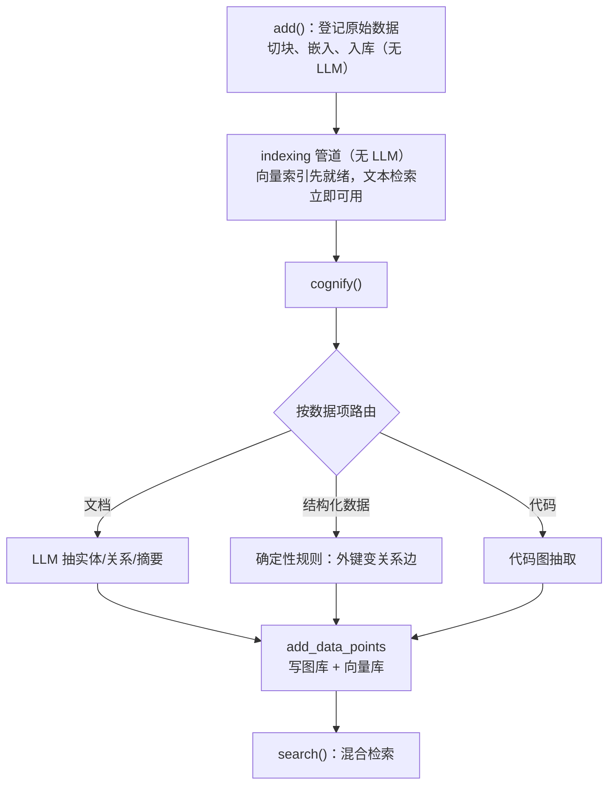

# Cognee

| 源仓库 | [topoteretes/cognee](https://github.com/topoteretes/cognee) |
|---|---|
| 协议 | Apache-2.0 |
| 主语言 | Python |
| 笔记基准 | commit `525b1d1`（2026-10-29，v1.6.6） |

Cognee 自我定位是"AI memory platform"（AI 记忆平台，`README.md:42`）：把文档、代码、对话这些原始数据加工成一张知识图谱加一套向量索引，agent 用自然语言查它，它同时用图的结构和向量的语义两种方式回答。GitHub star 约 3.3 万。知识图谱（knowledge graph）是用"节点 + 关系边"来存知识的数据结构——"张三"是一个节点，"张三 —任职于→ 某公司"是一条边；相比向量检索只能按语义相似度找文本，图谱能回答多跳关系问题（"张三的同事的负责人是谁"）。

和 mem0（从对话里抽事实）不同，cognee 的输入面更宽：文档、代码仓库、结构化数据（数据库表）都在它的加工范围内，近期的开发重心也在"结构化数据入图"上。另一个差异：cognee 可以完全本地运行，不配任何 API key 也能用本地模型完成抽取（`README.md:44`）。

这份笔记按问题组织，不按 cognee 的开发时间线：每个问题讲清 cognee 现在是怎么解的、为什么这么解、代价是什么。项目演进过程放在文末修订记录里。笔记起于 commit `525b1d1`（2026-10-29），跟进到 commit `525b1d1`（2026-10-29）。

## 它要解决什么问题

给 agent 配知识，最常见的做法是 RAG（Retrieval-Augmented Generation，检索增强生成）：文档切块、算向量、存向量库，查询时按相似度捞几块塞给模型。这条路对"找原文片段"够用，但有两个天然的短板：一是切块丢掉了结构——一份文档里"A 的负责人是 B"和另一份里"B 向 C 汇报"被切成互不相识的文本块，模型无法把它们连起来推理；二是原始文本里的冗余和矛盾原样进入检索范围，答案质量受制于文本质量。

cognee 的切入点是把"存原始数据"和"存知识"分开：原始数据先按原样保存，然后由一条加工管道把它提炼成图谱（实体和关系）加摘要，图谱和向量一起作为记忆存在。查询时既可以按语义找原文，也可以顺着图谱的关系边做推理。代价也很明显：多了一次完整的加工过程（要调模型、要建图），写入比"切块存向量"重得多。

## 仓库怎么分工

顶层是一个 Python 主包加一圈外围：

- `cognee/`——主包。内部分层：`api/v1/`（对外三大入口 add/cognify/search）、`tasks/`（所有加工步骤的具体函数，按 chunk/graph/summarization 等分目录）、`modules/`（业务层：管道编排、检索、用户、数据集、本体）、`infrastructure/`（LLM、各类数据库、文件存储的基础设施层）、`shared/`（提示词模板、数据模型）。
- `cognee-mcp/`——独立的 MCP 服务端包，把 remember/recall/forget 等操作暴露成 MCP 工具。
- `cognee-frontend/`——官网和控制台（Next.js）。仓库 193MB 的大头是这里的演示视频和图片素材，不是代码，也没有模型权重文件。
- `evals/`、`notebooks/`、`examples/`、`distributed/`、`deployment/`——评测、示例与部署物料。

模块依赖方向是清晰的：api 层调 modules 层，modules 层调 tasks 和 infrastructure，tasks 是无状态的纯函数（经 `Task` 包装后可批处理、可断点续跑）。想自己组装一条加工管道，直接拿 `Task` 列表调 `run_pipeline`，不用经过 api 层。

## 主轴：记忆是加工出来的，不是存出来的

向量记忆系统的常规认知是"存"：切块、算向量、入库，完事。cognee 把重心放在另一个动词上——它最核心的函数叫 `cognify`（认知化，`cognee/api/v1/cognify/cognify.py:137`）：把数据"理解"成图谱。这条主轴派生出它的几个关键设计：

1. **add 和 cognify 是两步**。`add()` 只把原始数据登记进库（分类、切块、算嵌入向量），完全不调大模型做理解（`cognee/api/v1/add/add.py:321-338`）；理解发生在 `cognify()`。两步分开意味着"先把资料堆进来"和"慢慢消化"可以分开调度。
2. **加工是两阶段的**。cognify 内部先跑一条不调模型的索引管道（切块入向量，`cognify.py:535-556`），让最基础的文本检索马上可用；再跑主管道做图抽取和摘要。反过来也成立：主管道直接复用索引管道已经算好的向量，不二次花嵌入的钱（`cognify.py:695-705`）。
3. **加工产物要能合并**。同一批数据加工多次、不同数据抽到同一个实体，图谱必须把它们合并成同一个节点。这件事被压在一个叫 `DataPoint` 的元数据契约上（下文"存储模型"节展开）——抽取结果怎么去重、怎么建索引，在数据模型层就定好了，不靠事后清洗。
4. **不同数据走不同加工方式**。同一次 cognify 调用里，文档走模型抽取、结构化数据走确定性规则（外键直接变成关系边）、代码走专门的代码图，按数据项路由（`cognify.py:559-581`）。

读这份笔记的其余部分时可以带着这个问题：每个机制（Task 链、DataPoint、混合检索、更新策略）都是在回答"加工出来的记忆怎么保持可用、可合并、可追溯"。

## 模型接入

LLM 调用统一走 litellm（一个把各家大模型 API 包装成统一接口的库），入口是 `LLMGateway`（`cognee/infrastructure/llm/LLMGateway.py`），配置是 pydantic 的 `LLMConfig`（`cognee/infrastructure/llm/config.py:74`）：提供商默认 openai，模型默认 `openai/gpt-5.6-luna`（`config.py:109-110`），支持 openai/anthropic/gemini/ollama/mistral/bedrock 等。结构化输出（让模型按指定 JSON 格式返回）默认用 litellm 原生框架，可切换 BAML（`config.py:101,152-153`）。

嵌入配置单独一套（`cognee/infrastructure/databases/vector/embeddings/config.py:89`），有个贴心行为：没配 API key 时回退到本地的 fastembed 模型（同文件 `:24-28`）。配合抽取侧的降级——环境变量 `GRAPH_EXTRACTOR=auto` 时，有 key 用大模型抽实体，没 key 用本地 GLiNER 模型抽（`cognify.py:262-273`）——cognee 可以全程无 key、全 CPU 跑通，这是"Runs locally for free"卖点的实际支撑。

## 加工管道

三大入口的关系：`add()` 登记原始数据，`cognify()` 加工成记忆，`search()` 查询。

cognify 的主管道默认由五个任务组成一条线性链（`cognify.py:669-732`）：分块任务 → 找回索引管道已嵌入的块 → `extract_graph_and_summarize`（调模型抽实体、关系、摘要，实现在 `cognee/tasks/graph/extract_graph_and_summarize.py:15`）→ `add_data_points`（写图库和向量库）→ `record_provenance`（记录数据来源，可选）。

任务编排有两个要点：

- **线性链，不是任务图**。`Task` 类（`cognee/modules/pipelines/tasks/task.py:188`）把函数包装成可批处理、可标注"是否需要 LLM"（`needs_llm`，用于无 key 场景的预检）的执行单元；上一步的输出就是下一步的输入（`cognee/modules/pipelines/operations/run_pipeline.py:37-100`）。没有分支、没有依赖解析——流程的灵活性靠"换任务列表"实现，不靠调度器。
- **按数据项路由**。同一条管道里，每个数据项先被分类到 STANDARD（普通文档）/ DLT_SOURCE（结构化数据）/ CODE / CODE_REPO 四条路由之一（`cognify.py:559-581`），各自用不同的任务组合。一份混合批次里，表格数据不会浪费模型调用去"抽取实体"——它的结构本来就是图（外键即关系边，近期的 SQL 外键解析特性）。

管道运行状态记录在关系库的 `PipelineRun` 表（`cognee/modules/pipelines/models/PipelineRun.py:36`），每个数据项在每个管道的完成状态记在 `Data.pipeline_status` 槽位里（`cognee/modules/pipelines/models/DataItemStatus.py:12-37`）。重跑 cognify 时，已完成的数据项默认跳过（增量执行，`incremental_loading` 默认开，`add.py:50`）。

## 存储模型

三类后端各司其职：图库存图谱、向量库存嵌入、关系库存用户/数据集/管道状态等元数据。默认组合是 ladybug（嵌入式图库）+ LanceDB（嵌入式向量库）+ SQLite（`cognee/infrastructure/databases/graph/config.py:47`、`vector/config.py:32`、`relational/config.py:22`）——三者都默认本地嵌入式，开箱零部署。Neo4j、pgvector、Kuzu 等都有适配器，通过各自的工厂函数创建；还有一张 `supported_databases` 注册表（`cognee/infrastructure/databases/graph/supported_databases.py:1`）允许外部注册自定义适配器。注意默认图库是 ladybug——网上旧文写的"默认 networkx"已失效，networkx 适配器已删除（只剩枚举遗留，`cognee/shared/data_models.py:337-341`）。

图谱的数据模型分两层。模型抽取层：大模型按 pydantic 模型 `KnowledgeGraph`（节点列表 + 边列表，`cognee/shared/data_models.py:73-77`）返回抽取结果；你也可以传入自定义的 `graph_model`（cognify 的参数，`cognify.py:219`），让模型按你的本体（ontology，预先定义的节点类型和关系类型体系）抽取。存储层：真正入库的是 `DataPoint` 的子类，如 `Entity`、`EntityType`、`EdgeType`。

`DataPoint` 基类（`cognee/infrastructure/engine/models/DataPoint.py:28`）是 cognee 最值得研究的一个设计，三个类属性决定了数据的一生：

- `index_fields`：列出的字段，每个字段单独建一个向量集合（集合名按"类型_字段"命名），实现"同一个实体的不同侧面用不同向量检索"；
- `identity_fields`：列出的字段参与生成确定性 id（uuid5，用命名空间 + 内容算出的固定 UUID）——同样的实体再被抽取到，id 不变，自然合并，不需要"判重后合并"的额外步骤（同一实体跨批次去重的实现基础）；
- `transparent`：标记写入图库时是否解包字段。

也就是说，"怎么去重"不是写入时的一个判断步骤，而是数据建模时的一个声明。代价是建模要想清楚哪些字段构成身份——身份字段选错，该合并的不合并。

本体解析默认用 RDFLib 读 OWL 文件（一种标准本体格式）加模糊匹配（`cognee/modules/ontology/object_to_model/get_default_ontology_resolver.py:16-17`）：模型抽出来的实体类型若与本体里的类型相近（模糊匹配上），按本体的类型入库。不传本体文件时这一层等于透明。

## 记忆检索

`search()`（`cognee/api/v1/search/search.py:42`）的分发链路：权限过滤（只查你有读权限的数据集，`cognee/modules/search/methods/search.py:246-248`）→ 未指定数据集时先做数据集路由（`:319-379`）→ 每个数据集切换到它自己的数据库上下文并发查询（`:441-446`）→ 按查询类型分发给对应检索器（注册表在 `cognee/modules/retrieval/get_search_type_retriever_instance.py:133-395`）。

查询类型（`SearchType` 枚举，`cognee/modules/search/types/SearchType.py:5-28`）有近二十种，常用的几类：CHUNKS（纯向量找原文块，不调模型）、SUMMARIES（找摘要）、GRAPH_COMPLETION（图谱检索后让模型基于三元组回答）、HYBRID_COMPLETION（默认类型，三通道混合）。旧教程里的 INSIGHTS 类型已删除。

默认的混合检索（`cognee/modules/retrieval/hybrid_retriever.py:59`）并发跑三条通道：chunk 通道（向量搜文本块和摘要）、entity 通道（向量搜实体，命中后从图里取邻接边，`:219-247`）、fact 通道（搜关系名称的嵌入，`:229-239`）。候选合并后交给模型生成回答；空上下文直接不调模型（`:323-330`）。两个使用注意：每条通道的 top_k 上限是 10（`hybrid_retriever.py:56`），传更大的 top_k 不会生效；HYBRID 在某些条件下会自动退化为 GRAPH_COMPLETION（`search.py:92-94`），解析返回结果前先确认实际的查询类型。

## 更新与遗忘

cognee 对"改数据"的态度比多数同类项目谨慎：

- **add 拒绝静默覆盖**：同路径但内容不同的文档，add 直接抛 `DocumentUpdateRequiredError`（`add.py:73-77`）——想更新就走 update，不允许"重新 add 一遍"把旧记忆变成无人引用的残留记录。
- **update 做块级增量**：文档 id 永不变化，默认 `chunk_level_diff=True` 只替换被编辑触及的文本块，没被碰到的块的实体、关系、摘要全部保留（`cognee/api/v1/update/update.py:43-52,117-121`）——改一段话不需要把整份文档重新加工一遍。前置条件不满足时回退为全量重建。
- **forget 统一五种遗忘**（`cognee/api/v1/forget/forget.py:23`）：按数据 id、按数据集、全库、`memory_only`（只删图谱和向量、保留原始文件，便于以后重新 cognify）、`clean_history`（连加工历史一起清）。有个诚实的说明：向量库 LanceDB 是追加式存储，删除操作释放空间要等它后台压缩（`:96-101`）——删了的记忆立刻查不到，但磁盘空间不是立刻回收。
- **冲突解决是新方向**：`FactConflict` 模型（`cognee/modules/engine/models/FactConflict.py`）加 `api/v1/conflicts/` 接口，把"两个数据源说矛盾的话"显式建模成可查询、可裁决的记录，而不是静默覆盖。这是近期开发的两条主线之一。

## 隔离与多租户

cognee 有一套完整的权限模型：用户、租户（tenant）、角色、权限、访问控制表俱全（`cognee/modules/users/models/User.py:15` 起的一组模型）。实际隔离的单位是数据集（Dataset，`cognee/modules/data/models/Dataset.py:9`，带 owner 和租户字段）：读侧只查有读权限的数据集；写侧每个数据集映射到**独立的数据库上下文**——`set_database_global_context_variables` 把后续的图/向量操作切到该数据集自己的引擎实例上（`search.py:441-446`）。数据集因此不只是个标签，而是物理隔离的边界。整套访问控制受 `ENABLE_BACKEND_ACCESS_CONTROL` 开关控制，默认行为要先查配置再依赖。

## 持久化与恢复

原始文件存文件层（本地或 S3，`cognee/infrastructure/files/storage/`）；元数据和状态存 SQLite（或 Postgres）；数据库结构变更由 alembic 迁移管理，add 和 cognify 前强制先跑迁移（`add.py:299-301`）。管道崩溃后的恢复路径：数据项级状态槽让重跑自动跳过已完成的项；原始数据一直在文件层，任何一步加工损坏都可以从"重新 cognify"恢复，不用重新上传。会话缓存可选 SQLite/Redis 等（`cognee/infrastructure/databases/cache/config.py:10-22`）。

## 扩展机制

- **自定义加工管道**：`Task(fn)` 直接包函数，或用 `@task` 装饰器（`task.py:124-157`），然后 `run_pipeline([自己的任务链])`。自定义 `graph_model`、自定义分块器、传入本体文件，都能改抽取行为而不碰框架代码。
- **自定义后端**：`supported_databases` 注册表挂自定义适配器（图和向量两侧都有对应的注册查询点，`create_vector_engine.py:326`）。
- **自定义检索器**：`cognee/modules/retrieval/register_retriever.py` 注册后即可作为新的 SearchType 使用。
- **MCP**：`cognee-mcp/` 包暴露 remember / recall / forget / improve / cognify_status 等工具（`cognee-mcp/src/server.py` 内多处），agent 通过 MCP 用 cognee 当记忆后端。

## 可观测性与评估

遥测是自建的 HTTP 上报（不是常见的第三方分析服务），事件批量发到项目方的收集端点（`cognee/shared/utils.py:23`），身份用 API key 派生的伪匿名 id（`:431-460`），敏感属性有清洗表（`:131`）。近期新增了 OpenTelemetry 风格的 span 层（`cognee/modules/observability`），在 add/cognify/search 三个入口埋点（span 名 `memory.store`/`memory.process`/`memory.retrieve`）。

评测框架内置在 `cognee/eval_framework/`：语料构建 → 问答 → 评分 → 面板四步，接 DeepEval 评分引擎，带 LoCoMo（一个长对话记忆基准）适配和检索器对比扫描工具。重依赖放可选依赖组里，核心包不引入。

## Agent Loop

cognee 主体是数据管道，没有常驻 agent 循环。唯一的"类 agent"组件是 `AgenticRetriever`（`cognee/modules/retrieval/agentic_retriever.py:68`）：一个受约束的 ReAct 式循环（模型每轮输出结构化的"调工具"或"最终回答"，`max_iter=6` 步上限），仅在查询类型为 AGENTIC_COMPLETION 且显式传入工具集时启用（`search.py:318-324`）。它解决的是"一次检索不够、需要多跳查图"的场景，不是通用 agent 框架——不要把 cognee 描述成 agent 平台。

## 设计原则

- **加工和质量优先于写入速度**。写入重（要建图）、检索快（图+向量多路），这个配比适合"资料相对静态、查询频繁"的知识库场景；反过来，高频写入的记忆流（聊天记录）用 cognee 会觉得重——mem0 那种轻写入路径更合适。
- **确定性优先于模型判断**。能不用模型的地方就不用：判重靠确定性 id（uuid5）、结构化数据靠规则建边、索引管道不调模型。模型只用在真正需要理解语义的抽取和摘要上。
- **拒绝静默变更**。add 拒绝覆盖、update 保 id、forget 分级、冲突显式建模——四处都在防"数据悄悄变了用户不知道"。代价是 API 更繁琐（更新要走专门接口），收益是记忆库的状态永远可解释。
- **默认全本地**。三类存储默认嵌入式、模型可无 key 降级，"能跑"的门槛压到最低；生产级的 Neo4j/Postgres/云模型全是可选升级。

## 可复用的做法

- **确定性 id 去重**（`DataPoint.identity_fields`，`DataPoint.py:28`）：需要"同一事物多次出现只存一份"的场景，在写入前用内容算确定性 id，比"先查后插"省一次查询且无竞态。前提是身份字段真的能唯一刻画该事物。
- **两阶段加工**（先无模型索引、后模型精加工，`cognify.py:187-205`）：任何"重加工"系统都可以先交付一个便宜的可用版本（原文可搜），昂贵加工异步补上，且两者共享嵌入结果不重复花钱。
- **按数据类型路由加工方式**（`cognify.py:559-581`）：混合数据源的系统里，结构化数据走规则、非结构化走模型，各走各的性价比最优路径，而不是一刀切全喂模型。
- **数据集级数据库上下文切换**（`search.py:441-446`）：多租户隔离不必每个租户一套部署，在调用层切换"当前操作的库"也能做到物理隔离，代价是并发下要小心上下文污染。
- **拒绝静默覆盖**（`add.py:73-77`）：允许"同名重新写入"的系统几乎都会积累出无人记得的旧版本残留；报错强制走显式更新通道，是把一致性问题暴露在写入时刻而不是排查时刻。
- **记忆冲突显式建模**（`FactConflict`）：两条来源矛盾的记忆不静默丢弃任何一条，而是生成一条"冲突"记录交给上层裁决——适合对答案可信度有要求的场景。

## 修订记录

- 2026-10-30 初版：基于 commit `525b1d1` 完整成文。覆盖 add/cognify/search 三入口、线性任务链与按数据项路由、DataPoint 元数据契约、三通道混合检索、块级增量更新与分级遗忘、数据集级隔离与评测框架。
