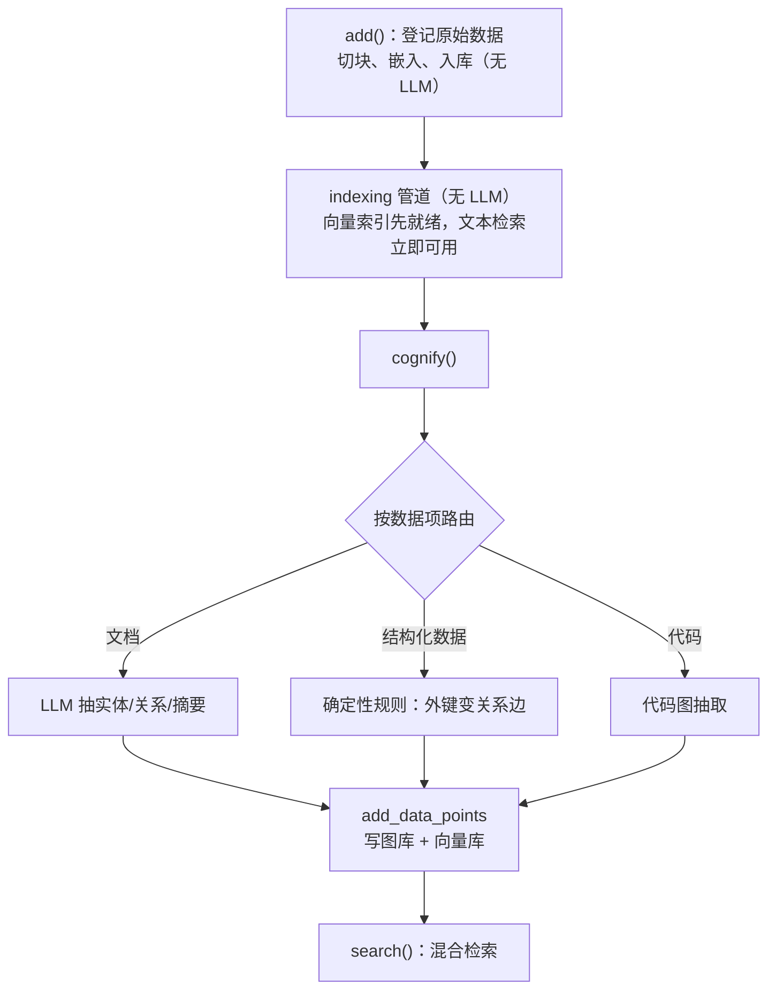

# Cognee

| 源仓库 | [topoteretes/cognee](https://github.com/topoteretes/cognee) |
|---|---|
| 协议 | Apache-2.0 |
| 主语言 | Python |
| 笔记基准 | commit `c8a094375`（2026-11-18，v1.6.10） |

Cognee 自我定位是"AI memory platform"（AI 记忆平台，`README.md:42`）：把文档、代码、对话这些原始数据加工成一张知识图谱加一套向量索引，agent 用自然语言查它，它同时用图的结构和向量的语义两种方式回答。GitHub star 约 3.3 万。知识图谱（knowledge graph）是用"节点 + 关系边"来存知识的数据结构——"张三"是一个节点，"张三 —任职于→ 某公司"是一条边；相比向量检索只能按语义相似度找文本，图谱能回答多跳关系问题（"张三的同事的负责人是谁"）。

和 mem0（从对话里抽事实）不同，cognee 的输入面更宽：文档、代码仓库、结构化数据（数据库表）都在它的加工范围内，近期的开发重心也在"结构化数据入图"上。另一个差异：cognee 可以完全本地运行，不配任何 API key 也能用本地模型完成抽取（`README.md:44`）。

这份笔记按问题组织，不按 cognee 的开发时间线：每个问题讲清 cognee 现在是怎么解的、为什么这么解、代价是什么。项目演进过程放在文末修订记录里。笔记起于 commit `525b1d1`（2026-10-29），跟进到 commit `c8a094375`（2026-11-18）。

## 它要解决什么问题

给 agent 配知识，最常见的做法是 RAG（Retrieval-Augmented Generation，检索增强生成）：文档切块、算向量、存向量库，查询时按相似度捞几块塞给模型。这条路对"找原文片段"够用，但有两个天然的短板：一是切块丢掉了结构——一份文档里"A 的负责人是 B"和另一份里"B 向 C 汇报"被切成互不相识的文本块，模型无法把它们连起来推理；二是原始文本里的冗余和矛盾原样进入检索范围，答案质量受制于文本质量。

cognee 的切入点是把"存原始数据"和"存知识"分开：原始数据先按原样保存，然后由一条加工管道把它提炼成图谱（实体和关系）加摘要，图谱和向量一起作为记忆存在。查询时既可以按语义找原文，也可以顺着图谱的关系边做推理。代价也很明显：多了一次完整的加工过程（要调模型、要建图），写入比"切块存向量"重得多。

## 仓库怎么分工

顶层是一个 Python 主包加一圈外围：

- `cognee/`——主包。内部分层：`api/v1/`（对外三大入口 add/cognify/search）、`tasks/`（所有加工步骤的具体函数，按 chunk/graph/summarization 等分目录）、`modules/`（业务层：管道编排、检索、用户、数据集、本体）、`infrastructure/`（LLM、各类数据库、文件存储的基础设施层）、`shared/`（提示词模板、数据模型）。
- `cognee-mcp/`——独立的 MCP（Model Context Protocol，让模型调用外部工具的标准协议）服务端包，把 remember/recall/forget 等操作暴露成 MCP 工具。
- `cognee-frontend/`——官网和控制台（Next.js）。仓库 193MB 的大头是这里的演示视频和图片素材，不是代码，也没有模型权重文件。
- `evals/`、`notebooks/`、`examples/`、`distributed/`、`deployment/`——评测、示例与部署物料。

模块依赖方向是清晰的：api 层调 modules 层，modules 层调 tasks 和 infrastructure，tasks 是无状态的纯函数（经 `Task` 包装后可批处理、可断点续跑）。想自己组装一条加工管道，直接拿 `Task` 列表调 `run_pipeline`，不用经过 api 层。

## 主轴：记忆是加工出来的，不是存出来的

向量记忆系统的常规认知是"存"：切块、算向量、入库，完事。cognee 把重心放在另一个动词上——它最核心的函数叫 `cognify`（认知化，`cognee/api/v1/cognify/cognify.py:137`）：把数据"理解"成图谱。这条主轴派生出它的几个关键设计：

1. **add 和 cognify 是两步**。`add()` 只把原始数据登记进库（分类、切块、算嵌入向量），完全不调大模型做理解（`cognee/api/v1/add/add.py:321-338`）；理解发生在 `cognify()`。两步分开意味着"先把资料堆进来"和"慢慢消化"可以分开调度。
2. **加工是两阶段的**。cognify 内部先跑一条不调模型的索引管道（切块入向量，`cognify.py:535-556`），让最基础的文本检索马上可用；再跑主管道做图抽取和摘要。反过来也成立：主管道直接复用索引管道已经算好的向量，不二次花嵌入的钱（`cognify.py:695-705`）。
3. **加工产物要能合并**。同一批数据加工多次、不同数据抽到同一个实体，图谱必须把它们合并成同一个节点。这件事被压在一个叫 `DataPoint` 的元数据契约上（下文"存储模型"节展开）——抽取结果怎么去重、怎么建索引，在数据模型层就定好了，不靠事后清洗。
4. **不同数据走不同加工方式**。同一次 cognify 调用里，文档走模型抽取、结构化数据走确定性规则（外键直接变成关系边）、代码走专门的代码图，按数据项路由（`cognify.py:559-581`）。

读这份笔记的其余部分时可以带着这个问题：每个机制（Task 链、DataPoint、混合检索、更新策略）都是在回答"加工出来的记忆怎么保持可用、可合并、可追溯"。

## 模型接入

LLM（Large Language Model，大语言模型）调用统一走 litellm（一个把各家大模型 API 包装成统一接口的库），入口是 `LLMGateway`（`cognee/infrastructure/llm/LLMGateway.py`），配置是 pydantic 的 `LLMConfig`（`cognee/infrastructure/llm/config.py:74`）：提供商默认 openai，模型默认 `openai/gpt-5.6-luna`（`config.py:109-110`），支持 openai/anthropic/gemini/ollama/mistral/bedrock 等。结构化输出（让模型按指定 JSON 格式返回）默认用 litellm 原生框架，可切换 BAML（`config.py:101,152-153`）。

嵌入配置单独一套（`cognee/infrastructure/databases/vector/embeddings/config.py:93`），有个贴心行为：没配 API key 时回退到本地的 fastembed 模型（默认本地模型是 bge-small，同文件 `:29-40`）。配合抽取侧的降级——cognify 的 `extractor` 参数默认 `auto`，解析规则是有可用的 LLM key 走大模型抽实体，没有就用本地 GLiNER 演示模型（解析调用在 `cognify.py:384`）——cognee 可以全程无 key、全 CPU 运行，这是"Runs locally for free"卖点的实际支撑。

## 加工管道

三大入口的关系：`add()` 登记原始数据，`cognify()` 加工成记忆，`search()` 查询。表格类数据源（数据库连接串、CSV 文件）有一组专属加工选项——主键、写入策略、单表行数上限这类——集中在 `dlt_config` 参数里，HTTP 端点 POST /add 现在也接受这个参数（此前只有 SDK 调用能传，`add.py:51`）。

add() 对数据库连接串这个入口设了默认拒绝的检查。用 `sqlite:///`、`postgresql://` 这类连接串把数据库当数据源摄入时，发起连接的是 cognee 所在的机器——能说出一个库地址的调用方，就能借它读到这台机器可达的任何库。所以未配置时按入口区分：SDK、CLI、MCP 服务端允许，API 服务端直接拒绝（错误 `DatabaseIngestionDisabled`，理由是 API 的调用者是所有能注册账号的人，`.env.template:505`）；环境变量 `ALLOW_DATABASE_INGESTION` 设 `true` 全部放开、设 `false` 全部拒绝（判定在 `cognee/tasks/ingestion/create_dlt_source.py:209`）。即便放开，指向 cognee 自己存储的连接仍会被拦下：存储根目录里的 SQLite 文件拒绝（里面是全部租户的用户、权限和数据）；携带 cognee 自己数据库用户名密码的连接串，不管 host 写什么都拒绝；目标地址解析后与 cognee 在用的数据库服务器同端口的连接也拒绝（按解析出的地址加端口比对，尽力而为）（`:133`、`:259` 起）。连接失败时客户端只拿到异常类名，驱动报错原文只进服务端日志（`:82-90`）——否则这条入口能被当成扫描器，对服务端可达的每台数据库逐个做连通测试。

cognify 的主管道默认由一条线性链组成（`cognify.py:679-737`）：分块任务 → 找回索引管道已嵌入的块（`early_chunk_indexing` 开启时）→ `extract_graph_and_summarize`（调模型抽实体、关系、摘要，实现在 `cognee/tasks/graph/extract_graph_and_summarize.py:15`）→ `add_data_points`（写图库和向量库）。来源审计从这条链上拿掉了：数据项审计表改在 `add_data_points` 落库成功后写入（`cognify.py:735` 的注释写明缘由），挂在所有写入方共用的落库步骤上，自定义管道和代码图路径也能覆盖。

分块器的选择走注册表加部署级默认值（SDK-1525）：内置的 TextChunker 登记在注册表里（`cognee/modules/chunking/chunker_registry.py:34`），部署用 `register_chunker()` 挂自己的分块器（`chunker_registry.py:37`），环境变量 `DEFAULT_CHUNKER` 按名字指定"调用没给分块器时用哪个"（默认 TextChunker，空串视为未设置，`cognee/modules/cognify/config.py:27`）。cognify()、remember()、update() 三个入口对 `chunker=None` 的解析都走同一个 `resolve_chunker`（`cognify.py:470`、`update.py:281`），SDK 调用显式传类仍然优先。这个设计主要服务服务端部署：HTTP 上传没有传分块器的地方，服务端靠 `DEFAULT_CHUNKER` 就能让 API 和 UI 上传的数据也按自己的分块器切——HTTP 请求里按名字传分块器的字段曾短暂存在，随后被删掉，只留下注册表加这个默认值。名字从不当导入路径解析，未注册的名字让每次写入直接失败（`chunker_registry.py:128-140`）。

任务编排有两个要点：

- **线性链，不是任务图**。`Task` 类（`cognee/modules/pipelines/tasks/task.py:188`）把函数包装成可批处理、可标注"是否需要 LLM"（`needs_llm`，用于无 key 场景的预检）的执行单元；上一步的输出就是下一步的输入（`cognee/modules/pipelines/operations/run_pipeline.py:37-100`）。没有分支、没有依赖解析——流程的灵活性靠"换任务列表"实现，不靠调度器。
- **按数据项路由**。同一条管道里，每个数据项先被分类到 STANDARD（普通文档）/ DLT_SOURCE（结构化数据）/ CODE / CODE_REPO 四条路由之一（`cognify.py:559-581`），各自用不同的任务组合。一份混合批次里，表格数据不会浪费模型调用去"抽取实体"——它的结构本来就是图（外键即关系边，近期的 SQL 外键解析特性）。

管道运行状态记录在关系库的 `PipelineRun` 表（`cognee/modules/pipelines/models/PipelineRun.py:36`），每个数据项在每个管道的完成状态记在 `Data.pipeline_status` 槽位里（`cognee/modules/pipelines/models/DataItemStatus.py:12-37`）。重跑 cognify 时，已完成的数据项默认跳过（增量执行，`incremental_loading` 默认开，`add.py:52`）。

来源审计是一套独立开启的子系统：数据项审计表（audit ledger）。环境变量 `PROVENANCE_TRACKING` 打开（默认关，挂在 `CognifyConfig.provenance_tracking` 上，`cognee/modules/provenance/tracking.py:3`）后，每个数据项在落库成功时记一行：键是 `{数据集 id}:data_item:{数据 id}`，值含内容哈希、操作者、管道运行与来源引用键（写入点 `cognee/tasks/provenance/record_provenance.py:50`）。设计上有四个要点。第一，只记数据项、不记节点和边——哪个节点哪条边来自哪个数据项，图上的 source ref 已经记录了，逐节点记录会让共享关系库膨胀约十倍（模块说明 `record_provenance.py:1-19`）。第二，审计表是带哈希链的追加式表（`cognee/modules/provenance/storage.py:1-13`）：并发追加靠进程内锁、Postgres 顾问锁、序列号唯一索引三层防护，竞态失败只会得到唯一索引冲突，哈希链不会分叉。第三，失败处理选了硬失败路线：审计表写不进去时，落库任务一起失败、整趟运行回滚——存储成功但审计缺失的状态没有任何机制能补报，所以宁可让运行失败（`record_provenance.py` 模块说明）。开关关闭时同样干脆：读取审计表直接报错而不是返回空（`tracking.py:26-31`），避免"以为有审计记录其实没有"。第四，审计行跟随数据项的生命周期：内容哈希变化记为版本更新（更新内容发布后才记新哈希）；删除数据项打墓碑标记（`cognee/modules/provenance/tombstones.py:119`），`forget(memory_only=True)` 只删记忆不动审计表，之后重新写入同一数据项会让审计行恢复。审计表自带的命令行读取入口受访问控制保护（提交 607792c82）。

会话经验另有一条蒸馏入口，由 improve 循环驱动：取出已蒸馏清单还没覆盖的会话条目、连同最早那条所在问答轮之后的对话一起，按批交给 curator 模型提议经验教训；每条提案先检索既有教训与实体判重，再由 writer/rejecter 模型定夺；被接受的教训渲染成文档，走 add + cognify 一趟入库（流程定义在 `cognee/modules/session_distillation/distill.py:3-8` 的模块注释）。已蒸馏清单同时是进度标记：条目在其批次完成且教训发布后封存，失败的批次不封存、下轮重来，整趟运行照常发布幸存的教训再抛出失败（`distill.py:15-20`）。`DISTILLATION_MODE=coding` 切到编码模式：换用编码场景的提示词与类型化模型，把每个单元的请求与最终回答钉进每批整理调用，教训按类型带证据规则（`distill.py:22-27`）；`IMPROVE_AUTO_ENABLED=true` 时 remember() 之后自动触发蒸馏（`cognee/modules/improve/config.py:11`）。

## 存储模型

三类后端各司其职：图库存图谱、向量库存嵌入、关系库存用户/数据集/管道状态等元数据。默认组合是 ladybug（嵌入式图库）+ LanceDB（嵌入式向量库）+ SQLite（`cognee/infrastructure/databases/graph/config.py:47`、`vector/config.py:32`、`relational/config.py:11`）——三者都默认本地嵌入式，开箱零部署。Neo4j、pgvector、Kuzu 等都有适配器，通过各自的工厂函数创建；还有一张 `supported_databases` 注册表（`cognee/infrastructure/databases/graph/supported_databases.py:1`）允许外部注册自定义适配器。注意默认图库是 ladybug——网上旧文写的"默认 networkx"已失效，networkx 适配器连同枚举遗留已全部删除。

pgvector 适配器是生产部署常用的向量路径，针对并发写入做过一轮有实测数据支撑的调优（SDK-651、SDK-1470）。新集合的向量列用 halfvec（半精度浮点，每行字节量是 vector 类型的一半），适配器因此要求 pgvector 0.7.0 以上，HNSW 索引的维度上限也随之从 2,000 提到 4,000（`cognee/infrastructure/databases/vector/pgvector/PGVectorAdapter.py:70-76`）。新建 HNSW 索引用 m=8（每个新行链接的邻居数减半）、ef_construction=64，检索至少查 100 个候选（pgvector 自身默认 40）——代码注释里留了实测依据：9.9 万条 3072 维嵌入、24 并发连接写入，m=16 用 80.3 秒、m=8 用 36.6 秒，代价是召回率 0.974 降到 0.951，把 ef_search 提到 100 买回 0.971（`PGVectorAdapter.py:77-96`）；已有索引不重建、保留原参数。向量写入走适配器自有的 asyncpg 连接池、以二进制格式传输（`PGVectorAdapter.py:99-103`）；upsert 只锁它实际改变的行、只嵌入它实际写入的行（提交 dbc877f9f、8b0fbd478）。新集合的表还能按主键做哈希分区（`pgvector_collection_partitions` 配置，默认 1 即单表，`cognee/infrastructure/databases/vector/config.py:39-41`）。开启访问控制后每个数据集的引擎默认池收到 pool_size=2 加 max_overflow=10——空闲时只保留 2 个连接，突发靠溢出连接顶住、用完即关（`PGVectorAdapter.py:64-68`）。

图谱的数据模型分两层。模型抽取层：大模型按 pydantic 模型 `KnowledgeGraph`（节点列表 + 边列表，`cognee/shared/data_models.py:73-77`）返回抽取结果；你也可以传入自定义的 `graph_model`（cognify 的参数，`cognify.py:141`——pydantic 模型类，或它对应的 JSON schema 字典，后者是 HTTP 端点传输的形式，`cognify.py:222-223`），让模型按你的本体（ontology，预先定义的节点类型和关系类型体系）抽取。存储层：真正入库的是 `DataPoint` 的子类，如 `Entity`、`EntityType`、`EdgeType`。

`DataPoint` 基类（`cognee/infrastructure/engine/models/DataPoint.py:28`）是 cognee 最值得研究的一个设计，三个类属性决定了数据的一生：

- `index_fields`：列出的字段，每个字段单独建一个向量集合（集合名按"类型_字段"命名），实现"同一个实体的不同侧面用不同向量检索"；
- `identity_fields`：列出的字段参与生成确定性 id（uuid5，用命名空间 + 内容算出的固定 UUID）——同样的实体再被抽取到，id 不变，自然合并，不需要"判重后合并"的额外步骤（同一实体跨批次去重的实现基础）；
- `transparent`：标记写入图库时是否解包字段。

也就是说，"怎么去重"不是写入时的一个判断步骤，而是数据建模时的一个声明。代价是建模要想清楚哪些字段构成身份——身份字段选错，该合并的不合并。

本体解析默认用 RDFLib 读 OWL 文件（一种标准本体格式）加模糊匹配（`cognee/modules/ontology/get_default_ontology_resolver.py:33`）：模型抽出来的实体类型若与本体里的类型相近（模糊匹配上），按本体的类型入库。不传本体文件时这一层等于透明。

## 记忆检索

`search()`（`cognee/api/v1/search/search.py:43`）的分发链路：权限过滤（只查你有读权限的数据集，`cognee/modules/search/methods/search.py:249`）→ 未指定数据集时先做数据集路由（`:318-380`）→ 每个数据集切换到它自己的数据库上下文并发查询（`:459`）→ 按查询类型分发给对应检索器（注册表在 `cognee/modules/search/methods/get_search_type_retriever_instance.py:88`）。路由有一个例外：CODE 查询不参与路由，始终在全部可读数据集上执行（`:341`）——代码数据集没有可供路由的文本块，路由表里不会有它的行，把 CODE 查询路由到"相似"的其他数据集只会得到空结果。

查询类型（`SearchType` 枚举，`cognee/modules/search/types/SearchType.py:5-28`）有近二十种，常用的几类：CHUNKS（纯向量找原文块，不调模型）、SUMMARIES（找摘要）、GRAPH_COMPLETION（图谱检索后让模型基于三元组回答）、HYBRID_COMPLETION（默认类型，三通道混合）。旧教程里的 INSIGHTS 类型已删除。

默认的混合检索（`cognee/modules/retrieval/hybrid_retriever.py:67`）按通道并发取候选再合并：chunk 通道（向量搜文本块和摘要，实现在 `retrieval/hybrid/chunks.py`）、entity 通道（向量搜实体，命中后从图里取邻接边，`hybrid/entities.py`）、fact 通道（搜关系名称的嵌入，`hybrid/facts.py`），外加一路可选的全局上下文索引通道（构造参数 `global_context_index_top_k`，`hybrid_retriever.py:86`）。每条通道的候选数量是独立的构造参数，默认各 5（`hybrid_retriever.py:80-96`）。空库与空结果分两层处理：图库为空直接抛 `NoDataError`——默认查询类型面对一个新装的空系统应该报"没数据"，而不是安静地返回一包空通道（`:135-141`）；通道全空时跳过模型调用，不硬答（`:74`）。HYBRID 在某些条件下会自动退化为 GRAPH_COMPLETION（`api/v1/search/search.py:91-93`），解析返回结果前先确认实际的查询类型。

## 更新与遗忘

cognee 对"改数据"的态度比多数同类项目谨慎：

- **add 拒绝静默覆盖**：同路径但内容不同的文档，add 直接抛 `DocumentUpdateRequiredError`（抛出点 `cognee/tasks/ingestion/refuse_changed_existing_documents.py:132`）——想更新就走 update，不允许"重新 add 一遍"把旧记忆变成无人引用的残留记录。
- **update 做块级增量**：文档 id 永不变化，默认 `chunk_level_diff=True` 只替换被编辑触及的文本块，没被碰到的块的实体、关系、摘要全部保留（`cognee/api/v1/update/update.py:41-52`）——改一段话不需要把整份文档重新加工一遍。前置条件不满足时回退为全量重建。块级路径有一个明确契约：整份文档必须是被同一个分块器切出来的。每个块带切出它的分块器的 id 戳（块没带就由分块流程统一补盖，带了别的 id 直接报错，`chunker_registry.py:109-125`）；update 发现存储块的 id 与本次分块器不符、或旧块没有 id 而本次分块器必然盖章时，拒绝块级路径、用当前分块器整篇重建（`update/incremental.py:1042-1056`）——TextChunker 对 1.5.4 之前没有 id 的老块保持直接更新。块的文本按序拼不回原文的文档（带重叠的分块器切出的就是这种）同样每次全量重建（`update.py:134-142`）。被替换下来的存储文件也不再堆积：更新路径会把已没有任何文档指向的存储文件删掉（`cognee/modules/data/methods/remove_unreferenced_files.py:21`），每次并发删除 16 个（宽度限制，让大重建不至于把存储线程池占满）；用户放在数据根目录之外的自己的文件不动，别的操作暂存、还没提交行引用的文件有声明机制保护（`stored_file_claims`）；删不掉的文件不会静默留在磁盘上——所有失败收集齐了一并抛 `StoredFileNotRemovedError`，没有任何调用方捕获它（`update/incremental.py:542-560`）。
- **forget 统一五种遗忘**（`cognee/api/v1/forget/forget.py:36`）：按数据 id、按数据集、全库、`memory_only`（只删图谱和向量、保留原始文件，便于以后重新 cognify）、`clean_history`（连加工历史一起清）。有个诚实的说明：向量库 LanceDB 是追加式存储，删除操作释放空间要等它后台压缩（`:108`）——删了的记忆立刻查不到，但磁盘空间不是立刻回收。
- **冲突解决是新方向**：`FactConflict` 模型（`cognee/modules/engine/models/FactConflict.py`）加 `api/v1/conflicts/` 接口，把"两个数据源说矛盾的话"显式建模成可查询、可裁决的记录，而不是静默覆盖。这是近期开发的两条主线之一。

## 隔离与多租户

cognee 有一套完整的权限模型：用户、租户（tenant）、角色、权限、访问控制表俱全（`cognee/modules/users/models/User.py:15` 起的一组模型）。实际隔离的单位是数据集（Dataset，`cognee/modules/data/models/Dataset.py:9`，带 owner 和租户字段）：读侧只查有读权限的数据集；写侧每个数据集映射到**独立的数据库上下文**——`set_database_global_context_variables` 把后续的图/向量操作切到该数据集自己的引擎实例上（`search.py:441-446`）。数据集因此不只是个标签，而是物理隔离的边界。整套访问控制受 `ENABLE_BACKEND_ACCESS_CONTROL` 开关控制，默认行为要先查配置再依赖。

## 持久化与恢复

原始文件存文件层（本地或 S3，`cognee/infrastructure/files/storage/`）；元数据和状态存 SQLite（或 Postgres）；数据库结构变更由 alembic 迁移管理，add 和 cognify 前强制先跑迁移（`add.py:320-322`）。管道崩溃后的恢复路径：数据项级状态槽让重跑自动跳过已完成的项；原始数据一直在文件层，任何一步加工损坏都可以从"重新 cognify"恢复，不用重新上传。会话缓存可选 SQLite/Redis 等（`cognee/infrastructure/databases/cache/config.py:10-22`）。

## 扩展机制

- **自定义加工管道**：`Task(fn)` 直接包函数，或用 `@task` 装饰器（`task.py:124-157`），然后 `run_pipeline([自己的任务链])`。自定义 `graph_model`、自定义分块器、传入本体文件，都能改抽取行为而不碰框架代码。
- **自定义后端**：`supported_databases` 注册表挂自定义适配器（图和向量两侧都有对应的注册查询点，`create_vector_engine.py:169`）。
- **自定义检索器**：`cognee/modules/retrieval/register_retriever.py` 注册后即可作为新的 SearchType 使用。
- **MCP**：`cognee-mcp/` 包暴露 remember / recall / forget / improve / cognify_status 等工具（`cognee-mcp/src/server.py` 内多处），agent 通过 MCP 用 cognee 当记忆后端。

## 可观测性与评估

遥测是自建的 HTTP 上报（不是常见的第三方分析服务），事件批量发到项目方的收集端点（`cognee/shared/utils.py:23`），身份用 API key 加盐派生的伪匿名 id（盐与迭代参数在 `utils.py:27-29`），敏感属性有清洗表（`:131`）。另有 OpenTelemetry 风格的 span 层（`cognee/modules/observability`），在 add/cognify/search 三个入口埋点（span 名 `memory.store`/`memory.process`/`memory.retrieve`）。在 span 层之上还有一层可选的 LLM 调用捕获：`LLM_CALL_CAPTURE_ENABLED=true` 开启（默认关），每次模型调用记录成一条结构化记录、异步写进本地 JSONL 文件，带所处的管道阶段（抽取/摘要/问答）与调用方标签；捕获只服务于观测，捕获环节失败只记日志、绝不影响它描述的那次模型调用（`cognee/modules/observability/llm_calls/__init__.py:1-11`）。

评测框架内置在 `cognee/eval_framework/`：语料构建 → 问答 → 评分 → 面板四步，接 DeepEval 评分引擎，带 LoCoMo（一个长对话记忆基准）适配和检索器对比扫描工具。重依赖放可选依赖组里，核心包不引入。

## Agent Loop

cognee 主体是数据管道，没有常驻 agent 循环。唯一的"类 agent"组件是 `AgenticRetriever`（`cognee/modules/retrieval/agentic_retriever.py:68`）：一个受约束的 ReAct 式循环（模型每轮输出结构化的"调工具"或"最终回答"，`max_iter=6` 步上限），仅在查询类型为 AGENTIC_COMPLETION 且显式传入工具集时启用（`search.py:318-324`）。它解决的是"一次检索不够、需要多跳查图"的场景，不是通用 agent 框架——不要把 cognee 描述成 agent 平台。

## 设计原则

- **加工和质量优先于写入速度**。写入重（要建图）、检索快（图+向量多路），这个配比适合"资料相对静态、查询频繁"的知识库场景；反过来，高频写入的记忆流（聊天记录）用 cognee 会觉得重——mem0 那种轻写入路径更合适。
- **确定性优先于模型判断**。能不用模型的地方就不用：判重靠确定性 id（uuid5）、结构化数据靠规则建边、索引管道不调模型。模型只用在真正需要理解语义的抽取和摘要上。
- **拒绝静默变更**。add 拒绝覆盖、update 保 id、forget 分级、冲突显式建模——四处都在防"数据悄悄变了用户不知道"。代价是 API 更繁琐（更新要走专门接口），收益是记忆库的状态永远可解释。
- **默认全本地**。三类存储默认嵌入式、模型可无 key 降级，"能跑"的门槛压到最低；生产级的 Neo4j/Postgres/云模型全是可选升级。

## 可复用的做法

- **确定性 id 去重**（`DataPoint.identity_fields`，`DataPoint.py:28`）：需要"同一事物多次出现只存一份"的场景，在写入前用内容算确定性 id，比"先查后插"省一次查询且无竞态。前提是身份字段真的能唯一刻画该事物。
- **两阶段加工**（先无模型索引、后模型精加工，`cognify.py:187-205`）：任何"重加工"系统都可以先交付一个便宜的可用版本（原文可搜），昂贵加工异步补上，且两者共享嵌入结果不重复花钱。
- **按数据类型路由加工方式**（`cognify.py:559-581`）：混合数据源的系统里，结构化数据走规则、非结构化走模型，各走各的性价比最优路径，而不是一刀切全喂模型。
- **数据集级数据库上下文切换**（`search.py:441-446`）：多租户隔离不必每个租户一套部署，在调用层切换"当前操作的库"也能做到物理隔离，代价是并发下要小心上下文污染。
- **拒绝静默覆盖**（`cognee/tasks/ingestion/refuse_changed_existing_documents.py:132`）：允许"同名重新写入"的系统几乎都会积累出无人记得的旧版本残留；报错强制走显式更新通道，是把一致性问题暴露在写入时刻而不是排查时刻。
- **带哈希链的追加式审计表**（`cognee/modules/provenance/storage.py:1-13`）：需要"谁在什么时候动了什么"的可靠记录时，用序列号唯一索引加哈希链让每条记录锚定前一条，篡改任何一行都会让后续链条断裂；并发安全用进程内锁加数据库级顾问锁双保险。审计类存储的通用做法。
- **记忆冲突显式建模**（`FactConflict`）：两条来源矛盾的记忆不静默丢弃任何一条，而是生成一条"冲突"记录交给上层裁决——适合对答案可信度有要求的场景。

## 修订记录

- 2026-10-30 初版：基于 commit `525b1d1` 完整成文。覆盖 add/cognify/search 三入口、线性任务链与按数据项路由、DataPoint 元数据契约、三通道混合检索、块级增量更新与分级遗忘、数据集级隔离与评测框架。
- 2026-11-07 基于 commit `8853378ea`（v1.6.7 合并窗口）补充：数据库连接串摄入新增默认拒绝的准入检查——API 服务端默认拒绝、SDK/CLI/MCP 允许、`ALLOW_DATABASE_INGESTION` 显式控制；指向 cognee 自身存储的连接一律拒绝；驱动报错原文只留服务端日志（提交 dd5a45afe 等），补入"加工管道"节。
- 2026-11-16 基于 commit `4053f6cc5`（v1.6.8 合并窗口，含 SDK-1112 系列）补充：数据项审计表（PROVENANCE_TRACKING 开关，落库成功后写入、哈希链追加式存储、墓碑生命周期、失败即回滚），审计写入从管道任务移到 `add_data_points` 落库后执行，补入"加工管道"节；update 路径新增无引用存储文件清理（16 并发宽度、声明保护、失败一并抛出，SDK-1541），补入"更新与遗忘"节；CODE 查询不参与数据集路由（提交 bb83717fe）与混合检索通道重构（每通道独立 top_k 参数、空库报 NoDataError），补入"记忆检索"节；POST /add 接受 dlt_config（SDK-1523），补入"加工管道"节。全篇行号引用按新代码核对更新。
- 2026-11-19 基于 commit `c8a094375`（v1.6.9 与 v1.6.10 合并窗口）补充：分块器改为注册表加部署级默认值——`register_chunker()` 注册、`DEFAULT_CHUNKER` 按名选择、三入口统一解析（SDK-1525），补入"加工管道"节；update 的块级增量补 chunker id 契约与整篇重建条件；pgvector 适配器一轮实测调优——halfvec 新集合（要求 pgvector 0.7.0）、HNSW m=8 与 ef_search 100、二进制写入专用池、可选哈希分区、upsert 行级锁、访问控制默认池（SDK-651/1470），补入"存储模型"节；会话经验蒸馏（improve 循环：curator 提议、writer 定夺、教训走 add+cognify 入库、已蒸馏清单封存进度、`DISTILLATION_MODE=coding`，SDK-1335），补入"加工管道"节；LLM 调用捕获（`LLM_CALL_CAPTURE_ENABLED`，默认关、本地 JSONL，SDK-529），补入"可观测性与评估"节；cognify 的 `graph_model` 接受 JSON schema 字典（SDK-1488）。全篇行号引用按新代码核对更新。
