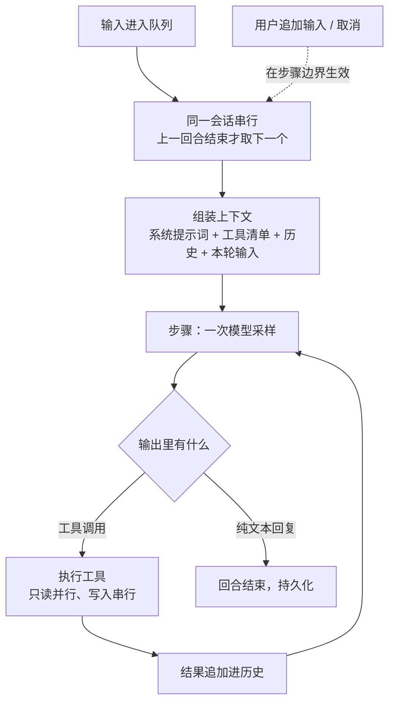
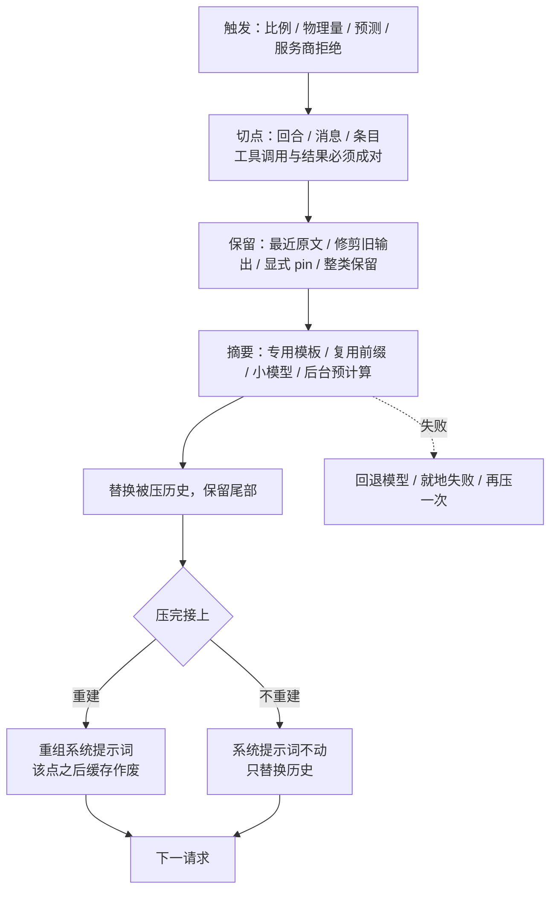
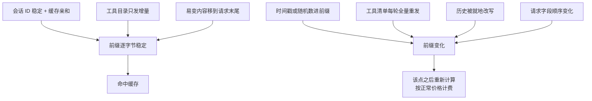
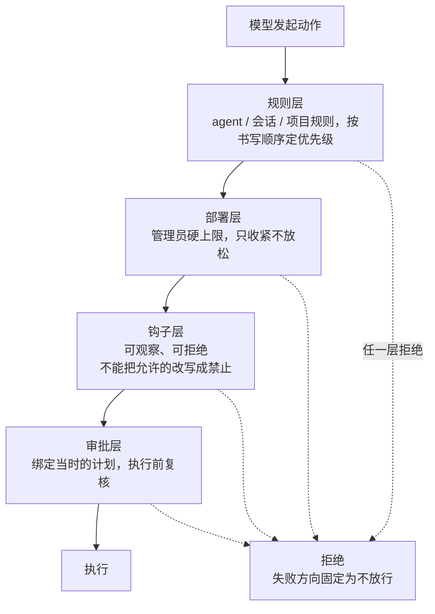
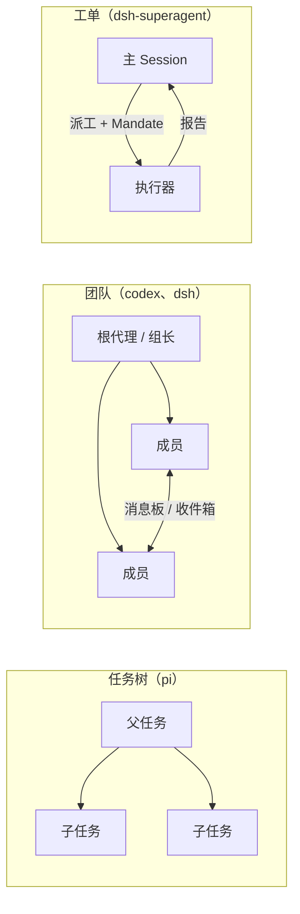
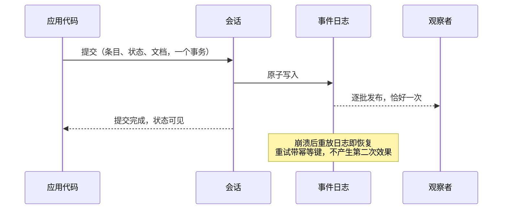
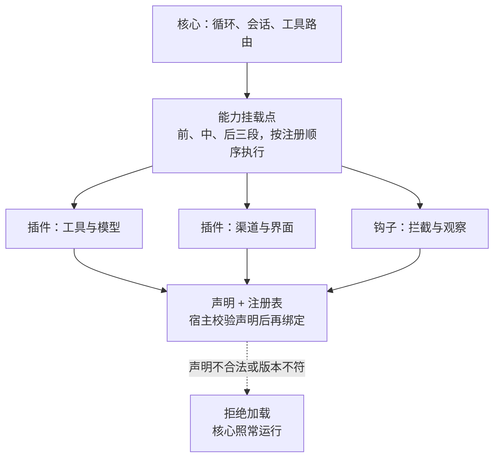
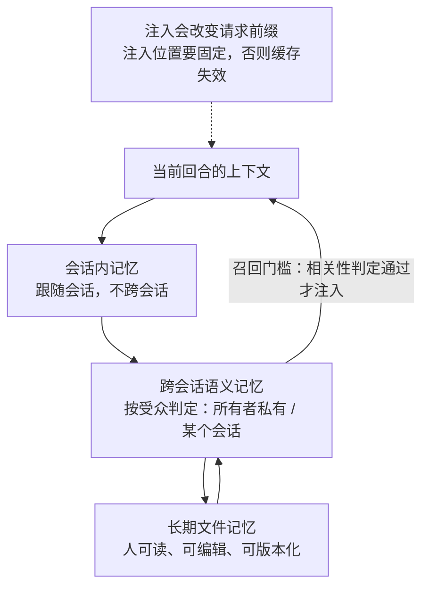
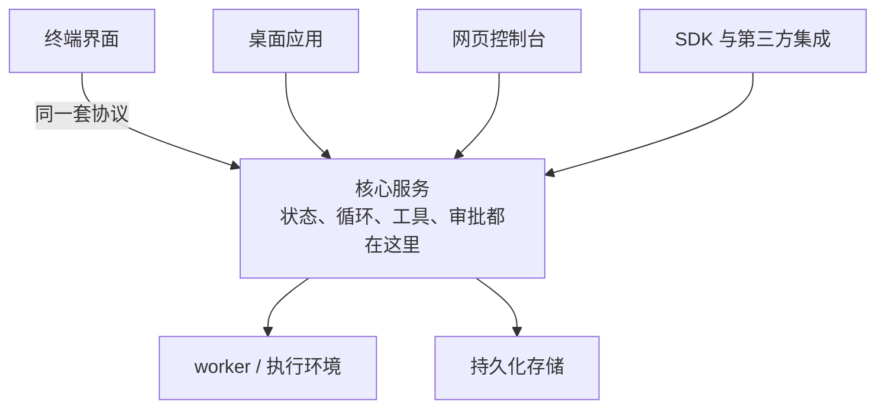

# Agent Harness 设计综合版

| 源仓库 | [openai/codex](https://github.com/openai/codex)、[NousResearch/hermes-agent](https://github.com/NousResearch/hermes-agent)、[openclaw/openclaw](https://github.com/openclaw/openclaw)、[anomalyco/opencode](https://github.com/anomalyco/opencode)、[earendil-works/pi](https://github.com/earendil-works/pi)、[deepseek-ai/deepseek-harness](https://github.com/deepseek-ai/deepseek-harness)、[deepseek-ai/dsh-superagent-prototype](https://github.com/deepseek-ai/dsh-superagent-prototype) |
|---|---|
| 协议 | 各仓库各自的开源协议 |
| 主语言 | Rust、TypeScript、Python |
| 笔记基准 | 2026-11-25，与各篇笔记的当日基准一致 |

这份文档不按项目介绍，按设计点组织。要看的是一个判断：**七个 agent 的差别不在能力清单上，而在同一组设计点上各自选了哪一边**。每个点上的选择都有成立条件，也有代价；项目之间的不同，是这些选择的组合不同。

每节的结构固定：这个点要回答什么、哪些做法已经共用、把它拆成哪几个子问题、每个子问题下有哪几个选项（各写成立条件与代价）、七个项目各落在哪、设计时的检查点。共用部分合并写一次，不按项目重复；只有真正分岔的地方才分成选项。

七个项目当坐标看：

| 项目 | 形态 | 一句话的取舍倾向 |
|---|---|---|
| codex | 核心服务 + 多前端 | 宁可多一道独立评审，也不让模型的动作无人复核 |
| openclaw | 单网关 + 多渠道 + worker | 宁可默认收紧、让用户主动加固 |
| hermes-agent | 单进程网关 + 多端 | 宁可多付输入成本，也不让缓存断 |
| opencode | 本地服务 + 多客户端 | 宁可把自己做薄、让插件长 |
| pi | 可复用库集合 | 宁可让恢复等于重放，也不做恢复逻辑 |
| deepseek-harness | 插件树 | 宁可核心没有功能，也不让扩展被核心挡住 |
| dsh-superagent-prototype | 建在 Harness 上的应用 | 宁可动作被授权门拦住，也不凭上下文放行 |

## 一、Agent 循环与回合模型

**这个点要回答什么**：一次输入到一次答复之间，哪些边界显式、哪些状态跨边界保留。边界粗，打断和恢复做不细；边界细，实现复杂度上升。

**已共用**：循环显式分成回合与步骤两级；同一会话的回合串行执行；工具结果以消息形式回灌历史；流式输出与取消信号贯穿全循环。

**子问题一：打断发生在哪一级**

- 选项 A 抢占：新输入到达时打断响应流与重试退避，下一请求带完整历史重发。条件是有"已完成步骤"与"作废响应"的区分；代价是被打断的响应作废。
- 选项 B 检查点：取消写成持久请求，循环在检查点读取后退出。条件是有稳定检查点；代价是取消有延迟。
- 选项 C 不可打断：只能等回合结束。条件是可以接受长回合；代价是用户失去控制权。

**子问题二：恢复从哪里开始**

- 选项 A 重放：恢复等于重放记录，循环本身不含恢复逻辑。条件是每步都是不可变记录；代价是存储量与读取成本。
- 选项 B 恢复逻辑：启动时扫描未完成状态并续跑。条件是状态可枚举；代价是恢复路径与正常路径要各测一遍。
- 选项 C 宿主重派：由外部调度器重新派发未完成的活。条件是有调度入口；代价是幂等要求更严。

**子问题三：谁决定能不能开回合**

- 选项 A 模型自己：派生与开工由模型决定。条件是信任模型；代价是不可控的资源使用。
- 选项 B 宿主准入：回合开始前宿主校验身份、额度与状态。条件是有准入接口；代价是每次开回合多一次调用。
- 选项 C 网关授权：网关持有授权表，决定谁可以在哪个会话开回合。条件是网关是唯一状态持有者；代价是网关成为关键路径。

**子问题四：等待怎么表达**

- 选项 A 进程内等待：等待是调用栈上的一个 await。条件是可以接受进程崩溃即丢；代价是恢复要重做。
- 选项 B 持久等待：等待带检查点写进存储，醒来继续。条件是存储可靠；代价是每次等待多一次写入。
- 选项 C 外部唤醒：等待交给宿主定时器或队列。条件是宿主有定时能力；代价是与宿主绑定。

**落点**：codex 打断选抢占，开回合由宿主准入加网关授权，恢复靠 rollout 重放。hermes 打断选检查点（写取消文件），等待选持久等待。pi 恢复选重放，"恢复逻辑"不存在。openclaw 开回合由网关授权，恢复靠机器状态里的恢复区间；准入在放行回合时同时产出一份冻结的回合授权（能派生、能创作技能、能换掉待决问题、能跑斜杠命令各一个布尔），回合内的资格判定只做这一次。opencode 的输入做成收件箱加执行声明，"已接受"与"已处理"分开。dsh 的句柄可迁移、收件箱保证不丢不重。

**检查点**：打断在哪一级；取消是中断请求还是等检查点；跨边界保留哪些状态；开回合的决定权在谁。

## 二、上下文如何拼接

一次请求的内容按四块拼：系统提示词（角色说明、工具清单、环境信息）、历史、本轮输入、末尾提醒。核心规则只有一条：按稳定度排序，稳定的放前面。

**已共用**：顺序固定；历史只追加；工具清单不每轮全量重发；环境信息放在工具清单之后、历史之前。

**子问题一：系统提醒走什么通道**

- 选项 A system 消息：最常见。条件是从提供方允许 system 出现在历史中间；代价是部分提供方只允许首条 system。
- 选项 B developer 输入项：作为 developer 角色发送，能吃到提示词缓存。条件是协议支持 developer；代价是要处理只认 system 的兼容。
- 选项 C user 消息：兼容性最好。代价是模型可能当成用户发言，需要在文本里标注。
- 选项 D 工具输出：外部文本绑定命名空间、作为工具结果注入。条件是有工具输出的信任边界；代价是模型看到的是"某工具返回的内容"。
- 选项 E 历史条目：注入即写进历史。条件是注入项有界；代价是历史持续变长、注入错了改不回来。

**子问题二：工具清单怎么呈现**

- 选项 A 顶层字段：每轮发当前清单。条件是清单小；代价是前缀断在清单处。
- 选项 B 顶层字段加增量：初始一次、之后只追加变更。条件是协议支持增量；代价是要处理移除通知。
- 选项 C 放进历史：定义作为历史条目，模型从历史里读。条件是有足够窗口；代价是早期定义可能被压缩掉。

**子问题三：不可信内容放哪**

- 选项 A 混进用户输入。实现最省；代价是提示注入与用户发言无法区分。
- 选项 B 独立命名空间工具输出。条件是工具层有命名空间；代价是多一层渲染。
- 选项 C 带显式标记的 user 消息。条件是模型能识别标记；代价是标记本身可能被模仿。

**子问题四：注入是否持久化**

- 选项 A 不持久化：每轮按需重发。条件是注入内容可重现；代价是重复占用窗口。
- 选项 B 持久化：一次注入写进历史。代价是撤回困难。
- 选项 C 按来源持久化：稳定内容持久化、易变内容每轮重发。条件是有来源分类；代价是分类要维护。

**落点**：codex 的提醒走选项 D（独立命名空间工具输出），工具清单走顶层加增量；客户端提交的附加上下文按来源记提交基线、基线随会话持久，恢复后同一条不再重放。openclaw 的提醒走选项 B（developer），后台结果用固定标签的 user 消息。hermes 把技能索引与工具清单压进系统提示词并固定宽度，goal 提醒放在压缩摘要之后。opencode 用统一标签区分非用户输入。dsh 的系统提示词拆成有位置的分节。pi 从历史树重放，路径确定前缀就确定。

**检查点**：每一块是否进前缀；提醒插入点是否固定；不可信内容是否与用户输入分开；注入能否撤回。

## 三、上下文如何压缩

压缩要回答五个问题。五个问题互相独立，组合起来就是一套压缩策略。

**已共用**：压缩是一次模型调用，有自己的提示词与输出额度；触发点可配置；摘要替换被压部分；压缩后给替换历史编号。

**问题一：什么时候压**

- 选项 A 比例阈值：用到窗口某百分比就压。条件是窗口已知；代价是窗口未知的模型只能取保守值。
- 选项 B 物理量：按字节数或事件数设上限。条件是计数可信；代价是与 token 额度解耦。
- 选项 C 预测溢出：发请求前估算是否越界。条件是估算够准；代价是误差会压掉正常请求。
- 选项 D 服务商拒绝后压：收到超长错误再压。条件是有幂等重试；代价是第一次请求白付。
- 选项 E 手动：用户显式触发。条件是界面能看到占用；代价是用户不点就不压。

**问题二：从哪里切**

- 选项 A 回合边界：只能在用户消息前切。条件是历史按回合组织；代价是超长单回合压不掉。
- 选项 B 消息边界：任意消息之间切。代价是可能切开工具调用与结果，需要额外规则成对。
- 选项 C 条目边界：调用与结果必须相邻、调用在前、策略相同。条件是有条目级标识；代价是实现要逐条核对。

**问题三：留什么**

- 选项 A 保留最近若干轮原文：按可用空间比例取，夹在上下限之间。
- 选项 B 修剪旧工具输出：只留调用记录、清空输出，累计省到一定量才动。
- 选项 C 显式 pin：标了必须保留的条目不压，且不占压缩额度。
- 选项 D 整类默认保留：比如客户端工具输出默认保留，按固定额度截断。

**问题四：摘要怎么生成**

- 选项 A 专用模板：固定摘要提示词。代价是质量受模板限制。
- 选项 B 复用正常请求前缀：压缩请求带同样的前缀，末尾追摘要指令。条件是缓存按前缀命中；代价是全量输入成本。
- 选项 C 专用小模型：用便宜模型写摘要。代价是质量下降，需要下限保护。
- 选项 D 后台预计算：快到线时提前算好。条件是能预测何时到线；代价是没用上的摘要照样付钱。
- 选项 E 只装一半预算：摘要瞄准可用空间的一半，另一半留给后续回合。条件是必需部分（最近未决请求、文件清单）能在一半内装下；代价是摘要更短，装不下时仍要用满预算。

**问题五：压完怎么接上**

- 选项 A 重建系统提示词：压缩点后重新组装。代价是这一点后缓存作废，但历史干净。
- 选项 B 不重建：只替换历史。条件是系统提示词不依赖被压内容；代价是分节位置要与历史对上。
- 选项 C 保留后缀并校验：换入现成摘要时只留额度允许的尾部，过长就从头总结。

**落点**：codex 用比例触发、条目边界、重建系统提示词。hermes 用复用前缀，把整个对话发给压缩模型。openclaw 用物理量触发，摘要只装一半预算——否则压完的上下文停在触发线上，下一回合再压一次，每回合白付一次摘要调用；另有一条从热缓存压缩的路线，压完不重建，压缩用会话从父会话继承的模型执行。opencode 三级减负加后台预计算。dsh 把压缩点做成唯一必须重建的位置。pi 用条目边界且不改条目序列。

**检查点**：触发点谁定；切点会不会切开成对条目；保留额度按什么单位算；摘要失败回退到哪；压缩点之后是否重建。

## 四、提示词缓存

这个点没有方案，只有一条物理约束：前缀逐字节相同才命中。取舍都是"愿不愿意为前缀稳定付出别的代价"。

**已共用**：会话 ID 稳定、支持缓存亲和的厂商按会话路由；缓存寿命可按请求申请档位；命中与未命中分开统计。

**子问题一：哪些内容进前缀**

- 选项 A 全部挪出：易变内容移到末尾或压进历史。代价是只能以追加形式出现。
- 选项 B 分类固定：稳定内容放前缀、易变内容放末尾。条件是有分类规则；代价是分类错了就会反复作废。
- 选项 C 每轮全部重拼：实现简单；代价是缓存基本失效。

**子问题二：工具清单怎么发**

- 选项 A 每轮全量。代价是前缀断在清单。
- 选项 B 增量。条件是协议支持；代价是移除通知要显式。
- 选项 C 历史内定义加稳定占位。条件是窗口足够；代价是占位本身占空间。

**子问题三：寿命怎么维持**

- 选项 A 不维持。代价是长间隔后整段重算。
- 选项 B 主动续温。条件是提供方支持预热；代价是预热付费、未命中白花。
- 选项 C 申请更长寿命。条件是支持 TTL 档位；代价是写入价格更高。

**子问题四：压缩与缓存什么关系**

- 选项 A 压缩复用正常前缀。代价是全量输入成本。
- 选项 B 压缩另起前缀。代价是压缩点之后缓存全废。
- 选项 C 后台预计算摘要。代价是可能白算。

**子问题五：回写字段怎么处理**

- 选项 A 原样回放（含服务商写回的字段）。条件是自己完整保存；代价是逐字段核对。
- 选项 B 只回放自己写的字段。代价是提供方可能因此丢弃后续推理。
- 选项 C 重新生成。代价是每轮都无法命中。

**落点**：hermes 五个子问题全按缓存优先选。openclaw 选续温，额度按"写入与读取差价的一半"算。codex 用增量清单并让客户端声明不要哪些响应字段，文本与工具输入的流式增量默认不再带序号。pi 选续温并走通了回写字段（不带走状态字段，提供方会丢推理）。opencode 把易变提醒插在摘要之后。

**检查点**：哪些内容随回合变化、是否在前缀；清单全量还是增量；续温额度谁定；寿命从哪里读。

## 五、工具系统

**这个点要回答什么**：怎么让一百个工具的上下文开销接近三个，同时不牺牲权限与可观测性。

**已共用**：统一路由层；参数先校验再执行、本地完成类型转换；输出有上限、超出写入文件，写入失败就地报错、不击穿进程；只读并行、写入串行。

**子问题一：工具规格怎么进上下文**

- 选项 A 全量顶层。条件是工具少；代价是清单膨胀。
- 选项 B 增量。条件是协议或历史支持；代价是移除要显式。
- 选项 C 按需检索：先搜再取。条件是检索质量够；代价是多一步。
- 选项 D 延迟加载：注册但不默认提供，指名才加载。条件是能指名；代价是模型要知道有哪些。

**子问题二：调用怎么执行**

- 选项 A 逐调用一轮模型。实现最省；代价是多步任务慢且贵。
- 选项 B 程序化编排：写一段程序连续调用。条件是有受控运行时与逐调用权限点；代价是运行时要实现语言语义与沙箱。
- 选项 C 持久执行环境：保留进程与 REPL。条件是资源上限可控；代价是常驻内存与状态污染。

**子问题三：结果什么时候发布**

- 选项 A 执行完立即发布。简单；代价是观察者可能看到被中间件改写的中间值。
- 选项 B 策略结算后发布。条件是中间件能改写结果；代价是多一层等待。
- 选项 C 分段发布：准备、派发、完成各发一次。条件是有阶段概念；代价是订阅方要处理三段。

**子问题四：输出怎么截断**

- 选项 A 只留头部。简单；代价是错误信息常在尾部。
- 选项 B 头尾各留一段。条件是能定位尾部；代价是实现稍复杂。
- 选项 C 头尾加省略标记，完整内容写文件。条件是有可读文件系统；代价是模型要多一次读取。

**落点**：codex 的规格走增量、结果走策略结算后发布，Code Mode 的动态工具结果带结构化字段、图片生成的工具可延迟暴露（初始模型请求不带它的定义）。opencode 走程序化编排，工具契约同时带机器值、文本与元数据；部分读取显式标注"这是部分结果"。pi 把工具当任务、支持工具调工具。dsh 用持久执行环境。openclaw 在路由上叠四层策略。

**检查点**：规格体积上限与去重；校验与转换在哪一层；截断内容放哪；只读并行度怎么证明。

## 六、沙箱、权限与审批

**这个点要回答什么**：动作在执行前经过哪些门，每道门拒绝时的失败方向是什么。

**已共用**：秘密与执行分离；审批绑定当时那份计划；拒绝是结构性的。

**子问题一：默认开还是关**

- 选项 A 默认收紧：沙箱与审批默认开。条件是面向不特定用户；代价是开箱体验变差。
- 选项 B 默认放开：不做内置沙箱，给外置方案。条件是使用者有安全意识；代价是默认不安全。
- 选项 C 分档：按会话类型给默认值。条件是有会话分类；代价是档位本身要解释。

**子问题二：规则放哪一层**

- 选项 A 单一策略：一份规则表。简单；代价是无法表达"部署方上限"。
- 选项 B 多层收紧：agent、会话、项目、部署逐层。条件是有规则语言与优先级；代价是排查要在多层里找。
- 选项 C 按动作类型分表：命令、文件、网络各一套。条件是有动作分类；代价是分类边界要维护。

**子问题三：审批绑定什么**

- 选项 A 命令文本：批准字符串。简单；代价是批准 A 执行 B。
- 选项 B 规范化计划：存下动作计划，执行前复核。条件是能规范化；代价是解释器类命令无法表达时只能拒绝。
- 选项 C 会话授权：一次授权覆盖一类动作。条件是能定义动作类别；代价是范围容易过大。

**子问题四：审批等谁**

- 选项 A 等循环：阻塞回合。简单；代价是长任务被审批卡住。
- 选项 B 等执行环境：卡片挂在执行环境上，可跨轮存活。条件是执行环境有生命周期；代价是清理规则更复杂。
- 选项 C 独立评审者：另一个模型会话先评审，再交人确认。条件是评审材料能按额度组装；代价是评审要花调用。
- 选项 D 无人值守规则：现场没人能回答时，按一份显式规则放行或拒绝，消息写明原因。条件是无人值守运行可识别；代价是规则自己要保证不放行危险动作。

**子问题五：秘密怎么隔离**

- 选项 A 引用传递：上下文只放引用，取值在可信进程。条件是宿主支持引用；代价是多一次解析。
- 选项 B 占位符加重写：执行环境里是假值，出口代理换回真值。条件是出口可拦截；代价是代理成为关键路径。
- 选项 C 掩码：日志与输出里替换。简单；代价是只解决泄漏面，不解决使用面。

**落点**：openclaw 默认收紧加多层规则，信任域写成一个网关。codex 多层收紧加独立评审者，否决可重审一次；评审输入收紧到待决动作带用户原话、待决历史落盘确认后再定证据截止、显式的工具调用边界标出该审哪一次；远端插件档案先验签名再解包。opencode 把规则组装成策略代数——覆盖层后写者胜、限制层命中即拒绝、兜底层只裁决询问；无人值守运行带显式规则，权限钩子把允许降成询问后规则不再继承那份允许。hermes 的卡片分命令、文件夹、网站三类，后两类跨轮存活。pi 默认放开。dsh 把系统级键鼠单独列为权限。dsh-superagent 用不可变 Mandate。

**检查点**：默认方向与文档是否一致；审批绑定什么；审批等谁；秘密从哪些位置可能进入上下文。

## 七、并发、subagent 与团队

**这个点要回答什么**：派生出去的活归谁所有、结果怎么回来、失败与让出怎么区分。

**已共用**：派生是显式动作；子任务有独立上下文；并发有上限；子任务可续接。

**子问题一：谁能派生**

- 选项 A 模型：工具调用即派生。条件是信任模型；代价是资源使用不可控。
- 选项 B 宿主：宿主按策略派生。条件是宿主知道任务结构；代价是模型失去分解能力。
- 选项 C 两者：模型提议、宿主准入。条件是有准入接口；代价是多一次往返。

**子问题二：结果怎么回到父级**

- 选项 A 摘要：子任务只回结论。简单；代价是父级看不到过程。
- 选项 B 历史条目：结果写成父会话的一条历史。条件是历史可追加自定义条目；代价是"告不告诉用户"变成父模型的决定。
- 选项 C 消息板：结果投到共享留言设施。条件是有一致的板面；代价是多一套存储与权限。

**子问题三：并发上限怎么定**

- 选项 A 全局固定。简单；代价是不能随负载伸缩。
- 选项 B 按提供方：每个提供方一份额度，限流时减半。条件是能识别提供方压力；代价是判定逻辑复杂。
- 选项 C 按会话或角色。条件是有会话分类；代价是跨会话协作要额外协调。

**子问题四：让出与停止怎么区分**

- 选项 A 不区分：暂停即失败。简单；代价是恢复要重跑。
- 选项 B 区分让出：让出保留状态等续接，停止是终态。条件是等待状态可持久化；代价是"让出当完成"的风险要防。
- 选项 C 让出带期限：超期转为终止。条件是有时钟；代价是期限选择依赖场景。

**子问题五：团队要不要独立协议**

- 选项 A 不要：团队就是有归属的子任务。代价是没有团队级进度与冲突处理。
- 选项 B 要：成员、消息、任务板独立建模。代价是抽象层数与持久化面增加。
- 选项 C 归并：子任务树就是团队，任务板作为可选附件。条件是有统一身份与路由；代价是历史数据兼容。

**落点**：pi 用任务树、无团队协议。codex 用团队加消息板，板的通知统一走 app-server 一条路、板不再自动订阅空闲子线程使其可以卸载。dsh 走归并路线。openclaw 用任务树加让出（分区唤醒、让出的根跨重启保留）；未投递的子任务结果在第一次失败时结算进请求方历史，不再重试；Beam 把会话快照发布到另一台网关，原发布者释放后由获授权的续接播种一条 Team 会话。hermes 的委托提供方只管路由，多 bot 协作靠房间成员身份。opencode 用后台子会话加汇报。dsh-superagent 用工单加授权。

**检查点**：派生权在谁；结果形式；上限粒度；让出与停止是否区分；团队协议要不要独立。

## 八、持久化与恢复

**这个点要回答什么**：存"发生了什么"还是"现在是什么"，副作用与存储怎么配对。

**已共用**：存储统一进单文件数据库或事件日志；崩溃恢复有幂等边界；存储故障就地失败。

**子问题一：存事件还是状态**

- 选项 A 事件日志：状态由重放算出。条件是事件不可变；代价是读取要重放。
- 选项 B 快照加索引：状态直接存库。条件是写路径可控；代价是过程要靠日志另存。
- 选项 C 两者并写：事件留档、快照加速。代价是两份要一致。

**子问题二：提交边界在哪**

- 选项 A 单次事务：所有相关写入一个事务。条件是相关写入可枚举；代价是事务变大。
- 选项 B 批量合并：多条写入合并提交。条件是有批处理层；代价是延迟。
- 选项 C 逐条提交：简单；代价是部分写入时状态不一致。

**子问题三：恢复从哪里开始**

- 选项 A 全量重放。简单；代价是慢。
- 选项 B 从最近检查点：之后重放。条件是检查点可信；代价是检查点本身要校验。
- 选项 C 宿主重派：由调度器补派。条件是有调度入口；代价是幂等要求更严。

**子问题四：幂等怎么做**

- 选项 A 幂等键。条件是键生成稳定；代价是键的生命周期要设计。
- 选项 B 回执查重。条件是有回执存储；代价是存储随请求增长。
- 选项 C 不做：接受重复，靠下游容忍。代价是把问题外推。

**子问题五：存储故障怎么处理**

- 选项 A 就地失败：判会话失败，不降级。条件是错误可判定；代价是可用性下降。
- 选项 B 降级继续：可恢复错误记警告。条件是有可恢复分类；代价是可能出现不一致。
- 选项 C 只读降级：拒绝写入、保留读。条件是有只读模式；代价是功能受限。

**落点**：pi 事件日志加单次事务加就地失败。codex 事件日志（rollout）加分页索引加幂等。openclaw 快照加索引，恢复按 agent 记录区间，优雅重启后已确认的输入保持排队。hermes 快照加墓碑。opencode 快照加部件表。dsh 事件日志加版本化校验。

**检查点**：事件还是状态；提交边界；恢复起点；幂等方式；故障处理方向。

## 九、模型接入与路由

**这个点要回答什么**：差异放在哪层表达、认证怎么绑、失败怎么分类。

**已共用**：统一请求、流式事件与参数名；差异显式建模；认证有固定优先级；失败分类决定重试与回退。

**子问题一：差异用什么载体**

- 选项 A 兼容标志。条件是差异可枚举；代价是标志表长期维护。
- 选项 B 适配器。条件是接口稳定；代价是接口演进要全员跟进。
- 选项 C 目录字段：差异写进模型目录。条件是目录权威；代价是目录数据质量决定行为。

**子问题二：认证怎么绑**

- 选项 A 静态密钥。简单；代价是轮换与吊销要额外做。
- 选项 B 登录令牌：OAuth 加刷新。条件是提供方支持；代价是刷新并发要处理。
- 选项 C 运行时断言：每次请求签一份。条件是提供方支持；代价是注册失败的降级要写清楚。

**子问题三：失败怎么分类**

- 选项 A 只有可重试与不可重试。简单；代价是"可重试但会重复收费"难区分。
- 选项 B 细分：限流、计费、鉴权、终态各一类，配不同退避。条件是有错误码或文案特征；代价是文案变化要跟随。
- 选项 C 交给宿主：原样上报。代价是每个调用方自己判断。

**子问题四：回退链按什么触发**

- 选项 A 任一错误都回退。简单；代价是可能掩盖真实故障。
- 选项 B 仅特定错误回退（缺模型、配额、认证）。条件是分类准确；代价是分类错了就不回退。
- 选项 C 不回退：失败就是失败。代价是可用性降低。

**子问题五：目录从哪来**

- 选项 A 内置生成。条件是生成脚本维护；代价是更新滞后。
- 选项 B 远端拉取加本地缓存。条件是远端可用；代价是离线时靠内置快照。
- 选项 C 混合：内置快照加远端刷新。条件是有版本策略；代价是两来源要合并。

**落点**：pi 用兼容标志加登录令牌，目录是生成物；SSE 解码统一成公共解码器、流读取定成线性时间，带状态的错误响应也进 onResponse 上报。codex 用运行时断言；模型目录可从 Responses WebSocket 握手的 ETag 刷新，MCP 服务器可由扩展供给按请求的认证。openclaw 用适配器加目录变换。hermes 用可插拔路由，Solstice 提供方把推理搬进无状态 Interactions API、按模型发思考档位。opencode 用适配器并把命名空间扁平化提前到协议构造，freeform 线格式的决定权收进 AI 包统一判定。

**检查点**：差异载体；认证绑定方式；失败分类粒度；回退触发条件；目录来源。

## 十、扩展机制

**这个点要回答什么**：插件能改变什么、不能改变什么，插件坏了后果多大。

**已共用**：能力声明加注册表；钩子限定时机；隔离边界明确；版本兼容要么运行要么明确拒绝。

**子问题一：扩展什么形态**

- 选项 A 单个文件。简单；代价是没有包管理与依赖隔离。
- 选项 B npm 包。条件是包生态健全；代价是依赖供应链变复杂。
- 选项 C 独立进程。条件是协议稳定；代价是通信开销。

**子问题二：能改变什么**

- 选项 A 只能加，不能改。简单；代价是替换内置能力要改名。
- 选项 B 可覆盖同名注册，按注册顺序取舍。条件是有作用域与顺序；代价是顺序规则要交代清楚。
- 选项 C 可替换整层（工具、模型、渠道）。条件是有中立接口；代价是接口成为兼容负担。

**子问题三：失败怎么处理**

- 选项 A 拒绝加载，核心照常运行。条件是有校验；代价是用户要自己找原因。
- 选项 B 加载但降级，只禁用出错的钩子。条件是能隔离单点；代价是行为不一致更难查。
- 选项 C 隔离进程，崩溃只影响自身。条件是有进程边界；代价是跨进程数据结构化。

**子问题四：重载怎么办**

- 选项 A 重启生效。简单；代价是中断服务。
- 选项 B 排空后换新：等旧工作结束。条件是能感知进行中的工作；代价是等待时间不定。
- 选项 C 三语义：排空等待、回合移交、新旧并存，由插件声明。条件是有步骤边界与代际；代价是三套路径都要测。

**子问题五：版本怎么兼容**

- 选项 A 精确版本。简单；代价是升级要全员同步。
- 选项 B 范围声明。条件是有语义化版本；代价是范围写错就装不上。
- 选项 C 运行时检测：缺符号就回退。条件是能检测；代价是回退路径要维护。

**落点**：dsh 是单文件加一切皆插件加进程外插件宿主。openclaw 用 npm 包、独占槽、热重载三语义；Beam 以插件分发，出站清洗用的原生可执行按尺寸与摘要逐个校验。codex 用包加钩子失败策略，会话启动钩子可给会话注入加密上下文。pi 用单文件。opencode 用 npm 包并可并入目录变换，技能正文与附带文件改成列清单、第一次用到才读。hermes 只导入被打开的插件；定时任务开放给插件调度（cron.plugin_api），沉默判定函数与会话来源读取进插件 API。

**检查点**：形态；能改变什么；失败模式；重载语义；版本兼容方式。

## 十一、可观测性与成本

**这个点要回答什么**：出问题时能不能回答"慢在谁身上、花了谁的钱"。

**已共用**：结构化日志与贯穿 trace；成本可见；敏感字段脱敏。

**子问题一：记录到什么粒度**

- 选项 A 只记事件。简单；代价是没有因果链。
- 选项 B trace 加 span。条件是上下文能跨进程传播；代价是每层都要接入。
- 选项 C 记录完整输入。条件是存储能承受；代价是要有上限与去重。

**子问题二：耗时怎么归因**

- 选项 A 不归因。简单；代价是慢只能靠猜。
- 选项 B 分段计时。条件是各段有起止；代价是并行汇合要额外规则。
- 选项 C 关键路径：保留结束得晚的分支。条件是有依赖图；代价是实现复杂。

**子问题三：成本口径**

- 选项 A 不显示。简单；代价是用户不知花了多少。
- 选项 B 目录估算。条件是目录价格可靠；代价是与账单可能不一致。
- 选项 C 账单为准，估算标注。条件是有账单来源；代价是延迟。

**子问题四：什么不记录**

- 选项 A 全记。简单；代价是秘密进日志。
- 选项 B 按类型脱敏（凭据、密钥、内联媒体）。条件是有类型标注；代价是漏标就漏记。
- 选项 C 只记 ID 与计数。代价是无法复盘内容。

**落点**：pi 用 trace 加 span 加契约化 schema，trace 随任务持久化。codex 记录完整输入，失败请求也留已产出内容；MCP 连接按服务器分别计量启动耗时。openclaw 有关键路径归因。hermes 的共享指标带用户选择加入，每日快照数出群聊与托管方。opencode 的事件编码失败时宁可全体重连。

**检查点**：粒度；归因方式；成本口径；脱敏范围。

## 十二、记忆

**这个点要回答什么**：记什么、谁来写、何时注入，注入对缓存的影响。

**已共用**：记忆与会话上下文分开存；写入有触发条件；召回有门槛；注入位置固定。

**子问题一：做不做**

- 选项 A 不做，只给存储骨架。条件是用户是开发者；代价是每个应用自己设计。
- 选项 B 做，内置一套策略。条件是策略足够通用；代价是替用户做了选择。
- 选项 C 做但可替换：内置默认加可插拔实现。条件是接口中立；代价是接口要覆盖不同形态。

**子问题二：分几层**

- 选项 A 单层：一份长期记忆。简单；代价是粒度粗。
- 选项 B 三层：会话内、跨会话、文件。条件是能判定受众；代价是层间同步。
- 选项 C 两条线：事实与经验分开（比如知识与技能）。条件是两类内容可区分；代价是两条线都要维护。

**子问题三：写入由谁触发**

- 选项 A 模型自己决定写。条件是信任模型；代价是写入噪声。
- 选项 B 会话结束自动提炼。条件是提炼质量可控；代价是调用成本与误沉淀。
- 选项 C 用户显式要求。简单；代价是覆盖率低。

**子问题四：召回有没有门槛**

- 选项 A 无门槛，按相似度注入。简单；代价是污染上下文。
- 选项 B 相关性判定（可用小模型或规则）。条件是判定成本可接受；代价是多一步。
- 选项 C 影子模式：先只记录判定，不拦截。条件是能观测；代价是暂时没效果。

**子问题五：受众怎么判定**

- 选项 A 不判定，所有会话共享。简单；代价是隐私风险。
- 选项 B 按会话所有者判定。条件是会话有所有者；代价是群聊等场景要特殊处理。
- 选项 C 宿主判定：由宿主从回合条目与派生链生成受众标签。条件是宿主掌握派生关系；代价是宿主与记忆实现要共同演进。

**落点**：pi 选不做。hermes 选做但可替换加自动提炼加宿主判定受众。openclaw 选可替换（独占槽）。opencode 在 home 目录建记忆工作区，闲置时提炼。codex 的写入有启动配额检查。

**检查点**：做不做；分层；写入触发；召回门槛；受众判定。

## 十三、多前端与服务化

**这个点要回答什么**：状态放在哪、协议怎么定、客户端能做多少。

**已共用**：核心服务化；协议先行；客户端瘦。

**子问题一：状态放哪**

- 选项 A 本地服务。条件是单机使用；代价是跨设备要同步。
- 选项 B 单网关：网关是唯一状态持有者。条件是网关可达；代价是单点。
- 选项 C 服务加远端存储。条件是网络可靠；代价是延迟与一致性。

**子问题二：协议怎么定**

- 选项 A 手工维护。简单；代价是两端漂移。
- 选项 B schema 生成：接口定义生成客户端与 SDK。条件是 schema 完整；代价是变更要全量再生成。
- 选项 C 版本协商：握手时声明能力。条件是能协商；代价是兼容矩阵。

**子问题三：客户端能做多少**

- 选项 A 只做展示与输入。简单；代价是复杂交互要多次往返。
- 选项 B 本地乐观状态：先改界面再同步。条件是能回滚；代价是冲突处理。
- 选项 C 客户端可执行工具：客户端工具反向暴露给服务端。条件是客户端能开入站通道；代价是信任面扩大。

**子问题四：离线与重连**

- 选项 A 断线即失败。简单；代价是体验差。
- 选项 B 断线排队，重连重放。条件是队列持久；代价是重复风险。
- 选项 C 断线保留草稿与状态，恢复后核对。条件是有核对机制；代价是实现复杂。

**子问题五：远程执行怎么接**

- 选项 A 不做。简单；代价是无法跨机。
- 选项 B 节点：远端声明能力，网关转发。条件是能力可描述；代价是网关成为中继。
- 选项 C 独立链路：端到端加密直连，网关只做授权。条件是能配对与验签；代价是协议复杂。

**落点**：codex 用本地服务、schema 生成、远程 exec-server。openclaw 用单网关加节点（能力声明、配对审批）。opencode 用本地服务加 schema 生成，客户端可反向暴露 MCP 工具；环境构造收敛到统一入口，worker 支持拉模式，托管运行时的闲置工作区挂起。hermes 用本地服务，客户端自报身份。pi 提供四种接入形态（TUI、打印、JSON 事件流、RPC），启动阶段的对话框按程序状态协议上报阻塞原因。

**检查点**：状态位置；协议定义与版本；客户端能力边界；离线恢复；远程执行接入方式。

## 十四、取舍对照

| 设计点 | 子问题 | 选项与主要采用者 | 代价 |
|---|---|---|---|
| 循环 | 打断 | 抢占（codex）/ 检查点（hermes）/ 不打断 | 作废重来与取消延迟 |
| 循环 | 恢复 | 重放（pi）/ 恢复逻辑 / 宿主重派（openclaw） | 存储量与幂等要求 |
| 拼接 | 提醒通道 | 工具输出（codex）/ developer（openclaw）/ 标签 user（opencode） | 兼容性与前缀稳定 |
| 压缩 | 触发 | 比例（codex）/ 物理量（openclaw）/ 预测 / 服务端拒绝 | 估算误差与白付请求 |
| 压缩 | 接上 | 重建（codex）/ 不重建（openclaw）/ 保留后缀 | 缓存作废与历史干净 |
| 缓存 | 寿命 | 续温（openclaw、pi）/ TTL 申请 / 不维持 | 预热费用 |
| 工具 | 编排 | 逐个 / 程序化（opencode）/ 持久环境（dsh） | 运行时复杂度 |
| 沙箱 | 默认 | 收紧（openclaw、codex）/ 放开（pi）/ 分档 | 开箱体验 |
| 沙箱 | 审批者 | 循环 / 执行环境（hermes）/ 独立评审（codex）/ 无人值守规则（opencode） | 阻塞与调用成本 |
| 压缩 | 摘要额度 | 装满可用空间 / 只装一半（openclaw） | 压缩频率与摘要质量 |
| 并发 | 团队 | 任务树（pi）/ 团队（codex）/ 归并（dsh）/ 工单（dsh-superagent） | 抽象层数 |
| 持久化 | 故障 | 就地失败（pi）/ 降级 / 只读降级 | 可用性 |
| 接入 | 认证 | 静态 / 登录令牌（pi）/ 运行时断言（codex） | 降级复杂度 |
| 扩展 | 重载 | 重启 / 排空 / 三语义（openclaw） | 中断与测试面 |
| 可观测 | 输入 | 完整输入（codex）/ 元数据 / 不记 | 存储体积 |
| 记忆 | 受众 | 不判定 / 所有者（hermes）/ 宿主判定 | 隐私与实现耦合 |
| 服务化 | 状态 | 本地服务（codex）/ 单网关（openclaw）/ 服务加远端 | 单点与延迟 |

**反复出现的反模式**

- 压缩打碎前缀：只压老历史、尾部留旁边，压缩请求自己另起前缀。
- 审批不绑定计划：批准命令 A、执行命令 B。
- 重试无幂等：失败重试产生第二次副作用。
- 默认全开：沙箱与审批默认关，却宣称安全。
- 工具全量重发：每轮带全量定义，前缀断在工具清单。
- 无上限注入：任意长度的注入挤掉用户消息。
- 让出当完成：把"让出"记成"完成"，父级等一个不来的信号。
- 窗口随额度伸缩：历史窗口跟着 token 额度变，压缩之间悄悄滑掉最早的回合。

## 修订记录

- 2026-11-24 初版：按十二个特性点组织，每点分共用做法、选项、落点与检查点，上下文拆成拼接与压缩两节，末附对照与反模式。
- 2026-11-24 结构改写：叙述单位从"项目做了什么"改成"同一个点上共用什么、剩下哪几个选项"，项目退为落点标注。
- 2026-11-24 全量展开：每个设计点拆成子问题，每个子问题下列选项并写成立条件与代价；上下文两节作为样板扩展到全部十三节，对照表改按子问题排列。
- 2026-11-25 增量融入：openclaw 回合授权一次判定、压缩摘要只装一半预算、子任务结果首次失败即结算、Beam 快照发布与续接；opencode 策略代数与无人值守规则、技能按需正文、环境统一入口；codex Guardian 评审输入收紧、插件档案签名验证、目录握手刷新、MCP 按请求认证、Code Mode 结构化结果；hermes cron.plugin_api、沉默判定与会话来源进插件 API、Solstice 无状态 Interactions；pi SSE 统一解码与启动对话框按程序状态上报。
