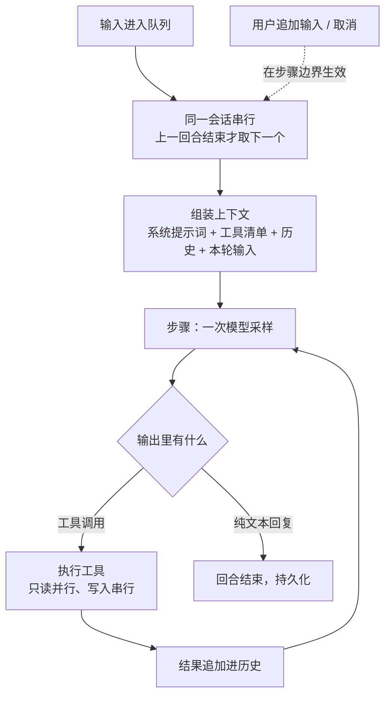
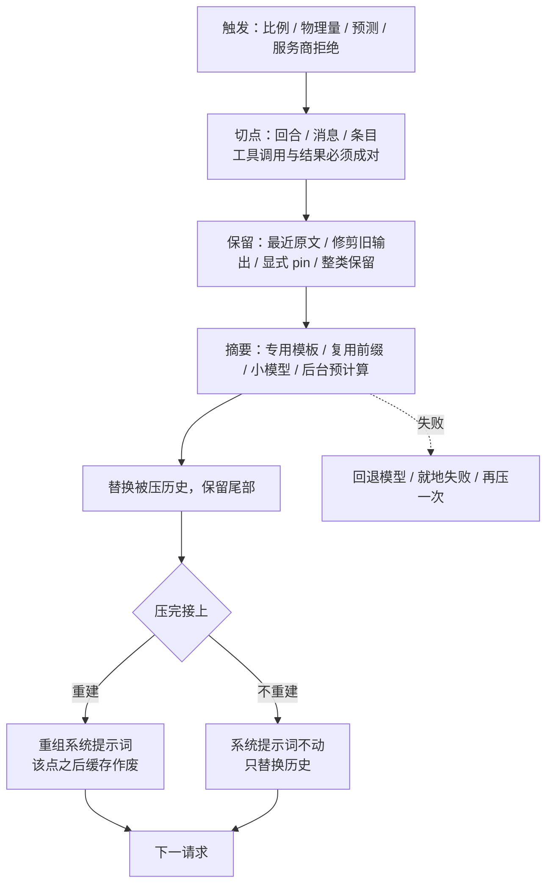
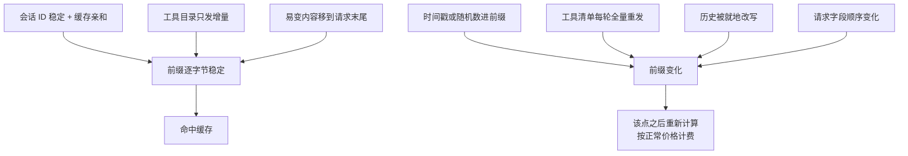
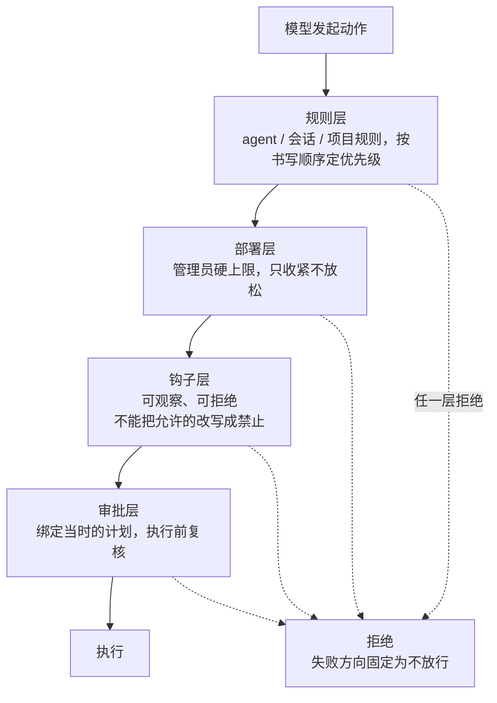
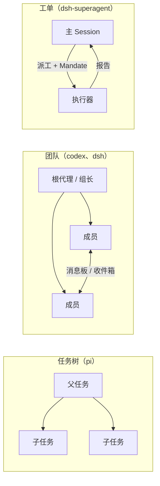
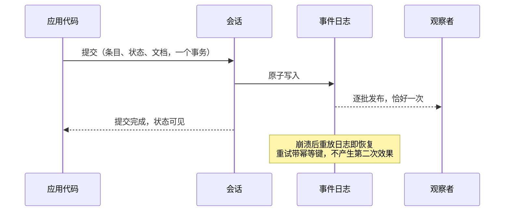
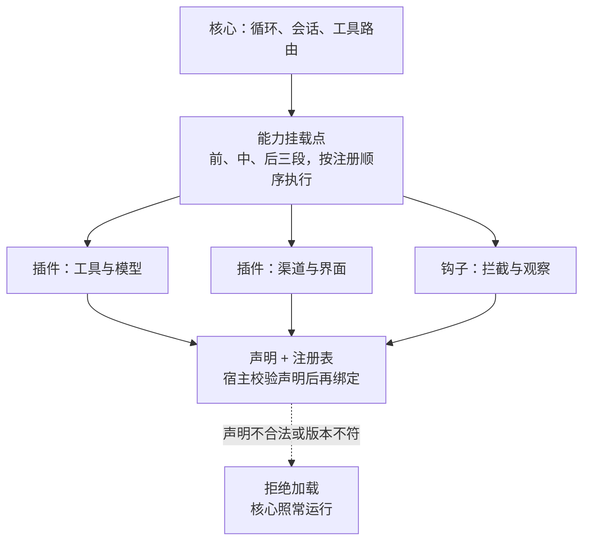
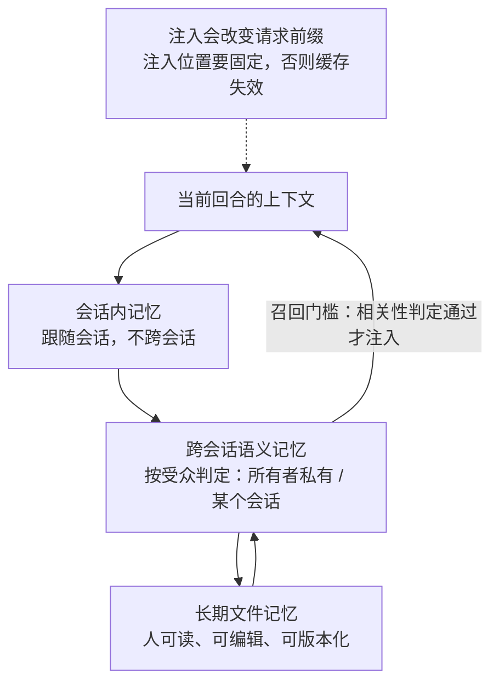
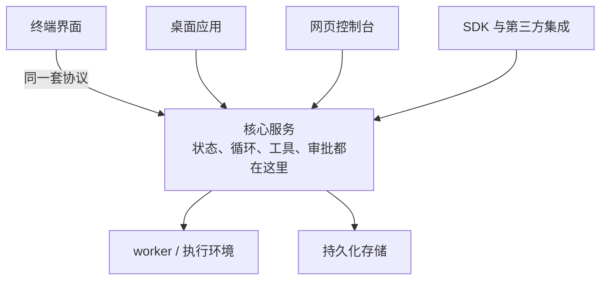

# Agent Harness 设计综合版

| 源仓库 | [openai/codex](https://github.com/openai/codex)、[NousResearch/hermes-agent](https://github.com/NousResearch/hermes-agent)、[openclaw/openclaw](https://github.com/openclaw/openclaw)、[anomalyco/opencode](https://github.com/anomalyco/opencode)、[earendil-works/pi](https://github.com/earendil-works/pi)、[deepseek-ai/deepseek-harness](https://github.com/deepseek-ai/deepseek-harness)、[deepseek-ai/dsh-superagent-prototype](https://github.com/deepseek-ai/dsh-superagent-prototype) |
|---|---|
| 协议 | 各仓库各自的开源协议 |
| 主语言 | Rust、TypeScript、Python |
| 笔记基准 | 2026-11-24，与各篇笔记的当日基准一致 |

这份文档不按项目介绍，按设计点组织。要看的是一个判断：**七个 agent 的差别不在能力清单上，而在同一组设计点上各自选了哪一边**。每个点上的选择都有成立条件，也有代价；项目之间的不同，是这些选择的组合不同。

所以每节的结构固定：这个点要回答什么、哪些做法是共用的、剩下哪几个选项（每个写清成立条件与代价）、七个项目各落在哪个选项上、设计时的检查点。共用的部分合并写一次，不按项目重复；不同的部分才分成选项。

七个项目当坐标看：

| 项目 | 形态 | 一句话的取舍倾向 |
|---|---|---|
| codex | 核心服务 + 多前端 | 宁可多一道独立评审，也不让模型的动作无人复核 |
| openclaw | 单网关 + 多渠道 + worker | 宁可默认收紧、让用户主动加固 |
| hermes-agent | 单进程网关 + 多端 | 宁可多付输入成本，也不让缓存断 |
| opencode | 本地服务 + 多客户端 | 宁可把自己做薄、让插件长 |
| pi | 可复用库集合 | 宁可让恢复等于重放，也不做恢复逻辑 |
| deepseek-harness | 插件树 | 宁可核心没有功能，也不让扩展被核心挡住 |
| dsh-superagent-prototype | 建在 Harness 上的应用 | 宁可动作被授权门拦住，也不凭上下文放行 |

## 一、Agent 循环与回合模型

这个点要回答的是：一次输入到一次答复之间，哪些边界是显式的、哪些状态要跨边界保留。边界划得粗，打断和恢复做不细；划得细，实现复杂度上升。

**共用做法**：循环显式分成"回合"与"步骤"两级——回合是用户输入到处理完，步骤是一次模型采样。同一会话的回合串行执行，工具结果以消息形式回灌历史，流式输出与取消信号贯穿整个循环。这些是七个项目的共同基线。

剩下的分歧在四个选项上：

**选项一：抢占式打断。** 新输入到达时直接打断正在进行的响应流与重试退避，下一请求带完整历史重发。成立条件是能区分"已完成步骤"与"作废响应"；代价是被打断的响应作废重来。

**选项二：检查点取消。** 取消写成一份持久请求，循环在检查点读取后退出。成立条件是有稳定的检查点；代价是取消有延迟，长跑任务里这段延迟可能很长。

**选项三：循环外的恢复。** 循环本身不做恢复，恢复等于重放日志。成立条件是每一步都是不可变记录；代价是存储量与读取成本。

**选项四：执行权分离。** 循环跑在执行进程里，调度与准入在网关；网关决定谁可以开回合，执行进程只负责跑。成立条件是有稳定的进程间协议；代价是调试链路变长。

落点：codex 选选项一加选项四的表层形态（核心服务 + 前端），打断做成抢占。hermes 选选项二，取消靠写取消文件、循环在检查点读取。pi 选选项三，"恢复逻辑"不存在，重放就是恢复。openclaw 选选项四，网关调度、worker 执行，回合可被 steering 改写方向。opencode 把输入做成收件箱加执行声明，属于选项三的变体——"消息已接受"与"消息已处理"分开记账。dsh 把句柄与收件箱拆开，句柄可迁移。

设计检查点：打断发生在哪一级；取消是中断请求还是等检查点；跨边界保留哪些状态；恢复靠重放还是靠恢复逻辑。

## 二、上下文如何拼接

这是整份文档里最值得展开的一节，因为所有项目在这里做的事情几乎一样，而顺序上的每一处差别都直接影响缓存与可读性。

一次请求的内容按四块拼：**系统提示词**（角色说明、工具清单、环境信息）、**历史消息**、**本轮输入**、**末尾提醒**。拼接的核心规则只有一条：按稳定度排序，稳定的放前面，每一轮都会变的放最后。

**共用做法**

- 顺序固定为：固定说明 → 工具清单 → 环境信息 → 历史 → 本轮输入 → 末尾提醒。
- 历史只追加不改写。改写历史等于把前缀从改写点起全部作废。
- 工具清单不每轮全量重发，要么作为顶层字段只发一次增量，要么把定义放进历史、只追加变更。
- 环境信息（工作目录、时间、平台）随回合变化，放在工具清单之后、历史之前，避免把变化挤进更靠前的位置。

**选项一：系统提醒走 system 消息。** 最常见。成立条件是提供方允许 system 消息出现在历史中间；代价是一部分提供方只允许首条 system，只能把提醒改成其它形式。

**选项二：系统提醒走 developer 输入项。** 用 developer 角色把提醒作为输入项发送，能吃到服务商的提示词缓存。成立条件是协议支持 developer 角色；代价是要处理"某些模型只接受 system"的兼容问题。

**选项三：系统提醒走 user 消息。** 兼容性最好。代价是模型可能把它当成用户发言，需要在文本里明确标注"这是系统更新，不是用户的话"。

**选项四：不可信内容渲染成工具输出。** 外部文本不混进用户输入，而是绑定到某个命名空间、作为工具结果注入。成立条件是有工具输出的信任边界；代价是模型看到的是"某个工具返回的内容"，需要显式的来源说明。

**选项五：注入项作为历史条目持久化。** 提醒一旦注入就写进历史，后续请求不复读。成立条件是注入项本身有界；代价是历史会持续变长，且注入错的内容改不回来。

落点：codex 的工具清单走顶层字段加增量通知，不可信内容用选项四（渲染成 `agent` 命名空间的命名工具输出），goal 目标同样走这条通道。openclaw 的历史读取窗口固定，提醒以 developer 消息追加，后台结果用固定标签的 user 消息注入，标签不含时间与任务号以保持前缀稳定。hermes 把技能索引与工具清单都压进系统提示词并固定描述宽度，goal 提醒放在压缩摘要之后而非尾部。opencode 的指令更新用统一标签，模型只需识别一种"非用户输入"标记。dsh 把系统提示词拆成有名字、有位置的分节，拼接时按分节顺序落位。pi 的历史是树，拼接即从当前叶子到根重放，路径确定前缀就确定。

设计检查点：每一块是否会被写入前缀；提醒的插入点是否固定；不可信内容是否与用户输入分开；注入项是否持久化、能否撤回。

## 三、上下文如何压缩

压缩要回答五个问题：什么时候压、从哪里切、留什么、摘要怎么生成、压完怎么接上。这五个问题各有选项。

**共用做法**

- 压缩是一次模型调用，有自己的提示词与输出额度。
- 压缩是有损的，越晚压丢的越多；触发点用可配置阈值，默认落在窗口的安全百分比上。
- 摘要替换掉被压缩的部分，保留一段最近的原文。
- 压缩完成后给替换后的历史编号，保证后续记录与恢复对得上。

**问题一：什么时候压（触发）**

- 选项 A：比例阈值。上下文用到窗口的某个百分比就压。成立条件是窗口已知；代价是窗口未知的模型只能取保守默认值。
- 选项 B：物理量。按字节数或事件数设固定上限，如 16 MiB 与一万个事件。成立条件是存储与计数可信；代价是与 token 额度解耦，靠近上限时请求更大。
- 选项 C：预测溢出。发请求前估算这次输入会不会越界，会就压。成立条件是估算足够准；代价是估算误差会把正常请求压掉。
- 选项 D：服务商拒绝后压。收到"提示词太长"再压。成立条件是有幂等的重试路径；代价是第一次请求白付。
- 选项 E：手动。用户显式触发。成立条件是界面能看到占用；代价是用户不点就一直不压。

**问题二：从哪里切（切点）**

- 选项 A：回合边界。只能在用户消息之前切。成立条件是历史按回合组织；代价是单个超长回合压不掉。
- 选项 B：消息边界。任意消息之间切。代价是可能把一次工具调用与它的结果切开，需要额外规则保证成对。
- 选项 C：条目边界。工具调用与结果必须相邻、调用在前、保留策略相同。成立条件是有条目级标识；代价是实现上要逐条核对。

**问题三：留什么（保留）**

- 选项 A：保留最近若干轮原文。最常见，按可用空间的比例取，夹在上下限之间。
- 选项 B：修剪旧工具输出。只留调用记录、清空输出，累计能省出一定量才动。
- 选项 C：显式 pin。调用方或用户标了"必须保留"的条目跨压缩保留，并且不占用压缩额度。
- 选项 D：整类默认保留。比如远程压缩开新窗口时，客户端工具输出默认保留，按固定额度截断后留下。

**问题四：摘要怎么生成**

- 选项 A：专用摘要提示词。固定模板，输入是被压历史。代价是摘要质量受模板限制。
- 选项 B：复用正常请求前缀。压缩请求带与普通请求相同的前缀，只在末尾追加摘要指令。成立条件是缓存按前缀命中；代价是全量输入的成本。
- 选项 C：专用小模型。用便宜模型写摘要。代价是摘要质量下降，需要下限保护。
- 选项 D：后台预计算。快到触发线时提前算好，到点直接换入。成立条件是能预测何时到线；代价是没用上的摘要照样付钱。

**问题五：压完怎么接上**

- 选项 A：重建系统提示词。压缩点之后重新组装系统提示词。代价是这一点之后缓存作废，但历史干净。
- 选项 B：不重建。系统提示词不动，只替换历史。成立条件是系统提示词本来就不依赖被压内容；代价是"分节位置"与历史条目要对得上。
- 选项 C：保留后缀并校验。换入现成摘要时，只保留额度允许的尾部原文，尾部过长就从头总结。

落点：codex 触发用比例阈值，切点按回合并保证工具调用成对，压完选重建系统提示词。hermes 选"复用正常请求前缀"，把整个对话一起发给压缩模型。openclaw 用物理量触发，另有一条从热缓存压缩的路线，压完不重建。opencode 是三级减负（修剪、保留尾部、摘要）加后台预计算，摘要只在缓存寿命还剩 30 秒以上时提前写。dsh 的分节日志让压缩点成为唯一必须重建的位置。pi 用条目边界，压缩不改条目序列。deepseek-harness 的归并让压缩与系统提示词重建发生在同一处。

设计检查点：触发点是谁定的；切点会不会切开成对条目；保留额度按什么单位算；摘要失败时回退到哪；压缩点之后前缀是否重建。

## 四、提示词缓存

这个点没有方案，只有一条物理约束：前缀逐字节相同才能命中。所有取舍都是"愿不愿意为前缀稳定付出别的代价"。

**共用做法**：会话 ID 稳定、支持缓存亲和的厂商按会话路由；缓存条目的寿命可以按请求申请档位；缓存命中与未命中分开统计，进界面。

**选项一：把会变的东西全部挪出前缀。** 时间戳、随机数、动态排序移到末尾或压进历史。代价是有些信息只能以追加形式出现。

**选项二：工具清单只发增量。** 初始清单一次，之后只追加变更。成立条件是协议支持增量或能把定义放进历史；代价是模型可能看到过期清单，需要显式移除通知。

**选项三：主动续温。** 寿命结束前发只读预热。成立条件是提供方支持预热；代价是预热要付费，未命中时白花。

**选项四：压缩也吃同一份缓存。** 压缩请求带与普通请求相同的前缀。代价是压缩成本按全量输入算。

**选项五：回写字段也算前缀。** 服务商写回历史的字段在回放时原样带上。成立条件是自己完整保存了这些字段；代价是逐字段对照提供方的回写行为。

落点：hermes 五条全用，另加一张学习表推断每条路由的真实缓存行为。openclaw 用选项三，额度按"写入与读取差价的一半"算，未命中即停。codex 用选项二作样板，并让客户端声明不要哪些响应字段。pi 用选项三，判断"续用概率乘以未命中成本减去续温成本"为正才预热；它走通了选项五——回放工具调用不带状态字段，后续推理会被提供方丢弃。opencode 把易变提醒插在压缩摘要之后而非尾部。

设计检查点：哪些内容会随回合变化、是否在前缀里；工具清单是全量还是增量；续温额度由谁定；缓存寿命从哪里读。

## 五、工具系统

这个点要回答的是：怎么让一百个工具的上下文开销接近三个，同时不牺牲权限与可观测性。

**共用做法**：统一路由层（按名字找处理器，套审批、钩子、超时、截断、事件上报）；参数先校验再执行，本地完成类型转换；输出有上限，超出部分写入文件并给有界预览；只读工具并行、写操作串行。

**选项一：按需加载与检索。** 工具标记为延迟加载，或提供关键词检索，模型先搜再取。成立条件是目录能按需物化；代价是多一步，检索质量决定可用性。

**选项二：程序化编排。** 模型写一段程序连续调用工具。成立条件是有受控运行时与逐调用权限点；代价是运行时要自己实现语言语义与沙箱。

**选项三：持久执行环境。** 同一 agent 保留进程与 REPL。成立条件是资源上限可控；代价是常驻内存与状态污染风险，多数实现用"每次拿副本"来限制。

**选项四：结果分三段发布。** 准备、派发、完成分开，结果在策略结算后发布。成立条件是中间件能改写结果；代价是发布多一层等待。

落点：所有项目都有统一路由。codex 用选项四并把目录做成增量。opencode 用选项二，工具契约同时带机器值、文本与元数据。pi 用选项二的另一种形态——工具把另一个工具当子任务跑。dsh 用选项三，PTC 默认持久执行。openclaw 在路由之上叠四层策略（见下一节）。

设计检查点：工具规格的体积上限与去重；参数校验与转换在哪一层；截断后的完整内容放哪；只读工具并行度怎么证明。

## 六、沙箱、权限与审批

这个点的分歧最大，本质是三个独立选择：默认开还是关、规则放哪一层、审批等的是谁。

**共用做法**：秘密与执行分离（凭据留可信进程，执行环境放占位符或引用）；审批绑定当时那份计划，执行前复核；拒绝是结构性的，规则不满足就失败。

**选项一：默认收紧。** 沙箱与审批默认开，放宽要显式配置。成立条件是面向不特定用户；代价是开箱体验变差。

**选项二：默认放开，把边界写进文档。** 不做内置沙箱，给外置隔离方案，列清"我们不声称什么"。成立条件是使用者有安全意识；代价是默认配置不安全。

**选项三：多层规则逐层收紧。** 规则层、部署层、钩子层、审批层依次收紧。成立条件是有明确规则语言；代价是排查"为什么被拒"要在四层里找。

**选项四：独立评审者。** 敏感动作除权限检查外，再起一个独立模型会话评审。成立条件是评审材料能按额度组装；代价是评审要花模型调用，评分与政策要版本化。

落点：openclaw 用选项一加选项三，信任域写成一个网关。codex 用选项三加选项四，Guardian 是独立评审者，否决可重审一次。opencode 用选项三，规则按书写顺序定优先级，命令前缀从命令里提取人类理解的前缀。hermes 用选项三，审批卡片分命令、文件夹、网站三类，后两类可跨轮存活。pi 用选项二，理由写在文档里：进程内做一半的沙箱容易被误解成安全边界。dsh 把系统级键鼠单独列为权限，每会话一次人工批准。dsh-superagent 用选项四的延伸——授权做成不可变 Mandate。

设计检查点：默认收紧还是放开、有没有写进文档；审批绑定计划还是命令文本；审批等待的是循环还是执行环境；秘密可能从哪些位置进入模型上下文。

## 七、并发、subagent 与团队

这个点要回答的是：派生出去的活归谁所有、结果怎么回来、失败了怎么续。

**共用做法**：派生是显式动作，子任务框在父任务生命周期内；子任务有独立上下文与工具集；并发有上限；子任务可续接。

**选项一：任务树。** 归属显式成树。成立条件是任务有持久状态；代价是团队协作被还原成"有归属的子任务"。

**选项二：团队 + 消息板。** 除派生外有成员互发消息、共享留言板、角色指令。成立条件是团队有身份与权限边界；代价是抽象层数增加。

**选项三：后台子会话 + 汇报。** 派生立即返回，子会话每次空闲向父会话投递汇报。成立条件是有跨进程任务表；代价是只有汇报通道，没有任务树。

**选项四：工单 + 授权。** 上层只派工单，执行器内部派生属于实现细节。成立条件是工单携带授权与归属；代价是协作粒度粗。

**选项五：让出语义。** 子任务可主动暂停交回控制权。成立条件是等待状态可持久化；代价是"让出"与"完成"必须严格区分。

落点：pi 用选项一，明确没有独立团队抽象。codex 用选项二。dsh 在 0.2.2 归并——subagent 树就是 Team。openclaw 用选项一加选项五，结果按就绪分区唤醒，让出的根跨重启保留。hermes 的委托提供方只回答路由，多 bot 协作靠房间成员身份。opencode 用选项三。dsh-superagent 用选项四。

设计检查点：派生权在模型还是宿主；结果以什么形式回到父级；并发上限是全局还是按提供方；停止、让出、完成三者是否区分。

## 八、持久化与恢复

这个点要回答的是：存"发生了什么"还是"现在是什么"，副作用与存储怎么配对。

**共用做法**：存储统一进单文件数据库或事件日志；崩溃恢复有幂等边界；存储故障就地失败，不悄悄降级。

**选项一：事件日志。** 只记事件，状态由重放算出。成立条件是事件不可变；代价是读取要重放，存储随使用增长。

**选项二：状态快照 + 增量索引。** 状态直接存库，另建索引支撑查询。成立条件是写入路径可控；代价是"怎么变成现在这样"要靠日志另存。

**选项三：原子提交 + 就地失败。** 提交要么全可见要么全不可见，写盘失败判会话失败。成立条件是存储错误可判定；代价是可用性让位于一致性。

**选项四：幂等键 + 回执。** 重试带幂等键，回执用于恢复与去重。成立条件是键的生成与保存稳定；代价是键的生命周期要设计。

落点：pi 用选项一加选项三，"存了一半"被判为比失败更难收拾。codex 用选项一（rollout）加选项二（分页索引）。openclaw 用选项二，重启恢复按物理 agent 记录区间，跨进程共享用租约。hermes 用选项二加墓碑文件。opencode 用选项二，部件单独成表。dsh 用选项一，会话日志带版本化 surface 与纯函数校验。

设计检查点：记录事件还是状态；一次提交的原子边界在哪；副作用是否在事务内；重试与恢复是否幂等。

## 九、模型接入与路由

这个点要回答的是：差异放在哪一层表达，路由策略由谁决定。

**共用做法**：统一请求、统一流式事件、统一参数名；差异显式建模成兼容标志；认证有固定优先级；失败分类决定重试与回退。

**选项一：统一抽象 + 兼容标志。** 上层只写一次。成立条件是差异可枚举；代价是标志表成为长期负担。

**选项二：适配器注册。** 每家一个适配器。成立条件是接口稳定；代价是接口演进要全员跟进。

**选项三：运行时身份。** 每次请求签身份断言，认证与路由绑定。成立条件是提供方支持断言；代价是注册失败的降级策略要写清。

**选项四：可插拔路由。** 生命周期留在核心，路由交给可替换提供方。成立条件是决策与生命周期解耦；代价是多一层注册与配置。

落点：pi 用选项一的样板，九种协议模块加兼容标志。codex 用选项三。openclaw 用选项二加目录变换。hermes 用选项四。opencode 把命名空间扁平化提前到协议构造。dsh 经统一接口调用，图片分压缩目标与请求上限两层。

设计检查点：差异用什么载体表达；认证优先级与失效重试；回退链的触发条件；目录数据的来源与刷新周期。

## 十、扩展机制

这个点要回答的是：插件能改变什么、不能改变什么，"插件坏了"的后果有多大。

**共用做法**：能力声明加注册表；钩子限定时机；隔离边界明确；版本兼容要么运行、要么明确拒绝。

**选项一：文件即扩展。** 一个导出工厂函数的文件就是扩展。成立条件是有统一接入面；代价是核心极简的纪律靠团队维持。

**选项二：能力声明 + 注册表。** 宿主校验声明后绑定。成立条件是声明可校验；代价是声明与实际行为可能不一致。

**选项三：插件槽 + 独占。** 某类能力同一时刻只允许一个插件。成立条件是接口中立；代价是切换要显式，槽主故障就是该类能力故障。

**选项四：热重载三语义。** 排空等待、回合移交、新旧并存，由插件声明。成立条件是有步骤边界与代际概念；代价是三套路径都要测。

**选项五：一切皆插件。** 核心只有加载器与注册表。成立条件是加载器足够小；代价是启动路径更长。

落点：dsh 用选项五。openclaw 用选项二、三、四。codex 用选项二加钩子失败策略。pi 用选项一。opencode 用选项二，插件能并入目录变换。hermes 的边界是"只有被打开的插件才被导入"。

设计检查点：插件能改变什么；钩子失败时的默认行为；重载期间正在运行的工作怎么办；旧版本插件在新区间上的行为。

## 十一、可观测性与成本

这个点要回答的是：出了问题能不能回答"慢在谁身上、花了谁的钱"。

**共用做法**：结构化日志与贯穿的 trace；耗时归因；成本可见；敏感字段脱敏。

**选项一：记录完整输入。** 模型真正收到什么，轨迹里就留什么。成立条件是存储能承受体积；代价是要有上限与去重。

**选项二：只记元数据。** 只记 ID 与摘要，正文不落轨迹。成立条件是能按 ID 回查；代价是回查依赖存储可读。

**选项三：成本口径显式化。** 标明金额是账单还是目录估算。成立条件是目录价格可靠；代价是不一致时要有人解释。

**选项四：遥测契约化。** 用 schema 声明字段类型与枚举，编译期校验。成立条件是团队接受契约维护；代价是字段变更要同步改 schema。

落点：pi 用选项四，trace 随任务持久化。codex 用选项一，失败请求也保留模型已产出的内容。openclaw 有专门的关键路径归因模块。hermes 的共享指标带用户选择加入。opencode 的事件编码失败时宁可让客户端全体重连。

设计检查点：一次请求能否串成一条 trace；归因粒度；脱敏点；成本是账单还是估算。

## 十二、记忆

这个点要回答的是：记什么、谁来写、什么时候注入，注入对缓存的影响。

**共用做法**：记忆与会话上下文分开存；写入有触发条件；召回有门槛；注入位置固定。

**选项一：不做内置记忆。** 只给存储骨架。成立条件是目标用户是开发者；代价是每个应用自己设计一遍。

**选项二：分层记忆。** 会话内、跨会话、长期文件分开。成立条件是能判定受众边界；代价是层间同步与冲突处理。

**选项三：独占槽位。** 同一时刻只有一个记忆插件生效。成立条件是接口中立；代价是槽主故障就是记忆故障。

**选项四：自动沉淀。** 会话结束自动提炼记忆与技能。成立条件是提炼质量可控；代价是模型调用成本与误沉淀。

落点：pi 用选项一。hermes 用选项四，受众判定收进宿主。openclaw 用选项三。opencode 在 home 目录建记忆工作区。codex 的记忆写入有启动配额检查。

设计检查点：写入由谁触发；受众边界如何判定；召回门槛；注入对缓存的影响。

## 十三、多前端与服务化

这个点要回答的是：状态放在哪、协议怎么定、客户端能做多少。

**共用做法**：核心服务化；协议先行；客户端瘦。

**选项一：核心服务 + 多客户端。** 成立条件是有成熟服务协议；代价是多一层进程与序列化。

**选项二：单网关 + 节点。** 网关是唯一状态持有者，节点声明能力。成立条件是能力可描述；代价是网关成为单点。

**选项三：协议先行生成客户端。** 接口用 schema 定义，客户端与 SDK 从 schema 生成。成立条件是 schema 覆盖完整；代价是协议变更要全量再生成。

**选项四：客户端自报身份。** 握手时声明身份与在线状态，只用于归属标注。成立条件是声明不可信也安全；代价是每条连接多一次握手信息。

落点：codex 用选项一加选项三，app-server 是全套前端的共同后端。openclaw 用选项二。opencode 用选项一加选项三，插件与界面站在同一接入面。hermes 用选项一加选项四。pi 的终端界面自己就是产品，另提供打印、JSON 事件流、RPC 与 SDK 四种接入形态。

设计检查点：状态放在哪个进程；协议定义方式与版本策略；客户端能做什么；离线与重连时的状态恢复。

## 十四、取舍对照

同一个设计点上的选项，各自对应什么代价：

| 设计点 | 选项 | 主要采用者 | 代价 |
|---|---|---|---|
| 打断 | 抢占 / 检查点 / 外置恢复 / 执行权分离 | codex、hermes、pi、openclaw | 延迟与复杂度 |
| 上下文拼接 | 提醒走 system / developer / user / 工具输出 / 历史条目 | codex、openclaw、opencode、dsh | 兼容性与前缀稳定 |
| 压缩触发 | 比例 / 物理量 / 预测 / 服务商拒绝 | codex、openclaw、opencode | 估算误差与白付请求 |
| 压缩保留 | 尾部原文 / 修剪输出 / 显式 pin / 整类保留 | 全部、codex、dsh | 信息损失与额度占用 |
| 缓存 | 挪出前缀 / 增量清单 / 续温 / 回写字段 | hermes、codex、pi、openclaw | 预热费用与协议依赖 |
| 工具 | 统一路由 / 按需检索 / 程序化 / 持久环境 | 全部、opencode、dsh | 运行时复杂度 |
| 沙箱 | 默认收紧 / 默认放开 / 多层规则 / 独立评审 | openclaw、pi、codex、opencode | 开箱体验与实现成本 |
| 并发 | 任务树 / 团队 / 后台子会话 / 工单 | pi、codex、opencode、dsh-superagent | 抽象层数 |
| 持久化 | 事件日志 / 快照索引 / 就地失败 / 幂等键 | pi、codex、openclaw、opencode | 读放大与可用性 |
| 扩展 | 文件即扩展 / 声明注册 / 独占槽 / 一切皆插件 | pi、openclaw、dsh、opencode | 启动路径与故障面 |

**从选项角度看，反复出现的反模式**

- **压缩打碎前缀**：只压较老历史、尾部留旁边，压缩请求自己另起前缀。
- **审批不绑定计划**：批准命令 A、执行命令 B。
- **重试无幂等**：失败重试产生第二次副作用。
- **默认全开**：沙箱与审批默认关，却宣称安全。
- **工具全量重发**：每轮带全量定义，前缀断在工具清单。
- **无上限注入**：任意长度的注入挤掉用户消息。
- **让出当完成**：把"让出"记成"完成"，父级等一个不来的信号。
- **窗口随额度伸缩**：历史窗口跟着 token 额度变，压缩之间悄悄滑掉最早的回合。

## 修订记录

- 2026-11-24 初版：按十二个特性点组织，每点分共用做法、选项、落点与检查点，上下文拆成拼接与压缩两节，末附选项对照与反模式；基准与七篇笔记的当日 commit 一致。
- 2026-11-24 结构改写：叙述单位从"项目做了什么"改成"同一个点上共用什么、剩下哪几个选项"，项目退为落点标注；上下文拼接与上下文压缩各成一节并展开到具体选项。
