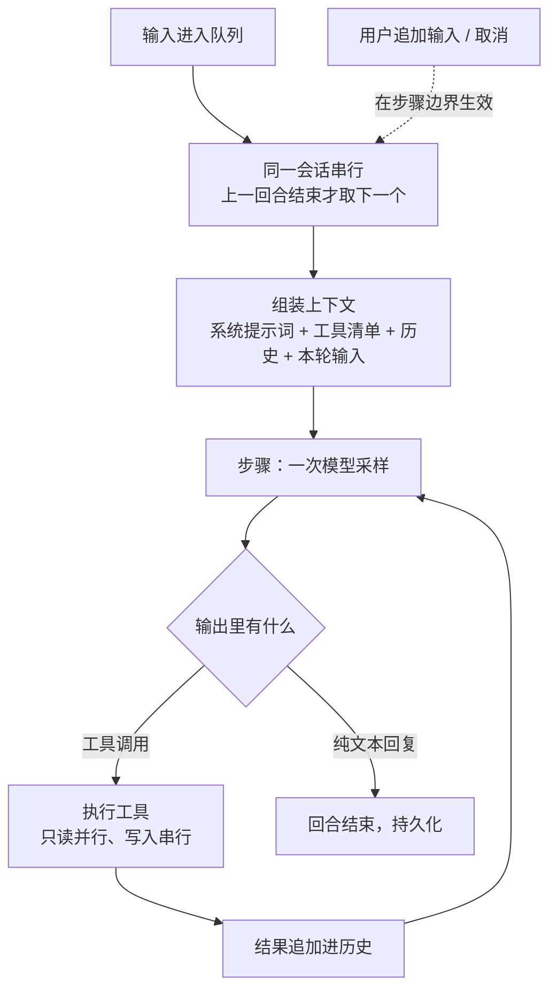
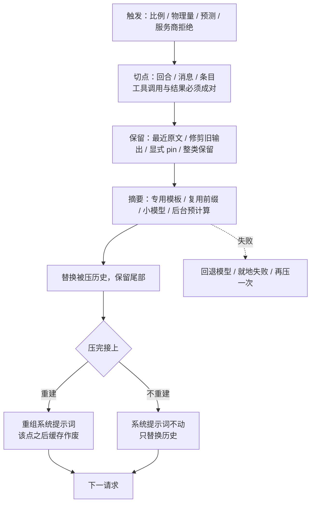
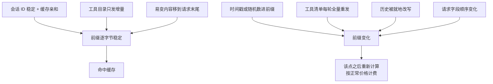
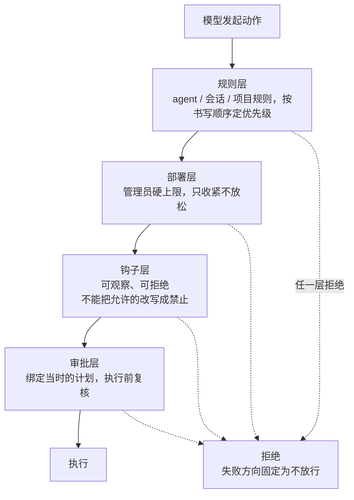
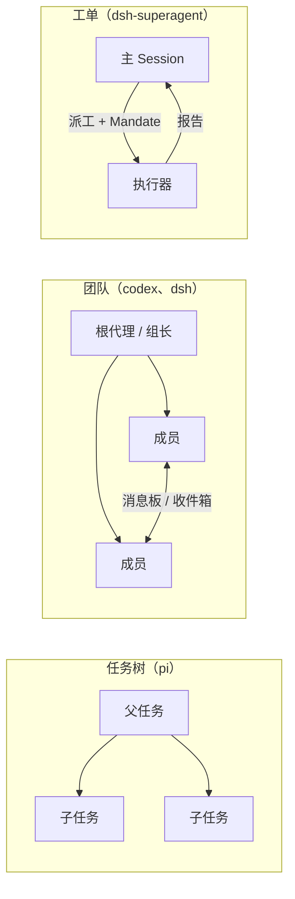
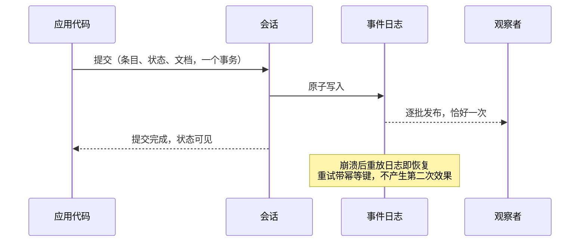
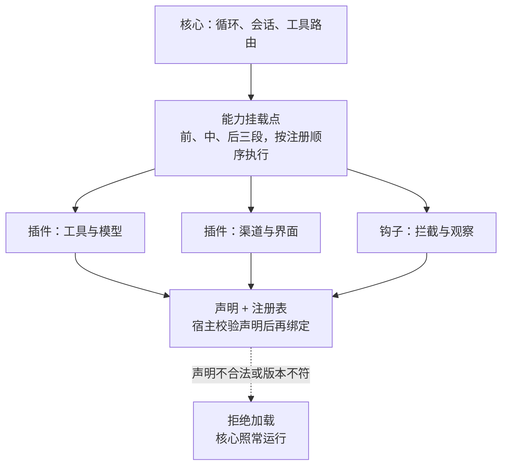
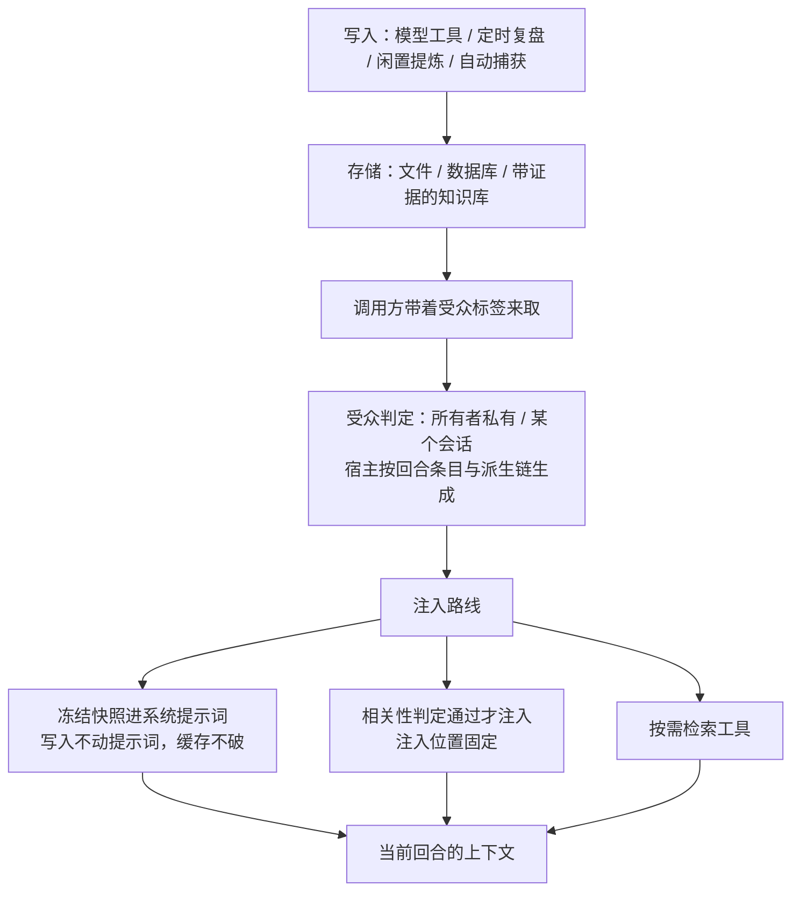
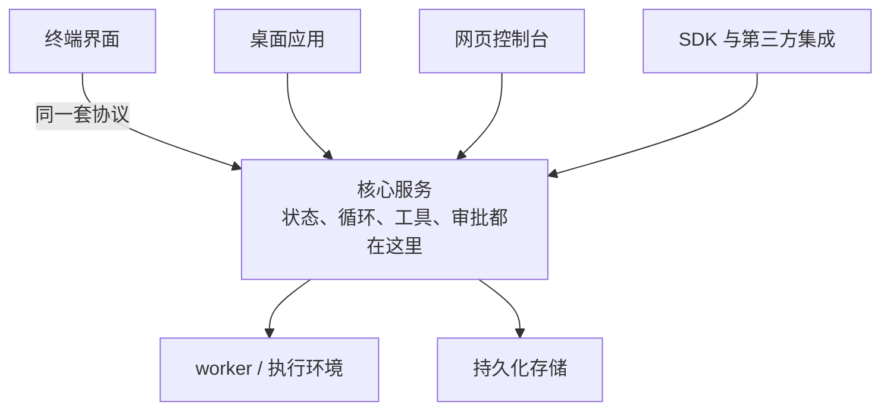

# Agent Harness 设计综合版

| 源仓库 | [openai/codex](https://github.com/openai/codex)、[NousResearch/hermes-agent](https://github.com/NousResearch/hermes-agent)、[openclaw/openclaw](https://github.com/openclaw/openclaw)、[anomalyco/opencode](https://github.com/anomalyco/opencode)、[earendil-works/pi](https://github.com/earendil-works/pi)、[deepseek-ai/deepseek-harness](https://github.com/deepseek-ai/deepseek-harness)、[deepseek-ai/dsh-superagent-prototype](https://github.com/deepseek-ai/dsh-superagent-prototype) |
|---|---|
| 协议 | 各仓库各自的开源协议 |
| 主语言 | Rust、TypeScript、Python |
| 笔记基准 | 2026-11-25，与各篇笔记的当日基准一致 |

这份文档不按项目介绍，按设计点组织。要看的是一个判断：**七个 agent 的差别不在能力清单上，而在同一组设计点上各自选了哪一边**。每个点上的选择都有成立条件，也有代价；项目之间的不同，是这些选择的组合不同。deepseek-harness 下文简称 dsh，dsh-superagent-prototype 下文简称 dsh-superagent。

每节的结构固定：这个点要回答什么、哪些做法已经共用、把它拆成哪几个子问题、每个子问题下有哪几个选项（各写成立条件与代价）、七个项目各选了哪边、设计时的检查点。共用部分合并写一次，不按项目重复；只有真正分岔的地方才分成选项。

七个项目当坐标看：

| 项目 | 形态 | 一句话的取舍倾向 |
|---|---|---|
| codex | 核心服务 + 多前端 | 宁可多一道独立评审，也不让模型的动作无人复核 |
| openclaw | 单网关 + 多渠道 + worker | 宁可默认收紧、让用户主动加固 |
| hermes-agent | 单进程网关 + 多端 | 宁可多付输入成本，也不让缓存失效 |
| opencode | 本地服务 + 多客户端 | 宁可核心精简，把能力让给插件 |
| pi | 可复用库集合 | 宁可让恢复等于重放，也不做恢复逻辑 |
| deepseek-harness | 插件树 | 宁可核心没有功能，也不让扩展被核心挡住 |
| dsh-superagent-prototype | 建在 Harness 上的应用 | 宁可动作被授权门拦住，也不凭上下文放行 |

## 一、Agent 循环与回合模型

**这个点要回答什么**：一次输入到一次答复之间，哪些边界显式、哪些状态跨边界保留。边界粗，打断和恢复做不细；边界细，实现复杂度上升。

**已共用**：循环显式分成回合与步骤两级；同一会话的回合串行执行；工具结果以消息形式回灌历史；流式输出与取消信号贯穿全循环。

**子问题一：打断发生在哪一级**

- 选项 A 抢占：新输入到达时立即打断正在进行的响应流与重试退避，已完成的步骤保留，被打断的响应作废，下一请求带上重组后的完整历史重发。例：codex——用户在生成中途再输入一行，客户端立刻发出取消信号，当前这条响应不再要了，已执行的工具调用与结果留在历史里。条件是有"已完成步骤"与"作废响应"的区分；代价是被打断的响应作废，模型已经算过的输出白付。
- 选项 B 检查点：取消请求写成一份持久的取消标记，循环只在稳定的检查点（步骤边界）读取它，读到才退出，检查点之前的输出都有效。例：hermes——取消写成一个取消文件，回合走到下一个阶段边界时读到它才停。条件是有稳定检查点；代价是取消有延迟，用户等了一段时间才看到停止。
- 选项 C 不可打断：只能等回合结束。例：一条十分钟的长任务，用户中途改变主意也只能等它执行完，或者终止整个会话。条件是可以接受长回合；代价是用户失去对单个回合的控制权。

**子问题二：恢复从哪里开始**

- 选项 A 重放：恢复等于把记录重放一遍，循环本身不含恢复逻辑——正常路径与恢复路径是同一条路径，不用各测一遍。例：pi——会话历史是一棵不可变的事件树，重启后从树根把条目重放，走到哪里前缀就恢复到哪里；pi 的代码里找不到一段叫"恢复逻辑"的分支。条件是每步都是不可变记录；代价是存储量与读取成本随历史增长。
- 选项 B 恢复逻辑：启动时扫描未完成状态并续跑。例：任务库里留着状态为"进行中"的行，启动时逐行判断执行到了哪一步、从那一步继续。条件是状态可枚举；代价是恢复路径与正常路径要分别测试，恢复路径的缺陷往往要到真的崩溃过一次才暴露。
- 选项 C 宿主重派：由外部调度器重新派发未完成的活。例：网关重启后，调度器把中断的任务重新派给恢复的 agent，任务的输入与输出各自带凭据，防止同一个任务被执行两次。条件是有调度入口；代价是幂等要求更严。

**子问题三：谁决定能不能开回合**

- 选项 A 模型自己：派生与开工由模型决定，宿主只提供工具。例：模型判断这个任务可以拆，直接调用派生工具开工。条件是信任模型的判断；代价是资源使用不可控，模型可以在一个回合里派生出一整片子任务。
- 选项 B 宿主准入：回合开始前宿主校验身份、额度与状态，不合法的回合根本开不起来。例：codex——回合开始前宿主核对线程状态、token 额度与权限档案，档案对不上的恢复会被拒绝。条件是有准入接口；代价是每次开回合多一次校验。
- 选项 C 网关授权：网关持有授权表，决定谁可以在哪个会话开回合。例：openclaw——准入在放行回合时同时产出一份冻结的回合授权：能不能派生子会话、能不能创作技能、能不能替换待决问题、能不能运行斜杠命令，各是一个布尔值，整回合内的资格判定只做这一次，回合中途再问也拿到同一份结论。条件是网关是唯一状态持有者；代价是网关成为关键路径，网关不可用则谁都开不了回合。

**子问题四：等待怎么表达**

- 选项 A 进程内等待：等待就是调用栈上的一个 await。例：等一个外部回调的 async 函数，进程一崩这个等待就没了，重启后只能从头做。条件是可以接受进程崩溃即丢；代价是恢复要重做。
- 选项 B 持久等待：等待状态带检查点写进存储，进程重启后醒来接着等。例：pi 的 durable 把任务分成 waiting 与 completing 两个状态，连同中止的级联关系一起持久化；hermes 的等待同样选了持久化。条件是存储可靠；代价是每次等待多一次写入。
- 选项 C 外部唤醒：等待交给宿主的定时器或消息队列，agent 进程只注册回调。例：把"两小时后提醒我"注册成定时器的到期事件，到点由定时器触发一个新的回合。条件是宿主有定时能力；代价是与宿主绑定，脱离这个宿主就没有等待能力。

**各项目的选择**：codex——抢占、宿主准入加网关授权、rollout 重放。hermes——检查点、持久等待。pi——重放，恢复逻辑不存在。openclaw——网关授权、机器状态里的恢复区间。opencode——收件箱加执行声明，"已接受"与"已处理"分开。dsh——句柄可迁移、收件箱保证不丢不重。

**检查点**：打断在哪一级；取消是中断请求还是等检查点；跨边界保留哪些状态；开回合的决定权在谁。

## 二、上下文如何拼接

一次请求的内容按四块拼：系统提示词（角色说明、工具清单、环境信息）、历史、本轮输入、末尾提醒。核心规则只有一条：按稳定度排序，稳定的放前面。

**已共用**：顺序固定；历史只追加；工具清单不每轮全量重发；环境信息放在工具清单之后、历史之前。

**子问题一：系统提醒走什么通道**

- 选项 A system 消息：把提醒作为 system 角色的消息插进历史。例：一条"用户切换了工作目录"的提醒作为 system 消息出现在历史中间。条件是提供方允许 system 出现在历史中间——有的提供方只认首条 system；代价是兼容性最差。
- 选项 B developer 输入项：作为 developer 角色发送，语义上就是"开发者给模型的指示"，还能吃到提示词缓存。例：openclaw——回合提醒走 developer 输入项，提醒不破缓存前缀。条件是协议支持 developer 角色；代价是要处理只认 system 的提供方。
- 选项 C user 消息：兼容性最好，任何提供方都接受。例：opencode——非用户输入统一打标签后作为 user 消息发送，标签写明这不是用户说的话。代价是模型可能当成用户发言，标签要设计得难以模仿。
- 选项 D 工具输出：外部文本绑定一个命名空间、作为某次工具调用的结果注入。例：codex——系统提醒做成独立命名空间的工具输出，模型看到的是"某个内部工具返回了一条提醒"，与用户发言之间有结构性的边界。条件是有工具输出的信任边界；代价是模型看到的内容带着"这是工具结果"的框架。
- 选项 E 历史条目：注入即写进历史，之后每一轮都在。例：代价场景——一条写错的注入留在了历史里，撤回只能追加一条更正，错误的原文永远在上下文里。条件是注入项有界；代价是历史持续变长、注入错了改不回来。

**子问题二：工具清单怎么呈现**

- 选项 A 顶层字段：每轮请求都带当前完整清单。例：hermes——工具清单压进系统提示词并固定宽度，宽度固定，清单增减不移动后面的字节，缓存前缀不受影响。条件是清单小；代价是前缀断在清单处。
- 选项 B 顶层字段加增量：初始请求发全量，之后只追加变更与移除通知。例：codex——初始请求带全量工具清单，之后只发增量；协议还允许客户端声明不需要哪些响应字段，进一步压缩请求体积。条件是协议支持增量；代价是要处理移除通知，客户端自己维护一份本地清单。
- 选项 C 放进历史：工具定义作为历史条目，模型从历史里读。例：代价场景——早期历史被压缩后，工具定义跟着消失，模型突然不知道这个工具怎么用。条件是有足够窗口；代价是早期定义可能被压缩掉。

**子问题三：不可信内容放哪**

- 选项 A 混进用户输入：网页正文、文件内容直接拼进用户消息。例：代价场景——抓取的网页正文里带着"忽略之前的指令"，模型分不清这是用户说的还是网页说的。实现最省；代价是提示注入与用户发言无法区分。
- 选项 B 独立命名空间工具输出：不可信内容走工具输出通道。例：codex——外部内容作为工具结果进入上下文，与用户发言在结构上分开。条件是工具层有命名空间；代价是多一层渲染。
- 选项 C 带显式标记的 user 消息：还是 user 通道，文本带标记。例：openclaw——后台任务的结果用带固定标签的 user 消息回进会话，标签写明这是后台结果。条件是模型能识别标记；代价是标记本身可能被模仿。

**子问题四：注入是否持久化**

- 选项 A 不持久化：每轮按需重发，会话结束就消失。例：一条"当前目录已变更"的提醒，只在目录真的变了的那一轮发。条件是注入内容可重现；代价是重复占用窗口。
- 选项 B 持久化：一次注入写进历史。例：代价场景——会话恢复后这条注入还在，但内容已经过时，又没有撤回通道。代价是撤回困难。
- 选项 C 按来源持久化：稳定内容持久化、易变内容每轮重发。例：codex——客户端提交的附加上下文按来源记提交基线，基线随会话持久；恢复会话后，同一条附加内容不再重放，易变的提醒每轮重新发。条件是有来源分类；代价是分类要维护。

**各项目的选择**：codex——提醒走独立命名空间工具输出、工具清单走增量、附加上下文按来源记基线。openclaw——提醒走 developer、后台结果用固定标签的 user 消息。hermes——技能索引与工具清单压进系统提示词并固定宽度。opencode——统一标签区分非用户输入。dsh——系统提示词拆成有位置的分节。pi——从历史树重放，路径确定前缀就确定。

**检查点**：每一块是否进前缀；提醒插入点是否固定；不可信内容是否与用户输入分开；注入能否撤回。

## 三、上下文如何压缩

压缩要回答五个问题。五个问题互相独立，组合起来就是一套压缩策略。

**已共用**：压缩是一次模型调用，有自己的提示词与输出额度；触发点可配置；摘要替换被压部分；压缩后给替换历史编号。

**问题一：什么时候压**

- 选项 A 比例阈值：用到窗口的某个百分比就压。例：codex——按窗口百分比设触发线，触发点可配置。条件是窗口已知；代价是窗口未知的模型只能取保守值。
- 选项 B 物理量：按字节数或事件数设上限。例：openclaw——压缩起点取"窗口减预留"与"窗口的 75%"中较小的那个，占用由服务商实测值驱动。条件是计数可信；代价是与 token 额度解耦，同样的字节数在不同模型上含义不同。
- 选项 C 预测溢出：发请求前估算这次会不会越界，会越界就先压。条件是估算够准；代价是误差会压掉本来能通过的请求。
- 选项 D 服务商拒绝后压：收到"请求超长"的错误再压，压完重发。例：代价场景——超长的那次请求已经按正常价格计费，压完的重发再付一次。条件是有幂等重试；代价是第一次请求白付。
- 选项 E 手动：用户看到占用提示后自己触发。例：pi——手动 /compact 可以附一句指令指定摘要侧重点；自动模式另有溢出恢复与接近上限两条触发，两个压缩并发时按过期（stale）规则裁决谁作废。条件是界面能看到占用；代价是用户不点就不压。

**问题二：从哪里切**

- 选项 A 回合边界：只能在用户消息之前切。例：代价场景——一个几百次工具调用的超长单回合自己就超过了窗口，回合边界切不动它。条件是历史按回合组织；代价是超长单回合压不掉。
- 选项 B 消息边界：任意消息之间切。例：代价场景——切在工具调用和它的结果中间，提供方会拒绝之后的每个请求，必须把两者成对省略。代价是可能切开工具调用与结果，需要额外的成对规则。
- 选项 C 条目边界：调用与结果必须相邻、调用在前、两侧策略相同，压缩不改变条目序列。例：pi——按条目边界切，条目序列保持原样。条件是有条目级标识；代价是实现要逐条核对。

**问题三：留什么**

- 选项 A 保留最近若干轮原文：按可用空间比例取，夹在上下限之间。例：codex——按比例保留最近的原文轮次。条件是空间可估算；代价是更早的上下文全靠摘要。
- 选项 B 修剪旧工具输出：只留调用记录、清空输出正文。例：opencode——放不下一整份转录时，从最旧的轮次开始逐级缩短：先砍工具输出，整轮省略是最后手段。条件是有逐级裁剪的判定；代价是被修剪的信息找不回来。
- 选项 C 显式 pin：标记了必须保留的条目不参与压缩，也不占压缩额度。例：代价场景——用户明说"记住这个结论"的一条决定，被一次压缩摘要成半句话。条件是有标记通道；代价是 pin 的条目多了压缩就没空间。
- 选项 D 整类默认保留：某一类输出默认不压，按固定额度截断。例：客户端工具（用户在界面上操作的产物）默认保留原文，超额度才截断。条件是有类型分类；代价是分类边界要维护。

**问题四：摘要怎么生成**

- 选项 A 专用模板：压缩请求用固定的摘要提示词。例：模板写明"保留未决请求、保留文件路径、丢弃中间输出"这类取舍。代价是质量受模板限制。
- 选项 B 复用正常请求前缀：压缩请求带着与正常请求相同的前缀，末尾追加摘要指令。例：hermes——把整个对话发给压缩模型，前缀与正常请求逐字节相同，缓存按前缀命中。条件是缓存按前缀命中；代价是全量输入成本一次付清。
- 选项 C 专用小模型：摘要交给更便宜的模型。例：代价场景——摘要模型漏掉了"用户决定用方案 B"这句关键话，之后每一轮都按错误的记忆继续。代价是质量下降，需要下限保护。
- 选项 D 后台预计算：快到线时提前算好摘要备用。例：opencode——后台预计算在接近阈值前提前生成；配置说明里直说"没被用上的后台摘要照样花 token"，太小的对话到不了提前量区间，天然不预计算。条件是能预测何时到线；代价是没用上的摘要照样付钱。
- 选项 E 只装一半 budget：摘要瞄准可用空间的一半，另一半留给后续回合。例：openclaw——摘要素材装满到触发线的话，压完的上下文停在触发线上，下一回合立刻再压一次，每个回合白付一次摘要调用；装一半后，后续几轮的追加不再触发压缩。必需部分（最近的未决请求、文件清单）能在一半内装下是成立条件，装不下时仍要用满 budget；代价是摘要更短。

**问题五：压完怎么接上**

- 选项 A 重建系统提示词：压缩点之后重新组装一遍。例：codex——压缩后重建系统提示词，历史干净；该点之后的缓存作废，下一请求按正常价格重算。代价是这一点后缓存作废，但历史干净。
- 选项 B 不重建：只替换历史部分。例：openclaw——有一条从热缓存压缩的路线，压完不重建，压缩本身用会话从父会话继承的模型执行；dsh 把压缩点做成唯一必须重建的位置——只有这里允许打破前缀。条件是系统提示词不依赖被压内容；代价是分节位置要与历史对上。
- 选项 C 保留后缀并校验：换入现成摘要时只留额度允许的原文尾部，过长就从头总结。例：opencode——换入的原文尾部至多占 budget 的四成，更长的尾部干脆从头总结；目标（goal）提醒固定插在摘要之后。条件是有现成摘要可用；代价是尾部取舍要额外计算。

**各项目的选择**：codex——比例触发、条目边界、重建系统提示词。hermes——复用前缀，整个对话发给压缩模型。openclaw——物理量触发、摘要只装一半 budget、热缓存路线不重建、压缩用继承的父模型执行。opencode——三级减负加后台预计算。dsh——压缩点是唯一必须重建的位置。pi——条目边界且不改条目序列。

**检查点**：触发点谁定；切点会不会切开成对条目；保留额度按什么单位算；摘要失败回退到哪；压缩点之后是否重建。

## 四、提示词缓存

这个点没有方案，只有一条物理约束：前缀逐字节相同才命中。取舍都是"愿不愿意为前缀稳定付出别的代价"。

**已共用**：会话 ID 稳定、支持缓存亲和的厂商按会话路由；缓存寿命可按请求申请档位；命中与未命中分开统计。

**子问题一：哪些内容进前缀**

- 选项 A 全部挪出：易变内容移到请求末尾，或者压进历史以追加形式出现。例：代价场景——一条带时间戳的提醒放在历史中间，时间每轮都在变，从那个字节起缓存全部作废。代价是易变内容只能以追加形式出现。
- 选项 B 分类固定：稳定内容放前缀、易变内容放末尾。例：hermes——把"会话期间提示词逐字节稳定"当成最高不变量：不改历史、不换工具清单、不重载记忆，所有中途必须注入的内容一律搭在工具结果或 user 消息上，绝不碰系统提示词。条件是有分类规则；代价是分类错了就会反复作废。
- 选项 C 每轮全部重拼：每次请求从头组装。条件是不在乎成本；代价是缓存基本失效。

**子问题二：工具清单怎么发**

- 选项 A 每轮全量：清单每轮完整重发。例：代价场景——五十个工具的定义有四千 token，每次请求都从头算这四千个。代价是前缀断在清单。
- 选项 B 增量：初始全量、之后只发变化。例：codex——工具目录只发增量。条件是协议支持；代价是移除通知要显式，少发一条移除，模型就多看到一个不存在的工具。
- 选项 C 历史内定义加稳定占位：定义写进历史，位置用稳定占位符保住。条件是窗口足够；代价是占位本身占空间。

**子问题三：寿命怎么维持**

- 选项 A 不维持：缓存过期就过期。例：代价场景——用户隔了一小时回来继续，整段前缀按未命中重新计算。代价是长间隔后整段重算。
- 选项 B 主动保活：已知缓存寿命结束之前，发一次只读请求把缓存续上。例：openclaw——用会话分叉的"缓存预热"模式发只读请求（Anthropic 用零输出上限、尾部条目不设缓存检查点；OpenAI 用预热参数），只对交互式会话、提示超过 5 万 token、上次回复已在同一路线结算过的会话生效；额度按"写入与读取差价的一半"计算，上限 24 次、12 小时封顶，未命中即停。pi 同样选了保活。条件是提供方支持预热；代价是预热付费、未命中白花。
- 选项 C TTL 档位：按 TTL（time-to-live，缓存寿命）档位申请更久的存活时间。例：代价场景——写入价格上去了，换长间隔后的会话仍然命中。条件是支持 TTL 档位；代价是写入价格更高。

**子问题四：压缩与缓存什么关系**

- 选项 A 压缩复用正常前缀：压缩请求与正常请求共享前缀。例：hermes——压缩把整个对话发给模型，前缀不变。代价是全量输入成本。
- 选项 B 压缩另起前缀：压缩请求用独立的前缀。例：代价场景——压缩一次，压缩点之后的缓存全部作废，之后的每轮都按未命中计费。代价是压缩点之后缓存全废。
- 选项 C 后台预计算摘要：快到线时提前算。例：见第三节问题四的选项 D。代价是可能白算。

**子问题五：回写字段怎么处理**

- 选项 A 原样回放：服务商写回的字段一起回放。条件是自己完整保存了原始响应；代价是逐字段核对。
- 选项 B 只回放自己写的字段：服务商写入的状态字段不回放。例：pi——不带状态字段回放；不回放那个字段，提供方会丢弃对应的推理内容，pi 为此走通了整条回写路径。代价是提供方可能因此丢弃后续推理。
- 选项 C 重新生成：每轮重新构造这些字段。例：代价场景——推理内容每轮重新生成，缓存前缀每轮都不同。代价是每轮都无法命中。

**各项目的选择**：hermes——五个子问题全按缓存优先选。openclaw——保活，额度按"写入与读取差价的一半"。codex——增量清单、客户端声明不要的响应字段、流式增量默认不带序号。pi——保活加回写字段。opencode——易变提醒插在摘要之后。

**检查点**：哪些内容随回合变化、是否在前缀；清单全量还是增量；保活额度谁定；寿命从哪里读。

## 五、工具系统

**这个点要回答什么**：怎么让一百个工具的上下文开销接近三个工具的水平，同时不牺牲权限与可观测性。

**已共用**：统一路由层；参数先校验再执行、本地完成类型转换；输出有上限、超出写入文件，写入失败就地报错、不击穿进程；只读并行、写入串行。

**子问题一：工具规格怎么进上下文**

- 选项 A 全量顶层：清单每轮完整进入上下文。例：hermes——核心工具名单几十个，每次调模型全量发送；名单上每多一个名字，每一次调用都多一份开销。条件是工具少；代价是清单膨胀。
- 选项 B 增量：初始全量、之后只发变更。条件是协议或历史支持；代价是移除要显式，客户端自己维护清单。
- 选项 C 按需检索：先按关键词搜工具、再取定义。例：代价场景——一千个工具的仓库，模型先按"数据库"搜出五个候选，再取需要的三个的定义。条件是检索质量够；代价是多一步。
- 选项 D 延迟加载：注册但不默认提供，指名才加载。例：codex——图片生成的工具可延迟暴露：初始模型请求不带它的定义，代码模式经 ALL_TOOLS 发现它之后才出现在请求里。条件是能指名；代价是模型要知道有哪些工具可指名。

**子问题二：调用怎么执行**

- 选项 A 逐调用一轮模型：每个动作单独请求一次。例：代价场景——连续五十个文件操作就是五十轮请求。实现最省；代价是多步任务慢且贵。
- 选项 B 程序化编排：写一段程序连续调用多个工具。例：opencode——Code Mode 让模型写一段 JavaScript 在受控运行时里连续调用工具；程序编译成自有字节码、由自研虚拟机执行，连解释器里的 fetch 都要过 webfetch 同一套权限检查。codex 同样有 Code Mode，动态工具结果带结构化字段。条件是有受控运行时与逐调用权限点；代价是运行时要实现语言语义与沙箱。
- 选项 C 持久执行环境：保留进程与 REPL，状态跨调用存活。例：dsh——PTC（programmatic tool calling，程序化工具调用）的默认执行模式是持久内存运行时，函数体与 REPL 语法统一走同一环境。条件是资源上限可控；代价是常驻内存与状态污染。

**子问题三：结果什么时候发布**

- 选项 A 执行完立即发布：结果一出来就通知观察者。例：代价场景——观察者先拿到的结果被后续中间件改写过，回放时对不上。简单；代价是观察者可能看到被中间件改写的中间值。
- 选项 B 策略结算后发布：所有改写策略走完、结果定稿再发布。例：codex——工具结果走策略结算后发布，观察者看到的就是最终那一份。条件是中间件能改写结果；代价是多一层等待。
- 选项 C 分段发布：准备、派发、完成各发一次。例：代价场景——界面要在"正在执行"与"执行完成"两个阶段分别渲染，订阅方要处理三段。条件是有阶段概念；代价是订阅方要处理三段。

**子问题四：输出怎么截断**

- 选项 A 只留头部。例：代价场景——编译错误的摘要常在输出末尾，头部只留了正常日志。简单；代价是错误信息常在尾部。
- 选项 B 头尾各留一段。例：hermes——工具结果做头尾三段的预览。条件是能定位尾部；代价是实现稍复杂。
- 选项 C 头尾加省略标记，完整内容写文件。例：pi——被截断的 MCP 工具输出把完整文本写进会话执行环境的临时目录，返回文本末尾给出路径；写文件选会话所在的环境，因为 subagent 的执行环境可能在另一台机器上。条件是有可读文件系统；代价是模型要多一次读取。

**各项目的选择**：codex——规格走增量、结果走策略结算后发布、Code Mode 结构化结果与图片延迟暴露。opencode——程序化编排、契约带机器值文本与元数据、部分读取显式标注"这是部分结果"。pi——工具当任务、支持工具调工具。dsh——持久执行环境。openclaw——路由上叠四层策略。

**检查点**：规格体积上限与去重；校验与转换在哪一层；截断内容放哪；只读并行度怎么证明。

## 六、沙箱、权限与审批

**这个点要回答什么**：动作在执行前经过哪些门，每道门拒绝时的失败方向是什么。

**已共用**：秘密与执行分离；审批绑定当时那份计划；拒绝是结构性的。

**子问题一：默认开还是关**

- 选项 A 默认收紧：沙箱与审批默认开启，加固靠用户主动。例：openclaw——默认收紧、让用户主动加固；codex 的多层规则同样从收紧方向默认。条件是面向不特定用户；代价是开箱体验变差，第一条命令就要审批。
- 选项 B 默认放开：不做内置沙箱，给外置方案。例：pi——明确不做权限系统与沙箱，默认放开，给扩展挂载点让需要的人自己搭。条件是使用者有安全意识；代价是默认不安全。
- 选项 C 分档：按会话类型给默认值。例：个人助理会话放开、对外服务的会话收紧，档位由会话类型决定。条件是有会话分类；代价是档位本身要解释。

**子问题二：规则放哪一层**

- 选项 A 单一策略：一份规则表管所有动作。例：代价场景——部署方要求数据库目录全公司只读，单一策略表表达不出这种"部署方上限"。简单；代价是无法表达"部署方上限"。
- 选项 B 多层收紧：agent、会话、项目、部署逐层叠规则，下层只能更严。例：codex——多层收紧，部署层的硬上限只收紧不放松；opencode 把各层规则组装成策略代数：覆盖层后写者胜、限制层命中即拒绝、保底层只裁决询问。条件是有规则语言与优先级；代价是排查要在多层里找生效的是哪一条。
- 选项 C 按动作类型分表：命令、文件、网络各一套规则。例：hermes——审批卡片分命令、文件夹、网站三类，后两类跨轮存活。条件是有动作分类；代价是分类边界要维护。

**子问题三：审批绑定什么**

- 选项 A 命令文本：批准的就是那条字符串。例：代价场景——批准的是 `git status`，实际执行的是 `git status; rm -rf /`，字符串对不上，用户以为批过的动作变了。简单；代价是批准 A 执行 B。
- 选项 B 规范化计划：存下动作的结构化计划，执行前复核计划是否一致。例：codex——审批绑定当时那份计划，执行前核对；补丁类动作复用同一套准备逻辑，评审者评的是验证过的补丁。条件是能规范化；代价是解释器类命令无法表达时只能拒绝。
- 选项 C 会话授权：一次授权覆盖一类动作。例："本次会话允许所有文件读取"批一次管整场。条件是能定义动作类别；代价是范围容易过大。

**子问题四：审批等谁**

- 选项 A 等循环：审批阻塞当前回合，人批完才继续。例：代价场景——长任务的第十步等审批，人不在，任务停在那里等。简单；代价是长任务被审批卡住。
- 选项 B 等执行环境：审批卡片挂在执行环境上，可跨轮存活。例：hermes——文件夹与网站两类审批卡跨轮存活，下一轮不用重新批。条件是执行环境有生命周期；代价是清理规则更复杂。
- 选项 C 独立评审者：另一个模型会话先评审，再交人确认。例：codex——Guardian 先评一轮，否决可重审一次；评审输入收紧到三件事：待决动作带用户原话、待决历史写入磁盘确认之后再定证据截止、显式的工具调用边界标出该审哪一次。条件是评审材料能按额度组装；代价是评审要花调用。
- 选项 D 无人值守规则：现场没人能回答时，按一份显式规则放行或拒绝，消息写明原因。例：opencode——识别出无人值守运行后按规则裁决；权限钩子把"允许"降级成"询问"之后，规则不再继承那份允许。条件是无人值守运行可识别；代价是规则自己要保证不放行危险动作。

**子问题五：秘密怎么隔离**

- 选项 A 引用传递：上下文里只放密钥的引用，取值发生在可信进程。例：模型看到"使用密钥 GITHUB_TOKEN"，真实值在执行前由宿主注入进程环境。条件是宿主支持引用；代价是多一次解析。
- 选项 B 占位符加重写：执行环境里是假值，出站代理把假值换回真值。例：日志与模型上下文里永远是占位符，真值只经过代理这一条路。条件是出口可拦截；代价是代理成为关键路径。
- 选项 C 掩码：只在日志与输出里替换。例：代价场景——日志干净了，模型上下文里仍是真值，泄露面只堵了一半。简单；代价是只解决泄漏面，不解决使用面。

**各项目的选择**：openclaw——默认收紧、多层规则、信任域写成一个网关。codex——多层收紧、独立评审者、否决可重审一次、远端插件档案先验签名再解包。opencode——策略代数、无人值守规则。hermes——卡片分命令、文件夹、网站三类，后两类跨轮存活。pi——默认放开。dsh——系统级键鼠单独列为权限。dsh-superagent——不可变 Mandate。

**检查点**：默认方向与文档是否一致；审批绑定什么；审批等谁；秘密从哪些位置可能进入上下文。

## 七、并发、subagent 与团队

**这个点要回答什么**：派生出去的活归谁所有、结果怎么回来、失败与让出怎么区分。

**已共用**：派生是显式动作；子任务有独立上下文；并发有上限；子任务可续接。

**子问题一：谁能派生**

- 选项 A 模型：工具调用即派生。例：模型判断这个任务可以拆，直接调用派生工具。条件是信任模型；代价是资源使用不可控。
- 选项 B 宿主：宿主按自己的策略派生。例：调度器把任务拆好后分派，模型只负责单个任务的执行。条件是宿主知道任务结构；代价是模型失去自主分解能力。
- 选项 C 两者：模型提议、宿主准入。例：codex——模型调用工具发起派生，宿主按并发槽位准入，宿主负责回合准入时槽位上限仍然生效。条件是有准入接口；代价是多一次往返。

**子问题二：结果怎么回到父级**

- 选项 A 摘要：子任务只回结论。例：代价场景——父级只看到"已完成"，用户追问细节时父级答不上来。简单；代价是父级看不到过程。
- 选项 B 历史条目：结果写成父会话的一条历史。例：openclaw——未投递的子任务结果在第一次失败时结算进请求方历史，不再重试；父回合被 Stop 时，已完成孩子的状态条目照常写进父历史——Stop 结束的是回合，已完成的工作不再被丢弃。条件是历史可追加自定义条目；代价是"告不告诉用户"变成父模型的决定。
- 选项 C 消息板：结果投到共享留言设施。例：codex——团队共享一块消息板；板的通知统一走 app-server 一条路，板不再自动订阅空闲子线程，空闲子线程因此可以卸载。条件是有一致的板面；代价是多一套存储与权限。

**子问题三：并发上限怎么定**

- 选项 A 全局固定：所有会话共享一个上限。例：上限 8，第 9 个派生排队等。简单；代价是不能随负载伸缩。
- 选项 B 按提供方：每个提供方一份额度，限流时减半。例：代价场景——主力模型限流，它名下的派生自动减半，其他模型不受影响。条件是能识别提供方压力；代价是判定逻辑复杂。
- 选项 C 按会话或角色：交互会话宽、后台会话紧。条件是有会话分类；代价是跨会话协作要额外协调。

**子问题四：让出与停止怎么区分**

- 选项 A 不区分：暂停一律当失败。例：代价场景——等外部审批的暂停被记成失败，恢复时从头重跑。简单；代价是恢复要重跑。
- 选项 B 区分让出：让出保留状态等续接，停止是终态。例：openclaw——分区唤醒、让出的根跨重启保留；唤醒源没能挺过重启时，确切的让出运行经完成所有者结算，终态错误不变、清理与投递照常，父级照常被通知。条件是等待状态可持久化；代价是"让出当完成"的风险要防。
- 选项 C 让出带期限：超期转为终止。例：等审批超过 24 小时自动转失败并通知发起方。条件是有时钟；代价是期限选择依赖场景。

**子问题五：团队要不要独立协议**

- 选项 A 不要：团队就是有归属的子任务。例：pi——任务树，无团队协议。代价是没有团队级进度与冲突处理。
- 选项 B 要：成员、消息、任务板独立建模。例：codex——团队加消息板；dsh-superagent——工单加授权，主 Session 派工时附带一份不可变 Mandate，执行器凭它行动；openclaw 的 Beam 把会话快照发布到另一台网关，原发布者释放后由获授权的续接播种一条 Team 会话——团队形态跨网关交接。代价是抽象层数与持久化面增加。
- 选项 C 归并：子任务树就是团队，任务板作为可选附件。例：dsh——归并路线。条件是有统一身份与路由；代价是历史数据兼容。

**各项目的选择**：pi——任务树、无团队协议。codex——团队加消息板、通知走 app-server 一条路。dsh——归并路线。openclaw——任务树加让出、未投递结果首败结算、Beam 发布与续接。hermes——委托提供方只管路由，多 bot 协作靠房间成员身份。opencode——后台子会话加汇报。dsh-superagent——工单加授权。

**检查点**：派生权在谁；结果形式；上限粒度；让出与停止是否区分；团队协议要不要独立。

## 八、持久化与恢复

**这个点要回答什么**：存"发生了什么"还是"现在是什么"，副作用与存储怎么配对。

**已共用**：存储统一进单文件数据库或事件日志；崩溃恢复有幂等边界；存储故障就地失败。

**子问题一：存事件还是状态**

- 选项 A 事件日志：只存"发生了什么"，状态由重放算出。例：pi——JSONL 事件日志，恢复等于重放；codex 的 rollout 同理，再加分页索引让重放不必从头扫。条件是事件不可变；代价是读取要重放。
- 选项 B 快照加索引：状态直接存库，按索引取。例：openclaw——快照加索引，恢复按 agent 记录区间取；opencode——快照加部件表；hermes——快照加墓碑：被删除的记录留一条删除标记，防止恢复时复活。条件是写路径可控；代价是过程要靠日志另存。
- 选项 C 两者并写：事件留档、快照加速读取。例：代价场景——同一份状态存了两处，一次写入要同时写两边，崩溃停在中间就不一致。代价是两份要一致。

**子问题二：提交边界在哪**

- 选项 A 单次事务：相关写入一个事务提交。例：pi——条目、状态、文档一个事务写完，崩溃后要么全在要么全不在。条件是相关写入可枚举；代价是事务变大。
- 选项 B 批量合并：多条写入攒一批再提交。例：代价场景——一批八条写入提交到第五条崩溃，批内的后三条丢了。条件是有批处理层；代价是崩溃丢批内的写入，延迟换吞吐。
- 选项 C 逐条提交：一条一提交。例：代价场景——三条写入提交了两条就崩溃，状态停在半路。简单；代价是部分写入时状态不一致。

**子问题三：恢复从哪里开始**

- 选项 A 全量重放：从日志头开始。例：代价场景——日志攒了三个月，恢复要重放三个月的事件。简单；代价是慢。
- 选项 B 从最近检查点：检查点之后重放。例：codex——rollout 带分页索引，恢复从最近的页开始。条件是检查点可信；代价是检查点本身要校验。
- 选项 C 宿主重派：调度器补派未完成的活。例：见第一节子问题二的选项 C。条件是有调度入口；代价是幂等要求更严。

**子问题四：幂等怎么做**

- 选项 A 幂等键：每次副作用带一个稳定键，重复请求被识别。例：codex——重试带幂等键，同一次操作不会产生第二次效果。条件是键生成稳定；代价是键的生命周期要设计。
- 选项 B 回执查重：请求方保存回执，重发前先查。例：openclaw——聊天输入的回执契约把"网关收到"与"提交进历史"做成可以分别对账的两件事，重复投递靠对账发现。条件是有回执存储；代价是存储随请求增长。
- 选项 C 不做：接受重复，靠下游兼容。例：代价场景——发消息的重试让对方收到两条一样的消息。代价是把问题外推。

**子问题五：存储故障怎么处理**

- 选项 A 就地失败：判会话失败，不降级。例：pi——存储写不进去就判失败，但绝不让已发布的提交失败：清理跳过、刷盘先走，破坏性操作的授权挂在事务边界上。条件是错误可判定；代价是可用性下降。
- 选项 B 降级继续：可恢复的错误记警告继续运行。例：代价场景——一处写入失败被记成警告，之后读到新旧并存的状态。条件是有可恢复分类；代价是可能出现不一致。
- 选项 C 只读降级：拒绝写入、保留读取。例：磁盘满时还能看历史，不能发新消息。条件是有只读模式；代价是功能受限。

**各项目的选择**：pi——事件日志、单次事务、就地失败。codex——事件日志（rollout）、分页索引、幂等键。openclaw——快照加索引、恢复按 agent 记录区间、优雅重启后已确认的输入保持排队。hermes——快照加墓碑。opencode——快照加部件表。dsh——事件日志加版本化校验。

**检查点**：事件还是状态；提交边界；恢复起点；幂等方式；故障处理方向。

## 九、模型接入与路由

**这个点要回答什么**：差异放在哪层表达、认证怎么绑、失败怎么分类。

**已共用**：统一请求、流式事件与参数名；差异显式建模；认证有固定优先级；失败分类决定重试与回退。

**子问题一：差异用什么载体**

- 选项 A 兼容标志：哪个模型不支持哪个特性，一张标志表写清。例：pi——按模型维护兼容标志，目录本身由脚本生成。条件是差异可枚举；代价是标志表长期维护。
- 选项 B 适配器：每家提供方一个适配层。例：openclaw——适配器加目录变换；opencode——适配器，且把命名空间扁平化提前到协议构造。条件是接口稳定；代价是接口演进要全员跟进。
- 选项 C 目录字段：差异写进模型目录，行为按目录字段走。例：codex——模型目录带能力字段；目录可从 Responses WebSocket 握手的 ETag 刷新。条件是目录权威；代价是目录数据质量决定行为。

**子问题二：认证怎么绑**

- 选项 A 静态密钥：配置里放一把长期密钥。例：代价场景——密钥泄露后要手动换掉所有部署里的这一把。简单；代价是轮换与吊销要额外做。
- 选项 B 登录令牌：OAuth 登录加自动刷新。例：hermes 的 Solstice——用你自己的 Gemini 订阅登录，配额按你的账号计算；推理请求发往无状态的 Interactions 接口，按模型各发各的思考档位。条件是提供方支持；代价是刷新并发要处理。
- 选项 C 运行时断言：每次请求现签一份凭据。例：codex——运行时签发；MCP 服务器可由扩展供给按请求的认证。条件是提供方支持；代价是注册失败的降级要写清楚。

**子问题三：失败怎么分类**

- 选项 A 只有可重试与不可重试。例：代价场景——限流（等一等再试）与余额不足（换钥匙或充值）走同一策略，要么白重试要么错放弃。简单；代价是"可重试但会重复收费"难区分。
- 选项 B 细分：限流、计费、鉴权、终态各一类，配不同的退避与回退。例：限流按退避表等待，鉴权失败直接转登录流程。条件是有错误码或文案特征；代价是文案变化要跟随。
- 选项 C 交给宿主：错误原样上报，调用方自己判断。例：代价场景——每个调用方各自实现一遍"这个错误该不该重试"。代价是每个调用方自己判断。

**子问题四：回退链按什么触发**

- 选项 A 任一错误都回退。例：代价场景——模型输出格式错误触发了回退，换了一个更弱的模型重试，真实缺陷被掩盖。简单；代价是可能掩盖真实故障。
- 选项 B 仅特定错误回退：缺模型、配额、认证才回退。例：hermes——回退用的密钥在客户端构建之前就从凭据池挑好，回退路线不临时找钥匙。条件是分类准确；代价是分类错了就不回退。
- 选项 C 不回退：失败就是失败。例：代价场景——主力模型故障时整个会话不可用。代价是可用性降低。

**子问题五：目录从哪来**

- 选项 A 内置生成：目录由脚本从上游数据生成，随版本发布。例：pi——目录是生成物；上游新模型要等下一个版本才有。条件是生成脚本维护；代价是更新滞后。
- 选项 B 远端拉取加本地缓存。例：代价场景——离线时拉不到目录，只剩本地缓存里上次拉到的清单。条件是远端可用；代价是离线时靠内置快照。
- 选项 C 混合：内置快照打底、远端刷新覆盖。例：codex——内置快照加 Responses WebSocket 握手的 ETag 刷新。条件是有版本策略；代价是两来源要合并。

**各项目的选择**：pi——兼容标志加登录令牌、目录是生成物、SSE 解码统一成公共解码器、错误响应进 onResponse 上报。codex——运行时断言、目录从握手 ETag 刷新、MCP 按请求认证。openclaw——适配器加目录变换。hermes——可插拔路由、Solstice 把推理搬进无状态 Interactions API。opencode——适配器、命名空间扁平化提前到协议构造、freeform 线格式的决定权收进 AI 包统一判定。

**检查点**：差异载体；认证绑定方式；失败分类粒度；回退触发条件；目录来源。

## 十、扩展机制

**这个点要回答什么**：插件能改变什么、不能改变什么，插件坏了后果多大。

**已共用**：能力声明加注册表；钩子限定时机；隔离边界明确；版本兼容要么运行要么明确拒绝。

**子问题一：扩展什么形态**

- 选项 A 单个文件：一个脚本就是一个插件。例：pi——单文件扩展。条件是能力简单；代价是没有包管理与依赖隔离。
- 选项 B npm 包：走包管理器，带依赖与版本。例：openclaw——npm 包；Beam 以插件分发时，出站清洗用的原生可执行按尺寸与摘要逐个校验，供应链里的每个文件都可验证。条件是包生态健全；代价是依赖供应链变复杂。
- 选项 C 独立进程：插件跑在核心之外的进程。例：dsh——一切皆插件，插件宿主在核心进程之外，插件崩溃不伤核心。条件是协议稳定；代价是通信开销。

**子问题二：能改变什么**

- 选项 A 只能加，不能改：新能力只能新增名字。例：代价场景——想替换内置的文件读取，只能改名成 file-read-v2。简单；代价是替换内置能力要改名。
- 选项 B 可覆盖同名注册，按注册顺序取舍。例：openclaw——记忆槽是独占槽：一个槽同时只有一个插件占着，内置 memory-core 与 LanceDB、Knowledge 换着占。条件是有作用域与顺序；代价是顺序规则要交代清楚。
- 选项 C 可替换整层：工具、模型、渠道整层换。例：pi——用扩展挂载点代替内置：别人家内置的功能它一概不做，挂载点足够好，官方就不必亲自实现所有功能。条件是有中立接口；代价是接口成为兼容负担。

**子问题三：失败怎么处理**

- 选项 A 拒绝加载，核心照常运行。例：codex——声明不合法或版本不符的插件直接拒绝加载，循环、会话、工具路由不受影响。条件是有校验；代价是用户要自己找原因。
- 选项 B 加载但降级，只禁用出错的钩子。例：代价场景——同一个插件里三个钩子坏了一个，另外两个还在运行，行为变得难以描述。条件是能隔离单点；代价是行为不一致更难查。
- 选项 C 隔离进程，崩溃只影响自身。例：hermes——可选把非内置插件导入一个按 profile 启动的独立宿主进程，宿主只带该 profile 的环境变量。条件是有进程边界；代价是跨进程数据结构化。

**子问题四：重载怎么办**

- 选项 A 重启生效：装完插件重启核心。例：代价场景——网关上装一个渠道插件，所有正在进行的会话被打断。简单；代价是中断服务。
- 选项 B 排空后换新：等旧工作结束再切换。例：代价场景——一个总也不结束的长回合让升级一直等。条件是能感知进行中的工作；代价是等待时间不定。
- 选项 C 三语义：排空等待、回合移交、新旧并存，由插件声明。例：openclaw——重载与运行中回合的关系由插件在清单里声明：默认排空等待；回合移交——运行中的回合走到下一个模型步骤边界停下、换到新版本继续（Knowledge 是第一个启用的）；新旧并存——旧代际保留到它名下的回合执行完毕（memory-core 声明了并存）。条件是有步骤边界与代际；代价是三套路径都要测。

**子问题五：版本怎么兼容**

- 选项 A 精确版本：锁死版本号。例：代价场景——宿主升一个版本，所有插件跟着一起升。简单；代价是升级要全员同步。
- 选项 B 范围声明：声明兼容的版本范围。例：`>=2,<3` 这样的范围。条件是有语义化版本；代价是范围写错就装不上。
- 选项 C 运行时检测：缺符号就回退到兼容路径。例：代价场景——新宿主删了一个老接口，老插件检测到后走兼容路径，两条路径都要维护。条件是能检测；代价是回退路径要维护。

**各项目的选择**：dsh——单文件、一切皆插件、进程外插件宿主。openclaw——npm 包、独占槽、热重载三语义、Beam 的供应链校验。codex——包加钩子失败策略、会话启动钩子注入加密上下文。pi——单文件。opencode——npm 包并入目录变换、技能正文列清单第一次用到才读。hermes——只导入被打开的插件、cron.plugin_api、沉默判定与会话来源进插件 API。

**检查点**：形态；能改变什么；失败模式；重载语义；版本兼容方式。

## 十一、可观测性与成本

**这个点要回答什么**：出问题时能不能回答"慢在谁身上、花了谁的钱"。

**已共用**：结构化日志与贯穿 trace；成本可见；敏感字段脱敏。

**子问题一：记录到什么粒度**

- 选项 A 只记事件：日志里一行一条事件。例：代价场景——用户问"刚才那条回复为什么等了二十秒"，日志里找不到事件之间的因果。简单；代价是没有因果链。
- 选项 B trace 加 span：跨进程传播上下文，每段耗时可查。例：pi——trace 加 span 加契约化 schema，trace 随任务持久化。条件是上下文能跨进程传播；代价是每层都要接入。
- 选项 C 记录完整输入：请求原文留档。例：codex——记录完整输入，失败请求也留下已产出的内容；配套上限与去重：重复的工具输出在 trace 里去重保留，载荷与捆绑各有体积上限。条件是存储能承受；代价是要有上限与去重。

**子问题二：耗时怎么归因**

- 选项 A 不归因：只有一个总耗时。例：代价场景——回合慢了 40 秒，是模型慢、评审慢还是人没点批准，说不清。简单；代价是慢只能靠猜。
- 选项 B 分段计时：各段独立计时。例：代价场景——四个工具并行执行，总时长是它们的汇合点，各段计时之外还要定汇合规则。条件是各段有起止；代价是并行汇合要额外规则。
- 选项 C 关键路径：保留结束得晚的分支。例：codex——回合关键路径拆成采样与压缩两份计时，捕获扩展到 subagent 与 Guardian 回合；子工作留在子回合自己的账上——父子混在一起就没法回答"慢在谁身上"。openclaw 同样有关键路径归因。条件是有依赖图；代价是实现复杂。

**子问题三：成本口径**

- 选项 A 不显示：界面上不出现费用。例：代价场景——月底账单到了才知道这个月烧掉了多少。简单；代价是用户不知花了多少。
- 选项 B 目录估算：按模型目录的价格估算。例：代价场景——目录价格过期，显示的费用与账单差了一截。条件是目录价格可靠；代价是与账单可能不一致。
- 选项 C 账单为准，估算标注。例：界面先显示估算值，账单到达后替换成实际值。条件是有账单来源；代价是延迟。

**子问题四：什么不记录**

- 选项 A 全记：所有内容原样进日志。例：代价场景——用户的 API 密钥出现在工具参数里，原样进了日志。简单；代价是秘密进日志。
- 选项 B 按类型脱敏：凭据、密钥、内联媒体按类型替换。例：hermes——共享指标带用户选择加入，敏感内容不进统计。条件是有类型标注；代价是漏标就漏记。
- 选项 C 只记 ID 与计数：内容不留。例：代价场景——出了问题只能看到"第 42 次调用失败"，看不到内容，无法复盘。代价是无法复盘内容。

**各项目的选择**：pi——trace 加 span 加契约化 schema，trace 随任务持久化。codex——完整输入留档、关键路径分采样与压缩、MCP 连接按服务器分别计量启动耗时。openclaw——关键路径归因。hermes——共享指标带用户选择加入、每日快照数出群聊与托管方。opencode——事件编码失败时宁可全体重连。

**检查点**：粒度；归因方式；成本口径；脱敏范围。

## 十二、记忆

**这个点要回答什么**：跨会话的记忆记什么、谁来写、怎么注入、注入怎么不破缓存、记忆能力由谁提供、谁能看到哪份记忆。

**已共用**：记忆与会话上下文分开存；写入有触发条件；注入位置固定；记忆属于外部数据，注入前要清洗掉内容里伪装的标签与系统注释。

**子问题一：做不做**

- 选项 A 不做，只给存储骨架。例：pi——明确地不做：记什么、什么时候召回、怎么注入，正确做法远没有收敛，一层都不做；给到的挂载点是 durable 文档——版本化、可 fork、可查询的持久状态存储，记忆系统由应用自己搭。codex 也没有长期记忆系统，跨会话靠用户自己维护的 AGENTS.md 这类文件。条件是用户能自己搭；代价是每个应用自己设计。
- 选项 B 内置一套策略。例：hermes——内置完整的学习循环：MEMORY.md 与 USER.md 两个记忆文件加定时复盘，开箱即用。条件是策略足够通用；代价是替用户做了选择，策略不对就得整个换。
- 选项 C 做但可替换：内置默认加可插拔实现。例：openclaw——记忆是一个独占的插件槽，内置 memory-core 与 LanceDB、Knowledge 换着占。条件是接口中立；代价是接口要覆盖不同形态的记忆。

**子问题二：记什么**

- 选项 A 环境事实加用户画像。例：hermes——MEMORY.md 记环境事实（工具的怪癖、项目约定、配置坑），USER.md 记用户是谁；负面清单写明：只存这段对话里有依据、能指到某条用户消息或工具结果的事实，不从话题、语气、用过的工具推断用户的水平、角色、情绪或偏好，一次性的"写短点"不升格成永久偏好——这份清单防的是记垃圾与记错的经验这两种病。条件是事实与画像可区分；代价是覆盖面窄。
- 选项 B 带证据的知识：每条记忆挂得上来源。例：openclaw 的 Knowledge 插件——页面、论断与类型化的关系存成 Markdown 记录，每条保留来源证据，写入有日志、本地留 Git 历史；记什么也定了方向：保存"结果与用户陈述"，不保存"过程进度"——结论与用户明确说过的话不会过期，中间状态会。条件是每条记忆能挂上证据；代价是写入比随手记重。
- 选项 C 原始事件全存，靠检索过滤。例：代价场景——三个月的对话原文全在库里，召回质量完全压在检索上，噪声随存储一起涨。条件是检索足够强；代价是召回质量不可控。

**子问题三：写入由谁触发**

- 选项 A 模型自己写：记忆动作就是一个工具。例：hermes——模型调用记忆管理工具写入，写入立即写磁盘。条件是信任模型的判断；代价是写入噪声。
- 选项 B 定时复盘提炼：循环里加计数器，到点触发整理。例：hermes——光有工具模型不会主动用，每过 10 个回合触发一次记忆复盘，连续 N 个迭代没用过技能工具就触发技能复盘；复盘 fork 一个会话单独做，不打断主对话。条件是复盘质量可控；代价是调用成本与误沉淀。
- 选项 C 闲置或会话结束时提炼。例：opencode——home 目录按项目建记忆工作区（memory/、docs/、scripts/ 三个文件夹），闲置时提炼；openclaw 的记忆插件另有自动捕获路径。条件是提炼质量可控；代价是调用成本与误沉淀。
- 选项 D 用户显式要求。例："记住我用 pnpm 不用 npm"，写进去就是了。条件是用户记得说；代价是覆盖率低。

**子问题四：怎么注入，注入与缓存什么关系**

- 选项 A 冻结快照：记忆全文在会话开始时进系统提示词，会话期间不动。例：hermes 的双状态设计——写入立即写磁盘，提示词用的是会话开始时的冻结快照；如果每写一条记忆就刷新系统提示词，缓存从第一个字节起全部失效，整个会话按未命中重新读一遍——牺牲"记忆即时生效"，换全会话的低成本；模型在工具响应里实时看到活跃副本，逻辑不出错。条件是记忆体积小、能全文放；代价是新写入的记忆要到下一场会话才进提示词。
- 选项 B 相似度注入加门槛：按当前上下文检索，相关性够才注入。例：openclaw——项目召回、实时语音上下文、触发召回经记忆接口取，全文检索靠 FTS5 虚表；每条注入都动前缀，注入位置必须固定。条件是检索与判定可用；代价是多一步判定，漏召回就漏注入。
- 选项 C 按需检索工具：记忆不自动注入，模型需要时自己查。例：hermes 的 session_search——检索对象是全部历史、访问方式按需触发，解决"三个月前那次调试最后是怎么解决的"这类问题。条件是模型知道何时该查；代价是模型想不起来查就等于没有。

**子问题五：记忆能力由谁提供**

- 选项 A 独占槽：记忆是一个槽位，一次只有一个实现。例：openclaw——记忆槽是独占槽，槽主可以是内置 memory-core，也可以是 LanceDB、Knowledge。条件是槽位语义简单；代价是换实现要整槽换。
- 选项 B 中立接口，多实现可互换。例：openclaw 的 MemoryProviderRuntime——提供方注册时声明自己的能力（数据来源、分页、候选类型、项目过滤），宿主打开时校验声明，绑定的句柄在真正调用之前就拒绝未声明的请求；项目召回、实时语音上下文、触发召回、记忆 Wiki 这些调用方在槽主注册了中立运行时就走新接口，没注册的旧实现保持原路径；槽主还能查询其他已启用的记忆插件，跨插件召回、权限仍按调用方的限界。次序是标准的：先有实现、再有接口、最后多个实现可互换。条件是接口能覆盖不同形态的记忆；代价是接口成为兼容负担。
- 选项 C 内置固定，外部最多一个。例：hermes 的 MemoryManager——内置提供者永远在，外部插件提供者最多同时注册一个：每个提供者都会往工具清单里加工具，多一个就多一份每请求开销。条件是外部实现少；代价是多个外部记忆实现不能并存。

**子问题六：受众怎么判定**

- 选项 A 不判定：所有会话共享一份记忆。例：代价场景——工作群里机器人学到的偏好被私聊会话拿去用，隐私跟着泄露。简单；代价是隐私风险。
- 选项 B 按会话所有者判定。例：私聊会话拿所有者的记忆，群聊会话只拿会话级记忆。条件是会话有所有者；代价是群聊与派生场景要特殊处理。
- 选项 C 宿主判定：宿主从回合条目与派生链生成受众标签，记忆实现只管存取。例：openclaw——调用者是代表所有者本人、还是代表某个具体会话，宿主从已受理的回合条目和派生链每一跳的信息直接生成受众标签（所有者私有或某个确切会话），提供方拿到结论就行，不用自己沿派生链逐跳查会话；这条派生链在会话创建、重置、滚动中都不会断。定时运行继承父会话的受众：所有者直聊派生的定时子任务拿所有者私有记忆，群聊父会话只拿会话级记忆；父会话运行中途被重置，两边都拒绝记忆提供方的读写。条件是宿主掌握派生关系；代价是宿主与记忆实现要共同演进。

**各项目的选择**：pi——明确不做，给 durable 文档存储骨架。codex——没有长期记忆系统，跨会话靠用户维护的 AGENTS.md。hermes——内置学习循环：两个记忆文件、定时复盘、冻结快照注入、单一外部提供者、session_search 按需检索。openclaw——独占插件槽加中立接口（memory-core 默认，LanceDB 与 Knowledge 可占槽），受众由宿主从派生链判定。opencode——home 目录按项目建记忆工作区，闲置时提炼。dsh——没有长期记忆特性。dsh-superagent——没有记忆。

**检查点**：做不做；记什么；写入触发；注入路线与缓存的关系；接口中立化程度；受众判定在哪一层。

## 十三、多前端与服务化

**这个点要回答什么**：状态放在哪、协议怎么定、客户端能做多少。

**已共用**：核心服务化；协议先行；客户端瘦。

**子问题一：状态放哪**

- 选项 A 本地服务：核心跑在本机，客户端连本机端口。例：codex——本地 app-server，TUI 与 IDE 扩展连它。条件是单机使用；代价是跨设备要同步。
- 选项 B 单网关：网关是唯一状态持有者。例：openclaw——网关常驻，渠道、worker、控制台都连它；hermes——单进程网关加多端。条件是网关可达；代价是单点，网关停了全部端一起停。
- 选项 C 服务加远端存储：计算在本地、状态在远端。例：代价场景——地铁里改了一条消息，出隧道才同步成功，中间的冲突要处理。条件是网络可靠；代价是延迟与一致性。

**子问题二：协议怎么定**

- 选项 A 手工维护：协议文档手写，两端各自实现。例：代价场景——服务端加了一个字段，忘了更新某个客户端的解析。简单；代价是两端漂移。
- 选项 B schema 生成：接口定义生成客户端与 SDK。例：codex 与 opencode——schema 生成客户端。条件是 schema 完整；代价是变更要全量再生成。
- 选项 C 版本协商：握手时各自声明能力。例：openclaw——握手能力清单里宣告"网关收下一条输入之后对它负什么责任"（排队模式、输入回执与对账），客户端按宣告适配。条件是能协商；代价是兼容矩阵。

**子问题三：客户端能做多少**

- 选项 A 只做展示与输入。例：代价场景——客户端想加一个本地文件拖入，要绕协议在服务端多走一遍。简单；代价是复杂交互要多次往返。
- 选项 B 本地乐观状态：先改界面再同步。例：消息发出去立刻显示已发送，失败再标红回滚。条件是能回滚；代价是冲突处理。
- 选项 C 客户端可执行工具：客户端自己的工具反向暴露给服务端。例：opencode——客户端可反向暴露 MCP 工具，服务端可以调用客户端机器上的工具。条件是客户端能开入站通道；代价是信任面扩大。

**子问题四：离线与重连**

- 选项 A 断线即失败。例：代价场景——手机锁屏一分钟，回来会话已经断了。简单；代价是体验差。
- 选项 B 断线排队，重连重放。例：openclaw——优雅重启后已确认的输入保持排队，重连后按序处理。条件是队列持久；代价是重复风险。
- 选项 C 断线保留草稿与状态，恢复后核对。例：输入框里的半条消息重连后原样回来，客户端与服务端核对哪些已送达。条件是有核对机制；代价是实现复杂。

**子问题五：远程执行怎么接**

- 选项 A 不做。例：代价场景——数据在另一台机器上，只能靠复制粘贴。简单；代价是无法跨机。
- 选项 B 节点：远端声明能力，网关转发。例：openclaw——远端节点带能力声明与配对审批，子任务可以指到一台已配对的设备上执行；codex——远程 exec-server 把执行放到远端机器。条件是能力可描述；代价是网关成为中继。
- 选项 C 独立链路：端到端加密直连，网关只做授权。例：代价场景——两台设备直连传文件，网关只见得到授权记录，见不到内容，排障时少了一双眼睛。条件是能配对与验签；代价是协议复杂。

**各项目的选择**：codex——本地服务、schema 生成、远程 exec-server。openclaw——单网关加节点（能力声明、配对审批）。opencode——本地服务加 schema 生成、客户端反向暴露 MCP 工具、环境构造统一入口、worker 拉模式、托管运行时闲置工作区挂起。hermes——本地服务，客户端自报身份。pi——四种接入形态（TUI、打印、JSON 事件流、RPC），启动对话框按程序状态协议上报阻塞原因。

**检查点**：状态位置；协议定义与版本；客户端能力边界；离线恢复；远程执行接入方式。

## 十四、取舍对照

| 设计点 | 子问题 | 选项与主要采用者 | 代价 |
|---|---|---|---|
| 循环 | 打断 | 抢占（codex）/ 检查点（hermes）/ 不打断 | 作废重来与取消延迟 |
| 循环 | 恢复 | 重放（pi）/ 恢复逻辑 / 宿主重派（openclaw） | 存储量与幂等要求 |
| 拼接 | 提醒通道 | 工具输出（codex）/ developer（openclaw）/ 标签 user（opencode） | 兼容性与前缀稳定 |
| 压缩 | 触发 | 比例（codex）/ 物理量（openclaw）/ 预测 / 服务端拒绝 | 估算误差与白付请求 |
| 压缩 | 接上 | 重建（codex）/ 不重建（openclaw）/ 保留后缀 | 缓存作废与历史干净 |
| 缓存 | 寿命 | 保活（openclaw、pi）/ TTL 档位 / 不维持 | 预热费用 |
| 工具 | 编排 | 逐个 / 程序化（opencode）/ 持久环境（dsh） | 运行时复杂度 |
| 沙箱 | 默认 | 收紧（openclaw、codex）/ 放开（pi）/ 分档 | 开箱体验 |
| 沙箱 | 审批者 | 循环 / 执行环境（hermes）/ 独立评审（codex）/ 无人值守规则（opencode） | 阻塞与调用成本 |
| 压缩 | 摘要额度 | 装满可用空间 / 只装一半（openclaw） | 压缩频率与摘要质量 |
| 并发 | 团队 | 任务树（pi）/ 团队（codex）/ 归并（dsh）/ 工单（dsh-superagent） | 抽象层数 |
| 持久化 | 故障 | 就地失败（pi）/ 降级 / 只读降级 | 可用性 |
| 接入 | 认证 | 静态 / 登录令牌（pi）/ 运行时断言（codex） | 降级复杂度 |
| 扩展 | 重载 | 重启 / 排空 / 三语义（openclaw） | 中断与测试面 |
| 可观测 | 输入 | 完整输入（codex）/ 元数据 / 不记 | 存储体积 |
| 记忆 | 受众 | 不判定 / 宿主判定（openclaw） | 隐私与实现耦合 |
| 记忆 | 注入 | 冻结快照（hermes）/ 门槛注入（openclaw）/ 按需工具（hermes） | 缓存与实时性 |
| 服务化 | 状态 | 本地服务（codex）/ 单网关（openclaw）/ 服务加远端 | 单点与延迟 |

**反复出现的反模式**

- 压缩打碎前缀：只压老历史、尾部留旁边，压缩请求自己另起前缀。
- 审批不绑定计划：批准命令 A、执行命令 B。
- 重试无幂等：失败重试产生第二次副作用。
- 默认全开：沙箱与审批默认关，却宣称安全。
- 工具全量重发：每轮带全量定义，前缀断在工具清单。
- 无上限注入：任意长度的注入挤掉用户消息。
- 让出当完成：把"让出"记成"完成"，父级等一个不来的信号。
- 窗口随额度伸缩：历史窗口跟着 token 额度变，压缩之间悄悄滑掉最早的回合。
- 记忆写入破缓存：每写一条记忆就刷新系统提示词，全会话的缓存从第一个字节起作废。

## 修订记录

- 2026-11-24 初版：按十二个特性点组织，每点分共同做法、选项、各项目的选择与检查点，上下文拆成拼接与压缩两节，末附对照与反模式。
- 2026-11-24 结构改写：叙述单位从"项目做了什么"改成"同一个点上共用什么、剩下哪几个选项"，项目退为选择标注。
- 2026-11-24 全量展开：每个设计点拆成子问题，每个子问题下列选项并写成立条件与代价；上下文两节作为样板扩展到全部十三节，对照表改按子问题排列。
- 2026-11-25 增量融入：openclaw 回合授权一次判定、压缩摘要只装一半 budget、子任务结果首次失败即结算、Beam 快照发布与续接；opencode 策略代数与无人值守规则、技能按需正文、环境统一入口；codex Guardian 评审输入收紧、插件档案签名验证、目录握手刷新、MCP 按请求认证、Code Mode 结构化结果；hermes cron.plugin_api、沉默判定与会话来源进插件 API、Solstice 无状态 Interactions；pi SSE 统一解码与启动对话框按程序状态上报。
- 2026-11-25 全面修订：全部子问题的选项补机制说明与例子，各项目的选择行改成短标注；记忆一节扩成六个子问题并融入五仓记忆机制；用词按禁用词表修正（budget、保活等）；对照表补记忆注入行、反模式补记忆写入破缓存。
- 2026-11-25 结构词替换：各设计点的结构行改称"各项目的选择"，八类生造词全库清理，正文换成接口、入口、插入位置等通用技术词。
