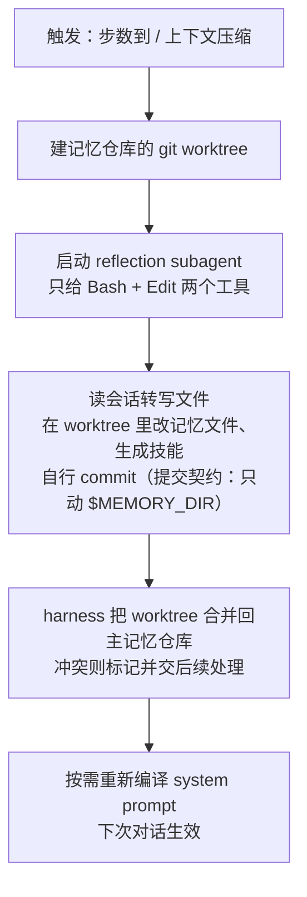

# Letta Code

| 源仓库 | [letta-ai/letta-code](https://github.com/letta-ai/letta-code) |
|---|---|
| 协议 | Apache-2.0 |
| 主语言 | TypeScript |
| 笔记基准 | commit `e2b62e2`（2026-10-30，v0.34.35） |

Letta Code 是 MemGPT 血统的现役实现。MemGPT 是 2023 年一篇著名论文提出的方案：让大模型自己管理一个"上下文之外的记忆区"，像操作系统管内存一样分页换入换出。这个方案工程化成的项目是 letta-ai/letta，累计 star 约 2.5 万。但要先说清一个仓库层面的变动：**letta-ai/letta 的 main 分支现在只剩一个导流页**——README 明说 "The current source code lives in `letta-ai/letta-code`"（letta 仓库 `README.md:5`），原来那套 Python 服务端整体保存在它的 `archive` 分支，官方声明废弃、不再修复。letta-code 是 TypeScript 重写的现役版本（npm 包 `@letta-ai/letta-code`），本笔记只写它。

形态上它是一个终端编码 agent（`letta` 命令，`package.json:9-11`），定位与 Claude Code、codex 同类；README 的自述是 "stateful agent harness for creating agents that are more like people than tools"——有记忆、有身份、有随时间积累的经验的 agent（`README.md:5`）。与同类产品相比它的差异点非常集中：**记忆不是库里的一张表，而是 agent 名下一个 git 仓库里的 Markdown 文件**，agent 用普通文件编辑工具改它，改完提交；后台还有整理记忆的机制。本笔记就围绕这个核心展开。

这份笔记按问题组织，不按 letta-code 的开发时间线：每个问题讲清 letta-code 现在是怎么解的、为什么这么解、代价是什么。项目演进过程放在文末修订记录里。笔记起于 commit `ebc496e`（2026-10-29），跟进到 commit `e2b62e2`（2026-10-30）。

## 它要解决什么问题

编码 agent 大多有会话记忆（一次会话内记得上下文），缺长期记忆：这周跟它磨合出的协作习惯、项目里踩过的坑、它自己总结的代码规范，下个会话全部清零。常见的补救是往项目里塞规范文档（AGENTS.md、CLAUDE.md），但这些文件是用户手写的，agent 自己的经验没有地方沉淀。

letta-code 的切入点是把"agent 的自我"做成持久资产：记忆（它知道什么）、技能（它会做什么）、提示词（它怎么行事）都是 agent 名下可版本化的文件，agent 在工作中自己修改它们，下次会话自动生效。README 原话："They learn and evolve over long horizons through rewriting their own memory, skills, prompts, and even the harness itself (through mods)"（`README.md:5`）。这件事的技术难点不在存储（存文件谁都会），而在三个工程问题：记忆文件什么时候进入模型上下文（全塞进去装不下）；agent 改了记忆怎么保证不出错（写坏了下次会话就废了）；多轮积累的修改怎么管理（没有版本管理就是灾难）。letta-code 的答案是 git——下面按问题展开。

## 仓库怎么分工

它是单包项目（不是 npm workspaces 多包 monorepo），Bun 构建（`package.json:10`），`src/` 按职责分层：

- `agent/`——agent 构造与记忆核心：记忆格式定义、git 钩子、worktree 管理、reflection 启动器、内置 subagent。
- `backend/`——双后端抽象：`api/` 对接 Letta Cloud（官方托管服务，`@letta-ai/letta-client`），`local/` 是纯本地后端（直连模型、记忆全在本地文件）。`dev/` 是本地 turn 执行器。
- `cli/`——Ink（React 的终端渲染库）写的终端界面；`tools/`——客户端工具实现；`providers/`——自带密钥（BYOK）的模型接入。
- `websocket/`——常驻 listener / App Server（本机 WebSocket 服务，让 Slack/Telegram 等渠道和远程客户端接入）。
- 其余：`skills/`、`mods/`（harness 自改机制）、`hooks/`、`sandbox/`、`permissions/`、`telemetry/`。

一个与本笔记系列相关的细节：本地后端的模型调用层用的是 `@earendil-works/pi-ai`——正是 pi 项目（见 notes/pi.md）的模型接入库（`src/backend/local/compaction.ts:1-7`、`src/standalone-entry.ts:2`）。两个 agent 项目在模型接入层已经是上下游关系。

## 主轴：记忆是一个 git 仓库，上下文是它的编译产物

letta-code 的记忆系统叫 MemFS（memory file system）。每个 agent 在 `~/.letta/agents/<id>/memory/` 下有一个 git 仓库（`src/agent/memory-filesystem.ts:33-35,50-60`），里面是一棵 Markdown 文件树。这条主轴有四个推论，贯穿全部机制：

1. **记忆分两层：进上下文的和不进的**。仓库根目录的 `.md` 文件是 core memory（核心记忆），每轮对话编译进 system prompt；子目录里的内容是外部记忆（external/deferred memory），不进上下文，靠工具按需读取。判定规则在 `src/agent/memory-format.ts:13-41`，并且有个约束：**子目录必须有自己的 `MEMORY.md` 索引文件才算记忆**（`src/agent/prompts/letta_root_memfs.md`）——没有索引的目录是普通文件，不会被当作记忆投影。
2. **上下文是编译出来的快照，不是实时视图**。每轮对话开始时，系统从记忆仓库的 **git 已提交版本**读文件（`git ls-tree -r HEAD` 列文件、`git show HEAD:<path>` 取内容，`src/backend/local/system-prompt-compilation.ts:92,121`——注意不读工作区，读的是最后一次 commit 的状态），渲染成 XML 块替换进 system prompt 模板的 `{CORE_MEMORY}` 占位符（`:154-199,380-385`）。系统提示词里写明了后果："Editing memory does NOT change your behavior in the current turn"（`letta_root_memfs.md:58`）——改记忆当轮不生效，下次编译才生效。这和"改配置要重启"是同一种语义，换取的是上下文来源的确定性。
3. **写入走 git 纪律**。agent 用普通的 Edit/Write/Bash 工具改记忆文件，然后 git commit。提交被 git 钩子约束：pre-commit 校验每个记忆文件的 frontmatter（Markdown 头部的元数据块，description 必填；`read_only` 是保护字段，不允许增删改，`src/agent/memory-git-hooks.ts:24-184`）；post-commit 把提交异步推送到用户配置的记忆远端仓库（可镜像到自己的 GitHub，`:254-274`）。
4. **学习 = 后台提交 + 合并**。记忆的批量整理不占用主对话，由后台的 reflection subagent 在记忆仓库的 git worktree（同一仓库的平行检出目录，改完可以合并回来）里工作，完成后由 harness 合并回主记忆仓库（下文"自我改进"节展开）。

选择 git 而不是数据库，收益直接：版本历史免费获得（改坏了能回滚）、worktree 机制让后台整理和主对话互不踩踏、post-commit 钩子顺手实现了记忆的异地备份。代价是用户要接受"记忆变更以提交为单位生效"这个稍微绕的心智模型。

## 上下文构造

一轮对话的上下文由三部分组成：编译后的 system prompt（内含 core memory 投影）、会话转写中保留的近期消息、更早消息的压缩摘要。编译流程（`src/backend/local/system-prompt-compilation.ts:432-461` 总入口）：

1. 从 git HEAD 读出全部 core memory 文件；
2. 渲染投影：每个根文件包成 `<label>...</label>` XML 块，`MEMORY.md` 包成 `<memory>` 块，子目录索引以 `<deferred-memory>` 条目列出（只给路径和索引内容，不给全文，`:154-199`）；
3. 元数据块（agent id、会话 id、历史消息数）拼进去；
4. 替换模板占位符——模板里没有占位符就追加到末尾（`:380-385`）；
5. 可用技能清单以 `<available_skills>` 追加在最后（`:391-421`）。

上下文的第三部分——压缩摘要——有一个保底分支（提交 `7f9d42d`，PR 5133）：完整压缩产出的摘要加保留消息仍然装不下时，压缩被判为"不可约"，此时不再让本轮失败，而是从最旧一侧按轮整体丢弃消息，直到剩余内容装得下；每一轮连同它的工具调用和结果一起消失，工具结果不会脱离调用单独存活；最近一轮用户消息始终保留，"较旧消息因压缩无法再缩小上下文而被丢弃"的警告替代摘要写入（`src/backend/local/compaction.ts:83,127`）。该分支只在上下文溢出触发压缩时启用，从最旧侧找不到可丢弃的轮次时放弃丢弃。

记忆的分层有明确的权威定义（`src/agent/prompts/letta_root_memfs.md`）：core（在上下文里）、external（按需读）、recall（全部消息历史，由 harness 自动存、不可变、永不注入——要查历史得自己调工具）、skills（程序性记忆，"怎么做某件事"的技能文件）。四层对应四种访问成本：免费的、一次工具调用的、一次检索的、一次技能加载的。

## 记忆的读取与写入

**读取是渐进发现式的**。core memory 已经在上下文里；往深看靠 `Memory(path)` 工具：读目录返回该目录的 `MEMORY.md` 索引加直接子项清单（带 description、按最近编辑排序），读文件返回内容（`src/tools/impl/memory.ts:347-422`）。agent 像浏览一个网站一样从根索引逐层深入，而不是每次全量扫描。

**历史检索靠 recall subagent**。需要翻旧对话时，agent 启动一个 recall subagent（`src/agent/subagents/builtin/recall.md:5-7`），它通过 conversation fork（分叉出继承父 agent 全部历史的一个临时会话）执行 `letta messages search`，支持向量/全文/混合三种模式（`src/backend/message-search.ts:11`）。注意：向量检索只在 Letta 服务端存在，本地后端的实现是纯词频打分的全文检索（`src/backend/local/transcript-search.ts:563`）——记忆文件本体从不建索引、不做嵌入，这是与 mem0/cognee 这类向量记忆路线的根本分歧。

**写入就是改文件加提交**，git 钩子把住质量关（见主轴节）。每轮对话结束后，harness 调 `syncPendingMemoryCommitsAfterTurn` 检查未提交/未推送的变更（`src/agent/memory-git.ts:1833-1939`），并把仓库的脏状态以 `<system-reminder>` 注入下一轮上下文（`src/reminders/memory-git-sync.ts:58-80`）——agent 忘了提交时系统会提醒它。修复类问题交给后台 memory worker 处理（`src/agent/subagents/memory-worker.ts`）。

## 自我改进

"agent 随经验变好"落地为三层机制：

1. **改记忆就是改提示词**。core memory 文件是 system prompt 的组成部分，agent 重写它们等于重写自己的提示词。系统提示词明说这是学习的方式："Rewrite core memory files to modify your system prompt for future invocations ... This is how you learn"（`letta_root_memfs.md:32`）。
2. **reflection（也叫 dreaming，睡眠整理）**。触发方式三种（`src/cli/helpers/memory-reminder.ts:15,51-56`）：关闭、按步数（默认 25 步触发一次）、按压缩事件（上下文压缩发生时触发）。触发后（`src/cli/helpers/reflection-launcher.ts:769` 起）：

   设计上有两点值得注意。一是隔离：reflection 只拿到 Bash 和 Edit 两个工具、工作在 worktree 里、有明确的提交契约（"只在 `$MEMORY_DIR` 内 git add/commit，合并由 harness 负责"，`src/cli/helpers/reflection-prompt.ts:15-28`）——后台进程能造成的最坏结果被限制在一个可丢弃的分支里。二是无人值守运行的安全：自动 reflection subagent 跑在内核级沙箱里，策略是 fail-closed（"可以广泛读取宿主机、只能写 harness 自身状态和自己的记忆、不能读写其他 agent 的记忆"，`src/memory-confinement.ts:11-27`）。

3. **mods**：`src/mods/` 提供 harness 自身的自改机制（改的是 harness 行为而不是记忆内容），README 把它列为自我改进的最外层。

技能生成的归宿也是记忆仓库：reflection 判定某个做法值得沉淀，就在 `$MEMORY_DIR/skills/` 下写一个技能文件，下次按四级优先级加载（项目级 > agent 记忆级 > 全局 > 包内置，`src/agent/skills.ts:3-8`）。

## Agent Loop

主循环在 `src/headless.ts:2153` 的 `while (true)`：检查中断与轮数上限 → 组装输入 → `sendMessageStream` 发给后端 → 消费流式事件 → 按 `stop_reason` 分支。终止原因收敛为几种：`end_turn`（正常结束）、`cancelled`（用户中断）、`requires_approval`（等用户批准工具）、`llm_api_error`（指数退避重试）、`max_steps`（CLI 的 `--max-turns` 上限，`headless.ts:2114-2132`）。

多步循环由"工具结果即下一轮输入"驱动：后端发来工具调用请求，客户端在本机执行工具（`executeApprovalBatch`，`headless.ts:2605-2624`），把结果包进下一轮输入后 `continue` 回循环顶部（`:2635-2639`）。本地后端的单步执行由 `ProviderTurnExecutor` 包装 pi-ai 的流式适配完成（`src/backend/local/local-executor-factory.ts:42-74`），适配器内部还有一层循环处理上下文压缩预检和溢出重试（`src/backend/dev/pi-stream-adapter.ts:814-864`）。

## 模型接入

双后端统一在 `Backend` 接口后（`src/backend/backend.ts:193` 起），用能力位声明差异（`BackendCapabilities`：`remoteMemfs`/`localMemfs`/`promptRecompile`/`serverSecrets` 等，`:172-188`）——上层代码按能力位分支，而不是按"云还是本地"硬编码。云后端的模型调用在服务端执行；本地后端经 pi-ai 直连，BYOK 接入支持 anthropic、openai、openai-compatible、xai、zai 及 Bedrock、OpenAI 订阅接入等（`src/providers/byok-providers.ts:131-177`）。

## 持久化

本地无数据库，全部是文件：记忆在每个 agent 的 git 仓库；会话转写是每会话一个 `messages.jsonl`（`src/backend/local/local-transcript.ts:90`）；agent 和会话的元数据是 JSON 文件。云后端一切在服务端，本地通过 git 代理访问记忆仓库（每轮推送到 origin，`src/agent/memory-git.ts:1905`）。用户把记忆仓库镜像到自己的 GitHub 是受支持的工作方式（post-commit 钩子实现）——记忆资产的所有权可以完全在用户手里。

## 隔离与多租户

单机场景的隔离单位是 agent：每个 agent 一个记忆仓库，跨 agent 访问由权限层守护（`src/backend/local/paths.ts:5-9`）。云场景有 organization 概念（`src/agent/organization-id.ts:1-16`），并区分"发起请求的人类"（acting user）和"持有密钥的运行时"（`src/agent/acting-user.ts:1-19`）——多用户共用一个部署时，责任归属可以分开记。最严格的隔离给了无人值守的 reflection：内核沙箱 fail-closed（见"自我改进"节）。

## 扩展机制

- **工具**：`defineTool({schema, description, impl})` 定义（`src/tools/define-tool.ts:24-36`）；`TOOLSET_CATALOG` 提供整套预设：`letta`（含 Memory/Task/Skill 等统一工具集）、`default`（Claude 风格）、`codex` 等（`src/tools/toolset-catalog.ts:19-87`）——一个 CLI 可以按预设切换成不同编码 agent 的工具行为。
- **MCP**：官方 SDK，stdio/HTTP/SSE 三种传输加 OAuth（`src/mcp-client.ts:1-34`）。
- **subagent**：内置 general-purpose / recall / reflection / fork / init 五种（`src/agent/subagents/builtin/`），agent 可调其他 agent 为 subagent。
- **hooks 与 mods**：脚本挂钩执行关键点；mods 改 harness 本身。

## 可观测性

遥测默认开启、需要主动关（opt-out）：`LETTA_CODE_TELEM=0` 或 `DO_NOT_TRACK=1`（`src/telemetry/index.ts:392-405`）。上报目标是用户所连的 Letta 服务端而不是独立第三方，事件是会话起止、工具用量、错误这类元数据，明确不序列化身份内容（`:304`）。自诊入口：`/doctor`（按症状诊断）、`/palace`（记忆可视化）、`/search`（全量消息搜索，`src/cli/commands/registry.ts:139-184`）。

## 设计原则

- **记忆是文件、git 是纪律**。所有记忆问题（版本、合并、备份、校验）都翻译成 git 已有的能力，不新造存储层。代价是心智模型绕（提交才生效），收益是几十年来工具链的全部能力直接可用。
- **上下文是编译产物**。读已提交版本、渲染投影、占位符替换——上下文的每个字节可复现、可 diff。实时性换确定性。
- **后台代理最小权限 + 可丢弃**。reflection 只有两个工具、在 worktree 里、沙箱 fail-closed、坏了合并不进来就行——自主性和安全性不冲突的结构设计。
- **能力位而不是 if-else**。云/本地两套后端的差异收敛成 `BackendCapabilities` 声明，上层按能力分支。双栈产品的通用解法。
- **顺带可见的商业策略**：核心流程在本地可用（记忆、reflection 都是本地能力），但向量检索、托管reflection 这些需要服务端的能力在云上——开源 CLI 与托管服务的能力边界划得很清楚。

## 可复用的做法

- **记忆即 git 仓库**（`src/agent/memory-filesystem.ts:50-60`）：任何需要"agent 或用户长期维护、可回滚、可审查"的生成内容（记忆、规范、配置）都可以用这个形态，校验挂 pre-commit、备份挂 post-commit，都是现成机制。
- **上下文读已提交版本**（`system-prompt-compilation.ts:92,121`）：从"正在被修改的数据"生成关键产物时，读最后一个稳定版本而不是工作区，天然避免读到半成品。
- **后台整理走 worktree + 提交契约**（`reflection-prompt.ts:15-28`）：让 subagent 批量修改共享状态时，给它一个平行工作区和"你只管提交、合并我来"的契约，主流程永远不暴露在半完成状态上。
- **按需加载的分层记忆**（core/external/recall/skills 四层）：上下文装不下的记忆不是全压缩，而是分层——常驻的、一次工具调用的、一次检索的、一次技能加载的，按访问频率分配成本。
- **前置校验挂 git 钩子**（`memory-git-hooks.ts:38-184`）：约束"agent 生成的内容"（必填字段、保护字段）放在提交时刻而不是读取时刻，坏数据进不了历史。
- **能力位统一多后端**（`backend.ts:172-188`）：产品有云/本地双形态时，把差异声明为能力位集合，上层按能力分支，避免满天飞的部署模式判断。

## 修订记录

- 2026-10-30 初版：基于 commit `ebc496e` 完整成文。覆盖 MemFS 记忆模型与四层分层、git 编译式上下文构造、钩子化的写入纪律、reflection worktree 流程、双后端能力位与本地无数据库持久化；说明 letta-ai/letta 已归档、本文以 letta-code 为准。
- 2026-10-31 基于 commit `e2b62e2` 补充：本地后端压缩新增"不可约"保底——完整压缩仍装不下时按轮从最旧侧丢弃历史、保留最近一轮用户消息，警告替代摘要写入（PR 5133，compaction.ts）。
