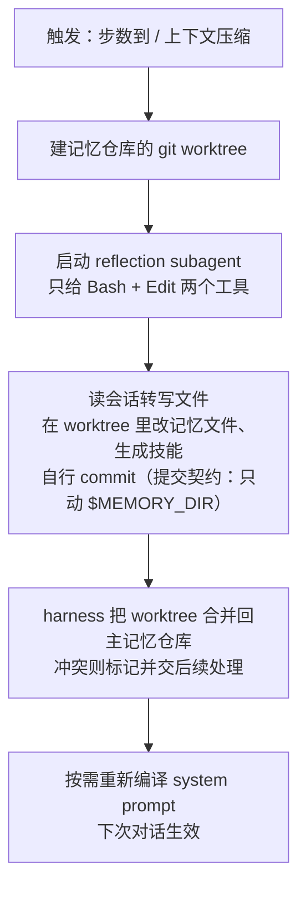

# Letta Code

| 源仓库 | [letta-ai/letta-code](https://github.com/letta-ai/letta-code) |
|---|---|
| 协议 | Apache-2.0 |
| 主语言 | TypeScript |
| 笔记基准 | commit `c67a0d5`（2026-11-24，v0.34.70） |

Letta Code 是 MemGPT 血统的现役实现。MemGPT 是 2023 年一篇著名论文提出的方案：让大模型自己管理一个"上下文之外的记忆区"，像操作系统管内存一样分页换入换出。这个方案工程化成的项目是 letta-ai/letta，累计 star 约 2.5 万。但要先说清一个仓库层面的变动：**letta-ai/letta 的 main 分支现在只剩一个导流页**——README 明说 "The current source code lives in `letta-ai/letta-code`"（letta 仓库 `README.md:5`），原来那套 Python 服务端整体保存在它的 `archive` 分支，官方声明废弃、不再修复。letta-code 是 TypeScript 重写的现役版本（npm 包 `@letta-ai/letta-code`），本笔记只写它。

形态上它是一个终端编码 agent（`letta` 命令，`package.json:9-11`），定位与 Claude Code、codex 同类；README 的自述是 "stateful agent harness for creating agents that are more like people than tools"——有记忆、有身份、有随时间积累的经验的 agent（`README.md:5`）。与同类产品相比它的差异点非常集中：**记忆不是库里的一张表，而是 agent 名下一个 git 仓库里的 Markdown 文件**，agent 用普通文件编辑工具改它，改完提交；后台还有整理记忆的机制。本笔记就围绕这个核心展开。

这份笔记按问题组织，不按 letta-code 的开发时间线：每个问题讲清 letta-code 现在是怎么解的、为什么这么解、代价是什么。项目演进过程放在文末修订记录里。笔记起于 commit `ebc496e`（2026-10-29），跟进到 commit `c67a0d5`（2026-11-24）。

## 它要解决什么问题

编码 agent 大多有会话记忆（一次会话内记得上下文），缺长期记忆：这周跟它磨合出的协作习惯、项目里踩过的坑、它自己总结的代码规范，下个会话全部清零。常见的补救是往项目里塞规范文档（AGENTS.md、CLAUDE.md），但这些文件是用户手写的，agent 自己的经验没有地方沉淀。

letta-code 的切入点是把"agent 的自我"做成持久资产：记忆（它知道什么）、技能（它会做什么）、提示词（它怎么行事）都是 agent 名下可版本化的文件，agent 在工作中自己修改它们，下次会话自动生效。README 原话："They learn and evolve over long horizons through rewriting their own memory, skills, prompts, and even the harness itself (through mods)"（`README.md:5`）。这件事的技术难点不在存储（存文件谁都会），而在三个工程问题：记忆文件什么时候进入模型上下文（全塞进去装不下）；agent 改了记忆怎么保证不出错（写坏了下次会话就废了）；多轮积累的修改怎么管理（没有版本管理就是灾难）。letta-code 的答案是 git——下面按问题展开。

## 仓库怎么分工

它是单包项目（不是 npm workspaces 多包 monorepo），Bun 构建（`package.json:10`），`src/` 按职责分层：

- `agent/`——agent 构造与记忆核心：记忆格式定义、git 钩子、worktree 管理、reflection 启动器、内置 subagent。
- `backend/`——双后端抽象：`api/` 对接 Letta Cloud（官方托管服务，`@letta-ai/letta-client`），`local/` 是纯本地后端（直连模型、记忆全在本地文件）。`dev/` 是本地 turn 执行器。
- `cli/`——Ink（React 的终端渲染库）写的终端界面；`tools/`——客户端工具实现；`providers/`——自带密钥（BYOK）的模型接入。
- `websocket/`——常驻 listener / App Server（本机起一个 WebSocket 双向长连接服务，让 Slack/Telegram 等渠道和远程客户端接入）。
- 其余：`skills/`、`mods/`（harness 自改机制）、`hooks/`、`sandbox/`、`permissions/`、`telemetry/`。

一个与本笔记系列相关的细节：本地后端的模型调用层用的是 `@earendil-works/pi-ai`——正是 pi 项目（见 notes/pi.md）的模型接入库（`src/backend/local/compaction.ts:1-7`、`src/standalone-entry.ts:2`）。两个 agent 项目在模型接入层已经是上下游关系。

## 主轴：记忆是一个 git 仓库，上下文是它的编译产物

letta-code 的记忆系统叫 MemFS（memory file system）。每个 agent 在 `~/.letta/agents/<id>/memory/` 下有一个 git 仓库（路径由 `getMemoryFilesystemRoot` 拼出，`src/agent/memory-filesystem.ts:40-51`），里面是一棵 Markdown 文件树。这条主轴有四个推论，贯穿全部机制：

1. **记忆分两层：进上下文的和不进的**。仓库根目录的 `.md` 文件是 core memory（核心记忆），每轮对话编译进 system prompt；子目录里的内容是外部记忆（external/deferred memory），不进上下文，靠工具按需读取。判定规则在 `src/agent/memory-format.ts:13-41`（`isCoreMemoryPath` 与 `isProjectedMemoryPath`），并且有个约束：**子目录必须有自己的 `MEMORY.md` 索引文件才算记忆**（`src/agent/prompts/letta_root_memfs.md`）——没有索引的目录是普通文件，不会被当作记忆投影。
2. **上下文是编译出来的快照，不是实时视图**。每轮对话开始时，系统从记忆仓库的 **git 已提交版本**读文件（`git ls-tree -r HEAD` 列文件、`git show HEAD:<path>` 取内容，`src/backend/local/system-prompt-compilation.ts:92,121`——注意不读工作区，读的是最后一次 commit 的状态），渲染成 XML 块替换进 system prompt 模板的 `{CORE_MEMORY}` 占位符（投影渲染 `:152-200,302-345`，占位替换 `injectCoreMemory` 在 `:377-382`）。系统提示词里写明了后果："Editing memory does NOT change your behavior in the current turn"（`letta_root_memfs.md:58`）——改完不立即生效，要等下一次编译：正常在下一轮开始，本轮中途发生压缩时提前到压缩边界（"上下文构造"节压缩时机段）。这和"改配置要重启"是同一种语义，换取的是上下文来源的确定性。
3. **写入走 git 纪律**。agent 用普通的 Edit/Write/Bash 工具改记忆文件，然后 git commit。提交被 git 钩子约束：pre-commit 校验每个记忆文件的 frontmatter（Markdown 头部的元数据块，description 必填；`read_only` 是保护字段，不允许增删改，`src/agent/memory-git-hooks.ts:24-184`），校验只拦截本次提交新增、修改或删除的文件里的问题——早已存在于未触碰文件里的问题降级为警告打印、不再拦截提交（与云端推送校验的行为一致；审计模式、仓库首个提交、批准的配置变更仍做全树校验，`src/agent/memory-constraints.ts:164-172`、`src/memory-constraints.ts:36-48`）；post-commit 把提交异步推送到用户配置的记忆远端仓库（可镜像到自己的 GitHub，`POST_COMMIT_HOOK_SCRIPT` 在 `:223-245`，只推 `main` 分支、日志写进 `.git/memory-repository-push.log`）。
4. **学习 = 后台提交 + 合并**。记忆的批量整理不占用主对话，由后台的 reflection subagent 在记忆仓库的 git worktree（同一仓库的平行检出目录，改完可以合并回来）里工作，完成后由 harness 合并回主记忆仓库（下文"自我改进"节展开）。

选择 git 而不是数据库，收益直接：版本历史是现成的（改坏了能回滚）、worktree 机制让后台整理和主对话互不踩踏、post-commit 钩子顺手实现了记忆的异地备份。代价是用户要接受"记忆变更以提交为单位生效"这个稍微绕的心智模型。

## 上下文构造

一轮对话的上下文由三部分组成：编译后的 system prompt（内含 core memory 投影）、会话转写中保留的近期消息、更早消息的压缩摘要。编译流程（`compileLocalSystemPrompt`，`src/backend/local/system-prompt-compilation.ts:429-459`）：

1. 从 git HEAD 读出全部 core memory 文件；
2. 渲染投影：每个根文件包成 `<label>...</label>` XML 块，`MEMORY.md` 包成 `<memory>` 块，子目录索引以 `<deferred-memory>` 条目列出（只给路径和索引内容，不给全文，`:151-200`）；
3. 元数据块（agent id、会话 id、历史消息数）拼进去；
4. 替换模板占位符——模板里没有占位符就追加到末尾（`:377-382`）；
5. 可用技能清单以 `<available_skills>` 追加在最后（`compileAvailableSkillsBlock`，`:388-427`）。

技能清单的更新方式单独值得讲。`client_skills`（客户端技能目录）会被渲染进提示词前缀、随每次请求发送，清单只要有任何变化，模型服务商缓存的提示词前缀就会失效，前面轮次的思考块（thinking blocks，推理模型已输出的思考内容）也随之丢弃（`src/agent/client-skills-baseline.ts` 整份模块的存在就是为了处理这件事）。为此每个会话各自维护一份冻结的技能清单：发现流程每轮照常扫描技能目录得到当前清单（`src/agent/message.ts:388-404`），真正发送的却是上次冻结的那份（计划逻辑 `planClientSkillsRequest`，`client-skills-baseline.ts:55-78`；调用点 `message.ts:409-413`）；目录里的变化改由一条技能增量提醒送到模型：按名字对比上次已送达的清单，产出新增、更新（description 或路径变化）、移除三类差异，三类都空则不发提醒（`src/agent/client-skills.ts:198-222`）。提醒正文是一段 `<system-reminder>`：声明本更新取代系统提示词里的技能清单与更早的技能更新，新增与更新的条目列出名字加描述（正文保持元数据级，技能正文仍靠 Skill 工具按需加载）、已移除的技能逐个指名、并声明即使系统提示词里仍有它们也不再使用、末尾附当前完整清单的名字列表（`client-skills.ts:243-261`）。目录变化只在下一次模型边界随请求送达（包括工具调用的续接），不会因文件监视直接发起一次新的对话轮（`message.ts:414-420`）。

两个配套语义保证这套机制自洽。其一，冻结清单与"已送达记录"只在服务端接受请求之后才更新——被拒绝的请求不会让这次提醒失效，重试时提醒仍在（`message.ts:562`）；其二，上下文压缩会重写历史、让早前的提醒从转写里消失，所以观测到压缩就标记重新冻结，下一次请求把当前清单整体作为新基准发送，此后又回到"固定载荷加增量提醒"的节奏。压缩观测有两条来源：手工压缩请求，以及后端打开的流里出现的 `summary_message` 消息块——后端把这些事件报给进程内订阅者（`src/backend/compaction-events.ts:1-12,18-24,32-46`），技能基准模块订阅后用 `markClientSkillsCompacted` 置重新冻结标记（`client-skills-baseline.ts:36-38,122-130`）；某个请求的流里出现了汇总消息、但基准已被之后接受的请求替换时，该请求的回调直接跳过、不触发重新冻结（`client-skills-baseline.ts:99-110`）。冻结基准按会话保存在内存里，同时持久化到 `<config-dir>/state/<服务器身份哈希>/client-skills-baselines/<scope>.json`，进程重启或会话恢复后发送的仍是同一份载荷；数据缺失或损坏就重新冻结一份，持久化失败从不阻断请求发送（`src/agent/client-skills-baseline-store.ts:47-53,80,120-170`）；没有独立会话 id 的默认会话按 agent 各记一份基准（`client-skills-baseline.ts:49-54`）。

技能目录不止本机那一处。给 subagent 起 Cloud 沙箱时可以顺带把 GitHub 仓库克隆进去（`cloud.repositories`，最多 10 个，"owner/repo" 或带 40 位 commit，克隆到 `/root/workspace/<repo>`，`src/tools/schemas/Task.json` 的 cloud 参数定义），这些仓库名同时作为 `cloud_skill_repositories` 随执行设置下发（`src/runtime-execution-settings.ts:10,35-37`、`src/headless-environment-response.ts:143,178-183`，仓库名的字符校验在 `src/utils/cloud-repository-roots.ts:3-16`）。技能发现随后把它们当项目来源扫描——每个仓库根下的 `.skills` 与 `.agents/skills` 两个目录（`getCloudProjectSkillDirectories`，`src/agent/client-skills.ts:353-362`，目录常量 `src/agent/skills.ts:139,141`），这批目录也进技能清单的缓存键（`client-skills.ts:117`），所以云仓库的内容变化会照常触发上一段说的增量提醒。外部编码 worker 各有自己的接收方式：Claude 侧把每个仓库的 `.claude/skills` 与 `.agents/skills` 软链到临时目录、以技能目录参数传给 worker，检出目录本身不改动、worker 退出后清理（`src/tools/impl/claude-repository-skills.ts:5-36`、`claude-stream-session.ts:455-463`）；Codex 侧经 app-server 的 `skills/extraRoots/set` 请求把每个仓库的 `.agents/skills` 设为额外技能根（`src/tools/impl/codex-app-server.ts:629-636`）。

上下文的第三部分——压缩摘要——有一个保底分支（提交 `7f9d42d`，PR 5133）：完整压缩产出的摘要加保留消息仍然装不下时，压缩被判为"不可约"，此时不再让本轮失败，而是从最旧一侧按轮整体丢弃消息，直到剩余内容装得下；每一轮连同它的工具调用和结果一起消失，工具结果不会脱离调用单独存活；最近一轮用户消息始终保留，"较旧消息因压缩无法再缩小上下文而被丢弃"的警告替代摘要写入（`src/backend/local/compaction.ts:154-205`）。该分支只在上下文溢出触发压缩时启用，从最旧侧找不到可丢弃的轮次时放弃丢弃。

另一条触发路径——上下文逼近上限时的压缩（触发器 `context_window_limit`）——被当成可失败的操作（PR 5154）：发起摘要调用之前先断言装得下，计划保留的消息估算 token 已超阈值就直接抛错，注定失败的摘要调用根本不发起；摘要返回后再核一次，摘要加保留消息仍超阈值、或者消息数与 token 数都没有下降（压缩没有进展），同样抛错（两个断言 `assertLocalPressureBudget` 在 `src/backend/local/compaction.ts:85-96`、`assertLocalCompactionProgress` 在 `:105-125`，调用点 `src/backend/local/local-backend.ts:718-722,747-751,769-773`）。错误按压缩模式区分：完整压缩抛 `LocalIrreducibleContextError`；滑动窗口模式抛规划错误，被捕获后升级为完整压缩再试（`local-backend.ts:682-686`）。完整压缩的不可约错误在这条路径上被外层包装捕获，整次压缩放弃、本轮对话照常进行——包装函数 `runLocalPressureCompaction` 只接住 `LocalIrreducibleContextError`、返回 `null`，其余错误照常抛（`compaction.ts:216-225`，调用点 `local-backend.ts:505-514`）。

压缩的方式本身也成了可选配置（PR 5351）：本地后端有四种压缩模式——`all`（全量）、`sliding_window`（滑动窗口，默认，保留最近 30%）、以及两个自压缩变体 `self_compact_all` / `self_compact_sliding_window`（模式定义 `compaction.ts:52-56`，设置经会话的 `compaction_settings` 传入并校验，`compaction-settings.ts` 内）。选自压缩变体时，摘要请求复用 agent 自己的请求上下文：同一份 system prompt、同一套工具、完整历史，压缩提示词并入末尾那条用户消息的内容块——该消息尚未到达模型（预检在携带它的请求发出前就触发压缩），提示词跟它合并成一条，严格角色交替的聊天模板会拒绝连续两条用户消息；整个过程不以模型名义写入任何消息，需要助手消息衔接的提供商由 pi-ai 自动补（`selfCompactionContext`，`compaction.ts:463-487`）——模型在它平时工作的语境里做摘要，提示词也换用自压缩专用版本（基础提示词加一段自压缩说明，`:281-288`）；这个请求溢出上下文窗口或没有产出文本（比如模型去调工具了）时，回退到转写摘要（`summarizeTranscript`，`:536-570`），转写摘要自身还有逐级截断的重试（`:552-568`，阶梯常量在 `:37` 起）。压缩是否"真的变小"由同一组断言把关——四种模式共用上文那套守门逻辑。每次压缩留下的统计里带 `summary_source` 字段，说明摘要出自哪条路径：自压缩请求直接产出记 `self`，模式本来就走转写摘要记 `transcript`，自压缩请求溢出或没有产出文本后回退的分别记 `transcript_after_overflow` 与 `transcript_after_no_text`（类型定义 `src/backend/local/local-message.ts:26-33`）；统计随每一趟压缩构建，滑动窗口回退完整压缩时报告的是摘要实际被存储的那一趟（`src/backend/local/local-backend.ts:737-745`），不可约回退丢弃模型摘要时统计不报来源（`src/backend/local/compaction.ts:163`）。

压缩的时机固定在请求边界上（PR 5803）：适配器只在发出模型请求前做一次预检压缩，按估算 token 判定（`compactBeforeProviderCall`，`src/backend/dev/pi-stream-adapter.ts:385-414`，调用点 `:627-635`），上下文溢出报错后在重试前再压，回合结束后不做用量补查。压缩完成时，若该 agent 开了记忆文件系统，后端会按记忆仓库的已提交版本重新编译一份 system prompt 随压缩结果一起返回（`recompileMemoryAfterCompaction`，`src/backend/local/local-backend.ts:631-647`），紧跟的那次请求直接用它（`inputAfterCompaction`，`pi-stream-adapter.ts:82-91`）：这一轮改过的记忆在压缩边界就进入上下文；记忆没改则提示词与压缩前逐字节一致，模型服务商缓存的提示词前缀跨压缩边界继续命中（两个测试用例分别断言这两种情形，`src/backend/local-preflight-compaction.test.ts:342-394`）。

记忆的分层有明确的权威定义（`src/agent/prompts/letta_root_memfs.md`）：core（在上下文里）、external（按需读）、recall（全部消息历史，由 harness 自动存、不可变、永不注入——要查历史得自己调工具）、skills（程序性记忆，"怎么做某件事"的技能文件）。四层对应四种访问成本：已常驻上下文的、一次工具调用的、一次检索的、一次技能加载的。

## 记忆的读取与写入

**读取是渐进发现式的**。core memory 已经在上下文里；往深看靠 `Memory(path)` 工具：读目录返回该目录的 `MEMORY.md` 索引加直接子项清单（带 description、按最近编辑排序），读文件返回内容（`memory` 实现 `src/tools/impl/memory.ts:314-392`，按最近编辑排序在 `:228`）。agent 像浏览一个网站一样从根索引逐层深入，而不是每次全量扫描。

**历史检索靠 recall subagent**。需要翻旧对话时，agent 启动一个 recall subagent（定义 `src/agent/subagents/builtin/recall.md:1-14`，检索指令内联在 `src/agent/prompts/recall_subagent.md:17` 起），它通过 conversation fork（分叉出继承父 agent 全部历史的一个临时会话）执行 `letta messages search`，支持向量/全文/混合三种模式（`src/backend/message-search.ts:11`）。注意：向量检索只在 Letta 服务端存在，本地后端的实现是纯词频打分的全文检索（`src/backend/local/transcript-search.ts:224-253` 的词频与分词）——记忆文件本体从不建索引、不做嵌入，这是与 mem0/cognee 这类向量记忆路线的根本分歧。

**写入就是改文件加提交**，git 钩子把住质量关（见主轴节）。每轮对话结束后，harness 调 `syncPendingMemoryCommitsAfterTurn` 检查未提交/未推送的变更（`src/agent/memory-git.ts:1650` 起）。同步状态对模型不可见：可修复的问题交给后台 memory worker（`src/agent/subagents/memory-worker.ts`）；worker 修不完或失败时，提醒只走宿主调试日志与宿主警告通道，不注入模型上下文（`src/reminders/memory-git-sync.ts:198-226` 的 `debugWarn` 加 `emitWarning` 两条出口）。也就是说，记忆仓库的同步完全由 harness 托管：agent 不用为同步分心，上下文里也不会出现同步提醒；代价是 agent 无法得知记忆处于脏状态，脏状态的处理责任在后台 worker 和宿主，不在模型。

## 自我改进

"agent 随经验变好"由三层机制实现：

1. **改记忆就是改提示词**。core memory 文件是 system prompt 的组成部分，agent 重写它们等于重写自己的提示词。系统提示词明说这是学习的方式："Rewrite core memory files to modify your system prompt for future invocations ... This is how you learn"（`letta_root_memfs.md:32`）。
2. **reflection（也叫 dreaming，睡眠整理）**。触发方式三种（`ReflectionTrigger` 定义 `src/reflection-settings.ts:1`，默认步数 25 在 `src/cli/helpers/memory-reminder.ts:12`）：关闭、按步数、按压缩事件（上下文压缩发生时触发）。触发后（`launchReflectionSubagent`，`src/cli/helpers/reflection-launcher.ts:752` 起）：

   设计上有两点值得注意。一是隔离：reflection 只拿到 Bash 和 Edit 两个工具、工作在 worktree 里、有明确的提交契约（只在 `$MEMORY_DIR` 内 git add/commit、合并由 harness 负责，`buildReflectionSubagentPrompt` 在 `src/cli/helpers/reflection-prompt.ts:11-24`）——后台进程能造成的最坏结果被限制在一个可丢弃的分支里。二是无人值守运行的安全：自动 reflection subagent 跑在内核级沙箱里，可写范围只有它自己的记忆根与记忆 worktree 目录，另加 harness 自身的状态目录与转写目录；沙箱后端不可用或拿不到记忆根时直接报错、不降级运行（`src/permissions/memory-confinement-launcher.ts:33-78`，入口 `src/memory-confinement.ts:13-20`）。

3. **mods**：`src/mods/` 提供 harness 自身的自改机制（改的是 harness 行为而不是记忆内容），README 把它列为自我改进的最外层。

技能生成的归宿也是记忆仓库：reflection 判定某个做法值得沉淀，就在 `$MEMORY_DIR/skills/` 下写一个技能文件，下次按四类来源加载（内置、全局、agent 记忆、项目，`src/agent/skill-sources.ts:1-8` 的 `ALL_SKILL_SOURCES` 顺序即优先次序）。

## Agent Loop

主循环在 `src/headless.ts:1999` 的 `while (true)`：检查中断与轮数上限 → 组装输入 → `sendMessageStream` 发给后端 → 逐条处理后端返回的流式事件 → 按 `stop_reason` 分支。终止原因收敛为几种：`end_turn`（正常结束）、`cancelled`（用户中断）、`requires_approval`（等用户批准工具）、`llm_api_error`（指数退避重试）、`max_steps`（CLI 的 `--max-turns` 上限，`checkMaxTurns` 在 `headless.ts:1972-1989`，检查刻意放在新用户轮之前、审批续接不计入）。

多步循环由"工具结果即下一轮输入"驱动：后端发来工具调用请求，客户端在本机执行工具（`executeApprovalBatch`，调用点 `headless.ts:2422-2430`，实现在 `src/agent/approval-execution.ts:324` 起），把结果包进下一轮输入后 `continue` 回循环顶部。本地后端的单步执行由 `ProviderTurnExecutor` 包装 pi-ai 的流式适配完成（`createLocalExecutor`，`src/backend/local/local-executor-factory.ts:41-73`），适配器内部还有一层循环处理上下文压缩预检和溢出重试（`src/backend/dev/pi-stream-adapter.ts:620` 起）。

客户端工具调用有超时机制，分两层。不在名单里的工具超过前台等待时长（默认 10 秒，控制器可按会话设置，限定在 1–30 秒）仍未返回时，调用自动转入后台，模型立即收到一个后台任务回执继续本轮，实际结果完成后经任务通知回流进后续轮次（默认时长与上下限 `src/tools/foreground-yield.ts:3-5`、当前轮取值 `:14-19`，转后台入口 `autoBackgroundClientTool`，`src/tools/client-tool-background.ts:66-113`）。名单内的状态变更工具（编辑、写文件、计划更新等——批内的下一个调用要读到它们改出的状态，变更不能悬在后台，`FOREGROUND_TOOLS` 集合在 `client-tool-background.ts:8-21`）改走硬超时：超时即中止并以错误结果结算，挂死的调用失败而不是拖住整轮——一般工具 10 秒，EnterWorktree / ExitWorktree（执行 `git worktree add/remove`，大仓库较慢）放宽到 60 秒，AskUserQuestionAsync 在等人类回答、不设上限（常量与例外 `client-tool-background.ts:24-38`）；超时措辞明确提示变更可能已生效、重试前先重读文件或状态（`:37-38`）。审批与人工等待不计入转后台的计时；Bash、exec_command、CodeMode 三个工具自带后台管理，不走自动路径（`SELF_BACKGROUNDING_TOOLS`，`:22`，判定在 `:100`）。Bash 工具自己另有一条默认时限：一条前台命令能不能转后台在启动那一刻定下，取决于消息队列有没有消费者；能转后台的不设默认超时（它随时可以变成后台任务继续执行），不能转后台的（一次性 headless 运行、所有 subagent——它们本身就是没人交互等待的后台工作）默认 120 秒超时，否则一条永不退出的命令会把整轮永远卡住；显式传入的 timeout 上限 600000 毫秒（`src/tools/impl/bash.ts:63-67,466-479`）。

## 模型接入

双后端统一在 `Backend` 接口后（`src/backend/backend.ts:191` 起），用能力位声明差异（`BackendCapabilities`：`remoteMemfs`/`localMemfs`/`promptRecompile`/`serverSecrets` 等八个布尔位，`:175-184`）——上层代码按能力位分支，而不是按"云还是本地"硬编码。云后端的模型调用在服务端执行；本地后端经 pi-ai 直连，BYOK 接入的提供商清单在 `CLOUD_BYOK_PROVIDERS`（`src/providers/byok-providers.ts:110-225`）：anthropic、openai、openai-compatible、xai、zai、minimax、gemini、moonshot、openrouter、bedrock 等，其中 ChatGPT/Codex 与 xAI 走订阅账号 OAuth。

默认模型的选取有一条硬规则：`letta/` 前缀的 Letta 托管模型永远不会被隐式选为默认（`getDefaultModel` 先过滤掉 `isLettaHostedModelHandle` 为真的句柄，`src/agent/model-catalog.ts:81-97`）；默认值从模型目录里标记 `isDefault` 的条目选取，没有标记就取第一个候选，目录为空则明确处于未选择状态（同函数 `:86-97`）。模型要跑起来需要凭据：要么自己的 API key，要么 Letta credits，两者都没有时轮次会收到明确的提示与指引（`/connect` 添加 provider key 或购买 credits，`KEY_OR_CREDITS_REQUIRED_MESSAGE` 在 `src/cli/helpers/error-formatter.ts:16`）。会话标题与描述这类辅助生成不占主模型，固定走单独指定的模型（`DEFAULT_TITLE_SUMMARIZATION_MODEL`，`src/constants.ts:1`）。

## 持久化

本地无数据库，全部是文件：记忆在每个 agent 的 git 仓库；会话转写是每会话一个 `messages.jsonl`（`src/backend/local/local-transcript.ts:83`）；agent 和会话的元数据是 JSON 文件。云后端一切在服务端，本地通过 git 代理访问记忆仓库（提交后由 post-commit 钩子异步推送，见主轴节）。用户把记忆仓库镜像到自己的 GitHub 是受支持的工作方式（post-commit 钩子实现）——记忆资产的所有权可以完全在用户手里。

## 隔离与多租户

单机场景的隔离单位是 agent：每个 agent 一个记忆仓库，跨 agent 访问由权限层守护（`evaluateCrossAgentGuard`，`src/permissions/cross-agent-guard.ts:233` 起，接入点在权限检查器 `src/permissions/checker.ts:23`）。云场景有 organization 概念（`src/agent/organization-id.ts:21-40`），并区分"发起请求的人类"（acting user）和"持有密钥的运行时"（`src/agent/acting-user.ts:4-13`）——多用户共用一个部署时，责任归属可以分开记。最严格的隔离给了无人值守的 reflection：内核沙箱不可用即拒绝启动（见"自我改进"节）。

## 扩展机制

- **工具**：`defineTool({schema, description, impl})` 定义（`src/tools/define-tool.ts:21-38`）；`TOOLSET_CATALOG` 提供整套预设：`letta`（含 Memory/Task/Skill 等统一工具集）、`default`（Claude 风格）、`codex` 等（`src/tools/toolset-catalog.ts:17` 起）——一个 CLI 可以按预设切换成不同编码 agent 的工具行为。
- **MCP（Model Context Protocol，让模型调用外部工具的标准协议）**：官方 SDK，stdio（标准输入输出）/HTTP/SSE（服务器单向推送的事件流）三种传输加 OAuth（开放授权协议），传输与鉴权在 `src/mcp-client.ts:1-34` 引入并在同文件内组装。
- **subagent**：Task 工具（工具描述里称 Agent 工具，`src/tools/descriptions/Task.md:1`）的启动是三层选择：给了 `subagent_type` 就用预设——可选 recall 这类预设或 `.letta/agents/` 下的自定义 agent，预设独占启动设置，harness、fork_context、model 等其余参数全部忽略（`applySubagentPreset`，`src/tools/impl/task-agent-selection.ts:16-28`）；没给预设时 `harness` 选运行器，取值 `letta`（默认）或外部编码 agent 的 `antigravity` / `claude-code` / `codex` / `opencode` / `cursor` 五种（`TASK_HARNESSES` 在 `task-agent-selection.ts:10-13`，具体取值 `src/tools/impl/external-coding-agent.ts:48-54`），外部 worker 各按本主 CLI 的协议驱动（流式会话 `src/tools/impl/claude-stream-session.ts`、app-server 协议 `src/tools/impl/codex-app-server.ts`、stream-json 输入输出的 `src/tools/impl/antigravity-session.ts` 等），可以在本机运行，也可以在远程 worker 上运行；Antigravity 侧以 stream-json 输入输出驱动自家 CLI，设了 `GEMINI_API_KEY` 就附带 `--settings` 指定 gemini 提供商，恢复会话用 `--conversation` 传入会话 id 并校验该会话归属当前 agent，agent 名即 `antigravity_<会话id>`（`antigravity-session.ts:55-83,234`）；跨机转发或调用方通知这类非父位置发起的路径不声明 `claimsParentRuntime`，也就是不接管父 agent 的运行时（`src/tools/impl/task.ts:687-693`、`src/websocket/listener/commands/subagent-control.ts:294-302`）。harness 为 `letta` 时，继承父会话完整历史是默认行为（PR 5564）：不带 `subagent_type` 时 `fork_context` 没传就映射到 fork 型 subagent（判定函数 `shouldForkTaskContext`，`task-agent-selection.ts:30-42`——显式传 true，或者没传且未指定 `agent_id`/`conversation_id`，都算继承；预设路径自管上下文、部署已有 agent 时省略参数即恢复原目标，两者都不隐式继承），要干净的空上下文必须显式传 `fork_context: false`，工具 schema 把分寸也写明了："Skip forking only when the task has nothing to do with this conversation, or the worker shouldn't see what's in it"，并说明新默认 agent 与外部 worker 默认为 true、已有的 agent 或会话目标恢复时不 fork（`src/tools/schemas/Task.json:21-23`）。外部 worker 的继承由同一判定函数驱动、默认同样生效，但机制不同：letta 自家 subagent 的 fork 是服务端会话分叉，外部 CLI 分叉不了自己的会话状态，拿到的是一份渲染后的父会话上下文——有压缩摘要就取最新的那份（摘要超长也整体保留），再加最近的消息，合计上限 50,000 字符（`INLINE_CHARACTER_LIMIT`，`src/tools/impl/external-fork-context.ts:12,44-88`）；更早的历史不落文件，payload 里直接给出 `letta messages search` 与 `letta messages list` 的查询命令，让 worker 自己往回翻（`:82-88`）。渲染时只保留用户与助手的文本、工具调用与结果、审批、摘要这几类，system 消息与推理类消息不进转写，用户消息里的 `<system-reminder>` 块被剥掉（`renderMessage`，`src/agent/subagents/parent-transcript.ts:162-214`）；prompt 里历史包在 `<parent_history>` 标签内，开头声明这是父会话的只读记录、冲突时以历史里人说的话为准、不要从历史里捡起无关的活儿（`:84-97`），真正的任务写在标签外。远程机器上启动的 worker 同样接受 `fork_context`，preview 与更早历史由目标机器在启动前备好（`src/tools/schemas/Task.json:21-23` 说明该参数对新默认 agent 与外部 worker 默认生效）。
- **subagent 按任务划分作用域**（PR 5844）：每个 subagent 只做一个任务，这个任务的 `description` 就是用户在会话列表里看到的标题——启动时作为会话名传给外部 worker，Claude 侧用 `--name` 参数、Codex 侧调 app-server 的 `thread/name/set` 请求，且只在新建会话时设、恢复已有会话时不覆盖（`sessionName`/`threadName` 选项在 `src/tools/impl/claude-stream-session.ts:54,72-73`、`src/tools/impl/codex-app-server.ts:118,664-667`，接入点 `src/tools/impl/external-coding-agent.ts:658,672,712,782`）。工具文档写明了这条纪律：不同任务起新 agent，即使旧 agent 空闲——上下文里塞满上一个任务会拖累下一个任务，需要延续的东西放进新 prompt（`src/tools/descriptions/Task.md:7`）。任务描述还会随 subagent 会话记录走（PR 5876）：新建 agent 启动时描述经环境变量 `LETTA_SUBAGENT_SUMMARY` 传给子进程（`src/agent/subagents/subagent-launcher.ts:205`；来源取 Task 调用的 description、只在新建时携带，恢复已有 agent 或会话目标时不带，`src/agent/subagents/manager.ts:353-356`），Cloud 后端建 subagent 会话时把它写进会话记录的 `summary` 字段（`src/agent/subagents/subagent-conversation.ts:17-27`）。
- **内置 subagent 与内部名单**：定义在 `src/agent/subagents/builtin/`（general-purpose、recall、reflection、fork、init、memory，另有 init-v2 / reflection-v2 两个新版并存）。其中 general-purpose、fork、init、reflection、memory 五个是模型不可选的内部型（`MODEL_HIDDEN_SUBAGENT_NAMES`，`src/agent/subagents/subagent-names.ts:1-7`）：general-purpose 支撑不继承历史的启动、fork 支撑继承父会话历史（继承已是默认路径），init / reflection / memory 由 harness 内部启动——memory 专职记忆仓库的 git 冲突修复，只给 Bash/Read/Edit/Write 四个工具，提交但不推送（`builtin/memory.md:1-13`）。模型能选的预设只有 recall 和用户自定义。
- **临时会话运行新鲜 subagent**：Cloud 后端上按预设启动的全新 subagent（不带 `agent_id`/`conversation_id`、不经 computer 路由）不再每次新建一个隐藏 agent，而是运行在一个没有自身 agent 的临时会话里——会话携带预设的 system prompt 与模型，链接到父 agent，由父 agent 供给 MCP 服务器、密钥与权限，工具集是客户端预设白名单（`--tools`）；本地后端与部署已有 agent 的路径不受影响（判定函数 `shouldRunSubagentEphemerally`，`src/agent/subagents/ephemeral-subagent.ts:3-27`）。设 `LETTA_CODE_EPHEMERAL_SUBAGENTS=0` 或 `false` 退回每次新建隐藏 agent 的方式（`EPHEMERAL_SUBAGENTS_ENV`，`ephemeral-subagent.ts:6`）。
- **subagent 的观测通道**：所有 subagent——内置的和外部 worker——的动态都经两条通路回到父 agent。精选进度：工具调用和回复文本记成进度条目，每条截到 300 字符、每个 subagent 只留最近 20 条（`PROGRESS_TEXT_CHARS`/`MAX_PROGRESS_TEXTS` 在 `src/agent/subagent-state.ts:16-17`，写入函数 `addProgressText` 在 `:313-334`，重复文本不重复记），写进任务输出文件并随快照发给另一台机器上的父 agent，父 agent 不必等它执行完毕就知道它在干什么。内置 subagent 的进度从事件流直接提取，回复文本按消息聚合、整条消息说完才写一条（`flushPendingProgressText`，`src/agent/subagents/subagent-stream.ts:63` 起）；远程 run 没有事件流，靠轮询消息列表补齐同样的条目，工具调用、审批请求、回复文本三类都记（`src/agent/subagents/remote-turn-wait.ts:41,188` 的 `progressMs` 轮询节奏），已结束的旧 run 只补读一次；等待中还会观察子 agent 的运行时状态，发现它空闲却仍有后台任务在运行时通知父 agent（`src/headless-super-run-wait.ts:168-191`）。全量日志：发起方在另一台机器上时，执行机在内存里为该 subagent 保留完整事件记录——单条超 256KB 截断并标注截掉多少字节、累计超 32MB 从最旧开始丢（`REMOTE_EVENT_MAX_BYTES`/`REMOTE_EVENT_STORE_MAX_BYTES`，`src/agent/subagent-events.ts:3-4`），父 agent 经 websocket 的 `read_subagent_events` 命令按序号分页拉取、单页 1MB，响应带 missed 计数告知丢了多少条（`REMOTE_EVENT_PAGE_BYTES` 与 `missed`，`:5,65-95`）。
- **hooks 与 mods**：脚本挂钩执行关键点；mods 改 harness 本身。

## 可观测性

遥测默认开启、需要主动关（opt-out）：`LETTA_CODE_TELEM=0` 或 `false`、或 `DO_NOT_TRACK=1`（`isTelemetryEnabled`，`src/telemetry/index.ts:369-379`）。上报目标是用户所连的 Letta 服务端而不是独立第三方，事件是会话起止、工具用量、错误这类元数据，不序列化身份内容。外部编码 worker 对模型 API 发出的原始调用另有一条独立的捕获通道：Cloud 认证会话里，worker 的模型请求经一个本地日志代理转发，转发的请求与响应字节不变——Claude 侧把 `ANTHROPIC_BASE_URL` 指向代理（`src/tools/impl/external-llm-trace-launch.ts:15,26`），Codex 侧由 `traceCodexLaunch` 读它生效的上游地址再经代理启动，ChatGPT 订阅认证的上游仍直连 ChatGPT 后端（`:47-87`，文档 `docs/external-agent-traces.md:27-29`）。捕获的记录不含 HTTP 头，凭据字段与已知密钥值在写入前替换为 `[REDACTED]`（`src/tools/impl/external-llm-trace-payload.ts:4-5,21-38`）；每条请求/响应负载的原始上限是 2 MiB，超限先压缩再决定去留：非数组负载删掉 `system` 与 `tools` 两个字段，然后先剥离内联图片（base64 编码的图像数据，`isInlineImage`，`external-llm-trace-payload.ts:163-177`），再按节省字节从大到小把单个字段整个替换成 `{"truncated":"size_limit"}`，压到 2 MiB 且编码后不超过 3 MiB 就照常上传并带 `truncated` 标记，压不下来才整条替换成标记（`compactTracePayload`，`external-llm-trace-payload.ts:179-252`）。相邻请求共用前缀时只上传增量行：比对两次请求的历史找公共前缀，比对时忽略 `cache_control` 缓存断点标记——Claude 的断点在轮间移动，带着它比对会把相同内容误判成变化（`withoutCacheBreakpoints`，`src/tools/impl/external-llm-trace-proxy.ts:46-59`）；增量行带 `base_trace_id` 指向基准行、只装新增的历史，自身超限时只走图片剥离这一步，字段替换会把没变的字段也抹掉、破坏增量语义（PR 5879，`external-llm-trace-proxy.ts:192-207`）；记录按批次上传到 `/v1/conversations/<会话id>/llm-trace`（`src/tools/impl/external-llm-trace-session.ts:73`），单批上限 8 MiB 或 20 行（`MAX_TRACE_BATCH_BYTES`，`:47,148-152`），失败按指数退避重试至多三次（`:160-170`），会话级上传队列 64 MiB、超出即丢弃（`:228`）——尽力而为，进程终止或队列耗尽可能丢记录，不完整流标记 `incomplete`。这条通道与遥测共用开关：`LETTA_CODE_TELEM=0`、`LETTA_CODE_TELEM=false` 或 `DO_NOT_TRACK=1` 同时关闭捕获与上传（`traceCaptureEnabled`，`external-llm-trace-payload.ts:8-19`，调用点在 `external-llm-trace-session.ts:106,126,208`）；自托管与未认证会话不上传（`docs/external-agent-traces.md:9-10`）。自诊入口：`/doctor`（按症状诊断）、`/palace`（记忆可视化）、`/search`（全量消息搜索，`src/cli/commands/registry.ts:71,128,168`）。

## 设计原则

- **记忆是文件、git 是纪律**。所有记忆问题（版本、合并、备份、校验）都翻译成 git 已有的能力，不新造存储层。代价是心智模型绕（提交才生效），收益是几十年来工具链的全部能力直接可用。
- **上下文是编译产物**。读已提交版本、渲染投影、占位符替换——上下文的每个字节可复现、可 diff。实时性换确定性。
- **后台代理最小权限 + 可丢弃**。reflection 只有两个工具、在 worktree 里、沙箱 fail-closed、坏了合并不进来就行——自主性和安全性不冲突的结构设计。
- **能力位而不是 if-else**。云/本地两套后端的差异收敛成 `BackendCapabilities` 声明，上层按能力分支。双形态产品的通用解法。
- **顺带可见的商业策略**：核心流程在本地可用（记忆、reflection 都是本地能力），但向量检索、托管reflection 这些需要服务端的能力在云上——开源 CLI 与托管服务的能力边界划得很清楚。

## 可复用的做法

- **记忆即 git 仓库**（`src/agent/memory-filesystem.ts:40-51`）：任何需要"agent 或用户长期维护、可回滚、可审查"的生成内容（记忆、规范、配置）都可以用这个形态，校验挂 pre-commit、备份挂 post-commit，都是现成机制。
- **上下文读已提交版本**（`system-prompt-compilation.ts:92,121`）：从"正在被修改的数据"生成关键产物时，读最后一个稳定版本而不是工作区，天然避免读到半成品。
- **后台整理走 worktree + 提交契约**（`reflection-prompt.ts:11-24`）：让 subagent 批量修改共享状态时，给它一个平行工作区和"你只管提交、合并我来"的契约，主流程永远不暴露在半完成状态上。
- **按需加载的分层记忆**（core/external/recall/skills 四层）：上下文装不下的记忆不是全压缩，而是分层——常驻的、一次工具调用的、一次检索的、一次技能加载的，按访问频率分配成本。
- **前置校验挂 git 钩子**（`memory-git-hooks.ts:24-261`）：约束"agent 生成的内容"（必填字段、保护字段）放在提交时刻而不是读取时刻，坏数据进不了历史。
- **能力位统一多后端**（`backend.ts:175-184`）：产品有云/本地双形态时，把差异声明为能力位集合，上层按能力分支，避免满天飞的部署模式判断。

## 修订记录

- 2026-10-30 初版：基于 commit `ebc496e` 完整成文。覆盖 MemFS 记忆模型与四层分层、git 编译式上下文构造、钩子化的写入纪律、reflection worktree 流程、双后端能力位与本地无数据库持久化；说明 letta-ai/letta 已归档、本文以 letta-code 为准。
- 2026-10-31 基于 commit `e2b62e2` 补充：本地后端压缩新增"不可约"保底——完整压缩仍装不下时按轮从最旧侧丢弃历史、保留最近一轮用户消息，警告替代摘要写入（PR 5133，compaction.ts）。
- 2026-11-01 基于 commit `91897d5` 补充：记忆同步状态改为只进宿主诊断通道（调试日志与警告），不再注入模型上下文，同步与修复由 harness 托管（PR 5398，memory-git-sync.ts）；相应改写"记忆的读取与写入"节。
- 2026-11-02 基于 commit `e621a31` 补充：Task 工具可把 claude-code / codex 作为外部 worker 启动（本机或远程，远程不接管父 harness），worker 回复文本记为进度条目流式写进任务输出文件并随快照发给父 agent（PR 5437 及同批 subagent 修复，task.ts、subagent-state.ts）。
- 2026-11-03 基于 commit `df63a31` 补充：subagent 观测补全——进度条目从外部 worker 扩展到全部 subagent，内置 subagent 从事件流提取、远程 run 轮询消息补齐（PR 5447）；远程发起的 subagent 在执行机保留全量事件日志，父 agent 经 read_subagent_events 按序号分页拉取，单条 256KB 截断、单 agent 32MB 存储上限（PR 5448）。
- 2026-11-04 基于 commit `b95e4a6` 补充：Task 工具启动改为三层选择——`subagent_type` 预设（含 `.letta/agents/` 自定义）优先、`harness` 选运行器（外部 worker 从 claude-code / codex 两种扩展为四种，新增 opencode 与 cursor）、`fork_context` 让 letta 子 agent 继承父会话历史（PR 5468）；补记内置内部型 subagent 名单与 memory 修复 agent，并改写"扩展机制"节 subagent 条目。
- 2026-11-05 基于 commit `c87e149` 补充：外部 worker 支持 `fork_context`，拿到的是渲染后的父会话转写（近期消息内联 50,000 字符上限、更早的写进 worker 工作区目录，历史 JSONL 标注只读非指令并剔除推理与系统消息，PR 5469/5510）；pre-commit 校验改为只拦截本次提交触碰文件里的问题、存量问题降级为警告（PR 5499）；远程子 agent 空闲挂后台任务时通知父 agent（PR 5517）。
- 2026-11-07 基于 commit `6d737b3` 补充：Task 工具的继承语义反转为默认——不带 `subagent_type` 时未传 `fork_context` 即继承父会话历史（内部映射 fork 型 subagent），显式传 `false` 才得到干净上下文，预设与部署已有 agent 的路径不隐式继承（PR 5564）；远程 worker 同样接受 `fork_context`、由目标机器准备历史文件，相应修正"扩展机制"节；上下文逼近上限的压缩改为可失败操作——上限断言不过时整次跳过、压缩失败不导致本轮对话失败（PR 5154），补入"上下文构造"节。
- 2026-11-08 基于 commit `9176d8c` 补充：Cloud 认证会话里外部编码 worker 的模型 API 原始调用经本地日志代理捕获——请求响应字节不变转发、凭据脱敏、2 MiB 单条与 64 MiB 会话队列上限、批量上传 llm-trace 接口、与遥测共用开关（PR 5534），补入"可观测性"节；`letta/` 前缀托管模型不再作为隐式默认（旧默认 `letta/auto` 已废弃），模型运行要求自有 API key 或 Letta credits（PR 5579），补入"模型接入"节。
- 2026-11-10 基于 commit `e7b7a02`（v0.34.50）补充：Cloud 后端的新鲜预设 subagent 改为运行在无自身 agent 的临时会话里，会话链接父 agent 供给 MCP、密钥与权限（PR 5580），补入"扩展机制"节；客户端工具调用前台等待超时自动转后台、回执先行与结果回流（PR 5620），补入"Agent Loop"节。
- 2026-11-11 基于 commit `ad308cd`（v0.34.51）补充：永不转后台的状态变更工具加硬超时——挂死的调用中止并以错误结果结算（一般 10 秒、worktree 工具 60 秒、AskUserQuestionAsync 不设上限），相应改写"Agent Loop"节超时机制段落（PR 5642）。
- 2026-11-16 基于 commit `eadef1c`（v0.34.63，窗口含 PR 5351 系列）补充：本地后端压缩新增模式设置——`all` / `sliding_window`（默认）之外多了 `self_compact_all` / `self_compact_sliding_window` 两个自压缩变体，摘要请求复用 agent 自己的请求上下文（同 system prompt、同工具、完整历史）执行，溢出或无产出时回退转写摘要，补入"上下文构造"节。全篇行号引用按新代码核对更新（压缩、主循环、适配器循环、后端接口）。
- 2026-11-18 基于 commit `4e4fb4b`（v0.34.65，窗口含 PR 5486）补充：`client_skills` 改为按会话冻结的固定载荷——每次请求发送同一份技能清单以保住模型服务商的提示词缓存，技能目录变化经一条技能增量提醒在下次模型边界送达，上下文压缩（手工压缩或流内 `summary_message`）触发重新冻结、基准持久化到本地 state 目录使重启后仍发送同一份载荷，补入"上下文构造"节。
- 2026-11-19 基于 commit `5b4f115`（窗口含 PR 5774）补充：压缩统计新增 `summary_source` 字段，记录摘要出自哪条路径（自压缩、转写、自压缩溢出或无产出后的转写回退），补入"上下文构造"节。
- 2026-11-20 基于 commit `5094712`（v0.34.66，窗口含 PR 5804）补充：自压缩摘要请求不再以模型名义插入合成的助手确认消息——压缩提示词并入末尾那条尚未到达模型的用户消息的内容块，避免严格角色交替的聊天模板拒绝连续两条用户消息（PR 5804），相应改写"上下文构造"节自压缩段。
- 2026-11-21 基于 commit `9613ea9`（v0.34.68，窗口含 PR 5822/5842/5833）补充：Cloud 沙箱可按 `cloud.repositories` 克隆 GitHub 仓库，这些仓库的 `.skills` 与 `.agents/skills` 纳入技能发现、外部编码 worker 各有接收方式（PR 5822），补入"上下文构造"节；外部调用捕获的 2 MiB 负载上限改为先压缩后去留（PR 5842），"可观测性"节相应改写；Bash 对无法转后台的前台命令补 120 秒默认超时（PR 5833），补入"Agent Loop"节。
- 2026-11-24 基于 commit `d63ea26`（v0.34.70，窗口含 PR 5844）补充：subagent 按任务划分作用域——任务的 `description` 作为外部 worker 会话标题传入（Claude `--name`、Codex `thread/name/set`，只在新建会话时设），不同任务起新 agent，补入"扩展机制"节。同一窗口删除了全部代码注释（提交 15f541f，1591 个文件），全篇行号引用与"注释原话"式论断按无注释的新代码重新核对：行为描述改为直接引用函数与常量名，外部 worker 的父上下文改为"摘要加近期消息内联 5 万字符、更早历史靠 `letta messages search` 自查"（原先把更早历史写进 worker 工作区文件的说法已不成立）。
- 2026-11-25 基于 commit `c67a0d5`（v0.34.70，窗口含 PR 5803/5886/5878/5876/5879）补充：压缩时机固定在请求边界、回合结束后不做用量补查（PR 5803），压缩结果携带按记忆仓库重编译的 system prompt、记忆改动在压缩边界进入上下文而记忆未变时提示词逐字节不变（PR 5886），补入"上下文构造"节并同步修正主轴节的生效时机表述；外部 worker 新增 antigravity（PR 5878）、任务描述写进 subagent 会话记录的 summary 字段（PR 5876），补入"扩展机制"节；trace 相邻请求比对忽略缓存断点、增量行超限只剥离内联图片、整体压缩阶梯先剥离图片（PR 5879），补入"可观测性"节。local-backend、pi-stream-adapter、external-llm-trace-payload 三个文件当日有改动，相关引用行号按新代码重核。
