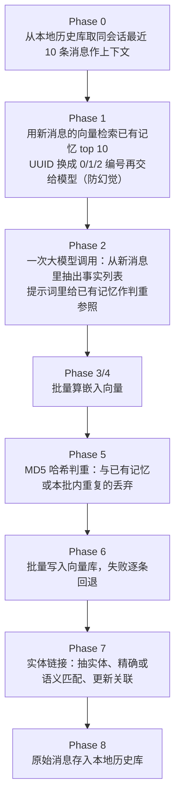

# Mem0

| 源仓库 | [mem0ai/mem0](https://github.com/mem0ai/mem0) |
|---|---|
| 协议 | Apache-2.0 |
| 主语言 | Python（另有 TypeScript SDK `mem0-ts/`） |
| 笔记基准 | commit `753496c`（2026-10-30） |

Mem0（读作 "mem-zero"）是给 AI 应用做长期记忆的组件库，GitHub 上 star 数在同类项目里最高（本笔记写作时约 6.8 万）。它的定位是"记忆层"：你的聊天应用把对话交给它，它从对话里抽出值得长期记住的事实（用户偏好、背景信息、做过什么决定），存进向量数据库，下次对话前按需取回，让模型表现出"记得这个用户"的效果。同类项目有 Zep、cognee、supermemory，本笔记另有专篇。

先说一个读这份笔记前必须知道的事：mem0 的开源版在 2026 年换过一代算法。网上大量文章（包括 mem0 自己早期的论文描述）讲的是旧版机制——让大模型对比新旧记忆，决定每条记忆是"新增/更新/删除/不操作"。这套逻辑在当前代码里只剩一段没人调用的提示词（`mem0/configs/prompts.py:176`），现行算法叫 V3：一次大模型调用只产出新记忆，不改不删旧记忆，把"状态变了"写进新记忆的文本里，冲突留到检索时靠排序解决。这篇笔记按 V3 写，涉及新旧差异的地方会明确指出。

这份笔记按问题组织，不按 mem0 的开发时间线：每个问题讲清 mem0 现在是怎么解的、为什么这么解、代价是什么。项目演进过程放在文末修订记录里。笔记起于 commit `26cdefb`（2026-10-26），跟进到 commit `753496c`（2026-10-30）。

## 它要解决什么问题

大模型没有跨会话的记忆：今天告诉它"我对坚果过敏"，明天新开一个会话它就忘了。常见做法是把历史消息全部塞进上下文，但历史越长，费用越高，模型注意力也越分散，而且"用户三个月前随口提过的事"和"昨晚的对话"在模型眼里没有区别。

mem0 的切入点是把"记住什么"做成一个独立的存储和加工问题：对话进来，先用大模型把其中值得记的内容提炼成一条条短小的事实（"用户对坚果过敏"），而不是保留原话；每条事实配上向量（embedding，把文本变成一串数字，语义相近的文本数字距离也近，据此可以按含义检索）存进向量数据库；检索时拿当前对话去库里找相关事实，按相关度排序返回。应用层因此不用管"记什么、存哪、怎么找"，换向量库、换模型都只改配置。

## 仓库怎么分工

顶层是一个核心包加一圈外围：

- `mem0/`——Python 核心 SDK，发布为 `mem0ai`。记忆的存取、抽取、检索全部在这里。
- `mem0-ts/`——TypeScript SDK，与 Python 版功能对齐，本笔记以 Python 版为准。
- `server/`——自托管服务：一个 FastAPI（Python 的 Web 框架）应用加一个本地管理界面，把 SDK 的能力包装成 REST 接口（`server/README.md:3`）。
- `integrations/`——面向各编码工具（Claude Code、Cursor 等）的插件，内含一个 MCP（Model Context Protocol，一个让模型调用外部工具的标准协议）服务端实现。
- `docs/`——文档站；`evaluation/` 目录是空的，评测框架另仓开源（`README.md:77`）。

核心包内部按"可替换组件 + 一个编排者"组织。可替换组件各有基类和工厂：`mem0/llms/`（大模型）、`mem0/embeddings/`（嵌入模型）、`mem0/vector_stores/`（向量库）、`mem0/rerankers/`（重排序器）。编排者是 `mem0/memory/main.py` 里的 `Memory` 类，所有对外方法（add/search/update/delete）都在它身上，它按配置把各组件拼起来调用。

## 主轴：记忆只增不改，冲突交给检索

记忆系统有一个绕不开的难题：事实会变。用户上个月说"我开燃油车"，这个月说"我换了电车"，那条旧记忆怎么办？直觉做法是让大模型对比新旧记忆，判断该更新还是删除。mem0 旧版就是这么做的，代价是每次写入都要一次额外的模型调用来做比对决策，而且模型判错了没有任何痕迹。

V3 把这个难题反过来解：**写入时永远只增不改**。新增记忆的提示词开头就写明 "Your sole operation is ADD"（你唯一的操作是新增，`mem0/configs/prompts.py:472`）。那旧记忆怎么办？两个机制接住：

1. **把变化写进新记忆的文本**。提示词要求模型在状态变化时写"用户从 X 换成了 Y"这种完整表述（提示词示例见 `mem0/configs/prompts.py:614-618`），新记忆自身就携带了最新状态，不依赖删除旧记忆。
2. **用实体把新旧记忆关联起来**。每条记忆抽出涉及的实体（人名、物品、属性），存进一个独立的实体集合，实体上记录它关联了哪些记忆（`mem0/memory/main.py:1186-1191`）。"燃油车"和"电车"两条记忆都挂在"用户的车"这个实体下。

检索时，三条信号一起给每条记忆打分：语义相似度、关键词匹配度（BM25，一种按词频的老牌文本检索算法）、实体加成（当前话题涉及某实体时，挂在该实体下的所有记忆集体加分）。旧记忆不需要被删除，它要么排名被新记忆压下去，要么因为带上了完整的前后表述而依旧可用。

这个取舍的收益很直接：每次写入固定一次模型调用，成本可预期；写入路径简单，不担心比对出错。代价是记忆总量只增不减，靠哈希去重（完全相同的文本不重复存，`mem0/memory/main.py:1022-1026`）和检索排名来维持检索质量——库会随使用变大，这是设计者明确接受的成本（`README.md:72` 原话 "Memories accumulate; nothing is overwritten"）。

## 模型接入

接入层是四个工厂，全在 `mem0/utils/factory.py`：`LlmFactory`（`factory.py:35`）、`EmbedderFactory`（`:152`）、`VectorStoreFactory`（`:180`）、`RerankerFactory`（`:226`）。每个工厂内部是一张"提供商名 → 类"的映射表，用 `importlib` 按名字加载类（`factory.py:29-32`），并开放 `register_provider()` 让第三方注册自己的实现（`factory.py:127-139`）。想加一家新的向量库，写一个实现类、在表里登记一行，完事。

规模上看两个数字：大模型支持 18 种提供商（openai、anthropic、gemini、deepseek、ollama 等，`factory.py:42-61`），向量库支持 23 种（qdrant、pgvector、elasticsearch、faiss 等，`factory.py:181-207`）。

默认配置值得记一下，都是本地开箱能跑的：大模型默认 openai 的 `gpt-5-mini`（`mem0/llms/openai.py:40`）；嵌入默认 `text-embedding-3-small`、1536 维（`mem0/embeddings/openai.py:15,19`）；向量库默认 Qdrant，本地模式数据放在 `/tmp/qdrant`，不需要起服务（`mem0/vector_stores/configs.py:9`、`mem0/vector_stores/configs/vector_stores/qdrant.py:12`）。

## 记忆写入

`add()` 是整个库最核心的方法（`mem0/memory/main.py:760`）。它有一条不调模型的快速路径：`infer=False` 时把消息原文直接存库，适合"我自己已经整理好记忆内容"的场景（`main.py:882-916`）。默认路径 `infer=True` 走完整加工，代码注释里叫 "V3 PHASED BATCH PIPELINE"（`main.py:918`），一共八步：

几步里有设计的细节值得展开：

- **给模型的参照记忆用编号不用 UUID**。Phase 1 检索到的已有记忆，传给模型前把一长串 UUID 换成 0、1、2 这样的顺序编号，代码注释写明是 "anti-hallucination"（防幻觉，`main.py:936-940`）——模型抄错一串十六进制字符的概率远高于抄错一个一位数。
- **判重是三层的**。语义层：提示词把已有记忆列为"判重参照"（`mem0/configs/prompts.py:503-516`），模型自己不该重复产出同义事实；精确层：写入前算 MD5 哈希，撞哈希的丢弃（`main.py:1022-1026`）；实体层：实体匹配时先精确比文本，比不上再比语义相似度，达到 0.95 才认定是同一个实体（`main.py:1146-1167`）。
- **实体抽取不调大模型**。用 spaCy（一个本地自然语言处理库）抽实体（`mem0/utils/entity_extraction.py:751`），这是写入路径里唯一一个固定成本的非模型步骤。
- **模型调用失败不再吞掉**。V3 把抽取失败从"记日志继续"改成了直接抛错（`main.py:965-971`）——宁可让调用方知道写入失败，也不默默丢一条记忆。

## 记忆的存储模型

一条记忆就是向量库里的一条记录，载荷字段有：记忆文本 `data`、MD5 哈希、创建/更新时间、词形还原文本（`text_lemmatized`，把英文单词还原成词典原形，"running" 存成 "run"，给 BM25 检索用，`main.py:1028`）、三个作用域标识 `user_id`/`agent_id`/`run_id`、可选的归属方 `attributed_to`（这条事实是用户说的还是助手说的）和可选的 `expiration_date`（`main.py:1030-1041`）。

实体是另一种记录，存在名字以 `_entities` 结尾的独立集合里（`main.py:422-424`），载荷是实体文本、类型、`linked_memory_ids`（关联的记忆 id 数组）。记忆和实体是多对多：一条记忆可以涉及多个实体，一个实体挂多条记忆。

值得单独说：**mem0 开源版已经没有图数据库支持了**。旧版可以配 Neo4j 存图谱记忆，V3 把这套约四千行代码整体删除（变更记录见 `docs/changelog/sdk.mdx:398`），官方文档明确图记忆现在是托管平台的功能，不在开源版里（`docs/open-source/configuration.mdx:97`）。开源版的替代物就是上面的实体集合——用"实体表 + 关联数组"在向量库里模拟了一个轻量的图。读旧文章时看到 mem0 的 Neo4j 用法，那已经是历史。

## 记忆检索

`search()`（`mem0/memory/main.py:1393`）默认 `top_k=20`、相似度阈值 `0.1`。检索链路在 `_search_vector_store()`（`main.py:1642`），按顺序做七件事：

1. 查询文本词形还原（与存储侧的 `text_lemmatized` 对齐，BM25 两边用同一套词形）；
2. 从查询里抽实体（同样用 spaCy）；
3. 查询向量化；
4. 向量检索，取 `max(limit*4, 60)` 条——过采样，给后面的融合留出淘汰空间（`main.py:1655-1658`）；
5. 如果向量库支持关键词检索，再做一路 BM25（不支持就跳过，静默退化为纯语义检索，`mem0/vector_stores/base.py:68`）；
6. 实体加成：抽出的实体去实体集合里做检索（阈值 0.5），命中实体用它挂的记忆 id 反查记忆，每条记忆按"实体相似度 × 0.5 × 反频率权重"加分（权重常量在 `mem0/utils/scoring.py:57`，公式在 `main.py:1815-1822`）；
7. 三路分数相加，除以理论满分归一化到 0 到 1，低于阈值的丢弃（`scoring.py:118-119`）。

过滤条件通过 `filters` 参数传入，支持比较运算符和 AND/OR/NOT 组合（`main.py:1416-1431`）。这里有一个 API 设计上容易踩的坑：**search() 拒绝顶层传 `user_id`**，必须写进 `filters`，传顶层直接抛错（`main.py:1449-1450`）；而 `add()` 和 `delete_all()` 又只认顶层参数。三组接口风格不一致，用错位置会直接报错而不是静默忽略。

返回格式是 `{"results": [...]}`，每条带 `id`、`memory` 文本、`score` 分数和时间戳；`explain=True` 时附带三路分数的明细（`main.py:1703-1745`），调试检索质量时有用。

## 更新与遗忘

- `update()`（`main.py:1829`）按记忆 id 定点改文本或元数据，重新算哈希、保留创建时间、刷新更新时间，变更写进历史（`main.py:2077-2105`）；文本变了会摘掉旧实体链接、重新抽取新链接（`main.py:2109-2112`）。作用域标识（user_id 等）不允许改（`main.py:143-162`）。update 还有一条硬保证：向量库的 update 是纯更新、永不创建记录——契约定义在 `mem0/vector_stores/base.py:35-37`（记录不存在返回 False，无法判断返回 None），记录不存在时上层直接抛 ValueError（`main.py:2092`）。这条保证防的是一类竞态：update 执行途中这条记忆被 delete 删掉，以前部分后端的 update 实际是"更新或插入"，会把刚删掉的记忆静默重建；现在各向量库后端的 update 实现逐一改成了纯更新语义（PR 7787）。
- `delete()`（`main.py:1883`）按 id 删单条，同时清理实体上的反向关联（`main.py:2142`）。
- `delete_all()`（`main.py:1904`）按作用域批量删，必须至少给一个作用域 id，否则提示你改用 `reset()`。
- `reset()`（`main.py:2146`）清空本地历史库、重建向量集合、重置实体集合，等于整库重来。
- `history()`（`main.py:1960`）查某条记忆的变更史。

**没有自动过期。** `add()` 可以传 `expiration_date`，但它的全部作用是检索时跳过已过日期的记忆（`main.py:442-451` 的读取时判断）——数据本体一直留在库里，直到有人显式调 delete。也没有按热度衰减、定期清理这类机制。遗忘在 mem0 里是显式操作，不是自动行为。

## 隔离与多租户

作用域由三个键组成：`user_id`（哪个用户）、`agent_id`（哪个 agent）、`run_id`（哪次运行），三者可以组合（比如"某用户 + 某 agent"），但至少要提供一个，全空直接报错（`main.py:391-397`）。隔离的落实方式是"过滤"而不是"分库"：所有记忆存在同一个向量集合里，每条记录的载荷带这三个键，add 和 search 时翻译成向量库的元数据过滤条件（`main.py:1656-1658`）。

有一个防御细节做得比较完整：调用方如果在自己的 `metadata` 里塞了 `user_id` 这类键，会被剥掉并告警（`main.py:140-162`）——防止应用代码把记忆误写进别的租户。作用域值本身也有校验：非字符串强转、去空白、拒绝空值和含空格的值（`main.py:175-209`）。

## 持久化

两个存储各管一摊：记忆和实体在向量库；变更历史和最近消息在本地 SQLite，默认路径 `~/.mem0/history.db`（`mem0/configs/base.py:42-45`，可用 `MEM0_DIR` 环境变量改）。SQLite 里两张表：`history` 记每次增删改（旧值、新值、事件类型、操作者，`mem0/memory/storage.py:102-126`），`messages` 按会话存原始消息、每会话只留最近 10 条（`storage.py:128-148`、`:279-291`）——这 10 条就是写入时 Phase 0 的上下文来源。

## 扩展机制

- **后端可插拔**：四个工厂 + `register_provider()`（见"模型接入"节）。
- **REST 服务**：`server/` 提供完整的增删改查、检索、配置接口，带管理员鉴权和限速（`server/main.py:292-320`）。
- **MCP**：`integrations/` 下的各工具插件共用一个 MCP 服务端实现（`integrations/agent-plugin-core/python/mcp_server.py`），只暴露一个 `search_memories` 工具——给编码工具接入时，最常用的动作就是查记忆。
- **代理封装**：`mem0/proxy/` 提供一个 OpenAI 兼容的聊天接口，内部先检索记忆注入提示词、再转调模型、最后异步回写记忆（`mem0/proxy/main.py:47` 起）。应用不改代码就获得记忆能力，代价是绑定了它的调用方式。

## 可观测性与评估

遥测用 PostHog 匿名上报（`mem0/memory/telemetry.py`），采集的是组件类名、向量维度、Python 版本这类环境元数据，业务事件里的作用域 id 只上报 SHA 编码（`main.py:1214-1219`）。热路径事件抽样 10%（`telemetry.py:32`），生命周期事件全量上报。设环境变量 `MEM0_TELEMETRY=False` 关闭（`telemetry.py:14-20`）。

评测框架在另一个仓库（mem0ai/memory-benchmarks），本仓库的 `evaluation/` 目录是空的。README 里的基准分数（LoCoMo 92.5 等）注明来自托管平台，开源版结果"方向一致但不完全相同"（`README.md:68`）——引用这些数字时要注意出处。

## Agent Loop

mem0 没有 agent 循环，它是被 agent 调用的库：模型只在 `add()` 里被调一次做抽取，没有规划、没有工具调用、没有多轮决策。占位的 `Memory.chat()` 直接抛"未实现"（`main.py:2189-2190`），README 也明确写 "Single-pass retrieval (one call, no agentic loops)"（`README.md:68`）。要给它配一个会自主决定"何时查记忆、何时存记忆"的 agent，那是应用层自己的事。

## 设计原则

从代码组织能读出的几条取舍：

- **写入成本封顶**。每次 add 固定一次模型调用（旧版是最多两次：抽取一次、比对决策一次），实体抽取用本地 spaCy 不花模型钱。成本可预期是它敢做"只增不改"的底气。
- **正确性靠检索而不是靠写入**。不追求写入时把记忆库整理得干干净净，而是把冲突解决推迟到读取时：排名靠前的、表述完整的记忆自然胜出。这让写入路径简单可靠，把复杂度集中到检索融合一处。
- **编号替代 UUID 防幻觉、失败上抛不吞错**，这两处是对"大模型在环"（模型参与执行路径）的防御性设计，值得所有让模型参与数据加工的系统参考。
- **开源版做减法**。图数据库、评测框架都移出开源版（图记忆变托管平台功能、评测另仓），开源核心收敛在"向量库 + 实体链接"这一套自洽实现上。

## 可复用的做法

- **给模型的参照数据用短编号**（`main.py:936-940`）：任何"把检索结果喂给模型做比对"的场景都适用，降低模型抄写标识符出错的概率。成本几乎为零。
- **写入只增、冲突后置到检索**（`main.py:918` 起）：适合事实会演变、但单条错误代价不高的记忆场景。前提是检索侧有可靠的排序融合（多信号打分），否则旧错误信息会浮上来。
- **三层判重**（提示词语义层、MD5 精确层、实体阈值层，`main.py:1008-1026`）：按"便宜的先做"排序，任何去重需求都可以套这个分层。
- **实体集合模拟轻量图**（`main.py:1186-1191`）：不想引入图数据库时，用"实体表 + 关联 id 数组"获得实体维度的检索能力。代价是没有图遍历，只能查一跳。
- **热路径遥测抽样**（`telemetry.py:32` 采样 10%）：高频事件的遥测不必全量，生命周期事件（安装、初始化）低频且重要，保持全量。
- **元数据里的身份键强制清洗**（`main.py:140-162`）：多租户系统里，调用方传入的数据不可信，身份字段只从专属参数收，这是防越权写入的低成本防线。

## 修订记录

- 2026-10-30 初版：基于 commit `26cdefb` 完整成文。覆盖 V3 加性抽取管道（八步）、实体链接存储模型、三信号融合检索、作用域隔离与各扩展面；标注了与旧版 ADD/UPDATE/DELETE 算法和旧图数据库支持的差异。
- 2026-10-31 基于 commit `753496c` 补充：update 语义收紧为"永不重建已删除记忆"——向量库 update 契约改为纯更新（记录不存在返回 False、上层抛 ValueError），各后端实现去掉"更新或插入"行为（PR 7787）。
