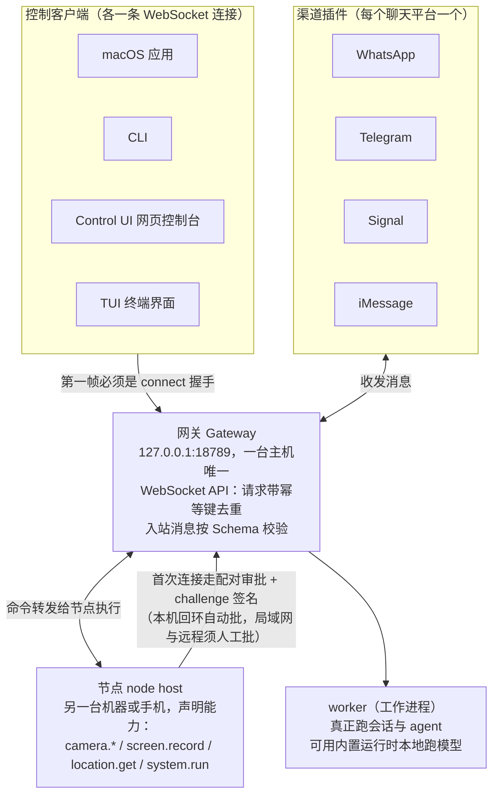
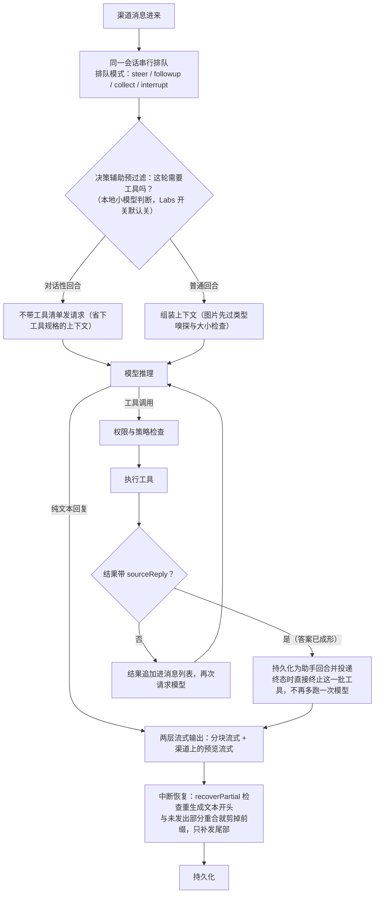

# OpenClaw

| 源仓库 | [openclaw/openclaw](https://github.com/openclaw/openclaw) |
|---|---|
| 协议 | MIT |
| 主语言 | TypeScript（另有 Swift 客户端） |
| 笔记基准 | commit `3b3efe9539`（2026-10-27） |

OpenClaw 是一个开源的个人 AI 助理项目，主体用 TypeScript 写成，加上一套 Swift 的 iOS/macOS 客户端。它在自己的电脑上跑一个常驻的网关程序，把你已经在用的聊天软件（Telegram、Discord、WhatsApp、Slack、iMessage 等 20 多个渠道）统一接到 AI 上，另有 macOS、iOS、Android、Windows、Linux 原生应用。代码规模很大：`src/` 下有上万个 TypeScript 文件，`extensions/` 下有 170 个扩展，`packages/` 下还有 20 多个共享包。它解决的核心问题是：让一个能执行命令、读写文件、替你发消息的 AI 助理，把状态、记忆和账号凭据全部留在你自己的硬件上，同时用写死的规则而不是模型的临场发挥来做安全决策。项目由独立的 OpenClaw 基金会（美国 501(c)(3) 非营利组织）维护，MIT 协议，没有付费版和托管服务。

这份笔记按问题组织，不按 OpenClaw 的开发时间线：每个问题讲清它现在是怎么解的、为什么这么解、代价是什么。项目演进过程放在文末修订记录里。笔记起于本地 HEAD `20eebbd5c7`（2026-09-21），跟进到 commit `3b3efe9539`（2026-10-27）。

## 它要解决什么问题

AI 助理要"能干活"，就必须拿到权限：读文件、执行命令、登录你的账号。这就带来一个矛盾：权限给得越多越好用，出事的范围也越大。OpenClaw 的作者在 `docs/start/why-openclaw.md` 里有一个说法：**架构决定 AI"能做什么"，远早于任何规则决定它"可以做什么"**。也就是说，与其指望模型每次都听话，不如把系统结构设计成"即使模型被骗了，损失也有限"。

另一个痛点是碎片化。你想在 Telegram 上使唤助理，也想在 iMessage 上用，还想让它看看手机摄像头。如果每个平台各装一套程序，各存一份状态，很快就没法维护。OpenClaw 的答案是：一台机器只跑一个网关，所有渠道、所有客户端都连到它，状态只有一份。

## 一个网关，所有渠道

整个系统是一组分工明确的长驻进程和客户端，全部通过 WebSocket（一种双向长连接协议，双方随时可以互发消息）连到网关。

### 网关（Gateway）

网关是本地控制平面，默认监听 `127.0.0.1:18789`（只接受本机连接）。它负责：

- 维持所有渠道的连接（比如 WhatsApp 用 Baileys 库、Telegram 用 grammY 库）。
- 向客户端暴露一套带类型的 WebSocket API：客户端发请求（`{type:"req", id, method, params}`），网关回响应，另外主动推送事件（`agent`、`presence`、`health` 等）。
- 入站消息按 JSON Schema 校验；这些 Schema 是从 TypeBox（一个 TypeScript 的类型定义库）生成的，Swift 客户端的模型类再从 JSON Schema 生成，保证三端类型一致。
- 带副作用的请求（发消息、跑 agent）必须带幂等键（idempotency key，同一个键的重复请求只执行一次），网关保留一个短期去重缓存，这样客户端重试不会导致消息发两遍。

一条硬性不变量：**一台主机只有一个网关**，它是唯一持有 WhatsApp 会话的地方。握手也是强制的：连接后的第一帧必须是 `connect`，否则直接断开。

### 渠道（channel）

渠道是"一个聊天平台"在代码里的叫法。每个渠道是一个插件，负责自己平台的账号、安全和传输细节；核心只保留共享的消息工具和统一的动作词汇表。iMessage、Signal、WhatsApp 这类直接跑在设备上的叫"原生渠道"。

### 客户端与节点（nodes）

- **控制客户端**：macOS 应用、CLI、网页控制台（Control UI）、TUI（终端界面），各自一条 WebSocket 连接，用来查看状态、发消息、管理配置。
- **节点（node host）**：装在另一台机器（包括手机）上的代理，以 `role: node` 连到同一个网关，声明自己支持的能力（摄像头 `camera.*`、录屏 `screen.record`、定位 `location.get`、执行命令 `system.run` 等）。模型始终只跟网关说话；网关把命令转发给节点执行。
- 新设备第一次连接要经过**配对（pairing）**审批，批准后网关发一个设备令牌用于后续连接；连接还要对 `connect.challenge` 这个一次性数（nonce）签名，防止重放。本机回环（loopback，即 127.0.0.1 上的连接）可以自动批准，局域网和远程连接必须人工批准。

远程访问的推荐方式是 Tailscale 或 SSH 隧道，而不是直接把网关暴露到公网。

**推理位置是可调度的。** worker（工作进程）是网关架构里真正跑会话和 agent 的进程。模型推理不必都打到云端 API：worker 可以用内置的原生推理运行时在本地跑模型，这条线从协议到客户端分五层——协议层定义 worker 本地推理的契约；worker 侧实现原生推理运行时；网关负责把推理请求安全地派发给合适的 worker；客户端按"worker 本地推理"的放置策略选位置；本地推理开始前还有一道策略校验（派发权限、会话监管、设备准备），不合规就不落地本地。配置里"必须用 worker"的放置策略（默认关闭）在普通会话创建、首条消息交接和既有恢复路径上都会被执行；用户显式选过的未发送草稿选择保持原样，分离派发时调用者对请求的保管权不丢，范围、profile 和会话的撤销检查照常生效。推理位置由此成了可调度的选择之一，而不是一个写死的常量。整套拓扑画出来是：



## 主轴：可信网关、不可信执行、确定性策略

这是官方文档对整个架构的一句话概括（trusted gateway, untrusted execution, deterministic policy），拆开讲：

- **网关是可信的**：它拿着你的配置、凭据、记忆，是秘密的保管人。
- **执行环境是不可信的**：AI 跑代码、碰文件的地方（沙箱、远程节点、一次性云主机），被当成"随时可能沦陷"的区域。即使模型被恶意提示词（prompt injection，指别人在消息里藏指令骗模型）骗了，或者执行环境被攻破，也拿不到网关里的秘密。凭据可以用 SecretRef 引用，受保护的秘密值根本不进入模型的上下文。
- **策略是确定性的**："这个命令能不能执行"由代码里的规则判定，不靠模型自觉。文档的原话是：拒绝是结构性的（structural），不是"请求模型遵守的请求"；需要审批的路径在规则不满足时一律失败（fail closed，即出错时倾向拒绝而不是放行）。

配套的信任模型文档（`docs/gateway/security/trust-model.md`）还明确了边界适用范围：**一个网关就是一个信任域**。它服务"一个操作者，或彼此信任的团队"；互不信任的用户应该各跑各的网关。当有人发消息给一个开了工具的助理，他就间接共享了助理的工具权限，这对互信的同事没问题，对敌意用户就是漏洞。

它的防御顺序也很实在：先定身份（谁有资格跟机器人说话，陌生人要配对），再定范围（机器人能在哪干活，哪些工具开放，要不要沙箱），最后才考虑模型（假设模型可能被骗，让被骗的后果可控）。

有一点官方说得很坦白：沙箱和执行审批**默认是关的**。默认安装是一个"信任单操作者"的助理，加固是主动的配置动作，`openclaw security audit` 会告诉你哪里偏离了加固基线。"默认好用"和"默认最安全"是两个不同的取舍，项目选了前者并把话说明，没有嘴上说安全最重要、实际上什么都默认开。

这条主轴在每个机制里都有落点：审批绑定的是"当时那份计划"、部署级工具白名单在普通授权之后再加一道硬上限、常驻 watcher 的批准只授权那一个确切的提案（均见"执行环境与取消传播"）、浏览器路由失败时不用别的机器顶上（见"浏览器控制"）、秘密用引用传递（本节）、审批测试共享同一份契约（见"测试体系"）。

## Agent 循环与消息流

一条消息进来后的处理链路叫 **agent loop（智能体循环）**：接收、组装上下文、模型推理、执行工具、流式输出、持久化。同一个会话的多次运行被串行化（一个会话同一时刻只有一个运行在干活），避免工具和会话状态竞争。整条链路画出来是：



**纯对话的回合可以不发工具清单。** 被判定为对话性的回合（寒暄、追问、不需要动手的交流）可以省略工具清单再发请求，省下的正是每次请求都背着的那份工具规格上下文。判定来自"决策辅助预过滤"（decision assistance prefilter，一个本地小模型判断这轮需不需要工具），但它不擅自生效：挂在 Labs 的 `decisionAssistance` 配置下（用户显式同意才开），还要求 harness 声明支持"回合级工具限制"能力（不支持的场景比如 Codex 执行引擎，就保留原来的工具策略）；回合里挂着待办的动作指令、或请求已取消时，也不启用。这个方向跟设计哲学里"核心有每次调用的税"的判断一致：既然每个工具都出现在每次请求里，能确认用不上的回合就不该缴这笔税。

**反过来，工具也可以直接交付完成的回复，不再多跑一次模型**（2026-10-04）。工具声明 `canDeliverSourceReply` 并在结果里带上写好的答案（`details.sourceReply`），运行时把它记为"工具创作的源回复"——持久化成助手回合、像助手文本一样投递进对话，并在回复是终态时直接终止这一批工具。答案已经成形的工具（查完的资料、跑完的脚本、发出去的消息）不再额外消耗一次"把工具结果交给模型、让模型复述一遍"的回合。SDK 侧把入口收敛成一个 helper（`captureToolAuthoredSourceReply`）；转录写入失败时投递照常进行、失败只记日志。这条跟"对话回合省工具"是同一笔经济账的两端：那头省的是不需要工具时的工具清单，这头省的是不需要模型时的模型调用。

流式回复有两层（`docs/concepts/streaming.md`），而且明确说明**没有真正的逐 token 推送**到聊天渠道：

- **分块流式（block streaming）**：模型每写完一段，就把这一"块"作为正常的渠道消息发出去。块的大小由 chunker 控制，有最小、最大字符数和切分偏好。
- **预览流式（preview streaming）**：在 Telegram、Discord、Slack 等渠道上，先发一条临时预览消息，生成过程中不断编辑追加，结束后再定稿。

**断线恢复与前缀去重**。流式输出可能中途失败（网络闪断、超时），恢复的办法是让模型重新生成。但模型重试时常会从头再说一遍，前半段你已经发给用户了，重发就成了复读。`src/auto-reply/reply/block-reply-delivery.ts` 里的 `recoverPartial` 用了一个很轻的解法：检查重新生成的文本开头是否与"还没发出去的剩余文本"的开头重合，重合就把前缀剪掉，只补发尾部：

```ts
const prefix = fragment.payload.text?.trimStart();
const remaining = text?.trimStart();
if (!remaining?.startsWith(prefix)) {
  break;
}
text = remaining.slice(prefix.length);
```

它不需要任何额外的状态记录，用内容本身自证重复，简单且可靠。同一文件里还有一个串行化设计：多次投递通过一条 Promise 链（`sequence`）排队，前一次投递失败时，下一次续写会先观察失败的回执，而不是跳过未发送的前缀继续发，避免内容错序丢失。

**发给模型之前，图片要先过检查**。模型对图片格式有要求（Anthropic 的接口只认 jpeg、png、gif、webp 四种），也不能太大。`src/media/anthropic-inline-images.ts` 在把图片塞进请求前做四件事，每一件都是处理不可信输入的标准动作：

- **嗅探真实类型**。怎么知道一段数据是什么文件？最可靠的办法不是看它自称什么，而是看开头几个字节的"魔数"（magic number，每种文件格式约定的特征字节，比如 PNG 开头固定是 `89 50 4E 47`）。这种读开头一小段猜类型的做法叫 MIME 嗅探。代码以检测出的类型为准，检测不出来才退回相信声明值：不轻信自报家门。
- **只解码前缀，不解码整张图**。图片以 base64（把二进制数据变成纯文本的编码）传输，规律是每 3 个原始字节变成 4 个字符。想嗅探类型只需要开头 N 个字节，那么取 base64 字符串的前 `4 × ceil(N / 3)` 个字符去解码就够了。一张几十兆的高清图，为了"闻一下类型"把整张图解码进内存太浪费，只解码最小前缀，内存和速度都省了。
- **不支持的格式转成通用格式**：检测到 BMP 就转 PNG，其他不认识的一律转 JPEG。给下游一个它一定能接受的格式，比自己维护一个大列表省事。
- **进门就设上限**：解码前先估算大小，超过 10MB 直接拒绝，不让超大输入拖垮系统。

**推理-only 回合撞上输出上限，不再发起无效的付费续写**（提交 ab7631a256，关联上游 #88656）。provider 重放（把已有消息重新发给厂商让模型续写）有个上游行为：只含推理、没有正文的回合若是在输出 token 上限处截断的，重放时会整个排除——模型根本看不到它。但推理-only 的恢复逻辑此前仍会让模型"从这个半截回合继续"，发起一次注定没有上下文依据的付费重试。现在续接资格复用重放的判定：重放里不含的回合直接以输出上限的结果收尾；重放里包含的推理-only 停止照旧可以续接；厂商明确返回的结构化拒绝仍是终态。

## 会话与队列

会话（session）是"一段持续对话及其状态"的单位，用 `sessionKey` 标识。文档特别提醒：`sessionKey` 只是路由选择器，不是授权令牌，别把它当成安全边界。

同一个会话的多个运行串行排队，防止两个运行同时改一份状态。聊天渠道的消息进来时可以选择排队模式（steer、followup、collect、interrupt）：比如"steer"让新消息改变正在进行的运行方向，"interrupt"打断当前运行直接处理新消息。这些模式最终都汇入同一个会话队列系统，用户在聊天软件里发一句"换个思路"，就能实时影响正在跑的任务，这是助理型产品的关键体验。排队里的后续消息在轮到自己时接管自己的派发回调：此前排在其后的回合会在前面的回合结束时拿到对方的回调——那条请求结算时授权已释放，第一条进度更新就报"操作者执行授权已失效"，把已经完成的回合标成失败（提交 d38a8d3171）。

子运行（父 agent 派生出去的 subagent 运行）的续接权限统一按持久化的 `spawnedBy` 血缘来定：在共享的运行留存边界上，从血缘里选出谁有权续接，原生 subagent 的准入例外被移除，子血缘穿过 agent、chat、Talk 三条准入路径；一个被中断的子运行，在它恢复后的父运行结束之后仍能通过 `sessions_send` 续接，来源校验、范围与模型上限、撤销、父 Stop 取消都照旧（提交 76cf9fe14c）。让出（yield，子运行主动暂停把控制权交回）的收集器有一条明确规则：没有记录结果就持久化为 yielded 的收集器永远不能再续接，注册表清扫器显式把这类行结算掉（保留让出时间作为结束时间），`agents_wait` 等它时返回 failed 带诊断，而不是永久挂起（提交 72ffe36e12）；可续接的让出叶子会显示已暂停多久（提交 bf6ed0e146）。

生成方还可以要求**盲子任务**（提交 57a6b7b610）：宿主在能力清单里声明 `native-subagent-blind-v1` 后，`spawn` 可带 `blind: true`，模型的 `sessions_spawn` 工具同样接受——典型用途是评测试验，评测的指令不该告诉子任务它跑的是哪个模型、在哪跑。盲子任务的提示词省略当前模型身份、运行时信息里的模型与 agent 等字段、工作区路径（一律显示为 `<workspace>`）以及任务上下文里的请求方与子会话键；其余一切不变——模型选择、工具、工作目录与文件边界、验收与收集回执照旧使用并上报真实模型，父会话列表照常显示。这个设置存在子会话上，它后续回合与自己派生的隐藏子任务保持盲态。`blind` 要求 `context: "isolated"`（分叉转录会带上请求方的对话，`fork` 被拒绝），也不能与 `runtime: "acp"`、`visible: true` 同用。盲化只覆盖 OpenClaw 自己渲染的提示词（内置运行时、CLI 后端、压缩），管不到 CLI 自带的说明或插件自写的指令；子任务仍可能从上报模型身份的工具（如 `session_status`）与宿主环境事实里得知自己的型号——提交明说它不授予任何权限，也不承诺万无一失。

**委托出去的活归到发起它的人名下。** 通过操作者工具新建的委托会话与自动化，默认保留"核实过的发起人"作为创建者（creator），不需要开 Labs 开关；被指派的所有者（assigned owner）仍是另一个概念——仅改指派不转移创建者权利，分享、公开链接管理、归档、恢复仍归创建者。文档把边界写得很直白（`docs/concepts/session.md` "Creators and assigned owners"，提交 3097ceed22）：被选中的工具使用者提供的是执行授权，不能证明任务是它发起的；没有可归属人类的自主工作记为 agent/system 创建。归属影响发现、创建者控制与无所有者时的个人档案回退，不改变执行身份、模型与工具权限、沙箱身份，也不会自动公开会话。归属存在既有创建记录里：旧版运行时忽略这段附加归属、按自己的旧规则办事，写回时保留记录，回到新版归属仍在。

扩展行为靠两套 hook（钩子，在固定时机被调用的回调）系统：内部的 `HOOK.md` 脚本响应命令和生命周期事件；插件 hook 则是带类型的 `api.on(...)` 处理器，挂在 agent 循环和网关 pipeline（pipeline 指请求从进来到出去经过的处理流程）的固定位置，比如 `before_tool_call`（工具调用前拦截）、`message_sending`（消息发出前可以取消）、`before_compaction`（上下文压缩前后观察）。`{ block: true }` 这类阻断性返回是终态，会拦住后续低优先级的处理器；返回 `{ block: false }` 则什么都不做，也不会清除先前的阻断。

**上下文压缩默认走服务端**。在 OpenAI 和 Anthropic 的 API-key 路线上，压缩默认是 provider-native（服务端压缩：对话全文保持在服务商的检查点里，客户端不再自己跑一遍摘要模型）。此前两条路线的默认并不一致：OpenAI 路线的自动压缩已走 `/responses/compact`，手动 `/compact` 却总是本地摘要；Anthropic 路线的阈值压缩更要手动打开——统一成默认服务端，并顺带修掉这条路径上实测暴露的三个缺陷。压缩在哪一端做，牵动成本、隐私边界和 hook 能观察到什么，默认对齐到服务端是个明确的取舍。ChatGPT 登录路线的服务端走法：下一次普通模型请求的末尾附带一个 `{"type":"compaction_trigger"}` 条目，由服务商返回一个不透明的 compaction 条目顶替整段历史。请求走原有的 attempt pipeline 和原生 ChatGPT 流，工具、指令、参数、缓存键和完整输入前缀都是本回合自己的，压缩请求因此能吃到温热的前缀缓存——客户端自己另起一炉做摘要（0 个缓存 token）做不到这一点。压缩还有一道保险：安全超时是聚合的挂钟时间，每次收到压缩进度汇报就重新计时（提交 d942bc5b1f）。动机写在提交里：推理型模型在大上下文上正常生成一份摘要也要几分钟，固定总时长会把健康的压缩中途杀掉；计时跟着"还有没有进展"走，而不是跟着"总共用了多久"走。

## 插件生态与开放标准

核心之外的几乎所有能力都是插件：模型提供商、渠道、记忆、语音、Codex 执行引擎。插件分两种风格：

- **代码插件（code plugin）**：跑 OpenClaw 的插件代码，适合需要运行时 hook、提供商、渠道、工具这类进程内扩展点的场景。
- **打包插件（bundle plugin）**：只打包稳定的外部物件（技能、MCP 服务器、配置），接口更小更稳，安全边界更好，能用就用这种。

插件通过 npm 包分发，官方注册表叫 ClawHub，带发布审核、安全审计和逐版本的信任结论（安装时使用）。第三方插件也可以经由同一条 SDK 通道接入，整个消息渠道都可以是社区插件。SDK 暴露的入口点数量受到"只减不增"的上限管理，增长必须是一个显式决定。

**插件的状态存储有现成的合规矩选项**：插件的状态回调不在网关主线程上做 SQLite 操作（返回 Promise 的接口也不例外）——"数据库活儿不占主线程"是仓库的硬纪律。插件作者拿到一个带版本号的、归 worker 所有的 keyed store（按键取值的存储，读写都在后台线程完成），已有的同步和回调式接口保持原有的完成语义不变——纪律不该只约束官方代码，也得给插件一条不用破例就能守规矩的路。

**插件影响运行中 agent 的方式**。此前插件在 agent 干活时发现问题，只能把补充上下文排进下一回合——等轮到它，这一跑往往已经按有问题的路线走完了。`api.session.workflow.steerActiveRun()` 让插件直接给进行中的运行插话：返回插话是否生效（生效时带上运行 ID），没生效时说明原因。另一个接口 `api.runtime.subagent.forkSession()` 解决"审阅要看全量上下文"的成本顾虑：插件可以在会话当前上下文的一个临时分叉上提问、拿回回答文本和 token 用量，原始会话不受影响；运行中、回合刚结束、agent_end 之后都能调。为什么值得多花这份钱，提交里给了数字：一个只看有界摘录的审阅插件，5 轮里错了 2 次（把还在轮询的后台命令误认成又新启动的命令）；看到完整会话上下文后，5 轮全对。摘要省 token，但审阅的误报更贵。第一个用上 forkSession 的插件是 Advisor。

**经认证的插件命令长出了腿。** 这组能力有一条贯穿的纪律：每扩一步都绑着一条收紧。插件代表请求方注册的命令（requester command）此前只能在请求方在场时执行一轮，现在它们可以启动原生 subagent（提交 7ba05b6836）——作为交换，命令回合本身被拒绝直接调用模型，模型工作必须路由进被接纳的原生 subagent；还可以调度有界的后续回合（`scheduledTurns`，提交 ad407430c4）——期限最多 7 天、单个调度至多跑 100 次、一次调用最多 4 个调度、每个已加载插件实例加父会话最多 8 个活跃调度，每次发生都按**当前**策略恢复原请求方的身份，并重新核对父会话与插件实例没有变过。配套把请求方范围的模型目录暴露给命令（提交 414a00cd3c）。

调度的存续靠绑定而不是无条件恢复：接受的调度在作业状态里记一份私有的重启绑定（提交 dfe0396d25）——服务它的网关进程、插件实例与插件源摘要（digest，内容的指纹），重启后仍按原来的边界与每次发生的权限检查执行。绑定机制在核心捆绑插件这一侧换了一种凭据（提交 245e575646）：捆绑插件加载的是宿主自有模块、没有可抓的源摘要，改用构建身份——该构建 `dist/build-info.json` 里的 build ID（连同版本、提交与构建时间），加上插件 ID 与构建内真实的根与入口，同一构建重启后调度照原边界重新武装。subagent 一侧，同一条纪律的落点是档案（提交 492af55908）：插件可以在清单里声明本地 subagent 档案（经 `api.agent.registerSubagentProfile` 注册），档案为这个 subagent 添加包自有的指令、但**只能移除工具**——不能添加工具，也不能动认证或沙箱；不带档案的既有派生行为不变。

**云 worker 回合也要过插件的准入钩子**（提交 3a342c5701）。网关的 `before_agent_run` 插件钩子能观察并调整回合的最终系统提示词与输入，但这条检查此前只覆盖网关本地执行的回合——云 worker 上执行的回合绕过了它，插件既看不到也改不了。现在 worker 运行前先向网关请求回合准入（turn admission）：钩子的输入由网关自己准备（不信任 worker 上报的事件内容），按每个钩子自己的时限执行，批准与确切的回合声明（turn claim）绑定在一起——持久化、代理推理、网关工具、live 事件都要求这份批准；被取消的运行仍会结算终态回执。时限上留了量：钩子顺序执行、各有 15 秒期限，加起来可能超过默认 30 秒的 RPC 超时，worker 给准入最多等 10 分钟。没有准入协议特性的旧 worker 走原路径（协议定义在 `packages/gateway-protocol/src/schema/worker-turn-admission.ts`）。

**插件激活之前先查运行时兼容性**（提交 aae13944bd）。安装与激活之间多了一道分析：按插件声明与依赖图检查它与当前运行时合不合，隐患在激活前报告出来（`src/plugins/plugin-runtime-compatibility.ts`、`installed-package-runtime-graph.ts`），可选调用与宿主链接的诊断也覆盖在内——问题在起作用之前被点出来，而不是运行到一半才暴露（`docs/plugins/runtime-compatibility.md`）。

**决策模型（decisionModel）是一个新的模型角色。** 它不做对话，只对送进来的证据按一把评分细则（rubric）给出有类型的答案：多选一、一个分数、或一个布尔概率，适合"这条请求该路由到哪""紧急程度打几分""满足条件吗"这类有边界的判断。官方概念文档把三个模型角色摆成一行对比：主模型管对话和工具调用，utilityModel 管标题摘要这类短文，decisionModel 管分类、评分与谓词判断（docs/concepts/decision-models.md）。核心提供 `decision_evaluate` 工具，跟随 Control UI 里的 Decision 选择加普通工具策略，提供方健康度不影响工具是否在场（src/agents/tools/decision-tool.ts 的 createDecisionTool）；模型目录为它描述专门的能力面——任务、协议、模态、推理、接地、概率语义、弃权与计费各算各的，不与聊天模型类型混用（提交 66dcec88fe）。提供方走插件：ONNX 本地 CPU 分类器、OpenAI Platform 的 Decisions API、TypeSafe AI（托管 Jev 或自托管 System One 服务器）、OpenRouter 的原生 Jev 决策与 ClawRouter 的原生类型化 Decisions（提交 eaaf553321、121758697b）。配套三笔：插件可自带模型凭据（PR 156799）、实用模型有独立的降级链（PR 173906）、插件包默认从 ClawHub 安装（d6d7435f59）。

模型提供商插件又多了一个有代表性的例子：Bifrost（一个 OpenAI 兼容的 LLM 网关，把 20 多家提供方统一到一个端点后面）此前只能手工配置，现在有内置的 `extensions/bifrost` 提供方，按 LiteLLM 提供方的形状实现——交互式设置问网关的基础 URL、可选的虚拟密钥，再从网关的 `/openai/v1/models` 列出模型并默认选第一个；发现失败时先说明原因再退回手工填写，发现期间配置变了就在发送凭据前中止。它指向 Bifrost 的 OpenAI 兼容面（如 `http://localhost:8080/openai`）而不是核心 `/v1` API，发现与对话补全共用一个基础 URL；Bifrost 发布带提供方前缀的模型 ID（如 `openai/gpt-4o-mini`），在 OpenClaw 里解析成 `bifrost/openai/gpt-4o-mini`；无认证启动的自托管网关允许匿名接入（提交 de8de9c569）。提示词缓存有了一份成文的参数说明（`docs/reference/prompt-caching.md`）：OpenAI 兼容路线自动带稳定的 `prompt_cache_key`——直连 `api.openai.com` 自动带，代理需 `compat.supportsPromptCacheKey: true` 显式打开；`cacheRetention: "long"` 在 GPT-5.6 及之后的两个 API 上请求 30 分钟缓存寿命（`prompt_cache_options.ttl: "30m"`），更早的原生模型只在 OpenAI 文档列出的延长保留名单上收 `prompt_cache_retention: "24h"`；GPT-5.6+ 的 Responses 请求还可以按模型配 `params.promptCacheTtl: "12h"`（或 `"30m"`）——按 OpenAI 的价目，30 分钟写入按普通输入的 1.25 倍计费，12 小时写入 2.5 倍，用量里的 cache_write 按上报的寿命计价而不是请求默认值（提交 4697b8ec80）。同一份文档把几条"缓存为什么没命中"的观察也写成记录：换模型必然换缓存谱系，换思考档位同样会失效；Responses 路线把整个系统提示词作为 `instructions` 发送，日期翻转、时区、提权等级这些易变后缀一变，从变更点起重新缓存——这与 Anthropic 检查点式的分段缓存不同。插件重载方面，阻止重载的保留引用现在能被点出来：哪个模块还握着旧实例，诊断直接列出（提交 bd2dbfdeb4）。

**Claws：便携的 agent 配置包（Labs 实验功能）。** 一个 Claw 是给新 agent 的一套可携带的设置：指令、工作区文件、技能、插件、MCP 服务器、自动化，清单文件是 `CLAW.md`。"添加"是单向动作——创建一个普通 agent 并安装它的依赖，不留下一个"已安装的 Claw"去管理，再添加一次就是再建一个 agent；没有状态、更新、移除、导出命令，想用新版就再添加一个。agent 自己也能造 Claw：从 agent 设置选 "Create a Claw"，把 `/skill create-claw` 发进它的主聊天，agent 提出输入、任务、输出与权限边界，写一份私有草稿、返回审阅链接；审阅弹窗列出确切的归档文件与声明的技能、插件、MCP、自动化依赖，可以取消勾选可选项后再发布，"要求修改"回到同一个对话。发布与搜索走 ClawHub 的独立注册表面，Control UI 可浏览官方与社区 Claws、按安装量排名（`docs/cli/claws.md`，提交 c9a7947148、99740c1827、94867f9f88、a4a0223bc9）。它把"一个配好的 agent"做成了可分发的物件，但刻意不做成需要跟踪状态的"安装"——添加完就是普通 agent，用普通 agent 的命令管。

标准协议方面，OpenClaw 同时是 MCP 客户端和 MCP 服务器（MCP，Model Context Protocol，是让模型接外部工具和数据源的开放协议）；其他智能体可以通过 A2A 1.0 协议找它合作；编辑器通过 ACP（Agent Client Protocol）连它——运维方还可以选择把网关的环境变量挡在 ACP agent 之外，不让它们继承网关进程的环境（提交 670a7ab33b）；智能体还能在会话面板上渲染 A2UI 动态界面组件；网关甚至能对外提供一个 OpenAI 兼容的 HTTP API（默认关闭），让现成的 OpenAI 客户端直接把请求打给网关。可观测性走 OpenTelemetry 和 Prometheus 导出。

### 记忆：一个特殊的插件槽

**记忆（memory）同一时刻只能激活一个插件**。官方目前内置多个方案，计划逐步收敛到一个推荐的默认路径。

**记忆接口是中立化的**。记忆的调用方不绑死在任何具体实现上——如果接口绑死在"按工作区文件搜记忆"的内置实现上，记忆插件的记录存在数据库里就提供不了召回。现在的 MemoryProviderRuntime 把接口中立化：提供方注册时声明自己的能力（数据来源、分页、候选类型、项目过滤），宿主在打开时校验声明，绑定的句柄在真正调用提供方之前就拒绝未声明的请求；项目召回、实时语音上下文、触发召回、记忆 Wiki 这些调用方在槽主注册了中立运行时就走新接口，没注册的旧实现保持原路径，两条路的行为（用途、授权、结果、引用标签）保持一致。配套的另一半是把"记忆受众"的判定收进宿主：调用者是代表所有者本人、还是代表某个具体会话，宿主从已受理的回合条目和派生链每一跳的信息直接生成受众标签（owner-private 或某个确切会话），提供方拿到的就是结论，不用自己沿着派生链（agent 派生出的子会话）逐跳查会话去推，而且这条派生链在会话创建、重置、滚动中都不会断。定时任务也接进了这套判定（提交 ddbf65c921）：定时运行继承其父会话的记忆受众——所有者直聊派生的定时子任务拿 owner-private 记忆，非所有者或群聊父会话只拿会话级记忆；父会话在运行中途被重置，两边都拒绝记忆提供方的读写。配套地，定时子任务的看板、固定 widget 与媒体工具作用到父会话的可复用会话键上（提交 80f42069a8）——定时任务不是无主任务，它带着发起会话的隐私边界干活。接口中立化的次序是标准的：先有实现、再有接口、最后让"多个实现可互换"成为可能。

记忆槽的周边也在变厚。运维侧，LanceDB 记忆插件支持显式的离线整表优化（提交 356525d1d6）——优化期间持共享的使用租约与独占的维护权（`extensions/memory-lancedb/lancedb-custody.ts`），记忆行与版本历史原样保留，结束后打印碎片与行数，流程写进了离线维护文档。实现侧，Knowledge 插件捆绑进仓库（提交 65ad180052，源自 openclaw/knowledge）——一个带证据的知识库兼记忆提供方，agent 把页面、论断与类型化的关系存成 Markdown 记录，每条保留来源证据，写入有日志、本地留 Git 历史；它默认关闭，在 `plugins.slots.memory` 里选 "knowledge" 启用（`extensions/knowledge/README.md`、`docs/plugins/knowledge.md`）。

**向量记忆检索的性能**。sqlite-vec（SQLite 的向量检索扩展）路线的 `memory_search` 有个反直觉的慢点：KNN 子查询每次请求开一个只读连接，页缓存只有默认的 2 MiB；紧随其后的 cosine 重排要把每个候选的 float32 向量从 vec0 块 blob 里读出来——4096 维时一个 blob 就有 16 MiB，而且**读 blob 越靠后的部分越贵**。于是出现一个典型的缓存病：同一个连接反复深读同一个 blob，页缓存装不下，深处的字节每次都从磁盘重来。修法是把已有的连接本地缓存策略（`configureSqliteMaintenanceCache`，64 MiB）套到这个每请求连接上，行、顺序、距离逐字节不变，变的只是缓存覆盖住 blob 之后那些重复读消失（提交 2d305eb206）。另一笔在去重：`dedupeEntries` 每比较一次就对两个片段各分一遍词，`isEntryCoveredByRecentDiary` 对每个候选都重新分词、归一化一遍最近的日记页；改成每条保留条目只准备一次 token 集、候选按路径分桶、MMR（最大边际相关排序）与去重共用同一份已准备的相似度，结果与合并顺序不变（提交 e8487347d3）。两笔的共同点是**先证明"结果不变"，再只动成本**——性能改造能这么干净收尾，靠的是改造前就有一致性可以对照。

**排序里的时间衰减可以按来源关掉。** 内置记忆引擎在混合检索相关性之后，对带日期的日记固定套一个 30 天半衰期的时间衰减和一个重要性乘数，再做 MMR 多样性排序（lambda 固定 0.7）；`MEMORY.md`、`USER.md` 这类常青文件本就不衰减。`memory.search.extraPaths`（额外索引的目录或文件）的条目现在可以写成 `{ path, pattern, evergreen }`，`evergreen: true` 给稳定的参考资料（比如运维手册）关掉时间衰减——它们的价值不随文件修改时间变老而下降；语义/关键词相关性、信任、来源、自动注入资格不变，也不覆盖 `memory/YYYY-MM-DD*.md` 日记的日期衰减；同路径同模式的重复条目以最后一条为准；只改查询时的排序，不重建索引、不重新向量化（`docs/reference/memory-config.md`，提交 b5bab41b16）。

**远端 embedding 的凭据跟着目的地走，不跟着适配器走**（提交 6770c6a6bd）。`memory.search` 配了远端 embedding 端点时，它的认证此前从全局默认的提供方配置继承——两个配置用的是同一个适配器（比如都走 openai 适配器），但指向的是不同的租户（各自配的 baseUrl），借来的凭据可能打不开自己的目的地。现在的判定按提供方身份归一化后比较：搜索配置的提供方与全局一致、或搜索没有自己的 baseUrl 而全局有，才继承全局的认证；配置向导里换提供方时，把各个 agent 借用的远端凭据落成它们自己的显式条目——启用一个新 agent 不会让它顺着继承链拿到别的租户的凭据。持久化侧同样防了一手：字段的"缺失"在保存与重载后仍是缺失，不会被折叠成"继承"。

**技能按需搜索读取，不全量进提示词**。技能（skill，把一段可复用的指令流程打包成的文件）原本受提示词限制：提示词里装不下的技能只能放弃。现在的模型是：超出提示词限额的合格技能保留在已安装目录里，agent 用两个安装技能工具（搜索、读取全文）按需取用——先搜名字，再读正文。实现上有几道克制：正文索引是惰性建立的（用到才建），超限额或暂时拿不到正文的技能退回"只搜元数据"；缓存命中也要重新校验当前的读取权限，不是命中就放行；整文读取的路径保留，索引只是加速层。技能因此可以越装越多，而不把提示词撑爆。

## 执行环境与取消传播

**AbortSignal：标准的取消机制**。AbortSignal 是现代 JavaScript 里表示"取消信号"的对象：创建任务时带上它，取消方调用 `abort()`，任务侧监听 `abort` 事件后停下并清理。发起方和执行方不必认识对方，共享一个信号即可，类似消防警报：谁拉响的不要紧，听到的人行动。Signal 渠道（`extensions/signal/src/client-container.ts`）的 WebSocket 接收流里有几个标准做法：

- 收到 abort 先让已接收的消息排空（drain，即把已接受的事件处理完），排空超时才强制 `ws.terminate()`，兼顾"别丢消息"和"别挂着不退"。
- 任务正常结束时用 `removeEventListener` 摘掉监听器，防止任务结束后信号再响还去执行清理。
- 注册前先检查 `signal.aborted`，信号已经中止过就直接按取消处理，不再白挂监听器。

**超时不等于失败**。OpenClaw 可以把 Codex（OpenAI 的编程智能体）当作一个"执行引擎"插件接进来。请求发出后要等 Codex 的 app-server 回应，等待有超时；但本地等待超时，不代表对端的任务真的失败了。`extensions/codex/src/app-server/request-attempt.ts` 用一句注释点破："本地等待器过期，不一定意味着原生响应也没了"（local waiter expiry need not imply a native response）。它的实现把两件事分离：

- **attempt（一次真实的线路请求）**：只要请求可能已经写到对端（`mayHaveWritten`），这个尝试就保持挂起，等原生响应到达。
- **waiter（一个等待者）**：等待者可以各自带超时或取消信号，超时的等待者拿到"timed out"错误退出，但不杀 attempt；后续如果有原生响应回来，其他等待者仍能拿到结果。

好比：你拜托朋友办事，等了十分钟没回音就先回家了（等待超时），但朋友手里的活不会因为你回家就停了；他办完后通知你，你还能知道结果。如果代码把"等待超时"直接当成"取消任务"，就会误杀还在正常工作的对端回合。

**定时子任务继承父会话的工作区与沙箱**（提交 603c8a7900）。定时运行此前默认在自己的 cron 根里干活；现在它可以跑在父会话绑定的 workspace 与沙箱里——但文件作用域保持在根（子任务自己的工作区），不借父会话的文件范围。继承是有生命周期的：子任务携带父会话的代际检查（generation check，会话每次重置都会推进的代数），工作区准备时把父会话的检查组合进来，提示词执行器把它作为已接纳运行的来源断言传下去——父会话一旦重置，内嵌的工具权限就拒绝子任务后续的一切动作；CLI 的宿主位置检查同样收到这次继承的沙箱要求，已有的 cron 根保留自己的记录、不收创建时的元数据（`src/cron/isolated-agent/run-workspace.ts`、`src/cron/parent-reset-watch.ts`）。与记忆受众的继承（"记忆：一个特殊的插件槽"一节）合起来看，定时子任务的边界跟着发起会话走：会话活着，继承来的权限活着；会话重置，权限随之失效。配套的一笔沙箱卫生（提交 8b99577d46）：工具的临时工作目录（checkout 根的 `.openclaw/tmp`）经共享的运行时策略排除出工作区结果——扫描工作区文件不会把工具自己产生的临时文件当成用户的产物，更早的待定结果一并排除；用户文件的边界与显式恢复路径不受影响，文档同时写明持久化的输出应放在临时目录之外。

**审批绑定的是"当时那份计划"**。节点命令（在另一台机器上执行 `system.run`）走审批时有一个容易忽略的细节：执行路径先把要跑的命令整理成一份规范的 `systemRunPlan` 存下来，用户批准的是这份存储下来的计划；之后网关转发的是这份计划，而不是调用方后来可能改过的命令或目录，执行前还会重新校验工作目录。对解释器类的命令，如果无法确定唯一的本地文件操作数，审批式执行直接拒绝，而不是假装覆盖了所有运行时语义。这个设计堵住了一个经典漏洞：批准时看的是 A 命令，执行的却是 B 命令。

**部署级的工具与动作白名单（`tools.gatewayPolicy`）。** 普通的工具策略（profile、allow/deny、沙箱工具门）之上，部署方（比如企业内统一部署网关的运维方）可以再加一层对**模型驱动的工作**生效的硬上限，没配置时一切照旧。`allow` 列出允许的具体工具身份——必填，空数组等于一个都不许；通配、工具组、整个插件的授权一律拒绝；别名如 `cron` 解析到同一身份 `automations`。凡是带 `action` 字段的工具还要在 `actions` 里逐个列出允许的动作，发布给模型的 schema 只含这些动作，执行时也要求动作在许可内，空动作列表等于不给这个工具。它在普通授权之后应用，所有者发起的对话也不例外。Tool Search 与 Code Mode 仍可作为分发器使用，但只覆盖许可内的目录，不能借它们碰到被省略的工具。执行检查放在 hook 与审批准备之后——hook 不能把一个允许的请求改写成禁止的动作；工具组装时捕获这份策略，留存的执行器与目录带着它走。改这个配置需要重启网关：部署方在部署时提供策略，旧工作结束后通过重启或替换激活。这张白名单还覆盖网关供给执行引擎的工具：Codex 适配器在工具增删之后应用它，声明的目录与可执行的回调都受检，Codex 原生编码工具与 subagent 不受限（`docs/plugins/codex-harness-reference/dynamic-tools.md`，提交 6796ef305f）；回调执行时检查的是工具构建时捕获的那份部署策略，恢复的旧线程也不例外，重启后重建的回调用新策略，保存的原生声明保留指纹，先前宣传过的工具因此可能返回策略拒绝。自动化管理有一档更细的限制（提交 a4bc5c6f0b）：`automations.scope: "caller"` 把管理性授权从模型回合收走——管理员自己开的对话、恢复的续接也不例外；`allowCommandJobs: false` 拒绝模型创建、转换、编辑、启用和手动执行命令任务与退出触发的命令 watcher，网关同时核对存储中的任务和请求的变更，省略载荷类型的补丁绕不过去；普通 Agent 回合排程不受影响。它只限制模型驱动的工具，人类直接管理网关的授权不变，也不配置 Codex 原生工具、不限制 Harness 本地程序（`docs/gateway/config-tools/tool-policy.md`，`src/agents/gateway-tool-policy.ts`，提交 1bd22b28d6）。

**自动化有一条宿主执行的总开关（2026-10-21，提交 0738f1313c）。** 能定义"宿主执行"自动化的调用方，等于能让网关以它的宿主权限起进程：读网关读得到的凭据、改网关写得到的配置，直接写文件连 `OPENCLAW_CONFIG_READONLY` 这样的 API 限制都绕得过。`OPENCLAW_DISABLE_CRON_HOST_EXECUTION=1` 写在网关的启动环境里，网关就拒绝命令与脚本载荷、条件触发器、on-exit 调度和网关托管的 stream 源——已持久化的作业与手动请求的运行也在内；定时的 agent 回合与经授权的沙箱 stream 源不受影响，被挡住的作业仍可以禁用或删除。配置文件改不动这个开关，只能改启动环境再重启——部署级的控制不能被运行中的配置变动翻掉。

**常驻 watcher 的批准只授权那一个确切的提案。** cron 的 stream 调度让一条操作者编写的 argv 命令在网关下常驻运行，从它的 stdout/stderr 行触发任务——事件驱动，不按时间到期（典型用法：`tail -F` 某个日志、`match: "ERROR"` 命中就让 agent 汇报）。agent 侧的 `automations` 工具创建流时，要求创建回合对该执行位置开放 `exec`；`ask: "always"` 下创建流会向用户询问批准这个具体的持久 watcher——问题写明命令、执行位置、输出行为与投递方式，并说明它在对话结束后继续运行、中断与网关重启后自动重启直到被禁用或删除。源变更（命令、cwd、匹配、批处理）、重新启用、清除重启耗尽都要重新批准；禁用、删除、等价重存不问。网关在没有肯定批准时不保存可运行的任务；拒绝、过期、取消一律让任务保持不变，`askFallback` 也不能越过，一个被拒的审批请求随即关闭、不能事后再批，要重试就让 agent 提新提案。沙箱或 node-only 的 exec 不能创建流，网关不回退到宿主执行。执行绑定到保存时的沙箱与当前会话权限，通过进程彻底消亡与工作区结算保持持久保管——取消、废弃、崩溃恢复都不能回退到宿主或丢失清理归属。连续 5 次运行短于 60 秒进入错误状态，手动重新启用才清除重启上限（`docs/automation/cron-jobs/schedules.md`，提交 8e4c7a0f23、a11879cd40）。工具结果里区分"保存的配置"与"运行时观察到的状态"：一个 disabled 但停止未确认的 watcher，只说明自动重启关了，不代表源进程已退出。批准的匹配也修了一处漂移（提交 d90406afff）：重排计划（replanning，重建流的创建过程）时，审批匹配把创建时间做了归一化，却保留了从那个时间推导出来的操作者来源执行修订——一次批准因此没能提交未变更的 watcher，又被问了一遍。现在创建者来源单独绑定，提案未变时一次批准就落定；可执行定义、已存状态与实时权限检查都保持原样。存量任务也有路进这套绑定（提交 6f3ac84c9a）：早期创建的自动化只靠会话键与父会话关联（key-only），新的 `cron.bind` 网关方法、automations 工具的 bind 动作与 CLI 的 `openclaw automations bind` 可以把它绑定到创建会话的当前化身作为 sourceConversation——从"无绑定父会话"变成"确切父会话"，此前的继承规则（记忆受众、工作区与沙箱、父会话重置即失效）就都有了着力点。绑定只能在所有者回合、于该自动化的父会话里执行；其他会话、不是按键关联的任务、没有管理授权的回合、没有会话的调用方，一律拒绝；Control UI 操作者回合在同样条件下也记录操作者来源。

**审批框不能被 AI 自己点掉。** macOS 原生自动化与浏览器自动化加了一道防自我审批：跟踪待定的原生人类决策界面（审批表单、确认弹窗），有人类决策等着时拒绝原生电脑输入；这些界面从原生屏幕快照里排除，模型看不到它们；浏览器自动化拒绝已知的 Control UI 来源（含附着的标签页，聚焦与关闭前重查来源）。单独的 CUA 驱动与第三方自动化不在范围内（提交 60cfa37acc）。一个能操作电脑的 agent，如果能点掉给自己的审批框，审批就只剩形式——这条把"决定权在人"从流程约定变成了输入层的拒绝。

## 存储与恢复

**状态统一用 SQLite**。SQLite 是一种单文件数据库，不需要单独部署数据库服务，一个文件就是一个完整的库。AGENTS.md 里有硬性规定：状态和缓存一律用 SQLite，不新增 JSON/JSONL 之类的零散文件（用户显式命名的文件、导入导出、附件、日志除外），普通查询用 Kysely（一个 TypeScript 的 SQL 查询构建器），原生 SQL 只留给建表、迁移和启动引导。理由很朴素：一个长期跑在后台的助手会产生大量状态，零散文件难以查询、容易损坏；SQLite 用一个文件提供查询能力和一致性保证，正适合个人设备。另外还有一条性能规定：**数据库访问跑在 worker 线程（后台线程），绝不占网关主线程**，会话 RPC 和行投影 SQL 也已挪进后台工作进程，主线程上的活只剩纯逻辑，避免慢查询卡住消息处理。

**存储引擎按家族可选**（提交 995a9ae021）。"家族"是状态数据的分组（会话、agent、共享状态等各成一族），每族可以单独指明跑在 SQLite 还是 PostgreSQL（需要独立部署的服务器级数据库）；混用两种引擎的搭配也被显式接纳（PR 174623）。迁移次序有讲究：旧的 SQLite 迁移必须先全部完成，PostgreSQL 的数据搬运才开始（0cca097b5d）；搬运按家族分批进行——agent 家族的搬运与备份（PR 174080）、共享状态（PR 173676）先后上 PostgreSQL。这条线仍在推进（提交里注明配置批准与家族感知恢复还是待办），方向已经明确：单文件数据库守个人设备，服务器级数据库接多实例部署。

记忆（memory）在 PostgreSQL 上建了完整的索引与发布（PR 174183），检索走已获准的向量与文本能力：tsvector 全文、pg_trgm 三元组、pgvector 向量三件套（PR 174085），三元组匹配先排序再截取（PR 174242）；记忆生命周期（PR 174374）与升级预检回滚（PR 173968）也跟着感知引擎。

PostgreSQL 路线上再往后的一批工作有个共同主题——批量化。网络数据库每次往返都有延迟，单文件 SQLite 上无所谓的逐条操作，到了服务器级数据库就得攒成批：会话条目的预编译写入合并（提交 31feec8be8）、转录水合（从数据库把会话历史读回内存）改为批量（提交 6f1949e179）、会话成本发布语句批量（提交 bead2a8e54）。

**写入一致性：写者声明**。agent loop 文档描述了一个防止串数据的机制：每次运行开始流式输出前，先持久化记录一个 `activeWriterRunId`（当前有权写会话记录的运行编号）；之后每次追加或改写会话记录，都必须带上 `expectedWriterRunId`，写入事务里校验它仍然匹配。被取代的旧运行因此无法把过期数据写进记录。这就像图书馆的取号机：只有当前号码的读者能借书，拿着旧号的人会被柜员拒收。

**恢复限流：给重活上信号量**。程序崩溃后重启，要把会话从 SQLite 里恢复，这是重活；几十个会话同时恢复会把网关压垮。`src/agents/main-session-recovery/main-session-recovery-capacity.ts` 用 30 行实现了一个信号量（semaphore，"同时最多放 N 个人进场"的计数器）：

- 活跃恢复数达到上限时，后来的在门口等（每 50 毫秒轮询一次）。
- 等待接受 `shouldContinue` 回调，网关要关闭时等待可以立即中断，不会死等。
- 释放函数带 `released` 标记，重复调用只会生效一次，防止把计数多减。

**放不进单文件的转录有了分块冷归档**（提交 d4ae3a7311）。会话历史可以搬进冷存储（把老数据从热库挪到便宜的归档文件里），但此前每个窗口（window，按时间切的一段历史）整体打包成一个文件，而冷存储对单文件有 64 MiB 的硬上限——超限的窗口搬不出去，最大的历史只能一直留在热库里（Team 版实测有 50 个窗口共 6.15 GiB 的会话离不开热库）。现在窗口改拆成一组有序的、各自成帧并独立校验的 v1 归档文件，逐块记进 `session_transcript_cold_archive_chunks` 表；抽取保持按窗口原子完成（要么整窗搬走、要么不动），恢复时逐块流式读回，单文件版 v1 归档原样兼容。64 MiB 的上限没变，但它落在每一块上而不是整个窗口上——上限按最小单元设，而不是按用户数据的自然大小设，是归档设计里容易被忽略的一步。

**网关关停时结算存量工作**：重启前排空存量工作并取消进行中的设备观察，暂停期挂起对账。

## 自升级与运行时管理

OpenClaw 会更新自己，还会管理一个私有的 Node.js 运行时（Node.js 是跑 JavaScript 的引擎，OpenClaw 依赖它）。AGENTS.md 把"更新必须总能完成"列为产品红线：更新器先于新代码运行，所以新版本无法直接修补旧更新器，修复只能靠旧驱动早已写入的标记来识别状态。围绕这条红线有几套机制：

- **先备好后切换**：准备新版本期间，老网关照常服务，等新版本完整就绪再切换，避免服务断档。相当于换轮胎时先把新胎打好气摆在手边，再动千斤顶。
- **保留运行中的更新器，用硬链接而不是拷贝**：更新器自身也是一大包文件（有一次统计是 3.7 万个文件、625 MB）。为了让它正在跑的工作进程在安装器替换包之后继续存活，旧做法是把整个包根目录**逐字节复制**一份到私有目录——三个完整的目录遍历、每文件复制加校验，慢到约每秒 12 个文件，一次更新会卡在"验证中"超过几分钟。改成**硬链接**（hard link：同一份文件数据挂多个"门牌号"，不复制字节）之后，保留语义不变、速度几乎不花钱；只有文件系统拒绝硬链接（比如跨磁盘）或必须原地改写的内容（启动器脚本）才真正复制字节，而且全程只有一次遍历。
- **Node 安装位置变了，升级流程也要走得完**：新版本安装 Node 时可能换一个安装前缀（prefix，即安装目录），已注册的网关服务里记的还是旧路径，升级走到一半就卡住：旧路径失效、新路径没接上。处理办法是准备阶段保住已验证的旧服务不动，恢复阶段只收拾自己发起的失败激活，让升级按新的安装位置重新走完注册流程。目录会变、路径会变，"老服务不停、恢复不越界"这两条不变。
- **只恢复自己管的激活**：升级失败后的恢复（`src/cli/update-cli/update-command-service-recovery.ts`）只处理本次更新器自己发起的激活动作，并且把"服务 A 的原生恢复"和"服务 B 的失败激活"分开结算，绝不把别的更新器或别人手动装的服务一并动掉。谁创建的谁清理，是资源管理的老规矩。
- **私有运行时，不碰系统**：`node-runtime-update.mjs` 负责在当前 Node 版本不受支持时，装一个"私有的、经过验证的"运行时，装在 OpenClaw 自己的目录里，不改系统 Node，不动 shell 配置。这个文件还有个细节：它故意只用最基本的语法，注释写着"必须在不受支持的 Node 版本上也能运行"，因为它的职责恰恰是救一个跑不动新代码的旧环境。
- **失败优先降级而不是硬崩**：可恢复的小故障记成警告，变更前先备份，回滚负责善后；只有确有数据风险时才拒绝更新，并且必须说明理由、保住旧网关继续运行。

**不可变安装：密封代际。** 更新架构的现形态是"不可变"（immutable）：安装完成后的目录不再被就地改写，新版本作为**密封代际（sealed generation）**准备——备好但不激活，显式启用的采用记录才拥有原生激活与恢复的权力。激活流程带一整套护栏：带围栏的排空/停止（先把在跑的活收干净再动）、持久化的指针发布（指向当前代际的"门牌"写稳了才切换）、有界的就绪等待、经审计的纯附加式启动配置迁移、出问题回滚到密封的前任代际。只准备了但没启用的记录保持惰性，不产生任何副作用；恢复运行时独立存在，热 SQLite 日志的恢复由原生执行器所有者受理。激活回执与阶段经现有 CLI 和 `update.status` 契约可见。这跟"先备好后切换"的软更新是同一个目标（更新必须总能完成）的更严格形态：就地替换的每一步都可能被打断留下半成品，不可变代际把"备好"和"生效"拆成两个各自完整的状态，切换变成改一个指针。

## 浏览器控制的本地优先路由

OpenClaw 能替用户操作浏览器（打开网页、点按钮、填表单），途径有两种：直接控制本机浏览器，或通过一台已配对的远程节点。`extensions/browser/src/browser-host-availability.ts` 确立的规则是：**本地能用就优先本地，不绕道远程**。它在做路由决定之前逐项核实本机能力：功能开关、配置档（profile）能否解析、运行模式、控制服务状态、浏览器可执行文件是否存在，最后实际连一下 CDP（Chrome DevTools Protocol，Chrome 官方提供的调试协议，外部程序靠它控制浏览器）确认通不通。

文件里有一句关键注释："attached 浏览器和配置的 CDP 端点属于这台主机的配置档；连接失败时，不能用另一台浏览器或它的登录状态来代替。"道理很实际：浏览器里可能登着你的账号，连接失败就偷偷换一台机器的浏览器顶上，用的可能不是你的登录态，甚至泄露隐私。能力检查决定走哪条路，安全边界决定不能走哪条路，两者缺一不可。

## 测试体系

**共享测试契约**。审批（approval）是"AI 想做有影响的操作前先问用户"的机制。iMessage、Signal、WhatsApp 三个原生渠道的审批测试原本各写各的，大量重复；后来抽成一份共享契约 `src/plugin-sdk/test-helpers/native-approval.ts`，任何原生渠道的审批行为都必须通过同一套断言。效果是：用户在任何渠道看到的审批行为一致；审批逻辑改动时，改一处契约、三个渠道的测试同时受验。这份契约放在 plugin-sdk 里也说明一件事：SDK 不仅给接口，还给"怎么测才合格"的标准。

**共享测试夹具与确定性随机**。Swift 测试里，转码和分享两个测试各自维护一份"生成带噪点 JPEG"的私有函数，后来提取成共享夹具（fixture，即测试用的标准原料）`NoiseJPEGFixture.swift`。它用固定种子的 SplitMix64 伪随机算法生成噪点，而不是系统随机：同一个函数每次生成同一张图，断言才能稳定。测试里的"随机"必须是"确定的随机"，否则测试就变成碰运气。

**测试纪律写进了制度**。AGENTS.md 里几条规矩相当严格：没有相关改动却偶发的测试失败是缺陷，不是噪音；靠重跑、重推、刷新 PR 来换绿灯是被禁止的；每个测试都要在 PR 里写明实测耗时，因为"每个测试都在每次 PR 上花所有人的 CI 时间"；`main` 分支红了是紧急事件，要直接修完推上去，让所有排队 PR 一起解封。

## 设计原则

**每个职责只有一个负责人（one owner per responsibility）**。某件事（比如记录状态、发消息）只能由一个模块决策和修改权威状态，其他模块通过它的接口来用。否则系统里出现两份各自为政的权威数据，谁也不知道哪份是对的。配套的动作规程叫"one owner, complete cutover"：改一个职责就把它全部调用方一起迁走，删掉被取代的旧路径，不留并行实现。

**小核心、强插件，因为核心有"每次调用的税"**。VISION.md 讲得很清楚：核心里的每个工具、每行提示词、每个配置项，会出现在每个操作者的每次模型请求里，所以核心扩展要过最严的审查；插件、技能、渠道没有这笔税，应该长得越旺越好。判断一个功能该不该进核心，先看它该插在哪一层，而不是它该不该存在。这个视角把"要不要加功能"变成了"加在哪层要付多少长期成本"。

**安全是权衡，不是越多限制越好**。文档原话是"安全是产品取舍，不是要最大化的目标"：要拿具体风险和影响，去对用户的操作成本、锁死风险和损失的能力，选"限制最小的有效防护"，并把这个取舍明说。同时配套一个"我们不声称什么"清单，主动交代沙箱默认关闭、插件进程内运行不受沙箱保护、出站流量白名单只覆盖配合的流量等局限。敢把边界写下来，比宣称"绝对安全"可信得多。

**配置只读当前格式，靠 doctor 迁移**。运行时代码只认当前配置格式，不留长期的旧键别名。一旦某个改动让旧配置失效，同一个改动必须附带一个 doctor 迁移（doctor 是"体检并修配置"的命令）：识别旧格式、解释原因、必要时备份、改写成新格式。用一条有主的路完成迁移，而不是在读取路径上散布各种兼容判断。

**TypeScript 的选择也和哲学一致**。OpenClaw 本质是编排系统（提示词、工具、协议、集成），选 TypeScript 是为了让项目"默认可改"：用的人多、迭代快、容易读和改。语言选择服务于"谁都能参与"这个目标。

## 可复用的做法

- **把秘密的保管和干活的地方分开**：网关管凭据，沙箱和节点干活；受保护的秘密用引用传递，不进模型上下文。
- **关键决策交给规则，不交给模型**：审批路径 fail closed，拒绝是结构性的。
- **幂等键防重复**：副作用请求带幂等键，重试安全。
- **超时和取消是两件事**：等待可以超时，任务本身是否继续是另一个决策；已经写出去的请求不要因为本地等不及就当它不存在。
- **取消要传播到底，清理要有始有终**：挂了监听器就摘掉，开了流就关上，每个开始对应一个结束。
- **重活限流**：启动期的恢复、加载套上并发上限，别让慢事堵死快事；等待要可中断，释放要防重复。
- **用内容自证重复**：流式恢复里判断重放，直接比较剩余文本的前缀，不需要额外状态。
- **自更新的章法**：先备好后切换、只清理自己发起的动作、私有运行时不污染系统、失败先降级并保留回滚。
- **路由前先核实能力**：决定走哪条路之前，逐项确认这条路真的通；而且失败时的替代方案也要守安全边界。
- **测试数据共享、随机要确定**：同一种测试原料提取成 fixture，一处生成多处调用；伪随机用固定种子。
- **重复是最贵的**：三份抄写式的测试代码、两份重复的造图函数，都是"每个副本可能悄悄不一样"的隐患；抽取共享是消重也是提速。
- **把不变量写下来**：一台主机一个网关、第一帧必须是 connect、事件不重放（客户端自己补差），这些"永远成立"的约定明确写在架构文档里，实现和审查都有依据。

## 修订记录

- 2026-09-21 初版：基于本地仓库 HEAD `20eebbd5c7bff6f6a2f77ef76db0694d809200a6`（"chore(ui): refresh control ui locales"）完整成文；素材覆盖 2026-09-11 至 09-21 的学习记录。
- 2026-09-23 基于 commit eeb450c9c 补充：运行中更新器的保留改为硬链接（不再逐字节拷贝整包）、会话 RPC SQL 全部移出网关主线程；另见"显式评估"与 Labs 选择加入的基础能力（仍在起步阶段）。
- 2026-10-02 基于 commit 998249275 补充：技能系统从全量进提示词改为按需搜索读取（超限技能保留、惰性索引、缓存命中重新校验权限）；对话性回合可省略工具清单（决策辅助预过滤，Labs 同意与 harness 能力双门控制）。
- 2026-10-03 基于 commit 8d756e9c00 补充：记忆接口中立化——MemoryProviderRuntime（提供方声明能力、宿主校验、调用方按注册路由新旧两条路径）与记忆受众由宿主生成（从派生链逐跳信息推出 owner-private 或具体会话，不再由各提供方自行推导）。
- 2026-10-04 基于 commit 1a158881cd 补充：更新架构走向不可变安装与密封代际——新版本备好不激活、显式启用才拥有激活与恢复（带围栏排空、持久指针发布、有界就绪、纯附加配置迁移、前任回滚），未启用记录保持惰性。
- 2026-10-05 基于 commit d2167f41b6 补充：工具可直接交付完成的回复（canDeliverSourceReply + details.sourceReply，持久化为助手回合并终止工具批次，省一次 post-tool 模型回合）。
- 2026-10-06 基于 commit b300e0edea 补充：worker 本地推理线——协议契约、worker 原生推理运行时、网关安全派发、客户端放置策略、本地推理前的强制 worker 策略校验。
- 2026-10-11 基于 commit a18af6f392 补充：强制 worker 放置策略接入普通会话创建、首条消息交接与恢复路径（默认关闭、保留草稿选择与撤销检查）；OpenAI/Anthropic API-key 路线压缩默认改走 provider-native 服务端压缩（原手动 /compact 与 Anthropic 阈值压缩的默认缺口一并对齐，修三个实测缺陷）；插件 SDK 新增 worker 所有的带版本 keyed store（状态回调不再在网关主线程做 SQLite）。
- 2026-10-14 基于 commit 2b03e913 补充：远程压缩 V2 落地（ChatGPT 登录路线在下个正常请求尾部带 compaction_trigger 条目、由服务商返回不透明 compaction 条目顶替历史，同 attempt pipeline 故能吃温热前缀缓存）；插件新增 steerActiveRun（给进行中的运行插话）与 subagent.forkSession（在临时分叉上用全量上下文提问，量化依据：摘录审阅 5 轮错 2 次、全上下文 5 轮全对，最早接入的是 Advisor）；凭据解析改为单一权威（5822af67c6）；性能战役持续推进（会话与网关 SQL、读写继续挪 worker）。
- 2026-10-17 基于 commit 9cbc48638f 补充：数据库引擎按家族可选（SQLite/PostgreSQL，旧迁移完成后再搬运；记忆检索上 PostgreSQL：tsvector/pg_trgm/pgvector 三件套，生命周期与升级预检跟着感知引擎）；新模型角色决策模型（decisionModel 角色 + decision_evaluate 工具，目录描述独立能力面，ONNX/OpenAI Decisions/TypeSafe/OpenRouter Jev 提供方）；压缩安全超时按进度汇报重计时；插件自带模型凭据、实用模型独立降级链、插件包默认走 ClawHub。
- 2026-10-20 基于 commit ab6d6bdc50 补充：向量记忆检索性能（sqlite-vec KNN 连接缓存提至 64 MiB 消除 blob 深读重复 I/O、去重与 MMR 分词一次准备共享）；网关关停时结算存量工作（重启前排空存量工作并取消进行中的设备观察、暂停期挂起对账）；内置插件 SDK 用量盘点（不执行插件、按固定的 checkout 审计）；cron 编排器引导收集子任务结果。
- 2026-10-20 结构重组：改为 pi.md 同款的问题主线结构——主轴定为官方架构概括"可信网关、不可信执行、确定性策略"；记忆内容归并为插件生态下的"记忆：一个特殊的插件槽"小节；正文时间线叙事收敛为现状描述，演进历史归修订记录；"更新记录"更名"修订记录"。
- 2026-10-21 基于 commit 73f2bf2295 补充：部署级工具与动作白名单 tools.gatewayPolicy（具体工具身份与动作逐个列出、普通授权之后生效、hook 之后检查、改动需重启）；cron 持久流的知情审批（批准绑定确切 watcher 提案、源变更重批、拒绝即关闭、执行绑定保存时的沙箱不回退宿主）；审批框防自我点击（待定人类决策界面排除出屏幕快照并拒绝原生输入与 Control UI 来源）；子运行续接权限统一按 spawnedBy 血缘、让出收集器无结果即结算为 failed；Bifrost 网关提供方插件；Claws 便携 agent 配置包（Labs，添加即建普通 agent、无安装状态）；记忆 extraPaths 的 evergreen 关掉时间衰减；PostgreSQL 写入、水合、成本发布批量化。另记一笔未写入正文的变动：模型请求压缩（session_compact 工具）与缓存过期前空闲压缩（cacheExpiry）于 10-20 合入（68efa3d998）又于同日回退（f1689ee0c6），HEAD 不含此特性。
- 2026-10-22 基于 commit a3078af438 补充：gatewayPolicy 覆盖网关供给执行引擎的工具（Codex 适配器对声明与回调都执行、恢复线程受检、原生编码工具与 subagent 不受限）与自动化管理细档（automations.scope: caller 收走模型回合的管理授权、allowCommandJobs: false 连存储任务一起核对）；委托会话与自动化默认归属核实过的发起人（与被指派所有者分立、不改执行身份、旧版可往返）；OpenAI 提示词缓存参数成文（prompt_cache_key、cacheRetention: long 的 30m/24h、params.promptCacheTtl 12h 按 2.5 倍计价、易变系统提示词后缀的缓存观察）与 ClawRouter 原生类型化 Decisions；排队后续消息轮到时接管自己的派发回调。
- 2026-10-23 基于 commit 722ad802bc 补充：经认证的插件命令可启动原生 subagent 且被禁直接模型调用；scheduledTurns 有界后续回合（期限 7 天、单个至多 100 跑、实例加父会话 8 个活跃调度，每次发生按当前策略恢复原请求方并重核父会话与插件实例）；调度跨网关重启保留（重启绑定网关进程、插件实例与源摘要）；请求方范围的模型目录；OPENCLAW_DISABLE_CRON_HOST_EXECUTION 关闭自动化的宿主执行通道（配置改不动、只能改启动环境重启）。
- 2026-10-24 基于 commit 3d2d03a435 补充：定时运行继承父会话的记忆受众（owner 直聊拿 owner-private、群聊只拿会话记忆、父会话中途重置则两边拒绝读写），定时子任务的看板/widget/媒体工具路由到父会话会话键；捆绑插件的命令调度改用构建身份（build-info.json 的 build ID）做重启绑定；插件本地 subagent 档案只能移除工具（不可加工具、不可动认证与沙箱）；运维者可用 source 限定选择器选择哪些工具被延迟到 Tool Search 之后；插件工具可在聊天中渲染原生视图；渠道入口支持存储前清洗；/learn 可把课程存进所选记忆插件。
- 2026-10-25 基于 commit 219e9181aa 补充：定时子任务继承父会话的工作区与沙箱（文件作用域保持在根、携带父会话代际检查、父会话重置后继承权限随之失效）；云 worker 回合接入网关的 before_agent_run 准入钩子（钩子输入由网关准备、批准绑定回合声明、准入至多等 10 分钟）；插件激活前检查运行时兼容性；LanceDB 记忆插件支持离线整表优化（使用租约加独占维护权）；推理-only 回合撞输出上限不再发起无效付费续写（续接资格复用重放判定）；重排计划时一次批准即可提交未变更的 watcher（创建者来源单独绑定）；工具临时目录排除出工作区结果。
- 2026-10-26 基于 commit 2d158b8852 补充：cron.bind 把存量 key-only 自动化绑定到创建会话的当前化身（所有者回合、父会话内执行、四类拒绝条件），继承规则有了着力点；Knowledge 记忆插件捆绑进仓库（带来源证据的 Markdown 记录、日志化写入、本地 Git 历史，默认关闭）；ACP agent 可被运维挡在网关环境变量之外。另记未入正文的小项：节点配对请求显示审批范围（不改授权行为，b6453bfe0c）；doctor 报告将失去访问或暂停的自动化（c668bc0565）；聊天中记录模型变更（f464b6eda0）；standalone 实验性 AOT 构建模式（c36710ec04）；测试 revert 一条（54c0e4dfa9，不涉正文）。
- 2026-10-26 基于 commit 2d158b8852 补充：Agent 循环节新增端到端流程图（含排队模式、对话回合省工具、源回复直投、前缀去重恢复），架构节新增网关-渠道-客户端-节点拓扑图（内容取自正文已有机制，不引入新事实）。
- 2026-10-27 基于 commit 3b3efe9539 补充：转录分块冷归档（窗口拆成有序、独立成帧校验的 v1 归档文件记入 session_transcript_cold_archive_chunks，按窗口原子抽取、恢复逐块流式，64 MiB 上限落在单块上——Team 版 50 窗口 6.15 GiB 的历史从此能离开热库）；盲子任务（native-subagent-blind-v1 能力声明后 spawn 带 blind: true，提示词省略模型身份、工作区路径与会话键，模型选择与回执照旧上报真实值，仅限 isolated 上下文，盲化不覆盖 CLI 自带与插件自写指令）；远端 embedding 凭据跟目的地走（提供方身份归一化比较、换提供方时把借用的凭据落成显式条目、缺失不折叠成继承）；网关重启后从各自执行结算过期 subagent 运行（c893f1e59c）；沙箱嵌套受保护技能挂载的可写祖先固定（321d6c66d4）。另记：本区间大量 perf 批次（185xxx 系列，会话队列、转录投影、插件加载等路径的局部性能修复，机制不变未入正文）；revert 两条不涉正文——服务重连前的 roster 物化回退（e78eab9a83）、转录提交回执省略未变条目回退（a7e0b82d1e）。
- 2026-10-27 文体修订：按"段落以问题为单位"的标准改写正文——变更清单式、时间线串联的段落改为问题立意（提交号降为注脚），过长段落按主题拆分；不引入新事实，机制描述与引用保持原状。
