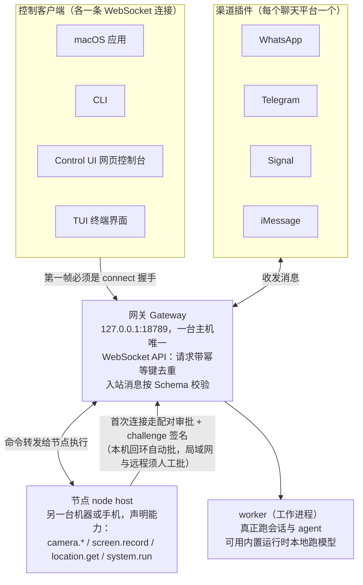
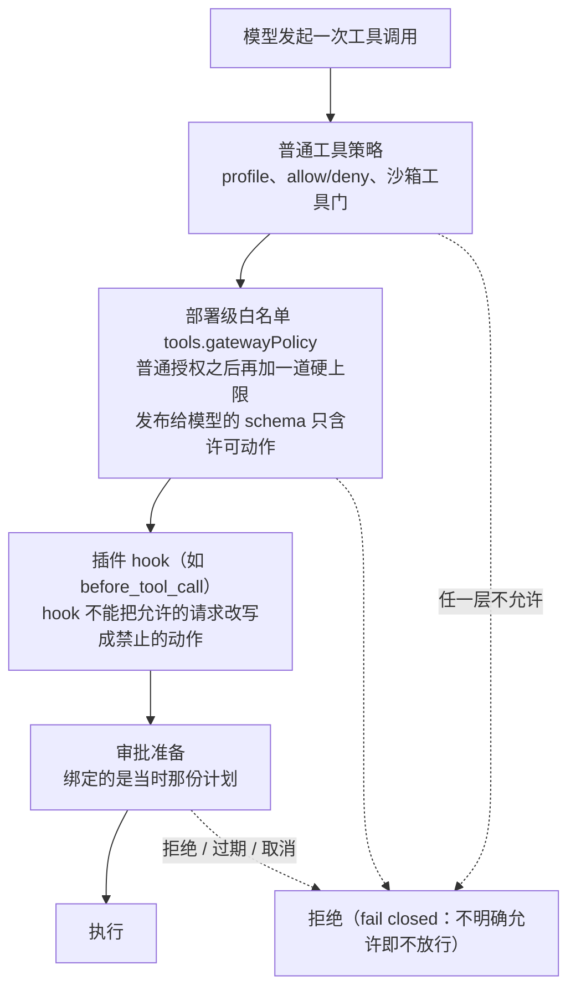
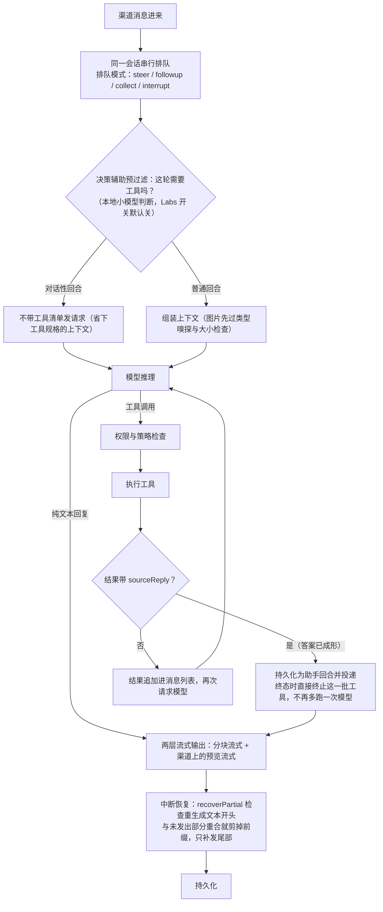
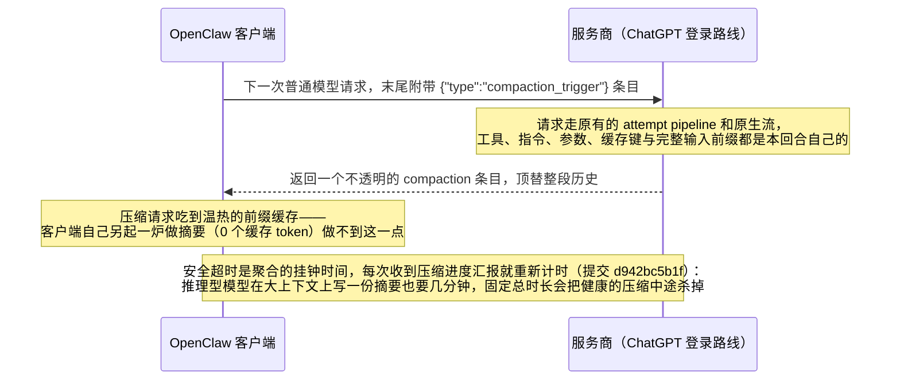
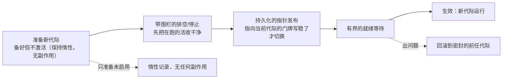

# OpenClaw

| 源仓库 | [openclaw/openclaw](https://github.com/openclaw/openclaw) |
|---|---|
| 协议 | MIT |
| 主语言 | TypeScript（另有 Swift 客户端） |
| 笔记基准 | commit `3b7e9c2ad53`（2026-11-09） |

OpenClaw 是一个开源的个人 AI 助理项目，主体用 TypeScript 写成，加上一套 Swift 的 iOS/macOS 客户端。它在自己的电脑上跑一个常驻的网关程序，把你已经在用的聊天软件（Telegram、Discord、WhatsApp、Slack、iMessage 等 20 多个渠道）统一接到 AI 上，另有 macOS、iOS、Android、Windows、Linux 原生应用。代码规模很大：`src/` 下有上万个 TypeScript 文件，`extensions/` 下有 170 个扩展，`packages/` 下还有 20 多个共享包。它解决的核心问题是：让一个能执行命令、读写文件、替你发消息的 AI 助理，把状态、记忆和账号凭据全部留在你自己的硬件上，同时用写死的规则而不是模型的临场发挥来做安全决策。项目由独立的 OpenClaw 基金会（美国 501(c)(3) 非营利组织）维护，MIT 协议，没有付费版和托管服务。

这份笔记按问题组织，不按 OpenClaw 的开发时间线：每个问题讲清它现在是怎么解的、为什么这么解、代价是什么。讲法上，每个特性都把"一次连接、一条消息、一次批准、一次升级"从头走到尾。项目演进过程放在文末修订记录里。笔记起于本地 HEAD `20eebbd5c7`（2026-09-21），跟进到 commit `3b7e9c2ad53`（2026-11-09）。

## 它要解决什么问题

AI 助理要"能干活"，就必须拿到权限：读文件、执行命令、登录你的账号。这就带来一个矛盾：权限给得越多越好用，出事的范围也越大。OpenClaw 的作者在 `docs/start/why-openclaw.md` 里有一个说法：**架构决定 AI"能做什么"，远早于任何规则决定它"可以做什么"**。也就是说，与其指望模型每次都听话，不如把系统结构设计成"即使模型被骗了，损失也有限"。

另一个痛点是碎片化。你想在 Telegram 上使唤助理，也想在 iMessage 上用，还想让它看看手机摄像头。如果每个平台各装一套程序，各存一份状态，很快就没法维护。OpenClaw 的答案是：一台机器只跑一个网关，所有渠道、所有客户端都连到它，状态只有一份。

## 一个网关，所有渠道

整个系统是一组分工明确的长驻进程和客户端，全部通过 WebSocket（一种双向长连接协议，双方随时可以互发消息）连到网关。

### 网关（Gateway）

网关是本地控制平面，默认监听 `127.0.0.1:18789`（只接受本机连接）。它负责：

- 维持所有渠道的连接（比如 WhatsApp 用 Baileys 库、Telegram 用 grammY 库）。
- 向客户端暴露一套带类型的 WebSocket API：客户端发请求（`{type:"req", id, method, params}`），网关回响应，另外主动推送事件（`agent`、`presence`、`health` 等）。
- 入站消息按 JSON Schema 校验；这些 Schema 是从 TypeBox（一个 TypeScript 的类型定义库）生成的，Swift 客户端的模型类再从 JSON Schema 生成，保证三端类型一致。
- 带副作用的请求（发消息、跑 agent）必须带幂等键（idempotency key，同一个键的重复请求只执行一次），网关保留一个短期去重缓存，这样客户端重试不会导致消息发两遍。

一条硬性不变量：**一台主机只有一个网关**，它是唯一持有 WhatsApp 会话的地方。握手也是强制的：连接后的第一帧必须是 `connect`，否则直接断开。

### 渠道（channel）

渠道是"一个聊天平台"在代码里的叫法。每个渠道是一个插件，负责自己平台的账号、安全和传输细节；核心只保留共享的消息工具和统一的动作词汇表。iMessage、Signal、WhatsApp 这类直接跑在设备上的叫"原生渠道"。

### 客户端与节点（nodes）

- **控制客户端**：macOS 应用、CLI、网页控制台（Control UI）、TUI（终端界面），各自一条 WebSocket 连接，用来查看状态、发消息、管理配置。
- **节点（node host）**：装在另一台机器（包括手机）上的代理，以 `role: node` 连到同一个网关，声明自己支持的能力（摄像头 `camera.*`、录屏 `screen.record`、定位 `location.get`、执行命令 `system.run` 等）。模型始终只跟网关说话；网关把命令转发给节点执行。
- 新设备第一次连接要经过**配对（pairing）**审批，批准后网关发一个设备令牌用于后续连接；连接还要对 `connect.challenge` 这个一次性数（nonce）签名，防止重放。本机回环（loopback，即 127.0.0.1 上的连接）可以自动批准，局域网和远程连接必须人工批准。

远程访问的推荐方式是 Tailscale（把设备组成私有网络的组网服务）或 SSH 隧道，而不是直接把网关暴露到公网。

**推理位置是可调度的。** worker（工作进程）是网关架构里真正跑会话和 agent 的进程。模型推理不必都打到云端 API：worker 可以用内置的原生推理运行时在本地跑模型，这条线从协议到客户端分五层——协议层定义 worker 本地推理的契约；worker 侧实现原生推理运行时；网关负责把推理请求安全地派发给合适的 worker；客户端按"worker 本地推理"的放置策略选位置；本地推理开始前还有一道策略校验（派发权限、会话监管、设备准备），不合规就不落地本地。配置里"必须用 worker"的放置策略（默认关闭）在普通会话创建、首条消息交接和既有恢复路径上都会被执行；用户显式选过的未发送草稿选择保持原样，分离派发时调用者对请求的保管权不丢，范围、profile 和会话的撤销检查照常生效。推理位置由此成了可调度的选择之一，而不是一个写死的常量。整套拓扑画出来是：



## 主轴：可信网关、不可信执行、确定性策略

这是官方文档对整个架构的一句话概括（trusted gateway, untrusted execution, deterministic policy），拆开讲：

- **网关是可信的**：它拿着你的配置、凭据、记忆，是秘密的保管人。
- **执行环境是不可信的**：AI 跑代码、碰文件的地方（沙箱、远程节点、一次性云主机），被当成"随时可能沦陷"的区域。即使模型被恶意提示词（prompt injection，指别人在消息里藏指令骗模型）骗了，或者执行环境被攻破，也拿不到网关里的秘密。凭据可以用 SecretRef 引用，受保护的秘密值根本不进入模型的上下文。
- **策略是确定性的**："这个命令能不能执行"由代码里的规则判定，不靠模型自觉。文档的原话是：拒绝是结构性的（structural），不是"请求模型遵守的请求"；需要审批的路径在规则不满足时一律失败（fail closed，即出错时倾向拒绝而不是放行）。

配套的信任模型文档（`docs/gateway/security/trust-model.md`）还明确了边界适用范围：**一个网关就是一个信任域**。它服务"一个操作者，或彼此信任的团队"；互不信任的用户应该各跑各的网关。当有人发消息给一个开了工具的助理，他就间接共享了助理的工具权限，这对互信的同事没问题，对敌意用户就是漏洞。

它的防御顺序也很实在：先定身份（谁有资格跟机器人说话，陌生人要配对），再定范围（机器人能在哪干活，哪些工具开放，要不要沙箱），最后才考虑模型（假设模型可能被骗，让被骗的后果可控）。

有一点官方说得很坦白：沙箱和执行审批**默认是关的**。默认安装是一个"信任单操作者"的助理，加固是主动的配置动作，`openclaw security audit` 会告诉你哪里偏离了加固基线。"默认好用"和"默认最安全"是两个不同的取舍，项目选了前者并把话说明，没有嘴上说安全最重要、实际上什么都默认开。有人值守的会话也有了自己的中间档（提交 65a125adc5）：每个 agent 可以配一套 attended 会话的默认权限模式（opt-in），只作用于**新建的、直接有人值守的**带档案操作者会话——已有的会话默认不变，用户显式选的模式永远优先，完全放开（full access）仍要求活着的管理员权威。默认档从"开或不开"变成了三档：默认关、显式选、按会话类型配默认。

模型驱动的 exec 也有了按提供方或模型设置上限的档位（提交 990fc1bd88）：`tools.byProvider[...].exec.mode` 给特定提供方或模型声明 exec 模式的上限（`src/agents/session-permission-exec-mode.ts:93` 起的注释写明方向——"模型上限只做限制；安全取最小值，ask 取最大值"），同一回合命中多条上限时逐条归并收紧（`:129-133`），应用在所有其他层之后——它只能把已经允许的动作收得更紧，永远不会放松任何一层。

这条主轴在每个机制里都有落点。最典型的是模型发起的一次工具调用要穿过的防线——普通工具策略、部署级硬上限、hook 与审批，每层的检查内容和失败方向都是固定的：



其余落点：审批绑定的是"当时那份计划"、常驻 watcher 的批准只授权那一个确切的提案（均见"执行环境与取消传播"）、浏览器路由失败时不用别的机器顶上（见"浏览器控制的本地优先路由"）、秘密用引用传递（本节）、审批测试共享同一份契约（见"测试体系"）。

## Agent 循环与消息流

一条消息进来后的处理链路叫 **agent loop（智能体循环）**：接收、组装上下文、模型推理、执行工具、流式输出、持久化。同一个会话的多次运行被串行化（一个会话同一时刻只有一个运行在干活），避免工具和会话状态竞争。整条链路画出来是：



**纯对话的回合可以不发工具清单。** 被判定为对话性的回合（寒暄、追问、不需要动手的交流）可以省略工具清单再发请求，省下的正是每次请求都背着的那份工具规格上下文。判定来自"决策辅助预过滤"（decision assistance prefilter，一个本地小模型判断这轮需不需要工具），但它不擅自生效：挂在 Labs 的 `decisionAssistance` 配置下（用户显式同意才开），还要求 harness 声明支持"回合级工具限制"能力（不支持的场景比如 Codex 执行引擎，就保留原来的工具策略）；回合里挂着待办的动作指令、或请求已取消时，也不启用。这个方向跟设计哲学里"核心有每次调用的税"的判断一致：既然每个工具都出现在每次请求里，能确认用不上的回合就不该缴这笔税。

两笔省的是看不见的账。恢复会话的历史编码开销砍掉了大头（提交 2a5ecf96a4）：恢复会话的 user 与 toolResult 消息在历史发布时一次性冻结快照（此前只冻结 assistant 消息，`src/agents/embedded-agent-runner/run/attempt-history-prepare.ts:275-281`），Anthropic 传输在发送前对通过相等性校验的副本按冻结键预编码字节片段并缓存（`packages/ai/src/transports/anthropic-request-body.ts:11` 的 WeakMap、`:138-143` 的预编码循环），序列化时直接复用——实测热身 CPU 降约 44%，发出的字节逐位一致。Code Mode 长会话的 replay 也改了算法（提交 61a0a1f214）：不再逐条编码入投影，先在写入表里解析出每个键的最终值，只对存活值调用编码，budget 检查移交最终投影（`src/agents/code-mode-session-store.ts:255-263` 的注释写明分工——历史 budget 归提交接纳管）；六千条 replay 从约五百次编码降到四次。

**反过来，工具也可以直接交付完成的回复，不再多跑一次模型**（2026-10-04）。工具声明 `canDeliverSourceReply` 并在结果里带上写好的答案（`details.sourceReply`），运行时把它记为"工具创作的源回复"——持久化成助手回合、像助手文本一样投递进对话，并在回复是终态时直接终止这一批工具。答案已经成形的工具（查完的资料、跑完的脚本、发出去的消息）不再额外消耗一次"把工具结果交给模型、让模型复述一遍"的回合。SDK 侧把入口收敛成一个 helper（`captureToolAuthoredSourceReply`）；转录写入失败时投递照常进行、失败只记日志。这条跟"对话回合省工具"是同一笔经济账的两端：那头省的是不需要工具时的工具清单，这头省的是不需要模型时的模型调用。

流式回复有两层（`docs/concepts/streaming.md`），而且明确说明**没有真正的逐 token 推送**到聊天渠道：

- **分块流式（block streaming）**：模型每写完一段，就把这一"块"作为正常的渠道消息发出去。块的大小由 chunker 控制，有最小、最大字符数和切分偏好。
- **预览流式（preview streaming）**：在 Telegram、Discord、Slack 等渠道上，先发一条临时预览消息，生成过程中不断编辑追加，结束后再定稿。

**断线恢复与前缀去重**。流式输出可能中途失败（网络闪断、超时），恢复的办法是让模型重新生成。但模型重试时常会从头再说一遍，前半段你已经发给用户了，重发就成了复读。`src/auto-reply/reply/block-reply-delivery.ts` 里的 `recoverPartial` 用了一个很轻的解法：检查重新生成的文本开头是否与"还没发出去的剩余文本"的开头重合，重合就把前缀剪掉，只补发尾部：

```ts
const prefix = fragment.payload.text?.trimStart();
const remaining = text?.trimStart();
if (!remaining?.startsWith(prefix)) {
  break;
}
text = remaining.slice(prefix.length);
```

它不需要任何额外的状态记录，用内容本身自证重复，简单且可靠。同一文件里还有一个串行化设计：多次投递通过一条 Promise 链（`sequence`）排队，前一次投递失败时，下一次续写会先观察失败的回执，而不是跳过未发送的前缀继续发，避免内容错序丢失。

**发给模型之前，图片要先过检查**。模型对图片格式有要求（Anthropic 的接口只认 jpeg、png、gif、webp 四种），也不能太大。`src/media/anthropic-inline-images.ts` 在把图片塞进请求前做四件事，每一件都是处理不可信输入的标准动作：


- **嗅探真实类型**。怎么知道一段数据是什么文件？最可靠的办法不是看它自称什么，而是看开头几个字节的"魔数"（magic number，每种文件格式约定的特征字节，比如 PNG 开头固定是 `89 50 4E 47`）。这种读开头一小段猜类型的做法叫 MIME 嗅探。代码以检测出的类型为准，检测不出来才退回相信声明值：不轻信自报家门。
- **只解码前缀，不解码整张图**。图片以 base64（把二进制数据变成纯文本的编码）传输，规律是每 3 个原始字节变成 4 个字符。想嗅探类型只需要开头 N 个字节，那么取 base64 字符串的前 `4 × ceil(N / 3)` 个字符去解码就够了。一张几十兆的高清图，为了"闻一下类型"把整张图解码进内存太浪费，只解码最小前缀，内存和速度都省了。
- **不支持的格式转成通用格式**：检测到 BMP 就转 PNG，其他不认识的一律转 JPEG。给下游一个它一定能接受的格式，比自己维护一个大列表省事。
- **进门就设上限**：解码前先估算大小，超过 10MB 直接拒绝，不让超大输入拖垮系统。

**推理-only 回合撞上输出上限，不再发起无效的付费续写**（提交 ab7631a256，关联上游 #88656）。provider 重放（把已有消息重新发给厂商让模型续写）有个上游行为：只含推理、没有正文的回合若是在输出 token 上限处截断的，重放时会整个排除——模型根本看不到它。但推理-only 的恢复逻辑此前仍会让模型"从这个半截回合继续"，发起一次注定没有上下文依据的付费重试。现在续接资格复用重放的判定：重放里不含的回合直接以输出上限的结果收尾；重放里包含的推理-only 停止照旧可以续接；厂商明确返回的结构化拒绝仍是终态。

**模型没有公开输出上限时，回复不再固定截在 8192**（提交 94e6734775）。无已知输出限制的模型此前一律按 8192 token 截断——长回答被拦腰砍断。现在默认上限提到 32,768（`src/agents/defaults.ts:11`）；已知窗口的模型按"窗口的一半给输出"解析，夹在 8192 下限与 32768 默认之间、绝不超出窗口本身（`src/agents/defaults.ts:21-29` 的解析函数），显式配置过的上限不经这条逻辑。

**回合中途的上下文维护与硬边界**（提交 e44b8f4491、PR 189810 上线后因 CI（持续集成）多个作业失败，被 ffbaf04726、PR 189891 整体回退，e0ed68c7b8、PR 190017 换了算法重做）。OpenClaw 有一个"回合中途预检"（midTurnPrecheck）：在工具轮次之间检查上下文压力、必要时先压缩，它挂在默认关闭的配置后面。重做后的机制分两层。**主动维护从窗口的 75% 开始，由服务商实测占用驱动而不是客户端估算**：实测值与上一请求的结算值都拿不到时才算 0（`src/agents/embedded-agent-runner/run/attempt-setup.ts:441-467`）；压缩起点取"窗口减预留"与"窗口×75%"中较小者（`packages/agent-core/src/harness/compaction/compaction-threshold.ts:9-13`）。**硬窗口检查总是执行**：每个准备好的请求都对照窗口核对，占用按名义值加校准过的工具结果估算，再加上服务商实测值与待加入项；越界时按可压缩程度走四条恢复路由——放行、只截断工具结果、只压缩、先压缩再截断（`src/agents/embedded-agent-runner/run/preemptive-compaction.ts:350-358`）。声明"推迟压缩"策略的会话仍豁免主动维护（它们自己拥有压缩时机），但代码注释明说"推迟维护不等于允许越窗的服务商请求"（`attempt-setup.ts:441`）。当前上下文总量经既有的受保护会话写手发布，最终有序结算覆盖中间快照；旧的 prompt-only 新鲜度戳直接作废，不动 schema、不加配置。软检查可以关，"实测阈值的维护与硬窗口检查不随开关停"这句区别写在配置帮助文本里（`src/config/schema.help.agents.ts:166`）。

两笔与上下文账目有关的修复：压缩摘要不再把没有实际改动的文件列为已修改（提交 077eac1f36）——`extractFileOpsFromMessages` 把结果标明 `changed: false` 的 edit/write 记为未变更（`packages/agent-core/src/harness/compaction/utils.ts:45-65`），摘要里不再出现"改了但其实没改"的文件，模型也不会顺着假改动继续推理；上下文引擎能看到真实的提示词用量了（提交 57953680cd）：持久化的回合提交此前丢弃 prompt 用量，引擎永远见不到真实的 prompt 大小，现在回合信箱带上最后一次调用的用量与缓存观察（`src/agents/harness/context-engine-turn-outbox.ts:23`，纯计数器），组装尝试的快照随生命周期清理（`src/agents/harness/context-engine-assembly-attempt.ts:30-36`）。

压缩本体随后也修了一轮语义。**摘要额度先给必需部分留位**（提交 2d4ec7bf48c）：此前的 safeguard 先为整个逐字保留后缀预留空间、剩下的才给摘要体，近期的工具输出会把模型自己的决策、TODO 与标识符挤出去；现在摘要体只为它必需的小节预留，后缀按时间序组装（保留回合 → 被切开回合的摘要 → 必需小节，`src/agents/agent-hooks/compaction-safeguard-budget.ts:67` 的 `budgetCompactionSummary`），头部优先的尾部截断先裁较老的逐字回合、截断保留小节标题、留下的工具结果只留 160 字符摘录。**切点先在选中的消息上判定**（提交 5479dceced9）：split 判定改在选中消息上先做、再回溯保留它前面的元数据——夹在 user 消息前的 bootstrap 标记不再把上一回合误判成 split-turn 前缀（`packages/agent-core/src/harness/compaction/compaction-cut-point.ts:288-294` 的注释写明这条顺序）。**失败分类看 provider 的原话**（提交 81699908e5c）：compaction 失败改按保留的 provider 响应归类、按包装层显示文本（`src/agents/embedded-agent-runner/compact-reasons.ts:81`），配额错误之后继续走已配置的 fallback 模型、按 unexpected-error 报错。**嵌套压缩不再误杀前台**（提交 44fc5544bf9）：嵌套 compaction 期间保留前台 watchdog、清理回调按 attempt 命名防遮蔽（`src/sessions/session-controller.watchdog.types.ts:7` 的类型契约），消除历史 compaction 之后的误停滞中止——这是停滞自愈那组的后续。**维护步骤拿得到模型目录了**（提交 3d6914aaad5）：网关 agent 方法的回合（subagent 完成通告、唤醒这类）走维护步骤时拿不到路由模型目录，一律按 200k 默认窗口算额度，大窗口模型的会话被过早压缩；现在把 thinkingCatalog 传进维护 followup（`src/agents/command/maintenance.ts:46`、`:163`）。

循环本身的几处判定也修准了。Ollama 式不完整回合的重试判定改按 API 匹配（提交 465c110e497，`src/agents/embedded-agent-runner/run/incomplete-turn-classification.ts:190` 的参数化），自定义 provider 走 Ollama API 时同样重试；settled 回合的交付计数排除 reasoning 载荷（提交 4a5dad7cd23，`:149`、`:153`），"显示了思考过程却没有最终答案"的误判消失；缓冲的非 SSE JSON 折成多行 `data:` 字段（提交 7e825b4d384，`src/agents/provider-transport-sse.ts:145-147`），流式 provider 的多行 JSON 不再丢事件；steering 之后消息生命周期不再假报 idle（提交 ee3ec605a59，`src/logging/message-lifecycle.ts:31`、`:72`，按会话 run 活跃度统一判定）；goal 延续对本地 Codex 目标免 operator 角色（提交 ec41ea83a44，`src/auto-reply/reply/goal-continuation.ts:106`、`:197`），只有 worker 放置需要网关 operator 能力。

## 会话与队列

会话（session）是"一段持续对话及其状态"的单位，用 `sessionKey` 标识。文档特别提醒：`sessionKey` 只是路由选择器，不是授权令牌，别把它当成安全边界。

同一个会话的多个运行串行排队，防止两个运行同时改一份状态。聊天渠道的消息进来时可以选择排队模式（steer、followup、collect、interrupt）：比如"steer"让新消息改变正在进行的运行方向，"interrupt"打断当前运行直接处理新消息。这些模式最终都汇入同一个会话队列系统，用户在聊天软件里发一句"换个思路"，就能实时影响正在跑的任务，这是助理型产品的关键体验。排队里的后续消息在轮到自己时接管自己的派发回调：此前排在其后的回合会在前面的回合结束时拿到对方的回调——那条请求结算时授权已释放，第一条进度更新就报"操作者执行授权已失效"，把已经完成的回合标成失败（提交 d38a8d3171）。这套排队与回执的形状如今写成了一份可宣告的契约（提交 323df2111e）：握手能力清单里的 `chat-input-custody-v1`（`docs/gateway/protocol/handshake.md:291`）把"网关收下一条输入之后对它负什么责任"（排队模式、精确的输入回执与对账）明说给客户端——宣告里不含权限承诺、不含"输入已经处理完"的含义，也不含后端注入的许诺。收到（started）与提交进历史从此是两件可以分别对账的事。

**没被模型看见的插话要能证明、能归还**（提交 36adaa89cf，PR 186619）。一条 steer 送进进行中的回合后，若回合在模型看到它之前就失败（上游在请求前拒绝、瞬时错误重试），这条插话可能随失败一起从历史里消失——用户说过的话没了下文。现在内置运行时在 120 秒的转录投递期限内，若能证明"那条排队的消息确实在提交前被移除"，就把这条输入按原队列位置归还为 followup 重跑；活跃回合已接纳的更晚插话留在原处、不重放。证明不了的超时不归还——运行时可能仍在处理那条输入，重放有重复风险（`docs/concepts/queue-steering.md:34-36`）。"插话被撤回"从一句记录变成了带证据、可恢复的状态。

**排队中的消息也进入了保管的视野**。一组修复把"网关收下一条消息之后对它负的责任"落到了具体路径：环境杂音（后台通知这类低价值消息）不再把用户请求挤出队列（提交 69d6eae050）；被队列上限丢弃的消息不再被重放（提交 9435188c9f）——丢弃是上限的语义，重放等于没丢；准备失败与插件重载时，排队消息保住不丢（提交 5e4a575863）；崩溃恢复跨普通回合与命令保留（提交 d4e2ec81b1），慢数据库准备也不再让恢复半途而废（提交 41932f3e5c）。与上面的 chat-input-custody-v1 契约对照着看：契约宣告责任，这组修复把责任在每条路径上兑现。

**重启恢复有了按物理 agent 的持久化凭据**（提交 4ca233c908）。网关崩溃重启后要补做每个 agent 的恢复扫描，此前这个"哪些还没恢复完"的记录只活在内存里——恢复到一半再次崩溃，范围就丢了。现在 boot 时把每个注册 agent 的崩溃恢复区间写进共享 SQLite 的机器状态（键 `gateway.restartRecovery`，`src/infra/gateway-boot-lifecycle.worker.ts:42`），相邻区间自动合并、干净启动不合并；每个 agent 的恢复 pass 完成后才消掉自己的区间（`src/infra/gateway-boot-lifecycle.worker.ts:191-205`），中间进程不覆盖别人的记录；agent 数据库不可用时明确报 "resume deferred" 并跳过该 agent，不拖累其他 agent（`src/gateway/session-restart-resume.ts:351-353`）。无 schema 迁移，旧版本二进制看到这个键会直接忽略。

**启动顺序学会了让慢库靠后站**（提交 fb5a31cfd03、74e1ecf132f、a1f1248ee90）。agent 数据库的启动准备此前按注册顺序串行，排在头部的未密封（非干净关闭）库会拖住所有 agent 的受理；现在先用 `cleanClose` 探测把干净关闭的库放进进程内受理、慢的未密封库靠后（`src/state/agent-database-startup.ts:242` 的探测，`src/state/openclaw-database-preflight-agent-scheduler.ts:32-33` 的注释写明分工——干净关闭的库进程内接纳、未密封的要冷读者进程），并发准备配了 8 许可的 journal 读池与发布完成的 deferred（`agent-database-startup.ts:97`）；对就绪状态不确定的库改发结构化的 `createIndeterminateDatabaseReadinessError` 并复用已通过的干净状态证明，减少重复严格检查（`src/state/openclaw-database-preflight.ts:150`）。重启恢复还补了两条：带 `parkedRunId` 等待恢复的子代理会话在重启枚举中被保留、绕过 skip（提交 9464adbe625，`src/gateway/session-restart-resume.ts:188` 枚举 `listMessageWaitingSubagentSessions`）；网关重启中止流式回复时给一段结算宽限，让终端部分回复先写完，宽限不因后续 chunk 或心跳刷新——服务商不理取消也不能无限续命（提交 9fb5cdc3039，`src/agents/embedded-agent-runner/run/llm-idle-timeout.ts:404` 的 `restartAbortTimer`、`:414-417` 的宽限定时）。排队的 run 的 lifecycle start 事件改在关联聊天之后投递（提交 a4c2cf29475，`src/gateway/server-runtime-subscriptions.ts:445`、`:555`）；慢关停的 finalizer 迟滞时先等它结束再走完下线（提交 e32051ef9a0，`src/gateway/server-close.ts:587` 的注释）；子代理会话的 capability 元数据按需 prepare/release（提交 13769ac805b，`src/agents/subagents/spawn/subagent-session-store.ts:245`、`:254`、`:261`）。

**worktree 会话不再被陌生仓库冒名**（提交 95d9c4083a5）。bootstrap 文件的归属判定收紧：执行根必须真的检出该 agent 的 workspace（同目录或同一 git common dir，`src/agents/workspace-run.ts:42`、`:55` 的 `checksOutWorkspace`）才接管它的身份与已保存个人指示；在一个独立项目仓库的 worktree 里启动时，保留 agent 自己的身份，那个仓库的 AGENTS.md 只作为项目上下文叠加——临时借用一个检出目录干活，不该连人带档案一起换了。

**删除一个 agent 的路径也走完了**（提交 38b3a0d00a、020ec24568、3f2e7078de）。删除失败现在只对 worker 过载一类原因重试三次、保留删除日志身份供重启后续删（`src/gateway/server-methods/agents-delete.ts:119-125`），失败聚合成一条可操作的告警；删除造成的数据库准入拒绝单独编码，就绪面板单列 `agentDeletions`、不再拉低核心就绪状态；大量闲置会话的排水并发限四，防止把 worker 池冲垮（`src/gateway/server-methods/agents-delete-drain.ts:188-189`）。安全重启的预检也改用真实的活跃工作快照（提交 49e8b5d2b5，`src/infra/restart-coordinator.ts:15` 起）——此前六个计数硬编码为零，会话工作可能被漏计。

**Discord 的线程可以分叉成独立的兄弟对话**（提交 69baaab4a9）。一条 Discord 线程里的讨论值得单独立项时，`/fork` 把它会话复制成一个新的兄弟对话并绑到新线程上（`extensions/discord/src/conversation-fork.ts`）——资格判定、创建前检查、私有成员与历史的区分、当前权威的读取各走各的（同一资格内的权限事实复用、准备与创建检查彼此独立），兄弟会话的创建只试一次。插件侧的分叉入口此前已有（见"插件生态与开放标准"的 runForkedTurn），这一笔把同一种能力摆到了聊天平台的用户面前。

子运行（父 agent 派生出去的 subagent 运行）的续接权限统一按持久化的 `spawnedBy` 血缘来定：在共享的运行留存边界上，从血缘里选出谁有权续接，原生 subagent 的准入例外被移除，子血缘穿过 agent、chat、Talk 三条准入路径；一个被中断的子运行，在它恢复后的父运行结束之后仍能通过 `sessions_send` 续接，来源校验、范围与模型上限、撤销、父 Stop 取消都照旧（提交 76cf9fe14c）。让出（yield，子运行主动暂停把控制权交回）的收集器有一条明确规则：没有记录结果就持久化为 yielded 的收集器永远不能再续接，注册表清扫器显式把这类行结算掉（保留让出时间作为结束时间），`agents_wait` 等它时返回 failed 带诊断，而不是永久挂起（提交 72ffe36e12）；可续接的让出叶子会显示已暂停多久（提交 bf6ed0e146）。让出状态随后落到了界面的两侧：被让出的子运行在会话列表上按"已暂停"显示（提交 4b6a38ada0）；确认让出的提示以 agent 文本出现在对话里，并一并列出在等哪些会话（提交 0ab9fc06cc）——让出不只是后台记录里的一个状态，对话里的人也看得见谁在等谁。

生成方还可以要求**盲子任务**（提交 57a6b7b610）：宿主在能力清单里声明 `native-subagent-blind-v1` 后，`spawn` 可带 `blind: true`，模型的 `sessions_spawn` 工具同样接受——典型用途是评测试验，评测的指令不该告诉子任务它跑的是哪个模型、在哪跑。盲子任务的提示词省略当前模型身份、运行时信息里的模型与 agent 等字段、工作区路径（一律显示为 `<workspace>`）以及任务上下文里的请求方与子会话键；其余一切不变——模型选择、工具、工作目录与文件边界、验收与收集回执照旧使用并上报真实模型，父会话列表照常显示。这个设置存在子会话上，它后续回合与自己派生的隐藏子任务保持盲态。`blind` 要求 `context: "isolated"`（分叉转录会带上请求方的对话，`fork` 被拒绝），也不能与 `runtime: "acp"`、`visible: true` 同用。盲化只覆盖 OpenClaw 自己渲染的提示词（内置运行时、CLI 后端、压缩），管不到 CLI 自带的说明或插件自写的指令；子任务仍可能从上报模型身份的工具（如 `session_status`）与宿主环境事实里得知自己的型号——提交明说它不授予任何权限，也不承诺万无一失。

**委托出去的活归到发起它的人名下。** 通过操作者工具新建的委托会话与自动化，默认保留"核实过的发起人"作为创建者（creator），不需要开 Labs 开关；被指派的所有者（assigned owner）仍是另一个概念——仅改指派不转移创建者权利，分享、公开链接管理、归档、恢复仍归创建者。文档把边界写得很直白（`docs/concepts/session.md` "Creators and assigned owners"，提交 3097ceed22）：被选中的工具使用者提供的是执行授权，不能证明任务是它发起的；没有可归属人类的自主工作记为 agent/system 创建。归属影响发现、创建者控制与无所有者时的个人档案回退，不改变执行身份、模型与工具权限、沙箱身份，也不会自动公开会话。归属存在既有创建记录里：旧版运行时忽略这段附加归属、按自己的旧规则办事，写回时保留记录，回到新版归属仍在。发起人也停得掉自己的活：已获授权的个人操作者可以跨设备停止**自己发起的**工作（提交 5573fd0771）——其他发起者的工作与会话的确切归属不受影响，"创建者管自己的东西"从权利延伸到了动作。

**自动化可以转给人类所有者，转过去的不含旧凭据**（提交 975e68cf82）。定时任务支持把所有权转移给一个具体的人：审计来源保持不可变，执行跟随当前的人类所有者（`src/cron/human-owner.ts:17-24`）；转移会让任务暂停、取消进行中的发生次数、作废已捕获的凭据与操作者权威——文档把边界写直白："管理权的转移不是把上一个人的账号借给接收者"（`docs/gateway/operator-scopes.md:62-64`）。换了所有者的任务要再跑，走的是重新授权而不是沿用旧绑定：待转移的任务恢复运行会被要求重新选择推理账号、或从经过认证的所有者回合重新授权——模型运行不得借用保留会话里上一位所有者的凭据；作废动作禁用任务、清空操作者来源与运行时权威，但保留只收紧不放宽的沙箱与 exec 限制——删掉它们只会放宽执行（`src/cron/human-owner.ts:39-50`）。`operator.cron` 范围的说明同步改写：管理自己名下的自动化、经认证的 agent 回合创建会话所有的自动化，含在 `operator.write` 内、不算全局管理（`docs/gateway/operator-scopes.md:38`）。

**自动化跑完投到哪里，成了可配置项**（提交 87c9eb3fc5）。cron 作业的完成输出此前固定投回创建会话；现在投递模式可配 none/announce/webhook（`src/cron/types.ts:56-81`），支持指定渠道、收件人、线程话题、多账号下的具体账户，完成与失败可以分开投——失败通知有独立的目的地覆盖。运行时配套三笔修复：启动期间新增的作业不再被推到"停机延迟"（提交 e7e8234a90）；触发条件在运行时准备超出触发 budget 时此前会永远超时，现在能正常走完（提交 0e9ef2f879）；延迟准入有了退避与可见的状态（提交 c3cdd6bc2d）。语义面随后又收敛了三处（提交 450d4af755、7ab0143fc2、85fa72f362）：一次运行的出口要等前次回执结算落定才清理启动上下文并推动队列，等待方同时等完成与回执，队列关停只中止未启动的项（`src/cron/service/run-queue.ts:487-491`）；PostgreSQL 下的 JSON 取值改按引擎分派、PG 显式类型转换，一次性任务的结算不再因方言差异失败（`src/infra/database-engine/json-values.ts:66-76`）；工具描述里给模型立了规矩——用户要的独立重复任务应该建专用命名会话并以 `session:<key>` 为目标，挂进设置它的对话里会让"这个对话"承担本该独立的工作（`src/agents/tools/cron-tool-description.ts:76-78`）。

扩展行为靠两套 hook（钩子，在固定时机被调用的回调）系统：内部的 `HOOK.md` 脚本响应命令和生命周期事件；插件 hook 则是带类型的 `api.on(...)` 处理器，挂在 agent 循环和网关 pipeline（pipeline 指请求从进来到出去经过的处理流程）的固定位置，比如 `before_tool_call`（工具调用前拦截）、`message_sending`（消息发出前可以取消）、`before_compaction`（上下文压缩前后观察）。`{ block: true }` 这类阻断性返回是终态，会拦住后续低优先级的处理器；返回 `{ block: false }` 则什么都不做，也不会清除先前的阻断。策略钩子查看"本回合授权了哪些工具"也多了一个口子（提交 c3a084d3d8）：`PluginHookToolAuthority` 新增可选的 `list()`（`src/plugins/hook-agent-context.types.ts:21`），返回本次回合授权名单的冻结快照——排序、去重、只读（`src/plugins/hooks.ts:848-851`），宿主撤销或派发结束后再调用直接报错；克制动与既有的 `allows()` 一致。这个方法是可选的，旧宿主上不存在——插件先做特性检测，没有就按"名单不可枚举"处理，不能当成宿主出错（`docs/plugins/hooks/prompt-and-session.md:184-190`）。

**agent_end 事件带上了这一跑的消耗事实**（提交 1621a2de8f，PR 190108）。插件在 `agent_end` 时能拿到工具名、用过的技能与模型迭代次数——做审计与用量统计的插件不用再自己插桩观察。

**上下文压缩默认走服务端**。在 OpenAI 和 Anthropic 的 API-key 路线上，压缩默认是 provider-native（服务端压缩：对话全文保持在服务商的检查点里，客户端不再自己跑一遍摘要模型）。此前两条路线的默认并不一致：OpenAI 路线的自动压缩已走 `/responses/compact`，手动 `/compact` 却总是本地摘要；Anthropic 路线的阈值压缩更要手动打开——统一成默认服务端，并顺带修掉这条路径上实测暴露的三个缺陷。压缩在哪一端做，牵动成本、隐私边界和 hook 能观察到什么，默认对齐到服务端是个明确的取舍。ChatGPT 登录路线的服务端走法是搭一次普通请求的便车：



## 插件生态与开放标准

核心之外的几乎所有能力都是插件：模型提供商、渠道、记忆、语音、Codex 执行引擎。插件分两种风格：

- **代码插件（code plugin）**：跑 OpenClaw 的插件代码，适合需要运行时 hook、提供商、渠道、工具这类进程内扩展点的场景。
- **打包插件（bundle plugin）**：只打包稳定的外部物件（技能、MCP（Model Context Protocol，模型接外部工具的开放协议）服务器、配置），接口更小更稳，安全边界更好，能用就用这种。

插件通过 npm 包分发，官方注册表叫 ClawHub，带发布审核、安全审计和逐版本的信任结论（安装时使用）。第三方插件也可以经由同一条 SDK 通道接入，整个消息渠道都可以是社区插件。SDK 暴露的入口点数量受到"只减不增"的上限管理，增长必须是一个显式决定。

**插件的状态存储有现成的合规矩选项**：插件的状态回调不在网关主线程上做 SQLite 操作（返回 Promise 的接口也不例外）——"数据库活儿不占主线程"是仓库的硬纪律。插件作者拿到一个带版本号的、归 worker 所有的 keyed store（按键取值的存储，读写都在后台线程完成），已有的同步和回调式接口保持原有的完成语义不变——纪律不该只约束官方代码，也得给插件一条不用破例就能守规矩的路。

**插件影响运行中 agent 的方式**。此前插件在 agent 干活时发现问题，只能把补充上下文排进下一回合——等轮到它，这一跑往往已经按有问题的路线走完了。`api.session.workflow.steerActiveRun()` 让插件直接给进行中的运行插话：返回插话是否生效（生效时带上运行 ID），没生效时说明原因。另一个接口 `api.runtime.subagent.forkSession()` 解决"审阅要看全量上下文"的成本顾虑：插件可以在会话当前上下文的一个临时分叉上提问、拿回回答文本和 token 用量，原始会话不受影响；运行中、回合刚结束、agent_end 之后都能调。为什么值得多花这份钱，提交里给了数字：一个只看有界摘录的审阅插件，5 轮里错了 2 次（把还在轮询的后台命令误认成又新启动的命令）；看到完整会话上下文后，5 轮全对。摘要省 token，但审阅的误报更贵。第一个用上 forkSession 的插件是 Advisor。

**后台会话工作抽成了核心机制**（提交 22c10602d9，PR 190158）。forkSession 这类"对着一份会话的有界副本提问"的机器（来源会话栅栏、脱离准入、隐藏运行、锁定模型、给前台让路）此前长在 Skill Workshop 的文件里——复盘是它独有的场景。现在核心新增 `src/agents/session-fork-run.ts` 作为唯一所有者：`prepareSessionFork`（`src/agents/session-fork-run.ts:76`）在任何模型调用之前拒绝未通过当前策略的 fork 工具；`runSessionFork` 持有栅栏、脱离准入、隐藏运行注册、锁定模型与向前台让路，代码原样从 Workshop 搬来。两处收紧值得注意：请求者身份（发送者、是否所有者、群组、渠道）显式随行——会话本身不记录"这一回合是谁发的"，准入与运行都按当前配置为这个请求者重新解析策略，排队期间撤销某发送者的工具权限，能在任何厂商调用之前拦住复盘；fork 通过既有的 `inputProvenance` 字段自标记（`sourceTool: "session_fork"`，`src/agents/session-fork-run.ts:47`），工具与模型调用紧迫性读它，Workshop 专用参数随之删除。Workshop 只留自己的决策（资格、提示词、开关、变更通知），成为这套机制的第一个用户。

**经认证的插件命令长出了腿。** 这组能力有一条贯穿的纪律：每扩一步都绑着一条收紧。插件代表请求方注册的命令（requester command）此前只能在请求方在场时执行一轮，现在它们可以启动原生 subagent（提交 7ba05b6836）——作为交换，命令回合本身被拒绝直接调用模型，模型工作必须路由进被接纳的原生 subagent；还可以调度有界的后续回合（`scheduledTurns`，提交 ad407430c4）——期限最多 7 天、单个调度至多跑 100 次、一次调用最多 4 个调度、每个已加载插件实例加父会话最多 8 个活跃调度，每次发生都按**当前**策略恢复原请求方的身份，并重新核对父会话与插件实例没有变过。配套把请求方范围的模型目录暴露给命令（提交 414a00cd3c）。

调度的存续靠绑定而不是无条件恢复：接受的调度在作业状态里记一份私有的重启绑定（提交 dfe0396d25）——服务它的网关进程、插件实例与插件源摘要（digest，内容的指纹），重启后仍按原来的边界与每次发生的权限检查执行。绑定机制在核心捆绑插件这一侧换了一种凭据（提交 245e575646）：捆绑插件加载的是宿主自有模块、没有可抓的源摘要，改用构建身份——该构建 `dist/build-info.json` 里的 build ID（连同版本、提交与构建时间），加上插件 ID 与构建内真实的根与入口，同一构建重启后调度照原边界重新武装。subagent 一侧，同一条纪律的落点是档案（提交 492af55908）：插件可以在清单里声明本地 subagent 档案（经 `api.agent.registerSubagentProfile` 注册），档案为这个 subagent 添加包自有的指令、但**只能移除工具**——不能添加工具，也不能动认证或沙箱；不带档案的既有派生行为不变。

**云 worker 回合也要过插件的准入钩子**（提交 3a342c5701）。网关的 `before_agent_run` 插件钩子能观察并调整回合的最终系统提示词与输入，但这条检查此前只覆盖网关本地执行的回合——云 worker 上执行的回合绕过了它，插件既看不到也改不了。现在 worker 运行前先向网关请求回合准入（turn admission）：钩子的输入由网关自己准备（不信任 worker 上报的事件内容），按每个钩子自己的时限执行，批准与确切的回合声明（turn claim）绑定在一起——持久化、代理推理、网关工具、live 事件都要求这份批准；被取消的运行仍会结算终态回执。时限上留了量：钩子顺序执行、各有 15 秒期限，加起来可能超过默认 30 秒的 RPC（远程过程调用，一问一答的跨进程调用方式）超时，worker 给准入最多等 10 分钟。没有准入协议特性的旧 worker 走原路径（协议定义在 `packages/gateway-protocol/src/schema/worker-turn-admission.ts`）。

**插件激活之前先查运行时兼容性**（提交 aae13944bd）。安装与激活之间多了一道分析：按插件声明与依赖图检查它与当前运行时合不合，隐患在激活前报告出来（`src/plugins/plugin-runtime-compatibility.ts`、`installed-package-runtime-graph.ts`），可选调用与宿主链接的诊断也覆盖在内——问题在起作用之前被点出来，而不是运行到一半才暴露（`docs/plugins/runtime-compatibility.md`）。

**决策模型（decisionModel）是一个新的模型角色。** 它不做对话，只对送进来的证据按一把评分细则（rubric）给出有类型的答案：多选一、一个分数、或一个布尔概率，适合"这条请求该路由到哪""紧急程度打几分""满足条件吗"这类有边界的判断。官方概念文档把三个模型角色摆成一行对比：主模型管对话和工具调用，utilityModel 管标题摘要这类短文，decisionModel 管分类、评分与谓词判断（docs/concepts/decision-models.md）。核心提供 `decision_evaluate` 工具，跟随 Control UI 里的 Decision 选择加普通工具策略，提供方健康度不影响工具是否在场（src/agents/tools/decision-tool.ts 的 createDecisionTool）；模型目录为它描述专门的能力面——任务、协议、模态、推理、接地、概率语义、弃权与计费各算各的，不与聊天模型类型混用（提交 66dcec88fe）。提供方走插件：ONNX（一种跨框架的开放模型格式）本地 CPU 分类器、OpenAI Platform 的 Decisions API、TypeSafe AI（托管 Jev 或自托管 System One 服务器）、OpenRouter 的原生 Jev 决策与 ClawRouter 的原生类型化 Decisions（提交 eaaf553321、121758697b）。配套三笔：插件可自带模型凭据（PR 156799）、实用模型有独立的降级链（PR 173906）、插件包默认从 ClawHub 安装（d6d7435f59）。

**Decision 模型的提供方与用途都在扩散。** 提供方一侧，Liquid AI 成为原生 Decision 提供方——仅凭凭据即可配置，目录带 d1 与 d1-ultra 两个适配器，图像与响应的处置都设了上限（提交 863839d032）；TypeSafe 的托管 Jev 从文本扩到图像，V2 的 PNG/JPEG 图像转成托管 Jev 的引用资产请求，本地与自定义服务器仍保持纯文本行为（提交 09b55d361a）。用途一侧，浏览器控制把"页面上有拦截物"的判断交给 Decision 模型做分诊（提交 7842e8bff8）。这类有边界的评分类判断，正从工具箱里的一个工具变成各家基础设施都在接的通用件。

Parallel 把这条线走完了全程（提交 851f1b09a4）：Parallel 插件此前只做搜索，现在注册了正式提供方与 DecisionProvider，直连 `POST {baseUrl}/decisions`（`extensions/parallel/src/decision-provider.runtime.ts:91`）的 fast 模式。接入的门槛收得很紧：只接受 `decisions-fast` 一个模型，拒绝任何生成参数——端点上没有生成控制，与其静默丢掉你写的隐私与限额设置，直接拒绝（`:36-45` 的 `unsupported-input` 判定）；响应上限 1 MiB（`:125` 附近）；每次请求发出前做一次接纳与截止时间复核（`:48-58` 的 `assertActive`，挂到请求与超时两个时机上）。解码复用 SystemOne 解码器但允许置信度缺席，模型拒绝显式映射为 `provider-error/refusal`（`src/decisions/systemone-codec.ts:40-41`）。OpenRouter 一侧把 `parallel/decisions-fast`（含免费版）纳入决策模型白名单，校验问题数上限并把 OpenRouter 的引用标注提升为结果级元数据。用量按"每请求一个单位"计。

模型提供商插件又多了一个有代表性的例子：Bifrost（一个 OpenAI 兼容的 LLM 网关，把 20 多家提供方统一到一个端点后面）此前只能手工配置，现在有内置的 `extensions/bifrost` 提供方，按 LiteLLM 提供方的形状实现——交互式设置问网关的基础 URL、可选的虚拟密钥，再从网关的 `/openai/v1/models` 列出模型并默认选第一个；发现失败时先说明原因再退回手工填写，发现期间配置变了就在发送凭据前中止。它指向 Bifrost 的 OpenAI 兼容面（如 `http://localhost:8080/openai`）而不是核心 `/v1` API，发现与对话补全共用一个基础 URL；Bifrost 发布带提供方前缀的模型 ID（如 `openai/gpt-4o-mini`），在 OpenClaw 里解析成 `bifrost/openai/gpt-4o-mini`；无认证启动的自托管网关允许匿名接入（提交 de8de9c569）。提示词缓存有了一份成文的参数说明（`docs/reference/prompt-caching.md`）：OpenAI 兼容路线自动带稳定的 `prompt_cache_key`——直连 `api.openai.com` 自动带，代理需 `compat.supportsPromptCacheKey: true` 显式打开；`cacheRetention: "long"` 在 GPT-5.6 及之后的两个 API 上请求 30 分钟缓存寿命（`prompt_cache_options.ttl: "30m"`），更早的原生模型只在 OpenAI 文档列出的延长保留名单上收 `prompt_cache_retention: "24h"`；GPT-5.6+ 的 Responses 请求还可以按模型配 `params.promptCacheTtl: "12h"`（或 `"30m"`）——按 OpenAI 的价目，30 分钟写入按普通输入的 1.25 倍计费，12 小时写入 2.5 倍，用量里的 cache_write 按上报的寿命计价而不是请求默认值（提交 4697b8ec80）。同一份文档把几条"缓存为什么没命中"的观察也写成记录：换模型必然换缓存谱系，换思考档位同样会失效；Responses 路线把整个系统提示词作为 `instructions` 发送，日期翻转、时区、提权等级这些易变后缀一变，从变更点起重新缓存——这与 Anthropic 检查点式的分段缓存不同。插件重载方面，阻止重载的保留引用现在能被点出来：哪个模块还握着旧实例，诊断直接列出（提交 bd2dbfdeb4）。

**模型策略通配符只剩一套语法**（提交 36362913ef）。`modelPolicy.allow` 此前"一个名字、两种语法"：运维角色接受 `openai/gpt-*` 这样的模型名前缀，agent 策略却拒绝；角色匹配用单独的 glob 匹配器，另有五处调用方各自手搓通配符检测。现在 `src/config/model-policy-ref.ts` 持有唯一的解析器与匹配器：`provider/*`、`provider/namespace/*`、`provider/family-*` 三种形态（`src/config/model-policy-ref.ts:26-30`），匹配语义是"前缀即覆盖"——`*` 可以匹配空，`provider/family-v1*` 也覆盖 `provider/family-v1`（`src/config/model-policy-ref.ts:50-56`）。agent 策略由此也接受模型名前缀；既有配置的含义不变。ClawRouter（OpenClaw 的模型路由器）的搜索也能透过目录里声明的原生 offers 了（提交 0a5f30f82d）：目录（catalog）里各提供方声明自己原生提供哪些能力，搜索与这些声明求交集——web 搜索、embedding、语音的路由不再只认路由器自己注册的那几样；原生搜索格式经共享的 codec（编解码器）读取，请求的打包格式按清单编码，守卫式的 codec 查找有文档（能力清单随提交再生）。上游欠费时的切换判定也做了细分类（提交 837402a456 起的一组）：路由器遇到上游的 402（Payment Required，余额不足）响应时，按响应文本里的特征短语把失败分成两类——命中"余额、额度、充值"这类短语的记为计费失败，命中"用量上限、限流"或带"稍后重试"的记为可重试的限额失败（`src/agents/failover/classification-rules.ts:54-88`）；分类只喂给切换决策，用户看到的仍是正常脱敏后的报错。计费失败会把共享密钥推进冷却：上游信用出问题时，共享 key 的后续请求不再打向已知欠费的上游，避免每个会话都撞一遍同一堵墙。

**Gemini 文本模型统一走 Interactions API**（提交 d6a1327f2c 先对 Flash 生效，6857b87954 扩到全部文本模型）。官方 AI Studio 端点上的 Gemini 文本模型（Flash、Flash-Lite、Pro、`gemini-4-argon`、`-latest` 别名）默认走 Interactions API，不再按型号族分用两种传输（`extensions/google/provider-models.ts:69-75`、`:94-108`）。边界都保留：Gemma 仍走 GenerateContent——它在 Interactions 上会把推理当答案文本返回；自定义 base URL 未显式配 `api` 的仍走 GenerateContent；显式的模型级或提供方级 `api` 最优先——要用显式 `cachedContent` 句柄就配回 `api: "google-generative-ai"`，Interactions 只支持隐式缓存；Vertex AI、Gemini CLI、图像、语音、Live、embeddings 各走各的路。

**插件热重载与运行中的回合：三种语义（提交 0957af2568，PR 184243 扩全）。** 此前插件重载只能等运行中的回合跑完——升级插件得挑一个"没活在跑"的时机。现在重载与运行中回合的关系由插件在 `openclaw.plugin.json` 里声明决定，三种语义：默认是**排空等待**——新版本等旧回合跑完再接管，行为最保守；声明 `reload: { turnHandover: true }` 是**回合移交**——重载预订插件时通知正持有它的工作，运行中的回合走到下一个模型步骤边界停下，经既有的插件运行时刷新机制换到新版本上继续，整段运行持有的租约交还工作量计数（Knowledge 是第一个启用的记忆插件，提交 ba520be021）；声明 `generationOverlap: true` 是**新旧并存**——旧代际的插件保留到它名下的回合跑完，新代际同时开始服务新回合，两个代际各自拥有自己的注册与服务实例，清理等最后一个持有者释放才发生。并存优先于移交：判定收在 `src/plugins/plugin-turn-handover-eligibility.ts:9`，声明了 overlap 的插件不做步骤边界移交；memory-core 与 llm-task 已声明并存。作者按插件性质选：能在步骤边界安全换版本的选移交，有跨回合状态的选并存。刷新的继续路径学会等待未完成的发布，而不是三次检查不过就报错。

插件工具取凭据的方式变细了（提交 748f3dc48a）：`hasAuthForProvider` 与 `resolveApiKeyForProvider` 新增可选的凭据类型查询（`api_key`/`oauth`/`token`，`src/plugins/tool-types.ts:54-55`）——按类型查询时只遍历该类型的有序已存档案（含待刷新的 OAuth），绝不回退环境变量或其它类型（`src/agents/openclaw-plugin-tools.ts:382-397`）。价值在组合：xAI 插件借此让 Grok OAuth 订阅者在任意模型上用 `x_search`，不"借"计费 API key——两种凭据各干各的事。插件更新渠道的版本选择也定了规则（提交 b0045af35c）：stable 渠道上官方插件的预发布 tag 选择器（`@beta` 这类）改随核心 stable 线走，优先与核心同版本、否则取最新并回写选择器，显式版本与第三方插件不受影响（`src/plugins/install-channel-specs.ts:115` 起的选择逻辑）；托管安装推迟快照发布，安装期只记内容与依赖闭包的摘要，启动读者真正用得上时才发布（提交 2699510898）；Doctor 修复与异步发现改走统一的自动启用路径（提交 2e13c52c97）；模型回退多次运行复用同一代内的自动启用准备结果（提交 f475f27d35，三级 WeakMap 缓存）。

插件准入与运行又细了一层。版本地板有了精确同版本的豁免（提交 fea61af35a7）：`src/infra/semver.ts:61` 的 `isRuntimeAdmissibleForFloor` 让宿主与运行时精确同版本对的插件即使低于后续 SDK 地板也准许接入——stable 化之后同一份核心带同一份插件跑，地板不再误伤自己；打包期就拒绝不相容的插件 cohort（提交 be0b106c3a9），发布回读按 `same-run-producer-success` 策略核验发布确实产自合格的 producer run（提交 e3a09aaba1f，`scripts/plugin-npm-publication-readback.mjs:212-228`）。插件工具的 scoped 目录学会跨环境替换保留（提交 64b382cf3d7，`src/shared/environment-key.ts:17` 的 `captureEnvironmentKey` 作身份）；排队回合的 hook 派发经 `resolvePluginRegistry` 复用活网关的插件注册表、用 contextless 解析（提交 c61a7c0cf6b，`src/gateway/server/hooks.ts:203`、`:215`）；内容未变的 hooks transform 模块跨配置重载复用缓存（提交 ad78e4fddf4，`src/gateway/hooks-mapping.ts:144` 的 transformCache），不再无谓重编译。搜索与语音 provider 有凭据即可激活，无需用户显式选定（提交 a6a0c7381b1）；doctor 前检对已激活 manifest owner 与禁用通道插件正确结算迁移（提交 e64215c411f）。

重载的保管边界随后补齐了四处（提交 92d5d1666a、668744f926、27ea834825、3f6417465d）：渠道的排队消息在插件重载后仍可恢复；排队的回复不再卡死重载流程；网关的资源绑定（定时器、watcher 这类跨模块句柄）跨模块重载保留；重载撤掉旧的回合注册表之后，后台回复照常投递。重载语义定成三种之后，"重载期间排队的工作什么都不能丢"成了每条路径都要兑现的下限。

**Templates：便携的 agent 配置包（Labs 实验功能，原名 Claws）。** 一个 Template 是给新 agent 的一套可携带的设置：指令、工作区文件、技能、插件、MCP 服务器、自动化，清单文件仍叫 `CLAW.md`（`docs/cli/templates.md`）。"添加"是单向动作——创建一个普通 agent 并安装它的依赖，不留下一个"已安装的 Template"去管理，再添加一次就是再建一个 agent；没有状态、更新、移除、导出命令，想用新版就再添加一个。agent 自己也能造 Template：从 agent 行的菜单选 "Create Template"，把捆绑的 `$create-template` 技能调用发进它的主聊天，agent 提出输入、任务、输出与权限边界，在该对话里写一份私有草稿；草稿就绪时 Control UI 打开审阅弹窗（agent 不返回审阅链接、不创建或分叉会话），弹窗列出确切的归档文件与声明的技能、插件、MCP、自动化依赖，可以改名、改描述、取消勾选可选项后再发布，"要求修改"回到同一个对话；包只含新写的提案内容，不复制源工作区、记忆或原始对话，已知的私有路径与像凭据的文本被拒绝。发布与搜索走 ClawHub 的独立注册表面，Control UI 可在 Pages → Templates 浏览官方与社区 Templates（提交 c9a7947148、99740c1827、94867f9f88、a4a0223bc9；整体更名见 d1c8d42588——注册表与清单文件名沿用 ClawHub 与 CLAW.md，改的是功能名、命令名、文档路径与 UI 样式文件名）。它把"一个配好的 agent"做成了可分发的物件，但刻意不做成需要跟踪状态的"安装"——添加完就是普通 agent，用普通 agent 的命令管。

标准协议方面，OpenClaw 同时是 MCP 客户端和 MCP 服务器（MCP，Model Context Protocol，是让模型接外部工具和数据源的开放协议）；其他智能体可以通过 A2A 1.0 协议找它合作；编辑器通过 ACP（Agent Client Protocol）连它——运维方还可以选择把网关的环境变量挡在 ACP agent 之外，不让它们继承网关进程的环境（提交 670a7ab33b）；智能体还能在会话面板上渲染 A2UI 动态界面组件；网关甚至能对外提供一个 OpenAI 兼容的 HTTP API（默认关闭），让现成的 OpenAI 客户端直接把请求打给网关。可观测性走 OpenTelemetry 和 Prometheus 导出。

MCP 工具的调用口子也打通了（提交 7ffee4a438、31ad71a8ad、e0ac3370bb）。`tools.effective` 早已列出已配置的 MCP 工具，但 `tools.invoke` 与 HTTP /tools/invoke 此前从不解析它们——插件和操作者看得见一个 MCP 工具却调不着。现在按 `<server>__<tool>` 的名字解析，只为拥有它的那台已配置服务器起一个**私有的按次运行时**（无会话身份、其他服务器按命名空间拒绝、请求方范围的服务器不可用即失败），物化出来的工具再过既有的网关策略管道；调用结算，运行时随即拆除。会话自己的 MCP 覆盖（禁用的服务器、按服务器的工具拒绝）也进这个运行时，而且持活读取——插件在等待钩子或目录的间隙改了策略，调用就被拒（活的权威绑定进 MCP 请求上下文）。服务器不可用报成工具错误，让模型知道"这台服务器现在不行"，对不可用的名字报 not_found 会让它以为工具不存在。Claude CLI 后端的回合此前拿不到请求方范围的服务器，也一并修了。节点宿主的 MCP 工具还能经网关向用户提问（MCP elicitation，e0ac3370bb）——服务器执行到一半需要人补充信息，问题经网关送到人面前、答案原路带回，撤销后留在服务器侧的待决答案会被告知失败。多节点部署里，MCP 工具也有了执行位置的语义（提交 e7f19b1192）：已准入的 MCP 工具默认在拥有它的那个 worker 节点上运行，权限在该节点启动回执时绑定，工具诊断随执行保留；本地 worker 的调用保持结果兼容，本地调用在 HTTP 请求边界计数；文档区分了节点自有的 MCP 客户端与远程 OAuth 服务器两种形态。

身份协议也有了大动作：`packages/openclaw-id-protocol` 专门成包（提交 ed57ed752e）——去中心化身份的协议契约包。信任模型换成**每 claw 一份设备允许名单**（per-claw allowlist）：属主设备签名的声明对照该 claw 当前的属主设备清单检查；吊销一台设备会连它批准过的设备一起删；不用的密钥按 90/30 天两级清除；快照只携带当前状态。证书链与吊销列表那套被整个替换——个人设备场景里，一张"现在谁说了算"的名单比一条"过去谁签过谁"的链条好验证。配套细节：冻结期间拒绝 root 签名的邀请、不可信的签名与字符串不抛异常、移除属主时拆掉它的隧道密钥。点对点传输配套 `crates/openclaw-iroh-node`（iroh 是一个 Rust 的点对点连接库，提交 104530d43e），停止与重置能打断挂起中的流式 I/O。成员规模也有了明确的协议上限（提交 ff99f817b7）：一个 claw 至多 256 个成员——这个数与声明清单的容量相等，列出全部成员的快照仍能通过校验；每个成员至多挂 10 个 iroh 对等密钥（浏览器这类端点），属主设备证书至多携带 10 个对等密钥（`packages/openclaw-id-protocol/src/statements/types.ts:41-49`）。

这条协议随后铺开了接入与治理的路径。**隧道传输与登录**（提交 59b8a114bf）：隧道（tunnel）成为新的传输方式——网关为隧道子进程开私有入口（`src/gateway/openclaw-id/ingress-listener.ts:1-11` 的契约注释）：入口是只有网关用户可达的 0600 Unix socket（放在 0700 目录里），代替回环 TCP 端口；子进程经进程间通信拿到每次启动更换的代理令牌，每个请求都要出示；对等密钥从 QUIC 握手带外传入、剥掉客户端自带的副本。通过检查的请求标记为 `openclaw-id-tunnel` 中继请求，网关永远不把它们当成直连回环。Control UI 的账号菜单支持 OpenClaw ID 登录（同提交，`src/gateway/openclaw-id/account-sign-in.ts:1-5`）：OIDC（OpenID Connect，建立在 OAuth 2.0 之上的身份认证协议）授权码流加 PKCE（防授权码截获的交换增强）的公共客户端，浏览器弹窗完成授权、验证码由网关持有并兑换（授权服务器不提供跨源共享，浏览器拿不到兑换环节），ID 令牌交回浏览器保存账号。**治理**（提交 428ca7daff）：网关成了成员关系的权威（`src/gateway/openclaw-id/authority.ts:2-6` 的注释）——它持有 claw 记录、按协议的参考规则应用写入、写穿 SQLite、上报网关需要执行的副作用，发现服务从不参与任何决策；成员关系的发布挂在 Labs 开关后面。属主重置有了协议（提交 46491e191c）：由网关密钥担保的属主重置声明——设备全部丢失也能按协议夺回属主身份。签名快照携带接受的协议版本（提交 55787b3b62），新旧实现可以协商。吊销的两处边界随后收紧：重放的旧吊销不再删掉重新获批的设备（提交 0809cf31e6）；被委派的属主设备不能逃过吊销或找回已被移除的能力（提交 c6480f7828）。操作者权威与访问程序的关系也改了规则（提交 b9a3df0ca6）：角色没有显式声明访问程序清单时，持 `operator.admin` 的操作者默认可以执行 Blue/Red 访问程序（子运行、重试、恢复沿用发起者的实时权威）；一旦角色显式设置了 `accessPrograms` 清单，它就成了包含管理员在内的硬上限（`src/agents/operator-access-program.ts:11-21`，运行时入口在 `src/agents/admitted-run-context.ts:186`）——"管理员天然全通"变成了"显式清单说了算"。签名快照的定期刷新也不再被异常打断：重复 issued_at 的过期快照（stale_snapshot）记为警告后继续下一轮 55 分钟重签，刷新流程本身不停（提交 80795a82a6）。

**成员之外多了一个"节点"类别**（提交 2198d6f49c2、c1b75daf794、21c02885fb1、e43e623ba06）。此前协议里的一切身份都长在成员账号上，把一台不属于任何人的机器（比如放在机房里的节点宿主）接进 claw，就得给它造一个成员。协议现在有了独立于账号的节点陈述：`NodeInviteCap` 与 `NodeRedemption` 两种声明、独立的 `node_invites`/`nodes` 状态——节点邀请默认 10 分钟、硬上限 1 小时（`packages/openclaw-id-protocol/src/node-invites.ts:31-32`），凭 proof key 在网关处单次直接注册（`packages/openclaw-id-protocol/src/authority/nodes.ts:27` 的 `registerNodeInvite`、`:88` 的 `submitNodeRedemption`，兑换只预留名额、不给任何访问权）；邮箱通道拒绝节点邀请，成员邀请的 proof 永远兑换不成节点位。被接纳的 `NodeRecord` 无账号、无角色、无 owner 能力、无审批后代，由网关构建专用的 node principal（`packages/openclaw-id-protocol/src/authority/state.ts:275` 的 `isNode`）；人机比对靠一个六位验证码，注释写明它不是凭据（`node-invites.ts:35`）。网关侧的接纳走属主审阅后的设备配对事务：只有首次节点模式的设备、只有属主审阅过的命令与能力子集可批准，每次等待 broker 之后都重校验 principal 时效（`src/gateway/openclaw-id/node-pairing.ts:19`）；节点端的 W 私钥永不序列化进配置、worker 描述符或子进程环境（`src/node-host/openclaw-id-transport.ts:35` 的注释），worker 经私有 Unix bridge 共享它。Access 控制台补了节点邀请的创建、批准、拒绝与移除界面；发布一处的竞态随后修掉（提交 dec19a6acb8，`src/gateway/openclaw-id/publication-retry.ts:169`）：清 pending 期间到达的成员变更重新置 pending 并重跑。restricted 角色能看到的仓库也收了边界（提交 95363ce54af）：网关新增 `src/gateway/project-access.ts`，经 GitHub API（带缓存）判定仓库公开性，受限角色（subagent spawn 计划、会话创建的项目选择、worktree 准备）只能使用配置主机上的公开 GitHub 仓库，service 凭据缺席时退化为匿名公开读——restricted 的边界从"文档约定"变成"程序检查"。

### 记忆：一个特殊的插件槽

**记忆（memory）同一时刻只能激活一个插件**。官方目前内置多个方案，计划逐步收敛到一个推荐的默认路径。

**记忆接口是中立化的**。记忆的调用方不绑死在任何具体实现上——如果接口绑死在"按工作区文件搜记忆"的内置实现上，记忆插件的记录存在数据库里就提供不了召回。现在的 MemoryProviderRuntime 把接口中立化：提供方注册时声明自己的能力（数据来源、分页、候选类型、项目过滤），宿主在打开时校验声明，绑定的句柄在真正调用提供方之前就拒绝未声明的请求；项目召回、实时语音上下文、触发召回、记忆 Wiki 这些调用方在槽主注册了中立运行时就走新接口，没注册的旧实现保持原路径，两条路的行为（用途、授权、结果、引用标签）保持一致。配套的另一半是把"记忆受众"的判定收进宿主：调用者是代表所有者本人、还是代表某个具体会话，宿主从已受理的回合条目和派生链每一跳的信息直接生成受众标签（owner-private 或某个确切会话），提供方拿到的就是结论，不用自己沿着派生链（agent 派生出的子会话）逐跳查会话去推，而且这条派生链在会话创建、重置、滚动中都不会断。定时任务也接进了这套判定（提交 ddbf65c921）：定时运行继承其父会话的记忆受众——所有者直聊派生的定时子任务拿 owner-private 记忆，非所有者或群聊父会话只拿会话级记忆；父会话在运行中途被重置，两边都拒绝记忆提供方的读写。配套地，定时子任务的看板、固定 widget 与媒体工具作用到父会话的可复用会话键上（提交 80f42069a8）——定时任务不是无主任务，它带着发起会话的隐私边界干活。接口中立化的次序是标准的：先有实现、再有接口、最后让"多个实现可互换"成为可能。

记忆槽的周边也在变厚。运维侧，LanceDB 记忆插件支持显式的离线整表优化（提交 356525d1d6）——优化期间持共享的使用租约与独占的维护权（`extensions/memory-lancedb/lancedb-custody.ts`），记忆行与版本历史原样保留，结束后打印碎片与行数，流程写进了离线维护文档。它也注册了中立的 providerRuntime（提交 7df9d79716）：作为记忆槽主时报告真实的健康状态，让操作者与所有者私有的调用方经中立接口搜索与读取它存的记忆；工具、自动召回与自动捕获保持原路径。实现侧，Knowledge 插件捆绑进仓库（提交 65ad180052，源自 openclaw/knowledge）——一个带证据的知识库兼记忆提供方，agent 把页面、论断与类型化的关系存成 Markdown 记录，每条保留来源证据，写入有日志、本地留 Git 历史；它默认关闭，在 `plugins.slots.memory` 里选 "knowledge" 启用（`extensions/knowledge/README.md`、`docs/plugins/knowledge.md`）。sidecar（边车，一个插件挂到另一个插件上做后台整理的形态）的注册边界也划清了（提交 5b482e2d3e）：Memory Core 充当另一插件的记忆整理边车时，不再注册 `memory_search`/`memory_get`——此前边车的这两个工具会遮住宿主插件自己的自定义 recall 工具，宿主的召回口子被边车抢了名。内置记忆文档同步写明这条规则。

Knowledge 的两条边界各自定了规矩。一是**谁能读私有知识**：每个存储（store）内，所有者直聊的回合读写私有分区，群聊与其他会话的回合被限制在各自的会话分区里——除非所有者授予该会话对私有分区的读、或读加保存的权限（提交 3a5a369ec6；`docs/plugins/knowledge.md:140-145`），操作者在 Knowledge 页的 Settings → Stores & sharing 管理成员与会话访问（需要 `operator.admin`）。授权是所有者的显式动作，群聊默认看不到所有者的私有记录。二是**页面不能无限长**（提交 ff2d7187a5）：一个页面在 agent 处理任何与它相连的事时都会被整页读进来，所以页面正文按读取代价设 budget（`docs/plugins/knowledge/tools.md:194-236`）——枢纽页（hub，按链接度在分区内排前 10%、分区至少 20 页、度至少 10）12,000 字符即一次默认 `knowledge_record` 读取，其他页 24,000 字符即两次；每次页面正文写入（保存、编辑、批量发布、合并、抽取章节的目的页）按同一份库快照检查一次，把正文写得比原来大且超过 budget 的写入被拒绝、什么都不保存，保持或缩小的写入总是成功（超限的旧页能清理但不能再长），论断、关系、更正、注解、撤回永远不受限——页面散文被拒时事实总可以存成论断；拒绝是一个 `state: "rejected"` 的正常结果，带说明怎么拆页。配套的 `knowledge_extract_section` 把一段章节抽成新页，链接与论断的主语保持完整（提交 ae5a297308）。论断的整理也有了维护任务 `knowledge-claim-consolidation`（提交 e665f5b70f，`docs/plugins/knowledge.md:214`）：按范围（未链接的、同一页上的、同一主语的）审阅并合并论断，状态快照类的论断（比如一个 PR 的一串 CI 与评审快照）由其结果取代——取代不能隐藏替代者。

**知识库的自动维护有了自己的工种：scribe（抄写员）。** 知识库要保鲜，靠的是一批周期性运行的维护任务——审阅页面、补写记录。这条线的演进是把"人手动摆布的维护"变成"声明式、可观测、可托管的体系"：scribe 以自调度技能的形式自我安装，按声明键登记并认领自己的任务，维护流程按声明键就能找到审阅 scribe，每个键只保留一个任务、跳过回合内的试运行，换知识库时任务自动改指目标（提交 288d5030ce）；Control UI 新增 Scribes 标签页，启动与控制有了界面——每次启动带独立的幂等键，失败启动留下的会话可复用，没跑完的跳过显示为失败、重启中的 scribe 显示为 Starting 直到它应答（提交 f69f246dba）；运行提示词不再藏在代码里，操作者可以读、也可以改（提交 ed23336405）。Knowledge 工具同时进了 coding profile（编码向 agent 的默认工具档），编码场景的 agent 不用额外配置就能读写知识库（提交 f0679ecf8d）。scribe 的摄取来源也在扩：新增"从 Granola 学习"的 scribe（提交 55d82ecb0d），经 Granola 插件把会议记录吃进知识库——维护工种先定型，喂给它的新数据源就是加一个声明键的事。

**深度研究成了一个捆绑插件**（提交 957f71e356、ff4123c5a3、3f8d6d6b6a）。`extensions/deep-research` 默认启用（`extensions/deep-research/openclaw.plugin.json:6`），把"多步检索、汇总成报告"的长任务做成可持续的作业：作业状态持久化、可以显式恢复（提交 957f71e356）；被接纳的作业从持久化的唤醒（wake）记录继续——网关重启后按 `research-wakes-v1` 唤醒流恢复（`extensions/deep-research/src/job-state.ts:67`，容量 4096 条、满则拒绝新条目），保留期 7 天（`:49`）；懒加载的捆绑插件可以整体退出（提交 3f8d6d6b6a）。长任务最怕中断即丢，恢复语义是它成为产品的门槛。

**向量记忆检索的性能**。sqlite-vec（SQLite 的向量检索扩展）路线的 `memory_search` 有个反直觉的慢点：KNN 子查询每次请求开一个只读连接，页缓存只有默认的 2 MiB；紧随其后的 cosine 重排要把每个候选的 float32 向量从 vec0 块 blob 里读出来——4096 维时一个 blob 就有 16 MiB，而且**读 blob 越靠后的部分越贵**。于是出现一个典型的缓存病：同一个连接反复深读同一个 blob，页缓存装不下，深处的字节每次都从磁盘重来。修法是把已有的连接本地缓存策略（`configureSqliteMaintenanceCache`，64 MiB）套到这个每请求连接上，行、顺序、距离逐字节不变，变的只是缓存覆盖住 blob 之后那些重复读消失（提交 2d305eb206）。另一笔在去重：`dedupeEntries` 每比较一次就对两个片段各分一遍词，`isEntryCoveredByRecentDiary` 对每个候选都重新分词、归一化一遍最近的日记页；改成每条保留条目只准备一次 token 集、候选按路径分桶、MMR（最大边际相关排序）与去重共用同一份已准备的相似度，结果与合并顺序不变（提交 e8487347d3）。两笔的共同点是**先证明"结果不变"，再只动成本**——性能改造能这么干净收尾，靠的是改造前就有一致性可以对照。

**排序里的时间衰减可以按来源关掉。** 内置记忆引擎在混合检索相关性之后，对带日期的日记固定套一个 30 天半衰期的时间衰减和一个重要性乘数，再做 MMR 多样性排序（lambda 固定 0.7）；`MEMORY.md`、`USER.md` 这类常青文件本就不衰减。`memory.search.extraPaths`（额外索引的目录或文件）的条目现在可以写成 `{ path, pattern, evergreen }`，`evergreen: true` 给稳定的参考资料（比如运维手册）关掉时间衰减——它们的价值不随文件修改时间变老而下降；语义/关键词相关性、信任、来源、自动注入资格不变，也不覆盖 `memory/YYYY-MM-DD*.md` 日记的日期衰减；同路径同模式的重复条目以最后一条为准；只改查询时的排序，不重建索引、不重新向量化（`docs/reference/memory-config.md`，提交 b5bab41b16）。

**记忆召回可以过一道决策模型的门**（提交 2ca7a3a0de）。Knowledge 的召回加了三档模式（`extensions/knowledge/src/recall-gate.ts:14`）：off 直接走原路径；shadow 是影子模式——门的判定与召回结果并排记录、不实际拦截；live 由门说了算。判定结果带类型回报（`extensions/knowledge/src/recall-gate-hook.ts:20` 的枚举含 injected/shadow/skip-hint/none/unavailable/error），shadow 档下只有命中才产出标注（`:116-117`）。配套一笔搜索修正（提交 4d153a7bce）：关键词搜索能透过"已被取代的措辞"找到当前记录——记录更新之后，用旧关键词仍能命中。要不要信一次召回，从"永远照收"变成"可以设门槛、可以旁观试运行"。

**agent 数据库的第 41 号 schema 给热门读取加了伴生表**（提交 b6ed90743e）。会话活跃事件的读取是高频路径，每次都按原始字节现算很贵：schema 41 新增一张初始为空的伴生表存预计算的事实（序列化字节数与依赖导航、载荷事实），事务性写入维护，读取侧左连接预计算行、缺失行回退到精确的原生字节计算（`src/config/sessions/session-accessor.sqlite-projection-read.ts:159-170`）——升级期不回填，老数据照旧路径走，新写入逐步铺满。Doctor 的 v16 升级也认得已发布的记忆全文检索虚表了（提交 958bfb7219，`src/state/openclaw-agent-db-schema-helpers.ts:75` 起）：FTS5 影子表按 unicode61/trigram 指纹匹配准入，漂移则拒绝修复并提示保留 sidecar——体检不再误删搜索引擎的家当。记忆维护的清扫学会了克制（提交 da3cea2ce4a）：memory-core 的维护调度新增 `knownDueAt`——已完成操作学到的截止时间，跨服务重载存活（`extensions/memory-core/src/standing-intents.ts:37`）；并发清扫槽位上限 2、槽位移交而非释放（`:50` 的 `MAX_CONCURRENT_SWEEPS`、`:61` 的 `withSweepSlot`），写失败即遗忘该库学到的截止时间、退回 owner 清扫——"添加一个 agent 触发全量清扫所有 agent 库"的放大效应就此止住。记忆额外路径的 glob 匹配改用 minimatch 并按平台归一（提交 71197af803f，darwin/win 大小写不敏感，匹配器按配置条目 WeakMap 缓存）；大 vault 的 watcher 启动移出网关线程（提交 16463ef4333，`extensions/knowledge/src/store-runtime.ts:21-23`，changed 回调移交 StorageClient）。

**共享工作区里的记忆文件可以限权**（2026-10-31 合并，PR 188763）。多个 agent 共用一个工作区时，记忆文件（`MEMORY.md`、`DREAMS.md` 与 dreaming 报告——dreaming 是后台整理记忆的机制，报告是它产出的记录文件）默认按常规权限新建，同机同组的其他用户读得到。现在 agent 条目与全局默认都可以配 `workspaceFileMode`，四档八进制：0600 只有文件属主能读写，0620、0640、0660 依次放开组内的写与读（`src/config/zod-schema.agent-entry-base.ts:6-10`；条目级覆盖全局默认的解析在 `src/agents/agent-scope-config.ts:455`，实际写入按 `0o666 & ~umask` 收敛）。只影响新建的文件——已有文件的权限不动，要收紧就手动改一次。适合的场景：一台机器上多个 agent 服务不同的信任域，记忆不该被另一个 agent 的运行者顺手读走。

**远端 embedding 的凭据跟着目的地走，不跟着适配器走**（提交 6770c6a6bd）。`memory.search` 配了远端 embedding 端点时，它的认证此前从全局默认的提供方配置继承——两个配置用的是同一个适配器（比如都走 openai 适配器），但指向的是不同的租户（各自配的 baseUrl），借来的凭据可能打不开自己的目的地。现在的判定按提供方身份归一化后比较：搜索配置的提供方与全局一致、或搜索没有自己的 baseUrl 而全局有，才继承全局的认证；配置向导里换提供方时，把各个 agent 借用的远端凭据落成它们自己的显式条目——启用一个新 agent 不会让它顺着继承链拿到别的租户的凭据。持久化侧同样防了一手：字段的"缺失"在保存与重载后仍是缺失，不会被折叠成"继承"。

**技能按需搜索读取，不全量进提示词**。技能（skill，把一段可复用的指令流程打包成的文件）原本受提示词限制：提示词里装不下的技能只能放弃。现在的模型是：超出提示词限额的合格技能保留在已安装目录里，agent 用两个安装技能工具（搜索、读取全文）按需取用——先搜名字，再读正文。实现上有几道克制：正文索引是惰性建立的（用到才建），超限额或暂时拿不到正文的技能退回"只搜元数据"；缓存命中也要重新校验当前的读取权限，不是命中就放行；整文读取的路径保留，索引只是加速层。技能因此可以越装越多，而不把提示词撑爆。装进来的技能只增不减也有了对策：学到的技能每条经验都往 `SKILL.md` 里补文字，而每次用到这个技能都要整篇读它。现在 Workshop 的每日维护（`auto` 模式）每天给每个 agent 的一个超大技能"瘦身"（提交 c4f34cb7bb）：模型把只属于某些分支的 `##` 小节原样挪进新的 `references/` 文件、收紧其余正文，`openclaw skills workshop restore <name>` 可以逐字节还原一次瘦身；`propose` 与 `off` 模式不变，工具策略拒绝 `skill_workshop` 的 agent 不会被执行瘦身。

**Skill Workshop 从核心搬进捆绑插件**（提交 b17b67373c）。技能加载、提示词路径压缩与安全审计此前都硬编码 Workshop 的每 agent 技能目录；现在新捆绑插件 `extensions/skill-workshop`（默认启用）持有学习技能文件夹，清单新增 `agentSkillsDir` 字段——每个 agent 状态文件夹下的一个目录名，技能发现从插件元数据读它、不需要加载插件本体（`extensions/skill-workshop/openclaw.plugin.json:7`）。安全审计扫描每个插件声明的学习文件夹，包括已禁用插件的；曾因迁移被停用的 `skill-workshop` 插件 id 恢复使用。配置迁移带标记 `meta.migrations.skillWorkshopPlugin`：旧配置里的 `skill-workshop` 策略条目被运行时与校验同时忽略，Doctor 在更新时移除条目并盖标记；旧条目还在的配置，任何触碰 `plugins` 的写入都会被拒绝并提示先跑 `openclaw doctor --fix`。有一处行为变化值得知道：学习技能现在经插件加载，只列白名单的 `plugins.allow` 不含 `skill-workshop`、或 `plugins.enabled: false`，都会停掉加载——Doctor 不会替你改这两个开关，只会在健康检查里提醒并指名修法。写入逻辑已整体搬进插件（提交 08f4a198a3）：Workshop 经通用的 SDK 接口运行，核心不再代写学习技能；核心的提示词与回复也不再指名 Workshop（提交 1ba543b6dd）。

Workshop 迁插件需要的 SDK 三件套随后补齐——评阅、写技能、发通知各有一个核心所有者加一条插件可用的通道：

- **带工具的隐藏 forked turn**（提交 def63496ca，PR 190950）。`forkSession` 是只读侧问、禁工具，评阅类插件想"带着自己的工具在会话的分叉上再跑一跑"没有路径。新接口 `api.runtime.subagent.runForkedTurn`（薄适配层 `src/gateway/server-plugin-forked-turn.ts`，盖在核心 session-fork 所有者上，见"会话与队列"）返回 settled 或 refused: tool_policy；工具只认调用插件注册且独占的，会话的工具策略照常适用，被拒的工具在任何模型调用前拒绝；请求者从不从插件收——核心从锚定回合的存储用户消息按回合边界读回推导（跳过 steer 插话），旧回合回退存储的会话事实，找不到输入直接拒绝；模型默认用锚定回合跑的那个，覆盖要走允许配置；插件权威在调用开始、每个 await 步后、每次工具执行前、完成回调前各查一次。提示词缓存顺带修好：隐藏 fork 不再把私有内部会话键放进系统提示词的 Runtime: 行（与 cron 运行键同一规则），同一锚点的多个 fork 发字节相同的前缀。
- **技能编写运行时**（提交 59373145f0，PR 190983）。核心所有者 `src/skills/lifecycle/skill-authoring.ts` 组合既有的写守卫、安全扫描、frontmatter 与 skill_changed 各环节；SDK 私有子路径 `openclaw/plugin-sdk/skill-authoring-runtime` 给 read/list/validate/write/remove/commitSkillChange——根由宿主从调用插件自己的 manifest `agentSkillsDir` 解析，插件不能传根或文件夹名，没声明的一律拒绝；圈禁与安全扫描由核心执行；commitSkillChange 应用变更、刷新技能发现、派发一次 skill_changed，应用失败就什么都不发。
- **向观察到的会话代际发后台通知**（提交 2163664150，PR 190893）。核心所有者 `src/sessions/session-notice.ts` 把通知发给生产者捕获时看到的**那一代**会话——捕获之后会话重置或被替换就跳过；追加仅转录的 plugin-notice 行、归调用插件；插件权威在代际读取内、渠道投递前、转录提交前各查一次，插件被撤销即断。重启恢复：排队的渠道投递记下完成归属，只在插件仍加载且启用时重放，否则在渠道 I/O 之前拒绝、记为失败投递；同一幂等键重试不重发。

配套两笔：插件命令的 `continueAgent` 从布尔扩成可带替换提示词——agent 与转录把替换提示词当这一回合的用户消息（与核心 /learn 的改写同形），顺带修了 Telegram 与 Discord 原生命令完全无视 continueAgent 的问题，授权用回复回合的当前请求者事实重查（提交 d983e34a52，PR 190908）；确认的用户停止有了 `run_stopped` 钩子——由一个所有者去重后派发，三个确认停止点都只调它，只在显式停止时触发（超时、失败、watchdog、重启、被取代都不触发），处理器在停止获准之后、取消提交之前同步跑，订阅方可以在被停回合自己的 agent_end 之前收住工作（提交 71e516af03，PR 190906）。

Workshop 迁插件的下一步是把 `/learn` 本身也通用化（提交 a5eb424e63）。`/learn` 此前把两个写入方焊死在核心命令里：Skill Workshop 的提示词与 drafts/undo 子命令长在核心，记忆提供方则靠记忆能力上的几个专用字段挤进来——结果 Workshop 没法搬进插件，记忆槽之外的插件也无法给 `/learn` 添内容。现在有一条通用注册：`api.registerLearnContribution(contribution)`（`src/plugins/plugin-api.types.ts:455`），贡献者声明自己的 medium（`skills` 或 `memory`）与各自的提示词、草稿与撤销行为；现有组合（Skill Workshop 加 Knowledge 记忆提供方）的提示词与回复逐字节不变。技能用量也开了插件通道（提交 09f0b0b400）：通用的用量所有者从 Workshop 目录搬进 `src/skills/runtime/`（`skill-usage.ts`、`skill-usage.kernel.ts`、`skill-usage.worker.ts`），插件拿到 `api.runtime.skills.readUsage`（按传入路径返回用量，tracked 标志区分"没用过"与"本进程不跟踪"）与 `api.runtime.skills.recordUsed`——Workshop 判断"学到的技能 30 天没用就归档"所依赖的用量记录，从此别的插件也能读、也能记。个人技能库的写作也分到了自己的工具（提交 3c8129e3d4）：`skill_library` 从共享的技能工具里拆出来，配一次性迁移标记，个人库的写作与共享技能的读写各有各的入口。

## 执行环境与取消传播

**AbortSignal：标准的取消机制**。AbortSignal 是现代 JavaScript 里表示"取消信号"的对象：创建任务时带上它，取消方调用 `abort()`，任务侧监听 `abort` 事件后停下并清理。发起方和执行方不必认识对方，共享一个信号即可，类似消防警报：谁拉响的不要紧，听到的人行动。Signal 渠道（`extensions/signal/src/client-container.ts`）的 WebSocket 接收流里有几个标准做法：

- 收到 abort 先让已接收的消息排空（drain，即把已接受的事件处理完），排空超时才强制 `ws.terminate()`，兼顾"别丢消息"和"别挂着不退"。
- 任务正常结束时用 `removeEventListener` 摘掉监听器，防止任务结束后信号再响还去执行清理。
- 注册前先检查 `signal.aborted`，信号已经中止过就直接按取消处理，不再白挂监听器。

**超时不等于失败**。OpenClaw 可以把 Codex（OpenAI 的编程智能体）当作一个"执行引擎"插件接进来。请求发出后要等 Codex 的 app-server 回应，等待有超时；但本地等待超时，不代表对端的任务真的失败了。`extensions/codex/src/app-server/request-attempt.ts` 用一句注释点破："本地等待器过期，不一定意味着原生响应也没了"（local waiter expiry need not imply a native response）。它的实现把两件事分离：

- **attempt（一次真实的线路请求）**：只要请求可能已经写到对端（`mayHaveWritten`），这个尝试就保持挂起，等原生响应到达。
- **waiter（一个等待者）**：等待者可以各自带超时或取消信号，超时的等待者拿到"timed out"错误退出，但不杀 attempt；后续如果有原生响应回来，其他等待者仍能拿到结果。

好比：你拜托朋友办事，等了十分钟没回音就先回家了（等待超时），但朋友手里的活不会因为你回家就停了；他办完后通知你，你还能知道结果。如果代码把"等待超时"直接当成"取消任务"，就会误杀还在正常工作的对端回合。

Codex 引擎的接入深度也在加。普通 Codex 线程改用 OpenClaw 自己的基础提示词（提交 94ba8aef40）——线程所有者的 `baseInstructions` 传空串常量（`extensions/codex/src/app-server/client-thread-owner.ts:46` 附近），渠道包装与会话规则对 Codex 回合同样生效；隔离的补全（isolated completion，独立上下文的单次问答）改经原生运行时执行（提交 8d922199c0，`extensions/codex/src/app-server/thread-requests.ts:50`、`:213`）；回合在 6 分钟之后才结束不再撞上"结算已关闭"的失败（提交 4d2081f3f5）。配套的一笔草稿卫生（提交 99ba844a3c）：agent 的一次性草稿（scratch）24 小时过期清理（`src/shared/scratch-expiry.ts:1` 的 TTL 常量，`src/infra/scratch-cleanup.ts:86` 按截止时间清理）——草稿是临时产物，不清理就会永久堆在工作目录里。

Codex 适配器把上下文对账也补上了（提交 b06a6e3534）：新增 `readCodexNativeModelContext`，在结算排空旁异步读 Codex 本地 rollout（只认本地 home，`extensions/codex/src/app-server/native-model-context.ts:20-23`），把 Codex 的 base instructions 与原生 AGENTS.md 快照计入系统提示报告（`extensions/codex/src/app-server/attempt-context.ts:187-190`、`:226-228`）——读取绝不阻塞结算：排空到期或结算关闭即中止，只在结算活跃期间写入。此前系统提示只报 OpenClaw 自己那份，Codex 侧实际生效的两段指令是盲区。执行环境的采集与水合也理了三处：worktree 基线刷新发现远端 HEAD 与本地引用已相同时跳过 `git fetch`（提交 10592dacdc，`src/agents/worktrees/base-ref.ts:420` 起）；worker 结果采集应用标准 Git 忽略规则，构建产物不再进结果，tracked 文件与认证过的手作产物保留（提交 1ad3ec3d20，`src/gateway/worker-environments/workspace-path-exclusions.ts:66` 起）；超限的未应用结果标记为 rejected，保留暂存引用、释放回合，不再每轮重试（提交 c1bf1cc0fb）。浏览器 profile 的自动 CDP 端口逐个探活，避开被其它网关占用的端口（提交 54ae1c9444）；SearXNG 解析引擎无响应字段，全引擎无响应加零结果按失败抛错、不缓存"无结果"（提交 941b949f8c）。

沙箱工作区的检查点与模板随后理了一轮账。模板刷新走增量（提交 3b7e9c2ad53）：sandbox 依赖模板在源码变化但保留的 commit 未变时，跳过完整克隆、只对既有模板行做增量 worktree checkout，校验失败再全量重建（`src/gateway/worker-environments/local-workspace-template.ts:178` 的 `retainedCommit`、`:184` 的 `if (!retainedCommit)` 才克隆）。检查点先探测再暂停（提交 df73fef0915）：投影前 `probeUnchangedLocalWorkspace` 探测清单（`src/gateway/worker-environments/local-workspace-projection.ts:385`），没变化就完全跳过容器 pause 与同步（`:148`），pause 按原因计数（`src/agents/sandbox/local-workspace-quiescence.ts:24-31`）——未变的会话不再为一次检查点白白停顿。sandbox exec 的 `HOME` 固定为沙箱 workspace 根（提交 001e82fcf99，`src/agents/bash-tools.exec-request-preparation.ts:545`），包存储跨任务目录持久，显式 env 可覆盖；读文件不再停沙箱（提交 94d45c8d514，新增 `readLocalWorkspacePath` 读取路径，`src/gateway/worker-environments/local-workspace-read.ts:10`），会话文件写入经 `withSettledLocalWorkspacePath` 先同步投影再恢复读取（提交 f6abc882721，`src/gateway/server-methods/sessions-files.ts:507`）；分离式 housekeeping 在 `runWithSpawnBroker` 上下文里执行、broker 不丢（提交 954f1a4fea0，`src/agents/sandbox/registry-lifecycle.ts:187`）；prompt 图片决策把"省略"也记录为决定（提交 109bfcd6fb2，`src/agents/embedded-agent-runner/run/prompt-image-decisions.ts:115-117`），沙箱镜像缺失或变化不再被 replay 反复重试。macOS 侧的进程信任判定也收紧了（提交 71bf0fcf30f）：argv 校验失败的镜像只有同时持有 `com.apple.private.no-read-procargs` entitlement、位于 `/System/` 下并经 lsof/ps 交叉确认，才按"系统已编辑"处理，其余照旧按未知（`src/process/supervisor/darwin-process-command.ts:14` 的 entitlement 正则、`:34` 的 `isRedactedSystemImage`、`:96-97` 的调用处）。

**定时子任务继承父会话的工作区与沙箱**（提交 603c8a7900）。定时运行此前默认在自己的 cron 根里干活；现在它可以跑在父会话绑定的 workspace 与沙箱里——但文件作用域保持在根（子任务自己的工作区），不借父会话的文件范围。继承是有生命周期的：子任务携带父会话的代际检查（generation check，会话每次重置都会推进的代数），工作区准备时把父会话的检查组合进来，提示词执行器把它作为已接纳运行的来源断言传下去——父会话一旦重置，内嵌的工具权限就拒绝子任务后续的一切动作；CLI 的宿主位置检查同样收到这次继承的沙箱要求，已有的 cron 根保留自己的记录、不收创建时的元数据（`src/cron/isolated-agent/run-workspace.ts`、`src/cron/parent-reset-watch.ts`）。与记忆受众的继承（"记忆：一个特殊的插件槽"一节）合起来看，定时子任务的边界跟着发起会话走：会话活着，继承来的权限活着；会话重置，权限随之失效。配套的一笔沙箱卫生（提交 8b99577d46）：工具的临时工作目录（checkout 根的 `.openclaw/tmp`）经共享的运行时策略排除出工作区结果——扫描工作区文件不会把工具自己产生的临时文件当成用户的产物，更早的待定结果一并排除；用户文件的边界与显式恢复路径不受影响，文档同时写明持久化的输出应放在临时目录之外。沙箱的 web 搜索也修了一处信任漏损（提交 3e3935a6b4）：沙箱化的搜索在解析提供方之前把会话的沙箱标志丢了，配置里声明不可信的工作区或外部提供方因此被实际执行；现在标志穿过两条解析路，进 web fetch 共用的那份清单信任过滤器；沙箱调用方拿到可行动的不可用提示，不为诊断加载被拒提供方的代码。

两处下载与导航口子接上了同一类 SSRF 守卫（f2084811c1、0e7aab7cd5）。ClawHub 的注册表下载此前用裸 fetch、跟随默认重定向——归档 URL 或任何一跳重定向都可能摸到回环、私网或元数据地址；现在走带 SSRF 防护的请求封装：只有配置的注册表（或 codeload）源允许私网地址，其余每个 URL 与每一跳重定向都必须解析到公网地址，环境代理经受信任的代理模式保留。Chrome MCP 的现有会话导航经不透明的 navigate_page/new_page 工具调用派发，重定向跳先到 Chrome 的网络栈、OpenClaw 才检查最终 URL——显式 strict 策略下，这条传输上的 http(s) 导航与标签页打开直接拒绝，与既有 raw CDP 回退的门一致。守卫立到哪个口子，就看那个口子能不能等到检查时机；等不到的，宁可关门。

**云 worker 的"保留磁盘"开始有了完整的生命周期语义**（提交 632dced4af、4e4342b9f8、8085604eb9，分支 s4-retained-session-disk）。这条线的共同思路是把"清理什么、信什么"绑定到记录下来的事实：worker 安装与注册之前，先把不可变的服务商回执（provider receipts）经既有的环境写手持久化，之后的恢复、检查与确认后的精确资源拆除都复用这份回执，而不是靠扫描现场猜。恢复期间磁盘权威跟着走：确切的仓库磁盘身份与"已接受的待定结果"权威存进共享状态 v38，磁盘缺失或被换掉时结果保持挂起，过期的文件、发布与物化回退一律拒绝。仓库工作区还可以显式选择"以磁盘为准"（disk-authoritative，opt-in）——磁盘上的内容是事实，镜像结果不再单方面改写它。整个模式在显式 I/O 与生命周期支持跟上之前保持不活跃：状态先行，行为后到。

**审批绑定的是"当时那份计划"**。节点命令（在另一台机器上执行 `system.run`）走审批时有一个容易忽略的细节：执行路径先把要跑的命令整理成一份规范的 `systemRunPlan` 存下来，用户批准的是这份存储下来的计划；之后网关转发的是这份计划，而不是调用方后来可能改过的命令或目录，执行前还会重新校验工作目录。对解释器类的命令，如果无法确定唯一的本地文件操作数，审批式执行直接拒绝，而不是假装覆盖了所有运行时语义。这个设计堵住了一个经典漏洞：批准时看的是 A 命令，执行的却是 B 命令。

**部署级的工具与动作白名单（`tools.gatewayPolicy`）。** 普通的工具策略（profile、allow/deny、沙箱工具门）之上，部署方（比如企业内统一部署网关的运维方）可以再加一层对**模型驱动的工作**生效的硬上限，没配置时一切照旧。`allow` 列出允许的具体工具身份——必填，空数组等于一个都不许；通配、工具组、整个插件的授权一律拒绝；别名如 `cron` 解析到同一身份 `automations`。凡是带 `action` 字段的工具还要在 `actions` 里逐个列出允许的动作，发布给模型的 schema 只含这些动作，执行时也要求动作在许可内，空动作列表等于不给这个工具。它在普通授权之后应用，所有者发起的对话也不例外。Tool Search 与 Code Mode 仍可作为分发器使用，但只覆盖许可内的目录，不能借它们碰到被省略的工具。执行检查放在 hook 与审批准备之后——hook 不能把一个允许的请求改写成禁止的动作；工具组装时捕获这份策略，留存的执行器与目录带着它走。改这个配置需要重启网关：部署方在部署时提供策略，旧工作结束后通过重启或替换激活。这张白名单还覆盖网关供给执行引擎的工具：Codex 适配器在工具增删之后应用它，声明的目录与可执行的回调都受检，Codex 原生的编码类工具与 subagent 不受限（`docs/plugins/codex-harness-reference/dynamic-tools.md`，提交 6796ef305f）；回调执行时检查的是工具构建时捕获的那份部署策略，恢复的旧线程也不例外，重启后重建的回调用新策略，保存的原生声明保留指纹，先前宣传过的工具因此可能返回策略拒绝。自动化管理有一档更细的限制（提交 a4bc5c6f0b）：`automations.scope: "caller"` 把管理性授权从模型回合收走——管理员自己开的对话、恢复的续接也不例外；`allowCommandJobs: false` 拒绝模型创建、转换、编辑、启用和手动执行命令任务与退出触发的命令 watcher，网关同时核对存储中的任务和请求的变更，省略载荷类型的补丁绕不过去；普通 Agent 回合排程不受影响。它只限制模型驱动的工具，人类直接管理网关的授权不变，也不配置 Codex 原生工具、不限制 Harness 本地程序（`docs/gateway/config-tools/tool-policy.md`，`src/agents/gateway-tool-policy.ts`，提交 1bd22b28d6）。

**自动化有一条宿主执行的总开关（2026-10-21，提交 0738f1313c）。** 能定义"宿主执行"自动化的调用方，等于能让网关以它的宿主权限起进程：读网关读得到的凭据、改网关写得到的配置，直接写文件连 `OPENCLAW_CONFIG_READONLY` 这样的 API 限制都绕得过。`OPENCLAW_DISABLE_CRON_HOST_EXECUTION=1` 写在网关的启动环境里，网关就拒绝命令与脚本载荷、条件触发器、on-exit 调度和网关托管的 stream 源——已持久化的作业与手动请求的运行也在内；定时的 agent 回合与经授权的沙箱 stream 源不受影响，被挡住的作业仍可以禁用或删除。配置文件改不动这个开关，只能改启动环境再重启——部署级的控制不能被运行中的配置变动翻掉。

**常驻 watcher 的批准只授权那一个确切的提案。** cron 的 stream 调度让一条操作者编写的 argv 命令在网关下常驻运行，从它的 stdout/stderr 行触发任务——事件驱动，不按时间到期（典型用法：`tail -F` 某个日志、`match: "ERROR"` 命中就让 agent 汇报）。agent 侧的 `automations` 工具创建流时，要求创建回合对该执行位置开放 `exec`；`ask: "always"` 下创建流会向用户询问批准这个具体的持久 watcher——问题写明命令、执行位置、输出行为与投递方式，并说明它在对话结束后继续运行、中断与网关重启后自动重启直到被禁用或删除。源变更（命令、cwd、匹配、批处理）、重新启用、清除重启耗尽都要重新批准；禁用、删除、等价重存不问。网关在没有肯定批准时不保存可运行的任务；拒绝、过期、取消一律让任务保持不变，`askFallback` 也不能越过，一个被拒的审批请求随即关闭、不能事后再批，要重试就让 agent 提新提案。沙箱或 node-only 的 exec 不能创建流，网关不回退到宿主执行。执行绑定到保存时的沙箱与当前会话权限，通过进程彻底消亡与工作区结算保持持久保管——取消、废弃、崩溃恢复都不能回退到宿主或丢失清理归属。连续 5 次运行短于 60 秒进入错误状态，手动重新启用才清除重启上限（`docs/automation/cron-jobs/schedules.md`，提交 8e4c7a0f23、a11879cd40）。工具结果里区分"保存的配置"与"运行时观察到的状态"：一个 disabled 但停止未确认的 watcher，只说明自动重启关了，不代表源进程已退出。批准的匹配也修了一处漂移（提交 d90406afff）：重排计划（replanning，重建流的创建过程）时，审批匹配把创建时间做了归一化，却保留了从那个时间推导出来的操作者来源执行修订——一次批准因此没能提交未变更的 watcher，又被问了一遍。现在创建者来源单独绑定，提案未变时一次批准就落定；可执行定义、已存状态与实时权限检查都保持原样。存量任务也有路进这套绑定（提交 6f3ac84c9a）：早期创建的自动化只靠会话键与父会话关联（key-only），新的 `cron.bind` 网关方法、automations 工具的 bind 动作与 CLI 的 `openclaw automations bind` 可以把它绑定到创建会话的当前化身作为 sourceConversation——从"无绑定父会话"变成"确切父会话"，此前的继承规则（记忆受众、工作区与沙箱、父会话重置即失效）就都有了着力点。绑定只能在所有者回合、于该自动化的父会话里执行；其他会话、不是按键关联的任务、没有管理授权的回合、没有会话的调用方，一律拒绝；Control UI 操作者回合在同样条件下也记录操作者来源。

**审批框不能被 AI 自己点掉。** macOS 原生自动化与浏览器自动化加了一道防自我审批：跟踪待定的原生人类决策界面（审批表单、确认弹窗），有人类决策等着时拒绝原生电脑输入；这些界面从原生屏幕快照里排除，模型看不到它们；浏览器自动化拒绝已知的 Control UI 来源（含附着的标签页，聚焦与关闭前重查来源）。单独的 CUA 驱动与第三方自动化不在范围内（提交 60cfa37acc）。一个能操作电脑的 agent，如果能点掉给自己的审批框，审批就只剩形式——这条把"决定权在人"从流程约定变成了输入层的拒绝。

## 存储与恢复

**状态统一用 SQLite**。SQLite 是一种单文件数据库，不需要单独部署数据库服务，一个文件就是一个完整的库。AGENTS.md 里有硬性规定：状态和缓存一律用 SQLite，不新增 JSON/JSONL 之类的零散文件（用户显式命名的文件、导入导出、附件、日志除外），普通查询用 Kysely（一个 TypeScript 的 SQL 查询构建器），原生 SQL 只留给建表、迁移和启动引导。理由很朴素：一个长期跑在后台的助手会产生大量状态，零散文件难以查询、容易损坏；SQLite 用一个文件提供查询能力和一致性保证，正适合个人设备。另外还有一条性能规定：**数据库访问跑在 worker 线程（后台线程），绝不占网关主线程**，会话 RPC 和行投影 SQL 也已挪进后台工作进程，主线程上的活只剩纯逻辑，避免慢查询卡住消息处理。

**存储引擎按家族可选**（提交 995a9ae021）。"家族"是状态数据的分组（会话、agent、共享状态等各成一族），每族可以单独指明跑在 SQLite 还是 PostgreSQL（需要独立部署的服务器级数据库）；混用两种引擎的搭配也被显式接纳（PR 174623）。迁移次序有讲究：旧的 SQLite 迁移必须先全部完成，PostgreSQL 的数据搬运才开始（0cca097b5d）；搬运按家族分批进行——agent 家族的搬运与备份（PR 174080）、共享状态（PR 173676）先后上 PostgreSQL。这条线仍在推进（提交里注明配置批准与家族感知恢复还是待办），方向已经明确：单文件数据库守个人设备，服务器级数据库接多实例部署。

记忆（memory）在 PostgreSQL 上建了完整的索引与发布（PR 174183），检索走已获准的向量与文本能力：tsvector 全文、pg_trgm 三元组、pgvector 向量三件套（PR 174085），三元组匹配先排序再截取（PR 174242）；记忆生命周期（PR 174374）与升级预检回滚（PR 173968）也跟着感知引擎。

PostgreSQL 路线上再往后的一批工作有个共同主题——批量化。网络数据库每次往返都有延迟，单文件 SQLite 上无所谓的逐条操作，到了服务器级数据库就得攒成批：会话条目的预编译写入合并（提交 31feec8be8）、转录水合（从数据库把会话历史读回内存）改为批量（提交 6f1949e179）、会话成本发布语句批量（提交 bead2a8e54）。

**只读检查有了自己的通道**（提交 cf50d4a366）。运维排查可以指向 PostgreSQL 的只读备库（standby，主库实时复制的影子副本）——备库接入被明确限定为不建表、不迁移，读连接的传输与写连接分开隔离，读者语句一律在显式的 `BEGIN READ ONLY` 事务里执行，事务先跑一条只读查询取快照，防止后续的事务设置把读者升级成写者（`src/infra/postgres-sync/bridge.worker.ts:243`）；连接建立时对只读目标会话设置 `default_transaction_read_only`（`bridge.worker.ts:192`）。主库的普通写入路径不受影响。废弃的只读数据库快照会被回收（提交 c16858baa2）。

**PostgreSQL 上跑起来之后，备份与隔离各有自己的形状**（均为 2026-11-01 合并）。备份侧（提交 4fb684e294）：当所有便携数据库家族都上了 PostgreSQL，可以打一种"本地伴生检查点"（local companion checkpoint）——归档本地文件、固定本地的 SQLite 库（含客户端凭据）与 PostgreSQL 的**锚点**（登记信息），不导出任何 PostgreSQL 行；校验与恢复离线检查这些锚点、不连数据库，恢复时用 `--target` 加 `--local-companion` 指明这是本地重启用的检查点（`src/commands/backup-restore.ts:308-310`，`docs/cli/backup.md`）——文档写明它不是灾难恢复：服务器数据本身仍靠数据库自己的备份。配套把"保留源工件"（preserveSourceArtifacts）的决策前置到备份创建时（提交 f33e48e672），SQLite 快照的保留与后续处置不再靠恢复端猜。隔离侧（提交 8186cba2d8）：沙箱环境的变量清洗把网关凭据的判定接了进来（`src/agents/sandbox/sanitize-env-vars.ts:104-108`）——PostgreSQL 连接串这类网关凭据不再跟着环境变量流进子进程，沙箱里跑的工具拿不到它们。

**SQLite 迁移的现场可以整体搬走**（提交 0f9e7f726a、a658df35ec）。`database migrationCapture create` 长出两条新路径：离线捕获——以同一个已停源的全新已验证文件系统归档为底（`--base-archive`）；外部静默捕获——借宿主上已有的网关挂起、不停止它就从现场捕获（`--externally-quiesced`，附上原请求与挂起 ID）（`src/cli/program/register.database.ts:116-128`）。借来的挂起永远不会被恢复或作废——那属于它的主人（`src/infra/database-migration-quiescence.ts:54-66` 的注释与 ID 校验）。"把一个正在运行的网关的数据库状态原样拿到别处分析"从此是一个有协议保证的动作。

**保留会话的离线恢复走完了**（提交 8129b061ba、68a413a67a、cbb3bc5463）。sealed 技能修订与仓库检查点经当前所有者恢复、不重放历史凭据与授权；休眠的保留属主离线还原——资源保管绑定到当前的会话与档案事实，运行时准入保持休眠，历史凭据与授权一概不还原；工件发布前校验恢复属主，外来或已改派的属主给出可行动的诊断。PostgreSQL 侧，状态命名空间只按配置精确准备——经原生的保管与引导所有者；既有命名空间保持严格就绪检查，绝不顺手修复。备份侧可以在请求时排除注册的 worktree 模板（提交 d9627ecb43，PR 190822）。

**会话创建的回执跨重启重放**（提交 d40aa7c6f2）。带认证的会话创建请求若在网关重启后重试，此前可能重复创建、把初始工作跑两遍。现在创建回执经既有的事务会话写入器持久化：重试凭回执恢复原始的 incarnation（同一会话身份的那次创建），重复创建与重复的初始工作都不发生；回执发布前重新校验活着的请求方、共享与生命周期权威，缓存的重放元数据绑定到这个被授权的化身。配套两笔保住了重启后的自动化：宿主的重启恢复事件改走既有**有界的恢复通道**（提交 ad524e67cc）——恢复不再饿死计划任务，cron 的执行 budget 跨通道内的显式等待保留，启动与执行的看门狗照旧；定时回合此前在压缩历史时会超时（提交 5f2d52066b）——必需的预检压缩现在经计划源的门获准准入，在模型或工具产生效果之前报告上下文引擎的进度，原运行截止时间与源保管的重放边界保留。时钟跳变也坑过自动化（提交 60b58554fe）：任务的执行时长 budget 此前按墙上时钟测量，任务在忙碌车道上等待时系统时钟往前一跳，budget 被整段扣光，任务还没派发模型就超时；现在按流逝时间测量（`src/shared/monotonic-time.ts`），时钟不动时行为不变。不相关的 MCP 重载也不再扰动已准入的定时运行（提交 aa49c2b7a6）：失败的发生次数经错误退避与重启保留，不跳到下一个每日槽位。同样的计时口径随后推广到三处（提交 1553f6d9ed、2f183b3862、1fc570cb5b）：launchd 恢复的 budget、发现与房间缓存、活跃记忆的召回缓存，都改按流逝时间过期。

**数据库慢了，要能说出是谁占着**（提交 14ad84c381，PR 189705）。网关的 SQLite 访问要过准入（admission，"同时放 N 个人进场"的计数机制，见上面的恢复信号量），一个连接等久了，此前只知道"等得久"，不知道在等谁。现在准入上下文记录持有者（`src/infra/sqlite-database-admission-context.ts`），慢等待的归因随 WebSocket 日志与连接处理器带出去（`src/gateway/ws-log.ts`、`src/gateway/server/ws-connection/message-handler.ts`）——排查"会话卡住"时能直接看到占用方；文档同时把这条诊断的语义边界写清楚（`docs/reference/database-engines.md:987-999`）。

**重磁盘读也能归因到具体操作**（提交 38ca38eb2c，PR 190445）。准入归因回答"谁在等"，这一笔回答"谁读得多"：SQLite 读操作按线程记内核统计的存储读字节——不是逻辑读数、不是进程总量，仅 Linux（`src/infra/thread-disk-io.ts:3-9`）；读超过 64 MiB 的操作在共享生命周期里打 `heavy SQLite reader operation` 警告，带操作名与读字节数（`src/infra/sqlite-reader-lifecycle.ts:10`、`:136-141`）。配套一笔 Linux 主线程卡顿识别（提交 cdf14a50f5）：从内核的 wchan 与系统调用号读卡住的位置，只保留系统调用号、不保留参数与用户数据（`src/logging/diagnostic-stall-kernel.ts:52-54`）。sqlite-reader-lifecycle 的惰性导入边界保持原样，日志在转录与共享状态读的所有者处供给。低于重读阈值的读也被计量：累计的操作数与物理读字节经 worker 诊断与 Prometheus 暴露，用量类工作拆成有界的操作标签，盘点、刷新与报表分得开（提交 6deb24aa46，PR 190907）。

备份与快照族又补了一轮"别为读一个数字搬一整个库"（提交 691bc8dbe0、f99d785d2a、c069d8cc42、cba7c0ec2e、f6d1e4c9c5）。备份引擎的健康判定改为在只读 worker 事务里读已提交的锚点，健康热库不再整库拷贝，只有严格采集、热回滚日志、不完整 WAL 才走私有副本（`src/infra/database-engine/physical-store.ts:41-44` 的模式分派）；已排空的库（无日志帧）用 `immutable` URI 原地打开读代数并复检摘要，杜绝"只为读代数拷贝整库"（提交 f99d785d2a）；快照压缩的 `VACUUM INTO` 写到暂存目录的同名 `.partial` 文件，避开受配额限制的临时文件系统（`src/infra/sqlite-snapshot.ts:697-700`）；只读 worker 协议保留 SQLite 原生错误码（提交 cba7c0ec2e，修复上一笔的回归）；Git 备份的 JSONL 切分自实现 UTF-8 按 LF 断行，U+2028/U+2029 作为合法字符串内容不再误断（`src/snapshot/git-backup-codec.ts:541-544`）。配套两笔：Doctor 修复保留条目接受 ISO-8601 的结束时间戳（提交 715c610543）；老版本的 agent 库 schema 报明确的"需要状态迁移"错误，托管服务停住并提示 `doctor --fix`，不再重启循环（提交 8bea0c155c）。

**读状态库不再整库拷贝**（提交 f7e58b8bf5、8e2f635eca、9f5e817557、ba33925801）。诊断与更新路径此前有个共同的习惯：每次检查都把活跃状态库做一份完整拷贝再读——Doctor 每轮体检、更新器的恢复守卫、常规更新读取都如此，状态库涨到 88 GiB 时这套动作再也扛不住。现在改为私有的 fork 快照：保留的读者先声明家族（family，状态数据的分组），快照从 WAL（write-ahead log，SQLite 的预写日志）分叉出私有的读视图，原生读取方改动之前家族就已绑定（`src/infra/sqlite-snapshot-source.ts:467` 的 `forkSqlitePrivateSnapshot`）；更新与 Doctor 的大部分读取随之改为不拷贝（提交 ba33925801）。

**写入一致性：写者声明**。agent loop 文档描述了一个防止串数据的机制：每次运行开始流式输出前，先持久化记录一个 `activeWriterRunId`（当前有权写会话记录的运行编号）；之后每次追加或改写会话记录，都必须带上 `expectedWriterRunId`，写入事务里校验它仍然匹配。被取代的旧运行因此无法把过期数据写进记录。这就像图书馆的取号机：只有当前号码的读者能借书，拿着旧号的人会被柜员拒收。

**恢复限流：给重活上信号量**。程序崩溃后重启，要把会话从 SQLite 里恢复，这是重活；几十个会话同时恢复会把网关压垮。`src/agents/main-session-recovery/main-session-recovery-capacity.ts` 用 30 行实现了一个信号量（semaphore，"同时最多放 N 个人进场"的计数器）：

- 活跃恢复数达到上限时，后来的在门口等（每 50 毫秒轮询一次）。
- 等待接受 `shouldContinue` 回调，网关要关闭时等待可以立即中断，不会死等。
- 释放函数带 `released` 标记，重复调用只会生效一次，防止把计数多减。

**放不进单文件的转录有了分块冷归档**（提交 d4ae3a7311）。会话历史可以搬进冷存储（把老数据从热库挪到便宜的归档文件里），但此前每个窗口（window，按时间切的一段历史）整体打包成一个文件，而冷存储对单文件有 64 MiB 的硬上限——超限的窗口搬不出去，最大的历史只能一直留在热库里（Team 版实测有 50 个窗口共 6.15 GiB 的会话离不开热库）。现在窗口改拆成一组有序的、各自成帧并独立校验的 v1 归档文件，逐块记进 `session_transcript_cold_archive_chunks` 表；抽取保持按窗口原子完成（要么整窗搬走、要么不动），恢复时逐块流式读回，单文件版 v1 归档原样兼容。64 MiB 的上限没变，但它落在每一块上而不是整个窗口上——上限按最小单元设，而不是按用户数据的自然大小设，是归档设计里容易被忽略的一步。

**网关关停时结算存量工作**：重启前排空存量工作并取消进行中的设备观察，暂停期挂起对账。

## 自升级与运行时管理

OpenClaw 会更新自己，还会管理一个私有的 Node.js 运行时（Node.js 是跑 JavaScript 的引擎，OpenClaw 依赖它）。AGENTS.md 把"更新必须总能完成"列为产品红线：更新器先于新代码运行，所以新版本无法直接修补旧更新器，修复只能靠旧驱动早已写入的标记来识别状态。围绕这条红线有几套机制：

- **先备好后切换**：准备新版本期间，老网关照常服务，等新版本完整就绪再切换，避免服务断档。相当于换轮胎时先把新胎打好气摆在手边，再动千斤顶。
- **保留运行中的更新器，用硬链接而不是拷贝**：更新器自身也是一大包文件（有一次统计是 3.7 万个文件、625 MB）。为了让它正在跑的工作进程在安装器替换包之后继续存活，旧做法是把整个包根目录**逐字节复制**一份到私有目录——三个完整的目录遍历、每文件复制加校验，慢到约每秒 12 个文件，一次更新会卡在"验证中"超过几分钟。改成**硬链接**（hard link：同一份文件数据挂多个"门牌号"，不复制字节）之后，保留语义不变、速度几乎不花钱；只有文件系统拒绝硬链接（比如跨磁盘）或必须原地改写的内容（启动器脚本）才真正复制字节，而且全程只有一次遍历。
- **Node 安装位置变了，升级流程也要走得完**：新版本安装 Node 时可能换一个安装前缀（prefix，即安装目录），已注册的网关服务里记的还是旧路径，升级走到一半就卡住：旧路径失效、新路径没接上。处理办法是准备阶段保住已验证的旧服务不动，恢复阶段只收拾自己发起的失败激活，让升级按新的安装位置重新走完注册流程。目录会变、路径会变，"老服务不停、恢复不越界"这两条不变。
- **只恢复自己管的激活**：升级失败后的恢复（`src/cli/update-cli/update-command-service-recovery.ts`）只处理本次更新器自己发起的激活动作，并且把"服务 A 的原生恢复"和"服务 B 的失败激活"分开结算，绝不把别的更新器或别人手动装的服务一并动掉。谁创建的谁清理，是资源管理的老规矩。
- **私有运行时，不碰系统**：`node-runtime-update.mjs` 负责在当前 Node 版本不受支持时，装一个"私有的、经过验证的"运行时，装在 OpenClaw 自己的目录里，不改系统 Node，不动 shell 配置。这个文件还有个细节：它故意只用最基本的语法，注释写着"必须在不受支持的 Node 版本上也能运行"，因为它的职责恰恰是救一个跑不动新代码的旧环境。
- **失败优先降级而不是硬崩**：可恢复的小故障记成警告，变更前先备份，回滚负责善后；只有确有数据风险时才拒绝更新，并且必须说明理由、保住旧网关继续运行。

**不可变安装：密封代际。** 更新架构的现形态是"不可变"（immutable）：安装完成后的目录不再被就地改写，新版本作为**密封代际（sealed generation）**准备——备好但不激活，显式启用的采用记录才拥有原生激活与恢复的权力。激活流程带一整套护栏，从准备到生效是一条单向的路：



激活流程带一整套护栏：带围栏的排空/停止（先把在跑的活收干净再动）、持久化的指针发布（指向当前代际的"门牌"写稳了才切换）、有界的就绪等待、经审计的纯附加式启动配置迁移、出问题回滚到密封的前任代际。只准备了但没启用的记录保持惰性，不产生任何副作用；恢复运行时独立存在，热 SQLite 日志的恢复由原生执行器所有者受理。激活回执与阶段经现有 CLI 和 `update.status` 契约可见。这跟"先备好后切换"的软更新是同一个目标（更新必须总能完成）的更严格形态：就地替换的每一步都可能被打断留下半成品，不可变代际把"备好"和"生效"拆成两个各自完整的状态，切换变成改一个指针。

**升级前可以先给候选版本做隔离体检**（提交 0a2bbda9c8，PR 190414）。候选版本在切换之前，外部监督者（external supervisor，比如编排系统或运维脚本）可以调一个隐藏的 `preflight` 子命令：在隔离环境里启动候选核心、按协议输出就绪回执（`src/cli/update-cli.ts:332-336`）。设计上这条命令是"只查不改"：候选自有检查、绝不顺手接受一次可变的更新；监督者的调用环境必须不带更新准入权威——拿着权威的环境调它直接报错，体检不能变成一次夹带的升级。超时与拒绝都有回执保留，监督者因此能区分"没跑完"和"跑完了不行"。

**修复与清理卡死的路径也理顺了**（提交 c7185836be、58155d2bae、85c39026a9、9e0b5a50a5）。此前有几类状态会让修复（repair）永远拒绝：已验证的更新在后续步骤失败；更新之后插件文件、配置或快照又发生了变化——修复流程把这类与更新无关的现场变化当成永久拒绝的理由，重试也不再尝试。重启之后，更新清理永远收不回更旧的回滚备份；清理目标已在中断的清理中消失时，流程卡住不动。现在这些场景各有结算：插件批次的修复经 `settleUpdatePluginCohort` 结算（`src/plugins/update-cohort-recovery.ts:387`），现场变化不再永久堵死修复；重启后的备份回收与"目标已消失"的清理也能走完。

**自动更新有了时间表**（提交 50ca1f4a5a）。`update.auto.enabled` 打开后台自动更新（stable 与 beta 包适用，extended-stable 永不自动应用，默认关闭）；`update.auto.schedule` 用可选的 cron 表达式指定自动更新战役的开始时间——按网关主机时区解释，不填就用既有的每小时节奏，发布延迟与空闲倒计时照常生效，错过的窗口跳过（`src/config/schema.help.core.ts:91-94`）；调度入口按 cron 计算下次运行（`src/infra/update-startup-scheduler.ts:60-66`）。自动更新从"只有固定节奏"变成"可以排班"。

**主线程卡死有了自愈的最后手段**（提交 b4fe3d2655、d5d4f6494d）。离线心跳观察者拿到了固定的五分钟终局期限：超过期限就写一条带 PID、耗时、阈值、信号的诊断行，然后对自己发 SIGKILL——交给 systemd、launchd 这类进程监督者去重启（`src/logging/diagnostic-stall-observer.worker.ts:44-45` 的期限常量、`:82-85` 的自杀路径）；调试器暂停与监视挂起豁免，Bun 下的时钟域改按主线程的时间原点计算。自愈的前提是看得见：非正常退出经 boot 生命周期记录为崩溃（机器状态键 `gateway.crashes`，保留最近十条），status、health、Doctor 与 readyz 都能查到，systemd 用一秒额度的日志查询取证，还能识别"末 30 秒自恢复"标记、把停滞自杀与普通崩溃分开。

**保管的死角也清了一遍**（提交 5577faefa9、689cfc8349、0542dd84ff、9c0b599224、86bc89e3b7）。进程出生时点普查（扫 /proc 与进程表、15 秒出生窗口，`src/process/command-reservation-census.ts:97`）让死掉的 Doctor 留下的 "reserved" 命令保管在其 Helper 死亡且无携带进程时结算，不再永久圈住更新修复（`src/infra/update-managed-command-custody.ts:233-241`）；`update repair` 能回收 phase 为 closing 的死 triage 保管租约（原生 closing 需证明 cgroup 属主为空，收回前打警告）；中断（非吊销）的更新有了独立的 `interrupted` 错误码，与请求者主动撤销区分（`src/infra/update-requester-authority.ts:31`）；Doctor 维护期对保留 updater 运行时的可回收判定改为"只有从该运行时加载的 worker 才算持有者"，缓存插件准备不再永久阻止回收；模型停用的阻塞条件枚举成显式清单（`src/commands/doctor/repair-sequencing.ts:96`、`:115`、`:413`），不可移除的常驻参数建议降级为建议项、不再阻塞停用。

**retained repair 的准入与收尾走成了一套交易**（提交 e4f99f33726 起 11 笔，`.agents/skills/update-team-server/controller/release-lib.mjs`）。修复的准入条件放宽到四类此前会误拒的情形：审阅后的 config 变更、重复的 config 替换、session 轮换与原生删除、candidate transcript 重写——重写经 `transcript_rewrite_watermarks` 水印查询放行（`release-lib.mjs:3004`、`:3015`），状态兼容校验新增 retired-agents 检查、已收尾的库不再被当成冲突（`:2489` 的 `verifyStateCompatibility`）。修复目标在 fetch main 之后冻结：frozen manifest 绑定原始精确 main 选择，目标不再漂移（`:530-538` 的绑定校验）。修复完成后按步骤收尾：journal 经 SHA256 校验归档、解锁普通部署（`:4063-4079`），controller 接管后清掉陈旧的 prebuild 证据（`:6822-6852`），并支持跨已完成历史 incident 门控采纳 controller。宿主侧配套：repair 竞争后恢复 LaunchAgent 注册（`src/infra/process-respawn.ts:51` 的 `assertGatewayRespawnOutsideMaintenance`、`:257` 在 respawn 前调用），respawn 前断言离线维护不占用状态库；备份捕获对 EBUSY/EPERM 的忙文件以 50/100 毫秒延迟重试并具名报错（`src/infra/sqlite-header-probe.worker.ts:5`、`:39`）；包更新失败单独归类、按 unexpected-error 报错。

## 浏览器控制的本地优先路由

OpenClaw 能替用户操作浏览器（打开网页、点按钮、填表单），途径有两种：直接控制本机浏览器，或通过一台已配对的远程节点。`extensions/browser/src/browser-host-availability.ts` 确立的规则是：**本地能用就优先本地，不绕道远程**。它在做路由决定之前逐项核实本机能力：功能开关、配置档（profile）能否解析、运行模式、控制服务状态、浏览器可执行文件是否存在，最后实际连一下 CDP（Chrome DevTools Protocol，Chrome 官方提供的调试协议，外部程序靠它控制浏览器）确认通不通。

文件里有一句关键注释："attached 浏览器和配置的 CDP 端点属于这台主机的配置档；连接失败时，不能用另一台浏览器或它的登录状态来代替。"道理很实际：浏览器里可能登着你的账号，连接失败就偷偷换一台机器的浏览器顶上，用的可能不是你的登录态，甚至泄露隐私。能力检查决定走哪条路，安全边界决定不能走哪条路，两者缺一不可。

## 测试体系

**共享测试契约**。审批（approval）是"AI 想做有影响的操作前先问用户"的机制。iMessage、Signal、WhatsApp 三个原生渠道的审批测试原本各写各的，大量重复；后来抽成一份共享契约 `src/plugin-sdk/test-helpers/native-approval.ts`，任何原生渠道的审批行为都必须通过同一套断言。效果是：用户在任何渠道看到的审批行为一致；审批逻辑改动时，改一处契约、三个渠道的测试同时受验。这份契约放在 plugin-sdk 里也说明一件事：SDK 不仅给接口，还给"怎么测才合格"的标准。

**共享测试夹具与确定性随机**。Swift 测试里，转码和分享两个测试各自维护一份"生成带噪点 JPEG"的私有函数，后来提取成共享夹具（fixture，即测试用的标准原料）`NoiseJPEGFixture.swift`。它用固定种子的 SplitMix64 伪随机算法生成噪点，而不是系统随机：同一个函数每次生成同一张图，断言才能稳定。测试里的"随机"必须是"确定的随机"，否则测试就变成碰运气。

**测试纪律写进了制度**。AGENTS.md 里几条规矩相当严格：没有相关改动却偶发的测试失败是缺陷，不是噪音；靠重跑、重推、刷新 PR 来换绿灯是被禁止的；每个测试都要在 PR 里写明实测耗时，因为"每个测试都在每次 PR 上花所有人的 CI 时间"；`main` 分支红了是紧急事件，要直接修完推上去，让所有排队 PR 一起解封。

## 设计原则

**每个职责只有一个负责人（one owner per responsibility）**。某件事（比如记录状态、发消息）只能由一个模块决策和修改权威状态，其他模块通过它的接口来用。否则系统里出现两份各自为政的权威数据，谁也不知道哪份是对的。配套的动作规程叫"one owner, complete cutover"：改一个职责就把它全部调用方一起迁走，删掉被取代的旧路径，不留并行实现。

**小核心、强插件，因为核心有"每次调用的税"**。VISION.md 讲得很清楚：核心里的每个工具、每行提示词、每个配置项，会出现在每个操作者的每次模型请求里，所以核心扩展要过最严的审查；插件、技能、渠道没有这笔税，应该长得越旺越好。判断一个功能该不该进核心，先看它该插在哪一层，而不是它该不该存在。这个视角把"要不要加功能"变成了"加在哪层要付多少长期成本"。

**安全是权衡，不是越多限制越好**。文档原话是"安全是产品取舍，不是要最大化的目标"：要拿具体风险和影响，去对用户的操作成本、锁死风险和损失的能力，选"限制最小的有效防护"，并把这个取舍明说。同时配套一个"我们不声称什么"清单，主动交代沙箱默认关闭、插件进程内运行不受沙箱保护、出站流量白名单只覆盖配合的流量等局限。敢把边界写下来，比宣称"绝对安全"可信得多。

**配置只读当前格式，靠 doctor 迁移**。运行时代码只认当前配置格式，不留长期的旧键别名。一旦某个改动让旧配置失效，同一个改动必须附带一个 doctor 迁移（doctor 是"体检并修配置"的命令）：识别旧格式、解释原因、必要时备份、改写成新格式。用一条有主的路完成迁移，而不是在读取路径上散布各种兼容判断。

**TypeScript 的选择也和哲学一致**。OpenClaw 本质是编排系统（提示词、工具、协议、集成），选 TypeScript 是为了让项目"默认可改"：用的人多、迭代快、容易读和改。语言选择服务于"谁都能参与"这个目标。

## 可复用的做法

- **把秘密的保管和干活的地方分开**：网关管凭据，沙箱和节点干活；受保护的秘密用引用传递，不进模型上下文。
- **关键决策交给规则，不交给模型**：审批路径 fail closed，拒绝是结构性的。
- **幂等键防重复**：副作用请求带幂等键，重试安全。
- **超时和取消是两件事**：等待可以超时，任务本身是否继续是另一个决策；已经写出去的请求不要因为本地等不及就当它不存在。
- **取消要传播到底，清理要有始有终**：挂了监听器就摘掉，开了流就关上，每个开始对应一个结束。
- **重活限流**：启动期的恢复、加载套上并发上限，别让慢事堵死快事；等待要可中断，释放要防重复。
- **用内容自证重复**：流式恢复里判断重放，直接比较剩余文本的前缀，不需要额外状态。
- **自更新的章法**：先备好后切换、只清理自己发起的动作、私有运行时不污染系统、失败先降级并保留回滚。
- **路由前先核实能力**：决定走哪条路之前，逐项确认这条路真的通；而且失败时的替代方案也要守安全边界。
- **测试数据共享、随机要确定**：同一种测试原料提取成 fixture，一处生成多处调用；伪随机用固定种子。
- **重复是最贵的**：三份抄写式的测试代码、两份重复的造图函数，都是"每个副本可能悄悄不一样"的隐患；抽取共享是消重也是提速。
- **把不变量写下来**：一台主机一个网关、第一帧必须是 connect、事件不重放（客户端自己补差），这些"永远成立"的约定明确写在架构文档里，实现和审查都有依据。

## 修订记录

- 2026-09-21 初版：基于本地仓库 HEAD `20eebbd5c7bff6f6a2f77ef76db0694d809200a6`（"chore(ui): refresh control ui locales"）完整成文；素材覆盖 2026-09-11 至 09-21 的学习记录。
- 2026-09-23 基于 commit eeb450c9c 补充：运行中更新器的保留改为硬链接（不再逐字节拷贝整包）、会话 RPC SQL 全部移出网关主线程；另见"显式评估"与 Labs 选择加入的基础能力（仍在起步阶段）。
- 2026-10-02 基于 commit 998249275 补充：技能系统从全量进提示词改为按需搜索读取（超限技能保留、惰性索引、缓存命中重新校验权限）；对话性回合可省略工具清单（决策辅助预过滤，Labs 同意与 harness 能力双门控制）。
- 2026-10-03 基于 commit 8d756e9c00 补充：记忆接口中立化——MemoryProviderRuntime（提供方声明能力、宿主校验、调用方按注册路由新旧两条路径）与记忆受众由宿主生成（从派生链逐跳信息推出 owner-private 或具体会话，不再由各提供方自行推导）。
- 2026-10-04 基于 commit 1a158881cd 补充：更新架构走向不可变安装与密封代际——新版本备好不激活、显式启用才拥有激活与恢复（带围栏排空、持久指针发布、有界就绪、纯附加配置迁移、前任回滚），未启用记录保持惰性。
- 2026-10-05 基于 commit d2167f41b6 补充：工具可直接交付完成的回复（canDeliverSourceReply + details.sourceReply，持久化为助手回合并终止工具批次，省一次 post-tool 模型回合）。
- 2026-10-06 基于 commit b300e0edea 补充：worker 本地推理线——协议契约、worker 原生推理运行时、网关安全派发、客户端放置策略、本地推理前的强制 worker 策略校验。
- 2026-10-11 基于 commit a18af6f392 补充：强制 worker 放置策略接入普通会话创建、首条消息交接与恢复路径（默认关闭、保留草稿选择与撤销检查）；OpenAI/Anthropic API-key 路线压缩默认改走 provider-native 服务端压缩（原手动 /compact 与 Anthropic 阈值压缩的默认缺口一并对齐，修三个实测缺陷）；插件 SDK 新增 worker 所有的带版本 keyed store（状态回调不再在网关主线程做 SQLite）。
- 2026-10-14 基于 commit 2b03e913 补充：远程压缩 V2 落地（ChatGPT 登录路线在下个正常请求尾部带 compaction_trigger 条目、由服务商返回不透明 compaction 条目顶替历史，同 attempt pipeline 故能吃温热前缀缓存）；插件新增 steerActiveRun（给进行中的运行插话）与 subagent.forkSession（在临时分叉上用全量上下文提问，量化依据：摘录审阅 5 轮错 2 次、全上下文 5 轮全对，最早接入的是 Advisor）；凭据解析改为单一权威（5822af67c6）；性能战役持续推进（会话与网关 SQL、读写继续挪 worker）。
- 2026-10-17 基于 commit 9cbc48638f 补充：数据库引擎按家族可选（SQLite/PostgreSQL，旧迁移完成后再搬运；记忆检索上 PostgreSQL：tsvector/pg_trgm/pgvector 三件套，生命周期与升级预检跟着感知引擎）；新模型角色决策模型（decisionModel 角色 + decision_evaluate 工具，目录描述独立能力面，ONNX/OpenAI Decisions/TypeSafe/OpenRouter Jev 提供方）；压缩安全超时按进度汇报重计时；插件自带模型凭据、实用模型独立降级链、插件包默认走 ClawHub。
- 2026-10-20 基于 commit ab6d6bdc50 补充：向量记忆检索性能（sqlite-vec KNN 连接缓存提至 64 MiB 消除 blob 深读重复 I/O、去重与 MMR 分词一次准备共享）；网关关停时结算存量工作（重启前排空存量工作并取消进行中的设备观察、暂停期挂起对账）；内置插件 SDK 用量盘点（不执行插件、按固定的 checkout 审计）；cron 编排器引导收集子任务结果。
- 2026-10-20 结构重组：改为 pi.md 同款的问题主线结构——主轴定为官方架构概括"可信网关、不可信执行、确定性策略"；记忆内容归并为插件生态下的"记忆：一个特殊的插件槽"小节；正文时间线叙事收敛为现状描述，演进历史归修订记录；"更新记录"更名"修订记录"。
- 2026-10-21 基于 commit 73f2bf2295 补充：部署级工具与动作白名单 tools.gatewayPolicy（具体工具身份与动作逐个列出、普通授权之后生效、hook 之后检查、改动需重启）；cron 持久流的知情审批（批准绑定确切 watcher 提案、源变更重批、拒绝即关闭、执行绑定保存时的沙箱不回退宿主）；审批框防自我点击（待定人类决策界面排除出屏幕快照并拒绝原生输入与 Control UI 来源）；子运行续接权限统一按 spawnedBy 血缘、让出收集器无结果即结算为 failed；Bifrost 网关提供方插件；Claws 便携 agent 配置包（Labs，添加即建普通 agent、无安装状态）；记忆 extraPaths 的 evergreen 关掉时间衰减；PostgreSQL 写入、水合、成本发布批量化。另记一笔未写入正文的变动：模型请求压缩（session_compact 工具）与缓存过期前空闲压缩（cacheExpiry）于 10-20 合入（68efa3d998）又于同日回退（f1689ee0c6），HEAD 不含此特性。
- 2026-10-22 基于 commit a3078af438 补充：gatewayPolicy 覆盖网关供给执行引擎的工具（Codex 适配器对声明与回调都执行、恢复线程受检、原生编码类工具与 subagent 不受限）与自动化管理细档（automations.scope: caller 收走模型回合的管理授权、allowCommandJobs: false 连存储任务一起核对）；委托会话与自动化默认归属核实过的发起人（与被指派所有者分立、不改执行身份、旧版可往返）；OpenAI 提示词缓存参数成文（prompt_cache_key、cacheRetention: long 的 30m/24h、params.promptCacheTtl 12h 按 2.5 倍计价、易变系统提示词后缀的缓存观察）与 ClawRouter 原生类型化 Decisions；排队后续消息轮到时接管自己的派发回调。
- 2026-10-23 基于 commit 722ad802bc 补充：经认证的插件命令可启动原生 subagent 且被禁直接模型调用；scheduledTurns 有界后续回合（期限 7 天、单个至多 100 跑、实例加父会话 8 个活跃调度，每次发生按当前策略恢复原请求方并重核父会话与插件实例）；调度跨网关重启保留（重启绑定网关进程、插件实例与源摘要）；请求方范围的模型目录；OPENCLAW_DISABLE_CRON_HOST_EXECUTION 关闭自动化的宿主执行通道（配置改不动、只能改启动环境重启）。
- 2026-10-24 基于 commit 3d2d03a435 补充：定时运行继承父会话的记忆受众（owner 直聊拿 owner-private、群聊只拿会话记忆、父会话中途重置则两边拒绝读写），定时子任务的看板/widget/媒体工具路由到父会话会话键；捆绑插件的命令调度改用构建身份（build-info.json 的 build ID）做重启绑定；插件本地 subagent 档案只能移除工具（不可加工具、不可动认证与沙箱）；运维者可用 source 限定选择器选择哪些工具被延迟到 Tool Search 之后；插件工具可在聊天中渲染原生视图；渠道入口支持存储前清洗；/learn 可把课程存进所选记忆插件。
- 2026-10-25 基于 commit 219e9181aa 补充：定时子任务继承父会话的工作区与沙箱（文件作用域保持在根、携带父会话代际检查、父会话重置后继承权限随之失效）；云 worker 回合接入网关的 before_agent_run 准入钩子（钩子输入由网关准备、批准绑定回合声明、准入至多等 10 分钟）；插件激活前检查运行时兼容性；LanceDB 记忆插件支持离线整表优化（使用租约加独占维护权）；推理-only 回合撞输出上限不再发起无效付费续写（续接资格复用重放判定）；重排计划时一次批准即可提交未变更的 watcher（创建者来源单独绑定）；工具临时目录排除出工作区结果。
- 2026-10-26 基于 commit 2d158b8852 补充：cron.bind 把存量 key-only 自动化绑定到创建会话的当前化身（所有者回合、父会话内执行、四类拒绝条件），继承规则有了着力点；Knowledge 记忆插件捆绑进仓库（带来源证据的 Markdown 记录、日志化写入、本地 Git 历史，默认关闭）；ACP agent 可被运维挡在网关环境变量之外。另记未入正文的小项：节点配对请求显示审批范围（不改授权行为，b6453bfe0c）；doctor 报告将失去访问或暂停的自动化（c668bc0565）；聊天中记录模型变更（f464b6eda0）；standalone 实验性 AOT 构建模式（c36710ec04）；测试 revert 一条（54c0e4dfa9，不涉正文）。
- 2026-10-26 基于 commit 2d158b8852 补充：Agent 循环节新增端到端流程图（含排队模式、对话回合省工具、源回复直投、前缀去重恢复），架构节新增网关-渠道-客户端-节点拓扑图（内容取自正文已有机制，不引入新事实）。
- 2026-10-27 基于 commit 3b3efe9539 补充：转录分块冷归档（窗口拆成有序、独立成帧校验的 v1 归档文件记入 session_transcript_cold_archive_chunks，按窗口原子抽取、恢复逐块流式，64 MiB 上限落在单块上——Team 版 50 窗口 6.15 GiB 的历史从此能离开热库）；盲子任务（native-subagent-blind-v1 能力声明后 spawn 带 blind: true，提示词省略模型身份、工作区路径与会话键，模型选择与回执照旧上报真实值，仅限 isolated 上下文，盲化不覆盖 CLI 自带与插件自写指令）；远端 embedding 凭据跟目的地走（提供方身份归一化比较、换提供方时把借用的凭据落成显式条目、缺失不折叠成继承）；网关重启后从各自执行结算过期 subagent 运行（c893f1e59c）；沙箱嵌套受保护技能挂载的可写祖先固定（321d6c66d4）。另记：本区间大量 perf 批次（185xxx 系列，会话队列、转录投影、插件加载等路径的局部性能修复，机制不变未入正文）；revert 两条不涉正文——服务重连前的 roster 物化回退（e78eab9a83）、转录提交回执省略未变条目回退（a7e0b82d1e）。
- 2026-10-27 文体修订：按"段落以问题为单位"的标准改写正文——变更清单式、时间线串联的段落改为问题立意（提交号降为注脚），过长段落按主题拆分；不引入新事实，机制描述与引用保持原状。
- 2026-10-28 基于 commit 39e4093b65 补充：插件热重载回合交接（reload.turnHandover 声明、步骤边界换到新版本继续、整段运行租约交还工作量、刷新等待未完成发布，Knowledge 第一个启用）；Knowledge scribe 体系（自调度技能按声明键认领、Scribes 标签页启动与控制、提示词可读可编辑、Knowledge 工具进 coding profile）；Decision 提供方与用途扩散（Liquid AI 原生提供方、TypeSafe 托管 Jev 扩到图像、浏览器页面拦截物用 Decision 分诊）；让出状态落界面（会话行按已暂停显示、确认提示以 agent 文本列出在等的会话）。另记未入正文的小项：busy-session 消息自动化配整套安全预设（25da76e481）；个人会话分组（49aa6fca9a）；sessions_spawn 可给子任务选 cyber Access（94390ecb6b）；Skill Workshop propose 模式把后台学习变成草稿审阅（b073ac5c33）；普通 agent 回合可从 stdin 管道读消息（--message-file -，caf3034ae0）。
- 2026-10-29 基于 commit 2742aa0166 补充：Claws 整体更名 Templates（功能名、命令名、文档路径 docs/cli/templates.md、$create-template 技能调用与 UI 样式文件名改名，CLAW.md 与 ClawHub 沿用；段落按现状改写，去掉未能核对的"按安装量排名"）；Knowledge 边界（所有者可授予群聊对私有分区的读或读加保存权限、Settings → Stores & sharing 管理；页面正文按读取代价设 budget——枢纽页 12,000 字符、其他页 24,000 字符，增长超限的写入拒绝、论断永不受限，knowledge_extract_section 抽章节保留链接与论断主语；knowledge-claim-consolidation 按范围合并论断、状态快照由结果取代且不能隐藏替代者）；LanceDB 记忆插件注册中立 providerRuntime（报告健康、经中立接口搜索与读取）；元信息块"笔记基准"自 3b3efe9539 补齐到当前基准。另记小项：worker 把自己的会话派发到角色授权的云档案（fd0403b40c）；原生插件 UI 无需 Labs 开关（de50262a1f）；交接等待行显示已暂停的子会话（9a35a81e23）；通知按显式标签识别已完成会话（845a0636b4）；mattermost 止住 bot 互回并加 allowBots（da579df307）；本地中继后的提供方保留托管空闲超时（9b59924f60）；遥测按无标识方式计数上报安装（fcd374fd1b）；qa 终端感知的逻辑模型计量（eb8196d4ea）；重复相同工具错误后允许有界恢复（21fdc279af）；会话资源按当前成员资格限定（a9b037d25c、99d2eadea8）；scribe 改名后显示需重新授权、Repair 不再打开它们（3d96ad74cf）；cron 保留固定的续跑（540a712aa0）；subagent 派生拒绝不能聊天的 ClawRouter 模型（01d66c79ae）；github_publish 或插件重载后 subagent 结果能回到父会话（8ea3ef8d86）；频道所有者被移除后其 subagent 保留原生运行时访问（3748a9d0c3）；另有多批 perf 提交未逐一列出。
- 2026-10-30 基于 commit cb156d027f 补充：发起人可跨设备停止自己发起的工作（创建者权利延伸为动作，其他发起者与归属不受影响）；Knowledge 新增经 Granola 插件摄取会议记录的 scribe；学到的超大技能由 Workshop 每日维护瘦身（分支小节挪进 references/、restore 可逐字节还原、propose/off 不变）；cron.defaultTools 在创建者策略检查与审批之前给非空 toolsAllow 补默认前置工具（toolsAllowMode: "exact" 可退出）。本区间以修复为主（约 300 条 fix），另记小项：备份的 Git 导出脱敏捆绑插件凭据（186953）；PostgreSQL 会话搜索改为走全文索引而非逐行扫描（187909）；网关清陈旧回合认领时的瞬时数据库锁不再让启动失败（187724）；溢出摘要保留被摘要消息的发送者与房间事件上下文（187833）；记忆索引在网关截断 embedding 批量上限错误时仍能失败恢复（187797）；回合中创建的 goal 在委托工作结束后正常停止（183706）；resume 被升级前停止打断的会话只续一次（187867）；服务子锚废弃后 file-backed stdin 保持 fd 0（187803）；系统启动回合的主体权限改动合入又回退（5be92b4250 回退 187126，HEAD 不含）；GitHub/PR 发布就绪观察与待证明包的签名候选发布属项目自身的发布流程（e242709994、e088b3a863），未入正文。
- 2026-10-30 结构重构：按端到端讲解的标准改写正文——新增一次工具调用的防线穿透图、图片进门四步检查图、服务端压缩时序图、密封代际激活流程图；正文一处禁用词随改（后台记录）；术语与引用保持原状，不引入新事实。
- 2026-10-31 基于 commit 1f86195956 补充：插件重载与运行中回合的关系扩成三种语义（默认排空等待、reload.turnHandover 回合移交、generationOverlap 新旧并存——每代际独立拥有注册与服务、清理等最后持有者释放，并存优先于移交，memory-core 与 llm-task 已声明，正文按现状改写）；共享工作区记忆文件可限权（workspaceFileMode 四档八进制、条目级覆盖全局默认、按 umask 收敛、只影响新建的 MEMORY.md/DREAMS.md/dreaming 报告）。另记未入正文的小项：fallback 日记只留档不进上下文（FALLBACK_NARRATIVE 占位条目写入文件、组装上下文条目时被排除，dreaming-dreams-file.ts:271-275）；cron 条件触发安静化（quietTrigger 不发会话通知、不动会话 recency，triggerFired:false 持久化，webhook 照发，563ba501dc、5f15db71e8）；read 工具翻页即停（64KB 窗口流式扫描、取满即停，未到文件尾不输出 totalLines，29a02f29ea）；hooks 超时修复（亚秒 timeoutSeconds 忽略、正秒取整，配了超时的 HTTP 钩子继承截止时间到点即停——此前整体时限计算为零导致一直重试、5 秒钩子实跑约 40 秒，24e37a12dd）；云 worker 支持 bundle 插件模式（无 registry 供给、tar 安全校验，44e6b1b846）；repositoryBranchPrefix 配置（87ff32dbf3）；azure-sandbox 磁盘制备（77869fe257）；goal 支持恢复既有本地 Codex 会话（f2e7dcc378）；durable 进程经 systemd-run 托管跨网关重启存活（Linux 加 systemd≥250，20c1a15bb5）；转录查看器双向分页（3c8bd4daf6、b195f61511）；owner-guidance 指引注入（15db8cc635）。
- 2026-11-01 基于 commit 7232a8de67 补充：回合中途上下文硬边界总是执行（midTurnPrecheck 软阈值默认关、硬检查带 20,000 token 预留下限、越界走安全恢复，推迟压缩会话豁免）；没被模型看见的 steer 可证明撤回并按原队列位置归还为 followup（120 秒转录投递期限内、证明不了不归还）；策略钩子可 list() 授权工具名冻结快照（可选方法需特性检测、克制动与 allows 一致）；PostgreSQL 本地伴生检查点（备份存锚点不导行、恢复 --target --local-companion、非灾难恢复）与源工件保留前置、PG 凭据经网关凭据判定挡在沙箱子环境外；SQLite 慢等待按持有者归因（holderAtWaitStart/holderAtEnqueue、尽力而为非准入权威）。另记小项：Matrix formatted_body 与中断词标点两处 ReDoS（mentions.ts 正则回溯 7.5 秒降到 35 毫秒、abort 触发词标点连串同理，dfb6454b01、0a171b4f63）；Windows POSIX shell 审批保持一次性（83e5d76560）；插件安装发布源快照摘要（8e6129a813）；Responses 请求历史哈希增量链（WeakMap 存链式状态减少重复哈希，2c16bf5427）；CLI 有界的 stdin/文件提示词输入（1 MiB 上限，c8faf8aec7、a5d66ef1fb）；boards widget V2 授权（7232a8de67）。
- 2026-11-02 基于 commit 8873aeb433 补充：回合中途的上下文维护改为服务商实测占用驱动并整体重做（e44b8f4491、PR 189810 上线后 CI 多作业失败被 ffbaf04726、PR 189891 整体回退，e0ed68c7b8、PR 190017 换算法重做：主动维护从窗口 75% 开始、硬窗口检查总是执行、四条恢复路由、上下文总量经受保护写手发布、旧 prompt-only 新鲜度戳作废，正文该段已按重做后机制改写）；自动化可转给人类所有者但不含旧凭据（975e68cf82）；Skill Workshop 从核心搬进捆绑插件（b17b67373c，agentSkillsDir 清单字段+配置迁移标记）；agent_end 事件带工具名、用过的技能与模型迭代数（1621a2de8f）；后台会话工作抽成核心 session-fork-run（22c10602d9，请求者身份显式随行、排队期撤销可拦）；模型策略通配符统一语法（36362913ef，agent 策略也接受模型名前缀）；Gemini 文本模型统一默认 Interactions API（d6a1327f2c 先行、6857b87954 扩全）；云 worker 保留磁盘生命周期语义（632dced4af、4e4342b9f8、8085604eb9，服务商回执绑定清理、磁盘身份存共享状态 v38、disk-authoritative 工作区 opt-in 且行为未激活）；SQLite 迁移捕获两路径（0f9e7f726a 离线、a658df35ec 借宿主挂起且永不代为恢复）；重磁盘读按线程归因到操作（38ca38eb2c）+Linux 主线程卡顿识别（cdf14a50f5）；update 候选版本隔离 preflight（0a2bbda9c8）；Discord 账号可从个人档案关联（4674051ce5）；Rewind 后受管沙箱恢复可用（a3751eaf96，历史裁剪前结算工作区编辑、收回运行时写者、私有交接回执）、无效 Rewind 先校验历史选择再动沙箱（f83363193f）；配置读取隐藏内联环境凭据（6bfd6bab26）。既有表述随改：backup-restore.ts 引用 294-296→308-310、hook-agent-context.types.ts 21-22→21。另记未入正文的小项：归档读取不再撑爆内存（c51d73355f）；Markdown 引用标注后保留粘贴链接（81d00a3d14）；用量报告尊重所选上下文窗口（34de4be3ef）；工具 schema 投影跨运行复用（b70c33caa8）；会话列表维护后代活动（3bf7eedacd）；更老历史分页不再逐行重建（4383307575）；普通消息文本转义省 CPU（9c416b2968）；更新保留未完成交接工件（fc8c2d0c4d）并在超时与取消时停止更新子进程（324dfc7898）；后台命令结果留在 Discord 自动线程（6025882e3d）；插件确认后恢复按钮反馈（03aec1b175）；Doctor 在插件迁移指引变化后允许配置晋升（b3991b182c）；主机名漂移后解释重启拒绝（970dd7ebfb）；诊断分裂的 Node 安装（2be13a6bdc）；collect 回合保留每条消息自己的上下文（00ffb825ec）；Beta v16 agent 库的 Doctor 升级解堵（ffee6a144f）。
- 2026-11-03 基于 commit 1f5b1d10c4 补充：Workshop 迁插件 SDK 三件套补齐（runForkedTurn 带工具隐藏分叉回合——请求者按回合边界从锚定回合存储消息推导、插件权威四次检查、fork 的 Runtime: 行不带私有会话键保提示词缓存字节同前缀 def63496ca；技能编写运行时——根由宿主从插件 manifest 解析、插件不能自带根 59373145f0；向观察到的会话代际发后台通知——重置即跳过、恢复只在插件仍启用时重放 2163664150；continueAgent 带替换提示词并修 Telegram/Discord 无视问题 d983e34a52；run_stopped 钩子只对显式停止触发 71e516af03，正文插件生态节扩五段）；保留会话离线恢复走完（sealed 修订经当前所有者恢复不重放历史凭据、PostgreSQL 命名空间只精确准备不顺手修复、备份可排除 worktree 模板，8129b061ba、68a413a67a、cbb3bc5463、d9627ecb43，正文存储节扩一段）；重磁盘读诊断补累计计量（低于阈值的读也进 Prometheus，6deb24aa46，正文补一句）。另记小项：doctor、/learn 与插件可解释工具为什么可用或不可用（baaf869a3a）；线程化对话 fork 带 Telegram 支持（b515cc7f9f）；cron 向插件暴露选中的 agent 失败观察（43bb559f84）；beam 受限 guest 可拥有发布（ec7b564105）；操作员可关掉只读 Gateway 横幅（ae4828f528）。
- 2026-11-04 基于 commit 65a13b12d9 补充：网关输入保管契约（chat-input-custody-v1 握手宣告排队模式与精确输入回执、started 与提交进历史可分别对账、不含权限或注入承诺，323df2111e，正文会话与队列节扩一句）；Discord 线程 /fork 成独立兄弟对话（资格/创建检查/成员历史区分/当前权威/单次尝试，69baaab4a9，正文会话节扩一段）；tools.invoke 打通已配置 MCP 工具（<server>__<tool> 解析、私有按次运行时过完整策略管道、会话覆盖持活读取、节点宿主 MCP elicitation 经网关问答、Claude CLI 回合补请求方服务器，7ffee4a438、31ad71a8ad、e0ac3370bb，正文标准协议段扩两段）；openclaw-id 去中心化身份协议包（每 claw 设备允许名单取代证书链与吊销列表、吊销连坐、密钥 90/30 天清除、iroh 点对点绑定 crate，ed57ed752e、104530d43e）；ClawRouter 搜索透过目录原生 offers 求交集、共享 codec 读取（0a5f30f82d，正文模型策略段后补一句）；/learn 通用插件注册口 registerLearnContribution、技能用量插件通道 readUsage/recordUsed、skill_library 拆分与迁移（a5eb424e63、09f0b0b400、3c8129e3d4，正文 Workshop 段后扩一段）；会话创建回执跨重启重放（恢复原始化身不重复创建、发布前重校验权威，d40aa7c6f2）与重启恢复不饿死计划任务（有界恢复通道、cron budget 保留，ad524e67cc）与定时回合压缩不再超时（预检压缩经计划源门、进度先于模型效果报告，5f2d52066b，正文存储节扩一段）；attended 会话每 agent 默认权限模式（仅新建直连值守会话、显式模式优先、full access 需活管理员权威，65a125adc5，正文主轴节扩一句）；沙箱 web 搜索带沙箱标志进信任过滤器（3e3935a6b4）；ClawHub 下载 SSRF 守卫（仅 registry/codeload 源可私网、每跳重定向须公网、env 代理受信任模式保留，f2084811c1）与 Chrome MCP strict 策略拒未检重定向导航（0e7aab7cd5，正文执行环境节扩一段）；Memory Core 边车不再注册 memory_search/memory_get 防遮蔽宿主自定义 recall（5b482e2d3e，正文记忆节补一段）。另记小项：acpx 原生聊天可选 Qoder 模型（4d2706f486）；Control UI 报告运行中网关的网络暴露（8f9190485c）；exec SecretRef 私有预演保持冷（65a13b12d9）。
- 2026-11-05 基于 commit 3d667d9baa 补充（475 个非 merge 提交，多为修复、测试与 UI 本地化；实质主题如下）：Skill Workshop 迁移收尾（写入逻辑整体进插件、核心提示词与回复不再指名 Workshop，08f4a198a3、1ba543b6dd，正文 Workshop 段改写）；PostgreSQL 只读备库检查（备库接入不建表不迁移、读者传输独立隔离、显式 READ ONLY 事务先取快照防升级、废弃只读快照回收，cf50d4a366、c16858baa2，正文存储节扩一段）；openclaw-id 成员规模上限（每 claw 256 成员与声明清单容量相等、每成员 10 个 iroh 对等密钥、属主设备证书 10 个，ff99f817b7，正文身份协议段补一段）；上游 402 切换分类与共享密钥冷却（特征短语分计费失败与可重试限额失败、分类只喂切换决策、计费失败冷却共享 key，837402a456 等，正文模型策略段扩一段）；MCP 工具执行位置语义（已准入工具默认在宿主节点运行、权限启动回执绑定、本地调用结果兼容，e7f19b1192，正文标准协议段扩一段）；cron 时长 budget 按流逝时间测量（时钟跳变不再扣光 budget）与 MCP 重载保留失败发生次数（60b58554fe、aa49c2b7a6，正文存储节补两句）。另记小项：ClawRouter 目录级原生 Gradium 语音（d65390bcf3）；共享 Actions 组件限定已批准查询（d0e78b0714）；启动期配置重载不再让 agent 带数据库修复建议拒答（eb90c067a6）；Telegram 富文本保留段落间距（9cb29007ed）；Codex 适配器不再重放旧的 Telegram 照片回合（12d01d956e）；Claude CLI 自动压缩通知去重（64a3de5a8f）；插件安装期间禁用安装（2d0e42c125）；侧栏会话滚动自动加载更早历史（87e94821a8）；UI 本地化与组件修复多批未入正文。
- 2026-11-07 基于 commit 36a1c58e91 补充（766 个非 merge 提交，含 11-06 全天与 11-07 凌晨，多为修复、测试与渠道适配；实质主题如下）：openclaw-id 隧道传输+OIDC 登录+中继设备鉴权、网关成员权威与 Labs 发布、网关密钥担保的属主重置、签名快照带协议版本、重放吊销不删重获设备、委派属主设备不能逃吊销（59b8a114bf、428ca7daff、46491e191c、55787b3b62、0809cf31e6、c6480f7828，正文身份协议段大扩）；deep-research 捆绑插件（作业持久化显式恢复、research-wakes-v1 唤醒流 4096 条保留 7 天、默认启用可整体退出，957f71e356、ff4123c5a3、3f8d6d6b6a，正文插件生态节扩段）；exec 按 provider/model 上限（只收紧不放松、命中多条逐条归并，990fc1bd88，正文主轴节扩段）；SQLite 状态库读取不整库拷贝（Doctor/更新/恢复守卫改 WAL 私有 fork 快照、88GiB 场景根治，f7e58b8bf5、8e2f635eca、9f5e817557、ba33925801，正文存储节扩段）；update repair 永久拒绝场景可结算（插件批次 settleUpdatePluginCohort、重启后备份回收、消失目标清理走完）与自动更新时间表（update.auto.enabled+schedule cron 表达式、错过窗口跳过，c7185836be、58155d2bae、85c39026a9、9e0b5a50a5、50ca1f4a5a，正文自升级节扩两段）；无输出上限模型默认 32768、已知窗口取一半（94e6734775，正文 Agent 循环节扩段）；压缩摘要剔 no-op 编辑、上下文引擎拿到真实 prompt 用量（077eac1f36、57953680cd，正文 Agent 循环节扩段）；队列保管群（环境杂音不驱逐用户请求、上限丢弃不重放、准备失败与重载保消息、崩溃恢复跨回合命令与慢库准备，69d6eae050、9435188c9f、5e4a575863、d4e2ec81b1、41932f3e5c，正文会话与队列节扩段）；插件重载保管群（排队消息可恢复、排队回复不卡重载、资源绑定跨重载保留、回合注册表撤掉后后台回复照投，92d5d1666a、668744f926、27ea834825、3f6417465d，正文插件热重载段后扩段）；Knowledge 决策模型 recall gate（off/shadow/live 三档）与关键词透 superseded 措辞命中（2ca7a3a0de、4d153a7bce，正文记忆节扩段）；cron 投递目的地可配（none/announce/webhook、失败独立投递）与运行时三修复（启动新增作业不停机延迟、触发条件超 budget 不再永久超时、延迟准入退避可见，87c9eb3fc5、e7e8234a90、0e9ef2f879、c3cdd6bc2d，正文自动化段后扩段）；Codex 适配器普通线程改用 OpenClaw 基础提示词、隔离补全走原生运行时、6 分钟后结算修复（94ba8aef40、8d922199c0、4d2081f3f5，正文执行环境节扩段）；agent scratch 24 小时过期清理（99ba844a3c，正文执行环境节补句）；流逝时间计时推广三处（launchd 恢复 budget、发现与房间缓存、活跃记忆召回缓存，1553f6d9ed、2f183b3862、1fc570cb5b，正文存储节补句）。另记：本区间其余提交以修复、测试与渠道适配为主，小项不逐一列出。
- 2026-11-08 基于 commit b0045af35c 补充（268 个非 merge 提交，约 85 笔 UI/Control UI 修复与性能、约 18 笔移动与桌面客户端、约 19 笔发布工具链、约 26 笔测试稳定化，均不逐一列出；实质主题如下）：Parallel 原生 Decisions 提供方（decisions-fast 专属、拒绝生成参数防静默丢设置、1 MiB 上限、请求前接纳复核、refusal 映射、OpenRouter 白名单与引用标注提升，851f1b09a4，正文决策模型段扩段）；操作者 Access 程序权威改规则（无显式清单时 operator.admin 默认放行、显式清单成含管理员的硬上限、stale_snapshot 不中断刷新，b9a3df0ca6、80795a82a6，正文身份协议段扩段）；Anthropic 恢复历史跨轮复用（user/toolResult 一次性冻结、Anthropic 传输按冻结键预编码复用、热身 CPU 约 -44%，2a5ecf96a4）与 Code Mode replay 合并编码（最终写解析后只编码存活值，61a0a1f214，正文 Agent 循环节扩段）；重启恢复按物理 agent 持久化 crash 区间（gateway.restartRecovery 机器状态键、合并区间、各自 pass 消区间、库不可用明确报错不压制他人，4ca233c908）与 agent 删除族（worker 过载三次重试续删、agent-deletion 独立就绪码、排水并发限四、安全重启预检用真实活跃工作快照，38b3a0d00a、020ec24568、3f2e7078de、49e8b5d2b5，正文会话与队列节扩两段）；cron 语义收敛（回执结算后才 pump、PG16 jsonValue 引擎分派、独立重复任务建专用命名会话，450d4af755、7ab0143fc2、85fa72f362，正文 cron 段扩段）；插件工具按凭据类型取授权（无环境变量回退、xAI Grok OAuth 用 x_search 不借计费 key）与插件更新渠道 stable 化、安装推迟快照发布（748f3dc48a、b0045af35c、2699510898、2e13c52c97、f475f27d35，正文插件生态节扩段）；agent schema 41 活跃转录事实伴生表与 Doctor v16 记忆 FTS 准入（b6ed90743e、958bfb7219，正文记忆节扩段）；备份快照族五笔（健康判定只读事务读锚点不整库拷贝、排空库 immutable 原地读代数、VACUUM INTO 暂存目录、只读 worker 保留原生错误码、JSONL 自实现 UTF-8 切分、ISO-8601 保留、旧 schema 明确报错不重启循环，691bc8dbe0、f99d785d2a、c069d8cc42、cba7c0ec2e、f6d1e4c9c5、715c610543、8bea0c155c，正文存储节扩段）；主线程停滞五分钟自愈 SIGKILL 与崩溃记录（gateway.crashes 最近十条、Doctor/readyz 可查，b4fe3d2655、d5d4f6494d）与自升级保管死角清理（出生时点普查、closing 租约回收、interrupted 独立错误码、updater 运行时持有者判定、模型停用阻塞枚举，5577faefa9、689cfc8349、0542dd84ff、9c0b599224、86bc89e3b7，正文自升级节扩两段）；Codex 上下文报告（base instructions 与原生 AGENTS.md 计入系统提示、绝不阻塞结算，b06a6e3534）与 worktree/采集/浏览器/SearXNG 三处整理（10592dacdc、1ad3ec3d20、c1bf1cc0fb、54ae1c9444、941b949f8c，正文执行环境节扩段）。另记小项：Knowledge 摄取管线五笔（UTF-8 分片头计入 max-bytes、manifest 哈希去 localeCompare、gzip 用 stream.compose、跳过重复溯源读、Browse 免扫无关 store，8fcc542637、0826c39a11、89bc216daa、fa27babf88、c044eee0df）；PAIRING_CHANGED 后连接 4001 促重连（6a7355e030）；网关 run flag 校验前置（312b580025）；存储失败分类加 storage-worker-memory（9222d8b152）；默认模型目录推迟到 ready 后（39fc48d7c1）；深infra Nemotron thinking=off 显式关 reasoning（d4d6fe725b）；媒体中断取消贯穿（e43ec1e835、22b1aacbc0）；onboard IPv6 加方括号（2ab781210c）。其余提交以 UI 修复、技能脚本修复（tmux 五笔、whisper 四笔、skill-creator 四笔）、测试与 CI 为主，小项不逐一列出。
- 2026-11-09 基于 commit 3b7e9c2ad53 补充（338 个非 merge 提交，约 130 笔测试/CI、25 笔 iOS 客户端、37 笔 Control UI、约 130 笔文案与本地化，均不逐一列出；实质主题如下）：OpenClaw ID 无账号节点注册与隧道准入（NodeInviteCap/NodeRedemption 声明、邀请 10 分钟硬上限 1 小时、proof key 单次注册、专用 node principal 无账号无角色、网关配对事务重校验时效、W 私钥永不序列化、Access 节点界面、发布竞态修复，2198d6f49c2、c1b75daf794、21c02885fb1、e43e623ba06、dec19a6acb8，正文身份协议段扩段）与 restricted 角色公开仓库边界（project-access.ts 程序检查，95363ce54af，同段补句）；压缩语义五笔（摘要额度先给必需部分留位、切点先在选中消息判定、失败按 provider 原话分类配额走 fallback、嵌套压缩保留前台 watchdog、维护步骤传 thinkingCatalog 免 200k 误压缩，2d4ec7bf48c、5479dceced9、81699908e5c、44fc5544bf9、3d6914aaad5，正文 Agent 循环节扩段）与循环判定六笔（Ollama 重试按 API、reasoning 不算交付、非 SSE 多行 JSON 折 data: 字段、steering 后不假 idle、本地 Codex 目标免 operator、incognito 停滞修复，465c110e497、4a5dad7cd23、7e825b4d384、ee3ec605a59、ec41ea83a44、8b16683b598，同节扩段）；Gateway 启动排序 sealed-first（cleanClose 探测、8 并发 journal 读池、不确定就绪结构化错误、等待子代理会话保留、流式回复结算宽限、lifecycle start 时序、慢关停先收尾、capability 按需 prepare/release，fb5a31cfd03、74e1ecf132f、a1f1248ee90、9464adbe625、9fb5cdc3039、a4c2cf29475、e32051ef9a0、f339098c3aa、13769ac805b，正文会话与队列节扩段）与 worktree 身份归属（须真检出 agent workspace 才接管，95d9c4083a5，同节扩段）；插件准入与运行八笔（精确同版本地板豁免、打包期拒不相容 cohort、发布回读 producer 策略、scoped 目录环境键身份、hook 复用活注册表、transform 缓存、凭据即可激活、doctor 迁移结算，fea61af35a7、be0b106c3a9、e3a09aaba1f、64b382cf3d7、c61a7c0cf6b、ad78e4fddf4、a6a0c7381b1、e64215c411f，正文插件生态节扩段）；记忆三笔（清扫限流与 knownDueAt、minimatch 平台归一、vault watcher 出线程，da3cea2ce4a、71197af803f、16463ef4333，正文记忆节扩段）；沙箱检查点与模板八笔（模板增量刷新、未变检查点零暂停、HOME 钉 workspace 根、读文件不停沙箱、写后同步再读、housekeeping 保 broker、镜像缺失按省略记录、darwin entitlement 判定，3b7e9c2ad53、df73fef0915、001e82fcf99、94d45c8d514、f6abc882721、954f1a4fea0、109bfcd6fb2、71bf0fcf30f，正文执行环境节扩段）；retained repair 交易族十一笔（准入放宽四类加水印查询、frozen manifest 绑定、完成后收尾解锁、controller 采纳门控、respawn 断言维护、EBUSY 重试、包更新失败分类，e4f99f33726、57c015ff033、e41198d8254、df371f177f9、c23b88f1116、34bb0cfb510、0622e93a295、46f74089b59、c1e55e24b3c、b2b3fbc43bf、0566b777195，正文自升级节扩段）。另记小项：Control UI 选中内容在新会话追问（formatChatSelectionQuote 进 launcher 草稿，9151ac22e00）；GPT Image 2.6 目录与 provider 目录驱动重构（7283c518249）；worker env provenance 区分 config 与 OS 值、Bun 空闲堆 GC、worker 缺模块报错不吞、egress 代理隧道 handoff 后 resume（5551bce7479、035349bce1a、058133da525、c7d6ccc53fa）；知识库修复群九笔（时间边界、Discrawl 亚毫秒窗、回复预览剔已删消息、gzip 清理、嵌套引用、emoji 完整性）；Muse 插件修复四笔；skills 解析与索引六笔；渠道投递五笔。
