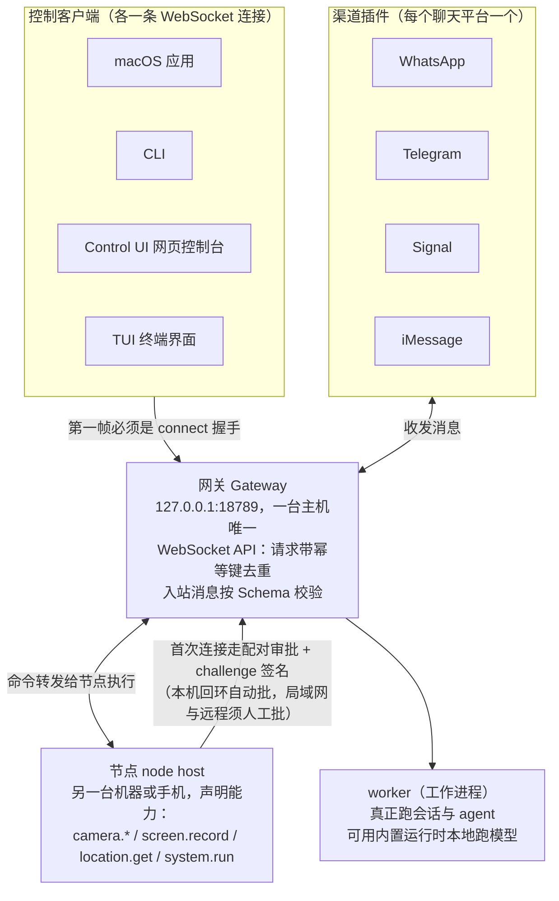
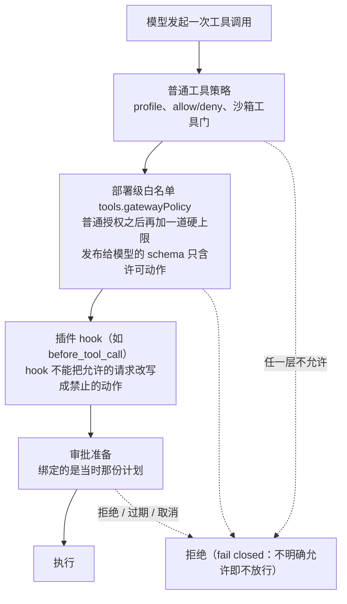
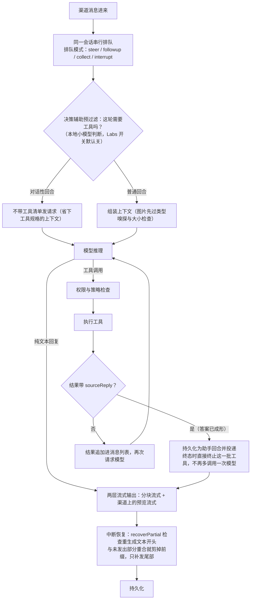
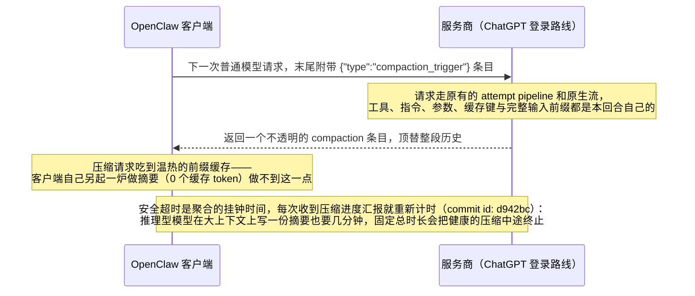
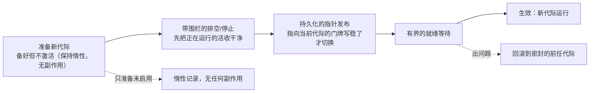

# OpenClaw

| 源仓库 | [openclaw/openclaw](https://github.com/openclaw/openclaw) |
|---|---|
| 协议 | MIT |
| 主语言 | TypeScript（另有 Swift 客户端） |
| 笔记基准 | commit `c635b051de`（2026-11-25） |

OpenClaw 是一个开源的个人 AI 助理项目，主体用 TypeScript 写成，加上一套 Swift 的 iOS/macOS 客户端。它在自己的电脑上跑一个常驻的网关程序，把你已经在用的聊天软件（Telegram、Discord、WhatsApp、Slack、iMessage 等 20 多个渠道）统一接到 AI 上，另有 macOS、iOS、Android、Windows、Linux 原生应用。代码规模很大：`src/` 下有上万个 TypeScript 文件，`extensions/` 下有 170 个扩展，`packages/` 下还有 20 多个共享包。它解决的核心问题是：让一个能执行命令、读写文件、替你发消息的 AI 助理，把状态、记忆和账号凭据全部留在你自己的硬件上，同时用写死的规则而不是模型的临场发挥来做安全决策。项目由独立的 OpenClaw 基金会（美国 501(c)(3) 非营利组织）维护，MIT 协议，没有付费版和托管服务。

这份笔记按问题组织，不按 OpenClaw 的开发时间线：每个问题讲清它现在是怎么解的、为什么这么解、代价是什么。讲法上，每个特性都把"一次连接、一条消息、一次批准、一次升级"从头走到尾。项目演进过程放在文末修订记录里。笔记起于本地 HEAD `20eebbd5c7`（2026-09-21），跟进到 commit `c635b051de`（2026-11-25）。

## 它要解决什么问题

AI 助理要"能干活"，就必须拿到权限：读文件、执行命令、登录你的账号。这就带来一个矛盾：权限给得越多越好用，出事的范围也越大。OpenClaw 的作者在 `docs/start/why-openclaw.md` 里有一个说法：**架构决定 AI"能做什么"，远早于任何规则决定它"可以做什么"**。也就是说，与其指望模型每次都听话，不如把系统结构设计成"即使模型被骗了，损失也有限"。

另一个痛点是碎片化。你想在 Telegram 上使唤助理，也想在 iMessage 上用，还想让它看看手机摄像头。如果每个平台各装一套程序，各存一份状态，很快就没法维护。OpenClaw 的答案是：一台机器只跑一个网关，所有渠道、所有客户端都连到它，状态只有一份。

## 一个网关，所有渠道

整个系统是一组分工明确的长驻进程和客户端，全部通过 WebSocket（一种双向长连接协议，双方随时可以互发消息）连到网关。

### 网关（Gateway）

网关是本地控制平面，默认监听 `127.0.0.1:18789`（只接受本机连接）。它负责：

- 维持所有渠道的连接（比如 WhatsApp 用 Baileys 库、Telegram 用 grammY 库）。
- 向客户端暴露一套带类型的 WebSocket API：客户端发请求（`{type:"req", id, method, params}`），网关回响应，另外主动推送事件（`agent`、`presence`、`health` 等）。
- 入站消息按 JSON Schema 校验；这些 Schema 是从 TypeBox（一个 TypeScript 的类型定义库）生成的，Swift 客户端的模型类再从 JSON Schema 生成，保证三端类型一致。
- 带副作用的请求（发消息、跑 agent）必须带幂等键（idempotency key，同一个键的重复请求只执行一次），网关保留一个短期去重缓存，这样客户端重试不会导致消息发两遍。

一条硬性不变量：**一台主机只有一个网关**，它是唯一持有 WhatsApp 会话的地方。握手也是强制的：连接后的第一帧必须是 `connect`，否则直接断开。

### 渠道（channel）

渠道是"一个聊天平台"在代码里的叫法。每个渠道是一个插件，负责自己平台的账号、安全和传输细节；核心只保留共享的消息工具和统一的动作词汇表。iMessage、Signal、WhatsApp 这类直接跑在设备上的叫"原生渠道"。

### 客户端与节点（nodes）

- **控制客户端**：macOS 应用、CLI、网页控制台（Control UI）、TUI（终端界面），各自一条 WebSocket 连接，用来查看状态、发消息、管理配置。
- **节点（node host）**：装在另一台机器（包括手机）上的代理，以 `role: node` 连到同一个网关，声明自己支持的能力（摄像头 `camera.*`、录屏 `screen.record`、定位 `location.get`、执行命令 `system.run` 等）。模型始终只跟网关说话；网关把命令转发给节点执行。
- 新设备第一次连接要经过**配对（pairing）**审批，批准后网关发一个设备令牌用于后续连接；连接还要对 `connect.challenge` 这个一次性数（nonce）签名，防止重放。本机回环（loopback，即 127.0.0.1 上的连接）可以自动批准，局域网和远程连接必须人工批准。网关前置的 Cloudflare Access 也能校验了（commit id: 80840a）：`cf-access-jwt-assertion` 用 RS256 对 `<issuer>/cdn-cgi/access/certs` 验证，检查 iss、aud、exp，用户头必须与签名里的 email 一致；证书读取上限 64 KB、每个签发者 30 秒最多查一次（失败也计入），RSA 密钥要求至少 2048 位。会话分享的发布通道随后定成显式 opt-in（commit id: 7abe86、96304dd461、39bcc3cc44、39feba647c）：读取者默认不开放、需要显式同意，同意在请求准入时检查而不是在后续使用点；为 Session Share 的 steering 准备了受限写入传输与 steer 发现，保留 publication owner 跨 writer 扩展、区分握手时禁用的发布用途；目标源配置了边缘认证时，命令行跳过本地共享凭据预检、让网关的设备配对决定，未配对设备提示通过 TUI 配对。

远程访问的推荐方式是 Tailscale（把设备组成私有网络的组网服务）或 SSH 隧道，而不是直接把网关暴露到公网。

Control UI 的前端随后做了一轮瘦身。聊天与新会话两个高频页面按需加载各自的代码：侧栏收件箱、转录与草稿、聊天 Markdown 渲染、哈希库、Usage 图表与筛选器、MCP 设置文本，各自拆成打开对应页面才加载的模块（commit id: 4e547a、c42be64af8、b17381c878、801073ff84、096cf7cb68、ee8ec4fe67、a4d2b6b26a）；完整的网关能力清单不再整体发给浏览器（commit id: 6018bc）；侧栏预览与样式随页面裁剪（commit id: 59e5b5、753e9defc1、8a38dbcde7、6b5bc83aec、cb5faf542a、410960eaaf），聊天折叠区块的查找方式也简化了（commit id: d2230e）。功能面三处：Swarm（多个 subagent 协作的群体形态）的进度直接显示在聊天回合里（commit id: 6e805f）；Customize 侧栏列出已安装的插件（commit id: b9cffa）；Sessions 从自己的侧栏图标打开，头像只负责切换 agent（commit id: 62f44b）。

**推理位置是可调度的。** worker（工作进程）是网关架构里真正跑会话和 agent 的进程。模型推理不必都打到云端 API：worker 可以用内置的原生推理运行时在本地跑模型，这条线从协议到客户端分五层——协议层定义 worker 本地推理的契约；worker 侧实现原生推理运行时；网关负责把推理请求安全地派发给合适的 worker；客户端按"worker 本地推理"的放置策略选位置；本地推理开始前还有一道策略校验（派发权限、会话监管、设备准备），不合规就不在本机执行。配置里"必须用 worker"的放置策略（默认关闭）在普通会话创建、首条消息交接和既有恢复路径上都会被执行；用户显式选过的未发送草稿选择保持原样，分离派发时调用者对请求的保管权不丢，范围、profile 和会话的撤销检查照常生效。推理位置由此成了可调度的选择之一，而不是一个写死的常量。

**会话的权限模式对网关的每一次工具调用生效。** 此前的 `resolveGatewayScopedTools` 只对受限发送者应用策略，Claude CLI 聊天经 `mcp__openclaw__read` 调网关工具时能读到宿主任意位置；现在策略对每个调用者生效，准备会话的工作区也随模式生效，相对路径解析到同一个根（`src/gateway/tool-resolution.ts:80`、`:223`，（commit id: a1599a））。文档同时把责任归属写成规则："谁运行工具谁执行模式"——Codex 用自己的沙箱管自己的工具，Muse、ACP 这类自带工具的宿主仍需 Full access，exec 不被限制在会话根目录内，除非运行时自己把命令放进沙箱（`docs/gateway/permission-modes.md`）。为保留自身原生工具的 CLI 加"第二道拒绝面"的尝试随后整体回退（commit id: 8fdae4、d31a94354b）：没有任何部署命中该场景，规则保持单一——CLI 的原生工具跟随 CLI 自身的权限控制。Claude CLI 一侧据此收尾（commit id: f3ebd9）：它的聊天不再对 Claude 自己的工具套 OpenClaw 的 exec 策略与审批，保留可用性检查、OpenClaw 拥有 exec 时对原生 Bash 的拒绝、原生文件参数投影与 `before_tool_call`；代价写进文档——WebSearch、Agent、Workflow 与第三方 MCP 工具（如 Claude in Chrome）在通过 `before_tool_call` 后即放行，OpenClaw 的 exec 拒绝列表拦不住它们。

**剩下各处的复查也一并拆了。** 上一轮把准入检查收敛成一次，这一轮清掉租约与运行期残留的复查：HTTP 路由执行期间不再复查权限快照，只保留 Stop 的中止作用域与"响应已结束"检查（commit id: f1a6db，`src/gateway/http-request-authority.ts:30`）；会话变更里运行期间的角色、作用域、profile、actor 与设备吊销复查删除，保留 `sessionMutationCommitGuard`（会话来源、写入租约、代数）与 Stop（commit id: 6ff7a0，`src/gateway/server-methods/session-mutation-guards.ts:52`）；

exec 审批只在 worker 的提交事务内查一次（commit id: c0ead5）；保存的请求者（排队输入、续跑、沙箱录制启动）统一走 `prepareOperatorAdmission` 与 `decideOperatorAdmission`，用准备好的所有者与已提交配置冻结当前 profile、访问级别、角色、模型与管理员事实（commit id: 3ad2cc，`src/gateway/operator-admission.ts:146`）。一处实质收紧：所有 queued、scheduled、replay、resume 启动都要求"创建这份工作的授权仍然有效"——此前只限定到 `operator.read` 也能启动，现在被降为只读的请求者以授权错误拒绝、待决输入记为 `policy-refused`（commit id: 3cd3a3、b8a55ae920）。subagent 的派生在子运行上保存请求者的操作者来源，网关重启后的唤醒按该来源重新准入（commit id: 450441，`src/gateway/session-restart-resume-custody.ts:108`）；

没有记录所有者的父会话在唤醒时退回 `operator.write` 基线，不再给管理员权限（commit id: e9f299）。拆除过程中丢掉的 MCP Stop 随后补回（commit id: 1a0a24）：loopback 的 MCP 调用把 CLI 回合的中止信号放进审批信号表。

**请求中途的权限重读被清空。** 这一轮把"准入时判一次"的规则铺到几乎每个区域：模型选择在提交时不再重读网关权限，会话历史的事件流每次推送不再重新认证、不重读范围与成员，`POST /tools/invoke` 只在客户端断开与请求结束时终止——权限撤销不再中止已开始的工具（commit id: 14f185）。服务端方法分四批逐区清理：带计数的拒绝串按"只有权限、审批或配置变化时能否触发"分类，能触发的连同管线一起删，属于 Stop、连接关闭与数据栅栏的保留并改写文案（commit id: 08eaf4、620b710834、59ae4e0f76、8ea0f17162、1596a12397、6c8c6dd946）；

运行关闭与运行出现序号的拒绝串改写为"此 agent 运行已不活跃"（commit id: bc26ef）；渠道入站事件里渠道操作者的重读与已无抛出点的错误类型删除（commit id: e6b910）；工具、沙箱与命令里的操作者重读同样删除（commit id: 5c2145、515a93c672）；自动回复执行器约 37 个文件与回复派发、会话事件 17 个文件的中途复查一并清理，Stop 依赖已有的中止信号（commit id: 24167f、cb1d8cdea3）；

命令所有者的实时策略读取与约 30 个处理器的"所有者是否仍是本人"检查删除（commit id: 572152）。收尾三处把调用约定也改了：`ReceiptAuthority` 这个布尔类型删除，"授权已失效"变成会抛错的会话来源断言，约 60 个测试夹具从返回假改为抛错（commit id: 096214）；只做 Stop 判断的两处调用改成直接检查中止信号（commit id: 70d12e）；"只有准备形态才带数据栅栏"搬进准备会话来源，后台媒体这类脱离的工作仍能在运行关闭后提交（commit id: b21086）。静态检查的白名单随之清空（`scripts/check-lifetime-check-ratchet.mts:20` 的清单已是空数组），规则脚本保留给后续检查。代价是有意接受的两类边界：撤销发生在请求开始之后时该请求会执行完毕，已经打开的事件流会持续推送到客户端重连、重连那次被拒绝。整套拓扑画出来是：



**一个回合能做什么，在准入时一次定死。** 此前"这个人算不算本人、能不能做这件事"的答案随回合的入口漂移：原生应用发出的 steer 换不掉一条待决问题；`operator.admin` 的客户端不在 `commands.allowFrom` 名单里就被挡在斜杠命令外；技能创作在 chat.send 上读一套"是不是人类回合"、在 agent RPC 上读另一份内部启动清单，同一个人的内部回合被误报"技能创作需要一条新消息"；工作区技能创作还在回合中途重读实时角色。现在准入在放行回合时产出一份冻结的回合授权 `TurnGrant`（`owner`、`skillAuthoring`、`questionReplace`、`commands` 四个字段，唯一的产出点是 `src/gateway/operator-admission.ts:234` 的 `decideTurnGrant`，模块注释写明"回合能做什么的唯一生产者，每种入口都经准入到达"；每条权威构造路径都调它：重放重新判定、网关新准入、渠道捕获与续接收窄），回合入口只读这份判定——所有者工具与转录盖章读 `grant.owner`，技能创作看 `grant.skillAuthoring`（`isHumanTurn` 与两套入口清单删除），斜杠命令看 `grant.commands`（管理员视为全通过，非管理员保留名单与可见拒绝）。这份授权只在内存里、只信内部提供者，重放按记录的来源重新判定一次。配套三笔：静态检查禁止在准入之外读回合种类（commit id: 335861）；渠道发送者也走同一扇门准入（commit id: e2a9a6）；网关请求的已验证调用者身份暴露给插件（commit id: b23f1e）。准入之外的"操作者权威复查棘轮"（lifetime ratchet）整套移除（commit id: 75cab7）。

客户端一侧补了一批。Safari 与 Mac 应用里悬停扫过侧栏导致控制界面卡死的问题修复（commit id: 0aa27d）；Mac 上 Command-T 打开浏览器侧标签、聚焦的标签里查找文本（commit id: dbe48a、a35ba559ef）；仪表盘链接从聊天打开不再整页重载（commit id: 3d9a42、cb4f301c6b）；隐藏的 macOS 仪表盘保持连接直到关闭、重载仪表盘需要 Shift-Command-R、Tailscale 来源在没有已配对浏览器密钥时也记录（commit id: df8bc4、aef014c81e、efaeb858b5）。

## 主轴：可信网关、不可信执行、确定性策略

这是官方文档对整个架构的一句话概括（trusted gateway, untrusted execution, deterministic policy），拆开讲：

- **网关是可信的**：它拿着你的配置、凭据、记忆，是秘密的保管人。
- **执行环境是不可信的**：AI 跑代码、碰文件的地方（沙箱、远程节点、一次性云主机），被当成"随时可能沦陷"的区域。即使模型被恶意提示词（prompt injection，指别人在消息里藏指令骗模型）骗了，或者执行环境被攻破，也拿不到网关里的秘密。凭据可以用 SecretRef 引用，受保护的秘密值根本不进入模型的上下文。
- **策略是确定性的**："这个命令能不能执行"由代码里的规则判定，不靠模型自觉。文档的原话是：拒绝是结构性的（structural），不是"请求模型遵守的请求"；需要审批的路径在规则不满足时一律失败（fail closed，即出错时倾向拒绝而不是放行）。

配套的信任模型文档（`docs/gateway/security/trust-model.md`）还明确了边界适用范围：**一个网关就是一个信任域**。它服务"一个操作者，或彼此信任的团队"；互不信任的用户应该各跑各的网关。当有人发消息给一个开了工具的助理，他就间接共享了助理的工具权限，这对互信的同事没问题，对敌意用户就是漏洞。

它的防御顺序也很实在：先定身份（谁有资格跟机器人说话，陌生人要配对），再定范围（机器人能在哪干活，哪些工具开放，要不要沙箱），最后才考虑模型（假设模型可能被骗，让被骗的后果可控）。

有一点官方说得很坦白：沙箱和执行审批**默认是关的**。默认安装是一个"信任单操作者"的助理，加固是主动的配置动作，`openclaw security audit` 会告诉你哪里偏离了加固基线。"默认好用"和"默认最安全"是两个不同的取舍，项目选了前者并把话说明，没有嘴上说安全最重要、实际上什么都默认开。有人值守的会话也有了自己的中间档（commit id: 65a125）：每个 agent 可以配一套 attended 会话的默认权限模式（opt-in），只作用于**新建的、直接有人值守的**带档案操作者会话——已有的会话默认不变，用户显式选的模式永远优先，完全放开（full access）仍要求活着的管理员权威。默认档从"开或不开"变成了三档：默认关、显式选、按会话类型配默认。

模型驱动的 exec 也有了按提供方或模型设置上限的档位（commit id: 990fc1）：`tools.byProvider[...].exec.mode` 给特定提供方或模型声明 exec 模式的上限（`src/agents/session-permission-exec-mode.ts:93` 起的注释写明方向——"模型上限只做限制；安全取最小值，ask 取最大值"），同一回合命中多条上限时逐条归并收紧（`:129-133`），应用在所有其他层之后——它只能把已经允许的动作收得更紧，永远不会放松任何一层。

这条主轴体现在每个机制里。最典型的是模型发起的一次工具调用要穿过的防线——普通工具策略、部署级硬上限、hook 与审批，每层的检查内容和失败方向都是固定的：



同一主轴的其余体现：审批绑定的是"当时那份计划"、常驻 watcher 的批准只授权那一个确切的提案（均见"执行环境与取消传播"）、浏览器路由失败时不用别的机器顶上（见"浏览器控制的本地优先路由"）、秘密用引用传递（本节）、审批测试共享同一份契约（见"测试体系"）。

**权限在工作开始时查一次，已开始的工作允许完成。** 一批重构把散在处理途中的权威复查删掉，只留准入时刻的一次检查：CLI 执行期间反复重建的运行断言工厂删除，排队执行开始时准入一次，已开始的传输在调用方权限变化后可以执行完毕，取消与超时仍走 AbortSignal（commit id: 5188f9）；工具执行处捕获的调用方权威守卫删除（24处生产调用），已准入的工具调用在源权限变化后可以完成，文件系统包含、worker 数据围栏与显式取消保留（commit id: c23cb9）；保留运行中的角色分配、OpenClaw ID 与设备撤销 watcher 改为启动时检查一次，下一次回合重新检查并被可见拒绝（commit id: 00bc79）；进程内网关请求在分发前检查一次调用方权威与绑定，返回真实结果——"已批准的变更被回复成拒绝"随之修复（commit id: 2e3fd0）。代价写在规则里：运行中被撤销权限时，正在执行的回合仍会走完，下一个回合才被拒绝。共享会话里的协作者边界同时收紧（commit id: 2b5f1a）：受邀协作者不能放宽别人的守卫、也不能替别人批准命令——审批记录携带 `requestedByProfileId`，实时与持久读取都按 profile 边界过滤，遗留审批读取器补同一边界，审批提交保留 profile 权限，状态库 schema 升到 v41 并带 approval-profile 迁移。

**模型看到的历史只在压缩时缩短。** 嵌入式运行器的历史读取上限改成固定的 16 MiB 与 10,000 个事件，与 `contextTokenBudget × 8` 解耦（`src/agents/embedded-agent-runner/run/session-context-limits.ts:9`）；两次压缩之间不再悄悄滑掉最早的回合，压缩成为唯一缩短历史的手段（commit id: 6198f7）。同一上限推广到 Codex app-server、Agents API、Muse 等插件执行器（commit id: 45b96b，`src/plugin-sdk/agent-harness-attempt-runtime.ts:336`）——窗口随 token 额度伸缩时，前缀会随内容增长被截断，缓存与重放的字节都不再稳定，这是把窗口钉成常量的原因。

配套几处都指向同一条：让重放的字节保持稳定。自动化与 subagent 的结果在模型投影里变成带固定标签的 user 输入 `[OpenClaw background result] ...`，标签不含时间、任务号与运行号（`src/agents/replay-provenance.ts:11`，（commit id: 954491）），模型不会把历史结果当成自己没请求过的回复接着写。steering 消息携带的文档文本在请求离开前写进投影，后续重放使用同一份文本（commit id: 20964c，`src/agents/embedded-agent-runner/run/attempt-llm-boundary.ts:411`）。

不带工具的后台 fork 列出与会话相同的工具集（含提供方托管的 `web_search`），再用 `tool_choice: none` 阻止执行——工具清单一致，缓存前缀才对得上（commit id: a63a42）。缓存亲和与提供方状态所有权也拆开了（commit id: 895c50）：`sessionId` 继续作缓存键与请求头，新增 `ProviderStateScope` 品牌类型经符号传入，Responses 的续写、WebSocket 池与 ChatGPT 池都按这个作用域建键——后台运行不再替换前台会话的续写基线（`packages/ai/src/session-resources.ts:55`）。

**自动压缩改成"复用会话下一请求的整体前缀"。** 除原生 ChatGPT 签入路线外，所有内置路线都把会话的下一次正常请求整体复用——同一套系统提示、工具、工具选择、输出上限、思考设置、缓存键与全部历史，只在末尾追加一条不设缓存检查点的用户指令作为摘要指令（commit id: e5dcfa，`src/agents/embedded-agent-runner/run/request-boundary-compaction.ts:245`）。请求若出现工具调用、结束原因不是正常结束或文本为空即拒绝，边界情况抛"只做压缩"的错误交回客户端压缩器。输入全量历史换来的是成本可控，摘要质量与旧路径相当。随之而来的触发点偏移被两次修正：请求边界压缩从 0.9 降到 0.8、客户端维护从 0.75 升到 0.8，给摘要请求本身留 20% 余量（commit id: 412df9）；触发公式收敛到唯一所有者 `packages/ai/src/utils/compaction-threshold.ts:6`（窗口减预留与窗口乘 0.85 取小），两个服务端压缩的 0.7 字面量消失，服务端侧与客户端边界压缩在同一占用率触发（commit id: 94ede2）。

缓存保活也成了一项常规动作（commit id: b36ba3）：已知缓存寿命结束之前，网关用会话分叉的"缓存预热"模式发一次只读预热——Anthropic 用零输出上限、非流式、尾部占位条目不设缓存检查点，OpenAI 用预热参数；只对交互式会话、提示超过 5 万 token、上次回复已在该路线结算、之后没有压缩或重置或换模型的会话生效。额度按路线价格算"写入与读取差价的一半"，上限 24 次（无价格时 3 次）、12 小时封顶，未命中即停，出错则暂停该提供方 15 分钟；状态写成会话行上的保活记录，由定时维护循环的第三个截止时间调度（`src/agents/prompt-cache-keep-warm.ts`）。

ChatGPT 的 Responses 后端不缓存 `instructions` 字段（模型目录里标了），所以系统提示改成作为输入的首条消息下发，进入缓存前缀与续传的重放内容（commit id: 8b1782，`packages/ai/src/providers/openai-chatgpt-responses-request.ts:38`）。后台评审分叉保留会话的托管搜索工具，使分叉请求与父请求前缀一致（commit id: 1b0a0a）；缓存丢弃诊断不再把三种输出上限字段的差异算作前缀参数变化（commit id: ddde86）；已结算回合的终结请求上限恢复为 16 MiB 与上下文额度八倍取小，超出时把工具结果正文换成简短通知（commit id: 6963e4）。

## Agent 循环与消息流

一条消息进来后的处理链路叫 **agent loop（智能体循环）**：接收、组装上下文、模型推理、执行工具、流式输出、持久化。同一个会话的多次运行被串行化（一个会话同一时刻只有一个运行在干活），避免工具和会话状态竞争。整条链路画出来是：



**纯对话的回合可以不发工具清单。** 被判定为对话性的回合（寒暄、追问、不需要动手的交流）可以省略工具清单再发请求，省下的正是每次请求都背着的那份工具规格上下文。判定来自"决策辅助预过滤"（decision assistance prefilter，一个本地小模型判断这轮需不需要工具），但它不擅自生效：挂在 Labs 的 `decisionAssistance` 配置下（用户显式同意才开），还要求 harness 声明支持"回合级工具限制"能力（不支持的场景比如 Codex 执行引擎，就保留原来的工具策略）；回合里挂着待办的动作指令、或请求已取消时，也不启用。这个方向跟设计哲学里"核心有每次调用的税"的判断一致：既然每个工具都出现在每次请求里，能确认用不上的回合就不该缴这笔税。工具的排序也学会了看用量（commit id: 8a328b、ac10e03c40）：opt-in 的 usage-ranked tool index 按历史用量给工具排名——工具用量与转录写入在同一事务里记录、跨被接纳的运行保留排名（`src/agents/tool-usage-ranking.ts:55` 的选择按冻结排名取行、保持调用方的规范行序，`:80` 的访问按用量份额加学到的用量排序，无排名的行按稳定 ID 顺序跟上）；MCP 工具同样入索引，压缩后按既有排名重新固定，冲突的 MCP 导入名拒绝注册（导入归属从结果所有权解析）。

两笔省的是看不见的账。恢复会话的历史编码开销砍掉了大头（commit id: 2a5ecf）：恢复会话的 user 与 toolResult 消息在历史发布时一次性冻结快照（此前只冻结 assistant 消息，`src/agents/embedded-agent-runner/run/attempt-history-prepare.ts:275-281`），Anthropic 传输在发送前对通过相等性校验的副本按冻结键预编码字节片段并缓存（`packages/ai/src/transports/anthropic-request-body.ts:11` 的 WeakMap、`:138-143` 的预编码循环），序列化时直接复用——实测热身 CPU 降约 44%，发出的字节逐位一致。

Code Mode 长会话的 replay 也改了算法（commit id: 61a0a1）：不再逐条编码入投影，先在写入表里解析出每个键的最终值，只对存活值调用编码，budget 检查移交最终投影（`src/agents/code-mode-session-store.ts:255-263` 的注释写明分工——历史 budget 归提交接纳管）；六千条 replay 从约五百次编码降到四次。Code Mode 的失败路径随后也立了规矩。失败要有终态（commit id: 859b77）：一次失败的工具调用此前可能被只做分类的钩子或不匹配的中间件吞掉语义身份，失败循环就此打转；现在失败身份穿过这些层被保留，存下的后续回合在 Control UI 里可见、准入等待有名字（`packages/agent-core/src/tool-call-outcome.ts` 的结算类型）。

静默的模型流也带上了期限（commit id: 8bb413）：被拒绝的程序先于未决兄弟桥接的排空返回，工具心跳与模型进展分开判定（`src/agents/embedded-agent-runner/run/llm-idle-timeout.ts`），卡住的调用要么失败结算、要么超时收尾。模型绕过 Code Mode 直接调用被藏起来的工具时，恢复指引告诉它该走哪条路（commit id: 90ecba，`src/agents/embedded-agent-runner/run/attempt-session-prepare.ts` 的会话准备）。

**反过来，工具也可以直接交付完成的回复，不再多调用一次模型**（2026-10-04）。工具声明 `canDeliverSourceReply` 并在结果里带上写好的答案（`details.sourceReply`），运行时把它记为"工具创作的源回复"——持久化成助手回合、像助手文本一样投递进对话，并在回复是终态时直接终止这一批工具。答案已经成形的工具（查完的资料、执行完毕的脚本、发出去的消息）不再额外消耗一次"把工具结果交给模型、让模型复述一遍"的回合。SDK 侧把入口收敛成一个 helper（`captureToolAuthoredSourceReply`）；转录写入失败时投递照常进行、失败只记日志。这条跟"对话回合省工具"是同一处经济账的两端：那头省的是不需要工具时的工具清单，这头省的是不需要模型时的模型调用。

流式回复有两层（`docs/concepts/streaming.md`），而且明确说明**没有真正的逐 token 推送**到聊天渠道：

- **分块流式（block streaming）**：模型每写完一段，就把这一"块"作为正常的渠道消息发出去。块的大小由 chunker 控制，有最小、最大字符数和切分偏好。
- **预览流式（preview streaming）**：在 Telegram、Discord、Slack 等渠道上，先发一条临时预览消息，生成过程中不断编辑追加，结束后再定稿。

**断线恢复与前缀去重**。流式输出可能中途失败（网络闪断、超时），恢复的办法是让模型重新生成。但模型重试时常会从头再说一遍，前半段你已经发给用户了，重发就成了复读。`src/auto-reply/reply/block-reply-delivery.ts` 里的 `recoverPartial` 用了一个很轻的解法：检查重新生成的文本开头是否与"还没发出去的剩余文本"的开头重合，重合就把前缀剪掉，只补发尾部：

```ts
const prefix = fragment.payload.text?.trimStart();
const remaining = text?.trimStart();
if (!remaining?.startsWith(prefix)) {
  break;
}
text = remaining.slice(prefix.length);
```

它不需要任何额外的状态记录，用内容本身自证重复，简单且可靠。同一文件里还有一个串行化设计：多次投递通过一条 Promise 链（`sequence`）排队，前一次投递失败时，下一次续写会先观察失败的回执，而不是跳过未发送的前缀继续发，避免内容错序丢失。

**发给模型之前，图片要先过检查**。模型对图片格式有要求（Anthropic 的接口只认 jpeg、png、gif、webp 四种），也不能太大。`src/media/anthropic-inline-images.ts` 在把图片塞进请求前做四件事，每一件都是处理不可信输入的标准动作：


- **嗅探真实类型**。怎么知道一段数据是什么文件？最可靠的办法不是看它自称什么，而是看开头几个字节的"魔数"（magic number，每种文件格式约定的特征字节，比如 PNG 开头固定是 `89 50 4E 47`）。这种读开头一小段猜类型的做法叫 MIME 嗅探。代码以检测出的类型为准，检测不出来才退回相信声明值：不轻信自报家门。
- **只解码前缀，不解码整张图**。图片以 base64（把二进制数据变成纯文本的编码）传输，规律是每 3 个原始字节变成 4 个字符。想嗅探类型只需要开头 N 个字节，那么取 base64 字符串的前 `4 × ceil(N / 3)` 个字符去解码就够了。一张几十兆的高清图，为了"闻一下类型"把整张图解码进内存太浪费，只解码最小前缀，内存和速度都省了。
- **不支持的格式转成通用格式**：检测到 BMP 就转 PNG，其他不认识的一律转 JPEG。给下游一个它一定能接受的格式，比自己维护一个大列表省事。
- **进门就设上限**：解码前先估算大小，超过 10MB 直接拒绝，不让超大输入拖垮系统。

**推理-only 回合撞上输出上限，不再发起无效的付费续写**（commit id: ab7631，关联上游 #88656）。provider 重放（把已有消息重新发给厂商让模型续写）有个上游行为：只含推理、没有正文的回合若是在输出 token 上限处截断的，重放时会整个排除——模型根本看不到它。但推理-only 的恢复逻辑此前仍会让模型"从这个半截回合继续"，发起一次注定没有上下文依据的付费重试。现在续接资格复用重放的判定：重放里不含的回合直接以输出上限的结果收尾；重放里包含的推理-only 停止照旧可以续接；厂商明确返回的结构化拒绝仍是终态。

**模型没有公开输出上限时，回复不再固定截在 8192**（commit id: 94e673）。无已知输出限制的模型此前一律按 8192 token 截断——长回答被拦腰砍断。现在默认上限提到 32,768（`src/agents/defaults.ts:11`）；已知窗口的模型按"窗口的一半给输出"解析，夹在 8192 下限与 32768 默认之间、绝不超出窗口本身（`src/agents/defaults.ts:21-29` 的解析函数），显式配置过的上限不经这条逻辑。

**回合中途的上下文维护与硬边界**（commit id: e44b8f、PR 189810 上线后因 CI（持续集成）多个作业失败，被 ffbaf04726、PR 189891 整体回退，e0ed68c7b8、PR 190017 换了算法重做）。OpenClaw 有一个"回合中途预检"（midTurnPrecheck）：在工具轮次之间检查上下文压力、必要时先压缩，它挂在默认关闭的配置后面。重做后的机制分两层。**主动维护从窗口的 75% 开始，由服务商实测占用驱动而不是客户端估算**：实测值与上一请求的结算值都拿不到时才算 0（`src/agents/embedded-agent-runner/run/attempt-setup.ts:441-467`）；

压缩起点取"窗口减预留"与"窗口×75%"中较小者（`packages/ai/src/utils/compaction-threshold.ts:9-13`）。**硬窗口检查总是执行**：每个准备好的请求都对照窗口核对，占用按名义值加校准过的工具结果估算，再加上服务商实测值与待加入项；越界时按可压缩程度走四条恢复路由——放行、只截断工具结果、只压缩、先压缩再截断（`src/agents/embedded-agent-runner/run/preemptive-compaction.ts:350-358`）。声明"推迟压缩"策略的会话仍豁免主动维护（它们自己拥有压缩时机），但代码注释明说"推迟维护不等于允许越窗的服务商请求"（`attempt-setup.ts:441`）。当前上下文总量经既有的受保护会话写手发布，最终有序结算覆盖中间快照；

旧的 prompt-only 新鲜度戳直接作废，不动 schema、不加配置。软检查可以关，"实测阈值的维护与硬窗口检查不随开关停"这句区别写在配置帮助文本里（`src/config/schema.help.agents.ts:166`）。

两笔与上下文账目有关的修复：压缩摘要不再把没有实际改动的文件列为已修改（commit id: 077eac）——`extractFileOpsFromMessages` 把结果标明 `changed: false` 的 edit/write 记为未变更（`packages/agent-core/src/harness/compaction/utils.ts:45-65`），摘要里不再出现"改了但其实没改"的文件，模型也不会顺着假改动继续推理；上下文引擎能看到真实的提示词用量了（commit id: 579536）：持久化的回合提交此前丢弃 prompt 用量，引擎永远见不到真实的 prompt 大小，现在回合信箱带上最后一次调用的用量与缓存观察（`src/agents/harness/context-engine-turn-outbox.ts:23`，纯计数器），组装尝试的快照随生命周期清理（`src/agents/harness/context-engine-assembly-attempt.ts:30-36`）。

压缩本体随后也修了一轮语义。**摘要额度先给必需部分留位**（commit id: 2d4ec7）：此前的 safeguard 先为整个逐字保留后缀预留空间、剩下的才给摘要体，近期的工具输出会把模型自己的决策、TODO 与标识符挤出去；现在摘要体只为它必需的小节预留，后缀按时间序组装（保留回合 → 被切开回合的摘要 → 必需小节，`src/agents/agent-hooks/compaction-safeguard-budget.ts:67` 的 `budgetCompactionSummary`），头部优先的尾部截断先裁较老的逐字回合、截断保留小节标题、留下的工具结果只留 160 字符摘录。**切点先在选中的消息上判定**（commit id: 5479dc）：split 判定改在选中消息上先做、再回溯保留它前面的元数据——夹在 user 消息前的 bootstrap 标记不再把上一回合误判成 split-turn 前缀（`packages/agent-core/src/harness/compaction/compaction-cut-point.ts:288-294` 的注释写明这条顺序）。

**失败分类看 provider 的原话**（commit id: 816999）：compaction 失败改按保留的 provider 响应归类、按包装层显示文本（`src/agents/embedded-agent-runner/compact-reasons.ts:81`），配额错误之后继续走已配置的 fallback 模型、按 unexpected-error 报错。**嵌套压缩不再误杀前台**（commit id: 44fc55）：嵌套 compaction 期间保留前台 watchdog、清理回调按 attempt 命名防遮蔽（`src/sessions/session-controller.watchdog.types.ts:7` 的类型契约），消除历史 compaction 之后的误停滞中止——这是停滞自愈那组的后续。

**维护步骤拿得到模型目录了**（commit id: 3d6914）：网关 agent 方法的回合（subagent 完成通告、唤醒这类）走维护步骤时拿不到路由模型目录，一律按 200k 默认窗口算额度，大窗口模型的会话被过早压缩；现在把 thinkingCatalog 传进维护 followup（`src/agents/command/maintenance.ts:46`、`:163`）。摘要能写多长也有了自己的旋钮（commit id: c7152f，PR 196207）：`compaction.maxSummaryChars` 限制持久化摘要的字符数，agent 级配置覆盖全局默认（`src/agents/agent-settings.ts:29-32` 的解析），默认 16,000、允许范围 1,000 到 200,000（`src/config/zod-schema.agent-entry-base.ts:12` 的 schema，默认值注明在 `src/config/zod-schema.agent-defaults-base.ts:151`）——页面长度的经济账（知识库那节给页面正文设过 budget）从此也管到了压缩摘要自己头上。

**压缩的时机转向"按预测溢出压缩"**（commit id: 535f3e）。此前的请求前压力检查把每个工具结果都当作可缩减的，只截断的路线上会把最老的已发送结果改写到总额度之内——这动了服务商缓存前缀里的字节，而且因为只裁到刚好装下，临近窗口的每一轮都会重复一遍同样的改写。现在预测压力只统计与裁剪服务商还没有收到的结果（最后一条助手消息之后的）；已发送历史的溢出改路由到压缩这个允许的重建点；真实服务商拒绝之后的恢复路径不变，所有预测溢出路径都保留已发送的输出。配套三处：慢的自动压缩跑满配置的超时、到 6 分钟就停的固定判定废除（commit id: ea6346）；回复前不再重读压缩历史——用活跃身份与依赖事实认证保留的压缩窗口后跳过压缩载荷，不支持或不确定的前缀保留完整读者、字节切点保持精确（commit id: f95533）；固定的提示词压力跨 attempt 阶段携带——估算器在上下文组装时创建、事实直接进前台额度计算，引擎新增或钩子改动系统提示词时保持精确重估，五组配对运行实测准备 CPU 降 30.6%（commit id: 138482）。

循环本身的几处判定也修准了。Ollama 式不完整回合的重试判定改按 API 匹配（commit id: 465c11，`src/agents/embedded-agent-runner/run/incomplete-turn-classification.ts:190` 的参数化），自定义 provider 走 Ollama API 时同样重试；settled 回合的交付计数排除 reasoning 载荷（commit id: 4a5dad，`:149`、`:153`），"显示了思考过程却没有最终答案"的误判消失；缓冲的非 SSE JSON 折成多行 `data:` 字段（commit id: 7e825b，`src/agents/provider-transport-sse.ts:145-147`），流式 provider 的多行 JSON 不再丢事件；steering 之后消息生命周期不再假报 idle（commit id: ee3ec6，`src/logging/message-lifecycle.ts:31`、`:72`，按会话 run 活跃度统一判定）；goal 延续对本地 Codex 目标免 operator 角色（commit id: ec41ea，`src/auto-reply/reply/goal-continuation.ts:106`、`:197`），只有 worker 放置需要网关 operator 能力。

Goal 的又一处停止推进根因也修掉了（commit id: 3e7893）：延续终局的判定此前要求这一跑没有接受任何会话派生，收集型子任务收尾时派生的"带完成消息的 spawn"（spawn 附带最终交付消息，本身表示子工作已经交付）也被当成"还有派生挂着"，Goal 等一个永远不来的信号；现在只有不带完成消息的派生才挡判定（`src/auto-reply/reply/goal-continuation.ts:133` 的 `hasCompletionMessageSessionSpawn` 检查，定义在 `src/agents/accepted-session-spawn.ts:90`）。

**后台命令与 yield 等待改由聊天拥有**（commit id: 5d35af）。后台命令、`sessions_yield` 等待与 exec 退出唤醒此前归发起它们的 run 所有，而 run id 只命名一次尝试、聊天每个回合换一个新 run id——后续回合因此接不上早前回合的活：后一个回合无法在早前回合启动的命令上 yield（`sessions_yield` 返回 nothing_pending，模型只好自己去轮询）；暂停的 subagent 任务只在唤醒指名那个暂停 run 时才继续。现在这三样东西按 chat 拥有，跨回合存活。

**工具循环守卫换成一个只看参数的重复守卫**（commit id: 3a3eed）。旧守卫散在 12 个文件约 1700 行：哈希工具结果、按单个工具名各写检查、四个独立检测器加一个压缩后守卫，滚动检测还要 opt-in。它始终开启的那部分最伤人：连续 3 次相同的失败调用之后，下一次相同调用直接结束回合——模型连回答的机会都没有，用户收到的是一条停止消息。新守卫是 `packages/agent-core/src/tool-repeat-guard.ts` 里的 105 行：只比较工具名与规范化后的参数、从不比较结果；连续第 3 次相同调用照常执行、在结果里附一条改向注记（点出工具名、要求换思路）；连续第 20 次不执行，回合以 `tool_repeat_limit` 结束并给出明确说明；工具用纯数据声明 `repeatable` 豁免（`wait`、`process` 的轮询与列举、`agents_wait`、`sessions_yield`、`computer` 截图等），声明随工具定义穿过 worker 边界、云与节点 worker 的回合同样适用；新的用户输入重置计数。结果哈希、逐工具检查、乒乓检测、滚动历史、压缩后守卫与"3 次失败即硬停"全部移除。

Goal 的恢复面也补了一处（commit id: fcf29c）：可见的已派生任务里中断的目标现在能恢复。

**长流之后的输出上限续写不再丢**（commit id: 02dc18）：模型输出触及上限时，先前的续写判定在长流（大量分段流式输出）之后失效，续写保留。

**上下文压力的判定收进一处**（commit id: fb9337）。此前"请求超没超窗口"散在四处——回合中途检查、提示词预检、ChatGPT V2 回退、回合前后压缩，各自为政；现在归到 `src/agents/context-pressure.ts` 一个模块：只有请求真的超过模型窗口才允许失败回合；软压力（还没到窗顶但值得减负）只在工具结算边界压缩、且压缩之后回合总是继续。压缩后的 Responses 输入前缀复用压缩归属发布的不可变身份（commit id: 6d381e），逐回合的深比较不再重复。后台聊天分叉（技能工作坊回顾、插件评审这类）改用原聊天的完整请求（commit id: 2a7ca1），提供方提示词缓存的命中率从 0% 升到 98%，分叉也不再被其他网关活动打断、超时跟随 agent 运行超时。回复看门狗停机时会列出尚未返回的工具，卡住的调用点一看便知（commit id: 3a595d）；

安静的 Auto Review 调用经工具存活归属发布父回合的执行期限，不再中途被看门狗终止（commit id: 3c3092）。工具参数的强制转换统一走一个入口（commit id: 40437f）：`tool_call`、Code Mode 与 Codex 动态工具共用 `validateToolArguments`，`"1"`、`"false"` 这类字符串参数不再被严格 schema 拒绝。简单的文件任务跳过无谓的技能发现与搜索、直接用已启用的一等编辑工具（commit id: 5ce80e）。工具判定随后又修准了一批：工具校验与截断的反馈改成可行动的说法（commit id: 877064）；

read 工具接受 `optional: false` 作为必需读取（commit id: 1039d5）；重试一个丢失了回复的工具动作之前，先向调用方发出警告（commit id: b7bf91）；重试重载超长历史时保住 subagent 的任务（commit id: adda3d）；Goal 的权威证明按已准入的运行政策核对（commit id: 1b778b）；没有标题的消息表格拒绝而非悄悄丢弃（commit id: e20e84）；超长的聊天历史消息保留渠道消息 id（commit id: 0c3f2a）；

用量记录不把占位的 $0 记在已解析的模型价之上（commit id: 723cc5）。

**请求前缀除压缩与模型切换外不改写。** 六处修补朝同一个目标收：系统提示词的历史身份改由 transcript 的边界计数认定（commit id: ee1140）——压缩把历史滚出有界窗口后，用记录相同 `boundaryCount` 的 `openclaw.system-prompt` 检查点命名历史，不再让 `historyId` 变成 null 触发 `restarted:history`，压缩摘要的输入同时排除 `System prompt update` 消息；

工具定义集合在提示词系列的第一次请求时固定，后续回合即使按回合权限没有构造某个工具，它仍留在列表里，调用时由 `resolveTurnToolSurface` 拒绝并回复"`<tool>` is outside the tools this run allows"，MCP 目录从 `tool_search` 定义移到系统提示词的 `### Deferred Tool Schemas` 段（commit id: 4639df）；路由不支持把系统提示词更新作为 system 消息时，投影出的 user 消息带 Symbol 键 `PROJECTED_PROMPT_UPDATE`，合并判定拒绝跨过它，提供方已经收到过的消息不再被改写（commit id: ced3bf）——Symbol 不进 JSON 序列化与 worker 协议，只被合并判定读取；

worker 节点的回合也按会话固定系统提示词，网关读最新检查点、把增量作为整段替换的 `System prompt update` 块写入该回合 user 行的 model-only 文本，重建点（压缩、模型或路由切换）之后旧增量作废（commit id: 28dafe）；Responses 回放转换器只把回合自身的上下文注记移回其 user 消息，紧跟在 user 消息前的第二个注记属于 steer，保持在第一次发送的位置（commit id: 470680）；

提示词历史诊断忽略只改 provenance 的转录变化，内容变化仍然触发缓存告警（commit id: f3992d）。代价是几处已知缺口：被拒绝的工具仍占着定义，升级后每个会话重新固定一次、产生一次缓存未命中，Bedrock Converse 这类走 `preserveContextBoundaries: false` 的路由不经过合并判定。系统提示词本身也重排过（commit id: 5efe76）：重复出现的规则合并到单一归属段落；`skills_read` 可用时技能目录从每条 6 行的 XML 块改为每行 `"name": description` 的紧凑列表，路径与路径加载说明不再进入提示词；

没有 `skills_read` 的会话（路径读取、CLI 后端）仍渲染 XML 目录，两种目录形状并存。

**触发压缩的字节数不再把控制行算进去。** 字节触发的压缩此前把每个 `openclaw.system-prompt` 检查点（系统提示词加工具清单）都计入 `maxActiveTranscriptBytes`；在挂两百个 MCP 工具的环境里检查点本身约 150 KB，对 256 KB 的上限会同时造成三件坏事：压缩过早触发、压缩之后仍然超限、闩锁常亮。现在 `transcriptEventChargesContextBytes`（`src/config/sessions/session-transcript-projection-append.ts:123`）规定 `custom` 类型条目持有宿主或插件状态、从不投影成模型消息，因此不计入字节数；

SQLite 计数器改用持久化的 `navigation_type` 谓词（`src/config/sessions/session-accessor.sqlite-reset-window.ts:672`）。上下文的资格判定不变，有界上下文获取仍能看到这些控制行（commit id: 703775）。压缩定位 assistant 检查点归属改用内部只读分支访问器，不再对已封存历史做深拷贝（commit id: 83bd36）；准入后的转录载荷复用已封存的归属结果，不再重复做深不可变性检查（commit id: 04382b）；

并发回合的提示词内存也省了一层——先共享提示词文本再做会话固定，每轮不再留一份完整副本（`src/agents/sessions/system-prompt-pool.ts`，（commit id: 53b68f））。渠道转发的消息开始在转录里打标（commit id: 86fe94）：入站上下文带 `ForwardedFrom` 时，显示给外部用户的轮次写入 `__openclaw.forwarded: true`，发送者身份字段不变，记忆导入能区分"某人写的"与"某人转发的"——未上报转发的渠道永远没有这个标记，历史数据不回填。

**自动化的运行槽位随提供方压力伸缩。** 槽位从 agent 并发上限推导，至少 8、最多 16；提供方言限流或过载、或内存紧张时，该提供方的槽位可以降到一半，约每分钟回补一个，空闲一小时后消退；对话回合优先，自动化不占对话的槽位（commit id: a2f7aa，`src/cron/store/run-queue-slots.worker.ts:106`、`src/cron/service/provider-backoff.ts:15`）。触发器脚本改为无头执行（commit id: 8bdaed）：exec 的续写关闭，后台化的命令无法把 `"status":"running"` 抛回脚本；普通运行失败不再自动禁用任务，只有连续三次计划计算出错才禁用并记 `schedule-errors`；手动运行同样执行触发器，中断的一次性任务重试一次。终端回复的静默判定只看最后一个推理标签之后的答案部分（commit id: 44f7c5，`src/agents/agent-run-terminal-reply.ts:62`）——推理里出现 `NO_REPLY` 不再让整段推理被当成播报发出去。保存自动化时也拒绝跨对话的工作区绑定（commit id: c0e3bc）。

渠道侧三处：排队的渠道恢复回复携带回调保管凭据，队列合并、溢出摘要重试与跟进载体都保留它，渠道插件回调在取用方释放之前保持有效（commit id: 3a4f6b，`src/auto-reply/reply/queue/delivery-context.ts:345`）；CLI 宿主的实时会话拒绝单独归类为 `cli_live_session_limit`，不再报成提供方限流、避免触发错误的模型回退与冷却（commit id: 359e9c）；新增 `create_issue` 动作，访客可以从项目会话向已注册的 GitHub 项目提交 issue，不需要工作树或 PR，只接受标题与可选正文，用会话绑定的项目与 agent 账号，字段级诊断保留在协议里（commit id: 3c8c7b，`src/gateway/github-publication-issue.ts:27`）。

**subagent 的终态不再靠挂起与重试，而是写成父会话的一条历史。** 能取用结果的续接回合照常投递；无法取用时把 subagent 标签、会话、运行、状态与结果（每个 subagent 8000 字符、每条 32000 字符封顶）作为一条模型可见、界面不显示的自定义条目追加一次，然后结束投递——重试阶梯、挂起、7 天过期、30 分钟预留过期、失败通知与"subagent投递失败"的生命周期错误一并删除，旧版本留下的挂起行在下次扫描时补写一次状态（commit id: cded11，`src/agents/subagents/completion/subagent-completion-admission.store.ts:118`、`src/agents/subagents/completion/subagent-completion-delivery.ts`）。设计理由是旧的挂起与重试会产生用户无法处理的行（原始结果转储、延迟提示、红色失败徽标），而父模型常常根本没看到结果；

代价是"告不告诉用户""要不要续跑"变成父模型自己的决定。配套修补：被监督的subagent给父会话发消息时不再启动父回合，父忙碌就 steer 进当前回合、父空闲就追加一条消息条目，subagent立刻拿到"已接受"，只有终态才唤醒父会话（commit id: ef48c7）；内部通道的发送只在"回合是会话间且存在外部投递记录"时才算仅记录历史，Control UI 用户不会再收到第二条第三人称回复（commit id: a9c1dd）；投递通知改用独立行类型，界面不再红标"无法完成此回复"（commit id: d66eef）；

未读判定只读最后活动时间、不读空闲时钟，隐藏协调回合不再标记活动（commit id: 334672）；被跟踪的subagent结束时在通知里写出它的名字（commit id: c7adbf）。定时任务一侧修了两处：`agents_wait` 把subagent返回为完成后清除该运行的收集义务，"只派生不产出"的判定因此成立，静默回复不再把subagent的原始 JSON 当摘要发出（commit id: 6c2ff3，`src/agents/tools/agents-wait-tool.ts:524`）；

网关重启打断定时运行时通知脚本的 webhook（commit id: 2d7b3d）。渠道三处：飞书在卡片模式、流式关闭、块流式开启时，完成的块走静态交互卡片而不是富文本帖，超过五张表的块仍退回富文本（commit id: 930a6e）；Tlon 的入站图片下载加总截止时间并传入入站生命周期（commit id: 606fb6）；Tlon 群组私聊在响应前需要圈层审批（commit id: 6eb70d）。

循环与目标随后各补几处。后台命令的结果要能在目标推进之前到达 agent，完成回合之后 goal 继续推进（commit id: 463d77、0b295654fa）；隐身聊天里的后台命令结果照常投递、存储失败也有交代（commit id: 016446）。图片检查折进聊天活动显示（commit id: 23d3df）。Responses 的工具历史跨回合检查点化，长对话的重复编码减少（commit id: 567aa9）；提示词历史诊断在回合之间保持准确（commit id: 941e80）。Knowledge 新聊天不再误报上下文溢出（commit id: 7f82ce）。子代理结果与内部回合运行时，会话保持在用户选定的模型上（commit id: 355167）；上下文引擎聊天里模型切换时，用户刚发出的消息保留（commit id: b01a7f）。Claude CLI 一侧四处：思考摘要不再显示两遍（commit id: 16065a）、文档上传只显示一次（commit id: 269f88）、活跃聊天不再重放进度更新（commit id: d7ed2d）、回合进行中送到的图片直接投递（commit id: ae8a10）。worker 会话不再在用不了的 wait 工具上打转（commit id: ea7ed2）；特殊用途的 IPv6 目标地址一律一致拒绝（commit id: 23f6f8）。

## 会话与队列

会话（session）是"一段持续对话及其状态"的单位，用 `sessionKey` 标识。文档特别提醒：`sessionKey` 只是路由选择器，不是授权令牌，别把它当成安全边界。

同一个会话的多个运行串行排队，防止两个运行同时改一份状态。聊天渠道的消息进来时可以选择排队模式（steer、followup、collect、interrupt）：比如"steer"让新消息改变正在进行的运行方向，"interrupt"打断当前运行直接处理新消息。这些模式最终都汇入同一个会话队列系统，用户在聊天软件里发一句"换个思路"，就能实时影响正在运行的任务，这是助理型产品的关键体验。排队里的后续消息在轮到自己时接管自己的派发回调：此前排在其后的回合会在前面的回合结束时拿到对方的回调——那条请求结算时授权已释放，第一条进度更新就报"操作者执行授权已失效"，把已经完成的回合标成失败（commit id: d38a8d）。这套排队与回执的形状如今写成了一份可宣告的契约（commit id: 323df2）：握手能力清单里的 `chat-input-custody-v1`（`docs/gateway/protocol/handshake.md:291`）把"网关收下一条输入之后对它负什么责任"（排队模式、精确的输入回执与对账）明说给客户端——宣告里不含权限承诺、不含"输入已经处理完"的含义，也不含后端注入的许诺。收到（started）与提交进历史从此是两件可以分别对账的事。

**没被模型看见的插话要能证明、能归还**（commit id: 36adaa，PR 186619）。一条 steer 送进进行中的回合后，若回合在模型看到它之前就失败（上游在请求前拒绝、瞬时错误重试），这条插话可能随失败一起从历史里消失——用户说过的话没了下文。现在内置运行时在 120 秒的转录投递期限内，若能证明"那条排队的消息确实在提交前被移除"，就把这条输入按原队列位置归还为 followup 重跑；活跃回合已接纳的更晚插话留在原处、不重放。证明不了的超时不归还——运行时可能仍在处理那条输入，重放有重复风险（`docs/concepts/queue-steering.md:34-36`）。"插话被撤回"从一句记录变成了带证据、可恢复的状态。

**排队中的消息也进入了保管的视野**。一组修复把"网关收下一条消息之后对它负的责任"落到了具体路径：环境杂音（后台通知这类低价值消息）不再把用户请求挤出队列（commit id: 69d6ea）；被队列上限丢弃的消息不再被重放（commit id: 943518）——丢弃是上限的语义，重放等于没丢；准备失败与插件重载时，排队消息保住不丢（commit id: 5e4a57）；崩溃恢复跨普通回合与命令保留（commit id: d4e2ec），慢数据库准备也不再让恢复半途而废（commit id: 41932f）。与上面的 chat-input-custody-v1 契约对照着看：契约宣告责任，这组修复把责任在每条路径上兑现。

**重启恢复有了按物理 agent 的持久化凭据**（commit id: 4ca233）。网关崩溃重启后要补做每个 agent 的恢复扫描，此前这个"哪些还没恢复完"的记录只活在内存里——恢复到一半再次崩溃，范围就丢了。现在 boot 时把每个注册 agent 的崩溃恢复区间写进共享 SQLite 的机器状态（键 `gateway.restartRecovery`，`src/infra/gateway-boot-lifecycle.worker.ts:42`），相邻区间自动合并、干净启动不合并；每个 agent 的恢复 pass 完成后才消掉自己的区间（`src/infra/gateway-boot-lifecycle.worker.ts:191-205`），中间进程不覆盖别人的记录；agent 数据库不可用时明确报 "resume deferred" 并跳过该 agent，不拖累其他 agent（`src/gateway/session-restart-resume.ts:351-353`）。无 schema 迁移，旧版本二进制看到这个键会直接忽略。

**启动顺序学会了让慢库靠后站**（commit id: fb5a31、74e1ecf132f、a1f1248ee90）。agent 数据库的启动准备此前按注册顺序串行，排在头部的未密封（非干净关闭）库会拖住所有 agent 的受理；现在先用 `cleanClose` 检测把干净关闭的库放进进程内受理、慢的未密封库靠后（`src/state/agent-database-startup.ts:242` 的检测，`src/state/openclaw-database-preflight-agent-scheduler.ts:32-33` 的注释写明分工——干净关闭的库进程内接纳、未密封的要冷读者进程），并发准备配了 8 许可的 journal 读池与发布完成的 deferred（`agent-database-startup.ts:97`）；对就绪状态不确定的库改发结构化的 `createIndeterminateDatabaseReadinessError` 并复用已通过的干净状态证明，减少重复严格检查（`src/state/openclaw-database-preflight.ts:150`）。

重启恢复还补了两条：带 `parkedRunId` 等待恢复的subagent会话在重启枚举中被保留、绕过 skip（commit id: 9464ad，`src/gateway/session-restart-resume.ts:188` 枚举 `listMessageWaitingSubagentSessions`）；网关重启中止流式回复时给一段结算宽限，让终端部分回复先写完，宽限不因后续 chunk 或心跳刷新——服务商不理取消也不能无限续命（commit id: 9fb5cd，`src/agents/embedded-agent-runner/run/llm-idle-timeout.ts:404` 的 `restartAbortTimer`、`:414-417` 的宽限定时）。排队的 run 的 lifecycle start 事件改在关联聊天之后投递（commit id: a4c2cf，`src/gateway/server-runtime-subscriptions.ts:445`、`:555`）；慢关停的 finalizer 迟滞时先等它结束再走完下线（commit id: e32051，`src/gateway/server-close.ts:587` 的注释）；subagent会话的 capability 元数据按需 prepare/release（commit id: 13769a，`src/agents/subagents/spawn/subagent-session-store.ts:245`、`:254`、`:261`）。

正在准备的回合也进了重启恢复的视野（commit id: 5fd794）：被重启中止、还没产生结果的回合此前退出了恢复资格——恢复判定只认"没有结果"，重启中止的信号把它排除在外；现在重启中止的操作保留在关停标记快照里、照常可恢复（`src/gateway/session-restart-resume.ts` 的 `isAgentRunRestartAbortReason` 判定），已提交回复的排除不变。恢复的时机也补齐了（commit id: ea3eb7）：重启恢复的回合准入此前不等 workspace 属主（worktree 检出这类慢准备），准备没完成恢复就半途而废；现在恢复事件准入先等 workspace 属主、重启标记在保管转移之后才消掉，真实的准备错误、挂起的等待与排队输入的次序都保留（同文件），未变化的保留重启标记不再被重写。

**worktree 会话不再被陌生仓库冒名**（commit id: 95d9c4）。bootstrap 文件的归属判定收紧：执行根必须真的检出该 agent 的 workspace（同目录或同一 git common dir，`src/agents/workspace-run.ts:42`、`:55` 的 `checksOutWorkspace`）才接管它的身份与已保存个人指示；在一个独立项目仓库的 worktree 里启动时，保留 agent 自己的身份，那个仓库的 AGENTS.md 只作为项目上下文叠加——临时借用一个检出目录干活，不该连人带档案一起换了。

**删除一个 agent 的路径也走完了**（commit id: 38b3a0、020ec24568、3f2e7078de）。删除失败现在只对 worker 过载一类原因重试三次、保留删除日志身份供重启后续删（`src/gateway/server-methods/agents-delete.ts:119-125`），失败聚合成一条可操作的告警；删除造成的数据库准入拒绝单独编码，就绪面板单列 `agentDeletions`、不再拉低核心就绪状态；大量闲置会话的排水并发限四，防止把 worker 池冲垮（`src/gateway/server-methods/agents-delete-drain.ts:188-189`）。安全重启的预检也改用真实的活跃工作快照（commit id: 49e8b5，`src/infra/restart-coordinator.ts:15` 起）——此前六个计数硬编码为零，会话工作可能被漏计。

**Discord 的线程可以分叉成独立的兄弟对话**（commit id: 69baaa）。一条 Discord 线程里的讨论值得单独立项时，`/fork` 把它会话复制成一个新的兄弟对话并绑到新线程上（`extensions/discord/src/conversation-fork.ts`）——资格判定、创建前检查、私有成员与历史的区分、当前权威的读取各走各的（同一资格内的权限事实复用、准备与创建检查彼此独立），兄弟会话的创建只试一次。插件侧的分叉入口此前已有（见"插件生态与开放标准"的 runForkedTurn），这一处把同一种能力摆到了聊天平台的用户面前。

排队链路随后补了三处边界：排队中的输入在崩溃后按记录的结束原因恢复（commit id: 703c82，队列 schema 升到 43）；排队的写入优先于页回收（commit id: d2db7b）；回合中途投递命令时，正在执行的回合保持运行（commit id: b68925）。`/stop` 之后发来的消息此前可能在 Stop 回复延迟投递时被吞掉，现在照常得到回答（commit id: b42a8f）。排队与启动的边界随后又补了一批：排队 steer 的重放报告同一个取消（commit id: 7edc99）；启动期间聊天元数据的早期读取可重试（commit id: 7f059c）；主聊天路由在首条消息之前就打开（commit id: 97a5c3）；完成的回合脱离交付处理器（commit id: 8db39f）；热重载的清理在释放输入之前完成（commit id: f0f3db）；自动归档等待期间清理一次性会话（commit id: 059e96）；转录元数据推进时恢复持久化的请求（commit id: 6ba1e7）；后端调用者的重启输入来源保留（commit id: d902b2）；上一跑结束之后，跟进的聊天消息被接受（commit id: f7235a）。

重启与重连这条线又补了一批。优雅重启后已确认的输入保持排队（commit id: d40e83）；排队消息续跑时保留聊天客户端的能力声明（commit id: 511df6）；重连续接的聊天发送按新发送同等准入（commit id: 24a8e8）；被拒绝的重启完成只结算一次、只发一条通告（commit id: b3dfd3）。Control UI 重连后的第一条消息就能创作技能、回答待决问题（commit id: 15b7df）；首条网关连接之前聊天草稿保留（commit id: 59e017）；相同的会话列表刷新共享一次执行（commit id: ad8a7b）。读取侧：旧聊天历史经单一的 reader-edge 所有者加载（commit id: ab100d）；聊天历史流的对账简化（commit id: 74c57f）；恢复的聊天活动排在开场请求之下（commit id: 60d9af）。未读只在"运行以一条新的可见回复结束"时推进（commit id: 7986fe）。待决问题用带类型的聊天回复回答（commit id: 691d0c）；自定义 ask_user 答案显示对勾（commit id: 10b740）。

### 会话身份与写入

**会话层的身份检查整体重做**（commit id: 8d581e、307e88c5e9、d979dba024）。此前会话写入用一串"捕获 id"守卫——转录 id、生命周期修订号、run id、代数、叶子指针，任何一个变化即拒绝写入，误拒的名目包括 "switched branches"、"Task resume differs"、"session-rebound"；现在聊天用 ChatRef 寻址、写入者用租约圈定，这批检查整体删除。Typed Stop 按记录的停止原因生效；排队输入只能因"被记录的原因"结束，检查失败不再静默丢消息。子任务的协同又补了三处：网关崩溃或重启打断的子任务显式判定为失败，不再悬挂（commit id: 3cce42）；已提交进请求者转录的子结果绝不重放也绝不丢失，未提交的结果不再有过期与尝试上限（commit id: b601a4）；agent 改变指令时经 `sessions_send` 立即注入忙碌子任务的当前运行，而不是排队等旧计划执行完再重做一遍（commit id: a49d0b）。配置热加载只拦未开始的会话事件回合，已开始的子任务与后台回合按其准入配置执行完（commit id: 98dd3a）。

**委托出去的活归到发起它的人名下。** 通过操作者工具新建的委托会话与自动化，默认保留"核实过的发起人"作为创建者（creator），不需要开 Labs 开关；被指派的所有者（assigned owner）仍是另一个概念——仅改指派不转移创建者权利，分享、公开链接管理、归档、恢复仍归创建者。文档把边界写得很直白（`docs/concepts/session.md` "Creators and assigned owners"，（commit id: 3097ce））：被选中的工具使用者提供的是执行授权，不能证明任务是它发起的；没有可归属人类的自主工作记为 agent/system 创建。归属影响发现、创建者控制与无所有者时的个人档案回退，不改变执行身份、模型与工具权限、沙箱身份，也不会自动公开会话。归属存在既有创建记录里：旧版运行时忽略这段附加归属、按自己的旧规则办事，写回时保留记录，回到新版归属仍在。发起人也停得掉自己的活：已获授权的个人操作者可以跨设备停止**自己发起的**工作（commit id: 5573fd）——其他发起者的工作与会话的确切归属不受影响，"创建者管自己的东西"从权利延伸到了动作。

**自动化可以转给人类所有者，转过去的不含旧凭据**（commit id: 975e68）。定时任务支持把所有权转移给一个具体的人：审计来源保持不可变，执行跟随当前的人类所有者（`src/cron/human-owner.ts:17-24`）；转移会让任务暂停、取消进行中的发生次数、作废已捕获的凭据与操作者权威——文档把边界写直白："管理权的转移不是把上一个人的账号借给接收者"（`docs/gateway/operator-scopes.md:62-64`）。换了所有者的任务要再跑，走的是重新授权而不是沿用旧绑定：待转移的任务恢复运行会被要求重新选择推理账号、或从经过认证的所有者回合重新授权——模型运行不得借用保留会话里上一位所有者的凭据；作废动作禁用任务、清空操作者来源与运行时权威，但保留只收紧不放宽的沙箱与 exec 限制——删掉它们只会放宽执行（`src/cron/human-owner.ts:39-50`）。`operator.cron` 范围的说明同步改写：管理自己名下的自动化、经认证的 agent 回合创建会话所有的自动化，含在 `operator.write` 内、不算全局管理（`docs/gateway/operator-scopes.md:38`）。

请求的权威随后固定在准入时刻（2026-11-19）。网关请求携带的操作者权威改为按请求固定（commit id: 04cb81）——请求在准入时确定自己的权威，处理途中不再跟随全局状态漂移；个人档案的请求获准入场后保持运行（commit id: 461319）。会话分享也有了正式的读取面（commit id: 579512）：网关发布支持窄范围的 publication-reader 角色，只读被分享的会话、碰不到其余网关状态；设备授权的会话读取随之实现（commit id: 644831）；共享会话可以经出站 WSS 拉取（commit id: 06d62b）——拉取方主动连出去，不再要求对方可达；可见的共享会话随发布刷新（commit id: 401d33）。

**散在处理途中的权威复查收敛成"请求开始时查一次"。** 六处重构把同一形状的重复检查挪到准入时刻：委托的 system-agent 变更此前在对账之后、提案解析时、应用前后（含迟到的自动批准复查）与对账轮询里反复复查运行权威——人已经批准的变更，若运行先一步结束就悄悄不被应用；现在权威在准入时检查一次，保留的只有准入本身、会话身份、待决对象属主、提案哈希复用与用户 Stop 在提案解析和应用边界两处的取消检查——两种模式都不会在用户停止运行之后应用变更；批准之后发生的重载、worker 移除或授权撤销作用于下一个请求，已获批准的应用会走完（commit id: 59ca88）。exec 审批权威、node 派发的运行权威、agent 运行时权威、node 插件审批决策与转发 node 审批的净化检查同样各查一次（commit id: de680e、a38c7df01e、26a5f7397d、4ea2deb8c3、fd45b2eb48）。配套两笔堵住绕行：内部 agent 控制的 backend caller 改由服务端推导——`agent` 请求预检此前对任何在 connect 帧里自称 client mode "backend" 的连接放行内部运行时交接控制（提示词不写转录这类），而该模式由客户端自选，远程只持写入范围的设备可以自称后端、启动一个不写进转录的回合（commit id: c73afb）；属主未经验证的插件，它的 node 工具此前能穿过 plugin-ID 工具策略——属主信任现在跨策略层保留、cron 创建者上限同样核对、保留的 node 工具属主受验证（commit id: ddd51d）。

会话成员的访问级别开始存进数据库，Participate 协议的第一块基石进来了（commit id: 5e5ecb）：agent schema 升到 v44，`session_members.access` 列可空存储成员访问级别，成员访问的存取经共享 worker 完成，网关协议补齐 Participate 的 schema——级别尚未强制，成员添加与提及暂拒带 access 字段的请求，等准入部分合并后再放开。配套几处：撤销会话读取者回执的所有者被点名（commit id: 51f562）；会话政策继承被隔离（commit id: aa132a）；全局会话上的成员能收到回复了（commit id: 631256）；设备配对尊重显式的会话范围（commit id: c755b4）。访客两侧的体验补齐：以 agent 自己的声音欢迎访客（commit id: e41bd5）、待决访客建议的文案说清楚（commit id: 22a57c）。

### subagent：派生、续接与结果投递

子运行（父 agent 派生出去的 subagent 运行）的续接权限统一按持久化的 `spawnedBy` 血缘来定：在共享的运行留存边界上，从血缘里选出谁有权续接，原生 subagent 的准入例外被移除，子血缘穿过 agent、chat、Talk 三条准入路径；一个被中断的子运行，在它恢复后的父运行结束之后仍能通过 `sessions_send` 续接，来源校验、范围与模型上限、撤销、父 Stop 取消都照旧（commit id: 76cf9f）。

让出（yield，子运行主动暂停把控制权交回）的收集器有一条明确规则：没有记录结果就持久化为 yielded 的收集器永远不能再续接，注册表清扫器显式把这类行结算掉（保留让出时间作为结束时间），`agents_wait` 等它时返回 failed 带诊断，而不是永久挂起（commit id: 72ffe3）；可续接的让出叶子会显示已暂停多久（commit id: bf6ed0）。

让出状态随后落到了界面的两侧：被让出的子运行在会话列表上按"已暂停"显示（commit id: 4b6a38）；确认让出的提示以 agent 文本出现在对话里，并一并列出在等哪些会话（commit id: 0ab9fc）——让出不只是后台记录里的一个状态，对话里的人也看得见谁在等谁。让出的根会话（root，发起等待的父会话自己）跨重启也有了着落（commit id: bbf0d7）：网关重启的恢复枚举此前接不住让出的根——等子会话的发起者被落下，子会话的结果没人收；现在让出的根跨重启保留，重启停掉自己的子会话时不影响普通根的恢复，仪表盘派生的子会话仍跟着请求者走，子结果投递的永久失败单独分类、带作用域的失败通告进对话。

spawn 的目标也多了选择（commit id: 6b99e9）：`sessions_spawn` 可以把子任务指到一台已配对的设备上执行（`src/agents/tools/sessions-spawn-cloud.ts` 的目标解析）——子会话跑在设备端，而非网关本机。聊天里还能显式交接（commit id: de0ea1）：`ask-user` 工具支持必需的人工步骤（required manual step）——回合在此停下，等真人完成动作后再继续，适合"必须有人先做点什么"的流程。重启恢复对让出与派生树的覆盖随后补齐。唤醒源没能挺过重启的让出子会话，此前只在子会话生命周期里失败、registry 里的运行仍挂着让出——父级欠的完成永不到达，停到有人写消息为止；现在生命周期失败之后，确切的让出运行经完成所有者结算（终态错误不变、清理与投递照常），父级照常被通知（commit id: 70f100）。

普通根（没有 registry 行的发起会话自己）在唤醒源丢失时此前直接记失败等人写消息；现在只要还有子会话欠它结算唤醒、未完成的完成、让出或待决投递，registry 读取就报它为等待中；真正无人会唤醒的根，才经普通重启恢复输入接纳（commit id: 4eb354）。真根的发现也会穿过可见的派生子会话：根发现此前只在会话键长得像隐藏 subagent 时沿血统上溯，`sessions_spawn` visible:true 的可见协调者会截断上溯、真根永远不被标记——根聊天到可见协调者再到隐藏工作者的树重启后停滞；现在按记录的原生派生属主（spawnedBy，或 createdVia spawn 的父级、控制者、请求者回退）上溯到普通根，可见与隐藏的原生子女都走，环守卫、子女权威检查与会话化身匹配保留，`sessions_send` 边不带派生元数据、仍是独立根（commit id: 2420b7）。

生成方还可以要求**盲子任务**（commit id: 57a6b7）：宿主在能力清单里声明 `native-subagent-blind-v1` 后，`spawn` 可带 `blind: true`，模型的 `sessions_spawn` 工具同样接受——典型用途是评测试验，评测的指令不该告诉子任务它跑的是哪个模型、在哪跑。盲子任务的提示词省略当前模型身份、运行时信息里的模型与 agent 等字段、工作区路径（一律显示为 `<workspace>`）以及任务上下文里的请求方与子会话键；其余一切不变——模型选择、工具、工作目录与文件边界、验收与收集回执照旧使用并上报真实模型，父会话列表照常显示。这个设置存在子会话上，它后续回合与自己派生的隐藏子任务保持盲态。`blind` 要求 `context: "isolated"`（分叉转录会带上请求方的对话，`fork` 被拒绝），也不能与 `runtime: "acp"`、`visible: true` 同用。盲化只覆盖 OpenClaw 自己渲染的提示词（内置运行时、CLI 后端、压缩），管不到 CLI 自带的说明或插件自写的指令；子任务仍可能从上报模型身份的工具（如 `session_status`）与宿主环境事实里得知自己的型号——提交明说它不授予任何权限，也不承诺万无一失。

**子任务结果的投递链补成跨重启的**（commit id: a58770、aa4d490a84、4a0e45492b、90814f56c0、43e9bf74f0、317f0656ac、5962eee2fc）。子任务写完答案到父会话读到之间有一串丢结果的窗口，现在逐个堵上：网关重启后已接受的结果可续读；可重试的完成投递不再从调度里掉出去；请求方被打断后，完成投递的重试要求重放证明、保留已提交的效果与不确定的发送，显式 Stop 与安静回复的既有契约不变；已完成的子任务聊天不再在父会话读取结果之前被删掉；会话重置后，被拒的保管结果在替换会话里留下可见的恢复通知（写不进去就保持待决），子任务的发现不跨重置泄漏；Responses 状态与完成投递在重启后恢复。

subagent 的结果投递随后修成了一条完整的链。子任务完成就交付，不再被彼此卡住：一个 Codex subagent 的结果在兄弟还在执行时就先交付（commit id: 5ef0e2）；兄弟在等消息时，已完成孩子的结果照常交付（commit id: bb28b7）；仓库路径或操作者权威不满足时此前直接拒绝，改为交付已完成的结果（commit id: 714129）。结果在异常路径下的保存也补齐了：网关重启后欠着的 subagent 结果记成待交付（commit id: 66273d）；各请求方回合之下保留各自的 subagent 结果（commit id: f444d3）；网关关闭时停止未决的 subagent 回复（commit id: 148190）；已完成 subagent 的遗留进程与父回合的加载指示一并停止（commit id: cf2136）；重启时被停掉的孩子由恢复的父回合收尾（commit id: b5c127）。

投递细节三处：转录取用之后，完成通告的歧义保留（commit id: 59fdfa）；已提交的 subagent 输入之后恢复请求方回合（commit id: 61daf4）；spawn 回执写明孩子的运行时与凭据（commit id: 0ca4e7）。外围三处：agent 已经回复之后，subagent 执行期间不再追加多余的旁白（commit id: 1eb335）；`sessions_send` 超过自己的超时后不再阻塞回合（commit id: da8fd1）；事件受众之间共享 subagent 的显示视图（commit id: 3eee09）。跨中断的结果保存随后再补四处：网关中断期间 subagent 的结果保留（commit id: 82e52b）；一个孩子的完成失败不再拖丢兄弟的结果（commit id: 5724f9）；运行回合更替时，让出的父级不再丢 subagent 结果（commit id: 0b18f6）；升级后的 subagent 关停通告可恢复（commit id: d54f70）。

**subagent 结果的投递链补齐了七种失败情形**（commit id: d0bbe9、8253356c98、f3f89c7050、1a60c2dc6c、d248a76be6、aae5d48c68、df406637f3）：重启中的父代理还在准备时也能投递子结果——先等当前请求者的后端，避免把自己的等待结果排到自己后面；源生命周期变化后保留子结果；完成投递失败时显示已保存的子结果；空闲投递过期时给请求者已保存结果的限量提示与操作者告警；保留的子聊天没有回答时给出结果提示；中断的子结果在重启后仍可见——要求可见的已保存结果回退先出现，才允许被取用的请求者输入落定，失败通知带 subagent 标识；精确 run 的结果选择跳过 `model-fallback` 投递镜像，父代理拿到 subagent 的答案而不是"模型已恢复"的通知，聊天显示不变。重启恢复另补三处：单个会话的 ancestry 读取失败只记录并跳过，不再阻断其它会话写恢复标记（commit id: e7d770）；重启后恢复已完成的 wait 要校验恢复的 wait 身份、作废被复用的运行、只在启动回合无歧义时恢复，恢复轮询失败后重新检查 live 完成状态（commit id: 6c8782）；没有 continuation 的已让出会话落定，恢复期间保留 pending exec 唤醒（commit id: 51a07c）。

**subagent 结果改成按就绪分区唤醒父级。** `sessions_yield` 之后冻结的一整批运行编号此前是所有成员必须同时满足的门槛——一个兄弟慢，全部结果都等它；现在每个已就绪的结果各唤醒一次，唤醒正文里列出仍在运行的兄弟（最多 5 个，超出截断），已经分发过的成员记录自己的批次，后续分区不会再投递它（`src/agents/subagents/announce/subagent-announce.requester-settle-wake.ts:79` 的入口、`:146` 之后的分区计算，（commit id: 09d956））。四条配套规则：等待回复的 followup 调用者（`sessions_send`、`agent-step`、嵌套 subagent 运行）只在最后一个分区继续；cron 管理权限只在最后一个分区随行；Goal 队列由最后一个分区恢复一次；兄弟未完成时父级可以回 `NO_REPLY` 保持沉默，这种沉默轮不再被当成"缺少可见回复"重试。代价是请求方会被唤醒多次，去重靠 `rearmGeneration` 与批次记录；被停止的 subagent 会立刻唤醒父级，父级先拿到的可能只是部分结果。

结果的生命周期也各自收紧：活跃的请求者回合仍持有绑定的子结果时，这些结果不再被当作可过期的对象（commit id: 9f3551）；网关重启期间私有子结果不被当作已投递而清除，未取用的完成结果留在待投递状态交给启动看护（commit id: c23cd7）；重启打断投递时保留子结果，已有的取用回执阻止重放（commit id: b8b06c）；投递不再等更早的后代清理结束——注册表查询把"完成待投递"与"仍在清理的后代"分开（commit id: 2e1d67）。workspace 门也修了一处继承错误（commit id: 582f5d）：worktree 会话首轮里的后台 exec 退出唤醒会被首轮的 workspace 门拒绝，报 `Session changed while preparing its project`；现在所有脱离上下文再准入的路径（exec、cron、重启、subagent 公告、队列、邮箱）统一在真正启动的那一轮的门下运行。插件也不能把"必须回复"改成"可选回复"（commit id: df2faf）——回复期望字段不再被插件层覆盖，subagent 的静默等待轮不会被误判成缺少回复。

子任务结果的结算语义随后做了一次化简（commit id: 57dd84）：子任务的完成只有四种去向——已投递、归某个队列或邮箱所有、在等它的请求方、未投递；"未投递"在第一次失败时结算进请求方历史，不再重试。旧的一整套投递处置（`permanent_failure`、`ambiguous`、`intentional_non_delivery`）、投递错误的分类器、可选通告的五分钟重试阶梯全部删除；父回合被 Stop 时，已完成孩子的状态条目照常写进父历史——Stop 结束的是那个回合，已经完成的工作不再被丢弃（`src/agents/subagents/announce/subagent-announce.ts`）。请求方批次与逐个孩子的投递并行时，让出的批次也能结算（commit id: 1f4079）；exec 完成失败的日志写明会话种类（commit id: 4a2ea5）；专用 worker 上的 agent 能派生子会话了（commit id: 3f00a5）。

### agent team：Swarm 与协作边界

Swarm 是 openclaw 里多个 subagent 协作的群体形态：一次派生带出若干 subagent，进度直接显示在聊天回合里（commit id: 6e805f）。subagent 之间的协作不走独立的消息板，靠父会话派发任务与收结果，这一点与本节 subagent 小节描述的投递链是同一套。

openclaw 没有给团队一套独立的任务树、角色指令或共享留言设施。团队边界由会话与成员身份给出：群聊房间承载多人协作，跨网关的成员由目标网关的操作者签发房间作用域授权。代价是团队级的进度汇总与冲突处理要在父会话或房间里自行安排，框架不提供。

Beam 的发布交接给团队协作添了一条正式的路（机制见"插件生态与开放标准"的 Beam 小节）：原发布者释放快照之后，第一个获授权的续接播种一条 Team 会话，文档把这条流程做成一条命令的演练（commit id: 41d6ea）；重试的交接不再产生重复回合（commit id: 23e252）；发布者交接保留给核实过的那个人（commit id: a64746）。

### 自动化、渠道与压缩

**自动化执行结束后投到哪里，成了可配置项**（commit id: 87c9eb）。cron 作业的完成输出此前固定投回创建会话；现在投递模式可配 none/announce/webhook（`src/cron/types.ts:56-81`），支持指定渠道、收件人、线程话题、多账号下的具体账户，完成与失败可以分开投——失败通知有独立的目的地覆盖。运行时配套三处修复：启动期间新增的作业不再被推到"停机延迟"（commit id: e7e823）；触发条件在运行时准备超出触发 budget 时此前会永远超时，现在能正常走完（commit id: 0e9ef2）；延迟准入有了退避与可见的状态（commit id: c3cdd6）。语义面随后又收敛了三处（commit id: 450d4a、7ab0143fc2、85fa72f362）：一次运行的出口要等前次回执结算落定才清理启动上下文并推动队列，等待方同时等完成与回执，队列关停只中止未启动的项（`src/cron/service/run-queue.ts:487-491`）；PostgreSQL 下的 JSON 取值改按引擎分派、PG 显式类型转换，一次性任务的结算不再因方言差异失败（`src/infra/database-engine/json-values.ts:66-76`）；工具描述里给模型立了规矩——用户要的独立重复任务应该建专用命名会话并以 `session:<key>` 为目标，挂进设置它的对话里会让"这个对话"承担本该独立的工作（`src/agents/tools/cron-tool-description.ts:76-78`）。

自动化的授权与恢复随后又补了一批。发生次数的权威在准入之后保持固定（commit id: ad550e）；跨渠道保留经宿主验证的请求方（commit id: 00be7d）——自动化换渠道投递时，请求方身份仍以宿主验证过的为准；Telegram 的自动化绑定在属主与账号上（commit id: febe29）。恢复引导三处：创建者渠道缺失而被卡住的定时任务在界面里说明原因并指路恢复（commit id: 81c9c3）；预期内的跳过不再发"未启动"通知（commit id: 4b0d39）；工具调用格式损坏时，计划运行按失败停止（commit id: 93ec0f）。会话组改名或编辑分享不再打断自动化（commit id: 04e8a7）；移交出去的聊天里用户可以安排自己的工作（commit id: 9c105a）；优雅关停时 PostgreSQL 上的 cron 完成结算加限定条件（commit id: f920a7）。

自动化的界面随后重做（commit id: dce9dd），页面围绕提示词与结果组织；配套的界面批次：计划以一句话描述（commit id: 14b9fc）、自动化选 agent 用带头像的列表（commit id: 5cdce0）、模型与推理力度用聊天的选择器选（commit id: d33473）、计划单行显示（commit id: 46ecb8）、高级设置分组（commit id: 70e285）、侧栏条目容易区分（commit id: bff0b5）、高级字段保持私有（commit id: e592d7）。自动化随后又补了一批。运行槽按 agent 并发上限定尺寸（commit id: c02789）：此前每台主机固定最多八个自动化并发，现在从 agent 并发上限推导——上限减去进行中的对话回合、且不低于八，对话永远不等自动化；网关每次决定什么能启动时从对话车道现算，队列排队或触发条件等槽位时一分钟内主动复查（对话回合结束不触发自动化事件，靠复查补上）。

新自动化从提示词自动命名（commit id: ceaf11）：创建表单去掉名字字段，`cron.add` 用会话标题的模型链（先 utility 模型、再主模型）给未命名的自动化起名、都不行就用提示词第一行，声明式的自动化保留作者起的名字。计划工作跨网关重启与升级保留（commit id: cb04fe、24cb73462f）：被打断的自动化与它的调度器待在一起，后端尝试之间保留被 steer 的工作、接受的回复在服务商退避后存活。欠插件重试的节奏修正（commit id: 1c1e80）：设了自动更新时间表时，一小时的冷却此前对着当前 cron 窗口量——五分钟的计划能在自动更新装完几分钟后重启网关，窗口外的检查还会作废已通告的重试、Hold 的重试永不恢复；现在等满一小时、Hold 保留。

指向属主的自动化失败告警改发到该自动化最后一次活动的聊天，此前直接发给属主（commit id: f59d9a）；从调用缺失工具恢复过来的计划运行记为失败（commit id: f5958f）。自动化随后又补三处：cron 作业在派生的子进程返回后才收尾（commit id: 24085c）；创建者授权的签发者一次核对（commit id: 688910）；工作区自动化里 agent 技能保持可用（commit id: 1a15f8）。

渠道的连接与投递也各自修了一圈：Telegram 重排更新 id 之后各账号继续收消息（commit id: dd854a）；网络中断后 Discord 重连所有账号（commit id: cf5cf7）、会话初始化冲突时显示忙碌提示（commit id: ee37dd）、计划报告投到未变的 Discord 线程（commit id: 226eba）、PCM 帧传输去掉多余的接收拷贝（commit id: bfc849）；Element X 里显示 Matrix 投票与表决（commit id: 371ed9）；Twilio 彩信照片作为附件交给 agent（commit id: 2fed96）；

WhatsApp 重连时的连接通知不再灌满 agent 会话队列（commit id: 5bb6f3）；按下 Slack 按钮的人无权回答时保留问题本身（commit id: 107bf5）；语音新通话加载会话历史（commit id: fc4111）；执行完成的唤醒跟随会话键（commit id: ad96c0）。渠道随后又各自修了一圈：绑定私信执行当前的访问政策（Discord，（commit id: 2a99e0））；阅后即焚的附件不投给 agent（Signal，（commit id: bc35f8））；超过十分钟的长回复在同一张流式卡片里收尾（飞书，（commit id: 0ff5c3））；

引用机器人提及的回复不再触发机器人回合（Matrix，（commit id: c6f10e））；遵循服务商的中断政策（Discord，（commit id: db9df0））；独立的请求不再顶替活跃任务（Discord，（commit id: 090762））；实时语音流绑定到已签名的通话（commit id: 3b8b74）；agent 创作的消息按钮在每个渠道都能回到 agent（commit id: cd2ae1）；已撤销之后已准入的咨询仍能收尾（Talk，（commit id: ac1745））；talk.catalog 报告自己用的语音转文字路径（commit id: d2f1f5）；

转录目录刷新的工作量降低（commit id: 38a503）；后台浏览器标签页在无头模式下仍可截屏（commit id: 73681d）；导航之后页面文本读取不再返回另一个页面的文本（commit id: 140e6b）；同时投递到渠道的 ACP 提示不再悬空无回复（commit id: 5119f2）。

扩展行为靠两套 hook（钩子，在固定时机被调用的回调）系统：内部的 `HOOK.md` 脚本响应命令和生命周期事件；插件 hook 则是带类型的 `api.on(...)` 处理器，挂在 agent 循环和网关 pipeline（pipeline 指请求从进来到出去经过的处理流程）的固定位置，比如 `before_tool_call`（工具调用前拦截）、`message_sending`（消息发出前可以取消）、`before_compaction`（上下文压缩前后观察）。`{ block: true }` 这类阻断性返回是终态，会拦住后续低优先级的处理器；返回 `{ block: false }` 则什么都不做，也不会清除先前的阻断。

策略钩子查看"本回合授权了哪些工具"也多了一个读取接口（commit id: c3a084）：`PluginHookToolAuthority` 新增可选的 `list()`（`src/plugins/hook-agent-context.types.ts:21`），返回本次回合授权名单的冻结快照——排序、去重、只读（`src/plugins/hooks.ts:848-851`），宿主撤销或派发结束后再调用直接报错；克制动与既有的 `allows()` 一致。这个方法是可选的，旧宿主上不存在——插件先做特性检测，没有就按"名单不可枚举"处理，不能当成宿主出错（`docs/plugins/hooks/prompt-and-session.md:184-190`）。

**agent_end 事件带上了这一跑的消耗事实**（commit id: 1621a2，PR 190108）。插件在 `agent_end` 时能拿到工具名、用过的技能与模型迭代次数——做审计与用量统计的插件不用再自己插桩观察。

**上下文压缩默认走服务端**。在 OpenAI 和 Anthropic 的 API-key 路线上，压缩默认是 provider-native（服务端压缩：对话全文保持在服务商的检查点里，客户端不再自己执行一遍摘要模型）。此前两条路线的默认并不一致：OpenAI 路线的自动压缩已走 `/responses/compact`，手动 `/compact` 却总是本地摘要；Anthropic 路线的阈值压缩更要手动打开——统一成默认服务端，并顺带修掉这条路径上实测暴露的三个缺陷。压缩在哪一端做，牵动成本、隐私边界和 hook 能观察到什么，默认一致到服务端是个明确的取舍。ChatGPT 登录路线的服务端走法是搭一次普通请求的便车：



压缩的工程面随后补了四处。大历史的压缩准备挪出网关线程（commit id: 472cd0）——压缩是网关里最重的同步工作之一，大历史在网关线程外准备，网关不再被一次压缩拖住。界面同步改进（commit id: 99eb4a）：压缩进行期间已加载的历史保持可见，此前会被清空等待。恢复压缩按它宣告的 id 持久化（commit id: 5ed49a）：一次回合中段的恢复压缩此前有两个 id（已保存的压缩与进行中的标记），控制界面会显示两条"Context compacted"分隔条——现在恢复压缩落在它宣告的 id 下，只显示一条。归因也修准了（commit id: 39c25a）：OpenAI Responses 的服务端压缩此前被提示词缓存审计记成"无法解释的缓存断掉"（实测一天 5 次、约 220 万缓存 token），现在归因为压缩重建、与提供方漂移分开。存活期长的会话压缩随后不再把整个历史抱在网关内存里（commit id: 777fc9）：压缩改为分段流过历史处理，实测 575 MiB 的会话压缩耗时（墙上时钟）下降 48.4%。

压缩读取的路径也降了成本（commit id: 864fd9、018e2fb364、77dfd80071、b783fa1b9c）：压缩时批量读取 PostgreSQL 转录、含压缩尾部读取；转录改写用内部只读边界做匹配与重放，已水合的载荷在准备与发布之间共享，网关停顿减少；历史 run 的输入先按唯一持久身份选择、再读载荷，不为读少量输入拉取无关的大会话；重载与模型上下文发布复用 owner-sealed 转录载荷，保持序列化属性顺序与物理字符串复用。

压缩随后修掉一处会让小窗口会话每回合都压缩的机制缺陷（commit id: 07372d）：压缩摘要此前想填满"压缩后到输出预留之间的全部空间"，而自动压缩的触发线恰好画在那里——压缩完的上下文停在门槛上，下一回合跨过门槛再压缩一次，每个回合都要付一次摘要请求。8,192 token 窗口的实测里六回合压缩了三次，每次都停在门槛下两个 token。现在统一的摘要装配器只装一半 budget，另一半留给后续回合（`packages/agent-core/src/harness/compaction/compaction-summary-budget.ts:29` 的注释写明"摘要瞄准一半，否则下一回合从头再来"）；必需部分（最近未决请求与文件清单）装不进一半时才用满 budget（`:37`），任何今天能成功的压缩都不会因此失败；摘要后的确定性地板绝不使用那半份回退空间——摘要省出的地方会被地板重新填满，白省。压缩用会话从父会话继承的模型执行（commit id: cee902），预检与运行共享同一份继承选择；preflight 压缩通告也在 chat.send 回合上显示（commit id: 58e073）；压缩把用户回合滚出历史时，重放的用户回合保留在历史里（commit id: 39bddd）。

**把输入送进正在运行的那一个回合。** `sessions.steerActive`（默认关闭，需要 `gateway.sessionControl.steeringEnabled === true`）把输入投递到指定的活动运行而不是新起一个运行，检查个人 profile、来源与 session 访问权，无法验证的脱敏重试保留在原来的 key 上（commit id: 599bc4）。父代理向忙碌 subagent 发送时，`sessions_send` 在准入即返回 `accepted` 或 `steered`，不再等转录提交（commit id: c3d658）：`steerTargetRunId` 作为准入写入的一部分落到转录行，接收运行在提交或结束时释放一次所有权。代价是接收运行在准入与下一个 steering 边界之间被取消、或网关重启时，消息被撤回，发送方只持有 `accepted`。

自动化与渠道各有几笔。自动化：Knowledge scribe 的调度可从详情页修改、一次只保存一个调度并支持 UTC（commit id: 44ec89）；Inspect run 链接指向记录的 run，`runningAtMs` 与 run 回执的 `startedAtMs` 在同一事务写入，不再指向结算后即被删除的临时会话别名（commit id: 6e56a2）；空清单的跳过记为 `status: "ok"` 与 `deliverySuppressionReason: "empty"`，不再记失败、不再发"未启动"通知（commit id: ccc83c）；会话目标的定时回复以 `displayOnly` 写入，模型只看到一份、聊天仍显示一份（commit id: b4ddf4）；聊天里可以展示计划中的自动化与实时调度控件，agent 先声明自动化槽位再调度（commit id: fc5882）；代理设置变化后靠代理登录的自动化继续运行（commit id: 0eb1fa）。

渠道：Slack 频道可以被 message 工具列出并选择读取用的 token（commit id: 79f547）；用共享 pending-history 路径的渠道不再把当前会话自己的近期回合复制进 InboundHistory（commit id: d874bf）；Discord 排队消息在回合开始时重新检查访问权，被拒的排队回合进入静默拒绝、只给属主一条提示（commit id: 514880）；Discord 的 agent 控件改为无状态自定义 id（`agent:<index>:<value>` 或 `agentsel:<index>`），不再写组件注册表，注册表过期或重启后仍可用，点击先做发送者授权、默认单次使用（commit id: a757a0）；Mattermost 与飞书渲染带 `action.type=callback` 的 agent 按钮（commit id: 66fc4d）；Teams 拒绝流结束时用纯 SDK 分块器渲染剩余回复（commit id: b24f06）。渠道又各自修了一圈：条件发送保持在选定的会话上（commit id: 53bc2d）；被拒绝的斜杠命令对网关客户端可见（commit id: 7f5ec4）；Slack 拒绝会话类型未解析的系统事件（commit id: 459e14）；Mattermost 长文件说明里的具名链接保持完好（commit id: 73f67e）；Telegram 富文本消息里有序列表的编号保留（commit id: 3ee2ce）；Teams 回复尊重 agent 的媒体根（commit id: 9776ca）；没有按钮的聊天里 Codex 登录链接保持可用（commit id: 25efa3）；qa 渠道经渠道运行时读信封时间戳（commit id: 705176）；多 agent 网关上 Ask OpenClaw 能显示渠道指引（commit id: f7aa7e）。

**聊天里创建的自动化，失败通知回到该会话。** 失败告警传输把 `sessionTarget` 传给同一个投递目标解析器，`current` 目标没有外部路由时用 `commitCronConversationResult` 写入创建它的会话，配独立的幂等键避免与该次运行结果行冲突；显式收件人、账号与线程仍走外部投递（commit id: 3eb60f）。被扣留的 followup 也要留下可见结果（commit id: e43daa、f02d9dc272）：投递围栏保留，被拒绝的续跑写进既有运行历史与受限的会话失败通知，不覆盖原始发生次数结果、绝不重放被撤销的输入，仅有权限而被扣留的 followup 同样显示结果。调度器一侧（commit id: 4266d0）：已被接受的启动工作进入运行队列后，原生调度器恢复即时释放，不再等这些工作执行完毕。

**Side chat 的长答案可以执行完毕，也可以只停掉这一段。** 新增独立的 `runSessionCompanionModel` 运行器（commit id: 8afd86）：以自己的运行编号建内部会话效果、绑定操作者模型执行、走 `prepareSystemAgentRunAdmission` 准入，答案按 thread 记录取消种类（`stopped` 或 `backing-session-revoked`），停止只中止当前这一次提问、不影响主聊天（`src/gateway/session-companion-run.ts:71`、`src/gateway/session-companion-ask.ts:219`）。答案上限从 1,200 字符改为 `SESSION_COMPANION_MAX_EXCHANGE_BYTES`（48 KiB），超长文本的链接列表保留到提示词里，此前长答案被协议层截断（commit id: ed6053）。

渠道与发布各有几笔。Feishu 在没有父目录时把 Drive 文件夹建在根目录（commit id: a33577）。GitHub 读取器只对可复用的 PR 与 commit 概览保留原始条目页，完整文档只留渲染投影，释放未使用的响应体，复用、访问检查、输出字节与请求次数不变（commit id: f4ef06）；中断的 GitHub 发布在下一次发布时恢复、保留恢复诊断并复用认领准入（commit id: ecedee）；从 PR 自己的检出再次发布时更新该 PR，不再新建分支与第二个 PR（commit id: 1df5b7）；clone 改为按进度的两分钟停滞检测，30 分钟与 10 分钟作为上限，超时归为 `clone_failed` 而不是误报 GitHub 连接问题（commit id: a77c8a）。

**模型目录行可以带提供方声明的显示名。** 插件在目录里声明标签后，`models.list` 不必为了取名字而加载插件；用户配置的名字优先（commit id: 748b31）。MiniMax M2 下线、PDF 抽取换到 M3（commit id: c076c1）。助手媒体 URL 里携带凭据的读取单独使用一个锁定键，失败记进 IP 历史但不施加本机回环的失败延迟（commit id: 83ad31，`src/gateway/http-auth-utils.ts:190`）。会话共享的目录支持按"自己是所有者"或"自己参与"过滤（commit id: 177e55，`extensions/session-share/src/session-catalog.ts`）；网关角色新增项目字段，受限角色因此可以访问被授予的项目，仅通过授权到达的项目强制在隔离的受管工作树里打开，授权从当前角色实时读取、不进入运行恢复快照（commit id: 4a775a，`src/config/zod-schema.gateway-roles.ts:51`）。模板声明的定时任务按"添加该模板的设备"的时区创建，并在结束聊天式安装前校验调度行（commit id: 2264fd）；后台刷新另一个内容键的工作树模板时，会话可以直接使用已经就绪的模板（commit id: a1a789）。


## 插件生态与开放标准

核心之外的几乎所有能力都是插件：模型提供商、渠道、记忆、语音、Codex 执行引擎。插件分两种风格：

- **代码插件（code plugin）**：跑 OpenClaw 的插件代码，适合需要运行时 hook、提供商、渠道、工具这类进程内扩展点的场景。
- **打包插件（bundle plugin）**：只打包稳定的外部物件（技能、MCP（Model Context Protocol，模型接外部工具的开放协议）服务器、配置），接口更小更稳，安全边界更好，能用就用这种。

插件通过 npm 包分发，官方注册表叫 ClawHub，带发布审核、安全审计和逐版本的信任结论（安装时使用）。第三方插件也可以经由同一条 SDK 通道接入，整个消息渠道都可以是社区插件。SDK 暴露的入口点数量受到"只减不增"的上限管理，增长必须是一个显式决定。

**插件的状态存储有现成的合规矩选项**：插件的状态回调不在网关主线程上做 SQLite 操作（返回 Promise 的接口也不例外）——"数据库活儿不占主线程"是仓库的硬纪律。插件作者拿到一个带版本号的、归 worker 所有的 keyed store（按键取值的存储，读写都在后台线程完成），已有的同步和回调式接口保持原有的完成语义不变——纪律不该只约束官方代码，也得给插件一条不用破例就能守规矩的路。

**插件影响运行中 agent 的方式**。此前插件在 agent 干活时发现问题，只能把补充上下文排进下一回合——等轮到它，这一跑往往已经按有问题的路线走完了。`api.session.workflow.steerActiveRun()` 让插件直接给进行中的运行插话：返回插话是否生效（生效时带上运行 ID），没生效时说明原因。另一个接口 `api.runtime.subagent.forkSession()` 解决"审阅要看全量上下文"的成本顾虑：插件可以在会话当前上下文的一个临时分叉上提问、拿回回答文本和 token 用量，原始会话不受影响；运行中、回合刚结束、agent_end 之后都能调。为什么值得多花这份钱，提交里给了数字：一个只看有界摘录的审阅插件，5 轮里错了 2 次（把还在轮询的后台命令误认成又新启动的命令）；看到完整会话上下文后，5 轮全对。摘要省 token，但审阅的误报更贵。第一个用上 forkSession 的插件是 Advisor。Advisor 随后走出了 Labs（commit id: 43fc74）：插件转正，配置默认仍是关闭；审阅请求发出后中途取消的会记入日志（commit id: dfdad1），不再无声消失。

**后台会话工作抽成了核心机制**（commit id: 22c106，PR 190158）。forkSession 这类"对着一份会话的有界副本提问"的机器（来源会话栅栏、脱离准入、隐藏运行、锁定模型、给前台让路）此前长在 Skill Workshop 的文件里——复盘是它独有的场景。现在核心新增 `src/agents/session-fork-run.ts` 作为唯一所有者：`prepareSessionFork`（`src/agents/session-fork-run.ts:76`）在任何模型调用之前拒绝未通过当前策略的 fork 工具；`runSessionFork` 持有栅栏、脱离准入、隐藏运行注册、锁定模型与向前台让路，代码原样从 Workshop 搬来。两处收紧值得注意：请求者身份（发送者、是否所有者、群组、渠道）显式随行——会话本身不记录"这一回合是谁发的"，准入与运行都按当前配置为这个请求者重新解析策略，排队期间撤销某发送者的工具权限，能在任何厂商调用之前拦住复盘；fork 通过既有的 `inputProvenance` 字段自标记（`sourceTool: "session_fork"`，`src/agents/session-fork-run.ts:47`），工具与模型调用紧迫性读它，Workshop 专用参数随之删除。Workshop 只留自己的决策（资格、提示词、开关、变更通知），成为这套机制的第一个用户。

**经认证的插件命令新增了腿。** 这组能力有一条贯穿的纪律：每扩一步都绑着一条收紧。插件代表请求方注册的命令（requester command）此前只能在请求方在场时执行一轮，现在它们可以启动原生 subagent（commit id: 7ba05b）——作为交换，命令回合本身被拒绝直接调用模型，模型工作必须路由进被接纳的原生 subagent；还可以调度有界的后续回合（`scheduledTurns`，（commit id: ad4074））——期限最多 7 天、单个调度至多跑 100 次、一次调用最多 4 个调度、每个已加载插件实例加父会话最多 8 个活跃调度，每次发生都按**当前**策略恢复原请求方的身份，并重新核对父会话与插件实例没有变过。配套把请求方范围的模型目录暴露给命令（commit id: 414a00）。

调度的存续靠绑定而不是无条件恢复：接受的调度在作业状态里记一份私有的重启绑定（commit id: dfe039）——服务它的网关进程、插件实例与插件源摘要（digest，内容的指纹），重启后仍按原来的边界与每次发生的权限检查执行。绑定机制在核心捆绑插件这一侧换了一种凭据（commit id: 245e57）：捆绑插件加载的是宿主自有模块、没有可抓的源摘要，改用构建身份——该构建 `dist/build-info.json` 里的 build ID（连同版本、提交与构建时间），加上插件 ID 与构建内真实的根与入口，同一构建重启后调度照原边界重新武装。subagent 一侧，同一条纪律作用在档案上（commit id: 492af5）：插件可以在清单里声明本地 subagent 档案（经 `api.agent.registerSubagentProfile` 注册），档案为这个 subagent 添加包自有的指令、但**只能移除工具**——不能添加工具，也不能动认证或沙箱；不带档案的既有派生行为不变。

插件的能力面随后扩了一圈，每一处都带着自己的边界。插件可以拦截最终的模型请求（commit id: 2b7950）：新的 `before_model_request` 钩子在请求发给模型提供方之前运行，可以改写或拒绝；文档同步写明钩子消息与载荷本身的差异（commit id: 75a31e）。会话访问成了一种可授予的能力（commit id: 694224）：插件经能力评审申请 conversationAccess，批准后才能读对话内容。agent 钩子能知道回合读过哪些网络内容（commit id: 819d09）：回合触碰网络内容后钩子收到通知，敏感动作的自动化判定有了依据。Prometheus 抓取路由对插件开放（commit id: bd1c54）：`metrics.register` 让插件往抓取路由添加自己的指标族。钩子的信息面补齐两处：钩子能看到发起回合的已验证配对设备（commit id: 74e512）；网关的首个 agent 会话也允许由钩子启动（commit id: e25ad9）。Codex 回合在一处命名冲突上不再失败（commit id: c7254c）：插件的 MCP 服务器与已配置服务器同名时，此前整个回合失败，现在按命名空间分开。

**云 worker 回合也要过插件的准入钩子**（commit id: 3a342c）。网关的 `before_agent_run` 插件钩子能观察并调整回合的最终系统提示词与输入，但这条检查此前只覆盖网关本地执行的回合——云 worker 上执行的回合绕过了它，插件既看不到也改不了。现在 worker 运行前先向网关请求回合准入（turn admission）：钩子的输入由网关自己准备（不信任 worker 上报的事件内容），按每个钩子自己的时限执行，批准与确切的回合声明（turn claim）绑定在一起——持久化、代理推理、网关工具、live 事件都要求这份批准；被取消的运行仍会结算终态回执。时限上留了量：钩子顺序执行、各有 15 秒期限，加起来可能超过默认 30 秒的 RPC（远程过程调用，一问一答的跨进程调用方式）超时，worker 给准入最多等 10 分钟。没有准入协议特性的旧 worker 走原路径（协议定义在 `packages/gateway-protocol/src/schema/worker-turn-admission.ts`）。

**插件激活之前先查运行时兼容性**（commit id: aae139）。安装与激活之间多了一道分析：按插件声明与依赖图检查它与当前运行时合不合，隐患在激活前报告出来（`src/plugins/plugin-runtime-compatibility.ts`、`installed-package-runtime-graph.ts`），可选调用与宿主链接的诊断也覆盖在内——问题在起作用之前被点出来，而不是运行到一半才暴露（`docs/plugins/runtime-compatibility.md`）。

**决策模型（decisionModel）是一个新的模型角色。** 它不做对话，只对送进来的证据按一把评分细则（rubric）给出有类型的答案：多选一、一个分数、或一个布尔概率，适合"这条请求该路由到哪""紧急程度打几分""满足条件吗"这类有边界的判断。官方概念文档把三个模型角色摆成一行对比：主模型管对话和工具调用，utilityModel 管标题摘要这类短文，decisionModel 管分类、评分与谓词判断（docs/concepts/decision-models.md）。核心提供 `decision_evaluate` 工具，跟随 Control UI 里的 Decision 选择加普通工具策略，提供方健康度不影响工具是否在场（src/agents/tools/decision-tool.ts 的 createDecisionTool）；模型目录为它描述专门的能力面——任务、协议、模态、推理、接地、概率语义、弃权与计费各算各的，不与聊天模型类型混用（commit id: 66dcec）。提供方走插件：ONNX（一种跨框架的开放模型格式）本地 CPU 分类器、OpenAI Platform 的 Decisions API、TypeSafe AI（托管 Jev 或自托管 System One 服务器）、OpenRouter 的原生 Jev 决策与 ClawRouter 的原生类型化 Decisions（commit id: eaaf55、121758697b）。配套三处：插件可自带模型凭据（PR 156799）、实用模型有独立的降级链（PR 173906）、插件包默认从 ClawHub 安装（d6d7435f59）。

模型目录与选取随后跟了一批。内置推荐名单换到 GPT-6.2 与 Qwen4 的后继型号（commit id: 384393），被取代的推荐随之替换（commit id: 3bd4bc）；模型选择器的收藏可以手动排序（commit id: 51d544）；选择器读取时对超过 15 分钟未刷新的提供方模型清单重新拉取（commit id: 2f658f）；目录发布之后重新开始发现（commit id: c4ee47）；目录准备期间保留凭据（commit id: 2272c0）；`/think` 菜单的模型改从已发布的目录读取（commit id: 3e0d36）。回退链两笔：缺模型错误之后，健康的回退模型保持可用（commit id: f3707d）；回退尝试之前不再重复做模型准备（commit id: 2b58c8）。ClawRouter 路由的 GPT-6.2 识别图像输入（commit id: 3bc20e）；没有受支持路线时省略消息、报出可行动的错误（commit id: 34d6c2）。让选择器即时列出 ChatGPT 订阅新模型的尝试因回归被回退（commit id: 1680f5、00d105d9fa），订阅模型仍按发版节奏进入选择器。目录随后又跟了一批。Google 图像生成默认换到 Nano Banana 2.1（`google/gemini-nano-banana-2.1`，（commit id: bcb47e））：该模型的编辑接受最多 14 张参考图（此前上限 5 张），1:4、4:1、1:8、8:1 的全景画幅照实传递（此前 1:8 会悄悄变回 9:16）。GPT-6.2 Astra 与 Sol 的系统提示词开始吃到缓存（commit id: c5d0e0）：这两个模型从不缓存 Responses 的 `instructions` 字段，整个系统提示词此前每次按普通输入计费；新的模型能力 `compat.cachesInstructions: false` 让传输把同一提示词作为 developer 输入项发送（服务商缓存该项，项紧接最后一条压缩项之后）。其余一批：被取代的 HY4 Preview 移出推荐（commit id: 01d203）；声明 none 推理的模型能在原生 Codex 上运行（commit id: 36def6）；目录发现失败时 models status 与 Doctor 保持安静而非误报（commit id: 33f04a）；被取代的模型目录在刷新后释放（commit id: 591464，Bun 上的 agent 目录同样释放，（commit id: 37a329））；托管目录在 2026.10.33 extended-stable 发布上恢复发布（commit id: 0d4eac）；ChatGPT 模型发现不再依赖 npm（commit id: 779c26）；Control UI 支持移除已配置的提供方（commit id: 84d462）；模型回退不再重复做提供方准备（commit id: 11b655）；ClawRouter 路由合格的 Bedrock Converse 流（commit id: ce6ab1）；openai-completions 路线上 LiteLLM 思考签名往返保留（commit id: 826a79）；max_tokens 截断 Anthropic 工具调用时报出输出上限（commit id: d58593）；Sign in with ChatGPT 请求带会话亲和（commit id: daae22）；自动设置无法激活模型时说明原因（commit id: 8a6d3a）、小上下文的手动选择给出警告且自动设置跳过它们（commit id: 021000）。模型与提供方这一轮又有几处：智谱把 GLM-5.4 加为 Coding Plan 的默认（commit id: 9125de）——目录行自带 1M 上下文、128K 输出与自己的思考档映射（off 关思考；low 发 `reasoning_effort: "medium"`，因为 GLM-5.4 自己的 low 行为接近关思考；high/max 照发），设置与端点检测优先 glm-5.4。OpenAI 只提供 API key 账号实际通告的速度档（commit id: 8f6f67）；账号限额在加载期间保持一致（commit id: 190d26）；Models 登录在连接断开丢掉结果时仍显示成功（commit id: 0111f1）。提供方管理三处：聊天模型设置时保留已选的提供方（commit id: e24a2e）；卸载默认模型的提供方之前先警告（commit id: b7de72）；托管目录更新期间模型刷新保持可用（commit id: 0657cd）；用提供方列出的模型测试模型访问（commit id: 558b64）。Daybreak 收成一个跟随聊天模型的开关（commit id: 5a4cb1、a1ba2bc405）：只有支持它的聊天模型才显示；Control UI 之外未配置的 cyber 模型按 Daybreak Red 运行（commit id: 862c71）。切换聊天时显示选定的模型名（commit id: 96781e）；经典引导允许跳过未配置的模型（commit id: 5b2a99）。

**Decision 模型的提供方与用途都在扩散。** 提供方一侧，Liquid AI 成为原生 Decision 提供方——仅凭凭据即可配置，目录带 d1 与 d1-ultra 两个适配器，图像与响应的处置都设了上限（commit id: 863839）；TypeSafe 的托管 Jev 从文本扩到图像，V2 的 PNG/JPEG 图像转成托管 Jev 的引用资产请求，本地与自定义服务器仍保持纯文本行为（commit id: 09b55d）。用途一侧，浏览器控制把"页面上有拦截物"的判断交给 Decision 模型做分诊（commit id: 7842e8）。这类有边界的评分类判断，正从工具箱里的一个工具变成各家基础设施都在接的通用件。提供方名单继续扩（commit id: 6acf39、0182580ebf、c4178498a0）：Gemini 4 Hydrogen 进目录；Google 提供方支持 Decision 模型；原生的 Celeris、Fastino、Nace 与 Perplexity 四家 Decision 接入。

Parallel 把这条线走完了全程（commit id: 851f1b）：Parallel 插件此前只做搜索，现在注册了正式提供方与 DecisionProvider，直连 `POST {baseUrl}/decisions`（`extensions/parallel/src/decision-provider.runtime.ts:91`）的 fast 模式。接入的门槛收得很紧：只接受 `decisions-fast` 一个模型，拒绝任何生成参数——端点上没有生成控制，与其静默丢掉你写的隐私与限额设置，直接拒绝（`:36-45` 的 `unsupported-input` 判定）；响应上限 1 MiB（`:125` 附近）；每次请求发出前做一次接纳与截止时间复核（`:48-58` 的 `assertActive`，挂到请求与超时两个时机上）。解码复用 SystemOne 解码器但允许置信度缺席，模型拒绝显式映射为 `provider-error/refusal`（`src/decisions/systemone-codec.ts:40-41`）。OpenRouter 一侧把 `parallel/decisions-fast`（含现成版）纳入决策模型白名单，校验问题数上限并把 OpenRouter 的引用标注提升为结果级元数据。用量按"每请求一个单位"计。

模型提供商插件又多了一个有代表性的例子：Bifrost（一个 OpenAI 兼容的 LLM 网关，把 20 多家提供方统一到一个端点后面）此前只能手工配置，现在有内置的 `extensions/bifrost` 提供方，按 LiteLLM 提供方的形状实现——交互式设置问网关的基础 URL、可选的虚拟密钥，再从网关的 `/openai/v1/models` 列出模型并默认选第一个；发现失败时先说明原因再退回手工填写，发现期间配置变了就在发送凭据前中止。它指向 Bifrost 的 OpenAI 兼容面（如 `http://localhost:8080/openai`）而不是核心 `/v1` API，发现与对话补全共用一个基础 URL；Bifrost 发布带提供方前缀的模型 ID（如 `openai/gpt-4o-mini`），在 OpenClaw 里解析成 `bifrost/openai/gpt-4o-mini`；无认证启动的自托管网关允许匿名接入（commit id: de8de9）。提示词缓存有了一份成文的参数说明（`docs/reference/prompt-caching.md`）：OpenAI 兼容路线自动带稳定的 `prompt_cache_key`——直连 `api.openai.com` 自动带，代理需 `compat.supportsPromptCacheKey: true` 显式打开；`cacheRetention: "long"` 在 GPT-5.6 及之后的两个 API 上请求 30 分钟缓存寿命（`prompt_cache_options.ttl: "30m"`），更早的原生模型只在 OpenAI 文档列出的延长保留名单上收 `prompt_cache_retention: "24h"`；GPT-5.6+ 的 Responses 请求还可以按模型配 `params.promptCacheTtl: "12h"`（或 `"30m"`）——按 OpenAI 的价目，30 分钟写入按普通输入的 1.25 倍计费，12 小时写入 2.5 倍，用量里的 cache_write 按上报的寿命计价而不是请求默认值（commit id: 4697b8）。同一份文档把几条"缓存为什么没命中"的观察也写成记录：换模型必然换缓存谱系，换思考档位同样会失效；Responses 路线把整个系统提示词作为 `instructions` 发送，日期翻转、时区、提权等级这些易变后缀一变，从变更点起重新缓存——这与 Anthropic 检查点式的分段缓存不同。插件重载方面，阻止重载的保留引用现在能被点出来：哪个模块还握着旧实例，诊断直接列出（commit id: bd2dbf）。

**模型策略通配符只剩一套语法**（commit id: 363629）。`modelPolicy.allow` 此前"一个名字、两种语法"：运维角色接受 `openai/gpt-*` 这样的模型名前缀，agent 策略却拒绝；角色匹配用单独的 glob 匹配器，另有五处调用方各自手搓通配符检测。现在 `src/config/model-policy-ref.ts` 持有唯一的解析器与匹配器：`provider/*`、`provider/namespace/*`、`provider/family-*` 三种形态（`src/config/model-policy-ref.ts:26-30`），匹配语义是"前缀即覆盖"——`*` 可以匹配空，`provider/family-v1*` 也覆盖 `provider/family-v1`（`src/config/model-policy-ref.ts:50-56`）。agent 策略由此也接受模型名前缀；既有配置的含义不变。ClawRouter（OpenClaw 的模型路由器）的搜索也能透过目录里声明的原生 offers 了（commit id: 0a5f30）：目录（catalog）里各提供方声明自己原生提供哪些能力，搜索与这些声明求交集——web 搜索、embedding、语音的路由不再只认路由器自己注册的那几样；原生搜索格式经共享的 codec（编解码器）读取，请求的打包格式按清单编码，守卫式的 codec 查找有文档（能力清单随提交再生）。上游欠费时的切换判定也做了细分类（commit id: 837402 起的一组）：路由器遇到上游的 402（Payment Required，余额不足）响应时，按响应文本里的特征短语把失败分成两类——命中"余额、额度、充值"这类短语的记为计费失败，命中"用量上限、限流"或带"稍后重试"的记为可重试的限额失败（`src/agents/failover/classification-rules.ts:54-88`）；分类只喂给切换决策，用户看到的仍是正常脱敏后的报错。计费失败会把共享密钥推进冷却：上游信用出问题时，共享 key 的后续请求不再打向已知欠费的上游，避免每个会话都撞一遍同一堵墙。

**Gemini 文本模型统一走 Interactions API**（commit id: d6a132 先对 Flash 生效，6857b87954 扩到全部文本模型）。官方 AI Studio 端点上的 Gemini 文本模型（Flash、Flash-Lite、Pro、`gemini-4-argon`、`-latest` 别名）默认走 Interactions API，不再按型号族分用两种传输（`extensions/google/provider-models.ts:69-75`、`:94-108`）。边界都保留：Gemma 仍走 GenerateContent——它在 Interactions 上会把推理当答案文本返回；自定义 base URL 未显式配 `api` 的仍走 GenerateContent；显式的模型级或提供方级 `api` 最优先——要用显式 `cachedContent` 句柄就配回 `api: "google-generative-ai"`，Interactions 只支持隐式缓存；Vertex AI、Gemini CLI、图像、语音、Live、embeddings 各走各的路。目录随后跟上（commit id: 6acf39）：Gemini 4 Hydrogen 进模型目录。

**插件热重载与运行中的回合：三种语义（commit id: 0957af，PR 184243 扩全）。** 此前插件重载只能等运行中的回合执行完毕——升级插件得挑一个"没活正在运行"的时机。现在重载与运行中回合的关系由插件在 `openclaw.plugin.json` 里声明决定，三种语义：默认是**排空等待**——新版本等旧回合执行完毕再接管，行为最保守；声明 `reload: { turnHandover: true }` 是**回合移交**——重载预订插件时通知正持有它的工作，运行中的回合走到下一个模型步骤边界停下，经既有的插件运行时刷新机制换到新版本上继续，整段运行持有的租约交还工作量计数（Knowledge 是第一个启用的记忆插件，（commit id: ba520b））；声明 `generationOverlap: true` 是**新旧并存**——旧代际的插件保留到它名下的回合执行完毕，新代际同时开始服务新回合，两个代际各自拥有自己的注册与服务实例，清理等最后一个持有者释放才发生。并存优先于移交：判定收在 `src/plugins/plugin-turn-handover-eligibility.ts:9`，声明了 overlap 的插件不做步骤边界移交；memory-core 与 llm-task 已声明并存。作者按插件性质选：能在步骤边界安全换版本的选移交，有跨回合状态的选并存。刷新的继续路径学会等待未完成的发布，而不是三次检查不过就报错。

插件工具取凭据的方式变细了（commit id: 748f3d）：`hasAuthForProvider` 与 `resolveApiKeyForProvider` 新增可选的凭据类型查询（`api_key`/`oauth`/`token`，`src/plugins/tool-types.ts:54-55`）——按类型查询时只遍历该类型的有序已存档案（含待刷新的 OAuth），绝不回退环境变量或其它类型（`src/agents/openclaw-plugin-tools.ts:382-397`）。价值在组合：xAI 插件借此让 Grok OAuth 订阅者在任意模型上用 `x_search`，不"借"计费 API key——两种凭据各干各的事。插件更新渠道的版本选择也定了规则（commit id: b0045a）：stable 渠道上官方插件的预发布 tag 选择器（`@beta` 这类）改随核心 stable 线走，优先与核心同版本、否则取最新并回写选择器，显式版本与第三方插件不受影响（`src/plugins/install-channel-specs.ts:115` 起的选择逻辑）；托管安装推迟快照发布，安装期只记内容与依赖闭包的摘要，启动读者真正用得上时才发布（commit id: 269951）；Doctor 修复与异步发现改走统一的自动启用路径（commit id: 2e13c5）；模型回退多次运行复用同一代内的自动启用准备结果（commit id: f475f2，三级 WeakMap 缓存）。过期的 API key 有了自己的处置路径（commit id: 5b3bd0）：上游返回 key 过期时，此前的答复指向重新登录——但登录刷新不了这类 key（`src/agents/failover/assistant-request-failure-copy.ts:81` 的文案写明 "Signing in again will not renew this key"）；现在失败分类单独认出 `api_key_expired`（`:122` 的判定），提示去提供方控制台新建 key 并在 OpenClaw 或它的密钥存储里替换，这条提示在终端输出与会话历史里保留原文、不被脱敏改写。

**composer 动作长成了输入框自己的控件**（commit id: a3d7e4）。composer action（插件往输入框上方加的操作，改写、翻译、缩短、填模板这类）此前只能加一条全宽文本按钮、用 `setDraft` 覆写用户草稿，进度与结果要插件自己画卡片、自己处理取消、聊天切换、撤销与读屏；现在 composer 特性按宿主渲染的紧凑动作与任务卡呈现，观感与行为跟输入框原生控件一致。动作还能声明需要草稿并把结果直接插入（commit id: 5aed41）：改写草稿的动作此前能在空输入框时点击（SDK 的 resolve 看不到草稿），结果总排在"使用"按钮后面；现在 resolve 拿得到草稿、空输入框时禁用，用户要的结果一步插入。官方插件可以不离开对话就从聊天卡片安装（commit id: 0d0584）。版本类 npm tag 的更新通道打开（commit id: 818ec6）且解析正确（commit id: 82e7c3）。技能侧：验证器不再拒绝声明 `version` 的 SKILL.md——frontmatter 白名单漏了这个键，而 ClawHub 官方示例就带着 `version: 1.0.0`（commit id: 8ea701）；新库技能的名字被拒时不留残留文件（commit id: 3bfb36）；技能库请求指向还没有回合的会话时说明原因（commit id: 58e735）。

插件准入与运行又细了一层。版本地板有了精确同版本的豁免（commit id: fea61a）：`src/infra/semver.ts:61` 的 `isRuntimeAdmissibleForFloor` 让宿主与运行时精确同版本对的插件即使低于后续 SDK 地板也准许接入——stable 化之后同一份核心带同一份插件跑，地板不再误伤自己；打包期就拒绝不相容的插件 cohort（commit id: be0b10），发布回读按 `same-run-producer-success` 策略核验发布确实产自合格的 producer run（commit id: e3a09a，`scripts/plugin-npm-publication-readback.mjs:212-228`）。插件工具的 scoped 目录学会跨环境替换保留（commit id: 64b382，`src/shared/environment-key.ts:17` 的 `captureEnvironmentKey` 作身份）；排队回合的 hook 派发经 `resolvePluginRegistry` 复用活网关的插件注册表、用 contextless 解析（commit id: c61a7c，`src/gateway/server/hooks.ts:203`、`:215`）；内容未变的 hooks transform 模块跨配置重载复用缓存（commit id: ad78e4，`src/gateway/hooks-mapping.ts:144` 的 transformCache），不再无谓重编译。搜索与语音 provider 有凭据即可激活，无需用户显式选定（commit id: a6a0c7）；doctor 前检对已激活 manifest owner 与禁用通道插件正确结算迁移（commit id: e64215）。

重载的保管边界随后补齐了四处（commit id: 92d5d1、668744f926、27ea834825、3f6417465d）：渠道的排队消息在插件重载后仍可恢复；排队的回复不再卡死重载流程；网关的资源绑定（定时器、watcher 这类跨模块句柄）跨模块重载保留；重载撤掉旧的回合注册表之后，后台回复照常投递。重载语义定成三种之后，"重载期间排队的工作什么都不能丢"成了每条路径都要兑现的下限。

**Templates：便携的 agent 配置包（Labs 实验功能，原名 Claws）。** 一个 Template 是给新 agent 的一套可携带的设置：指令、工作区文件、技能、插件、MCP 服务器、自动化，清单文件仍叫 `CLAW.md`（`docs/cli/templates.md`）。"添加"是单向动作——创建一个普通 agent 并安装它的依赖，不留下一个"已安装的 Template"去管理，再添加一次就是再建一个 agent；没有状态、更新、移除、导出命令，想用新版就再添加一个。agent 自己也能造 Template：从 agent 行的菜单选 "Create Template"，把捆绑的 `$create-template` 技能调用发进它的主聊天，agent 提出输入、任务、输出与权限边界，在该对话里写一份私有草稿；草稿就绪时 Control UI 打开审阅弹窗（agent 不返回审阅链接、不创建或分叉会话），弹窗列出确切的归档文件与声明的技能、插件、MCP、自动化依赖，可以改名、改描述、取消勾选可选项后再发布，"要求修改"回到同一个对话；包只含新写的提案内容，不复制源工作区、记忆或原始对话，已知的私有路径与像凭据的文本被拒绝。发布与搜索走 ClawHub 的独立注册表面，Control UI 可在 Pages → Templates 浏览官方与社区 Templates（commit id: c9a794、99740c1827、94867f9f88、a4a0223bc9；整体更名见 d1c8d42588——注册表与清单文件名沿用 ClawHub 与 CLAW.md，改的是功能名、命令名、文档路径与 UI 样式文件名）。它把"一个配好的 agent"做成了可分发的物件，但刻意不做成需要跟踪状态的"安装"——添加完就是普通 agent，用普通 agent 的命令管。入口随后多了两个（commit id: 68647d、a63f4df9ca0）：对话里可以直接让 agent 造 Template——把创建请求发进聊天，该对话里产出提案、Control UI 弹窗审阅后发布，审阅不可用时有说明、恢复不占创建者的运行时；也可以从 ClawHub 的包页直接把一个 Template 添加成新 agent，添加预览里的元数据读取保留。模板的定义面随后收进一份清单（commit id: 1f700f）：原生配置可以内联写在 `CLAW.md` 里（`src/templates/gateway-manifest-disclosure.ts` 向用户披露这些配置的来源），依赖的来源与精确安装版本在界面里可见。捆绑的依赖走原生信任检查（commit id: 4e69d1、7197ce16cf）：完整的技能文件夹经原生 Add 打包进模板，捆绑内容与同意在安装时披露绑定、摘要按原生格式校验；捆绑插件经原生管理安装，控制台可以审阅捆绑插件申请的授权，插件层重建与文件系统错误有校验。自动化的门槛也放低了（commit id: 9c6ee9）：模板带来的自动化可以声明为暂停启动——先安装、主人确认后再启用，引导阶段不被突然跑起来的定时任务抢戏。模板随后补了两处：本地项目可以经活着的网关直接装进模板（commit id: f762b1）；删掉的模板 agent 允许重新添加（commit id: b609d2）。agent 菜单随后也能直接把一个 agent 分享成模板（commit id: fce78d），分享重试保持在原请求与原连接上；打开模板的自动化行时显示它将要做什么（commit id: fe66a0）；页面呈现跟着补齐：模板按类别配图标、卡片有独立插图与两栏布局、SOUL.md/AGENTS.md/BOOTSTRAP.md 有更清晰的图标、插件名与图标不带来源标签、安全审计从信息图标展开说明（commit id: c25f49、d77b58673e、e09123bb8b、a4d58eff6c、37e7af1988）。Templates 随后补了几处：私有草稿里可以直接登录 ClawHub（commit id: ff9c56）；不需要模型登录也能添加模板（commit id: 8eb7c5）；导入模板后直接打开新 agent 的聊天（commit id: 04ddd0）；Template 设置更快完成、并说明正在设置什么（commit id: d21d42）；新 agent 的聊天一打开就显示模板的图像（commit id: b8c95a）。

workboard 插件给卡片加了证据与限额（commit id: c1ca2d、df0d49f58d）：卡片可以在 `metadata.automation.evidence` 里带结果证据，按来源分开——claim 是 worker 调 `workboard_complete` 时声明的陈述，盖上调用 agent 与卡片运行的章，网关侧完成没有 agent 身份、拒绝 claim；observation 是关联会话的运行结果，只由会话生命周期同步写入、每次运行一条；每块板对每个属主的活跃卡片数另设上限。

标准协议方面，OpenClaw 同时是 MCP 客户端和 MCP 服务器（MCP，Model Context Protocol，是让模型接外部工具和数据源的开放协议）；其他智能体可以通过 A2A 1.0 协议找它合作；编辑器通过 ACP（Agent Client Protocol）连它——运维方还可以选择把网关的环境变量挡在 ACP agent 之外，不让它们继承网关进程的环境（commit id: 670a7a）；智能体还能在会话面板上渲染 A2UI 动态界面组件；网关甚至能对外提供一个 OpenAI 兼容的 HTTP API（默认关闭），让现成的 OpenAI 客户端直接把请求打给网关。可观测性走 OpenTelemetry 和 Prometheus 导出。

MCP 工具的调用入口也打通了（commit id: 7ffee4、31ad71a8ad、e0ac3370bb）。`tools.effective` 早已列出已配置的 MCP 工具，但 `tools.invoke` 与 HTTP /tools/invoke 此前从不解析它们——插件和操作者看得见一个 MCP 工具却调不着。现在按 `<server>__<tool>` 的名字解析，只为拥有它的那台已配置服务器起一个**私有的按次运行时**（无会话身份、其他服务器按命名空间拒绝、请求方范围的服务器不可用即失败），物化出来的工具再过既有的网关策略管道；调用结算，运行时随即拆除。会话自己的 MCP 覆盖（禁用的服务器、按服务器的工具拒绝）也进这个运行时，而且持活读取——插件在等待钩子或目录的间隙改了策略，调用就被拒（活的权威绑定进 MCP 请求上下文）。服务器不可用报成工具错误，让模型知道"这台服务器现在不行"，对不可用的名字报 not_found 会让它以为工具不存在。Claude CLI 后端的回合此前拿不到请求方范围的服务器，也一并修了。节点宿主的 MCP 工具还能经网关向用户提问（MCP elicitation，e0ac3370bb）——服务器执行到一半需要人补充信息，问题经网关送到人面前、答案原路带回，撤销后留在服务器侧的待决答案会被告知失败。多节点部署里，MCP 工具也有了执行位置的语义（commit id: e7f19b）：已准入的 MCP 工具默认在拥有它的那个 worker 节点上运行，权限在该节点启动回执时绑定，工具诊断随执行保留；本地 worker 的调用保持结果兼容，本地调用在 HTTP 请求边界计数；文档区分了节点自有的 MCP 客户端与远程 OAuth 服务器两种形态。Tool Search 与模型直调的关系随后也理了三处。目录少时先搜再调纯属浪费（commit id: 80ba59，PR 196252）：基准测评里每个试验平均多花约 3.8 次搜索往返；现在 `tool_search` 的描述末尾附带一份有上限的确定性目录——总量 4 KiB（`src/agents/tool-search-directory.ts:32` 的 `MAX_MCP_TOOL_DIRECTORY_BYTES`）、每工具一行 96 字符的净化描述（`:33` 的常量）、歧义名带确切的目录 ID、装不下时按服务器给计数，模型看一眼目录就能直调列出的 MCP 工具；目录跟着已注册的目录快照走，MCP 清单不变时描述字节逐回合一致（`src/agents/tool-search.ts:247` 的注释）。搜索结果补上输入形状的 TypeScript 风格签名（commit id: eb8c48，`src/agents/tool-schema-hints.ts` 的有界提示），模型在搜索阶段就能看出参数怎么填。包装后的 MCP 结果不再发给模型两次（commit id: bdce9c）：结构化镜像与文本内容此前都进消息列表，同样的内容占两份上下文（`src/agents/mcp-structured-mirror.ts`）。

身份协议也有了大动作：`packages/openclaw-id-protocol` 专门成包（commit id: ed57ed）——去中心化身份的协议契约包。信任模型换成**每 claw 一份设备允许名单**（per-claw allowlist）：属主设备签名的声明对照该 claw 当前的属主设备清单检查；吊销一台设备会连它批准过的设备一起删；不用的密钥按 90/30 天两级清除；快照只携带当前状态。证书链与吊销列表那套被整个替换——个人设备场景里，一张"现在谁说了算"的名单比一条"过去谁签过谁"的链条好验证。配套细节：冻结期间拒绝 root 签名的邀请、不可信的签名与字符串不抛异常、移除属主时拆掉它的隧道密钥。点对点传输配套 `crates/openclaw-iroh-node`（iroh 是一个 Rust 的点对点连接库，（commit id: 104530）），停止与重置能打断挂起中的流式 I/O。成员规模也有了明确的协议上限（commit id: ff99f8）：一个 claw 至多 256 个成员——这个数与声明清单的容量相等，列出全部成员的快照仍能通过校验；每个成员至多挂 10 个 iroh 对等密钥（浏览器这类端点），属主设备证书至多携带 10 个对等密钥（`packages/openclaw-id-protocol/src/statements/types.ts:41-49`）。

这条协议随后铺开了接入与治理的路径。**隧道传输与登录**（commit id: 59b8a1）：隧道（tunnel）成为新的传输方式——网关为隧道子进程开私有入口（`src/gateway/openclaw-id/ingress-listener.ts:1-11` 的契约注释）：入口是只有网关用户可达的 0600 Unix socket（放在 0700 目录里），代替回环 TCP 端口；子进程经进程间通信拿到每次启动更换的代理令牌，每个请求都要出示；对等密钥从 QUIC 握手带外传入、剥掉客户端自带的副本。通过检查的请求标记为 `openclaw-id-tunnel` 中继请求，网关永远不把它们当成直连回环。Control UI 的账号菜单支持 OpenClaw ID 登录（同提交，`src/gateway/openclaw-id/account-sign-in.ts:1-5`）：OIDC（OpenID Connect，建立在 OAuth 2.0 之上的身份认证协议）授权码流加 PKCE（防授权码截获的交换增强）的公共客户端，浏览器弹窗完成授权、验证码由网关持有并兑换（授权服务器不提供跨源共享，浏览器拿不到兑换环节），ID 令牌交回浏览器保存账号。**治理**（commit id: 428ca7）：网关成了成员关系的权威（`src/gateway/openclaw-id/authority.ts:2-6` 的注释）——它持有 claw 记录、按协议的参考规则应用写入、写穿 SQLite、上报网关需要执行的副作用，发现服务从不参与任何决策；成员关系的发布挂在 Labs 开关后面。属主重置有了协议（commit id: 46491e）：由网关密钥担保的属主重置声明——设备全部丢失也能按协议夺回属主身份。签名快照携带接受的协议版本（commit id: 55787b），新旧实现可以协商。吊销的两处边界随后收紧：重放的旧吊销不再删掉重新获批的设备（commit id: 0809cf）；被委派的属主设备不能逃过吊销或找回已被移除的能力（commit id: c6480f）。操作者权威与访问程序的关系也改了规则（commit id: b9a3df）：角色没有显式声明访问程序清单时，持 `operator.admin` 的操作者默认可以执行 Blue/Red 访问程序（子运行、重试、恢复沿用发起者的实时权威）；一旦角色显式设置了 `accessPrograms` 清单，它就成了包含管理员在内的硬上限（`src/agents/operator-access-program.ts:11-21`，运行时入口在 `src/agents/admitted-run-context.ts:186`）——"管理员天然全通"变成了"显式清单说了算"。签名快照的定期刷新也不再被异常打断：重复 issued_at 的过期快照（stale_snapshot）记为警告后继续下一轮 55 分钟重签，刷新流程本身不停（commit id: 80795a）。

**成员之外多了一个"节点"类别**（commit id: 2198d6、c1b75daf794、21c02885fb1、e43e623ba06）。此前协议里的一切身份都长在成员账号上，把一台不属于任何人的机器（比如放在机房里的节点宿主）接进 claw，就得给它造一个成员。协议现在有了独立于账号的节点陈述：`NodeInviteCap` 与 `NodeRedemption` 两种声明、独立的 `node_invites`/`nodes` 状态——节点邀请默认 10 分钟、硬上限 1 小时（`packages/openclaw-id-protocol/src/node-invites.ts:31-32`），凭 proof key 在网关处单次直接注册（`packages/openclaw-id-protocol/src/authority/nodes.ts:27` 的 `registerNodeInvite`、`:88` 的 `submitNodeRedemption`，兑换只预留名额、不给任何访问权）；邮箱通道拒绝节点邀请，成员邀请的 proof 永远兑换不成节点位。被接纳的 `NodeRecord` 无账号、无角色、无 owner 能力、无审批后代，由网关构建专用的 node principal（`packages/openclaw-id-protocol/src/authority/state.ts:275` 的 `isNode`）；人机比对靠一个六位验证码，注释写明它不是凭据（`node-invites.ts:35`）。网关侧的接纳走属主审阅后的设备配对事务：只有首次节点模式的设备、只有属主审阅过的命令与能力子集可批准，每次等待 broker 之后都重校验 principal 时效（`src/gateway/openclaw-id/node-pairing.ts:19`）；节点端的 W 私钥永不序列化进配置、worker 描述符或子进程环境（`src/node-host/openclaw-id-transport.ts:35` 的注释），worker 经私有 Unix bridge 共享它。Access 控制台补了节点邀请的创建、批准、拒绝与移除界面；发布一处的竞态随后修掉（commit id: dec19a，`src/gateway/openclaw-id/publication-retry.ts:169`）：清 pending 期间到达的成员变更重新置 pending 并重跑。restricted 角色能看到的仓库也收了边界（commit id: 95363c）：网关新增 `src/gateway/project-access.ts`，经 GitHub API（带缓存）判定仓库公开性，受限角色（subagent spawn 计划、会话创建的项目选择、worktree 准备）只能使用配置主机上的公开 GitHub 仓库，service 凭据缺席时退化为匿名公开读——restricted 的边界从"文档约定"变成"程序检查"。节点端的注册流程随后走完了（commit id: d88a38）：节点宿主拿属主批准的 OpenClaw ID 邀请完成注册——签好 W 声明后先验证"已被接纳节点"的证据才保存或拨号（`src/node-host/openclaw-id-enrollment.ts:26` 的 `enrollNode`）；注册前先问网关自己是否已在名单上，已列名的节点拒绝重复注册（`:74-78` 的判定与注释——一个已在名单上的 W 会在属主决定之前就显得"已批准"，宁可先拒绝），然后发出兑换邮件、按退避轮询网关等属主审批（`:101` 起的循环，等待时打印六位验证码）；属主拒绝重注册时，已配置 claw 的更强信任事实不被抹掉（同函数的 sameClaw 持久化）。浏览器侧的配对也补了一条公共路径（commit id: d85ebf）：还没有网关凭据的浏览器用短码配对——浏览器发起配对请求，网关返回六位码与过期时间（`src/gateway/browser-pair-http.ts:1` 的契约注释），属主在宿主上确认后凭设备签名完成配对；容量满时明确回 429（`:155-156` 的响应），CLI 侧有配套的 `pair-cli`。ID 服务器轮换后的重连也理顺了（commit id: 3e4e20）：每次隧道拨号与周期检测前先刷新签名的 Discovery 权威（`src/node-host/node-worker-journal.worker.ts:108` 的 worker 刷新入口），配置在刷新期间变了就中止这次拨号（`:140` 的检查），更强的绑定与成员事实在拒绝重注册时保留、信任经 SQLite 属主合并。移动端也有了协议的本地绑定（commit id: 1c996b）：独立 crate `crates/openclaw-iroh-ffi`（iroh 1.4.1 加 UniFFI 0.31.2）把 openclaw/tunnel/1 传输面暴露给 Swift 与 Kotlin——最小预设的 bind（只带选中的 relay 与必需的 keep-alive）、连接到已验证的端点 key、双向流、数字关闭码、关停时打断挂起中的 I/O，种子密钥在每条 bind 路径上清零。

claw 的成员体系随后长成了多人形态。**角色是可定义的**（commit id: 4fc7ac、fc6c25e915、9fc96c43e5）：成员角色支持自定义——`gateway.roles.definitions` 里定义角色（`src/gateway/openclaw-id/member-role-presets.ts:17` 保留 operator/viewer/guest 三个内置预设），协议里角色只是不透明的名字、具体能力由网关侧的定义决定；没有默认角色时，角色定义不会自动开启按名角色的强制。**访客（guest）是一档成员角色**（commit id: 3ddc56）：能力收在沙箱化的会话工具子集里——访客可以进会话干活，碰不到宿主级动作。**设备管理交到成员自己手里**（commit id: 2c8ffd、8165381c8e）：成员可以添加并批准自己的设备，待批的设备审批在账号菜单里能找到；应用申请的节点随其属主设备一起批准（commit id: 4c8668）。**属主身份可以换钥匙**（commit id: 5f2f21）：claw 整体迁到新密钥、凭恢复套件（recovery kit）走协议化的 rebind（`packages/openclaw-id-protocol/src/authority/state.ts` 的状态迁移）。**macOS 客户端接进了两条加入路径**（commit id: 750c23、987c04a008）：Mac 节点可经 OpenClaw ID 邀请注册（带原生托管引导），普通 Mac 也能以成员身份加入 claw——凭邀请加入，或从成员自己的另一台设备确认把这台 Mac 添加进来；设备绑定失败不发出任何内容、保持可重试，未完成的审批不再留着密钥。**邀请的体验补齐**（commit id: e741fd、cec47fd13f、b8cd8c10e5、50cf956087、257759ae2b）：可以把邀请发给 claw 上已有的人；受邀成员先按邮箱前缀命名、首次访问时再确认身份；已批准的邀请链接重开会被明确拒绝为已使用；邀请数量到上限时提示移除人员或设备；有人或节点等属主批准时，界面上有提醒。**管理员成了一档成员角色**（commit id: 35b110、33d26e441f）：admin 角色的成员就是管理员——API 按管理员成员政策放行，GitHub 发布保留成员权威、拒绝无归属的发布恢复；Access 页可以查看并更改目录成员的角色，属主签名的角色变更带管理员确认与被阻角色的修复，提交前校验目标、重连强制照常验证。**成员换新浏览器也要属主点头**（commit id: 1ce9df）：属主批准绑定在声明里、与对照码比较，成员浏览器只显示通知。身份权威在两个读取面上随后补齐（commit id: a8a7ce、4e3212605b、b7e618de5d）：应用经 HTTP 的读取保留 ID 成员资格；浏览器推送通知尊重 ID 权限；媒体票据刷新过期的 ID 权限。**成员丢了设备也能找回访问**（commit id: 5f41b5）：恢复套件（recovery kit）给成员一套找回流程——新增恢复专用的设备密钥、恢复时的准入隔离、恢复使用会通知所有者，历史操作有记录可查。成员体系随后又补了一批边界：请求的会话与自动化归属到提出请求的那个人（commit id: e235b2）；网关连接断开时属主设备审批保持可用（commit id: 420247）；首次会话可以保存标签与模型（commit id: 4a8cde）；首次聊天的授权在完成抖动减少的同时保留（commit id: 8610cd）；未链接渠道的用户创建会话不再误报身份错误（commit id: 3fcb8d）；agent 交还聊天后 WebChat 权限保留（commit id: 6122ae）；配对修复指引指向网关主机（commit id: 39f956）；Doctor 检查 OpenClaw ID 成员角色并遵循可选的默认角色（commit id: d1276e）。角色变更此后记录进变更历史（commit id: 016785）；macOS 应用在新默认浏览器里打开 OpenClaw ID 登录（commit id: 053fb6）；带插件允许清单开启 OpenClaw ID 时显示 Access 页（commit id: 4424c6）。

插件面又扩了两块。**一次插件安装接入 GBrain**（commit id: 2718a0）：安装流程自动生成 `mcp.servers` 条目、签发 bearer key、托管服务，多 agent 场景下按主机选择 brain。**插件分叉可以用核心工具了**（commit id: 38a0e8）：`runForkedTurn` 的插件分叉此前只能用插件自注册的工具，现在在会话策略允许下可用核心的 read/ls/exec。MCP 的接入方式也松了绑：CLI 可以在不停止网关的情况下修改已保存的 MCP 服务器（commit id: 6e38d6）；从聊天里就能直接连接 OAuth 类型的 MCP 服务器——agent 引导登录、网关全程在线，不再要求停机（commit id: bdd7cd）。安装与凭据的边界各自收紧：聊天内插件安装拒绝 Git 源与第三方 npm 源（commit id: b0d95f）；插件项目安装去掉继承的 npm allow-scripts（commit id: 910700）；`skills.update` 不再把 `SecretRef` 或 `${VAR}` 形式的 API key 覆写成明文（commit id: aa73da）。

### Beam：会话快照的发布、镜像与续接

Beam 是随核心分发的插件（默认关闭，`openclaw plugins enable beam` 启用），解决"把一段编码会话交给另一台网关上的人看"的问题：源机器把会话快照打包上传，接收网关认证后存下、显示在 Control UI 的会话目录里。快照只携带对话内容，不带源电脑的访问权或工具（`extensions/beam/README.md`、`docs/plugins/beam.md`）。低权限访客凭核实过的档案与有效的访客邀请可以发布、刷新并查看自己的快照，碰不到别人的快照与共享目录。对话文本原样保留——包括其中的秘密，所以发送前要人工过目，出站清洗交给一个经校验的原生可执行清理器。

发布走一条有代数的生命周期。评审过的包以带条件的回执发布（commit id: a0c9da）；条件修订绑定到发布的代数（commit id: 114b0d）；已发布的快照按代数读取（commit id: 15664b）；原发布者可以释放发布、解析它的目的地（commit id: 500e19）——释放之后，第一个获授权的续接播种一条 Team 会话，重开 Beam 链接就回到那条会话。发布者能发现自己私有的目录操作（commit id: a6893b）；作用域化的续接与请求状态有了路由（commit id: 7071b8）。

镜像（mirror）把源会话的后续内容持续同步到网关。会话目录先识别有资格自动导出的本地来源（commit id: 358447），后台导出绑定到服务授权（commit id: ca6361）；来源绑定的镜像发布经清洗后注册（commit id: 2920d2），自动镜像保持在最初授权的来源上（commit id: c4c9a7），确认过的镜像跨重启续跑（commit id: 2d1781），镜像导出保留带归属的助手回复（commit id: 6d4e30），未变化的镜像跳过重复清洗（commit id: adb008）。目录链接的权限各有各的裁决：共享目录链接按当前读取者的权限打开（commit id: 8656b1）、按访客权限发现（commit id: be729d）、解析链接时返回会话 ID（commit id: 900734）。

离线网关的原生清理器有自己的供应链：发布打包器按 package.json 里 `beamNativeRelease` 声明的六个平台可执行文件，逐个校验 gzip 归档与尺寸、SHA-256 摘要；安装的插件在首次出站清洗时选用本平台的那份。联网的构建机上预热缓存后，把 `.artifacts/beam-cleaners/<version>/` 整目录拷到离线打包检出即可（commit id: 438c96）；生成的包协议在运行时校验（commit id: a8f32d）。

插件侧还有三笔配套：插件服务可以翻页读取本地会话目录（commit id: 91702a）；会话范围的插件分叉在被准入的会话里运行（commit id: 56f867）；plugin-sdk 新增"向解析后的会话发消息"的入口（commit id: f956be）。

插件接口随后补了三处。composer 任务支持 `send: true` 与 `attach`（commit id: 18c6b7）：`send: true` 插入后走输入框自己的发送路径，仍然经过准入、跟进排队与连接检查；`attach` 每次聊天显示时重新挂接正在进行的任务，`startTask({ startedAt })` 保留原始计时。插件热重载后刷新带原生命令的渠道（Telegram、Discord、Slack、Mattermost），只重启该渠道，没有原生命令的渠道不触碰（commit id: 626527）。插件的迁移契约加载失败时中止数据库迁移（commit id: d567cf）；读不到时更新继续、Doctor 记录延迟，post-session 的延迟被持久化（commit id: 2f699d）。worker 从投递的 turn bundle 读取技能，不再读原工作区（commit id: 35d714）。

模型目录这边有三条聚合的经验。模型是否存在只由提供方的账号列表决定（commit id: b9aa2b）：清单不再为 `runtime` 与 `refreshable` 提供方返回模型行，首次列表未到时显示 pending、失败时为空——代价是约 63 个内置声明在首次列表前不再显示清单模型；没有网关时 `models list` 也读已保存的托管目录，未知模型的上下文与价格不再是猜测量（commit id: 52b918）；`models.catalogRefresh` 改变时立即重新调度目录检查，并在 update owner 自己的上下文中运行，避免在发布配置的插件生命周期里构建候选（commit id: 4332e9）。ChatGPT 的版本判定收敛成一条：模型发现用 OpenClaw 发布号作 `client_version`，删除 npm 查询与六小时内存缓存，空订阅列表视为失败列表并保留上次结果（commit id: 7d1d7d）；`version` 头改由 provider attribution 提供数值发布号（beta 去后缀、dev 用 `99.0.0`），`User-Agent` 保留完整构建（commit id: e4c17c）。认证需求也参与路由判定（commit id: fe9694）：按提供方声明的认证需求判断 profile 与模型路由是否不兼容，区分"没有可用兼容账号"与"路由凭据不对"，解释被拒的类别但不暴露账号标识。暂停与推荐：已过时的 Kimi K3 停止推荐（commit id: 8aa280）；OpenRouter 的非 Gemini 图像模型转发画幅比例，不支持的比值返回 OpenRouter 自己的错误（commit id: 23019d）。

**Templates 这一轮也有扩展。**`create-template` 可以从一段描述起草模板，而不再只描述当前 agent，描述型模板排除当前 agent 的头像、例程与无关依赖（commit id: a75429）；创建时显示进度并保留 agent 头像，草稿增加可选 `avatar`，审阅阶段校验路径与内容后重编码为不超过 512 像素、512 KiB 的 PNG（commit id: 87e11d）；添加模板时显示正确的 agent 身份与实时活动（commit id: 97d10e）；分类改用 ClawHub 的新集合（commit id: 8db93d）。

Code Mode 与 Tool Search 从 Labs 移到了 Agent defaults 的 Tools 页（commit id: a81218）：Auto 资格、显式模型与代理选择、Node 与 QuickJS 的选择都保留；Templates 在 Customize 下正常可用，且不把缺失的默认值写进已保存配置，显式关闭与既有的审查、安装、同意、发布权限检查照旧。`src/templates/labs-gate.ts` 删除，新增 `src/templates/availability.ts`——"能不能用"从实验室开关变成一个可判定的可用性条件。

**OpenCode 两条线接入浏览器设备授权登录。** OpenCode（Zen）与 OpenCode Go 各注册一个 `oauth` 方法（`opencode-console`、`opencode-go-console`），走 `client_id=openclaw` 的设备码流程，凭据保存在 auth profile 里并刷新（commit id: 369cdb）。两者必须分别登录：OpenCode 的刷新令牌一次性使用，共用一份凭据会互相作废刷新链。登录后的目录空了一阵，原因是两个目录只读 `ctx.resolveProviderApiKey`、拿不到 OAuth profile；现在先按提供方的 OAuth 标记取认证，选中 OAuth 时用访问令牌做实时发现，目录里的 `apiKey` 仍是标记，原始令牌不进入提供方配置（commit id: cb3981）。浏览器登录后没有主模型时自动选一个（commit id: 08a262）：`models.authLogin` 在凭据类登录带 `selectModel: true` 且 agent 尚无主模型时先刷新目录，取推荐可用模型否则取该账号第一个可用模型，交给既有的 `saved-auth:<profileId>` 激活环节做实时验证、写入主模型并返回 `modelActivation`；登录后从配置回读，绝不覆盖操作者此前的选择。

模型目录与认证侧还有一批。重复登录不再改写已配置的模型行（commit id: 83feeb）：`src/config/merge-patch.ts:44` 在按 ID 键的数组模式下把目标行当补丁应用，`null` 值被丢弃，于是 `thinkingLevelMap.off: null` 变成删除增量写进 `openclaw.json`；现在直接对匹配行求差异。GPT-6 Luna 在 ChatGPT 与 Codex 订阅路由恢复聊天（commit id: 39a215）：配置路由与目录路由不同时，目录覆盖层曾把 `inference` 一律降为 `{ chat: false }`，现在只在目录行本身声明 `chat: false` 时保留否决，否则整体丢弃该路由绑定的声明。Anthropic 组织无余额时返回 429 且 `error.details.error_code` 为 `credits_required`，此前被归为限流进瞬时重试，用户要等约 16 次请求；现在这个精确错误码映射到计费，走一次请求后的余额提示或回退模型（commit id: 9e7555）。Gemini 3 把思考签名放在答案之后的独立空 part，助手的答案文本提取会选中这个空的带签名块，导致 `NO_REPLY` 被当作正文发出；现在忽略空的签名块（`src/shared/assistant-answer-text.ts:24`，（commit id: fcfb11））。解析提供方凭据不再加载整个模型运行时，插件 SDK 路径的启动成本随之下降（commit id: b22ff2）。

**没有配置模型时不再悄悄用某个默认值。** 此前默认会隐式使用 `openai/gpt-6-astra`，现在聊天直接回复"未配置模型"，`/model <provider/model>` 仍可用；升级时 `openclaw doctor --fix` 把旧版实际运行的模型写进 `agents.defaults.model.primary`，只配了独立 utility 模型的配置也一并写对（commit id: 265577，`src/agents/model-selection-config.ts:17`）。冷却与封禁的截止时间按模型归属判断：共享密钥的短冷却与较长的模型限流重叠时，各自报告适用的重置时间，兄弟模型可以在共享冷却结束后回到选择器（commit id: 7dde1e，`src/agents/auth-profiles/usage-state.ts:130`）。模型目录合并保留提供方声明的强弱顺序，不再回退为字母序（commit id: ade675，`src/agents/model-catalog-order.ts:11`）；模型快照构建的数据库准入绑定到这次构建本身，账号触发的刷新不会被已作废世代的取消打断（commit id: 036c7d）；设置页为 primary 与 fallback 分别选择 harness，`models.list` 返回每个模型的 `runtimeChoices`（commit id: 57443c，`src/gateway/server-methods/models-list-runtime-choices.ts:146`）。

插件与技能页各补一块：插件详情页按工具逐个启用或禁用、写进全局 `tools.deny`，策略读不出来时不覆盖（commit id: 30ce00，`ui/src/pages/plugins/settings-view.tsx:368`）；插件设置页提供提供方登录入口，OAuth 完成后展示声明的选择标签（commit id: c00e18）；技能页按 ClawHub 分类浏览、分类内搜索与分页，失败时重试同一页并保留焦点与恢复（commit id: 094752，`src/infra/clawhub-skill-categories.ts`）。登录失败也交给单一所有者分类（commit id: a30bdf）：同意被拒、state 不匹配、粘贴了登录页这类可恢复错误留在输入框里，验证码过期、拒绝、网络失败与 `invalid_grant` 给出"重新开始登录"，回调端口被占说明清楚；登录会话与发起它的套接字解耦（commit id: 75886f），Control UI 断线或重载后同一登录步骤能恢复并带回已输入的地址，无人观察的登录可以被同一用户的新登录替换。

进程与启动内存这一轮收了五处。子进程启动诊断增加有界的传输标签与线程标签，用来区分"缺少代理上下文"与"必须就地启动"两类选项（commit id: dc0ac1，`src/process/spawn-diagnostics.ts:174`）。`env -S` 载荷里的变量赋值键也进入被阻止键检查与审批的 shell 启动检查（commit id: 16e32f）。打包 Windows 上托管 GitHub 执行的启动器路径解析与原生重定向参数清洗补齐（commit id: 6af45b）。精益资源档位的首次启动内存调了一轮（commit id: 0e45cc）：就绪后的维护等请求空闲后再放行、Linux 上跳过命令启动代理、目录监视辅助进程在调用者死亡后自行退出、SQLite 只读辅助进程成为首选的内存回收对象、内存不足评分改异步写入（`src/gateway/server-post-ready-release.ts`、`src/infra/gateway-resource-profile.ts`）。worker 宿主图只构建一次（commit id: d38fed）。沙箱侧：工作区清单指纹（压缩后的文件状态事实）随模板一起携带，未变化的文件不再重新哈希，btrfs 克隆时只重绑设备与树引用（commit id: 4d075f）；Azure 沙箱的 worker 内存上限与尺寸协商随后补齐，包含随更新保留的 worker 启动与旧尺寸兼容（commit id: 254588）。引擎侧四处：Codex 应用服务器的线程交接在旧写入者未确认退出时以 10 秒为界并给出可恢复的错误（commit id: 1d409a）；导入的 Claude CLI 历史里没有错误标记的工具结果按完成处理、与实时流一致（commit id: a27b4e）；`show_widget` 的结果以裸内容块数组返回时也能投影成画布块（commit id: e4b20b）；聊天重载后内联组件仍挂在对应回复上（commit id: 646a2d）。

## 执行环境与取消传播

**AbortSignal：标准的取消机制**。AbortSignal 是现代 JavaScript 里表示"取消信号"的对象：创建任务时带上它，取消方调用 `abort()`，任务侧监听 `abort` 事件后停下并清理。发起方和执行方不必认识对方，共享一个信号即可，类似消防警报：谁拉响的不要紧，听到的人行动。Signal 渠道（`extensions/signal/src/client-container.ts`）的 WebSocket 接收流里有几个标准做法：

- 收到 abort 先让已接收的消息排空（drain，即把已接受的事件处理完），排空超时才强制 `ws.terminate()`，兼顾"别丢消息"和"别挂着不退"。
- 任务正常结束时用 `removeEventListener` 摘掉监听器，防止任务结束后信号再响还去执行清理。
- 注册前先检查 `signal.aborted`，信号已经中止过就直接按取消处理，不再白挂监听器。

**超时不等于失败**。OpenClaw 可以把 Codex（OpenAI 的编程智能体）当作一个"执行引擎"插件接进来。请求发出后要等 Codex 的 app-server 回应，等待有超时；但本地等待超时，不代表对端的任务真的失败了。`extensions/codex/src/app-server/request-attempt.ts` 用一句注释点破："本地等待器过期，不一定意味着原生响应也没了"（local waiter expiry need not imply a native response）。它的实现把两件事分离：

- **attempt（一次真实的线路请求）**：只要请求可能已经写到对端（`mayHaveWritten`），这个尝试就保持挂起，等原生响应到达。
- **waiter（一个等待者）**：等待者可以各自带超时或取消信号，超时的等待者拿到"timed out"错误退出，但不杀 attempt；后续如果有原生响应回来，其他等待者仍能拿到结果。

好比：你拜托朋友办事，等了十分钟没回音就先回家了（等待超时），但朋友手里的活不会因为你回家就停了；他办完后通知你，你还能知道结果。如果代码把"等待超时"直接当成"取消任务"，就会误杀还在正常工作的对端回合。

Codex 引擎的接入深度也在加。普通 Codex 线程改用 OpenClaw 自己的基础提示词（commit id: 94ba8a）——线程所有者的 `baseInstructions` 传空串常量（`extensions/codex/src/app-server/client-thread-owner.ts:46` 附近），渠道包装与会话规则对 Codex 回合同样生效；隔离的补全（isolated completion，独立上下文的单次问答）改经原生运行时执行（commit id: 8d9221，`extensions/codex/src/app-server/thread-requests.ts:50`、`:213`）；回合在 6 分钟之后才结束不再撞上"结算已关闭"的失败（commit id: 4d2081）。配套的一处草稿卫生（commit id: 99ba84）：agent 的一次性草稿（scratch）24 小时过期清理（`src/shared/scratch-expiry.ts:1` 的 TTL 常量，`src/infra/scratch-cleanup.ts:86` 按截止时间清理）——草稿是临时产物，不清理就会永久堆在工作目录里。agent 的临时文件随后也收进自有 scratch（commit id: f91bc9）。

Codex 适配器把上下文对账也补上了（commit id: b06a6e）：新增 `readCodexNativeModelContext`，在结算排空旁异步读 Codex 本地 rollout（只认本地 home，`extensions/codex/src/app-server/native-model-context.ts:20-23`），把 Codex 的 base instructions 与原生 AGENTS.md 快照计入系统提示报告（`extensions/codex/src/app-server/attempt-context.ts:187-190`、`:226-228`）——读取绝不阻塞结算：排空到期或结算关闭即中止，只在结算活跃期间写入。此前系统提示只报 OpenClaw 自己那份，Codex 侧实际生效的两段指令是盲区。执行环境的采集与水合也理了三处：worktree 基线刷新发现远端 HEAD 与本地引用已相同时跳过 `git fetch`（commit id: 10592d，`src/agents/worktrees/base-ref.ts:420` 起）；worker 结果采集应用标准 Git 忽略规则，构建产物不再进结果，tracked 文件与认证过的手作产物保留（commit id: 1ad3ec，`src/gateway/worker-environments/workspace-path-exclusions.ts:66` 起）；超限的未应用结果标记为 rejected，保留暂存引用、释放回合，不再每轮重试（commit id: c1bf1c）。浏览器 profile 的自动 CDP 端口逐个探活，避开被其它网关占用的端口（commit id: 54ae1c）；SearXNG 解析引擎无响应字段，全引擎无响应加零结果按失败抛错、不缓存"无结果"（commit id: 941b94）。

沙箱与 worktree 的等待时间随后压了一轮。沙箱侧：导入拉取请求时的冻结缩短（commit id: 71ee55）；发布暂存期间沙箱保持运行（commit id: c2ca16）；准备与恢复的延迟降低（commit id: 044391、1f03e2723b）；重试拉取刷新时的暂停缩短（commit id: e9e1bd）；改动工作区的命令之后的暂停缩短（commit id: d4faf6）；exec 期限穿过沙箱准备保留（commit id: d59d97）；界面说明沙箱因什么保持暂停（commit id: 048bb6）。worktree 侧：最近用过的 worktree 不进空闲清理（commit id: f5d35b）；新建时从已知仓库与基础分支里选（commit id: f7c680）；原生模板克隆的写入有报告（commit id: 2301af）；provisioning 从 reflink（写时复制的轻量克隆）回退时有归因与报告（commit id: b08cf8、5e677bad85）；新 worktree 的分支列表可读且最近优先（commit id: fe83a7）；准备日志里识别模板（commit id: 3230bb）；PostgreSQL 的清理作业恢复（commit id: a4be1a）；冷清理的发现加了上限（commit id: 2e697d）。

沙箱工作区的检查点与模板随后理了一轮账。模板刷新走增量（commit id: 3b7e9c）：sandbox 依赖模板在源码变化但保留的 commit 未变时，跳过完整克隆、只对既有模板行做增量 worktree checkout，校验失败再全量重建（`src/gateway/worker-environments/local-workspace-template.ts:178` 的 `retainedCommit`、`:184` 的 `if (!retainedCommit)` 才克隆）。检查点先检测再暂停（commit id: df73fe）：投影前 `probeUnchangedLocalWorkspace` 检测清单（`src/gateway/worker-environments/local-workspace-projection.ts:385`），没变化就完全跳过容器 pause 与同步（`:148`），pause 按原因计数（`src/agents/sandbox/local-workspace-quiescence.ts:24-31`）——未变的会话不再为一次检查点白白停顿。sandbox exec 的 `HOME` 固定为沙箱 workspace 根（commit id: 001e82，`src/agents/bash-tools.exec-request-preparation.ts:545`），包存储跨任务目录持久，显式 env 可覆盖；读文件不再停沙箱（commit id: 94d45c，新增 `readLocalWorkspacePath` 读取路径，`src/gateway/worker-environments/local-workspace-read.ts:10`），会话文件写入经 `withSettledLocalWorkspacePath` 先同步投影再恢复读取（commit id: f6abc8，`src/gateway/server-methods/sessions-files.ts:507`）；分离式 housekeeping 在 `runWithSpawnBroker` 上下文里执行、broker 不丢（commit id: 954f1a，`src/agents/sandbox/registry-lifecycle.ts:187`）；prompt 图片决策把"省略"也记录为决定（commit id: 109bfc，`src/agents/embedded-agent-runner/run/prompt-image-decisions.ts:115-117`），沙箱镜像缺失或变化不再被 replay 反复重试。macOS 侧的进程信任判定也收紧了（commit id: 71bf0f）：argv 校验失败的镜像只有同时持有 `com.apple.private.no-read-procargs` entitlement、位于 `/System/` 下并经 lsof/ps 交叉确认，才按"系统已编辑"处理，其余照旧按未知（`src/process/supervisor/darwin-process-command.ts:14` 的 entitlement 正则、`:34` 的 `isRedactedSystemImage`、`:96-97` 的调用处）。模板与闲置容器的账随后也各自理清。被打断的准备不再丢弃已就绪的模板（commit id: 4a42d5）：中断的克隆可能还带着上一代的 Git link，清理只删自己拥有的树、已就绪的模板记录跨关停保留，分阶段的刷新先经空闲校验再发布（`src/agents/worktrees/template-cache.ts` 的 `retainWorktreeTemplate` 与 refresh 回调）。闲置的容器开始归还资源（commit id: 25bb30）：不活跃的 Docker 与 Podman 工具运行时经既有的注册表 housekeeping 停掉——闲置 15 分钟、每轮至多停 32 个（`src/agents/sandbox/prune.ts` 的 `IDLE_STOP_MS`、`MAX_IDLE_STOPS_PER_PASS`），工作区与已准备的依赖复用保留、后台命令的确切保管受保护；显式与隐式的 tmpfs 分配设上限、超出运维限制的照旧按运维限制（`src/agents/sandbox/constants.ts` 的创建参数代际推进到 `2026-11-09-bounded-tmpfs`）。沙箱与 worktree 随后再补一批：SSH 沙箱会话之间的远程技能刷新串行化（commit id: 6ecbcf）；锁文件变化时模板照常刷新（commit id: 895091）；基础提交变化时保留的模板被复用（commit id: a769dd）；agent 能从自己创建的受管 worktree 发布工作——`github_publish` 让无绑定会话以检出目录为发布路径，但发布校验沿用会话创建的目录规则、只认 agent 工作区文件夹，worktrees.create 建的受管 worktree 在 worktree 根下，被网关以"缺 operator.admin 范围"拒绝，而 subagent 永远没有这个权限；现在调用方持 operator.write 且记录的仓库根通过 worktrees.create 与 branches 已用的规则时，接纳无会话属主的活跃受管 worktree，会话属主的 worktree、只持 operator.sessions.write 的调用方与其他宿主路径仍被拒，拒绝时列出可接纳的路径（commit id: 7be8d8）；worktree 清理不再反复全历史重写（commit id: 6ef632）；硬链接的 Git pack 不被改写（commit id: d980b7）。

durable 后台命令在 macOS 上也能跨网关重启存活（commit id: fafac7）。此前只有 Linux 的 systemd 后端（见修订记录）；现在每条 durable 命令作为登录用户 gui 域里的临时 launchd 作业运行（`src/agents/bash-process-launchd.ts:42` 的域名拼接、`:209` 起的 plist 生成），走与 systemd 后端同一套五个监督操作，注册表、归属存储、认领与属主会话唤醒不变。一个零依赖的包装进程由 launchd 启动：在自己的进程组里执行命令、记录进程组、等它清空、执行超时、把结果连同实测时长写进状态文件——launchd 自己的退出状态只有 `launchctl print` 才完整暴露，包装进程自己记录（`src/agents/bash-process-launchd-wrapper.ts:4` 的注释）。

**后台 exec 的完整输出落进文件**（commit id: 202514）。后台命令的输出此前压在内存里、有 20 万字符上限，超限的部分无声丢失；现在后台 exec 在运行的同时把 stdout 与 stderr 按到达顺序写进一个仅属主可读的文件，退出唤醒以 `Full output: <path> (<N> bytes)` 结尾给出路径——模型用 `read` 只取需要的部分，没有输出再被上限丢掉。exec 的服务计数也修准（commit id: 344cc7）：只有真实的服务计入 exec 服务上限。

Claude Code 引擎的托管回合默认有了网络搜索（commit id: 778696、e891a13fb6）：claude-cli 适配器的托管回合可以保留 Claude Code 原生的 WebSearch 工具、并默认开启——搜索能力来自引擎自带实现，OpenClaw 侧不再替它关掉。Codex 引擎这一侧也有几笔：回合超过 1 MiB 上限时保留当前请求的头部（指令与不可信内容标记），只截中段并加可见标记（commit id: 64e2ad）；新的宿主能力 `fitCurrentInput` 把超限的完整请求存成入站附件 `current-request.txt` 供模型检索，存放位置由连接方按沙箱与远程策略决定（commit id: 52e807）；Codex API 配额错误不再误报成订阅耗尽（commit id: 956f64）；模型目录请求可以穿过推理中继（commit id: ed3230）。claude-cli 侧：首回合输出被拒后的重试保留原生会话 id，不再新开 Claude 会话（commit id: 2fdabd）；帧上限只对解析器保留的 Claude 帧计费，工具密集的长回合不再耗尽帧额度（commit id: 96ce19）。

两个引擎随后各自补了一批。Codex 侧：捆绑的 Codex 升到 0.169 以支持新的 ChatGPT 模型（commit id: 82a38f）；恢复的对话保持在同一个原生写端上（commit id: de5f46）；更早会话生命周期遗留的原生指派被清理（commit id: ea8755）；流式增量不再每个 delta 重复完整的候选答案（commit id: 6691ac）；Node 24 上保留原生的启动错误（commit id: e93a42）；远程 hook 回调加固到防植入链接、防重放、慢启动的 hook 不阻塞（commit id: 7de705），远程回调改走环境变量里的代理（commit id: 51533b）。claude-cli 侧：长回合不再在回退模型上重做已完成的工具工作（commit id: fea4a9）；完成回合超过 10,000 字符时孩子的结果不再丢失（commit id: 5f1847）；进度消息之后的最终答案保留（commit id: 79116a）；流式回复保留换行（commit id: 4e4738）。Codex 引擎这一侧随后再补一批：凭据发送前先验证已准入的 app server——WSS app-server 的证书在发送凭据之前固定（commit id: f9efb2）；重启恢复等待仍在运行的远程回合（commit id: dbf41b）；`doctor --fix` 移除指向已消失插件代际的 `appServer.command`（commit id: fbacc8）；安装设置能验证独立安装器的运行时（commit id: c2a856）；未配置的网关上不再启动 Codex（commit id: 5594d3）；远程 Codex app-server 用库技能、读不了的网关路径不再是唯一选择（commit id: 44f24d），`skills_read` 结果里也不再带网关路径（commit id: 563309）；agent 文件夹名带大写字母时 Codex subagent 也能启动（commit id: 999e87）。

**定时子任务继承父会话的工作区与沙箱**（commit id: 603c8a）。定时运行此前默认在自己的 cron 根里干活；现在它可以跑在父会话绑定的 workspace 与沙箱里——但文件作用域保持在根（子任务自己的工作区），不借父会话的文件范围。继承是有生命周期的：子任务携带父会话的代际检查（generation check，会话每次重置都会推进的代数），工作区准备时把父会话的检查组合进来，提示词执行器把它作为已接纳运行的来源断言传下去——父会话一旦重置，内嵌的工具权限就拒绝子任务后续的一切动作；CLI 的宿主位置检查同样收到这次继承的沙箱要求，已有的 cron 根保留自己的记录、不收创建时的元数据（`src/cron/isolated-agent/run-workspace.ts`、`src/cron/parent-reset-watch.ts`）。与记忆受众的继承（"记忆：一个特殊的插件槽"一节）合起来看，定时子任务的边界跟着发起会话走：会话活着，继承来的权限活着；会话重置，权限随之失效。配套的一处沙箱卫生（commit id: 8b9957）：工具的临时工作目录（checkout 根的 `.openclaw/tmp`）经共享的运行时策略排除出工作区结果——扫描工作区文件不会把工具自己产生的临时文件当成用户的产物，更早的待定结果一并排除；用户文件的边界与显式恢复路径不受影响，文档同时写明持久化的输出应放在临时目录之外。沙箱的 web 搜索也修了一处信任漏损（commit id: 3e3935）：沙箱化的搜索在解析提供方之前把会话的沙箱标志丢了，配置里声明不可信的工作区或外部提供方因此被实际执行；现在标志穿过两条解析路，进 web fetch 共用的那份清单信任过滤器；沙箱调用方拿到可行动的不可用提示，不为诊断加载被拒提供方的代码。

两处下载与导航入口接上了同一类 SSRF 守卫（f2084811c1、0e7aab7cd5）。ClawHub 的注册表下载此前用裸 fetch、跟随默认重定向——归档 URL 或任何一跳重定向都可能摸到回环、私网或元数据地址；现在走带 SSRF 防护的请求封装：只有配置的注册表（或 codeload）源允许私网地址，其余每个 URL 与每一跳重定向都必须解析到公网地址，环境代理经受信任的代理模式保留。Chrome MCP 的现有会话导航经不透明的 navigate_page/new_page 工具调用派发，重定向跳先到 Chrome 的网络栈、OpenClaw 才检查最终 URL——显式 strict 策略下，这条传输上的 http(s) 导航与标签页打开直接拒绝，与既有 raw CDP 回退的门一致。守卫装到哪个入口，就看那个入口能不能等到检查时机；等不到的，宁可不放行。

**云 worker 的"保留磁盘"开始有了完整的生命周期语义**（commit id: 632dce、4e4342b9f8、8085604eb9，分支 s4-retained-session-disk）。这条线的共同思路是把"清理什么、信什么"绑定到记录下来的事实：worker 安装与注册之前，先把不可变的服务商回执（provider receipts）经既有的环境写手持久化，之后的恢复、检查与确认后的精确资源拆除都复用这份回执，而不是靠扫描现场猜。恢复期间磁盘权威跟着走：确切的仓库磁盘身份与"已接受的待定结果"权威存进共享状态 v38，磁盘缺失或被换掉时结果保持挂起，过期的文件、发布与物化回退一律拒绝。仓库工作区还可以显式选择"以磁盘为准"（disk-authoritative，opt-in）——磁盘上的内容是事实，镜像结果不再单方面改写它。整个模式在显式 I/O 与生命周期支持跟上之前保持不活跃：状态先行，行为后到。

**审批绑定的是"当时那份计划"**。节点命令（在另一台机器上执行 `system.run`）走审批时有一个容易忽略的细节：执行路径先把要跑的命令整理成一份规范的 `systemRunPlan` 存下来，用户批准的是这份存储下来的计划；之后网关转发的是这份计划，而不是调用方后来可能改过的命令或目录，执行前还会重新校验工作目录。对解释器类的命令，如果无法确定唯一的本地文件操作数，审批式执行直接拒绝，而不是假装覆盖了所有运行时语义。这个设计堵住了一个经典漏洞：批准时看的是 A 命令，执行的却是 B 命令。

**部署级的工具与动作白名单（`tools.gatewayPolicy`）。** 普通的工具策略（profile、allow/deny、沙箱工具门）之上，部署方（比如企业内统一部署网关的运维方）可以再加一层对**模型驱动的工作**生效的硬上限，没配置时一切照旧。`allow` 列出允许的具体工具身份——必填，空数组等于一个都不许；通配、工具组、整个插件的授权一律拒绝；别名如 `cron` 解析到同一身份 `automations`。凡是带 `action` 字段的工具还要在 `actions` 里逐个列出允许的动作，发布给模型的 schema 只含这些动作，执行时也要求动作在许可内，空动作列表等于不给这个工具。它在普通授权之后应用，所有者发起的对话也不例外。Tool Search 与 Code Mode 仍可作为分发器使用，但只覆盖许可内的目录，不能借它们碰到被省略的工具。执行检查放在 hook 与审批准备之后——hook 不能把一个允许的请求改写成禁止的动作；工具组装时捕获这份策略，留存的执行器与目录带着它走。改这个配置需要重启网关：部署方在部署时提供策略，旧工作结束后通过重启或替换激活。这张白名单还覆盖网关供给执行引擎的工具：Codex 适配器在工具增删之后应用它，声明的目录与可执行的回调都受检，Codex 原生的编码类工具与 subagent 不受限（`docs/plugins/codex-harness-reference/dynamic-tools.md`，（commit id: 6796ef））；回调执行时检查的是工具构建时捕获的那份部署策略，恢复的旧线程也不例外，重启后重建的回调用新策略，保存的原生声明保留指纹，先前宣传过的工具因此可能返回策略拒绝。自动化管理有一档更细的限制（commit id: a4bc5c）：`automations.scope: "caller"` 把管理性授权从模型回合收走——管理员自己开的对话、恢复的续接也不例外；`allowCommandJobs: false` 拒绝模型创建、转换、编辑、启用和手动执行命令任务与退出触发的命令 watcher，网关同时核对存储中的任务和请求的变更，省略载荷类型的补丁绕不过去；普通 Agent 回合排程不受影响。它只限制模型驱动的工具，人类直接管理网关的授权不变，也不配置 Codex 原生工具、不限制 Harness 本地程序（`docs/gateway/config-tools/tool-policy.md`，`src/agents/gateway-tool-policy.ts`，（commit id: 1bd22b））。

**自动化有一条宿主执行的总开关（2026-10-21，（commit id: 0738f1））。** 能定义"宿主执行"自动化的调用方，等于能让网关以它的宿主权限启动进程：读网关读得到的凭据、改网关写得到的配置，直接写文件连 `OPENCLAW_CONFIG_READONLY` 这样的 API 限制都绕得过。`OPENCLAW_DISABLE_CRON_HOST_EXECUTION=1` 写在网关的启动环境里，网关就拒绝命令与脚本载荷、条件触发器、on-exit 调度和网关托管的 stream 源——已持久化的作业与手动请求的运行也在内；定时的 agent 回合与经授权的沙箱 stream 源不受影响，被挡住的作业仍可以禁用或删除。配置文件改不动这个开关，只能改启动环境再重启——部署级的控制不能被运行中的配置变动翻掉。

**常驻 watcher 的批准只授权那一个确切的提案。** cron 的 stream 调度让一条操作者编写的 argv 命令在网关下常驻运行，从它的 stdout/stderr 行触发任务——事件驱动，不按时间到期（典型用法：`tail -F` 某个日志、`match: "ERROR"` 命中就让 agent 汇报）。agent 侧的 `automations` 工具创建流时，要求创建回合对该执行位置开放 `exec`；`ask: "always"` 下创建流会向用户询问批准这个具体的持久 watcher——问题写明命令、执行位置、输出行为与投递方式，并说明它在对话结束后继续运行、中断与网关重启后自动重启直到被禁用或删除。源变更（命令、cwd、匹配、批处理）、重新启用、清除重启耗尽都要重新批准；禁用、删除、等价重存不问。网关在没有肯定批准时不保存可运行的任务；拒绝、过期、取消一律让任务保持不变，`askFallback` 也不能越过，一个被拒的审批请求随即关闭、不能事后再批，要重试就让 agent 提新提案。沙箱或 node-only 的 exec 不能创建流，网关不回退到宿主执行。执行绑定到保存时的沙箱与当前会话权限，通过进程彻底消亡与工作区结算保持持久保管——取消、废弃、崩溃恢复都不能回退到宿主或丢失清理归属。连续 5 次运行短于 60 秒进入错误状态，手动重新启用才清除重启上限（`docs/automation/cron-jobs/schedules.md`，（commit id: 8e4c7a）、a11879cd40）。工具结果里区分"保存的配置"与"运行时观察到的状态"：一个 disabled 但停止未确认的 watcher，只说明自动重启关了，不代表源进程已退出。批准的匹配也修了一处漂移（commit id: d90406）：重排计划（replanning，重建流的创建过程）时，审批匹配把创建时间做了归一化，却保留了从那个时间推导出来的操作者来源执行修订——一次批准因此没能提交未变更的 watcher，又被问了一遍。现在创建者来源单独绑定，提案未变时一次批准就落定；可执行定义、已存状态与实时权限检查都保持原样。存量任务也有路进这套绑定（commit id: 6f3ac8）：早期创建的自动化只靠会话键与父会话关联（key-only），新的 `cron.bind` 网关方法、automations 工具的 bind 动作与 CLI 的 `openclaw automations bind` 可以把它绑定到创建会话的当前化身作为 sourceConversation——从"无绑定父会话"变成"确切父会话"，此前的继承规则（记忆受众、工作区与沙箱、父会话重置即失效）就都有了明确的作用对象。绑定只能在所有者回合、于该自动化的父会话里执行；其他会话、不是按键关联的任务、没有管理授权的回合、没有会话的调用方，一律拒绝；Control UI 操作者回合在同样条件下也记录操作者来源。

**审批框不能被 AI 自己点掉。** macOS 原生自动化与浏览器自动化加了一道防自我审批：跟踪待定的原生人类决策界面（审批表单、确认弹窗），有人类决策等着时拒绝原生电脑输入；这些界面从原生屏幕快照里排除，模型看不到它们；浏览器自动化拒绝已知的 Control UI 来源（含附着的标签页，聚焦与关闭前重查来源）。单独的 CUA 驱动与第三方自动化不在范围内（commit id: 60cfa3）。一个能操作电脑的 agent，如果能点掉给自己的审批框，审批就只剩形式——这条把"决定权在人"从流程约定变成了输入层的拒绝。

**沙箱模板与进程资源按使用节奏管理。** 默认分支前进后预热首次发送使用的沙箱模板（commit id: 6d8091）；近期 create recipe 被记住，空闲阶段发现默认分支 tip、按 checkout 内容身份生成并保留目标代，空闲子进程使用 idle I/O 优先级（commit id: c72c65）；重复沙箱回合之前减少分配（commit id: d58aa4）。Linux 侧：session cgroup 空闲后作废，内存压力下延迟缓存 warmer 的模块导入（commit id: c8931b）；Linux 网关的分配器碎片降低（commit id: 4665e7）；命令完成后回收空 session cgroup 的缓存内存，清理串行化、活动分组不触碰（commit id: e4cda4）；agent exec 周期之间复用 cgroup 发现结果与内存策略，去掉第二份命令环境副本（commit id: 3927cf）。worktree 侧：长时间删除拆成有界批次并响应 500 毫秒的 btrfs 提交节奏（commit id: 09bef7），btrfs 预留紧张时暂停 worktree 作废（commit id: 2aca1a），后台删除按节奏分批、无人引用的恢复共用同一限速（commit id: 58dbe4）；生成的 worktree 名字以 worktree ID 结尾，降低远端重名（commit id: 87275d）；已结束聊天会话的 worktree 保留一个空闲窗口再删除（commit id: d7d546）；过期的 scratch clone 与 Git repack 残留被回收（commit id: 3f0788）。成功的 foreground exec 结构化结果保留进程原始输出（含首尾空白），Code Mode 程序拿到精确字节，模型可见文本与失败路径不变（commit id: 98d43a）；前台 exec 留下进程或清理未确认时，提示改走 warning 通道（可见文本前部与 `warningText`），不再拼进聚合输出、脚本解析 JSON 不再失败（commit id: 7fb018）；工作区结果排除 NuGet 的 http-cache、v3-cache、global-packages 与 Convex 二进制，可重新下载的缓存不再触发单文件结果上限（commit id: 749e2a）。有头 Chrome 的背景标签截图改为在截图期间开启 `Page.startScreencast`（1x1 预览），让 Chromium 渲染隐藏标签并产出帧，无头模式仍用原来的前台切换（commit id: 7e5cad）。

沙箱工作区的结果排除又多两类构建产物（commit id: 7f088c、dc6e31a285）：Android Gradle 的 AGP 中间件、APK 输出与 app bundle 不进结果，.NET 的构建输出同样排除，其他作者写的内容与结果上限照旧（`src/gateway/worker-environments/workspace-path-exclusions.ts`）；首次沙箱发送不再做第二次工作区扫描，直接接受已准备好的技能挂载布局（commit id: 951bef）。订阅制 CLI 聊天的 fork 走它自己的 CLI（commit id: b7bf93）：`runSessionFork` 设 `cliBackendDispatch: "subscription-auth"`，派发接受 fork 的内存对话并只传可执行的工具，按新 CLI 会话的方式选账号（此前只传显式 pin，已保存的 Claude 令牌到不了 CLI），fork 的策略事实（沙箱会话键、请求者字段、内部系统来源）随授权一起传给 CLI 的网关工具。代价是 fork 属于全新 CLI 会话，不复用聊天缓存，每次在 Claude 的会话目录下留一个文件。Codex 重试期间聊天显示进度（commit id: bbbf6c）；Code Mode 桥接错误与运行失败分开归类，日志不再混同（commit id: 0c475b）。

精益资源模式下，核心 worker 共用同一个宿主进程，小内存机器的进程数随之减少；逻辑停止时释放托管的资源，最终退休时才 join 宿主，SQLite 关闭无法证明原生资源已释放的运行时不共享宿主（commit id: da13d2，`src/infra/shared-worker-host.ts:123`）。worker 的增长受内存额度约束：额度按上限来源确定、允许配置覆盖，每次评估时读取托管槽位的占用，网关重启后重新绑定，共享宿主的内存只计一次（commit id: d48665，`src/infra/worker-memory-budget.ts:133`）。

状态库与内存索引补了四处。SQLite 原生观测层推迟读取语句源码，只在执行时分类，保持原生准备与执行的错误顺序（commit id: 2960ee，`src/infra/sqlite-native-observer.ts:247`）。维护争用错误加入工作进程回复的错误身份映射，状态库访问错误改成全局单例类，跨线程重建之后仍是同一类型（commit id: e42e24，`src/state/openclaw-state-worker-error-identity.ts:179`）。六项合并修复：数据库执行的借用者与空闲执行器托管、推理历史消息投影、更新器导入保留、提供方恢复期间的可用性、知识回执重放、插件重载期间已领取的 subagent 发送可达（commit id: e58ca1）。内存索引的范围哈希改用码位比较排序，避免区域相关的排序把不同路径判等；只有范围不一致时在下一次检索前触发影子重建（commit id: b49b45，`extensions/memory-core/src/memory/manager-reindex-state.ts:176`）。

## 记忆系统

**记忆（memory）同一时刻只能激活一个插件**。官方目前内置多个方案，计划逐步收敛到一个推荐的默认路径。

### 接口与受众：槽主、中立运行时与派生链

**记忆接口是中立化的**。记忆的调用方不绑死在任何具体实现上——如果接口绑死在"按工作区文件搜记忆"的内置实现上，记忆插件的记录存在数据库里就提供不了召回。现在的 MemoryProviderRuntime 把接口中立化：提供方注册时声明自己的能力（数据来源、分页、候选类型、项目过滤），宿主在打开时校验声明，绑定的句柄在真正调用提供方之前就拒绝未声明的请求；项目召回、实时语音上下文、触发召回、记忆 Wiki 这些调用方在槽主注册了中立运行时就走新接口，没注册的旧实现保持原路径，两条路的行为（用途、授权、结果、引用标签）保持一致。配套的另一半是把"记忆受众"的判定收进宿主：调用者是代表所有者本人、还是代表某个具体会话，宿主从已受理的回合条目和派生链每一跳的信息直接生成受众标签（owner-private 或某个确切会话），提供方拿到的就是结论，不用自己沿着派生链（agent 派生出的子会话）逐跳查会话去推，而且这条派生链在会话创建、重置、滚动中都不会断。定时任务也接进了这套判定（commit id: ddbf65）：定时运行继承其父会话的记忆受众——所有者直聊派生的定时子任务拿 owner-private 记忆，非所有者或群聊父会话只拿会话级记忆；父会话在运行中途被重置，两边都拒绝记忆提供方的读写。配套地，定时子任务的看板、固定 widget 与媒体工具作用到父会话的可复用会话键上（commit id: 80f420）——定时任务不是无主任务，它带着发起会话的隐私边界干活。接口中立化的次序是标准的：先有实现、再有接口、最后让"多个实现可互换"成为可能。

### 存储与索引：向量库、全文检索与清扫调度

记忆槽的周边能力也在增加。运维侧，LanceDB 记忆插件支持显式的离线整表优化（commit id: 356525）——优化期间持共享的使用租约与独占的维护权（`extensions/memory-lancedb/lancedb-custody.ts`），记忆行与版本历史原样保留，结束后打印碎片与行数，流程写进了离线维护文档。它也注册了中立的 providerRuntime（commit id: 7df9d7）：作为记忆槽主时报告真实的健康状态，让操作者与所有者私有的调用方经中立接口搜索与读取它存的记忆；工具、自动召回与自动捕获保持原路径。实现侧，Knowledge 插件捆绑进仓库（commit id: 65ad18，源自 openclaw/knowledge）——一个带证据的知识库兼记忆提供方，agent 把页面、论断与类型化的关系存成 Markdown 记录，每条保留来源证据，写入有日志、本地留 Git 历史；它默认关闭，在 `plugins.slots.memory` 里选 "knowledge" 启用（`extensions/knowledge/README.md`、`docs/plugins/knowledge.md`）。sidecar（边车，一个插件挂到另一个插件上做后台整理的形态）的注册边界也划清了（commit id: 5b482e）：Memory Core 充当另一插件的记忆整理边车时，不再注册 `memory_search`/`memory_get`——此前边车的这两个工具会遮住宿主插件自己的自定义 recall 工具，宿主的召回入口被边车抢了名。内置记忆文档同步写明这条规则。记忆的索引边界随后又清了两处：执行唤醒（exec wake）的输出不进会话索引（commit id: 346993）——工具执行的例行输出没有检索价值；已结算的观察者失效保留（commit id: 6d815d）。梦境阶段（dreaming，记忆后台整理的形态）的叙事数据收进自己的类型（commit id: d98c42）。

**Knowledge 的采集面随后扩展到 Slack**（commit id: 4da7f9）：新增 scribe，读取使用显式 `readAs` token，只有 opt-in 时才读纯用户账号；计划中的跨渠道发现保留 Slack 读取（commit id: 413368）；召回复用 vault 扫描事实（commit id: 786cd2）；scribe 不再停在论断链接这一步（commit id: f6298a）。

Knowledge 的两条边界各自定了规矩。一是**谁能读私有知识**：每个存储（store）内，所有者直聊的回合读写私有分区，群聊与其他会话的回合被限制在各自的会话分区里——除非所有者授予该会话对私有分区的读、或读加保存的权限（commit id: 3a5a36；`docs/plugins/knowledge.md:140-145`），操作者在 Knowledge 页的 Settings → Stores & sharing 管理成员与会话访问（需要 `operator.admin`）。授权是所有者的显式动作，群聊默认看不到所有者的私有记录。二是**页面不能无限长**（commit id: ff2d71）：一个页面在 agent 处理任何与它相连的事时都会被整页读进来，所以页面正文按读取代价设 budget（`docs/plugins/knowledge/tools.md:194-236`）——枢纽页（hub，按链接度在分区内排前 10%、分区至少 20 页、度至少 10）12,000 字符即一次默认 `knowledge_record` 读取，其他页 24,000 字符即两次；每次页面正文写入（保存、编辑、批量发布、合并、抽取章节的目的页）按同一份库快照检查一次，把正文写得比原来大且超过 budget 的写入被拒绝、什么都不保存，保持或缩小的写入总是成功（超限的旧页能清理但不能再长），论断、关系、更正、注解、撤回永远不受限——页面散文被拒时事实总可以存成论断；拒绝是一个 `state: "rejected"` 的正常结果，带说明怎么拆页。配套的 `knowledge_extract_section` 把一段章节抽成新页，链接与论断的主语保持完整（commit id: ae5a29）。论断的整理也有了维护任务 `knowledge-claim-consolidation`（commit id: e665f5，`docs/plugins/knowledge.md:214`）：按范围（未链接的、同一页上的、同一主语的）审阅并合并论断，状态快照类的论断（比如一个 PR 的一串 CI 与评审快照）由其结果取代——取代不能隐藏替代者。工具结果的形状随后瘦身（commit id: 9b7dcd）：agent 侧的 Knowledge 工具结果只带数据——细粒度的操作留给界面（UI keeps detail operations），读取的下一个偏移允许为空表示到底；写入加了一道哈希前缀围栏（hash-prefix write fence），凭内容哈希前缀核对再落笔，陈旧读取之上的写入会被拦下。维护技能改成了短路由（commit id: 239b49）：consolidation 与 ingestion 两个技能收成"规则卡加按任务引用"的形态，每个实体类型配一页布局参考；页面维护的默认做法改成"当前页不动"（leave-alone as default），过期的章节移进 State 而引用不丢，并要求 agent 在已记录论断变化时把页面 State 跟着更新——维护从"定期改写"转向"保持现状、有变化才动"。

**知识库的自动维护有了自己的工种：scribe（抄写员）。** 知识库要保鲜，靠的是一批周期性运行的维护任务——审阅页面、补写记录。这条线的演进是把"人手动摆布的维护"变成"声明式、可观测、可托管的体系"：scribe 以自调度技能的形式自我安装，按声明键登记并认领自己的任务，维护流程按声明键就能找到审阅 scribe，每个键只保留一个任务、跳过回合内的试运行，换知识库时任务自动改指目标（commit id: 288d50）；Control UI 新增 Scribes 标签页，启动与控制有了界面——每次启动带独立的幂等键，失败启动留下的会话可复用，未执行完毕的跳过显示为失败、重启中的 scribe 显示为 Starting 直到它应答（commit id: f69f24）；运行提示词不再藏在代码里，操作者可以读、也可以改（commit id: ed2333）。Knowledge 工具同时进了 coding profile（编码向 agent 的默认工具档），编码场景的 agent 不用额外配置就能读写知识库（commit id: f0679e）。scribe 的摄取来源也在扩：新增"从 Granola 学习"的 scribe（commit id: 55d82e），经 Granola 插件把会议记录吃进知识库——维护工种先定型，喂给它的新数据源就是加一个声明键的事。scribe 的运行量随后按每轮目标结算（commit id: 2fc2c7）：一轮能做更多时不再做一项就停；升级期间自定义的合并计划保持技能默认量，区间与一次性计划视为自定义；每周、夜间与 Granola 各自的运行量写进了文档。

**深度研究成了一个捆绑插件**（commit id: 957f71、ff4123c5a3、3f8d6d6b6a）。`extensions/deep-research` 默认启用（`extensions/deep-research/openclaw.plugin.json:6`），把"多步检索、汇总成报告"的长任务做成可持续的作业：作业状态持久化、可以显式恢复（commit id: 957f71）；被接纳的作业从持久化的唤醒（wake）记录继续——网关重启后按 `research-wakes-v1` 唤醒流恢复（`extensions/deep-research/src/job-state.ts:67`，容量 4096 条、满则拒绝新条目），保留期 7 天（`:49`）；懒加载的捆绑插件可以整体退出（commit id: 3f8d6d）。长任务最怕中断即丢，恢复语义是它成为产品的门槛。

**向量记忆检索的性能**。sqlite-vec（SQLite 的向量检索扩展）路线的 `memory_search` 有个反直觉的慢点：KNN 子查询每次请求开一个只读连接，页缓存只有默认的 2 MiB；紧随其后的 cosine 重排要把每个候选的 float32 向量从 vec0 块 blob 里读出来——4096 维时一个 blob 就有 16 MiB，而且**读 blob 越靠后的部分越贵**。于是出现一个典型的缓存病：同一个连接反复深读同一个 blob，页缓存装不下，深处的字节每次都从磁盘重来。修法是把已有的连接本地缓存策略（`configureSqliteMaintenanceCache`，64 MiB）套到这个每请求连接上，行、顺序、距离逐字节不变，变的只是缓存覆盖住 blob 之后那些重复读消失（commit id: 2d305e）。另一处在去重：`dedupeEntries` 每比较一次就对两个片段各分一遍词，`isEntryCoveredByRecentDiary` 对每个候选都重新分词、归一化一遍最近的日记页；改成每条保留条目只准备一次 token 集、候选按路径分桶、MMR（最大边际相关排序）与去重共用同一份已准备的相似度，结果与合并顺序不变（commit id: e84873）。两笔的共同点是**先证明"结果不变"，再只动成本**——性能改造能这么干净收尾，靠的是改造前就有一致性可以对照。

**排序里的时间衰减可以按来源关掉。** 内置记忆引擎在混合检索相关性之后，对带日期的日记固定套一个 30 天半衰期的时间衰减和一个重要性乘数，再做 MMR 多样性排序（lambda 固定 0.7）；`MEMORY.md`、`USER.md` 这类常青文件本就不衰减。`memory.search.extraPaths`（额外索引的目录或文件）的条目现在可以写成 `{ path, pattern, evergreen }`，`evergreen: true` 给稳定的参考资料（比如运维手册）关掉时间衰减——它们的价值不随文件修改时间变老而下降；语义/关键词相关性、信任、来源、自动注入资格不变，也不覆盖 `memory/YYYY-MM-DD*.md` 日记的日期衰减；同路径同模式的重复条目以最后一条为准；只改查询时的排序，不重建索引、不重新向量化（`docs/reference/memory-config.md`，（commit id: b5bab4））。

**记忆召回可以过一道决策模型的门**（commit id: 2ca7a3）。Knowledge 的召回加了三档模式（`extensions/knowledge/src/recall-gate.ts:14`）：off 直接走原路径；shadow 是影子模式——门的判定与召回结果并排记录、不实际拦截；live 由门说了算。判定结果带类型回报（`extensions/knowledge/src/recall-gate-hook.ts:20` 的枚举含 injected/shadow/skip-hint/none/unavailable/error），shadow 档下只有命中才产出标注（`:116-117`）。配套一处搜索修正（commit id: 4d153a）：关键词搜索能透过"已被取代的措辞"找到当前记录——记录更新之后，用旧关键词仍能命中。要不要信一次召回，从"永远照收"变成"可以设门槛、可以旁观试运行"。

**agent 数据库的第 41 号 schema 给热门读取加了伴生表**（commit id: b6ed90）。会话活跃事件的读取是高频路径，每次都按原始字节现算很贵：schema 41 新增一张初始为空的伴生表存预计算的事实（序列化字节数与依赖导航、载荷事实），事务性写入维护，读取侧左连接预计算行、缺失行回退到精确的原生字节计算（`src/config/sessions/session-accessor.sqlite-projection-read.ts:159-170`）——升级期不回填，老数据照旧路径走，新写入逐步铺满。Doctor 的 v16 升级也认得已发布的记忆全文检索虚表了（commit id: 958bfb，`src/state/openclaw-agent-db-schema-helpers.ts:75` 起）：FTS5 影子表按 unicode61/trigram 指纹匹配准入，漂移则拒绝修复并提示保留 sidecar——体检不再误删搜索引擎的家当。记忆维护的清扫学会了克制（commit id: da3cea）：memory-core 的维护调度新增 `knownDueAt`——已完成操作学到的截止时间，跨服务重载存活（`extensions/memory-core/src/standing-intents.ts:37`）；并发清扫槽位上限 2、槽位移交而非释放（`:50` 的 `MAX_CONCURRENT_SWEEPS`、`:61` 的 `withSweepSlot`），写失败即遗忘该库学到的截止时间、退回 owner 清扫——"添加一个 agent 触发全量清扫所有 agent 库"的放大效应就此止住。记忆额外路径的 glob 匹配改用 minimatch 并按平台归一（commit id: 71197a，darwin/win 大小写不敏感，匹配器按配置条目 WeakMap 缓存）；大 vault 的 watcher 启动移出网关线程（commit id: 16463e，`extensions/knowledge/src/store-runtime.ts:21-23`，changed 回调移交 StorageClient）。Knowledge 记什么也定了方向（commit id: 7b2988）：保存"结果与用户陈述"，不保存"过程进度"——记忆的价值在结论与用户明确说过的话，中间状态会过期。记忆提示词里展示了 Knowledge 工具的调用形状（commit id: 0ed6b2），首次保存与查找不再因不知道怎么调而失败；活跃记忆在不支持受保护私有转录召回的提供方上，每个提供方与 agent 只告警一次（commit id: e5b1ad）。

**共享工作区里的记忆文件可以限权**（2026-10-31 合并，PR 188763）。多个 agent 共用一个工作区时，记忆文件（`MEMORY.md`、`DREAMS.md` 与 dreaming 报告——dreaming 是后台整理记忆的机制，报告是它产出的记录文件）默认按常规权限新建，同机同组的其他用户读得到。现在 agent 条目与全局默认都可以配 `workspaceFileMode`，四档八进制：0600 只有文件属主能读写，0620、0640、0660 依次放开组内的写与读（`src/config/zod-schema.agent-entry-base.ts:6-10`；条目级覆盖全局默认的解析在 `src/agents/agent-scope-config.ts:455`，实际写入按 `0o666 & ~umask` 收敛）。只影响新建的文件——已有文件的权限不动，要收紧就手动改一次。适合的场景：一台机器上多个 agent 服务不同的信任域，记忆不该被另一个 agent 的运行者顺手读走。

**远端 embedding 的凭据跟着目的地走，不跟着适配器走**（commit id: 6770c6）。`memory.search` 配了远端 embedding 端点时，它的认证此前从全局默认的提供方配置继承——两个配置用的是同一个适配器（比如都走 openai 适配器），但指向的是不同的租户（各自配的 baseUrl），借来的凭据可能打不开自己的目的地。现在的判定按提供方身份归一化后比较：搜索配置的提供方与全局一致、或搜索没有自己的 baseUrl 而全局有，才继承全局的认证；配置向导里换提供方时，把各个 agent 借用的远端凭据落成它们自己的显式条目——启用一个新 agent 不会让它顺着继承链拿到别的租户的凭据。持久化侧同样防了一手：字段的"缺失"在保存与重载后仍是缺失，不会被折叠成"继承"。

**技能按需搜索读取，不全量进提示词**。技能（skill，把一段可复用的指令流程打包成的文件）原本受提示词限制：提示词里装不下的技能只能放弃。现在的模型是：超出提示词限额的合格技能保留在已安装目录里，agent 用两个安装技能工具（搜索、读取全文）按需取用——先搜名字，再读正文。实现上有几道克制：正文索引是惰性建立的（用到才建），超限额或暂时拿不到正文的技能退回"只搜元数据"；缓存命中也要重新校验当前的读取权限，不是命中就放行；整文读取的路径保留，索引只是加速层。技能因此可以越装越多，而不把提示词撑爆。装进来的技能只增不减也有了对策：学到的技能每条经验都往 `SKILL.md` 里补文字，而每次用到这个技能都要整篇读它。现在 Workshop 的每日维护（`auto` 模式）每天给每个 agent 的一个超大技能"瘦身"（commit id: c4f34c）：模型把只属于某些分支的 `##` 小节原样挪进新的 `references/` 文件、收紧其余正文，`openclaw skills workshop restore <name>` 可以逐字节还原一次瘦身；`propose` 与 `off` 模式不变，工具策略拒绝 `skill_workshop` 的 agent 不会被执行瘦身。

**Skill Workshop 从核心搬进捆绑插件**（commit id: b17b67）。技能加载、提示词路径压缩与安全审计此前都硬编码 Workshop 的每 agent 技能目录；现在新捆绑插件 `extensions/skill-workshop`（默认启用）持有学习技能文件夹，清单新增 `agentSkillsDir` 字段——每个 agent 状态文件夹下的一个目录名，技能发现从插件元数据读它、不需要加载插件本体（`extensions/skill-workshop/openclaw.plugin.json:7`）。安全审计扫描每个插件声明的学习文件夹，包括已禁用插件的；曾因迁移被停用的 `skill-workshop` 插件 id 恢复使用。配置迁移带标记 `meta.migrations.skillWorkshopPlugin`：旧配置里的 `skill-workshop` 策略条目被运行时与校验同时忽略，Doctor 在更新时移除条目并盖标记；旧条目还在的配置，任何触碰 `plugins` 的写入都会被拒绝并提示先跑 `openclaw doctor --fix`。有一处行为变化值得知道：学习技能现在经插件加载，只列白名单的 `plugins.allow` 不含 `skill-workshop`、或 `plugins.enabled: false`，都会停掉加载——Doctor 不会替你改这两个开关，只会在健康检查里提醒并指名修法。写入逻辑已整体搬进插件（commit id: 08f4a1）：Workshop 经通用的 SDK 接口运行，核心不再代写学习技能；核心的提示词与回复也不再指名 Workshop（commit id: 1ba543）。

Workshop 迁插件需要的 SDK 三件套随后补齐——评阅、写技能、发通知各有一个核心所有者加一条插件可用的通道：

- **带工具的隐藏 forked turn**（commit id: def634，PR 190950）。`forkSession` 是只读侧问、禁工具，评阅类插件想"带着自己的工具在会话的分叉上再跑一跑"没有路径。新接口 `api.runtime.subagent.runForkedTurn`（薄适配层 `src/gateway/server-plugin-forked-turn.ts`，盖在核心 session-fork 所有者上，见"会话与队列"）返回 settled 或 refused: tool_policy；工具只认调用插件注册且独占的，会话的工具策略照常适用，被拒的工具在任何模型调用前拒绝；请求者从不从插件收——核心从锚定回合的存储用户消息按回合边界读回推导（跳过 steer 插话），旧回合回退存储的会话事实，找不到输入直接拒绝；模型默认用锚定回合跑的那个，覆盖要走允许配置；插件权威在调用开始、每个 await 步后、每次工具执行前、完成回调前各查一次。提示词缓存顺带修好：隐藏 fork 不再把私有内部会话键放进系统提示词的 Runtime: 行（与 cron 运行键同一规则），同一锚点的多个 fork 发字节相同的前缀。
- **技能编写运行时**（commit id: 593731，PR 190983）。核心所有者 `src/skills/lifecycle/skill-authoring.ts` 组合既有的写守卫、安全扫描、frontmatter 与 skill_changed 各环节；SDK 私有子路径 `openclaw/plugin-sdk/skill-authoring-runtime` 给 read/list/validate/write/remove/commitSkillChange——根由宿主从调用插件自己的 manifest `agentSkillsDir` 解析，插件不能传根或文件夹名，没声明的一律拒绝；圈禁与安全扫描由核心执行；commitSkillChange 应用变更、刷新技能发现、派发一次 skill_changed，应用失败就什么都不发。
- **向观察到的会话代际发后台通知**（commit id: 216366，PR 190893）。核心所有者 `src/sessions/session-notice.ts` 把通知发给生产者捕获时看到的**那一代**会话——捕获之后会话重置或被替换就跳过；追加仅转录的 plugin-notice 行、归调用插件；插件权威在代际读取内、渠道投递前、转录提交前各查一次，插件被撤销即断。重启恢复：排队的渠道投递记下完成归属，只在插件仍加载且启用时重放，否则在渠道 I/O 之前拒绝、记为失败投递；同一幂等键重试不重发。

配套两笔：插件命令的 `continueAgent` 从布尔扩成可带替换提示词——agent 与转录把替换提示词当这一回合的用户消息（与核心 /learn 的改写同形），顺带修了 Telegram 与 Discord 原生命令完全无视 continueAgent 的问题，授权用回复回合的当前请求者事实重查（commit id: d983e3，PR 190908）；确认的用户停止有了 `run_stopped` 钩子——由一个所有者去重后派发，三个确认停止点都只调它，只在显式停止时触发（超时、失败、watchdog、重启、被取代都不触发），处理器在停止获准之后、取消提交之前同步跑，订阅方可以在被停回合自己的 agent_end 之前收住工作（commit id: 71e516，PR 190906）。

Workshop 迁插件的下一步是把 `/learn` 本身也通用化（commit id: a5eb42）。`/learn` 此前把两个写入方焊死在核心命令里：Skill Workshop 的提示词与 drafts/undo 子命令长在核心，记忆提供方则靠记忆能力上的几个专用字段挤进来——结果 Workshop 没法搬进插件，记忆槽之外的插件也无法给 `/learn` 添内容。现在有一条通用注册：`api.registerLearnContribution(contribution)`（`src/plugins/plugin-api.types.ts:455`），贡献者声明自己的 medium（`skills` 或 `memory`）与各自的提示词、草稿与撤销行为；现有组合（Skill Workshop 加 Knowledge 记忆提供方）的提示词与回复逐字节不变。技能用量也开了插件通道（commit id: 09f0b0）：通用的用量所有者从 Workshop 目录搬进 `src/skills/runtime/`（`skill-usage.ts`、`skill-usage.kernel.ts`、`skill-usage.worker.ts`），插件拿到 `api.runtime.skills.readUsage`（按传入路径返回用量，tracked 标志区分"没用过"与"本进程不跟踪"）与 `api.runtime.skills.recordUsed`——Workshop 判断"学到的技能 30 天没用就归档"所依赖的用量记录，从此别的插件也能读、也能记。个人技能库的写作也分到了自己的工具（commit id: 3c8129）：`skill_library` 从共享的技能工具里拆出来，配一次性迁移标记，个人库的写作与共享技能的读写各有各的入口。

### 跨插件查询

**记忆槽主可以查询其它记忆插件。** 遗留的 memory runtime 作为后端提供，并加入可选的 provider store（commit id: c7f0d5）：适配器把旧记忆插件包装成可查询的 passive 后端，`memory-runtime.ts`（`src/plugins/memory-runtime.ts:64`）在 provider runtime 之上暴露后端访问。记忆槽的属主可以查询所有已启用的记忆插件，`createMemoryBackendAccess` 在调用方作用域内建立与结束访问（commit id: e5ccb8）——召回可以跨插件取用，权限仍按调用方的限界。

## 存储与恢复

**状态统一用 SQLite**。SQLite 是一种单文件数据库，不需要单独部署数据库服务，一个文件就是一个完整的库。AGENTS.md 里有硬性规定：状态和缓存一律用 SQLite，不新增 JSON/JSONL 之类的零散文件（用户显式命名的文件、导入导出、附件、日志除外），普通查询用 Kysely（一个 TypeScript 的 SQL 查询构建器），原生 SQL 只留给建表、迁移和启动引导。理由很朴素：一个长期跑在后台的助手会产生大量状态，零散文件难以查询、容易损坏；SQLite 用一个文件提供查询能力和一致性保证，正适合个人设备。另外还有一条性能规定：**数据库访问跑在 worker 线程（后台线程），绝不占网关主线程**，会话 RPC 和行投影 SQL 也已挪进后台工作进程，主线程上的活只剩纯逻辑，避免慢查询卡住消息处理。

**存储引擎按家族可选**（commit id: 995a9a）。"家族"是状态数据的分组（会话、agent、共享状态等各成一族），每族可以单独指明跑在 SQLite 还是 PostgreSQL（需要独立部署的服务器级数据库）；混用两种引擎的搭配也被显式接纳（PR 174623）。迁移次序有讲究：旧的 SQLite 迁移必须先全部完成，PostgreSQL 的数据搬运才开始（0cca097b5d）；搬运按家族分批进行——agent 家族的搬运与备份（PR 174080）、共享状态（PR 173676）先后上 PostgreSQL。这条线仍在推进（提交里注明配置批准与家族感知恢复还是待办），方向已经明确：单文件数据库守个人设备，服务器级数据库接多实例部署。

记忆（memory）在 PostgreSQL 上建了完整的索引与发布（PR 174183），检索走已获准的向量与文本能力：tsvector 全文、pg_trgm 三元组、pgvector 向量三件套（PR 174085），三元组匹配先排序再截取（PR 174242）；记忆生命周期（PR 174374）与升级预检回滚（PR 173968）也跟着感知引擎。

PostgreSQL 路线上再往后的一批工作有个共同主题——批量化。网络数据库每次往返都有延迟，单文件 SQLite 上无所谓的逐条操作，到了服务器级数据库就得攒成批：会话条目的预编译写入合并（commit id: 31feec）、转录水合（从数据库把会话历史读回内存）改为批量（commit id: 6f1949）、会话成本发布语句批量（commit id: bead2a）。

**只读检查有了自己的通道**（commit id: cf50d4）。运维排查可以指向 PostgreSQL 的只读备库（standby，主库实时复制的影子副本）——备库接入被明确限定为不建表、不迁移，读连接的传输与写连接分开隔离，读者语句一律在显式的 `BEGIN READ ONLY` 事务里执行，事务先跑一条只读查询取快照，防止后续的事务设置把读者升级成写者（`src/infra/postgres-sync/bridge.worker.ts:243`）；连接建立时对只读目标会话设置 `default_transaction_read_only`（`bridge.worker.ts:192`）。主库的普通写入路径不受影响。废弃的只读数据库快照会被回收（commit id: c16858）。

**PostgreSQL 上跑起来之后，备份与隔离各有自己的形状**（均为 2026-11-01 合并）。备份侧（commit id: 4fb684）：当所有便携数据库家族都上了 PostgreSQL，可以打一种"本地伴生检查点"（local companion checkpoint）——归档本地文件、固定本地的 SQLite 库（含客户端凭据）与 PostgreSQL 的**锚点**（登记信息），不导出任何 PostgreSQL 行；校验与恢复离线检查这些锚点、不连数据库，恢复时用 `--target` 加 `--local-companion` 指明这是本地重启用的检查点（`src/commands/backup-restore.ts:308-310`，`docs/cli/backup.md`）——文档写明它不是灾难恢复：服务器数据本身仍靠数据库自己的备份。配套把"保留源工件"（preserveSourceArtifacts）的决策前置到备份创建时（commit id: f33e48），SQLite 快照的保留与后续处置不再靠恢复端猜。隔离侧（commit id: 8186cb）：沙箱环境的变量清洗把网关凭据的判定接了进来（`src/agents/sandbox/sanitize-env-vars.ts:104-108`）——PostgreSQL 连接串这类网关凭据不再跟着环境变量流进子进程，沙箱里跑的工具拿不到它们。

**SQLite 迁移的现场可以整体搬走**（commit id: 0f9e7f、a658df35ec）。`database migrationCapture create` 新增两条新路径：离线捕获——以同一个已停源的全新已验证文件系统归档为底（`--base-archive`）；外部静默捕获——借宿主上已有的网关挂起、不停止它就从现场捕获（`--externally-quiesced`，附上原请求与挂起 ID）（`src/cli/program/register.database.ts:116-128`）。借来的挂起永远不会被恢复或作废——那属于它的主人（`src/commands/database-migration-capture.ts:135` 的注释与 ID 校验）。"把一个正在运行的网关的数据库状态原样拿到别处分析"从此是一个有协议保证的动作。

**保留会话的离线恢复走完了**（commit id: 8129b0、68a413a67a、cbb3bc5463）。sealed 技能修订与仓库检查点经当前所有者恢复、不重放历史凭据与授权；休眠的保留属主离线还原——资源保管绑定到当前的会话与档案事实，运行时准入保持休眠，历史凭据与授权一概不还原；工件发布前校验恢复属主，外来或已改派的属主给出可行动的诊断。PostgreSQL 侧，状态命名空间只按配置精确准备——经原生的保管与引导所有者；既有命名空间保持严格就绪检查，绝不顺手修复。备份侧可以在请求时排除注册的 worktree 模板（commit id: d9627e，PR 190822）。

**会话创建的回执跨重启重放**（commit id: d40aa7）。带认证的会话创建请求若在网关重启后重试，此前可能重复创建、把初始工作跑两遍。现在创建回执经既有的事务会话写入器持久化：重试凭回执恢复原始的 incarnation（同一会话身份的那次创建），重复创建与重复的初始工作都不发生；回执发布前重新校验活着的请求方、共享与生命周期权威，缓存的重放元数据绑定到这个被授权的化身。配套两笔保住了重启后的自动化：宿主的重启恢复事件改走既有**有界的恢复通道**（commit id: ad524e）——恢复不再饿死计划任务，cron 的执行 budget 跨通道内的显式等待保留，启动与执行的看门狗照旧；定时回合此前在压缩历史时会超时（commit id: 5f2d52）——必需的预检压缩现在经计划源的门获准准入，在模型或工具产生效果之前报告上下文引擎的进度，原运行截止时间与源保管的重放边界保留。时钟跳变也坑过自动化（commit id: 60b585）：任务的执行时长 budget 此前按墙上时钟测量，任务在忙碌车道上等待时系统时钟往前一跳，budget 被整段扣光，任务还没派发模型就超时；现在按流逝时间测量（`src/shared/monotonic-time.ts`），时钟不动时行为不变。不相关的 MCP 重载也不再扰动已准入的定时运行（commit id: aa49c2）：失败的发生次数经错误退避与重启保留，不跳到下一个每日槽位。同样的计时口径随后推广到三处（commit id: 1553f6、2f183b3862、1fc570cb5b）：launchd 恢复的 budget、发现与房间缓存、活跃记忆的召回缓存，都改按流逝时间过期。这条口径随后继续铺开（commit id: 910e73、97cfe4ed223、3001551e277、35523ba3e4f、a272894e356、e7ab00b36b4）：记忆搜索的失败暂停、embedding 检测缓存、活跃记忆的召回熔断、浏览器托管启动的冷却、GitHub 详情读缓存、会话事件的刷新重试窗口，全部改按流逝时间过期——墙钟一跳，这些计时不再被整段扣光或提前失效。PostgreSQL 路线随后接过了 Gateway 状态的所有权（commit id: c886f8）：新配置 `database.localStores = "none"`（默认仍是 "anchors"，且只允许在纯 PostgreSQL 部署下配置）把 Gateway 的属主判定搬到 PostgreSQL——安装 UUID 存在 `<stateDir>/postgres-install.json`（0600、`link()` 原子发布），网关锁在专用的池外连接上加会话级 `pg_try_advisory_lock`（`src/infra/gateway-postgres-owner.ts:115`），并写 `gateway_owner` 行（pid、host、boot id、心跳）；争用错误沿用既有类型、指名安装 schema 与持有者身份。升级改走复制换名（commit id: ef930e）：共享或 agent 库比当前构建旧时，网关启动把状态目录复制进私有影子、只在影子跑 Doctor，校验通过（版本、integrity_check、外键检查、逐表行数守恒）后按持久化计划改名接管，被替换或移除的文件保留为 `<name>.pre-<version>`，中断的计划下次启动续完。回滚捕获也留在 PostgreSQL 里（commit id: 2ff425）：精确更新回滚与 Doctor 迁移前捕获在同一服务器的冻结 `restore_<uuid>` schema 里复制一份（单个 REPEATABLE READ 事务、清单哈希与同快照的独立来源核对），恢复时复制回新命名空间并验哈希——捕获在失败的或重复的回滚之后仍然可用；便携 SQLite 导出仍是归档、移植与修复的默认。恢复演练也能对 PostgreSQL 存储做（commit id: 96c685）：`backup restore --postgres-connection-env` 指向一个环境变量里的连接串，把 PostgreSQL 存储导入暂存库演练、失败的导入会被清理。

PostgreSQL 路线随后又修了一圈实战里撞上的问题（2026-11-19）。搬迁与升级：升级过的状态库可以搬去 PostgreSQL（commit id: c5d15d）；Team Reports 在试运行成功后搬不过去的问题修复（commit id: ced77f）；Template 延迟引导之前创建的 PostgreSQL 状态按 schema 漂移拒绝（commit id: 17c5fb）。并发与延迟：并发读之下聊天历史变慢的问题修复（commit id: a07919）；转录搜索改分批搬运，每行一查的方式废除（commit id: bc4e26）；删除 PostgreSQL agent 的延迟降低（commit id: 95d6e4）；主机挂起后的首个网关操作保留（commit id: ba9faf）。挂在 PostgreSQL 存储上的功能各自修通：讨论室（commit id: 1fae66）、Discord 控制与电话咨询（commit id: 30d445）、语音 agent 咨询的 steering（commit id: 1389c8）。备份与更新侧：备份恢复路径经符号链接目标不再失败（commit id: e63abd）；备份恢复期间的 PostgreSQL 启动失败被防住（commit id: 8bb4e4）；受监督的 PostgreSQL 更新不再忽略服务器恢复捕获（commit id: 6fc897）；agent 准备期间联结保留的创建者（commit id: 24c2e7）；插件完成的取消与清理有验证（commit id: c4d825）。两种引擎的边界随后又各自修通了一批：带插件凭据的 PostgreSQL 网关能启动（commit id: 9fa0b9）；Talk 与插件加载请求在 PostgreSQL 网关上不再失败（commit id: c18082）；PostgreSQL 的模型计费路由警告恢复（commit id: 2f1875）；SQLite worker 不再携带用不上的 PostgreSQL 数据（commit id: d2689f）；清理之后释放 SQLite 快照占用的磁盘空间（commit id: eb381d）；嵌套回收不再排空前台属主（commit id: 60ab51）；ASCII 读取输入跳过多余的 UTF-8 计数（commit id: 0b6ac6）。

**数据库慢了，要能说出是谁占着**（commit id: 14ad84，PR 189705）。网关的 SQLite 访问要过准入（admission，"同时放 N 个人进场"的计数机制，见上面的恢复信号量），一个连接等久了，此前只知道"等得久"，不知道在等谁。现在准入上下文记录持有者（`src/infra/sqlite-database-admission-context.ts`），慢等待的归因随 WebSocket 日志与连接处理器带出去（`src/gateway/ws-log.ts`、`src/gateway/server/ws-connection/message-handler.ts`）——排查"会话卡住"时能直接看到占用方；文档同时把这条诊断的语义边界写清楚（`docs/reference/database-engines.md:987-999`）。慢 SQLite 写入的诊断随后带上受影响的行数（commit id: 947f78）——一条写入拖了多久之外，还能看到它改了多少行。

**重磁盘读也能归因到具体操作**（commit id: 38ca38，PR 190445）。准入归因回答"谁在等"，这一处回答"谁读得多"：SQLite 读操作按线程记内核统计的存储读字节——不是逻辑读数、不是进程总量，仅 Linux（`src/infra/thread-disk-io.ts:3-9`）；读超过 64 MiB 的操作在共享生命周期里打 `heavy SQLite reader operation` 警告，带操作名与读字节数（`src/infra/sqlite-reader-lifecycle.ts:10`、`:136-141`）。配套一处 Linux 主线程卡顿识别（commit id: cdf14a）：从内核的 wchan 与系统调用号读卡住的位置，只保留系统调用号、不保留参数与用户数据（`src/logging/diagnostic-stall-kernel.ts:52-54`）。sqlite-reader-lifecycle 的惰性导入边界保持原样，日志在转录与共享状态读的所有者处供给。低于重读阈值的读也被计量：累计的操作数与物理读字节经 worker 诊断与 Prometheus 暴露，用量类工作拆成有界的操作标签，盘点、刷新与报表分得开（commit id: 6deb24，PR 190907）。

网关的响应性随后又加固了一批。状态与扫描：共享状态读准入的计数开销降低（commit id: e474ac）；引擎选择的冻结字节计费复用（commit id: 88387a）；提交期间共享不可变的注册表载荷（commit id: fb34e9）；提及收件箱的维护跨读波共享（commit id: 66c2fb）；会话清单的重复失效扫描去掉（commit id: 3460f6）；只有租约的启动工作区扫描跳过（commit id: b70ce1）。主线程保护：文件系统停滞期间保持就绪响应（commit id: e43b14）；聊天发送的运行时间与准备分开计（commit id: 898b2c）；shell 快照捕获不再冻结网关（commit id: 1f229e）；网页抽取期间网关保持响应（commit id: a2c1b0）；克隆的模型上下文不再重复检查（commit id: c72ba5）；模型流的传输上下文复用（commit id: fd2949）。

备份与快照族又补了一轮"别为读一个数字搬一整个库"（commit id: 691bc8、f99d785d2a、c069d8cc42、cba7c0ec2e、f6d1e4c9c5）。备份引擎的健康判定改为在只读 worker 事务里读已提交的锚点，健康热库不再整库拷贝，只有严格采集、热回滚日志、不完整 WAL 才走私有副本（`src/infra/database-engine/physical-store.ts:41-44` 的模式分派）；已排空的库（无日志帧）用 `immutable` URI 原地打开读代数并复检摘要，杜绝"只为读代数拷贝整库"（commit id: f99d78）；快照压缩的 `VACUUM INTO` 写到暂存目录的同名 `.partial` 文件，避开受配额限制的临时文件系统（`src/infra/sqlite-snapshot.ts:697-700`）；只读 worker 协议保留 SQLite 原生错误码（commit id: cba7c0，修复上一处的回归）；Git 备份的 JSONL 切分自实现 UTF-8 按 LF 断行，U+2028/U+2029 作为合法字符串内容不再误断（`src/snapshot/git-backup-codec.ts:541-544`）。配套两笔：Doctor 修复保留条目接受 ISO-8601 的结束时间戳（commit id: 715c61）；老版本的 agent 库 schema 报明确的"需要状态迁移"错误，托管服务停住并提示 `doctor --fix`，不再重启循环（commit id: 8bea0c）。备份的读取成本随后又省了两笔：一次捕获里重复的 SQLite 读取去掉（commit id: 420def）；blob 密集库的 PostgreSQL 导出哈希加速（commit id: ee543d）。

**读状态库不再整库拷贝**（commit id: f7e58b、8e2f635eca、9f5e817557、ba33925801）。诊断与更新路径此前有个共同的习惯：每次检查都把活跃状态库做一份完整拷贝再读——Doctor 每轮体检、更新器的恢复守卫、常规更新读取都如此，状态库涨到 88 GiB 时这套动作再也扛不住。现在改为私有的 fork 快照：保留的读者先声明家族（family，状态数据的分组），快照从 WAL（write-ahead log，SQLite 的预写日志）分叉出私有的读视图，原生读取方改动之前家族就已绑定（`src/infra/sqlite-snapshot-source.ts:467` 的 `forkSqlitePrivateSnapshot`）；更新与 Doctor 的大部分读取随之改为不拷贝（commit id: ba3392）。

**写入一致性：写者声明**。agent loop 文档描述了一个防止串数据的机制：每次运行开始流式输出前，先持久化记录一个 `activeWriterRunId`（当前有权写会话记录的运行编号）；之后每次追加或改写会话记录，都必须带上 `expectedWriterRunId`，写入事务里校验它仍然匹配。被取代的旧运行因此无法把过期数据写进记录。这就像图书馆的取号机：只有当前号码的读者能借书，拿着旧号的人会被柜员拒收。

**恢复限流：给重活上信号量**。程序崩溃后重启，要把会话从 SQLite 里恢复，这是重活；几十个会话同时恢复会把网关压垮。`src/agents/main-session-recovery/main-session-recovery-capacity.ts` 用 30 行实现了一个信号量（semaphore，"同时最多放 N 个人进场"的计数器）：

- 活跃恢复数达到上限时，后来的在门口等（每 50 毫秒轮询一次）。
- 等待接受 `shouldContinue` 回调，网关要关闭时等待可以立即中断，不会一直等待。
- 释放函数带 `released` 标记，重复调用只会生效一次，防止把计数多减。

**放不进单文件的转录有了分块冷归档**（commit id: d4ae3a）。会话历史可以搬进冷存储（把老数据从热库挪到便宜的归档文件里），但此前每个窗口（window，按时间切的一段历史）整体打包成一个文件，而冷存储对单文件有 64 MiB 的硬上限——超限的窗口搬不出去，最大的历史只能一直留在热库里（Team 版实测有 50 个窗口共 6.15 GiB 的会话离不开热库）。现在窗口改拆成一组有序的、各自成帧并独立校验的 v1 归档文件，逐块记进 `session_transcript_cold_archive_chunks` 表；抽取保持按窗口原子完成（要么整窗搬走、要么不动），恢复时逐块流式读回，单文件版 v1 归档原样兼容。64 MiB 的上限没变，但它落在每一块上而不是整个窗口上——上限按最小单元设，而不是按用户数据的自然大小设，是归档设计里容易被忽略的一步。非活跃转录的归档随后转成默认开启（commit id: f86493）：保留 30 天不活跃的截止线与显式 `false` 退出，冷策略默认值在调度准入与抽取之间共享；用量族（usage-family）的历史此前到不了冷存储，也放行了（commit id: 3f207f）。

**网关关停时结算存量工作**：重启前排空存量工作并取消进行中的设备观察，暂停期挂起对账。

存储与恢复这一轮又补了一批边界（2026-11-18）。从 PostgreSQL 迁回 SQLite 的路径修通（commit id: 24213c）——staging 不再对已同版本的导出副本跑私有迁移；启动升级的 copy-and-swap 前先停掉 successor 读取者，`SQLITE_IOERR_FSTAT` 不再出现（commit id: f8038c）；删除完成但保留文件的 agent 存储不再进启动升级链，避免 vec0 模块缺失导致的崩溃循环（commit id: e3f8a6）；大主机的备份用空闲核并行 gzip（commit id: 7c1c49，`src/infra/backup-gzip.worker.ts`）；单个缺失的冷存档转录不再阻塞所有更新（commit id: 427c85）；快照水合改经 promisor 水合器取缺失的 HEAD 对象（commit id: b22022），不再全仓扫描 promisor packs。存储与恢复这一轮再补一批（2026-11-25）：PostgreSQL 更新失败后网关保持可用（commit id: c7b132）；并发的首次聊天在 PostgreSQL 上都能跑（commit id: 38841c）；备份校验之前释放活动中的 WAL 读者（commit id: a5bf12）；受压的后台完整性读者被释放（commit id: c635b0）；启动时等待瞬态的 SQLite 所有权（commit id: 10de3a）；恢复出来的配置优先于更新的恢复备份（commit id: b86dd6）；升级后首次启动时包含的配置照常生效（commit id: bcdfa9）。

**PostgreSQL 的租约、连接与 schema 发布各自补齐。** 首次写入在 schema 发布期间仍可用（commit id: 0abe03）：既有 schema 的写入走已准入的子集连接与同步事务，不再启动或修复完整的运行时 schema。租约侧五处：锁竞争时用短重试间隔而不是整个心跳间隔（commit id: db7d0d）；连接丢失后恢复心跳、重建 worker 与 carrier listener（commit id: cc849d）；完成的心跳 carrier listener 在 native 退出、成员关闭或注册失败时解绑，释放已完成的租约调用方上下文（commit id: f19698）；静默断连后数据库 worker 仍健康，静默的 PostgreSQL 请求受宿主期限约束（commit id: a80b56）；大型维护语句不再受运行时客户端的语句上限限制（commit id: c29f72）。Doctor 与校验侧：在配置的存储里校验遗留会话（commit id: 53fe7a）；导入心跳结果前修复遗留会话 key（commit id: f287df）；状态准入时验证实际写权限，没有待迁移写入时也能发现不可写存储，用非截断打开保留内容（commit id: 39c309）；构建 PostgreSQL 搜索 DDL 的位置校验向量维度，Doctor 报既有维度错误而不是事务中止（commit id: ce30ed）；迁移到 SQLite 前检测不兼容的所有权（commit id: 835d72），新装 PostgreSQL 可以迁回 SQLite（commit id: 708089），拒绝保留的 PostgreSQL schema 前缀（commit id: 3d91af）。其余：模型或 tokenizer 变化后重建记忆索引与搜索定义（commit id: 883290）；批量写 watcher 游标减少被观察会话更新的开销（commit id: 850d90）；SQLite 序列的当前值为 0 视为未调用，不再执行 `setval(0)`（commit id: 1a7f34）；只读巡检不再复制 live 状态，同时保留 live 元数据与未验证 owner 的巡检能力（commit id: 222559）；活动网关阻止重置时状态保持完整（commit id: 64ea41）；会话数据库替换后停止旧文件写入（commit id: d14c98）。

会话恢复这一轮补了四处。重启后新开的聊天回合能在保留任务里继续（commit id: b9377c）：恢复选择改为沿会话祖先关系挑选仍活跃的回合（`src/gateway/session-restart-resume-selection.ts:45`），会话行投影携带运行时身份。被移除的会话工作区可以显式恢复（commit id: 733097）：恢复在 workspace 准备或命令租约获取之前、经既有恢复环节执行，失败给出带类型的可见错误，Review 保持只读，并发回合只物化一次检出，`src/agents/worktrees/snapshot-restore-settlement.ts` 负责结算快照恢复。冷模板刷新的拒绝原因变得可解释（commit id: 4a86f9）：`refreshRejectReason`（模板目录缺失、旧代校验失败、`.gitattributes` 变化、检出策略不兼容、Git 差异检查失败）、`validationFailure`（脏文件、HEAD 不匹配、状态输出畸形）与 `refreshErrorClass` 三类事实穿过最终准备结果，不含命令输出与路径。运行中的网关包被原地替换后，关闭阶段不再首次导入已被替换的 chunk——`ERR_MODULE_NOT_FOUND` 会让会话重启标记丢失；`prepareGatewayShutdownRuntime` 在启动时就持有会话重启恢复与 subagent 注册表的模块命名空间（commit id: 061fd3，代价是启动时多常驻两个模块）。

存储与状态侧还有三处。启动升级时大体积 agent 数据库保持注册（commit id: c2af38）：`src/state/state-upgrade-tree.ts:156` 为限制影子副本大小排除了超过 64 MiB 的当前 SQLite 文件，Doctor 在影子里看不到这些文件就把 `agent_databases` 行删掉；现在 Doctor 与相对会话库修复都不因"文件缺失"注销注册项，真实删除仍走专门的注销入口，只读打开返回 `database-missing`、只有显式可写打开才建库。会话召回隐藏被撤销的会话（commit id: b66dc6）。共享会话可以在其来源 Control UI 打开（commit id: 95418c）：`extensions/session-share/src/original-url.ts:17` 只接受接收方配置的来源源站，路径必须是 `/chat/` 且与 thread id 一致，不接受凭据、查询串、片段与点段。

配置热更新也收紧了投影范围（commit id: 585df1）：新增 `src/config/read-dependencies.ts`，由读取依赖决定一次配置事件影响哪些投影，事件只校验一次；代价是依赖声明成为配置读取的显式契约，漏声明会让投影不刷新。网关运行时 `config unset` 能删除带默认数组的段落（commit id: 4bedae）；`talk.catalog` 首次读取直接等构建完成再返回快照、受 5 秒上限约束，不再先报"目录预热中"（commit id: b0d799）。

所有者租约释放时如果还有读取借用状态句柄，跳过 clean-close 封存——租约行照常释放，下一次启动重新验证；进程内重启超过停止额度时，计划中的退出不会变成"网关启动失败"（commit id: a1aa12）。OpenClaw ID 多了"从自己的电脑解绑"（commit id: 8669e1）：网关用 `K_gw` 签署 `ClawUnlink`，删除属主设备、成员、节点与邀请，关闭远端会话、吊销隧道令牌、重启为未链接的远端访问，解绑发给发现服务、确认之前保持待决；从未注册过的 claw 只在本地完成（`src/gateway/openclaw-id/service-unlink.ts:48`）。Goal 可以在 OpenClaw 云 worker 上开始与恢复，输入与操作回执在 worker 准入之后才提交（commit id: 7f019f）；会话可以搬进项目（commit id: a567e7）：既无项目也无检出的会话记录项目与待决检出，下一轮经 `prepareSessionWorkspaceForRun` 打开，沿用项目打开路径的 setup、忽略文件、沙箱与上下文，并要求检出的 git 目录与公共目录都在工作区内且没有 alternates。

**试验状态机补了四处边角。** 迁移完成之后只给新版本十分钟启动窗口，启动器依据一条阶段标记缩短原有的二十分钟额度（commit id: 6f2bd8，`src/update/launcher.ts:13`、`:177`）；自身进程号的锁只有在早于本进程启动时才算遗留（commit id: d16017）；重启后把准备阶段死掉的运行记为中断并释放准备锁，包含容器里进程号为 1 的情形（commit id: fb6297）；启动器收回管道句柄，Windows 回滚之后旧进程才能退出（commit id: 36bc04）。插件后置维护从重启前移到新网关就绪之后（commit id: 3b64ff）：十分钟额度、释放租约、用既有运行时生命周期重载变更、再跑 Doctor，失败只产生需要关注的警告、不让核心更新失败；没有 Doctor 契约或产物的插件按"已检查、无需配置修复"处理（commit id: 7fe9f7）；同步读取模型之前先准备好已安装提供方的策略（commit id: 52f945）。安装身份与同意也收了：能力同意经运行中的网关传达到更新，更新入口校验发起方的检出是否属于网关所服务的安装（commit id: b3e8b8）。报告与诊断六处：回滚报告保留已完成的准备步骤、插件失败取命令行的显式原因、成功的核心更新把失败的补充步骤计为"有警告需要关注"（commit id: 6837fd）；活动后 Doctor 检查在更新运行监视下执行、建议性结果不改变成功状态（commit id: 8fa548）；收尾式 Doctor 通道里保留待执行的检查编号、就绪后执行并删掉合成的"检查延后"警告（commit id: 8ac1d4）；发布更新路径拒绝整库完整性检查并指向 Doctor（commit id: c1902d）。另有：准备更新时回收已发布就地更新器遗留的约 640 MiB 运行时（commit id: 84cab0）；插件运行时依赖缓存列入备份的可重建目录，避免清单超过 1 MiB 上限（commit id: f6fca1）；用 npx 方式安装网关时写一个托管脚本并把路径追加到 shell 配置（commit id: 49e7bc）。

**发布编排多了快速通道。** 快速通道的审批契约定义三角洲上限（现为 20 个提交、一万五千行，排除包清单，（commit id: 3c4bab））与请求摘要，文档与内置技能都写明快通道审批只能由另一名人类完成（commit id: 973fbf，`scripts/lib/release-fast-track-contract.mts`）；发布证据由准入评审器封印，仅编排修复时复用子运行的证据，风险豁免支持精确到"取消某一步"，部分发布后复用原始字节并有界重试恢复、保留生产者与摘要校验（commit id: 0a6109、8a6443a48a、41b8e9f426、2ecd257f13、49795c31df）。快速通道随后长成了完整的发布形态：显式批准过的快速通道发布可以真正发布（commit id: 4f3816）；批准只认 GitHub 这一条路（commit id: 61ecfe）；快速通道工件先备好、验证另走（commit id: b3bbe4）；任何已发布的版本都可作快速通道的参照（commit id: 56ed4b）；证据清单按全尺寸摘要（commit id: 1c601d）。只构建不发布的验证各有各的账：准入的覆盖率计入只构建发布的 budget（commit id: 04f193）、证据复用对只构建验证关闭（commit id: 33e054）、只构建的 npm 工件为发布渠道封存（commit id: 7cf1da）。Doctor 侧三处：没有 `lsof` 或 `ss` 的主机用内核父进程关系认定启动器的网关子进程，使 Doctor 与更新修复能在网关运行时完成维护排空（commit id: cff878）；Doctor 读取 webhook 安装证据需要准入（commit id: 4b9faa）；工具授权同意无法校验时，拒绝消息指出具体缺失的事实而不是统一的"修复状态数据库"（commit id: 3ff110）。

## 自升级与运行时管理

OpenClaw 会更新自己，还会管理一个私有的 Node.js 运行时（Node.js 是跑 JavaScript 的引擎，OpenClaw 依赖它）。AGENTS.md 把"更新必须总能完成"列为产品红线：更新器先于新代码运行，所以新版本无法直接修补旧更新器，修复只能靠旧驱动早已写入的标记来识别状态。围绕这条红线有几套机制：

- **先备好后切换**：准备新版本期间，老网关照常服务，等新版本完整就绪再切换，避免服务断档。相当于换轮胎时先把新胎打好气摆在手边，再动千斤顶。
- **保留运行中的更新器，用硬链接而不是拷贝**：更新器自身也是一大包文件（有一次统计是 3.7 万个文件、625 MB）。为了让它正在运行的工作进程在安装器替换包之后继续存活，旧做法是把整个包根目录**逐字节复制**一份到私有目录——三个完整的目录遍历、每文件复制加校验，慢到约每秒 12 个文件，一次更新会卡在"验证中"超过几分钟。改成**硬链接**（hard link：同一份文件数据挂多个"门牌号"，不复制字节）之后，保留语义不变、速度几乎不花钱；只有文件系统拒绝硬链接（比如跨磁盘）或必须原地改写的内容（启动器脚本）才真正复制字节，而且全程只有一次遍历。
- **Node 安装位置变了，升级流程也要走得完**：新版本安装 Node 时可能换一个安装前缀（prefix，即安装目录），已注册的网关服务里记的还是旧路径，升级走到一半就卡住：旧路径失效、新路径没接上。处理办法是准备阶段保住已验证的旧服务不动，恢复阶段只收拾自己发起的失败激活，让升级按新的安装位置重新走完注册流程。目录会变、路径会变，"老服务不停、恢复不越界"这两条不变。
- **只恢复自己管的激活**：升级失败后的恢复（`src/cli/update-cli/update-command-service-recovery.ts`）只处理本次更新器自己发起的激活动作，并且把"服务 A 的原生恢复"和"服务 B 的失败激活"分开结算，绝不把别的更新器或别人手动装的服务一并动掉。谁创建的谁清理，是资源管理的老规矩。
- **私有运行时，不碰系统**：`node-runtime-update.mjs` 负责在当前 Node 版本不受支持时，装一个"私有的、经过验证的"运行时，装在 OpenClaw 自己的目录里，不改系统 Node，不动 shell 配置。这个文件还有个细节：它故意只用最基本的语法，注释写着"必须在不受支持的 Node 版本上也能运行"，因为它的职责恰恰是救一个跑不动新代码的旧环境。
- **失败优先降级而不是硬崩**：可恢复的小故障记成警告，变更前先备份，回滚负责善后；只有确有数据风险时才拒绝更新，并且必须说明理由、保住旧网关继续运行。

**不可变安装：密封代际。** 更新架构的现形态是"不可变"（immutable）：安装完成后的目录不再被就地改写，新版本作为**密封代际（sealed generation）**准备——备好但不激活，显式启用的采用记录才拥有原生激活与恢复的权力。激活流程带一整套护栏，从准备到生效是一条单向的路：



激活流程带一整套护栏：带围栏的排空/停止（先把正在运行的活收干净再动）、持久化的指针发布（指向当前代际的"门牌"写稳了才切换）、有界的就绪等待、经审计的纯附加式启动配置迁移、出问题回滚到密封的前任代际。只准备了但没启用的记录保持惰性，不产生任何副作用；恢复运行时独立存在，热 SQLite 日志的恢复由原生执行器所有者受理。激活回执与阶段经现有 CLI 和 `update.status` 契约可见。这跟"先备好后切换"的软更新是同一个目标（更新必须总能完成）的更严格形态：就地替换的每一步都可能被打断留下半成品，不可变代际把"备好"和"生效"拆成两个各自完整的状态，切换变成改一个指针。

**升级前可以先给候选版本做隔离体检**（commit id: 0a2bbd，PR 190414）。候选版本在切换之前，外部监督者（external supervisor，比如编排系统或运维脚本）可以调一个隐藏的 `preflight` 子命令：在隔离环境里启动候选核心、按协议输出就绪回执（`src/cli/update-cli.ts:332-336`）。设计上这条命令是"只查不改"：候选自有检查、绝不顺手接受一次可变的更新；监督者的调用环境必须不带更新准入权威——拿着权威的环境调它直接报错，体检不能变成一次夹带的升级。超时与拒绝都有回执保留，监督者因此能区分"没执行完毕"和"执行完毕了不行"。

**修复与清理卡死的路径也理顺了**（commit id: c71858、58155d2bae、85c39026a9、9e0b5a50a5）。此前有几类状态会让修复（repair）永远拒绝：已验证的更新在后续步骤失败；更新之后插件文件、配置或快照又发生了变化——修复流程把这类与更新无关的现场变化当成永久拒绝的理由，重试也不再尝试。重启之后，更新清理永远收不回更旧的回滚备份；清理目标已在中断的清理中消失时，流程卡住不动。现在这些场景各有结算：插件批次的修复经 `settleUpdatePluginCohort` 结算（`src/plugins/update-cohort-recovery.ts:387`），现场变化不再永久堵死修复；重启后的备份回收与"目标已消失"的清理也能走完。

**自动更新有了时间表**（commit id: 50ca1f）。`update.auto.enabled` 打开后台自动更新（stable 与 beta 包适用，extended-stable 永不自动应用，默认关闭）；`update.auto.schedule` 用可选的 cron 表达式指定自动更新战役的开始时间——按网关主机时区解释，不填就用既有的每小时节奏，发布延迟与空闲倒计时照常生效，错过的窗口跳过（`src/config/schema.help.core.ts:91-94`）；调度入口按 cron 计算下次运行（`src/infra/update-startup-scheduler.ts:60-66`）。自动更新从"只有固定节奏"变成"可以排班"。

**主线程卡死有了自愈的最后手段**（commit id: b4fe3d、d5d4f6494d）。离线心跳观察者拿到了固定的五分钟终局期限：超过期限就写一条带 PID、耗时、阈值、信号的诊断行，然后对自己发 SIGKILL——交给 systemd、launchd 这类进程监督者去重启（`src/logging/diagnostic-stall-observer.worker.ts:44-45` 的期限常量、`:82-85` 的自杀路径）；调试器暂停与监视挂起豁免，Bun 下的时钟域改按主线程的时间原点计算。自愈的前提是看得见：非正常退出经 boot 生命周期记录为崩溃（机器状态键 `gateway.crashes`，保留最近十条），status、health、Doctor 与 readyz 都能查到，systemd 用一秒额度的日志查询取证，还能识别"末 30 秒自恢复"标记、把停滞自杀与普通崩溃分开。

**保管的死角也清了一遍**（commit id: 5577fa、689cfc8349、0542dd84ff、9c0b599224、86bc89e3b7）。进程出生时点普查（扫 /proc 与进程表、15 秒出生窗口，`src/process/command-reservation-census.ts:97`）让死掉的 Doctor 留下的 "reserved" 命令保管在其 Helper 死亡且无携带进程时结算，不再永久圈住更新修复（`src/infra/update-managed-command-custody.ts:233-241`）；`update repair` 能回收 phase 为 closing 的死 triage 保管租约（原生 closing 需证明 cgroup 属主为空，收回前打警告）；中断（非吊销）的更新有了独立的 `interrupted` 错误码，与请求者主动撤销区分（`src/infra/update-requester-authority.ts:31`）；Doctor 维护期对保留 updater 运行时的可回收判定改为"只有从该运行时加载的 worker 才算持有者"，缓存插件准备不再永久阻止回收；模型停用的阻塞条件枚举成显式清单（`src/commands/doctor/repair-sequencing.ts:96`、`:115`、`:413`），不可移除的常驻参数建议降级为建议项、不再阻塞停用。

**retained repair 的准入与收尾走成了一套交易**（commit id: e4f99f 起 11处，`.agents/skills/update-team-server/controller/release-lib.mjs`）。修复的准入条件放宽到四类此前会误拒的情形：审阅后的 config 变更、重复的 config 替换、session 轮换与原生删除、candidate transcript 重写——重写经 `transcript_rewrite_watermarks` 水印查询放行（`release-lib.mjs:3004`、`:3015`），状态兼容校验新增 retired-agents 检查、已收尾的库不再被当成冲突（`:2489` 的 `verifyStateCompatibility`）。修复目标在 fetch main 之后冻结：frozen manifest 绑定原始精确 main 选择，目标不再漂移（`:530-538` 的绑定校验）。修复完成后按步骤收尾：journal 经 SHA256 校验归档、解锁普通部署（`:4063-4079`），controller 接管后清掉陈旧的 prebuild 证据（`:6822-6852`），并支持跨已完成历史 incident 门控采纳 controller。宿主侧配套：repair 竞争后恢复 LaunchAgent 注册（`src/infra/process-respawn.ts:51` 的 `assertGatewayRespawnOutsideMaintenance`、`:257` 在 respawn 前调用），respawn 前断言离线维护不占用状态库；备份捕获对 EBUSY/EPERM 的忙文件以 50/100 毫秒延迟重试并具名报错（`src/infra/sqlite-header-probe.worker.ts:5`、`:39`）；包更新失败单独归类、按 unexpected-error 报错。

**发布目录布局与更新路径随后又过了一轮硬化工**（commit id: b868ed、51ceecd7ae、5597108fd0、ff75829814、8697342093、ae678bf4c6、41b339be05、ad678e5938、181a0edf80、59007f373a、a238f1c636）。OpenClaw 自有的安装把每个发布版本保持在自己的 `releases/<version>/` 目录里、包路径只留相对链接；普通包目录采纳进这个布局的两次改名之间路径会短暂缺失，转换中途被杀的程序从此起不来——现在链接在 release 内部备好、两个路径用一步原子交换换位（Linux 的 renameat2 `RENAME_EXCHANGE`、macOS 的 `renamex_np RENAME_SWAP`，经 Node FFI、osascript 或系统 perl，没有交换原语的平台退回两次改名并注明用了哪种）。Doctor 的几处判定收紧：成功的启动归因也记录下来供下一次 Doctor 使用（此前只在失败时记）；`--no-restart` 更新期间受管网关自己重启进程、与 Doctor 的停止相撞导致更新回滚的问题修复；并发读者让 WAL 索引活得比更新器的记录提交更久时，父捕获过期 Doctor 也能继续迁移；未设置的 git 配置键不再被报成失败的检查；更新 Doctor 运行期间跳过 setgid crontab 读取；更新迁移的归因不再走通用数据库路径。两条平台与部署约束：Windows 计划任务安装上拒绝网关发起的更新——更新助手在任务的 kill-on-close Job 里，激活期间停任务会连更新器一起终止、更新永远完不成；已废弃配置键在受管部署准入前迁移、原始字节绑进激活日志、回滚恢复原样。

更新的可靠性又过了一轮大工（2026-11-18）。Git checkout 安装改为从发布链接后的发布目录运行（commit id: 6747b1）——此前每次更新要自拷贝运行时（实测 133 到 892 秒）再自改服务树（约 2000 行的改动），这两件事都不再发生。被杀的更新留下的现场由下一次更新收尾：插件收敛抛错改为记录欠账、保留更新结果、下次重试，不再回滚整个更新（commit id: c48b82）；被杀更新留下的插件批次与"已发布 journal 未安装"的包状态，在满足条件（原进程已死、无网关停机、结果为回滚或已验证候选）时由下一次更新 settle（commit id: 23fca1、0ce9c779f4）。npm 与 pnpm/Bun 更新在发布包中途被杀时保持 OpenClaw 可运行（commit id: 413d9e、f52f728d34）；旧 npm link 与 Git wrapper 无法移除时保留新包安装并告警，不再判更新失败（commit id: 5e96b8、176f2ff965）；失败的 shell 补全与服务定义刷新记为欠账，不再被后续更新无限重试（commit id: 89924a）。`openclaw update repair` 与 settlement 读同一个 journal 固定的租约存储，"另一个更新执行器占有此安装"的死锁解除（commit id: ae31ea）；update status 从单一状态库镜像读取，不再反复拷贝状态库（commit id: 28f1bc）。Doctor 与平台的批次：候选 Doctor 可从 staged 候选包读插件依赖，Windows npm 全局安装的更新不再必回滚（commit id: dab086）；macOS Doctor 把 node-host、app、worker 归类为非更新器进程，回收被占用的更新运行时（commit id: 1ad4ca）；Linux Doctor 用外来 UID 证据回收被无关进程占用的运行时（commit id: f65e4d）；Windows 的更新与 Doctor 清理命令可删超 MAX_PATH 的长路径（commit id: 17c3a8）。发布分发三处：分阶段升级检查改用发布前任版本作基线（commit id: da5ebc）；extended-stable 已发布更新经 selector 资格认证、允许显式更新目标（commit id: 84dd10、5484e18dab）；stable 与 beta 发布后请求 Gateway Store（MSIX）分发通道（commit id: 687dc6）。首次安装就建立 profile 感知的终端 CLI（commit id: 9dc0cd，`src/daemon/terminal-cli.ts`），新装网关立即可在终端使用。

被中断的更新随后走通了完整的自愈链（2026-11-19）。已装好新版本时被杀的更新由下一次更新收尾（commit id: fdf0c9）；机器重启之后被杀的更新也能被下一次更新接手（commit id: d905d8）；Git checkout 更新被杀同样可续（commit id: 7e79c8）；旧版网关留下插件租约时，2026.11.4 及更早版本出发的更新照常走完（commit id: b1f012）；2026.10.33 extended-stable 的更新器得到桥接（commit id: ce9db4）。防混乱侧：损坏的保留安装标记被隔离（commit id: 66b521）；重新挂载的包发布在准入前结算（commit id: ea1c9d）；自动更新接手此前更新欠下的插件更新（commit id: 1dbe12）；另一个工具在更新期间读数据库时更新仍能完成（commit id: 0a3995）；另一个 OpenClaw 进程写入时不再报"数据库被锁"失败（commit id: b1ec28）；插件更新需要重启网关完成时，更新提示会说明（commit id: 5f8e44）。服务与平台侧：没有服务管理器的 Linux 主机允许卸载（commit id: 92fb62）；运行中的 Linux 网关服务不再显示上一次退出码 0（commit id: 2fe1f8）；网关重启会等待仍在启动、端口未开的网关（commit id: 6316af）；监督者停掉的工作在下次启动时保持停止（commit id: 276979），另一个监督者令牌下停掉的工作在网关崩溃后不回来（commit id: f8727f）；安装助手无法运行时 agent 自己修复配置（commit id: 8b007e）。

**发布验证（FRV，发布前的第一轮验证运行）的豁免与证据链定细**：beta 豁免按候选圈定、按尝试圈定的做法废除（commit id: de0920）；FRV16 豁免只圈原始失败的执行（commit id: 5eb45c）；发布豁免默认适用于未来所有 FRV 运行（commit id: bd9166）；发布验证失败可诊断（commit id: 961897）；混合结果的发布证据要完整校验（commit id: b2e906）；规范的 beta 发布证据在恢复派发前获取、不再重复扫描（commit id: 82265e、a88939d3e5）；2026.11.10-beta.1 的资格走快速通道、三个候选验证分片被接受、评审后的 beta 验证失败被接受（commit id: 1579eb、4806f984b3、06615cc033）；Node23 清理失败与 OpenCode Go 可用性失败按精确原因接受（commit id: 30542a、8a23d7c11d）；恢复运行标题按请求绑定接受（commit id: cb3d91）；跨渠道的认证回执恢复（commit id: 324058）；临时的 beta 发布例外撤除、收尾之后修复（commit id: 724de7）。豁免与回执随后又走细一步：验证豁免政策化简（commit id: a3749a）；批准的豁免在回执恢复期间应用（commit id: 92c476）；回执恢复选择器恢复（commit id: 947cc1）；稳定收尾信任已发布的豁免结论（commit id: 86cde8）；最终发布复用 stable 限定的 beta 验证（commit id: 9571aa）；生命周期更新回执被接受、渠道切换候选得以解析（commit id: 2e96f3）；main 上的保留发布工件要认证（commit id: 14b0d8）；保留的 npm 生产者绑定到准入资格（commit id: 212f95）；已核实的结论与固定的候选输入打印出来（commit id: 91f371）。

**Git checkout 与 pnpm 的更新线修通**：半切换的 Git 更新走完、报"已是最新"的做法废除（commit id: 32d629）；Git 发布在 node_modules 之外构建与服务（commit id: 2ef6f7）；切换到包安装时，pnpm 链接的 Git checkout 不再损坏（commit id: 3a173d），更新 pnpm 安装之后 `openclaw` 命令与网关保持可用（commit id: dbc1aa）；候选位于已安装 checkout 内部时也能构建更新（commit id: a32fc0）；schema 变更或库忙时，Git checkout 更新不再在新发布启动前失败（commit id: 2183ca），跨 schema 变更的更新不再以"更新后失败"收尾（commit id: f5e764）；网关正写 agent 库时包更新也能开始（commit id: 911e7c）；迁移前的数据库镜像装不下时更新继续（commit id: ee1269）；busy 的 WAL 库改走快照、拒绝准入的做法废除（commit id: 07baab）；插件不改配置且 openclaw.json 只读时更新走得完（commit id: 5242bc）；更新期间不等已停止的网关（commit id: 2d9c5d）；记录前任停止之前释放检测读者（commit id: 17cc36）；源码构建与 Git 更新在 8 GiB 内存的机器上走得完（commit id: eedb35）。

**备份、桥接与 Doctor**：更新验证后移除自己的备份、删除旧更新器的备份（commit id: aecb49）；2026.11.6 与 2026.11.10-beta.1 更新器得到桥接（commit id: 921299）；存疑的被杀更新恢复留在修复路径上（commit id: cb5cfb）；旧通知代码的标签页也能显示更新通知（commit id: 1c1f00）；插件更新重启倒计时显示在需要它的那个更新旁边（commit id: 949e51）；agent 维护指引移除更新器专属限制（commit id: 8f2cfd）；Doctor 在报告截断之后恢复配置（commit id: 4aa458）、整盘归档写入后心跳迁移不再卡住（commit id: 72a92d）、共享镜像候选保留遗留 STAT4 凭据切换（commit id: c1d065）；维护期间恢复命名空间出现之前的死 macOS 锁（commit id: 697b15）；凭据启动失败之后允许重新打开（macOS，（commit id: 914acb））；慢关停步骤之后完成数据库清理（commit id: 6445f7）。

**更新失败之后把网关带回来。** 六处定义了完整流程：升级失败后把网关带回来、覆盖多个历史版本的 rollback digest（commit id: 583122）；agent 更新网关时保留正在运行的安装，按实际安装方式选择更新器（内置、源码 checkout、发布槽，（commit id: ad4863））；区分已恢复的网关与失败的更新检查，恢复结果留在收件箱、保留较新的发布控件（commit id: de3f8e）；修复标注为修复并保留被修复的失败更新，跨未完成的修复重试（commit id: 34720a）；过去的更新失败保留为只读收件箱条目、可单独关闭（commit id: 17f716）；验证 Git 更新前等待忙碌网关重启完成，覆盖受监督的租约交接、延迟重启与过期监听者的后继者（commit id: 5f49bd）。安装侧：恢复 dashboard 的网关启动与安装恢复，检测使用 dashboard 选中的端点，只有原生服务拥有该端点时才恢复（commit id: ed8f4e）；新的主动检查改为 opt-in（commit id: 476160）；Linux 服务只在安装器有 `TMPDIR` 时写入 systemd unit，避免更新在内存支撑的 `/tmp` 上占满磁盘（commit id: f9ae6f）；更新 macOS 网关时更新它实际运行的那个 checkout，LaunchAgent 不用发布槽时保持 checkout 事务（commit id: 247b95）；自定义 Docker 用户可访问挂载的状态，恢复非递归的 home 遍历、不扩大私有状态目录（commit id: b65a2b）；更新恢复捕获把 payload 的 fsync 批量化，WhatsApp 凭据目录这类数千小文件的场景不再每文件等待一次日志提交（commit id: 8ebcc3）；快照存储满时 Doctor 不再建议恢复（commit id: 4b74fd）；非交互 Doctor 不因提示类插件告警失败（commit id: 31d7ef）；commit 基准缩写时以默认分支为目标，只在 HTTP 404 时认为 GitHub 分支不存在（commit id: 2c78c0）。

**Git 安装全部改走发布目录。** 在 `<state>/git-install/releases/<id>/openclaw` 建立独立发布目录，`<state>/git-install/openclaw` 作为链接指向当前候选，启动器连续两次启动失败后切回上一代；Windows 用 NTFS junction（不需要管理员），切换时先删旧 junction 再改名；包转成 Git 安装时保留原 npm 包作为回退，并把全局 npm 包的 `openclaw.mjs` 改写成转发到发布启动器，否则 PATH 上的 `openclaw` 仍会跑旧构建；`openclaw update` 不再移动检出的 HEAD、也不重新构建 dist（commit id: b229b2）。代价是状态目录里多代发布物需要保留与回收，链接成为运行时事实来源。Windows 上 Git 与 npm 互切时，执行器接受"本安装自己的转发包"占用槽位，安装脚本修正了 dist 入口的双反斜杠写法，重写转发脚本时让运行中的 `cmd.exe` 干净退出（commit id: 9809b2）。Windows 更新失败回滚时恢复计划任务（commit id: af5410）：任务计划导出会省略 `Settings.Enabled=true` 并按 schema 顺序写出更新器的 `/DISABLE`，回滚把 `Enabled` 插回开头后哈希不再匹配，于是永远拒绝恢复、任务保持禁用、网关起不来；现在按"去掉 `Settings.Enabled` 的字节"比较，回滚回执的哈希跨版本字节兼容。

更新前置检查与恢复随后各补几条。需要迁移数据库的更新，在执行器停止自身服务之后、改动任何包之前，如果仍有活着的网关拥有该状态就直接拒绝，并报出存储、schema 跳变与进程号（commit id: 3f1a42）。服务节点跑起网关时是启动器子进程，服务主进程号与驻留进程号不同，drain 每次报"维护期间网关进程变了"；现在接受"所有网关端口监听者都是该进程、且其父进程是服务主进程"的驻留进程（commit id: a27f0c）。宿主繁忙时回收被遗弃的更新器运行时（commit id: bafbb0）：按 `/proc` 启动时间判定，先确认进程确已死亡，再判断父进程是否已回收。更新替换文件后运行中的网关能干净关闭（commit id: 78a6ca）：关闭路径不再首次加载被替换的 hashed chunk，并新增 CI 守卫扫描"关闭阶段首次导入的模块"。自动更新对同一目标的同类失败做退避（commit id: adc087）：沿用"最新终态运行行"作为持久事实，从每小时重试扩展为 1、2、4、8、16 小时，第六次之后每天一次，新目标、成功与手动更新清零。

快照与 Doctor 清理五处。验证成功的后续更新回收更早更新留下的 `.databases` 快照目录（commit id: 84f9d2）：只删除更新历史里记录过、且被其后完成并验证成功的更新覆盖的目录，未完成、待恢复、最新一次验证与未记录的目录都保留并报出大小与原因。包回滚后 Doctor 能执行完毕（commit id: 2c4739）：在持有迁移锁之前先配置共享状态 SQLite 的日志模式，使 agent 维护写入者能拿到租约。取消后清理空的 Doctor 快照分配（commit id: a8fb9e）；状态检查被中断时不再建议备份（commit id: 795842）；干净的更新不再对"跳过 agent 数据库路径修复"发警告，修复先分类注册项、计数大于零才警告（commit id: 314a47）。离线更新检查的 Doctor 复用已有的备份后维护读准入，不再复制状态树（commit id: a04002）。

**更新改成"预备发布 + 常驻启动器"的试用模型。** Git 安装在旁边的 worktree 里构建下一版本，`openclaw update check-release` 用新代码离线验证配置与插件表面，发布成待试用的状态；常驻启动器在下次子进程启动时切换发布链接、计数尝试次数，新网关就绪后提交，否则回滚到上一版本（commit id: be5f7f，`src/update/launcher.ts:11`、`src/update/gateway-trial.ts:23`）。npm、pnpm、Bun 的全局包安装接入同一流程：在 `node_modules` 之外打包解压、只装生产依赖，staged 清单去掉开发依赖与检出专用准备钩子，`--no-restart` 把试用留到下次启动（commit id: 689d52，`src/update/prepare-package.ts`）。状态保护围绕这条管线补了几道：原始状态快照改成"第一次真正修改状态之前"才复制，被拒绝的更新不复制数据库（commit id: a57791）；回滚恢复的镜像是 DELETE 日志文件，恢复后按路径策略重新建立 WAL，客户端凭据库保持 DELETE（commit id: 15e5f7）；更新与修复之前验证记录的数据风险标记，不一致就保持网关停止并要求先分类（commit id: a28f21）；候选已启动且端口、版本都对上时，重启健康检查失败不再标记数据风险、也不回滚，记为"状态已迁移、无需回滚"（commit id: 648619）；同一状态目录上有带 kind 标记的 node 服务时，任何激活都拒绝更新，包括没有 schema 变化的补丁更新（commit id: 19fcba）。发布准备失败时保留失败命令输出的最后 8 KiB、去掉终端转义码，写进失败步骤的明细（commit id: 27cbf2）。

pnpm 与启动器的修补各自有针对性：Git 发布使用目标版本锁定的 pnpm（环境里的 pnpm、Corepack 转发层或固定版本的 npm 引导），Windows 安装不带生命周期脚本（commit id: 926eaa）；识别 pnpm 11 的组内虚拟存储，避免把全局安装误判成未受管的包根（commit id: e17201）；启动器只重写本账号拥有的文件，替换时只保留权限位、不带 setuid 与 sticky 位，所有者不符时报告双方 uid 并拒绝（commit id: 7a570c）；`brew cleanup` 删掉启动器副本后，重新挂载结算接受缺失的根，根存在时必须匹配记录的身份（commit id: f56171）；pnpm 更新在激活后死亡时，由替换它的安装完成已经开始的提交（commit id: 72f54f）；激活后保留更新器运行时，分离的 worker 不再因为找不到模块失败（commit id: 35b84d）；更新期间捕获请求者权限后释放 worker 持有的状态读取器，Doctor 迁移与回滚不再被 WAL 共享锁挡住（commit id: 832fa6）。容器与平台侧：用户自建的 devcontainer、Podman、LXC 安装可以更新，官方镜像补回启动转发模块（commit id: 58a3c7）；没有 systemd user bus 的 Linux 主机可以无服务管理器地准备下一版本（commit id: 0694f9）；macOS 在 staging 前检测不可用的系统 Git 并给出安装提示（commit id: 4097bc）；安装器的静默步骤统一用 `/dev/null` 作标准输入，避免 sudo-rs 的伪终端让 NodeSource 步骤挂起（commit id: 275476）。升级的健壮性再补一批（2026-11-25）：`openclaw doctor --fix` 让网关停机的时间更短（commit id: 8901ed）；不可读的可选状态文件不挡网关升级（commit id: 9b5208）；停网关之前先核对更新数据库的安全性（commit id: 270aae）；更新结果由正在服务的网关上报（commit id: d000ca）；重启网关时应用更新的 npm 安装（commit id: d76161）。Git 安装这条线：Git 安装可以切回 npm 包（commit id: 152254）；早到的 Git checkout 更新自动完成、不再要求重建（commit id: d015ef）；Doctor 能修复首次更新之后的 Git checkout 安装（commit id: 04d969）；2026-11-17 main 更新器上的 Git checkout 不再因 schema 变更半切换（commit id: 8b1676）；Git 发布只构建一次（commit id: a0fe6b）；已安装的工件报告为当前版本（commit id: 4d99cb）。

## 浏览器控制的本地优先路由

OpenClaw 能替用户操作浏览器（打开网页、点按钮、填表单），途径有两种：直接控制本机浏览器，或通过一台已配对的远程节点。`extensions/browser/src/browser-host-availability.ts` 确立的规则是：**本地能用就优先本地，不绕道远程**。它在做路由决定之前逐项核实本机能力：功能开关、配置档（profile）能否解析、运行模式、控制服务状态、浏览器可执行文件是否存在，最后实际连一下 CDP（Chrome DevTools Protocol，Chrome 官方提供的调试协议，外部程序靠它控制浏览器）确认通不通。

文件里有一句关键注释："attached 浏览器和配置的 CDP 端点属于这台主机的配置档；连接失败时，不能用另一台浏览器或它的登录状态来代替。"道理很实际：浏览器里可能登着你的账号，连接失败就偷偷换一台机器的浏览器顶上，用的可能不是你的登录态，甚至泄露隐私。能力检查决定走哪条路，安全边界决定不能走哪条路，两者缺一不可。浏览器配置档的写入也学会保持会话热度（commit id: 6bb430）：把已提交的重载路径传给订阅者，从模型元数据与会话投影的依赖键里排除浏览器配置档——改一个配置档不该让整个会话的缓存视图失效。

## 测试体系

**共享测试契约**。审批（approval）是"AI 想做有影响的操作前先问用户"的机制。iMessage、Signal、WhatsApp 三个原生渠道的审批测试原本各写各的，大量重复；后来抽成一份共享契约 `src/plugin-sdk/test-helpers/native-approval.ts`，任何原生渠道的审批行为都必须通过同一套断言。效果是：用户在任何渠道看到的审批行为一致；审批逻辑改动时，改一处契约、三个渠道的测试同时受验。这份契约放在 plugin-sdk 里也说明一件事：SDK 不仅给接口，还给"怎么测才合格"的标准。

**共享测试夹具与确定性随机**。Swift 测试里，转码和分享两个测试各自维护一份"生成带噪点 JPEG"的私有函数，后来提取成共享夹具（fixture，即测试用的标准原料）`NoiseJPEGFixture.swift`。它用固定种子的 SplitMix64 伪随机算法生成噪点，而不是系统随机：同一个函数每次生成同一张图，断言才能稳定。测试里的"随机"必须是"确定的随机"，否则测试就变成碰运气。

**测试纪律写进了制度**。AGENTS.md 里几条规矩相当严格：没有相关改动却偶发的测试失败是缺陷，不是噪音；靠重跑、重推、刷新 PR 来换绿灯是被禁止的；每个测试都要在 PR 里写明实测耗时，因为"每个测试都在每次 PR 上花所有人的 CI 时间"；`main` 分支红了是紧急事件，要直接修完推上去，让所有排队 PR 一起解封。

## 设计原则

**每个职责只有一个负责人（one owner per responsibility）**。某件事（比如记录状态、发消息）只能由一个模块决策和修改权威状态，其他模块通过它的接口来用。否则系统里出现两份各自为政的权威数据，谁也不知道哪份是对的。配套的动作规程叫"one owner, complete cutover"：改一个职责就把它全部调用方一起迁走，删掉被取代的旧路径，不留并行实现。

**小核心、强插件，因为核心有"每次调用的税"**。VISION.md 讲得很清楚：核心里的每个工具、每行提示词、每个配置项，会出现在每个操作者的每次模型请求里，所以核心扩展要过最严的审查；插件、技能、渠道没有这笔税，应该长得越旺越好。判断一个功能该不该进核心，先看它该插在哪一层，而不是它该不该存在。这个视角把"要不要加功能"变成了"加在哪层要付多少长期成本"。

**安全是权衡，不是越多限制越好**。文档原话是"安全是产品取舍，不是要最大化的目标"：要拿具体风险和影响，去对用户的操作成本、锁死风险和损失的能力，选"限制最小的有效防护"，并把这个取舍明说。同时配套一个"我们不声称什么"清单，主动交代沙箱默认关闭、插件进程内运行不受沙箱保护、出站流量白名单只覆盖配合的流量等局限。敢把边界写下来，比宣称"绝对安全"可信得多。

**配置只读当前格式，靠 doctor 迁移**。运行时代码只认当前配置格式，不留长期的旧键别名。一旦某个改动让旧配置失效，同一个改动必须附带一个 doctor 迁移（doctor 是"体检并修配置"的命令）：识别旧格式、解释原因、必要时备份、改写成新格式。用一条有主的路完成迁移，而不是在读取路径上散布各种兼容判断。

**TypeScript 的选择也和哲学一致**。OpenClaw 本质是编排系统（提示词、工具、协议、集成），选 TypeScript 是为了让项目"默认可改"：用的人多、迭代快、容易读和改。语言选择服务于"谁都能参与"这个目标。

## 可复用的做法

- **把秘密的保管和干活的地方分开**：网关管凭据，沙箱和节点干活；受保护的秘密用引用传递，不进模型上下文。
- **关键决策交给规则，不交给模型**：审批路径 fail closed，拒绝是结构性的。
- **幂等键防重复**：副作用请求带幂等键，重试安全。
- **超时和取消是两件事**：等待可以超时，任务本身是否继续是另一个决策；已经写出去的请求不要因为本地等不及就当它不存在。
- **取消要传播到底，清理要有始有终**：注册了监听器就摘掉，开了流就关上，每个开始对应一个结束。
- **重活限流**：启动期的恢复、加载加上并发上限，别让慢事堵死快事；等待要可中断，释放要防重复。
- **用内容自证重复**：流式恢复里判断重放，直接比较剩余文本的前缀，不需要额外状态。
- **自更新的章法**：先备好后切换、只清理自己发起的动作、私有运行时不污染系统、失败先降级并保留回滚。
- **路由前先核实能力**：决定走哪条路之前，逐项确认这条路真的通；而且失败时的替代方案也要守安全边界。
- **测试数据共享、随机要确定**：同一种测试原料提取成 fixture，一处生成多处调用；伪随机用固定种子。
- **重复是最贵的**：三份抄写式的测试代码、两份重复的造图函数，都是"每个副本可能悄悄不一样"的隐患；抽取共享是消重也是提速。
- **把不变量写下来**：一台主机一个网关、第一帧必须是 connect、事件不重放（客户端自己补差），这些"永远成立"的约定明确写在架构文档里，实现和审查都有依据。

## 修订记录

- 2026-09-21 初版：基于本地仓库 HEAD `20eebbd5c7bff6f6a2f77ef76db0694d809200a6`（"chore(ui): refresh control ui locales"）完整成文；素材覆盖 2026-09-11 至 09-21 的学习记录。
- 2026-09-23 基于 commit eeb450c9c 补充：运行中更新器的保留改为硬链接（不再逐字节拷贝整包）、会话 RPC SQL 全部移出网关主线程；另见"显式评估"与 Labs 选择加入的基础能力（仍在起步阶段）。
- 2026-10-02 基于 commit 998249275 补充：技能系统从全量进提示词改为按需搜索读取（超限技能保留、惰性索引、缓存命中重新校验权限）；对话性回合可省略工具清单（决策辅助预过滤，Labs 同意与 harness 能力双门控制）。
- 2026-10-03 基于 commit 8d756e9c00 补充：记忆接口中立化——MemoryProviderRuntime（提供方声明能力、宿主校验、调用方按注册路由新旧两条路径）与记忆受众由宿主生成（从派生链逐跳信息推出 owner-private 或具体会话，不再由各提供方自行推导）。
- 2026-10-04 基于 commit 1a158881cd 补充：更新架构走向不可变安装与密封代际——新版本备好不激活、显式启用才拥有激活与恢复（带围栏排空、持久指针发布、有界就绪、纯附加配置迁移、前任回滚），未启用记录保持惰性。
- 2026-10-05 基于 commit d2167f41b6 补充：工具可直接交付完成的回复（canDeliverSourceReply + details.sourceReply，持久化为助手回合并终止工具批次，省一次 post-tool 模型回合）。
- 2026-10-06 基于 commit b300e0edea 补充：worker 本地推理线——协议契约、worker 原生推理运行时、网关安全派发、客户端放置策略、本地推理前的强制 worker 策略校验。
- 2026-10-11 基于 commit a18af6f392 补充：强制 worker 放置策略接入普通会话创建、首条消息交接与恢复路径（默认关闭、保留草稿选择与撤销检查）；OpenAI/Anthropic API-key 路线压缩默认改走 provider-native 服务端压缩（原手动 /compact 与 Anthropic 阈值压缩的默认缺口一并一致，修三个实测缺陷）；插件 SDK 新增 worker 所有的带版本 keyed store（状态回调不再在网关主线程做 SQLite）。
- 2026-10-14 基于 commit 2b03e913 补充：远程压缩 V2 已实现、插件新增 steerActiveRun、凭据解析改为单一权威、性能战役持续推进。
- 2026-10-17 基于 commit 9cbc48638f 补充：数据库引擎按家族可选（SQLite/PostgreSQL，旧迁移完成后再搬运；记忆检索上 PostgreSQL：tsvector/pg_trgm/pgvector 三件套，生命周期与升级预检跟着感知引擎）；新模型角色决策模型（decisionModel 角色 + decision_evaluate 工具，目录描述独立能力面，ONNX/OpenAI Decisions/TypeSafe/OpenRouter Jev 提供方）；压缩安全超时按进度汇报重计时；插件自带模型凭据、实用模型独立降级链、插件包默认走 ClawHub。
- 2026-10-20 基于 commit ab6d6bdc50 补充：向量记忆检索性能（sqlite-vec KNN 连接缓存提至 64 MiB 消除 blob 深读重复 I/O、去重与 MMR 分词一次准备共享）；网关关停时结算存量工作（重启前排空存量工作并取消进行中的设备观察、暂停期挂起对账）；内置插件 SDK 用量盘点（不执行插件、按固定的 checkout 审计）；cron 编排器引导收集子任务结果。
- 2026-10-20 结构重组：改为 pi.md 同款的问题主线结构——主轴定为官方架构概括"可信网关、不可信执行、确定性策略"；记忆内容归并为插件生态下的"记忆：一个特殊的插件槽"小节；正文时间线叙事收敛为现状描述，演进历史归修订记录；"更新记录"更名"修订记录"。
- 2026-10-21 基于 commit 73f2bf2295 补充：部署级工具、cron 持久流的知情审批、审批框防自我点击、子运行续接权限统一按 spawnedBy 血缘、让出收集器无…、Bifrost 网关提供方插件、Claws 便携 agent 配置包、记忆 extraPaths 的 evergreen 关掉时间…、PostgreSQL 写入、水合、成本发布批量化。另记一处未…。
- 2026-10-22 基于 commit a3078af438 补充：gatewayPolicy 覆盖网关供给执行引擎的工具、委托会话、OpenAI 提示词缓存参数成文、排队后续消息轮到时接管自己的派发回调。
- 2026-10-23 基于 commit 722ad802bc 补充：经认证的插件命令可启动原生 subagent 且被禁直接模型调用；scheduledTurns 有界后续回合（期限 7 天、单个至多 100 跑、实例加父会话 8 个活跃调度，每次发生按当前策略恢复原请求方并重核父会话与插件实例）；调度跨网关重启保留（重启绑定网关进程、插件实例与源摘要）；请求方范围的模型目录；OPENCLAW_DISABLE_CRON_HOST_EXECUTION 关闭自动化的宿主执行通道（配置改不动、只能改启动环境重启）。
- 2026-10-24 基于 commit 3d2d03a435 补充：定时运行继承父会话的记忆受众、捆绑插件的命令调度改用构建身份、插件本地 subagent 档案只能移除工具、运维者可用 source 限定选择器选择哪些工具被延迟到 T…、插件工具可在聊天中渲染原生视图、渠道入口支持存储前清洗、/learn 可把课程存进所选记忆插件。
- 2026-10-25 基于 commit 219e9181aa 补充：定时子任务继承父会话的工作区与沙箱（文件作用域保持在根、携带父会话代际检查、父会话重置后继承权限随之失效）；云 worker 回合接入网关的 before_agent_run 准入钩子（钩子输入由网关准备、批准绑定回合声明、准入至多等 10 分钟）；插件激活前检查运行时兼容性；LanceDB 记忆插件支持离线整表优化（使用租约加独占维护权）；推理-only 回合撞输出上限不再发起无效付费续写（续接资格复用重放判定）；重排计划时一次批准即可提交未变更的 watcher（创建者来源单独绑定）；工具临时目录排除出工作区结果。
- 2026-10-26 基于 commit 2d158b8852 补充：cron.bind 把存量 key-only 自动化绑定到创…、Knowledge 记忆插件捆绑进仓库、ACP agent 可被运维挡在网关环境变量之外。另记未入正…、doctor 报告将失去访问或暂停的自动化、聊天中记录模型变更、standalone 实验性 AOT 构建模式、测试 revert 一条。
- 2026-10-26 基于 commit 2d158b8852 补充：Agent 循环节新增端到端流程图（含排队模式、对话回合省工具、源回复直投、前缀去重恢复），架构节新增网关-渠道-客户端-节点拓扑图（内容取自正文已有机制，不引入新事实）。
- 2026-10-27 基于 commit 3b3efe9539 补充：转录分块冷归档、盲子任务、远端 embedding 凭据跟目的地走、网关重启后从各自执行结算过期 subagent 运行、沙箱嵌套受保护技能挂载的可写祖先固定、revert 两条不涉正文——服务重连前的 roster 物…。
- 2026-10-27 文体修订：按"段落以问题为单位"的标准改写正文——变更清单式、时间线串联的段落改为问题立意（提交号降为注脚），过长段落按主题拆分；不引入新事实，机制描述与引用保持原状。
- 2026-10-28 基于 commit 39e4093b65 补充：插件热重载回合交接、Knowledge scribe 体系、Decision 提供方、让出状态落界面、个人会话分组、sessions_spawn 可给子任务选 cyber Ac…、Skill Workshop propose 模式把后台学习…、普通 agent 回合可从 stdin 管道读消息。
- 2026-10-29 基于 commit 2742aa0166 补充：Claws 整体更名 Templates、段落按现状改写、Knowledge 边界、页面正文按读取代价设 budget——枢纽页 12,000…、knowledge-claim-consolidation…、LanceDB 记忆插件注册中立 providerRunti…、元信息块"笔记基准"自 3b3efe9539 补齐到当前基准…、原生插件 UI 无需 Labs 开关等。
- 2026-10-30 基于 commit cb156d027f 补充：发起人可跨设备停止自己发起的工作、Knowledge 新增经 Granola 插件摄取会议记录…、学到的超大技能由 Workshop 每日维护瘦身、cron.defaultTools 在创建者策略检查、PostgreSQL 会话搜索改为走全文索引而非逐行扫描、网关清陈旧回合认领时的瞬时数据库锁不再让启动失败、溢出摘要保留被摘要消息的发送者、记忆索引在网关截断 embedding 批量上限错误时仍能失…等。
- 2026-10-30 结构重构：按端到端讲解的标准改写正文——新增一次工具调用的防线穿透图、图片进门四步检查图、服务端压缩时序图、密封代际激活流程图；正文一处禁用词随改（后台记录）；术语与引用保持原状，不引入新事实。
- 2026-10-31 基于 commit 1f86195956 补充：插件重载、共享工作区记忆文件可限权、cron 条件触发安静化、read 工具翻页即停、hooks 超时修复、云 worker 支持 bundle 插件模式、repositoryBranchPrefix 配置、azure-sandbox 磁盘制备等。
- 2026-11-01 基于 commit 7232a8de67 补充：回合中途上下文硬边界总是执行、没被模型看见的 steer 可证明撤回并按原队列位置归还为…、策略钩子可 list() 授权工具名冻结快照、PostgreSQL 本地伴生检查点、SQLite 慢等待按持有者归因、Windows POSIX shell 审批保持一次性、插件安装发布源快照摘要、Responses 请求历史哈希增量链等。
- 2026-11-02 基于 commit 8873aeb433 补充：回合中途的上下文维护改为服务商实测占用驱动并整体重做、自动化可转给人类所有者但不含旧凭据、Skill Workshop 从核心搬进捆绑插件、agent_end 事件带工具名、用过的技能、后台会话工作抽成核心 session-fork-run、模型策略通配符统一语法、Gemini 文本模型统一默认 Interactions A…、云 worker 保留磁盘生命周期语义等。
- 2026-11-03 基于 commit 1f5b1d10c4 补充：Workshop 迁插件 SDK 三件套补齐、技能编写运行时——根由宿主从插件 manifest 解析、插…、向观察到的会话代际发后台通知——重置即跳过、恢复只在插件仍启…、continueAgent 带替换提示词并修 Telegra…、run_stopped 钩子只对显式停止触发 71e516a…、保留会话离线恢复走完、重磁盘读诊断补累计计量、线程化对话 fork 带 Telegram 支持等。
- 2026-11-04 基于 commit 65a13b12d9 补充：网关输入保管契约、Discord 线程 /fork 成独立兄弟对话、tools.invoke 打通已配置 MCP 工具、openclaw-id 去中心化身份协议包、ClawRouter 搜索透过目录原生 offers 求交集…、/learn 通用插件注册口 registerLearnCo…、会话创建回执跨重启重放、attended 会话每 agent 默认权限模式等。
- 2026-11-05 基于 commit 3d667d9baa 补充：Skill Workshop 迁移收尾、PostgreSQL 只读备库检查、openclaw-id 成员规模上限、上游 402 切换分类、MCP 工具执行位置语义、cron 时长 budget 按流逝时间测量、共享 Actions 组件限定已批准查询、启动期配置重载不再让 agent 带数据库修复建议拒答等（475 条提交）。
- 2026-11-07 基于 commit 36a1c58e91 补充：openclaw-id 隧道传输+OIDC 登录+中继设备鉴…、deep-research 捆绑插件、exec 按 provider/model 上限、SQLite 状态库读取不整库拷贝、update repair 永久拒绝场景可结算、无输出上限模型默认 32768、已知窗口取一半、压缩摘要剔 no-op 编辑、上下文引擎拿到真实 promp…、队列保管群等（766 条提交）。
- 2026-11-08 基于 commit b0045af35c 补充：Parallel 原生 Decisions 提供方、操作者 Access 程序权威改规则、Anthropic 恢复历史跨轮复用、重启恢复按物理 agent 持久化 crash 区间、cron 语义收敛、插件工具按凭据类型取授权、agent schema 41 活跃转录事实伴生表、备份快照族五处等（268 条提交）。
- 2026-11-09 基于 commit 3b7e9c2ad53 补充：OpenClaw ID 无账号节点注册、压缩语义五处、Gateway 启动排序 sealed-first、插件准入、记忆三处、沙箱检查点、retained repair 交易族十一处、GPT Image 2.6 目录等（338 条提交）。
- 2026-11-10 基于 commit 46589542ffb 补充：节点端注册流程走完、浏览器短码配对公共路径、ID 服务器轮换后重连、iroh FFI 的 uniffi 绑定、tool_search 描述带 4 KiB 确定性 MCP…、压缩摘要字符上限 maxSummaryChars 可配、重启恢复三处、Goal 带完成消息的 spawn 不再挡延续终局等（364 条提交）。
- 2026-11-16 基于 commit cddd25e87e5 补充：OpenClaw ID 多人成员体系、PostgreSQL 状态所有权四处、usage-ranked tool index、Templates 清单、durable 后台命令 macOS launchd 后端、claude-cli 托管回合保留并默认开启 Claude…、Advisor 出 Labs 、sessions_spawn 配对设备目标等（1903 条提交）。
- 2026-11-17 基于 commit 1ce9df608b 补充：ID 角色线六处、后台命令、子任务结果投递链跨重启七处、压缩工程面四处、后台 exec 输出落文件、非活跃转录默认归档、发布目录布局、模型目录等（263 条提交）。
- 2026-11-18 基于 commit 7c1c497a0f 补充：上下文压力判定收进 context-pressure.ts…、会话层 ChatRef+租约重构删除捕获 id 拒绝检查、排…、成员恢复套件、GBrain 一键安装、插件分叉可用核心工具、MCP 不停机…、Knowledge 保存结果、Codex 1 MiB 头部保留、迁回 SQLite、copy-and-swap 退读取者、删…、更新可靠性大工等（352 条提交）。
- 2026-11-19 基于 commit 0eabe3398c 补充：插件能力批次——before_model_request 拦…、模型目录批次——GPT-6.2/Qwen4 后继推荐、模板本地项目经活网关安装、请求权威固定在准入、publication-reader 窄…、subagent 结果投递链十四处、排队 schema 43 结束原因崩溃恢复、排队写入优先于页…、cron 批次——发生次数权威准入后固定、跨渠道保留宿主验证…、渠道批次——Telegram 更新 id 重排后续收、Dis…等（391 条提交）。
- 2026-11-20 基于 commit 8a6d3a04ee 补充：各类权威检查收敛为请求开始时一次、压缩策略转向按预测溢出压缩、重启恢复覆盖让出子会话、普通根、排队、cron 七处、渠道、模型目录十七处、插件等（313 条提交）。
- 2026-11-21 基于 commit 0abe03d100 补充：权限只查一次、提示词前缀只追加六处、steering 两笔、沙箱模板预热、PostgreSQL 租约五处、更新恢复六处、记忆后端查询两笔、Cloudflare Access 等（420 条提交）。
- 2026-11-22 基于 commit 1ca7a7f01c 补充：会话权限模式对每次网关工具调用生效、压缩字节额度不计 custom 控制条目、subagent 结果按就绪分区唤醒、Code Mode 、沙箱产物排除三处、会话恢复四处、Git 安装走发布目录、文件监听的整批事件合并等（268 条提交）。
- 2026-11-23 基于 commit 53643d71f0 补充：一次性准入的剩余复查拆除十六处、历史窗口固定为 16 MiB 、cron 槽位随提供方压力伸缩、无隐式默认模型、共享 worker 宿主、租约释放跳过封存、预备发布、隐式 main agent 校验归一等（198 条提交）。
- 2026-11-24 基于 commit 8b17822bec 补充：请求中途的权限重读清空十九处、从热缓存压缩、subagent 终态写入父会话历史九处、模型目录显示名、进程诊断、状态库、试验状态机四处、已忽略的自动化失败不进收件箱等（230 条提交）。
- 2026-11-25 结构修订：commit 引用统一为（commit id: 六位）格式、记忆小节升格为独立"记忆系统"章、生造词清理。
- 2026-11-25 基于 commit c635b051de 补充：回合授权 TurnGrant 一次判定、Beam 快照发布与镜像与续接新小节、压缩只装一半 budget 与继承模型执行、子任务未投递结果结算进历史、Participate 协议奠基（成员访问级别）、GLM-5.4 Coding Plan 默认、快速通道完整发布形态、重启与重连批次、升级健壮性批次（360 条提交）。
