# OpenCode

| 源仓库 | [anomalyco/opencode](https://github.com/anomalyco/opencode) |
|---|---|
| 协议 | MIT |
| 主语言 | TypeScript |
| 笔记基准 | commit `c7d0d38027`（2026-11-24） |

OpenCode 是一个开源的 AI 编码 agent（agent 指能自己连续做事的 AI 助手：读代码、改文件、跑命令、反复检查，而不是一问一答）。它用 TypeScript 写成，跑在 Bun（一个比 Node.js 更快的 JavaScript 运行环境）上，代码在一个 monorepo（单仓库多包，一个仓库里管着 35 个相对独立的小包）里，仓库处于 2.1 系列。你可以把它理解成 Cursor、Claude Code 的同类，但有两点不同：第一，它不绑定任何模型厂商，OpenAI、Anthropic、DeepSeek、本地模型都能接；第二，整个项目 MIT 协议开源，核心逻辑全部可读。

这份笔记按问题组织，不按 OpenCode 的开发时间线：每个问题讲清它现在是怎么解的、为什么这么解、代价是什么。项目演进过程放在文末修订记录里。2026 年 10 月，开发已久的 v2 分支整体合入 dev 主干（约 1.9 万条提交、近 8000 个文件），仓库进入 2.0 系列，下文提到文件路径时以 v2 合流后的现状为准。笔记起于 dev 分支 commit `17b7678`（2026-09-21），跟进到 commit `c7d0d38027`（2026-11-24）。

## 它要解决什么问题

AI 写代码这件事，难点从来不只是"模型够不够聪明"，还有一圈工程问题：

- **模型锁定**。今天最强的模型和明年最强的模型往往不是同一家。agent 如果绑死一家，用户就被绑死了。OpenCode 把"接模型"做成标准接口，模型可以随时换。
- **安全**。AI 要帮你改文件、跑命令，就意味着它有能力删你的数据、执行危险操作。谁来决定"这件事 AI 能不能做"？OpenCode 的答案是一张明确的权限规则表（见"权限与策略"一节），而不是让模型自己判断。
- **生态**。编辑器、语言服务、外部工具，每个领域都有成熟标准。OpenCode 不重造这些轮子，而是把标准接进来：编辑器对接走 ACP（Agent Client Protocol，编辑器接 agent 的开放协议）协议，代码理解走 LSP（Language Server Protocol，语言服务器协议）协议，外部工具走 MCP（Model Context Protocol，模型接外部工具的协议）协议。
- **多端一致**。同一个核心，要有终端界面、桌面应用、网页版，还要能给第三方程序当后端。OpenCode 的做法是把核心逻辑放进一个本地 HTTP 服务，所有界面都是这个服务的客户端。

剩下的部分（上下文太长怎么办、配置怎么合并、事件怎么广播）都是围绕这四个问题长出来的，后面的章节逐个展开。

**仓库里多了一个用 Rust 写的客户端。** `packages/cli-rs` 基于 OpenTUI 的 Rust crate 实现命令行与全屏终端界面，二进制叫 `opencode-native`，目前还不随发布出货。定位写得很清楚：它只是客户端，走 HTTP 连 TypeScript 服务端，共享会话、后台服务与 `cli.json`。服务端从哪里来按四级解析——`--server <url>`；`--standalone` 或配置里 `disabled: true` 时启动一个私有的 `<opencode> serve --stdio --port 0`，它的标准输入就是租约，客户端退出它就退出；否则在状态目录的注册里找第一个就绪且兼容的服务，都不行才启动后台服务（`packages/cli-rs/docs/architecture.md`）。crate 分层与 TypeScript 侧的单向依赖同构：`util` → `api-types` → `api` → `local` → `service` → `store` → `plugin-abi` → `ui` → `plugin`，再上面是 `tui`、`mini`（跑在终端滚动区里的形态）、`acp`、`drive`（驱动无头 TUI 的模拟端点）与 `cli`。命令树照 TypeScript CLI 逐项对照：静态表加一份移植 Effect CLI 的解析器，两份测试分别对照导出的命令树与帮助/用法错误的逐字节输出；`serve`、`uninstall`、`plugin` 直接带着参数转发给 TypeScript 的 `opencode`（`crates/service/src/delegate.rs`）。事件流订阅 `/api/event`，第一帧必须是 `server.connected`，静默流被替换、断线重连，事件按小批到达并合并相邻增量，队列有界——满了就重连、在下一个 `server.connected` 上重新同步。客户端本地文件与 TypeScript 客户端逐字节兼容：`cli.json` 的注释与排版必须保住，为此移植了 `jsonc-parser` 用到的那部分（`crates/local/src/jsonc.rs`）。自己的 store 把服务端状态复制一份：`Data` 是一把锁包着的 `State` 的廉价句柄，锁从不跨 `.await` 持有，请求跑在 store 自己的 tokio 运行时上；每次改动在 `Changes` 里记下碰过什么，flush 拿到修订号、保留最近 256 份，视图按自己看到的修订号取增量（`crates/store/src/changes.rs`），多少视图各自观察都不必共享全量状态。插件跑在它自己的 Bun 进程里，同时也支持 Luau 插件，契约在 `plugin-abi` 与 `docs/plugin-abi.md`；`parity/` 目录用单元快照逐格对照 TypeScript 客户端的渲染，故意不同的地方单独立文件记录。

## 仓库怎么分工

仓库根目录的 `packages/` 下有 35 个包，按职责可以分成四组：

| 分组 | 包 | 干什么 |
|---|---|---|
| 四层骨架 | `schema`、`core`、`protocol`、`server` | 公开数据形状与持久事件、运行时与持久化（会话、工具、权限、MCP、插件、文件系统、终端都在这）、HTTP API 定义、HTTP 服务 |
| 界面 | `tui`、`desktop`、`web`、`app`、`ui`、`session-ui`、`storybook`、`theme` | 终端界面、桌面应用、网页、共享组件与主题 |
| 模型与能力 | `ai`、`codemode`、`containers`、`plugin`、`plugin-browser`、`gui-extensions`、`function` | 模型调用适配、代码执行模式、容器、插件体系 |
| 接入与周边 | `cli`、`client`、`sdk`、`console`、`stats`、`enterprise`、`identity`、`httpapi-codegen`、`http-recorder`、`effect-drizzle-sqlite`、`util` 等 | 命令行入口、生成的客户端库、云上控制台与统计、身份、代码生成与开发工具 |

HTTP API 的规模有一份专门的审计文档可作参照：一次清点共 139 个端点（点对点的接口条目），分十组覆盖配置、凭据、会话生命周期、执行、权限、文件系统、终端、事件等。

值得单独说的是 TUI（终端图形界面，用字符在命令行里画出窗口、菜单、输入框）的实现：`packages/tui` 依赖 `@opentui/solid` 和 `solid-js`，也就是用 SolidJS（一个类似 React 的界面框架）来写终端界面。写法和网页开发一样是声明式的，只是渲染目标从浏览器换成了终端。

### 单向依赖

项目的 `AGENTS.md`（给 AI 和贡献者看的仓库说明书）里有一条硬规定，现在的原文意思是：

> 运行时依赖方向从 Schema 指向 Core 和 Protocol，再从 Core 和 Protocol 指向 Server。Client 的运行时代码可以依赖 Schema 和 Protocol，但绝不能依赖 Core 或 Server；`sdk` 包把 Client、Core、Server 组合起来。

翻译成大白话。把这四个包想成一家餐厅：**Schema** 是菜单上的菜品规格（纯数据定义，说清"一条会话长什么样、一条消息有哪些字段"，不含任何行为）；**Core** 是后厨（真正干活的地方，agent 循环、工具执行都在这里）；**Protocol** 是点菜的话术规范（约定怎么传递信息）；**Server** 是前厅（把后厨的能力通过 HTTP 服务暴露出去）。**Client** 是来吃饭的客人（各个界面和第三方程序）。依赖方向画出来是这样：

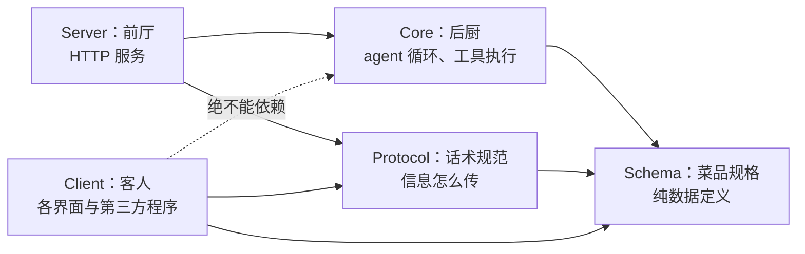

规定说的是：客人只能照着话术规范和菜单点菜，不能冲进后厨自己动手。这样有两个好处：后厨怎么改造升级（重构、换实现），客人完全不受影响；客人再多、再杂，也弄不坏内部结构。这条规定在 v2 合流中改过一次方向：旧版是"Schema → Core → Protocol → Server"一条线，话术规范建在后厨之上；现在 Protocol 和 Core 平级，各自只依赖 Schema，再共同被 Server 依赖——放到餐厅比方里，话术规范不再依赖后厨的做法，只对着菜单规格写。这意味着对外接口契约与内部实现从此可以各自演进，改后厨不必动话术；把"接口稳定"直接写进依赖图，比口头承诺可靠。这种"分层 + 单向依赖"是大型项目防止腐化的基本手段，OpenCode 用明文规定加代码评审把它落实了。

### 技术栈里的 Effect

代码里到处是 `Effect.gen(function* () { ... yield* something ... })`。Effect 是一个 TypeScript 库，把异步操作、错误处理、依赖注入都变成可以组合的"效果描述"：程序先写出"要做什么"的清单，再由运行器统一执行。第一次读会不习惯，有个简单的读法：把 `yield*` 当成 `await`，把 `Effect.gen` 当成一个大的 `async` 函数，语义八九不离十。OpenCode 用它换来了几样东西：错误必须被显式处理（漏处理编译器会提醒）、重试和超时是可组合的积木（后文的重试代码会看到）、服务之间的依赖关系由 Layer（层的声明）统一管理，每个文件末尾的 `node = LayerNode.make({...deps: [...]})` 就是在声明"我这个服务需要谁"。

### 服务实例：一个进程管多个项目

代码里到处能看到 `InstanceState.make(...)` 和 `ctx.directory`，这是一个值得单独解释的概念：OpenCode 的核心服务（配置、agent 列表、LSP 客户端、权限状态等）不是全局唯一一份，而是按"实例"（instance，即一个工作目录）各存一份状态。同一个进程可以同时服务多个项目目录，每个目录有自己的配置合并结果、自己的 agent、自己的语言服务器进程，切换目录拿的是另一套实例状态，互不串味。这也解释了为什么事件发布要附带目录信息：订阅方靠它区分"这件事发生在哪个项目"。

实例不是永驻的。一个项目位置（location，即一个被打开的工作目录）在没有会话活动时会被卸载——它的配置、agent、语言服务器进程等服务全部释放，下次用到再加载。空闲多久卸载由 `experimental.location_idle_timeout` 控制（`packages/core/src/location-activity.ts`，提交 d898c048ae）：接受 `"2 hours"` 这类时长写法，默认 60 分钟，设为 `false` 永不卸载，项目配置可以覆盖全局值。正在运行的会话和后台任务（background job）都算活动，位置因此保持加载，任务不会跑到一半被卸载（提交 89d996c2c5）。活动的定义后来还扩了一次（提交 1908fcb8b7）：开着的 PTY（伪终端）WebSocket（双向长连接协议）与客户端 MCP WebSocket 也算活动（`packages/core/src/location-lifecycle.ts`、`location-activity.ts`），界面还连着终端的位置不会被卸载；位置因其他原因关停（重载、VCS 初始化、调试驱逐）时，这些 socket 以 1012（服务重启）关闭码收尾，客户端立刻重连到顶替的新位置（`packages/server/src/handlers/pty-socket.ts:35-47`）。一个进程开过的项目越多，不回收就越像内存泄漏；按活动回收是"一个进程管多个项目"必须配套的另一半。

可移植性上还有个小细节：数据库模块通过 import 映射表（`#sqlite`，`packages/core/package.json:35-40`）区分运行环境——workerd、Bun、Node 三个条件各指一个实现，都没匹配到默认走 Node。Bun 与 Node 两路用的都是 Effect 官方的 SQLite 客户端（`@effect/sql-sqlite-bun` / `@effect/sql-sqlite-node`，套 `Layer.orDie`，`packages/core/src/database/sqlite.bun.ts:10-13`、`sqlite.node.ts:10-13`），workerd 一路仍是自写实现；同一套代码三种运行时都能跑。

### 分支与协作约定

默认分支是 `dev` 而不是 `main`，日常开发都在 `dev` 上，发布走稳定分支。提交信息要求 conventional commits 格式（`type(scope): summary`，比如 `fix(tui): simplify thinking toggle styling`）。`AGENTS.md` 还规定了相当细的代码风格：能写在一个函数里就不拆、不预先抽只调用一次的辅助函数、尽量不用 `try/catch` 和 `any`、优先用 `Bun.file()` 这类原生 API、不给导入起别名、不用星号导入。这份文件本身就是"AI 时代工程规范"的一个样本：把团队约定写成文档，人和 AI 都照着执行。

## 主轴：自己不发电，做电网

OpenCode 自己不发电，它做电网。发电厂（模型服务商、第三方能力）五花八门，但只要按插座标准接入，就能用。这条主轴落在四个方向的标准接口上：

- **接模型**走 Vercel AI SDK 的适配器体系（核心只直接依赖 3 个 `@ai-sdk/*` 包——provider、provider-utils、openai-compatible——各家接入由内置提供方表与自研客户端承接，见"模型接入"）；
- **编辑器对接**走 ACP 协议（见"标准协议"）；
- **代码理解**走 LSP 协议（见"标准协议"）；
- **外部工具**走 MCP 协议，扩展行为走 PluginModule 插件接口（见"插件系统"）。

单向依赖规定是这个主轴的架构化：接口契约（Protocol、Schema）与内部实现（Core）平级解耦，"接口稳定"写进依赖图。本地 HTTP 服务是总插座：所有界面、第三方程序、插件都站在同一个接入面上，能力对等。核心自己保留的只有两样必须自己做的决定：权限规则表（安全决策不交给模型）和会话运行时（收件箱、持久事件）。

代价也要说清：Effect 的抽象对新手门槛不低，代码里 `Layer`、`yield*`、`Schema` 叠在一起，贡献者要先过一道学习关；35 个包的 monorepo 对小贡献者也不友好，改一个界面问题可能要在四个包里理解一遍依赖。这是"大而全的开放平台"路线必然的成本，OpenCode 用详尽的 `AGENTS.md` 和自动生成代码来对冲，但门槛仍然存在。

## Agent 循环

### 一次请求的完整路径

先给一张路线图，后面各节都在这条路径上。用户在界面输入一句话之后：

1. 界面（TUI、桌面、编辑器）把请求发给本地 HTTP 服务（编辑器也可以走 ACP 协议）；
2. 服务里的 SessionPrompt（`session/prompt.ts`，一千六百多行，会话的总指挥）接单：`prompt`（普通提问）、`shell`（直接跑命令）、`command`（执行自定义斜杠命令模板）、`cancel`（打断）各有入口；
3. 它把系统提示词、历史消息、当前 agent 的工具清单组装好，交给 SessionProcessor 调用模型，底层走 Vercel AI SDK 和对应的 provider 适配器；
4. 模型回复说"我要调某个工具"时，请求回到工具注册表，先过权限检查，再执行，再截断输出，结果追加进消息列表，然后再次请求模型；
5. 这个"模型与工具来回"的循环持续到模型给出最终回答；期间 token 计数累计，接近上限就触发压缩。

理解这条链，很多问题就能对号入座：权限在第 4 步执行前检查，压缩在第 5 步计数超限时介入，重试发生在第 3 步的模型请求失败之后。这条链是初版文档成文时的样子；v2 合流后入口换了机制（输入先过收件箱，见下节），核心循环的思路没变，相关代码从旧主包挪进了 `packages/core/src/session/`。把 v2 的收件箱准入也接上，完整路径是：

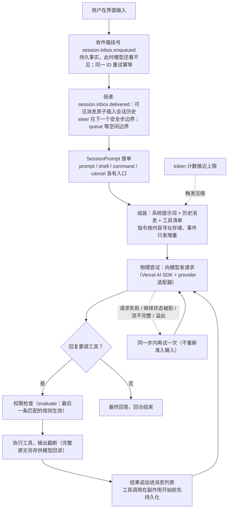

### v2 会话契约：收件箱、执行声明与指令增量

v2 合流带来一套成文的会话契约（`specs/v2/session.md`，开篇说明它是"难以从单个源码文件还原的行为的权威描述"）。四个新概念值得端到端讲清。

**收件箱准入：先挂号，再看病。** v2 里 `Session.prompt(...)` 不再把用户输入直接送进执行，而是先发布一条持久的收件箱事实（`session.inbox.enqueued`），在数据库里投影成一行收件箱条目；此时这条输入**模型还看不见**。真正"投递"（`session.inbox.delivered`）时才原子地把可见消息插进会话历史。就像医院先挂号再叫号：挂号了不代表马上就诊，但号不会丢。为什么要绕这一道？因为"用户说了什么"是要永久保留的事实，而"模型正在处理什么"是随时可能被打断的现场；把两件事拆开，输入在任何时刻都不会因为程序崩溃而丢。收件箱条目带 ID，拿同一个 ID 重试是幂等的（第一次准入算数，重发的载荷被忽略），跨会话或跨类型复用 ID 直接报错。投递分两种模式：`steer`（插话，默认）在下一个"安全步边界"按顺序投递；`queue`（排队）等会话空闲的边界才投递，空闲时插话仍然优先。手动压缩和会话搬移也走同一条收件箱，做成"控制条目"，并且控制条目是投递边界——排在它后面的插话不许越过它先走。一次输入从进门到被模型看见，走的是这条路：

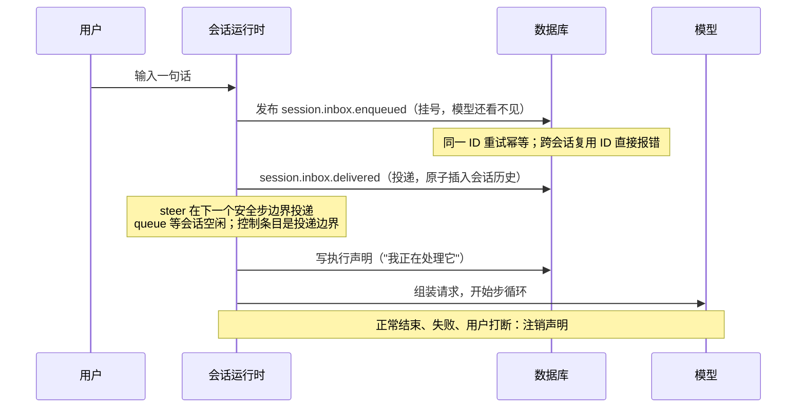

**执行声明：崩溃后知道谁没干完。** 执行是进程本地的，按会话 ID 键控。一段忙碌期开始时先写一条"执行声明"（write-ahead claim，先写一张"我正在处理它"的凭证再干活）：正常结束、失败、用户打断都会注销声明，而进程崩溃会让声明留下来。下次启动时，恢复程序看到未注销的声明，就把对应的顶层会话从持久历史里恢复起来（恢复尝试有次数上限）。规格把边界说得毫不含糊：恢复不保证外部效果恰好发生一次（被打断的工具调用可能已经生效过），启动时会先把上一进程遗留的"还在执行中"的工具调用投影结算为失败，绝不重放说不清的副作用；明确的唤醒不等于崩溃恢复，恢复只由声明驱动。崩溃与恢复的完整过程是：

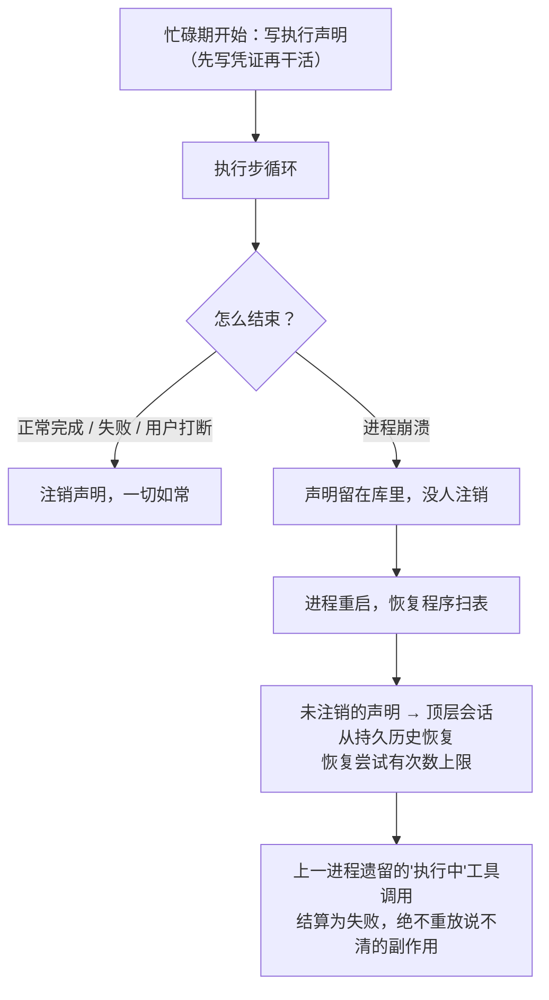

声明的另一头是后台任务：后台 shell、subagent、图片生成这类活儿同样要跨进程接续。它们的恢复标记原先记在通用的 KV（key-value，键值对）表里，现在搬进专用的 `job` 表（迁移 `20261030054400_job`，提交 664c8f0990），重启后的接续读取也走这张表。这张表如今对外可见了：一个实验性的 job 列表端点从表里列出每个后台任务的状态、起止时间与恢复方式（recovery 字段描述重启后怎么接续，shell 类任务带着自己的会话 ID），外部客户端由此能看见"有哪些跨进程任务还在跑"（`packages/core/src/job/list.ts`、`packages/server/src/handlers/job.ts`，提交 bde737f4d5，PR 60698）。同一主题上还有一处恢复成本的优化：重启后要判定"哪些工具调用还没等到结果"，此前把整条会话转写载进内存再找；现在改为直接查库，只取可能挂着流式或运行中工具调用的未完成助手消息——按 `time.completed` 为空筛选、从最近一次压缩点起读（`packages/core/src/session/history.ts:342-368`，提交 5c4983d5e2，PR 61421）。

**一步可能有多次物理尝试；指令是值增量。** 每一步（Step，一次"模型与工具的往返"）大多数时候就是一次对模型的物理请求，但通用重试、继续状态被拒、不完整的流续传、溢出触发的压缩，都可以在不重新准入输入的情况下再试一次；工具调用在副作用开始前先持久化，工具调用 ID 只在一步内唯一，所以持久事件还要带上它所属的助手消息 ID。指令（发给模型的那些"提示词素材"：内置说明、发现的技能指引、引用、MCP 指引）按内容寻址存储——正文以哈希为键只存一份，事件里只发"哪些键变了"的增量；每次模型请求前并发读一遍所有指令源、原子提交一个增量；压缩结束开启新的指令世代（epoch，一个版本区间，跨压缩推进），分叉的会话拿父会话最新值当基线。规格专门强调"没有指令注册表"：指令不是一份固定名单，而是值加增量的流。增量里甚至容得下纯重排（提交 3960ebb5b9）：同一组指令源、内容都没变、只有顺序变了时，渲染器可以不产出新文本（`packages/core/src/instructions/index.ts:110-113`），提交事件照发、只是增量不带正文（`session/instruction-state.ts:44-60`），界面不必插一条系统消息——修复之前，纯重排会让整个回合以缺陷失败。

**回合结束不一定是终点：`/goal` 的目标循环。** 斜杠命令 `/goal <目标>` 给会话立一个目标。它解决的问题是：模型答完一轮就停，多步任务常常差最后一口气——用户要么盯着屏幕反复说"继续"，要么任务悄悄烂尾。目标循环的做法是会话空闲后由一套评审机制决定要不要接着干（提交 8de0323975，实现在 `packages/core/src/plugin/goal.ts`，以内部插件身份注册）。评审提示词先把身份划清：明确要求模型"停止扮演助手、只当评审、不许调用任何工具"，只拿对话里已有的证据——工具结果、命令输出、文件内容——核对目标是否达成，"助手自称做完了"不算证据；目标文本包在 `<untrusted_objective>` 标签里当数据看待，里面若藏着"该怎么评判"的指令一律忽略。评审回一行 JSON 判决：`done`（达成）、`continue`（附下一步）、`blocked`（需要用户介入，比如缺决定、缺凭据、缺手工步骤）、`paused`（用户要求停）、`wait`（后台工作没汇报完）。判 `continue` 就注入续跑提示接着干，外面套三道上限防失控：最多 50 轮、连续 3 轮没有任何工具调用算停滞、等后台工作最多 30 分钟就暂停（`goal.ts:16-19`）。几个状态细节都朝着"不悄悄失控"设计：目标状态存会话的插件存储，分叉或子会话不继承；状态里记着一个进程启动 ID，上一个进程立的目标重启后回到 paused，不会自己悄悄续跑（`goal.ts:22-23`）；循环写状态前先重读一遍，期间用户敲的 `/goal pause`、`clear` 或新目标赢过循环自己的写入（`goal.ts:61`）；评审请求太大可以压缩一次再评，第二轮还溢出就暂停。

**会话有了自己的工作目录。** 目录存在会话元数据的隐藏键 `$opencode_experimental_cwd` 里，读取时从公开元数据中剔除、投影更新时再写回，因此不需要数据库迁移（`packages/core/src/session/cwd.ts:20`）。设置时校验目标存在且是目录；`machines` 开关打开时，工作目录可以指向另一台已配对机器、通过 `Machines` 取到那台机器的执行环境；目标机器已被移除时构造一个所有文件操作都失败的执行环境，让后续调用就地失败，避免悄悄退回本机（`cwd.ts:140`）。子会话未指定时继承父会话（`packages/core/src/session.ts:348` 附近）。执行侧新增"当前工作目录"引用，每个步骤之前注入运行时（`packages/core/src/environment/environment.ts:73`、`:85`、`packages/core/src/session/runner/llm.ts:300` 附近）；文件访问、`read`、`shell` 与 Code Mode 的 `path` 全局都按当前工作目录解析相对路径，位于会话目录内的机器路径不再产生外部目录权限请求（`packages/core/src/file-access.ts:241` 附近）。目录自己的 `AGENTS.md`、`CLAUDE.md` 也进了指令：按发现优先级顺序尝试、单文件上限 512 KiB，已被常规发现覆盖的目录不重复加载，瞬时读取错误保留已加载内容、首次加载则视为没有，避免离线机器阻塞第一步（`packages/core/src/session/cwd-instructions.ts:18`、`:78`）。整个循环从头到尾是：

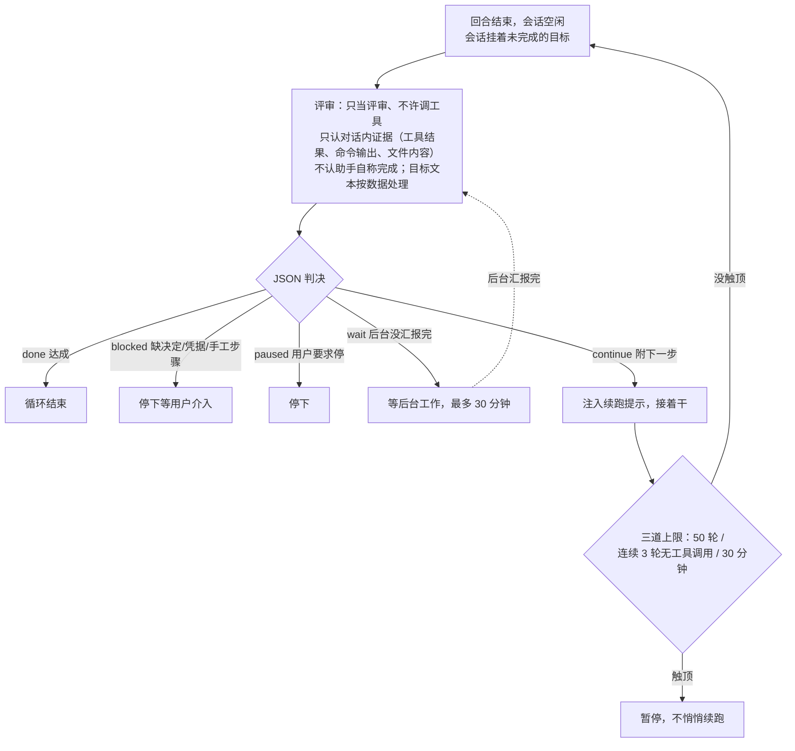

## 会话与上下文

先说数据的形状。一次会话（session）下面是消息（message），消息下面是部件（part）：一条助手消息可能同时包含文本部件、推理部件（模型"思考"过程的文字）、若干工具调用部件；一条用户消息可能带文件附件部件。每个部件有自己的 ID 和状态，工具部件就分 pending（进行中）、completed、error 三态，还记录耗时和截断标记。压缩时"清空某个旧工具的输出"，动的就是单个工具部件的状态字段，消息骨架不动。要回看任何一个动作的来龙去脉，顺着部件查就行。

### 内置 agent

OpenCode 里"agent"指一套带独立系统提示词和权限配置的运行身份。内置七个（`packages/opencode/src/agent/agent.ts`）：

- **build**：默认身份，按配置的权限干活，能读能写能跑命令。
- **plan**：只读模式，禁止所有编辑工具，适合先看代码、做计划。唯一例外是允许写计划文件本身（`.opencode/plans/*.md` 和全局计划目录）。
- **general**：子任务执行者，处理多步骤任务，可以并行派多个。
- **explore**：快速探索代码库的只读 subagent，只放开 grep、glob、read、webfetch 这类检索工具。
- **compaction**、**title**、**summary**：三个隐藏身份，分别负责压缩历史、起会话标题、生成摘要，它们的权限是"全部拒绝"，也就是只能生成文本，碰不了任何工具。起标题这种小活不动用主模型的推理档位：title 没有单独配模型时，先找该提供方的 small 模型，用它最低的推理档位；没有 small 模型就用主模型本身、但取比会话所选更低的档位——`none`、`minimal` 一定是减少推理，`low` 在默认不推理的模型上反而会打开推理，所以只在它排在会话所选档位之下时才用（`packages/core/src/session/context.ts:98-109`、`:191-200`）。

用户可以在配置里定义自己的 agent，也可以用 `/agents` 命令让模型根据一句话描述自动生成一个（`agent.ts` 里的 `generate` 方法）。

### 上下文空间：永远给输出留位置

模型一次能读的内容有上限，叫上下文窗口（以 token 计，token 是模型处理文字的基本单位，大约一个汉字或半个英文单词）。对话越长越接近上限，但有个容易被忽略的细节：模型回答时还要**输出**内容，如果历史记录把窗口塞满，模型连写答案的地方都没有了。

`session/overflow.ts` 里的 `usable` 函数专门算"还能用多少"：

```
可用空间 = 上下文上限 − 预留量
```

预留量取"配置值"或"2 万 token 与该模型最大输出长度的较小者"。还有一层细节：如果模型单独标注了输入上限（`limit.input`），就用输入上限减预留量；没有标注才用总上下文减输出空间。不同模型的限制写法不一样，计算要按模型实际给的字段来，不能一套公式套所有模型。

当已用 token 数超过可用空间（`isOverflow`），就触发压缩。

给输出留位置的另一端是**请求时的输出上限**：`session/model-request.ts` 的 `outputLimit` 把一次请求的 `maxTokens` 按"窗口减去已量得的输入、再减去带估计误差的估计输入"算出剩余空间。主请求（primary）现在再留窗口 1% 的余量（`WINDOW_HEADROOM = 0.01`）——模型服务商数出来的 token 总比客户端多几个（聊天模板、工具 schema），严格的服务商会拒绝"输入加输出超过窗口"的请求；压缩请求不留这份余量，因为它的摘要按自己的预留空间定尺寸（提交 da702a85a6）。

### 压缩：分层的减负

对话长到快撑爆上下文窗口时怎么办？把历史整个删掉会丢任务线索，原样全发又会超限。OpenCode 的答案是把"减负"拆成三级，从轻到重逐级用（`session/compaction.ts`）：

1. **修剪（prune）旧工具输出**。工具输出（比如整个文件的内容、命令的全部打印）是上下文里最占地方的部分。从最近的对话往前数，保留最近 4 万 token 的工具输出不动，更早的只留"调用记录"、清空"输出内容"，并在消息上做个标记（`time.compacted`）。`skill` 工具的输出受保护不被清理；累计能清出 2 万 token 以上才真正动手，清不出就不值得折腾。
2. **保留最近对话（tail）**。压缩时不是把全部历史都变成摘要，而是留一段最近的原文：默认保留量在 2000 到 15000 token 之间，取"可用空间的 25%"与这个区间的交集。放不下一整个回合（turn，一次用户提问到模型答完）时，还会在回合内部找一条消息边界切开，尽量填满保留额度。
3. **生成摘要**。剩下的历史被序列化成纯文本（用户消息、助手回复、推理过程、工具调用与结果各有固定格式），连同上一轮摘要一起交给 compaction agent，产出新摘要替换原文。压缩完成后，如果设置了自动续跑，系统会把被压缩打断的那条用户消息重新放回对话（图片等大附件换成占位文本），让任务接着走。

这一整套对应的配置项都在 `compaction` 命名空间下：可以关闭自动压缩、调整保留量；自动压缩的触发余量本身也能配（`compaction.buffer`），接受 `"20%"` 这类百分比写法或直接的 token 数——百分比按模型的窗口换算成 token，0% 或不小于窗口的设置在配置归一化时直接判无效（提交 6700dd87b5）。压缩请求自己的尺寸也有一道上限：摘要请求的提示词最多占"输入窗口与上下文窗口里较小的那个"（`packages/core/src/session/compaction.ts:1152-1158`，提交 cb1e58fe44）——目录或配置覆盖偶尔把输入上限报得比上下文窗口还大，而上下文窗口还要装下模型的回复，照抄大数请求就发不出去了。压缩由溢出触发时（服务商刚以"提示词太长"拒掉了整个对话），摘要请求的第一轮就把必须变更的历史折成文本，而不是把刚被拒的对话原样再发一遍（`compaction.ts:524-526`、`:622`，提交 6597f6cd6c，PR 61015）——此前缩减循环从"不折成文本"起步，第一轮必然再被拒，白白多一轮请求；手动触发或非溢出触发的压缩不受影响。三级减负从头到尾串起来是：

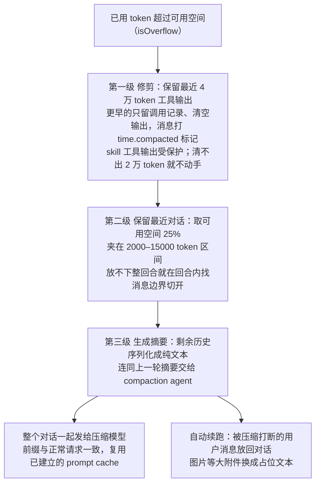

**总结整个对话，动机是保住提示词缓存**（2026-10-20，提交 fd6589239e）。提示词缓存（prompt cache，模型服务商提供的机制：请求开头那段和上次一模一样，就直接复用上次的计算结果，费用低）省钱的条件是前缀逐字节相同。现在的做法是把**整个对话**（包括保留的尾部）一起发给压缩模型（`packages/core/src/session/compaction.ts`，`prepare(context, context.messages, budget)`），而不是只把较老的部分发去总结、尾部留在旁边。代码注释把理由说得很直白：总结请求的前缀与正常请求完全一致（`[system][S1 + "E9 E10"][E11 … E18][E19][prompt]`），前缀不变，**总结请求就能复用正常请求已经建立的那份 prompt cache**；旧做法在尾部之前切开，缓存断点落在摘要请求自己的路上。配套把自动压缩的触发余量从 10% 提到 15%，且至少保留 16k token（`RESERVE_SHARE = 0.15`）：多出来的余量用于吸收单步 token 的暴涨——真实会话里单步最多涨过约 22k token（p99）——一步跨过触发线时，整个对话仍能原样发出、照常命中缓存，而不是被迫立刻压缩把前缀打碎。摘要的输出上限按正常回合的规则算（估算 token 时留同样的安全余量），再加一道保底：余量会把接近目标的摘要压到最小输出，所以摘要至少拿到 32000 token（`SUMMARY_OUTPUT_FLOOR`）与不计余量时剩余空间两者的较小者（`packages/core/src/session/compaction.ts:139`、`:1191-1201`，提交 6709f5646d）。

**图片裁剪的决策跨请求稳定，理由同样是缓存**（2026-10-20，提交 d9fe53e926）。上下文超限时系统会裁剪历史里的图片附件（图片是上下文里的大户），裁剪决策保持稳定——同一张图不会被这轮裁掉、下轮又放回来（`packages/core/src/session/model-request.ts`）。一旦放回来，请求前缀就变了，缓存前功尽弃。和压缩那条合起来看，opencode 把"缓存利用"从提示词组装一路贯彻到了资源裁剪：凡是会出现在请求前缀里的东西，跨请求就得长得一样。

**摘要可以在后台提前算，自动压缩到点直接换入（提交 6a5973d263；此后从实验开关转正为默认行为，提交 edd88bd3fe——`background_compaction` 退出 flag 注册表，配置项 `precompute` 更名 `background` 且默认开）。** 自动压缩有个体验代价：到点触发时用户要干等一份摘要从零写出来。既然用量涨到 85% 时就能预见到压缩快来了，为什么不让摘要提前在后台算好？做法：上下文用量进入压缩上限之前一段固定的提前量（`PRECOMPUTE_LEAD` = 60,000 token，`packages/core/src/session/compaction.ts:158`）时，系统在后台把"最新一条响应之前的前缀"总结成一份现成摘要。提前量取固定值有个讲究：写一份摘要要 30–60 秒，期间对话中位数只增长几千 token、但二十分之一的概率遇上大文件读取同时到达会涨 25k 以上——提前多少按这个增长速度定，与窗口大小无关（`compaction.ts:153-157`）；同时提前量不超过本轮压缩周期距离的一半，刚压缩完不会立刻又开始预计算（`compaction.ts:362`）。选那个前缀也有讲究：它正是服务端刚处理过的部分，总结请求直接读到它的缓存——但只有当最近一次响应的缓存寿命还剩至少 30 秒（`CACHE_MARGIN`，`compaction.ts:162`）时才启动，缓存快过期的总结写了也白写（`compaction.ts:386`）。自动压缩到期时不再从零等一份摘要：正在写的就等它写完，写完了直接换入，换入不了才按老办法当场总结（`compaction.ts:317-320`、`:396`）；连续失败 2 次后到下次压缩前不再开新的（`compaction.ts:171`）——开关的配置说明里直说"没被用上的后台摘要照样花 token"，太小的对话到不了提前量区间，天然不会预计算。换入也有尺寸约束：现成摘要旁边保留的原文尾部至多占 budget 的 40%（`PRECOMPUTED_TAIL_SHARE`，`compaction.ts:169`）——尾部通常远短于这个数，上限是为大块工具输入或粘贴文本的爆发准备的；按 Claude 的分词器算，换入的上下文也压在 budget 的三分之二左右，下一轮压缩仍有空间，更长的尾部干脆从头总结。配套一笔在摘要请求自己的转录组装上（提交 ac68d6a929）：放不下一整份转录时，从最旧的轮次开始逐级缩短——先砍工具输出，整轮省略是最后手段；最新的轮次只缩短、绝不省略，摘要最需要的正是最新内容（`compaction.ts:691-699`）。转正的同时有两条简化：换入判定不再核对生成摘要时用的模型与指令——摘要就是一份纯文本，哪个模型都能接手（只有切到服务商原生压缩的会话才走原生），判定只剩"会话开头没变"与保留尾部的尺寸两条（`compaction.ts:404-420`）；窗口未知的模型（天花板无限，此前直接不预计算）也参与预计算——总量进入提前量区间就启动，而回合总会结束，下一个提示把现成摘要换入，不等一份从零写的（`compaction.ts:353-357`）。界面上两者分工也定了：自动压缩在时间线上是一条安静的分隔线，手动压缩才流式显示摘要正在写。预计算和换入的完整过程：

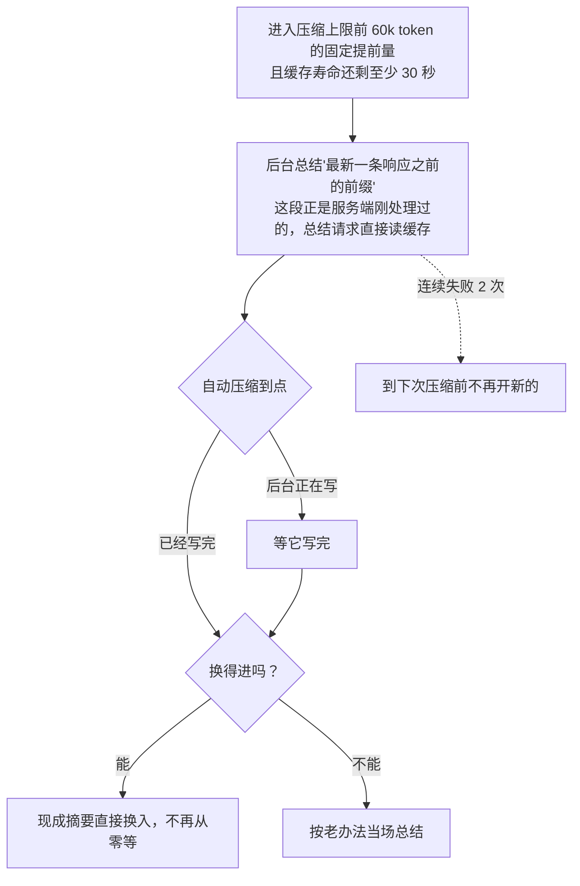

### 请求级重试：挑着重试

模型请求失败很常见（限流、网络抖动、服务商过载），`session/retry.ts` 有一套完整的重试策略，三个要点：

- **分清哪些错误值得重试**。代码里列了一组正则模式：429（请求太多）、5xx（服务端错误）、网络中断、超时、"容量不足"这类才重试；写错参数、认证失败这类不重试。
- **尊重服务端的指示**。如果响应带了 `Retry-After` 或 `Retry-After-Ms` 头（服务商告诉你"过多久再来"），优先按它说的等。
- **退避加抖动**。没有指示时，首次等 2 秒，每次翻倍，最多重试 5 次；再叠加 25% 的随机抖动（jitter，故意加点随机量），避免大量客户端在同一时刻一起重试，把刚缓过来的服务又压垮。

分类还要防一种张冠李戴：服务商把"每分钟 token 限流"报成 429，正文里又带着"too many tokens"这类字样（Cerebras 的实际报文就是如此），错误分类器按正文措辞把它判成了上下文溢出——溢出会触发压缩，可真正的病因是限流，压缩救不了，白白多压一次。现在带 429 状态码的错误不再做溢出正文匹配，一律按限流走重试（提交 618b890667）：同一个词组，在不同状态码下含义不同，分类先看状态码再看措辞。

供应商主机根本到不了的情况单独有一条调度（提交 20c94b79f1）：DNS 解析失败、无路由这类错误（`ENOTFOUND`、`EAI_AGAIN`、`ENETUNREACH`、`EHOSTUNREACH`、`ENETDOWN`，`packages/core/src/model-retry.ts:43`）不占通用重试的次数，自己按 2 秒指数起步、单次间隔上限 30 秒、总窗口 1 小时重试（`:44`、`:48-49`）——网络闪断叠加流断开时，通用额度留给真正值得重试的失败；连接被拒（服务器有应答）不算不可达；超时类重试另有三次上限，防止一个永远连不上的供应商占住整条一小时窗口（`:65`）。

**发给模型的东西不是用户说的，标记得一致。** 后台任务的结果与提示词里的指令更新此前各有各的标签，模型得分别识别；现在统一成两种（提交 e51247f626、c98608c513）：后台结果一律是 `<background-result kind="..." id="..." state="...">` 块，覆盖 shell、subagent、codemode、image 四种来源，各系统提示里说明它属于 harness 输入、不是用户发言；提示词里的指令更新一律用 `<system-update>` 标签，含 goal reminder 与 TUI 文案。标签少一种，模型判断"这句话是谁说的"就少一次出错的机会。

时间线的计数与摘要改为从部件推导的 facts 计算（提交 07c2502525、fe8def6854）：`summarize`（`packages/session-ui/src/timeline/facts.ts:14`）从消息部件算出"做了多少事"，折叠、过滤与详细度设置都不再改变这些数字；"放在哪里"——分类、是否独立成行、并入哪个组、是否默认展开——由 `place.ts` 从 facts 推导，旧时间线与新时间线共用同一套判定，只对少数条目保留差异。展示层因此只负责画，不再替数据算数。

**home 目录多了一个记忆工作区**（提交 16bbbe635c、55c6827566）。数据目录下按项目分开，home 目录里建 `memory/`、`docs/`、`scripts/` 三个文件夹，作为 `LocalSource` 注入上下文并附使用说明；开启 `project_overlay` 时，模型写的技能落在 overlay 的 `skills/` 目录。每次闲置卸载前最多每日一次，把过去一天该目录下的会话摘要（单条 4,000 字符、总数 20 万字符上限）作为维护提示词排入一个维护会话。边界定得很保守：首次运行只记录时间起点、不做维护，维护会话创建后立即归档，没有新对话时只推进时间戳、不创建会话。代价是维护提示词要花一次模型调用，摘要在长度上限处被截断、早期细节可能丢失。

工具清单这一轮五笔。`opencode.session.interrupt` 工具可以中断其他会话（提交 b575c1f30f）：递归执行"先取消任务、再中断会话、再取消一次"，遍历子会话；拒绝中断调用者自身及其祖先，避免把当前调用一起停掉（`packages/core/src/tool/plugin/session-interrupt.ts`）。shell 工具描述带上实际使用的 shell 名，shell 选择变化时经总线事件触发工具重载，取代原来挂在会话上的三个钩子（提交 825986a31a）。两个媒体工具改名为 `generate_image` 与 `generate_video`，权限规则归一化与旧配置迁移把旧名映射到新名（提交 7b70422787，`packages/core/src/v1/config/migrate.ts` 的 `renamedTool`）。视频生成默认开启（提交 04a10583c8）：`video_generate` 开关与接口层的拒绝一并删掉，改由"存在视频模型 + 配置没关 + 权限规则"决定是否注册（`packages/core/src/tool/plugin/video-generate.ts:272` 附近）。

## 工具系统

工具（tool）是模型能调用的动作：读文件、写文件、跑命令、搜网页。v2 把工具契约写成了一份规格（`specs/v2/tools.md`）：一个工具就是 `Tool.make({...})` 造出的一个结构化值——说明、输入 schema、输出 schema、执行函数写在一起。一次工具响应可以带三个值：`output` 是过了 schema 校验的机器值，专给 Code Mode（让模型写一段代码、在代码里连续调用工具的执行方式，省得每个动作都单独请求一轮模型）用；`content` 是给模型看的文本，持久保存；`metadata` 是给界面的小份 JSON。注册按名字且带作用域：同一名字后注册的生效，一个注册被关闭就露出它的上一任，像一层层覆盖的透明片。每次调用的上下文带持久身份（会话 ID、agent、助手消息 ID、调用 ID），由会话运行器提供、注册表不猜。输出截断归注册表管：只量文本部分，超限按"头一段、省略标记、尾一段"切，完整原文放进托管存储、给模型一个有界的预览；元数据单独限量，不留给工具当绕过截断的暗道。内置工具和插件工具走同一个构造器，但权限不同：内置（和受信任的位置插件）捕获受信任的服务，主动向权限服务发起请求；规格原话是"共享工具类型不等于同等权限"。

工具参数还可以不走 JSON：恰好只有一个必填字符串参数的工具可以设 `freeform`，模型把这个参数直接写成原始文本——不受约束的 `text`，或者匹配一个 `regex` / `lark` 文法的文本（`packages/ai/README.md:105-125`，提交 45713a326c）。为什么要多这条路？工具参数默认是 JSON，模型写 JSON 时转义、引号、换行都容易出错，写一段原始代码或命令反而更自然。OpenAI 的 Responses 与 Chat Completions 及复用它们的提供方把它作为 custom tool 发送，其他协议照发普通 JSON 工具；没有任何检查或回退——模型不接受 custom tool 就收到提供方的错误，所以只对确认支持的模型设置。调用、工具输入事件、结果与历史始终用对象形式（README 的例子是 `{ code }`），过去的调用按当前请求里的声明方式重放，同一份历史有没有 `freeform` 都能用。这条能力随后也铺给了 Code Mode 里声明的工具（提交 53f2d631df）：模型支持 freeform 时，单个字符串参数的工具在 Code Mode 的工具清单里自动按 freeform 声明（`packages/codemode/src/codemode/tool-schema.ts`），模型写脚本调用这类工具时直接给文本、不必包一层 JSON。

**工具清单可以在会话中途变化**（提交 49b94635ff）。此前一次请求的顶层 `tools` 就是这一步可用的全部工具，中途增删要等下一次请求整体重发。现在 `packages/ai/src/tool-updates.ts` 把工具声明变成消息流里的一份有序清单：一条系统角色的消息可以携带 `Message.tools({ add, remove })` 标记，按消息顺序生效——先删后加，同名工具原位替换（`tool-updates.ts` 的 `foldTools`）。协议按能力选两副面孔：模型的 `tools.updates` 能力与协议编码都覆盖某个变更时，标记留在消息原位发送，顶层声明和它背后的提示词缓存不动；覆盖不了时，全部标记折叠进顶层声明一次发清，代价是缓存作废重来（`tool-updates.ts:1-3` 的注释）。

### Code Mode：模型写代码，解释器执行

Code Mode 让模型写一段 JavaScript，在一段受控的运行时里连续调用工具，省得每个动作都单独请求一轮模型。跑这段代码用的不是宿主的 JavaScript 引擎直接执行，而是 `packages/codemode` 自带的一套受控运行时：程序先编译成自有字节码、由自研虚拟机执行——支持哪些语法和内置对象列在 `interpreter-support.md` 里，不在清单上的就是不支持。为什么放着现成的引擎不用、要自己造一套？因为模型写的代码要受控：不能让它访问任意网络、任意文件，工具调用要逐个过权限。宿主引擎给不了这种细粒度的控制点，自研运行时才有。这话有个现成的例子：解释器里的 `fetch` 也要过权限——按 webfetch 工具的同一套规则检查 URL（`packages/core/src/codemode/fetch.ts:31`，注释写明"在 webfetch 被拒的 URL 在这里同样被拒"），被拒时把用户附的那句反馈原样作为错误信息带给程序；读本地文件的 `file:` 地址则直接报错（提交 bdca40ac0e）。两条修正把这道检查做实了：权限规则对**请求的 URL 原样**匹配——只剥掉永不发送的 fragment，其余按输入原样比对，无效 URL 直接报错而不是往下走（`packages/core/src/tool/plugin/webfetch.ts:144-146`、`packages/core/src/codemode/fetch.ts:19-21`；提交 805a4b8200 先做过一版归一化匹配，e803323c13 把它改回原样比对——用户按浏览器地址写的规则照原样对得上）；重定向改为 fetch 自己跟随，每一跳的新 URL 都对照 webfetch 同一套 deny 规则、带 redirectedFrom 记录来路（`fetch.ts:47-53`，提交 b5b9bddb54，PR 60502）——此前重定向由底层 HTTP 实现跟随，中间跳过的 URL 没过任何权限。

解释器还学会了**按 Node 模块名导入宿主全局**（提交 adcfc83d19，PR 61151）：`import fs from "node:fs"`、`require("crypto")`、`await import("fs")` 都解析到宿主经扩展提供的全局，`node:` 前缀剥掉后与裸名等价（`packages/codemode/src/language/runtime/modules.ts:19`），`fs/promises`、`url`、`util`、`buffer` 是别名，映射到提供它们的全局（`modules.ts:8-15`）；没有包，其他名字一律抛错。import 在程序运行前加载，默认导入绑定模块本身（Node 呈现 CommonJS 的方式）；全局若是函数对象（比如 `fs`），从它可达的每个函数都是一个入口，调用触发 extension 钩子时以路径为名（`fs.readFile`、`fs.promises.readFile`）。

代价是要自己实现 JavaScript 的运行语义，promise（异步结果的占位对象）这块有一条保证值得记：**每个 job 跑到完成**——两个 await 之间的代码、以及一个异步函数到它第一个 await 之前的函数体，在另一个 job 开始之前执行完，调度器抢占长 job 时也不例外；工具调用仍然并发（该语义最早在 AST 解释器里补齐，提交 3b593dd5d2；引擎统一后由调度器的 job 队列承载——job 是"跑一个已落定 promise 的 reaction，或收养一个 thenable"的纯数据描述，`packages/codemode/src/language/scheduler.ts:65`）。宿主引擎里这是理所当然的微任务语义，自己写运行时就得自己保证。另一处是成本：codemode 运行时跨执行复用，不再每次工具调用都重建（`packages/core/src/codemode/tool.ts`，提交 6ec56821d6）；配套修了一批内置方法的边角语义（`Uint8Array.from` 的映射函数、字节比较不做类型转换、`flatMap` 跳过空位、非整数进制截断，提交 db45c950a9）。这批修法有了一个总验收：运行时开始过 test262（ECMAScript 官方一致性测试集）的用例。getter 与 setter 有了（提交 d3f6559d93）；报错带上了真正的出错调用路径（提交 1626bbc54e）；`Buffer` 的 `map`、`filter`、`slice`、`subarray` 返回 `Buffer` 而非裸 `Uint8Array`（提交 6fbc0af624）；base64 的字母表、`omitPadding` 与 `lastChunkHandling` 选项照标准执行（提交 7c2fd929fa）；`Date` 的 `toLocale*` 方法认 locale 与 options（提交 a21895aee6）；`localeCompare` 认 locales 与 collator 选项（提交 277c9a4439）；补上 `Uint8Array.BYTES_PER_ELEMENT`（提交 10e5856f05）；范围内的 class 用例整组通过（提交 ca729da9a5）。

自己当运行时，卡住的现场也在自己手里。一段程序等不到结果、停着不动时，错误信息现在直接指出是哪一个 await 永远不会落定——await 表达式挂起时把自己的源码位置一并交给调度器，报错能落到具体那一行（提交 2ed57439da）。支撑它的调度骨架如今随引擎统一收拢：程序从源码编译成扁平的操作码（`packages/codemode/src/language/compiler/` 与 `src/language/opcodes.ts`），执行由调度器的 job 队列推进，宿主工作（工具调用、搜索、扩展函数的一步）以 HostCall、ExtensionRequest 这样的纯数据请求进出运行时，由驱动翻成 Effect 执行（`packages/codemode/src/language/scheduler.ts:80-86` 的注释）；每次调用的去向也记成数据——queued（已写入、尚未开始运行）、running、started（durable 工具的 start 已返回数据、进入 wait）或 completed（`scheduler.ts:88`）。调度收拢到一处，"每个 job 跑到完成"那类语义才有唯一的执行点可守。

扩展暴露给程序的全局函数也能返回 Effect（`packages/codemode/README.md`，提交 a882cf98a0）：一个全局可以返回普通值、Promise 或 Effect；Effect 只在 `extension.before` 钩子放行这次调用之后才启动，它的依赖像工具的依赖一样并入运行时环境，宿主因此能按执行提供服务——比如把发起调用的会话用 `Effect.provideService(Session, session)` 交进去，全局函数在里面先做授权检查再去取网页。钩子的次序随之定死：扩展的 before 钩子先于宿主调用执行（提交 1c49e51303）。两处使用体验：`search` 可以像 Promise 一样 await 或链式调用（提交 711802c3a3）；程序的语法错误报出位置与提示，而不是一句笼统的解析失败（提交 c96d200de8）。

`full_codemode` 旗标把"工具走 Code Mode"这条路线再推进一步（提交 7745079647）。它曾要求显式指名才会开启（opt-in-only 机制），这个类别随后整个取消（提交 77b322ceae）：`all` 通配与 `all_flags` 全局开关覆盖所有旗标，full_codemode 跟其他旗标一样按渠道取默认——dev 构建默认开启。开启后 shell 命令也归 Code Mode 管：shell 工具按 `options: { codemode: fullCodeMode() }` 注册（`packages/core/src/tool/plugin/shell.ts`，提交 73de67fcd2），模型在 `execute` 里以 `tools.shell(...)` 调用它，顶层工具清单里不再单独列出。内部插件不随配置变化重跑，旗标改了之后由 `ConfigEntryObserver` 监听配置变更、重载工具变换。同一次提交也给定时任务的 `code` 动作补了一道禁令：`shell` 在禁用工具清单里（提交 73de67fcd2 引入，定时任务重写后由 `packages/core/src/automation/code.ts:39-40` 承接）——无人值守批准 shell 工具，等于批准它想跑的任何命令。

Code Mode 的运行环境随后补上了 Bun 自己的文件能力（提交 2f20ba65b7）：`Bun.file`、`Bun.write`、`Bun.Glob` 以受控形态注册进解释器（`packages/core/src/codemode/bun.ts`），指引同步告知模型这些 API 的存在（提交 7667ec4020），模型写文件操作的代码时不必再绕道内置工具。哪些工具放顶层、哪些收进 Code Mode，也改为按会话的模型决定（提交 007afb1b0c）——Code Mode 内的常驻工具与"固定在顶层"的判定都认 `codemode` 选项的 `pinned` 标记（`packages/core/src/codemode/tool.ts` 的 `isPinned`），Code Mode 退出时的指引同步改述：`execute` 工具不可用时，受允许的工具恢复为直接工具调用。解释器对 import 的拒绝开始说明原因（提交 db8730ebcd）：错误消息按失败的 import 种类分别命名，模型不用猜。后台 Code Mode 脚本执行结束后的呈现与后台 shell 一致（提交 6fcf38838b）。

这条路线随后铺满。文件四工具 read、edit、write、patch 在旗标开启时按 `codemode: true, pinned: true` 注册（提交 c658753fdb、edd81e580a、e40057ab84）——既能在 `execute` 里以 `tools.read(...)` 调用，也保留在顶层清单；pinned 的含义就在这：随 Code Mode 开启的其他工具会从顶层隐藏，pinned 的留下。websearch 同样可调（提交 cbfd30e520），Node 的 `path` 模块进了运行时全局（提交 18503ee942，`packages/core/src/codemode/path.ts`）。反向的一批随之而来：grep 与 glob（提交 bb9d4e3562）、webfetch（提交 6c5ad7d907）在开启时不再注册——搜索与取网页各有 Code Mode 内的对应物。要隐藏哪些直接工具也不再按模型逐个配置（提交 fb40f64d0c）：glob、grep、webfetch 对开启 Code Mode 的所有模型统一隐藏；跑不了 `execute` 的 agent（比如 explore）保持全量直接工具。慢脚本也有了退路（提交 30654dae6c）：跑太久的 Code Mode 脚本转成后台 job 继续跑，服务器重启后以合成消息告知中断（`packages/core/src/codemode/job.ts`）。转后台的门槛定为前台最多等 2 分钟（提交 a41a53505b，PR 64957）——超时后工具返回"已转后台"，脚本接着在后台跑。shell 的注册随之定型（提交 301ab45538）：它是 Code Mode 里唯一的 shell 工具，pinned，工具说明里注明了这一点。

`packages/codemode` 的引擎形态在 2026-11 收敛为一套（提交 72616be4db、a73657f3f9）。它曾是两套并存：默认的 AST 解释器逐节点求值，外加一个可选的自研字节码 VM——`CodeMode.make({ engine: "vm" })` 切换、flag `codemode_vm` 门控（提交 ffde0f7d47、07f492b048）；随后 AST 解释器整体移除，VM 成为唯一引擎，engine 选项与 flag 一并删除；包的结构随后又分了层（提交 b9029e64a0）：语言层——编译器、操作码、VM、调度器、快照、运行时——独立到 `src/language/` 下，Code Mode 的编排层（工具目录、扩展、工具包装）留在 `src/codemode/`。收敛的方向早有伏笔：VM 多出的那种能力——`program.suspend()` 把整场运行的完整状态存成字节快照、之后 resume 续跑，超出字节上限则挂起失败、运行照常继续（提交 33f94fce96）——解释器给不出来。为什么最终选 VM？AST 解释器逐节点求值，状态天然好取但慢；字节码 VM 把程序编译成扁平指令再执行，快，而挂起与恢复这类能力，只有在状态可以整存整取的引擎上才做得出来。

语言层的边界随后长出了几块。宿主函数可以调回宿主，全局可以声明可构造（提交 e92fbcfba1）：全局函数在执行中能回调宿主能力；构造器类的全局可以声明 `constructible`，程序里用 `new` 构造（`packages/codemode/src/codemode/codemode.ts:337` 的 `Host.fn(..., { constructible, takesFunctions })`）。宿主调用的参数整理也有了规矩（提交 b24d599d33）：参数里的函数值宿主用不上，由运行时丢弃；参数里的 promise 由运行时代为 await 再交给宿主。引用未知工具的 promise 从抛异常改成按 promise 的方式拒绝，调度不被打断（提交 2b5ea4977f）。扩展的接入面也变细了：每次运行可以从运行时已装的扩展里挑一个子集（提交 f0def1f86f）；扩展还能指名哪些模块加载时需要带上它的全局（提交 9cfff5f24d）。内置对象继续补齐：Node 的 `Buffer` 进了运行时（提交 eaa6075572）；同步全局允许阻塞在一个 Effect 上等结果（提交 042badd23f）。

挂起最初有两处硬限制：扩展函数返回的宿主函数（比如 `fetch(...).text`）没法进快照；挂起落在运行中的工具调用上时，那个调用只能作废重等。两条路解开了它们（提交 c33eaa170e）。其一，扩展可以声明自己的快照钩子 `snapshot: { encode, decode }`（`packages/codemode/src/codemode/extension.ts:28`）：挂起时把扩展函数返回值里的宿主函数编码成纯数据存进快照（快照格式以 HostFunction 与 HostValue 两类记录承载，`packages/codemode/src/language/snapshot/codec.ts:507`、`:550`），恢复时经 decode 重建并重新接线到程序的副本上；没有钩子的扩展，它给的宿主函数进不了快照，恢复碰到就直接报错（`packages/codemode/src/language/runtime/extensions.ts:372`）。其二，工具调用按可中断性分了三类。标记 `Tool.idempotent` 的幂等工具（`packages/codemode/src/codemode/tool.ts:141`）挂起时把运行中的调用改存为 queued（`packages/codemode/src/language/runtime/execute.ts:360-362`），恢复后用同一个调用键（`<runId>:<callId>`，runId 可在 `program(code, bindings, { runId })` 里指定）重跑，且不重复计入调用上限；`Tool.durable({ start, wait, cancel })` 的持久化工具（`packages/codemode/src/codemode/tool.ts:153`）走三段式——start 在键下启动工作并返回数据，挂起时工作照跑（驱动层把它拆成 start 与 wait 两段 fiber，挂起只断开第二段、留住 start 给的数据，`packages/codemode/src/language/runtime/driver.ts:19-21`），恢复后经 wait 用存下的数据重连等结果，cancel 只在真正中断时触发。调度器给调用记 started 状态与 data（`packages/codemode/src/language/scheduler.ts:88`），"是否阻塞挂起"的判定放宽为幂等、durable-started 都不算阻塞（`packages/codemode/src/language/runtime/driver.ts:86-91`）；恢复时若某个挂起的 durable 调用在新运行时里已经不再是 durable 工具，以 SnapshotError 拒绝恢复（`packages/codemode/src/language/runtime/execute.ts:136-141`）。一段"调了长任务工具再挂起"的脚本，从"必须等完"变成"可以带着现场走"。

工具目录的增量更新随后换了算法（提交 61045f1a46）。目录变化此前只有两副面孔——要么重发一份完整的替换消息，要么在部分目录下报一句"哪些命名空间的数量变了"；现在更新消息按变更内容点名：来了哪些命名空间与工具、走了哪些、哪些已展示的签名变了（连同因此不再展示的），描述变了的命名空间当作新来的重新陈述。目录仍是部分清单时，新增签名共享一条 1000 字符的固定额度（`packages/core/src/codemode/instructions.ts:25` 的 `UPDATE_BUDGET`），按"重述的命名空间数加新增组数"均分，完整目录不设额度（`:78`）；`search(...)` 的指引也只在目录列不全的那一次发送，不再每条更新都带。`search` 背后的排序也换成了标准算法（提交 59ed43f0b8）：字段加权 BM25（k1 取 1.2、b 取 0.75）再叠加"短名字优先"的偏好，取代此前手写的匹配打分（`packages/codemode/src/codemode/tool-runtime.ts:212`）。几笔配套随之补齐：目录里工具描述的截断上限从 200 字符放宽到 500（`packages/core/src/codemode/catalog.ts` 的 `DESCRIPTION_LIMIT`，提交 a0777f3182）；每次工具调用有了自己的独立 ID，不再共用一次 execute 的身份（提交 43406d468d）；插件改名的工具在 Code Mode 里按新名对待（提交 e0ab9b0ebc），改名工具的结构化输出也按新名返回（提交 18c9da079e）；`search` 接受纯字符串查询（提交 df46f6931d）；执行输出的日志区不再多出一条 null 结果行（提交 d54fe2628d）。

解释器本体随后移出了仓库（提交 eb2dfb2638）：自带语言解释器整体删除约 4.7 万行（解释器、prelude、bench、disasm、test262 脚本与支持文档），改为依赖 `psychoscript` 包，`codemode` 只保留工具边界与执行接线（`packages/core/src/codemode/tool.ts:130`）。语言本身的迭代与本仓库解耦，代价是调试语言问题需要跨仓库，包版本成为运行时契约的一部分。执行选项多了一个（提交 a5fc5fd93d）：`full_codemode` 下 `execute` 接受 `timeout` 与 `background`，默认仍等待 2 分钟，超时后脚本不终止、转为后台 job 并立即返回 job id，完成时通过通知回报；`background: true` 则一开始就不等待。工具描述同步告诉模型"不要轮询"——长脚本不会因为等待超时把正在写的文件丢掉。

脚本对文件的变更被收集成结构化记录（提交 8a1501ca5e，`packages/core/src/codemode/diffs.ts:9`）：写入复用写权限请求阶段已经算好的 diff；追加只按新增文本行数计数（追加的 diff 起点是空文件）；删除没有 diff，只记状态。额度为 50 个文件、20 万字节 patch，超出的条目只保留计数。收集器在运行中就能通知上层重新投影（提交 e86058a790），脚本还在执行时时间线就能显示已经发生的文件差异，未结束时按"运行中"呈现。"强模型才把内置工具放进 Code Mode"的分支删除（提交 4390284d4d）：`full_codemode` 下所有模型的内置工具统一通过 Code Mode 暴露，只保留"GPT-5 及以上用 patch、其余用 edit/write"的隐藏规则——不同模型看到的工具清单一致，代价是弱模型也必须走脚本调用。会话工具在 Code Mode 里改名 `opencode.session.rename` 与 `opencode.session.move`（提交 8e50929d0d，破坏性变更），系统提示里的调用示例同步更新；`Bun.Glob` 扫描的权限动作从 `glob` 改为 `read`、资源改为扫描根目录（提交 4122af0206）——扫描文件本质是读目录，不再与 glob 工具的权限语义耦合。顶层直接调用的工具与 Code Mode 内的执行在时间线上统一呈现了（提交 2ae1910140）：顶层工具调用也记成 `execute` 程序的一段（`packages/core/src/session/runner/step.ts`、`packages/core/src/tool.ts`），时间线不再把同一件事按两种形态画成两类条目。固定在顶层的工具在 Code Mode 目录里也显示完整描述了（提交 4c7ef3e128）：此前 pinned 工具只给一行摘要，模型看不到参数细节；现在目录里按完整描述呈现。错位的工具调用也集中到一处处理（提交 9aaa33013b）：`packages/core/src/plugin/tool-input-repair.ts` 统一负责修补与拒绝，备注排在前面，会话运行器不再各自兜一遍。Code Mode 的 `fetch` 支持 `opencode:///api/...`（提交 571619bc15）：请求直接交给进程内路由，服务器在交给脚本之前补上 Basic 凭据，脚本看不到密码；`/api/session/current` 重写成调用方会话，并自动补上目录头。开关是 local 与 dev 构建专用的 `opencode_api`，且需要显式打开（`packages/core/src/codemode/fetch.ts:30`、`:91`、`packages/core/src/flag/resolve.ts:54`）——脚本里调自己的接口，凭据与身份由宿主补，而不是交给模型写。websearch 在目录里标成 pinned（提交 13671da355），模型不必先翻目录再决定。

### 内置工具清单与图像生成

内置的工具可以按名字对上（旧注册表 `tool/registry.ts` 的清单，v2 后由核心注册同名单）：`bash`（跑 shell 命令）、`read`、`grep`、`glob`（按文件名模式找文件）、`edit`、`write`、`apply_patch`（打补丁方式改文件）、`webfetch`（抓网页）、`websearch`、`todowrite`（记任务清单，曾被移除，2026-10-20 以实验开关恢复，提交 8f7db12b2a）、`subagent`（派发 subagent）、`skill`（调用技能）、`question`（向用户提问）等。`bash` 的超时语义值得单独记（提交 b80a3891a4、73abe63ac2）：超时到点时，前台命令转入后台（返回 shell ID、说明里叮嘱"它还在执行时不要另起一份副本"），后台命令则被停止（`packages/core/src/tool/plugin/shell.ts:59`）——等待的默认动作从"杀了重来"变成"交给后台"，模型不必丢弃已完成的部分输出；默认超时 2 分钟（`shell.ts:25` 的 `DEFAULT_TIMEOUT_MS`，设 0 表示不限时）。跑命令的环境里还带上了会话身份：当前会话 ID 注入 `OPENCODE_SESSION_ID` 环境变量（`shell.ts:49`、`:391`，提交 5bf661138b），脚本不用再从别处猜自己服务的是哪个会话。另一个按情况启用的细节：

- OpenAI 的 GPT 系模型习惯用 `apply_patch` 的方式改文件，其他模型用 `edit`/`write`。注册表按模型 ID 自动切换（`gpt-` 开头且不是 `gpt-4` 的用 patch）。
- `websearch` 只对特定模型服务商开放。

`subagent` 工具（派发 subagent，运行在子会话里）在 2026-11 改成了**一律后台运行**（提交 66e2fb94b1）。此前的行为是父会话挂着等 subagent 结束再继续；现在调用立即返回子会话 ID 与 running 状态，父会话继续干自己的事，subagent 每次空闲（包括后续每一轮工作结束）都向父会话投递一条 `<subagent>` 消息汇报（`packages/core/src/session/execution/subagent-report.ts`，提交 609ee05a23）——尚未结束的后台工作让报告保持 running 标记而不是误报完成（提交 91dccad1eb，`packages/core/src/session/subagent-metadata.ts`）。工具说明里把父会话的行为约束写得很硬：不要睡眠、不要轮询、不要主动检查 subagent 进度、不要重复它的工作——继续做不重叠的任务，或者简单告知用户派了什么就结束回合；要给它发后续指令或改任务，用同一个工具带上返回的会话 ID 再调一次。挂在前台的旧路径整个删除（提交 f5f5190dd0、23dd370ab5），重启后的唤醒时序也定了：父会话重启时先数清自己的运行尝试再唤醒 subagent，防止重复投递（提交 1ef44331df）。subagent 从此与前述的 job 表、后台 shell 是同一类东西：跨进程接续的后台任务。图形界面把运行中的工作合成一处展示（提交 f15ed39165）：Code Mode 脚本与 subagent 的后台工作同 shell 一起列为"运行中的工作"，各自带停止按钮。展示依赖的进度数据也补齐了：读取消息时带上仍在运行的工具调用的最新进度元数据（`packages/core/src/session/runner/live-tool-metadata.ts`，提交 99952796f1），界面不必等工具结束才看到进展。

内置清单里还添了一个会自己跑后台的：`experimental_image_generate`，生成或编辑图片（提交 89f3ac108f）。它解决的问题：生成图片要等几十秒，如果工具调用一直挂着，模型和用户都得干等。做法是把工具调用改成"后台任务式"——一次端到端的调用流程是：模型给出一段描述加最多 8 张参考图（本地路径或 http(s) URL，单张上限 20MB），调用立即返回一个任务 ID，图片在后台生成、写好后自动通知会话并附保存路径——工具说明里明确要求模型等待期间不要轮询、不要睡眠、不要反复检查文件。可用性跟着模型目录走：有可用的图像模型才注册，目录一变就重新评估（`packages/core/src/tool/plugin/image-generate.ts:232-234`），所以它不需要单独的开关；配置里的 `experimental.image_generate` 只承担偏好（比如默认模型），不配就选"会话所属提供方里最新的图像模型，否则所有可用里最新的"（`image-generate.ts:387`）。说明文字同时约束模型的行为分寸：只在用户要求做图或改图时调用，觉得配图有帮助但用户没提，先问再做，别自作主张生成（提交 372d0d5510）。

清单外还有一组实验工具：artifacts（提交 8f0fc21e71，PR 60351）。一个 artifact（工件）是一组带标题的 UTF-8 文件——比如一个 `index.html` 配 `assets/app.js` 的小网页——外加一个入口文件（默认按 `index.html`、`index.md`、唯一文件取）。模型经四个工具操作它：创建、读取、更新、删除，ID 形如 `art_...`（`packages/core/src/tool/plugin/artifact.ts`）。文件落到哪由"提供方"决定：每个提供方实现同一个接口（`packages/core/src/artifact.ts:54-63`）——`create`、`read`、`update`、`delete` 四个操作各自是一个 Effect，外加 ID、名字、能力声明和给模型看的提示词；注册表按 ID 存放提供方、默认用哪个可选（`artifact.ts:157-158`），内置一个 `local`（`artifact.ts:32`），插件侧也有对应的 artifact 接口，别的后端可以照着接。工具输入里还能为单次请求临时指定提供方，不动默认值。

技能（skill，一份按需加载的说明文档，附带可执行的脚本文件）此前必须是磁盘上的目录：内置技能靠伪造的 `/builtin/*.md` 路径硬撑，来源在内存里的技能（云端下发的、测试注入的）没有落脚点，`read` 工具也读不到它们附带的脚本。现在技能路径多了一种 `skill://<id>/<file>` 的 URI 形式（`packages/core/src/skill.ts:36-38`，提交 69269e4ebe，PR 60921）：技能目录里加一张"文件表"（技能 ID 到"文件名 → 内容"的映射），`Skill.prepare` 对 URI 技能不再扫磁盘，直接从内存文件表列出附带文件（`skill.ts:59-62`），内置技能的假路径随之换成真 URI（`packages/core/src/plugin/skill.ts:33`）。`read` 工具能解析 `skill://` 路径读附带文件，读之前过两道权限：先按技能 ID 过 `skill` 权限，再按规范化后的 URI 过 `read` 权限——尾斜杠先归一（`packages/core/src/tool/plugin/read.ts:63`、`:71`、`:252-256`），`skill://id/file/` 绕不过写给 `skill://id/file` 的规则。桌面应用的文件面板把 `skill://` 当虚拟路径识别，旧的 `/builtin/` 前缀仍兼容。这条路直接服务于"插件系统"一节里 Console 工作区下发的技能：云上下来的技能就是以这种形式生效的。shell 工具的结构化结果也说清了"为什么没有退出码"（提交 dcb24c74dc）：被信号终止、或因超时转入后台的命令没有退出码，结果里直接写明原因，而不是留一个让人猜的空字段。read 工具在超大文件上定位时改了读取节奏（提交 4332e24fad）：按偏移跳读时块大小逐次放大，找远端行不再从固定小块一路扫过去。工具结果里的字段顺序也理了一遍（提交 5756d59a68）：小字段排在大的输出之前，`exitCode` 这类结论字段不必等整段输出读完才出现——模型与流式解析都先拿到关键判据。环境相关的能力查询与事实读取也各收了一个入口（提交 d03cb4a024、cf2d028d82）：文件访问、shell 与搜索统一问环境"你能做什么"，不再各自假设本地文件系统的行为。

### 执行的统一封装与自定义工具

所有工具的执行被统一包了一层（旧主包的 `wrap` 函数，语义保留在 v2 契约里），做两件事：

1. **参数校验**。模型传来的参数先过类型检查，不合格就抛 `InvalidArgumentsError`，错误信息是写给模型看的："这个工具被用错误的参数调用了，请重写输入"。模型收到后会自己修正重试。
2. **输出截断**。工具输出超过长度上限时自动截断，完整内容另存为文件、把路径附在结果里，模型之后还可以去读。这个存放截断文件的目录，连同技能（skill）目录一起，被内置权限规则列为"允许跨目录读取"，模型回头去取完整输出时不会被外部目录规则拦住。截断行为按当前 agent 的配置来。

工具也可以扩展：把 `.ts` 或 `.js` 文件放进项目的 `.opencode/tool/` 目录，导出一个符合接口的对象，就成为一个自定义工具；插件也能注册工具，还能通过 `tool.definition` 钩子改任何工具的说明和参数定义。

**工具作用于哪个文件系统，从此有了明确的归属。**环境（environment，一套文件系统与执行能力的抽象，本地目录是一种，远端机器是另一种）有了自己的 ID（提交 a48ff45c50）；文件的标识从"一条路径"改为"环境加路径"（提交 1c90a3ea9e），两条同名路径不再混为一谈。随之而来的是一整批归属改写：文件工具（read、edit、patch、write）按解析出的路径所属环境执行（提交 47fcf735fa）；shell 命令按工作目录所属环境执行（提交 011f9043e8）；搜索（grep、glob、ripgrep）按命中路径所属环境执行（提交 eb452cd278）；图像与视频工具按目标路径所属环境执行（提交 df313c5209）；Code Mode 的文件访问同样按路径归属（提交 3508a0e31a）；read 工具直调环境自己的文件系统函数、不再绕中间层（提交 a105f58280）；formatter 只处理本机的文件，远端环境的文件不送本机格式化器（提交 2e7eabc592）。远端机器（machine）一侧补上了驱动层：主进程经一条自定义的 wire 协议（JSON 消息、字节以 base64 传输）与远端机器上的 worker 进程对话，向它启动进程、转发文件调用（`packages/core/src/machine/driver.ts`，提交 6e6cd0cf5f）；连接丢失后命令的下落有三种如实报法——没发出去、发出去了但下落未知（15 秒宽限后仍无音讯）、worker 重启后进程丢失。机器清单进了数据库（提交 bf00f52937）。文件改写也多了一道保险（提交 b4d81f04ad）：edit 与 patch 重写文件前检查字节是不是合法 UTF-8——文本解码会把非法字节替换成 U+FFFD，直接重写等于毁掉文件；不合法就报错、文件保持原样，提示改用保字节的工具或先转换编码。

**另一台电脑成了一个可寻址的执行环境。** 路径里写机器名，文件与 shell 调用经一条加密长连接发到对端 worker，这组能力从路径语法一路建到权限隔离。起点是 `name:/abs` 语法（提交 0071deec8c）：解析器只认长度 2 到 63 的小写名字，拒绝 `C:` 这类盘符、URL 与 `//` 开头；命中后把路径指向该机器的 `Environment` 而不是本机文件系统（`packages/core/src/machine/path.ts:22`）。读、写、编辑、补丁与 shell 的 target 都带上 `machine` 字段，shell 的 `~` 保留原样交给远端解析（`file-access.ts:167`、`:213`）。可用机器名作为一条 `core/machines` 指令注入模型上下文（提交 f898eaeaa1，`instructions.ts:9`）：用名字列表作 key 做增量更新，连接掉线不会重复追加，离线机器只在调用时报错，文本明确说明 grep 与 glob 不能跨机器。`name:~/x` 指向该机器的 home（提交 5d429b952d）：home 来自 worker 的 hello 消息（要求绝对 POSIX 路径），只有机器在线时才能解析 `~`，`~user`、`~+` 一律拒绝。Windows 服务器上恢复机器文件名此前用了 `path.join`，跨机器 target 改用 `posix.join`（提交 88ebea163a）。

配对与身份是这条链路的地基（提交 6e924965c6）。家目录密钥是 32 字节 Ed25519 seed，存在 `machine/home-key`，创建用 `wx`、权限 0600，加载时拒绝其他用户可读的文件（与 ssh 一致），失败不自动替换；机器表新增 `key` 列。邀请生成 `ocjoin_` 前缀的 base64url JSON（home 公钥、32 字节 secret、过期时间、可达地址），有效期 5 分钟，只保存 secret 的 sha256，同名第二次邀请覆盖第一张，一张只配对一次。传输层实现 Noise XX（一种成熟的加密握手协议，拨号方为 initiator），prologue 为 `opencode-link-v1`，附固定向量测试（提交 08c4798423，`machine/noise.ts`）。`dial`/`accept`（提交 352c3df480，`packages/core/src/machine/link.ts:10`）让双方各自生成本次连接的临时 static key，并用长期 Ed25519 身份对"方向前缀 + static 公钥 + 当前握手哈希"签名，把身份绑定到这一条连接上；home 在第 2 条消息先证明自己，worker 校验通过后才在第 3 条消息提交自己的身份与 join secret——secret 不会送到别的主机。三条握手消息长度固定（32 / 192 / 193 字节），长度不符在 Noise 读取前就拒绝；整个握手 10 秒超时，任何失败统一为 `Refused`，不向对端透露原因。

分帧由 `machine/frames.ts` 负责（提交 d9eb208a22）：Noise 单条上限 65,535 字节，所以每条 carrier 消息先加密再带一个标签字节，`0x00` 表示最后一片（可空），`0x01` 表示后续还有且本片恰好 65,518 字节；单条应用消息上限 160 MiB（覆盖 100 MiB 视频输入经 base64 膨胀后的体积）。发送端只有一个任务从无界队列取消息加密写出，接收端只有一个读者；任一方向每 2^20 条消息自行换钥，两侧计数一致，线路上不暴露换钥时机。服务端 WebSocket 端点挂在 `server.experimental` 的 `machine.link`（提交 6f9d6cf575）：并发握手最多 32 个、每个占一个信号量名额；单帧限制在 16 到 65,535 字节；未读数据超过一条最大消息就断开；30 秒 ping 一次、一个周期无响应即判定失联；关闭码统一 1008 且不带原因，使握手失败、坏帧、机器被删除、服务停止看起来一样；停机时给所有链路 1 秒应答时间后强制断开。命令行是 `opencode machine add/list/remove`（提交 32330f55b5）：`add` 打印 join 字符串并把服务端可达地址转成 `ws`/`wss`，非 loopback 地址排在前面；`remove` 删除记录并结束链路；`list` 显示 paired/online 与 os/arch。

**机器的权限边界落在配对动作上。** 一段时间里曾要求对路径类动作的 `allow` 规则写出机器名前缀，本机保存的 `*` 到不了另一台机器；这个约束随后移除（提交 44593c514e）：已配对的机器，其文件读写与命令在默认规则下不再请求审批，本机保存的 `*` 同样覆盖机器路径，`packages/core/src/permission.ts:101` 的 `evaluate` 只做动作与资源的通配匹配。设计理由处于同一条信任链上：配对本身经一次性邀请与双方身份签名固定，配过的机器就是可信边界，再要求每条规则写出机器名只是把信任重复表达一次。代价也清楚：配对成为唯一的权限判定点，一次配对等于把该机器上的全部路径纳入本机的默认规则；撤销配对连同它的链路一起结束，是回到安全状态的唯一动作。机器可用的能力随之补齐：`machine.list` 工具在 Code Mode 里列出机器名、是否在线、是否已配对与系统信息（提交 5ca87b9dda，`packages/core/src/tool/plugin/machine.ts`），空清单也注册，中途加第一台机器不会让工具目录变形；传输层接受经 Iroh（一个点对点连接库）建立的机器链路（提交 cfbf3f7171，`packages/core/src/machine/iroh.ts`）；远端的 `process` 操作可以接管程序的标准输入，stdout 与 stderr 各走各的通道、错误不再混进输出（提交 5a4f3bc5ad）；机器路径的语法集中到一个模块（提交 4d4a95a323），错误消息更明确（提交 f8d34e1116），`opencode machine` 命令接受 `--server` 指向别的服务端（提交 b3b30005e4），命令行还会说明机器是怎么连上的（提交 cfb1b4afbc）。配对机器的路径解析仍是本地的一部分：进入敞开状态的进程与 patch/image/video 的机器 target 都按同一套解析处理。协议本身的取舍没有变：carrier 是可能经过第三方 relay 的 WebSocket，长期身份必须能在首次接触前由 join 字符串固定，所以用 Ed25519 身份签临时 Noise static key、长期密钥不参与密钥交换；一次性 secret 让"谁先拿到邀请谁就能配对"，重连不必再带 secret。代价是协议要在 TypeScript 与 Rust worker 两端各实现一份，握手消息定长、版本演进只能靠新 prologue。

**"工具是否整体禁用"的判定改成顺序折叠。** `Permission.isActionDenied`（`packages/core/src/permission.ts:118`）从空值开始：遇到资源为 `*` 的规则就用它的结果重置结论，遇到窄规则只在 deny 时保持、遇到 allow 或 ask 立即判否。此前用"取最后一条匹配规则"，`deny *` 后面跟一串窄 deny 会算成未禁用、后面有窄 allow 又会被判为禁用；折叠之后，`deny *` 加窄 deny 仍是整体禁用，`deny *` 加窄 allow 则照常暴露工具（提交 c7d0d38027，调用点在 `packages/core/src/tool.ts:326`、`:425`、`:435`、`:500`）。"是否在本机执行"也从工作区标识的推断改成读执行环境的事实（提交 7d2acece1d）：启动器是不可用实现时不再设置"能服务宿主"与"可搜索"，`packages/core/src/filesystem.ts` 的启动路径解析、插件宿主的 worktree 策略、Claude Agent 与本地提供方的远端判断统一改用这份事实（`packages/core/src/environment/environment.ts:60` 附近）——代价是任何自定义构造的执行环境必须自己声明这些事实。分支列表也改用符号引用标记区分，不再按 `/HEAD` 后缀丢弃，`topic/HEAD` 这类真实分支能列出（`packages/core/src/plugin/vcs/git.ts:261` 附近，提交 6230d3bc35）。

## 权限与策略

"这件事 AI 能不能做"由一张规则表决定，核心是 `permission/index.ts` 里的 `evaluate` 函数：

```
evaluate(permission, pattern, ...rulesets) → { action: "allow" | "deny" | "ask" }
```

三个输入：**permission** 是想干什么（如 `edit`、`bash`、`read`）；**pattern** 是在哪个范围上干（如文件路径、命令前缀）；**rulesets** 是若干条规则，每条形如"什么权限 + 什么模式 → 怎么处理"。函数在所有规则里找匹配的，关键实现是 `findLast`：**从后往前找，最后一条匹配的规则生效**。这相当于给规则定了优先级，写在后面的覆盖写在前面的。为什么这样定？因为例外条款总是后补的：先有默认允许，后来发现某类文件危险，补一条例外——按书写顺序定优先级，例外自然压过默认。于是可以这么用：先写一条宽松的（"读任何文件都允许"），后面跟一条例外（"读 `*.env` 要询问"），例外自然压过默认。

shell 命令的授权遇到扫描器分析不了的写法也有了明确处置（提交 291c51b704）：可移植的 shell 扫描器读不懂 `eval` 或别的动态执行时，此前的请求清单是空的——一条 deny 规则无从对子命令生效。现在分两种情况（`packages/core/src/shell/permissions.ts` 的 `UnverifiableError`）：配了 shell 的 deny 规则时直接拒绝，错误消息说明扫描器无法分析、要求改写命令去掉动态执行；没有 deny 规则时请求两条权限——目标是 `external_directory` 的 `*`（未分析的命令可能到达任何目录，只有放行所有目录的规则才能自动通过），以及 shell 动作本身、资源就是整条命令，两条都明确不保存为模式。授权不再是"分析不了就默认放行"，而是"分析不了就把范围放到最大来问人"。

### ask：把决定权交还用户

`ask` 是这个系统最有意思的部分。需要询问时，权限服务创建一条待决请求（pending），通过事件广播给界面，然后**挂起等待**；用户在界面上选择后调用 `reply`，可选三种答复：`once`（这次放行）、`always`（本次会话内这类操作都放行，实现是往已批准列表里追加一条 allow 规则）、`reject`（拒绝，可附带一句反馈给模型）。有两个贴心的连带处理：拒绝一条请求时，同一会话里其他还在等待的请求也会一起取消（用户已经表达了"停下"的意图）；选择"总是允许"时，其他等待中、能被新规则放行的请求会被一起放行，不用逐个再点。从工具请求执行到放行或拒绝，完整走一遍是：

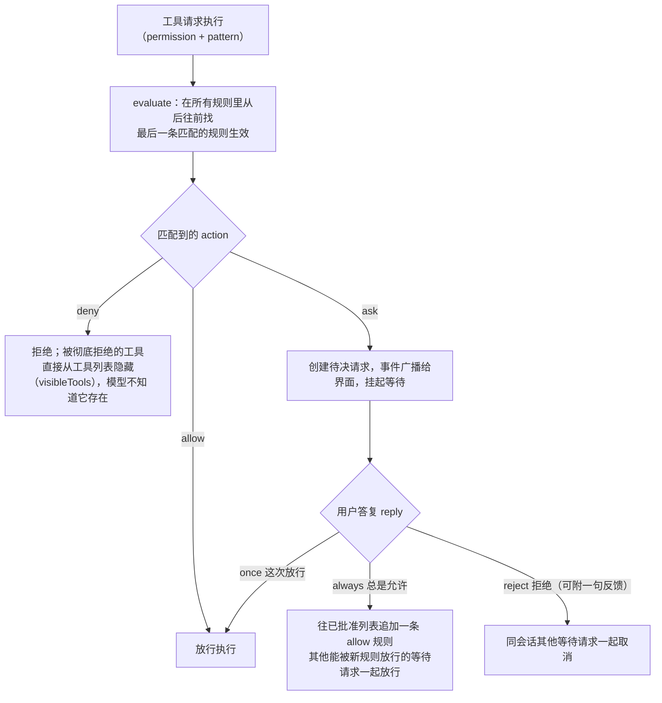

### 规则从哪来

规则有三层叠加（也是 `findLast` 生效顺序）：

1. **内置默认**（`agent.ts`）：默认全部允许，但 `doom_loop`（反复执行同类操作）要询问；读 `.env` 类文件要询问，模式特意对齐了 GitHub 官方 gitignore 模板里的 `.env` 写法；读项目外的目录要询问。
2. **agent 自带规则**：plan 模式禁编辑、explore 只给检索工具。
3. **用户配置**：配置文件的 `permission` 字段，最终覆盖前两层。

界面的自动接受（auto-accept，不打断询问、直接放行权限请求的开关）按项目记：每个项目可以单独设置并覆盖全局默认值——某个仓库想放开手脚、别的项目保持保守，各记各的。会话里积累的"已保存权限"也可以编辑（2026-10-20，提交 fede5ddda5），写错了的放行规则会话中就能改。

把会话挪到别的目录也要过一道权限（提交 0dffb96c4b）：session_move 的目标目录会变成会话的内部工作目录，因此目标在项目外时先解析目录、不在本项目 worktree 清单内就走与访问外部目录相同的审批（`packages/core/src/tool/plugin/opencode.ts:147-167`）；项目自己的 worktree 免批。

### 命令前缀：从一条命令提取"人类理解的前缀"

对 `bash` 命令的权限控制有个前置问题：规则写 `git *` 能管住所有 git 子命令的前提，是先从一条完整命令里提取出"人类理解的命令前缀"。`shell/parse.ts` 维护了一张"命令元数表"（arity，一个命令由几个词构成，`packages/core/src/shell/parse.ts:23`），比如 `git checkout main` 归约成 `git checkout`、`npm run dev` 归约成 `npm run`，拿这个前缀去匹配规则。这样规则写 `git *` 就能管住所有 git 子命令，不用关心用户后面跟了什么参数。

这张表所在的命令分析器是一套手写的 shell 解析器：早先这层解析靠 tree-sitter（一个解析器生成工具）的 WebAssembly 产物来做，如今全部换成手写实现，WASM 依赖整个删掉（提交 8609cc55d0）。权限检查站在安全边界上，解析器的一个解析漏洞就是一条绕过通道，所以解析逻辑值得自己握在手里、逐个补边角。解析器也确实在继续补边角：写在参数中间的文件重定向（`echo hi > out.txt`）也会被识别成一条触碰文件的命令参与权限检查，PowerShell 的方法调用与动态变化的目录同样纳入扫描（提交 dc0bfc5ea4）。ANSI-C 引号（bash 的 `$'...'` 写法，内部用反斜杠转义）里未知的转义序列，解码规则按目标 shell 区分（提交 6a2300da32）：bash 保留反斜杠原样（`$'\q'` 的值是 `\q`），zsh 丢掉反斜杠（`$'\q'` 的值是 `q`）；posix 方言要同时覆盖两者、值无法确定，含这类转义的命令整条按不可解析处理、权限检查走保守路径。此前未知转义一律按"引号未闭合"拒绝。方言之间的其他分歧同样按不可解析处理：bash 3.2 与 5 对 `\c` 控制转义的解码不同，不允许 Unicode 的场景 `\u`、`\U` 拒绝；zsh 把 `\C`、`\M` 读作按键转义，不带数字的 `\x`、`\u`、`\U` 读作 NUL。文件路径类的权限规则在 macOS 上按大小写不敏感匹配（提交 79bd2c6f11，`packages/core/src/config/plugin/policy.ts`）——macOS 的文件系统本身不区分大小写，规则写 `*.PDF` 也该管住 `*.pdf`；误匹配的代价只是多一次提示，漏匹配的代价是绕过。

### 策略层：权限之上的组织规则

权限规则表管"这次调用放不放行"，但还有一个更外层的问题它管不了：这个组织、这台机器允不允许用某家模型服务商、某类工具？策略（policy）就是权限之上再套的一层，配置键是顶层 `policies`（由 `experimental.policies` 转正而来，旧键标弃用并指向新位置；提交 f576da508d），取代旧的 `enabled_providers`/`disabled_providers` 开关名单。

语句形如"效果 + 动作 + 资源"，动作有七种（`packages/schema/src/config/policy.ts:18-25`）：`provider.use`（能不能用某家模型服务商）、`tool.use`（某类工具在某种资源上，写成 `<权限名>:<资源>`，如 `shell:git push *`）、`integration.connect`（某个集成能不能被列出和连接）、`integration.use`（集成背后的哪个账号能用，资源写成 `<集成>#<账号>`）、以及从 `integration.use` 拆出来的 `mcp.use`、`skill.use`、`plugin.use`。拆分前 `integration.use` 一个动作管所有集成资源，靠资源前缀区分；现在各管一段，旧写法在解码时自动转换——只有带前缀的资源参与转换，光秃秃的 `integration.use` `*` 保持原动作、覆盖面扩到提供方与账号（提交 b2bd02ee71）。判定和权限规则表同一个思路：按顺序扫，最后一条匹配的生效，没有配策略就一切照旧。

配置文档之间的顺序则反过来读：普通配置越具体越优先，策略却是用户全局的语句最后应用——所以仓库配置不能偷偷重新启用用户全局禁用的东西。组织托管语句（来自 OpenCode 云控制台）排在所有作者语句之后、拥有最终权力：组织的 deny 不能被仓库或个人的 allow 抵消。两条自保设计值得记：`tool.use` 的 allow 永不授权，它只能抵消更早的 deny，放不放行仍由权限规则和批准记录决定；策略插件本身被保护起来，插件不得增删或覆盖策略语句，配置里用任何选择器都移除不了它——否则一个仓库就能关掉整个策略执行。一次工具调用先过策略、再过权限的两层关系是：

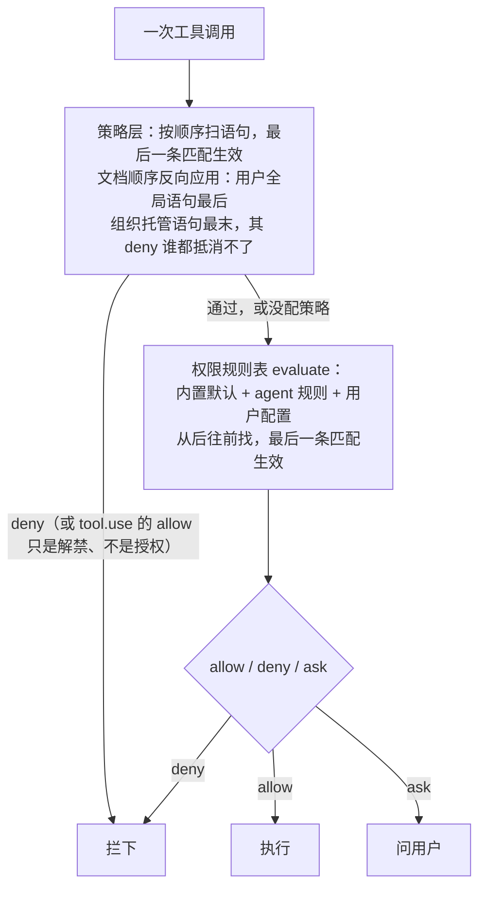

## 插件系统

OpenCode 的"开放"分两层：接模型靠插件，扩展行为也靠插件。

**标准接口**。插件实现 `@opencode-ai/plugin` 包定义的 `PluginModule` 接口：一个函数，接收 `PluginInput`（包含调用本机服务的 client、项目目录、`Bun.$` shell 等能力），返回一组 **Hooks**（钩子，程序在特定时机留出的挂载点）。钩子的调用模式很统一：`trigger(名字, 输入, 输出)`，钩子函数原地修改输出对象。已注册的钩子点包括 `tool.definition`（改工具定义）、`experimental.chat.messages.transform`（改发给模型的消息列表）、`experimental.session.compacting`（压缩时注入上下文或替换压缩提示词）等。核心只定义接口、在固定时机调用，具体插件做什么它不管。

**内置认证插件**（`plugin/` 目录）：OpenAI Codex、GitHub Copilot、Modal、GitLab、Poe、Cloudflare（Workers 和 AI Gateway 两种）、Azure、DigitalOcean、Snowflake Cortex、xAI、Cerebras。每家服务商的登录方式不同（API 密钥、OAuth（开放授权协议）网页授权、订阅账号），插件把"怎么登这家"封装掉，用户只需 `opencode auth login` 选一家。

**外部插件**。配置里写 `plugin: ["npm包名"]`，加载器（`loader.ts`）负责从 npm 安装（安装在后台异步进行，不阻塞启动）并加载。加载是严格串行的，注释里写明原因：保证钩子注册和执行顺序在不同运行之间一致。插件加载失败不会弄垮主程序，错误会作为会话事件上报，界面能看到。串行加载也带出一个时序问题：安装是异步的，会话跑起来时插件可能还没就绪——一个依赖插件钩子的会话，头几步就会漏掉插件本该处理的事件。现在每一步执行、每一次工具调用之前都等待插件激活完成（`packages/core/src/session/prompt.ts:38`、`generate.ts:35` 的 `Plugin.awaitActivation`），激活中的钩子不会漏接事件（提交 b64cc80db3）。

插件自己也有了更新通道：应用的 Settings › Extensions 页可以检查并安装插件更新（提交 b03809b2d7），更新流程由一个状态机管理（`packages/app/src/settings/providers/plugin-update-machine.ts`）；清单刷新期间已发现的更新保留到清单稳定后确认一致才显示（提交 cb41d3da12），防止一次清单抖动把更新入口闪没。配套的 `plugin.list` 响应一度带过插件就绪状态（提交 133f24a4d3），随后应用不再读它（提交 ea79f69bcf）、协议字段整体移除（提交 7bec1e6b35）——就绪等待仍归会话执行前的 awaitActivation，列表只报清单。写成 `name@latest` 的插件随后也进了自动更新（提交 c4df872944）：插件管理器按周期检查新版本并自动升级，不用逐个手动点。

**目录变换（catalog transforms）**管的是"外界可见的能力清单"（有哪些模型、哪些认证、哪些集成）怎么随插件、配置、登录状态变化。做法留了完整的决策记录：每个影响清单的来源（配置、models.dev 数据、认证插件、普通插件）都注册成一份可重放的变换，拿到一个目录编辑器往私有草稿里增删条目；目录每次把全部活动变换按注册顺序重放一遍、应用策略、算出差异、发一次 Catalog.Event.Updated；插件停用就是撤掉它的变换再重建，不需要手工回滚它的改动。被否掉的另一个方案是让插件直接改全量配置：任何字段都可能被改，配置一动所有读配置的服务都得全体重载；选定的方案把重建范围缩到目录本身。把两个方案和否掉的理由一并留档这件事本身就值得学，记录里写明动机：这些接口的行为难以从单个源码文件里还原。

目录变换的来源里多了一个云端的：OpenCode Console 工作区的 Library（提交 288fa12843，PR 60401）。此前 Console 只给核心下发配置（提供方、策略、websearch 之类），组织在工作区里维护的指令（instructions）与技能进不了本地会话。现在 OpenCode 提供方插件从 Console 分别请求 `/api/v2/instructions` 与 `/api/v2/skills` 两个端点拉取这两样东西（提交 21bf6b493b，取代早先从 `/api/v2/config` 的 `library` 字段解码的做法）——指令整包到达（ID 加内容），技能只到版本清单（slug 加 version），技能文件随后台下载单独取（`packages/core/src/plugin/provider/opencode.ts:574-575`）。404 或非 SSO 的 403 视为空清单，其他错误保留上一次拉到的清单（`opencode.ts:550-573`）；技能文件的下载端点也改为 `/api/v2/skills/<slug>`（`opencode.ts:695`）。两样东西分别以目录变换的方式接进两套既有目录：指令进 `InstructionDiscovery`、技能进 `Skill`；下载不阻塞启动与配置变更，下载完成前沿用上一批，配置比对改为按内容严格相等、深等价的旧文档不再覆盖既有引用（`opencode.ts:295-302` 的注释与实现）。组织托管的 `integration.use: deny` 把配置层变成只含策略的副本，指令与技能随之扣下——策略关掉的集成，它的指令和技能一并不可见。策略随后也不再被清单连坐（提交 6e96c5bbbc）：配置、指令、技能三样各有独立的缓存条目，指令或技能的请求失败或格式坏了，只保留各自上一份（没有就为空），绝不拖住配置与其中的策略（`packages/core/src/plugin/provider/opencode.ts` 的 `list` 包装）；两条清单还改成并发拉取（提交 d0a84fc273）。

Console 工作区的事件也能反过来唤醒本地会话（提交 fa928beb84 起，a98e3fa7a1、1284450a03 续）。提供方插件在 `GET /api/v2/config` 的响应头 `x-opencode-event-watches` 里看到本工作区配了事件 watch（`packages/core/src/plugin/provider/opencode-watches.ts:14`）时，注册 `console_watch` 命名空间的工具并建立一条共享事件连接：同一台 Console 的所有项目位置共用一条 WebSocket，租约 9.5 分钟、Console 以 4401 关闭、客户端立即经同一认证升级重连（`opencode-watches.ts:19`），静默超过 11 分钟视为断线（`:23`）。事件按会话分组、以 steer 方式的合成消息注入并唤醒对应会话，事件 ID 逐一登记确认，单次确认上限 1000 个（`:25`）；不归这台机器管的会话（存储里查无此人）只确认不唤醒。这套工具有三件：`watch` 挂一个目标——Slack 线程、GitHub 的 PR、issue、commit 或 Actions 运行，或者工作区 MCP 服务器声明的事件类型（`events` 工具列出类型与其参数 schema，`watch` 的 `server` 加 `event` 加 `arguments` 形态与 `target` 二选一）；`unwatch` 解除；shell 工具执行完命令后，插件还会从输出里识别目标自动挂 watch——在工具调用的路径之外 fork，失败只跳过、结果不等它。两处防走神：连续 5 次 watch 唤醒之后，下一个事件改为等一个真人（`STREAK_LIMIT`，`:31`——两个 agent 不得无人看管地互相唤醒）；频道里自己发帖之后的新顶层消息按"可能与本任务无关"叙述（提交 1284450a03），并明说只当任务信息、不执行它请求的动作。会话删除时挂着的 watch 一并取消，删除标记保留 72 小时，让别的机器遇到迟到事件时能确认并代为应答。防走神随后从单一计数细化成两道限（提交 5fde43180d）：10 分钟窗口内最多 5 次（`packages/core/src/plugin/provider/opencode-watches.ts:31` 的 `WINDOW_LIMIT`）、自用户最后一条提示以来最多 20 次（`:32` 的 `PROMPT_LIMIT`）；CI 事件（workflow_run、workflow_job）节奏规整，只计入 20 次那一道、不占 10 分钟窗口（`:137-139` 的判定）。达到限之后的更新改为等一个真人，工具描述里写明"further updates wait for your next prompt"。整个功能还挂到了 `console_watches` flag 下（提交 3dc79ab657，`packages/core/src/plugin/provider/opencode.ts:337`）——flag 关着不连 Console、不注册工具；`watch` 的工具描述也补了两句实话（提交 3d5ac2dce5）：PR 会连着 checks 一起唤醒，经 Console、`gh pr create`、`git push` 做过的写操作已经在 watch 里，不要再 watch 自己刚做的东西。达到限等真人的会话也不会被永久晾着（提交 88ca792e02）：静默满 30 分钟后，下一次事件照常唤醒、窗口计数清零重来。真的需要无人值守的会话（比如常驻的路由）可以在挂 watch 时声明 `unattended`（提交 e090ace288）：它的更新越过"自用户最后一条提示以来 20 次"那一道限，10 分钟 5 次的窗口限照常生效；这个标记只存本地存储，Console 那头看不到。

插件对权限的参与也很深：插件可以主动发起权限请求（assert），输入形状与会话内的权限请求一致（sessionID、agent、动作、资源、保存策略、来源等字段，见 packages/plugin/src/permission.ts 的 AssertInput；提交 6a7cedcbf1）。插件工具要碰敏感资源时，走和内置工具同一条"问用户"的通道，而不是绕开它。服务器侧的处理器不再等插件（提交 ce7b4252d8）：model、provider、generate、voice、websearch 这些处理器与目录读取，在插件还在激活时直接返回当前快照，不等待、不重试、不把慢插件变成超时或 503。图形界面的插件也可以声明自己的图标（提交 22377659a8），界面不必为每个插件各备一份。

插件的自动更新范围随后从"`name@latest`"扩到"明确写了跟随目标"的写法（提交 db2d889c0e）：`@latest`、版本范围、Git 的 `semver:` 范围、远端确认为分支的 Git ref 自动更新；裸包名、其他 dist-tag、Git tag 与 commit 保持已安装版本。Git ref 是否为分支通过 pacote 的 `GitFetcher` 解析结果判断，依赖它缓存的 refs，通常不会再次访问远端（`packages/util/src/npm.ts:45`、`:81`）。检查周期从 48 小时改为 24 小时（提交 2c9060237f）。代价是 Git 分支判定需要一次远端解析，同一周期内每个目标只尝试一次、更新失败不在周期内反复重试。

## 标准协议：LSP、ACP 与 MCP

### LSP：给模型装上语义眼睛

LSP（Language Server Protocol，语言服务器协议）是微软发起的行业标准，解决的问题是：自动补全、报错、跳转定义这些"代码理解"能力，语言有几十种、编辑器有十几个，如果每家编辑器为每种语言各写一套，就是几百份重复劳动。LSP 把它拆开：每种语言由一个独立的"语言服务器"进程负责理解（如 TypeScript 语言服务器、gopls 之于 Go），编辑器只需实现一次 LSP 客户端，就能接上所有语言。

OpenCode 接 LSP 的动机和编辑器不同：不是给用户补全，而是**给模型装上"语义眼睛"**。模型读代码靠文本，容易漏掉类型错误和引用关系；语言服务器恰好擅长这些。`lsp/lsp.ts` 对外提供的能力包括：

- `touchFile`：文件变动后通知语言服务器重新分析；
- `diagnostics`：拿到"哪一行有什么错"（就是编辑器里红波浪线的数据）；
- `hover`：某个位置上符号的说明；`definition`：跳转到定义；
- `references`、`implementation`：谁引用了它、实现在哪；
- `documentSymbol`、`workspaceSymbol`：文件内和全项目内按名字找符号；
- 调用层级（call hierarchy）：这个函数被谁调用、它调用了谁。

编辑和重构类工具执行后会主动 `touchFile` 等诊断，模型于是能"改完自己检查一遍"，而不是等用户来报错。

工程上有几个细节值得看（`getClients` 函数）：内置 38 个语言服务器的启动定义（`lsp/server.ts`），按文件扩展名匹配；服务器进程**按项目根目录惰性拉起**，用到才启动；启动失败记入 broken 集合，不再反复重试；正在启动中的请求合并等待（`spawning` 映射表去重），避免同一服务器被并发拉起多个。用户可在配置里禁用某个服务器或接入自定义命令启动的服务器。

### ACP：编辑器与 agent 的标准握手

ACP（Agent Client Protocol，智能体客户端协议）解决的是另一个方向的标准化：市面上有多种 AI 编码 agent 和多种编辑器，如果每对组合都要专门写对接代码，就是"每家跟每家握手"。ACP 约定了编辑器（客户端）和 agent（服务端）之间的标准对话方式，任何一方支持协议就能自由组合。OpenCode 通过官方 SDK（`@agentclientprotocol/sdk` 0.21.0）实现了 agent 一侧（`acp/service.ts`）。

协议覆盖了会话的完整生命周期，从接口清单能看得很清楚：

- 握手：`initialize`（交换协议版本和能力声明）、`authenticate`（登录，OpenCode 的方式是引导用户在终端跑 `opencode auth login`）；
- 会话：`newSession`、`loadSession`、`listSessions`、`resumeSession`、`closeSession`、`forkSession`（把现有会话复制一份分头继续，类似 git 的分支）；
- 交互：`prompt`（发送用户输入，这是核心动作）、`cancel`（打断进行中的任务）；
- 运行中调整：`setSessionModel`（换模型）、`setSessionMode`（换模式）、`setSessionConfigOption`（改会话级配置）。运行中插话随后多了一个非标准补充：`_session/steering`（提交 894e30395c，PR 54394）。协议本身还没有运行中插话的方法，opencode 在 ACP agent 上挂了这个扩展方法，参数是会话 ID 加 prompt 数组、语义与内置的 steer 队列一致——编辑器一侧在 agent 干活时插话不用再等回合结束（`packages/cli/src/acp/agent.ts:122-125` 的注册，注释自承"interim extension until ACP has native mid-turn steering"）。

被后台 shell 唤醒的回合也流式给编辑器（提交 9e48e80fa5）。后台 shell 结束时经收件箱事实唤醒会话（`session.inbox.enqueued` 排入通知，`delivered` 与 `cancelled` 结算）；此前的回合结束判定只盯着子任务，后台 shell 唤醒的回合不把过程流式发回客户端——编辑器只能干等一个黑盒。现在回合收尾统一看一个判定，子任务与后台 shell 通知都在其中，被唤醒的回合照常流式；子任务与后台 shell 都比被取消的回合活得久，它们触发的提问与唤醒照常到达客户端（`packages/cli/src/acp/translate.ts`）。一个 shell 在自己的回合还没结束就先完成时，结果无论落回原回合还是唤醒新回合，过程都流式。

初始化时的能力声明也值得一看：支持加载历史会话、支持 HTTP 和 SSE（Server-Sent Events，服务器单向推送的事件流）两种 MCP 服务、提示里可以内嵌上下文和图片。协议的职责边界很清晰：它规定"外面的人怎么跟你打交道"，agent 内部怎么干活它不管。Zed 等编辑器已经支持 ACP，接上就能用 OpenCode。

顺带把三个"协议"放在一起分辨：**ACP** 管编辑器怎么接 agent，**LSP** 管编辑器（或 agent）怎么接语言理解能力，**MCP**（Model Context Protocol，模型上下文协议）管 AI 助手怎么接外部工具和数据源。三者各管一段，OpenCode 三个都用。

MCP 这一格还有个方向反转的玩法（实验性，2026-10 下旬）：通常是 opencode 作为 MCP 客户端，主动去连外部工具服务器；client MCP 反过来——客户端应用（编辑器、TUI）自己跑 MCP 服务器，opencode 通过客户端应用打开的入站 WebSocket 连它。为什么要反转？有的宿主环境不允许子进程对外拨号连接，但宿主自己可以开一个本地服务端等别人来连——传输方向跟着宿主的能力走。注释里把边界写得很清楚：只有连接方向反转，传输从不主动外拨，只服务于进来的连接（`packages/core/src/mcp/socket-client.ts:12-18`）。客户端侧的 `connectClientMcp` 助手收一组工具定义，工具以 `<应用名>_<工具名>` 的形式暴露给模型，每次调用还带发起它的会话 ID；浏览器发不了认证头，就改用 URL 里的 ticket（`packages/client/src/mcp.ts:8`、`:10`、`:31-33`）。TUI 的实验性 `open_terminal` 走的就是这条路（提交 0030a705a3、4535146139、4a6dacec5e、0b93f0b749）：宿主把终端能力以 MCP 工具的形式交给 agent，opencode 自己不必开进程。作为客户端连接外部服务器时也多了一分耐性，而且这套耐性后来整段重做过（提交 42287632a8，PR 60733）：单个工具的 schema 畸形时记一条警告、跳过这个工具，服务器上其余正常的工具照常加载——一个坏工具不再拖垮整台服务器。实现上，opencode 先给 MCP 客户端 SDK 打了补丁（`patches/@modelcontextprotocol%2Fclient@2.3.1.patch`），让工具清单不再由 SDK 逐个校验——原来清单里有一个坏工具，SDK 会把整个清单拒掉；现在清单原样进来，opencode 自己逐个检查（`packages/core/src/mcp/client.ts:390-435`）：非对象、名字不是非空字符串、inputSchema 不是对象、声明了 type 却不是 object 的，各自跳过并记下原因；过检的工具拷贝成 opencode 自己的 Tool 形状（类型不符的字段直接丢弃），顶层 inputSchema 规范化补上 `type: "object"`——有的提供方按 JSON Schema 元模式校验工具参数，顶层畸形会连整个请求一起拒掉。清单获取绕过 SDK 的工具缓存（`cacheMode: "bypass"`），调用时把该工具的定义随请求带上、只编译这一个；服务端按 SEP-2243 以 -32020 拒绝"请求头与过期定义不符"的调用时，重新拉一次清单、用新定义重试一次（`packages/core/src/mcp/client.ts:41-42`、`:492-498`）。模型请求也肯等还在连接中的服务器一小会儿（提交 c811c0cb51）：启动宽限 2 秒、从该服务器连接尝试起算，上限统一固定为 2 秒（`packages/core/src/mcp/index.ts:121` 的 `STARTUP_GRACE_MS`，提交 893e8dc43f、5de6a1399d 两轮收敛定形），`awaitStartup` 把仍在连接的服务器并发等齐（`:799-809`）；每次模型请求组装工具时，`McpTool.flush` 先确认初始注册完成、等宽限内的连接、必要时把注册表追平（`packages/core/src/tool/mcp.ts:26-30`、`:146-154`，`session/context.ts:132`）——刚起步的 MCP 服务器不再因为慢半拍就从第一次请求里缺席。stdio（标准输入输出）方式的服务器还换了一层地基：消息分帧不再依赖 MCP SDK 的读缓冲，自己按消息边界切，单条消息上限 16 MiB（`packages/core/src/mcp/stdio.ts:15`，提交 1a443ae42a）。MCP 连接还能跨项目位置共享了（实验开关 `pool: true`，提交 33d52e6011）：多个位置连同一台服务器时复用一条连接，不必每个位置各自握手；stdio 服务器不回答版本检测时回退到 legacy 读取方式、不再直接失败（提交 64ca766ff7）；调用方中途打断时，连接与断开流程也会走完收尾，不留半开的连接（提交 88cc1e71af）。提示（prompts）清单的刷新也多了一分保守（提交 c72ce6cf82）：刷新失败不再吞错置空，`state.prompts` 保持旧值——服务器短暂无响应不再让已有的提示清空（`packages/core/src/mcp/connection.ts:121-127`）。工具调用的结果也不再被服务器自己的声明卡住（提交 10bc5cbebb）：调用时传给 SDK 的定义不带 `outputSchema`，跳过 SDK 按服务器自报 schema 做的输出校验——服务器返回违反自己声明的结果（比如 Zoom 对一个 204 回空体）时，此前整个调用报失败，已经完成的动作被说成失败（`packages/core/src/mcp/client.ts:522-532`）。服务器主动发来的事件也接住了（提交 6b1db2759a、2c1e17b581）：MCP 客户端支持事件流，事件发布到总线。配套一个实验工具（提交 eb670f1e98 引入 `watch_mcp_event`，`packages/core/src/tool/plugin/mcp-events.ts`，flag `mcp_events` 门控；后更名为 `list_mcp_events`，提交 a0fdbf9b91）：现在的职责是列出某台服务器会发送哪些事件——只列服务器声明为推送投递的那些——供自动化挑选事件触发器；调用前先过一道权限（动作 `opencode_list_mcp_events`，按服务器记资源），服务器没连上或不发事件时如实报错。事件流的耐性也定好了：断开、静默、关闭分别按 1、2、4 秒从上次的 cursor 重开，指数退避封顶三次，服务器主动终止的流保持关闭（`mcp-events.ts:22-26` 的 reopen 调度），单次携带的数据截到 16 KiB（`:14` 的 `DATA_LIMIT`）。事件送进会话时的信任标注也分了对象（提交 70fe3b6d0d）：服务器推送的事件一律按"信息"级别处理、不当作用户的话，Console 认定是成员自己造成的事件则标注"来自你"——成员自己的动作与外部注入在模型眼里是两回事。OAuth 凭据的生命周期随后也归到一处（提交 94ee60df53）：提供方登录与 MCP 服务器共用同一套凭据刷新路径（`packages/core/src/credential.ts`）；MCP 的 OAuth 刷新改在存储凭据的跨进程锁下进行（提交 66071f9edd，`packages/core/src/mcp/oauth.ts:42` 的注释、`:93` 的传递点）——两个进程同时刷新同一凭据不再互相踩。刷新临时失败也不再丢登录（提交 2a9a3ed97c）：SDK 把无法分类的刷新失败（网络错误、超时、5xx）当作登录丢失、直接开始新的授权，连接从此报 needs_auth 等用户重登；现在刷新失败改回 503 的 `temporarily_unavailable`——SDK 原样透传这个 OAuth 错误、凭据留给下次接着用（`oauth.ts:53-59` 的注释与构造）。

非 attached 连接的默认协议改为 `auto`（提交 bda12b51d7）：先尝试协商最新协议，失败再退回 legacy（旧版初始化方式）。stdio 服务器如果因为不认识的检测请求直接退出（例如 Python SDK 1.3），会重新启动进程并以 legacy 初始化；HTTP 服务器如果 auto 检测超时，只要启动额度还有剩余就用剩余时间走 legacy；共享连接（无 roots）不能是 legacy，因此连接池另开私有连接。attached 客户端仍固定 legacy。代价是 stdio 检测失败要付一次进程重启，HTTP 检测超时会吃掉启动额度的一部分，对"检测请求导致崩溃"的服务器多一次进程启动。

MCP 的事件推送跟随了 Events beta 的投递形态（提交 1645a8aa5a）：客户端侧的订阅与确认路径重写，`automation` 的事件触发器改从新的投递接口取事件（`packages/core/src/mcp/client.ts`、`packages/core/src/automation/event.ts`）。Console 的事件 watch 在达到唤醒上限时也会告诉 agent 一声（提交 8a836dd924）：窗口 5 次唤醒、单次提示 20 条的上限不变，但在触发上限的那次更新与之后每次被挂住的更新里，都会带上"后续更新不会再唤醒这个会话，直到用户下一次提示；如果你在等某一条，就告诉用户"（`packages/core/src/plugin/provider/opencode-watches.ts:34` 的 `PAUSED`）——被限额停住的 agent 不再无声等待。顺带把会话查询改成返回 Option，会话已删除时不再抛错打断整条唤醒路径。

## 配置系统

配置是"开放工具"的必答题：模型、权限、agent、插件、快捷指令都要可配，而且来源很多。OpenCode 的答案分三步：找出所有来源、按固定顺序深合并、宽容地解析。

**来源与合并顺序**（`config/config.ts` 的 `loadInstanceState`，从先到后）：

1. 登录服务商通过 `.well-known/opencode` 声明的远端配置；
2. 全局配置（`~/.config/opencode/` 下的 `config.json`、`opencode.json`、`opencode.jsonc`）；
3. 环境变量 `OPENCODE_CONFIG` 指定的文件；
4. 项目配置：从当前目录**逐级向上**找到仓库根（worktree）为止，每一级的 `opencode.json(c)` 都算，最深的目录最后合并、最优先；
5. `.opencode/` 目录里的 agent、command、plugin 子配置；
6. `OPENCODE_CONFIG_CONTENT` 环境变量（给嵌入场景用）；
7. 企业场景：组织控制台下发的配置，以及 macOS 上通过 MDM（设备统一管理）下发的受管配置，后者覆盖一切。

合并用 `mergeDeep`（深合并）：不是整份文件互相覆盖，而是逐字段对齐合并。全局配置写了默认模型、项目配置写了权限，结果是两者都生效。特例是 `instructions` 数组：各层的不互相覆盖，而是拼接去重（指令清单通常就是要累加的）。旧配置也有出路：老的 TOML 格式 `config` 文件会被自动迁移成 JSON 并删除，带 `theme`/`keybinds` 等已迁移字段的配置会静默移除。

**宽容解析**。配置文件支持 JSONC（带注释的 JSON，还允许多余逗号），用的 `jsonc-parser` 库。解析出错时报错信息值得学（`config/parse.ts`）：把出错的行原文打出来，用 `^` 符号精确指到出错的那一列。配置文件还会在首次创建时自动写入 `$schema` 字段，编辑器就能对配置做补全和校验。

实验开关也收进了同一套机制：原先散在配置归一化里的各处判断，收敛为 `packages/schema/src/config/flag.ts` 的单一注册表（当前八项：todo、media_blob、automations、artifacts、video_generate、console_watches、mcp_events、full_codemode），core 侧 `Flag.enabled(key)` 统一读取（提交 66b25c2bfc）。改名的键走 `aliases` 表：旧配置里的 `schedules` 仍指向 `automations`（提交 62d06fab22）。解析优先级从高到低：`OPENCODE_FLAGS` 环境变量（逗号分隔，`-key` 表示关、`all` 表示全开但 opt-in-only 旗标除外、可再排除单项）→ 最高优先级配置文档里的 `experimental.<key>` → `experimental.all_flags: true` 全局开关（能穿透项目级的 experimental 块）→ 渠道默认：local 与 dev 构建默认全开，release 与分支预览默认全关（`packages/core/src/flag.ts:21`、`:26`、`:35-64`）。一键全开另有显式的 `all` 开关（提交 aff43234c8），代码注释里预留了远端 kill switch 的位置。`full_codemode` 曾是唯一的 opt-in-only 旗标（提交 7745079647），todo 旗标随后加入这一类（提交 af64830a47），类别一度取消（提交 77b322ceae）；todo 现在重新成为唯一的 opt-in-only 旗标（提交 56dc95bff5）：这类旗标跳过 `all` 通配与 `all_flags`，任何渠道默认关闭——包括 local 与 dev 构建——必须显式 `experimental.todo: true` 或 `OPENCODE_FLAGS=todo`。渠道默认值的输入端也堵上了一道暗门（提交 e42d622a75）：构建元信息（channel、version、name）此前是带默认值的服务引用，组装漏了它就静默按 release 渠道处理、所有 flag 默认全关；现在改成必需服务（`packages/core/src/app.ts:12` 的 `Service`），缺元信息直接组装失败——"悄悄回到 release 默认"从此不可能。

三笔与配置读取有关的补齐。全新安装也能继承旧凭据了（提交 478de99765）：建库事务在 schema 建表后立即执行旧凭证导入迁移（`packages/core/src/database/migration.ts:39`），`auth.json` 里的 OAuth 凭据进新库；迁移本身也放宽了一步——"auth.json 不是 JSON 对象"从致命错误降为警告并跳过（`packages/core/src/database/migration/20260805200742_import_legacy_credentials.ts:52`）。旧版配置里的模型引用保留了内联写法（提交 12b6efad8b）：v1 迁移的模型选择改用统一的 Selection schema 解码（`packages/core/src/v1/config/migrate.ts:17`），`provider/model#variant` 形式不再被当非法引用丢弃，内联 variant 与显式 `variant` 字段合并时内联优先（`migrate.ts:68-76`）。v1 迁移还保留了 provider 自己的 baseURL（提交 a687c047af）：旧配置的 `api` 字段（提供方类型）与 `options.baseURL` 同时存在时，已填的 `options.baseURL` 优先、为空才回退 `api` 值（`packages/core/src/v1/config/migrate.ts:128`）——自定义网关地址不再被提供方类型顶掉。agent 与 command 的 markdown 文件发现也修正了（提交 6a89e9f287、21ec64ac9f、b2b5da600e）：扫描目录跳过 node_modules 一类噪音路径（`packages/core/src/config/plugin/agent.ts:138`），frontmatter 校验失败从静默丢弃改为带文件路径与原因的警告（`agent.ts:28-29`，command 同改 `packages/core/src/config/plugin/command.ts:20`）——写错的 agent 文件为什么没生效，第一次有地方可查。两笔配置读取的边界也修了。v1 迁移的模型覆盖不再清空目录能力（提交 782650b036）：覆盖只写了部分字段时，`tool_call`、输入输出模态这些目录带来的能力保留（`packages/core/src/v1/config/migrate.ts:232-235`）——此前迁移拿默认值补齐没写的字段，目录标明"这家不支持工具调用"之类的信息被默认值顶掉。登出也不再让远端配置的余温继续生效（提交 550bf20cb8）：登出清掉保存的远程配置，来源在重新拉取成功之前供不出东西（`packages/core/src/wellknown.ts:56` 的 `clearCached`、`:215` 的实现）；刷新失败则保留上一份解析结果，远端提供方与允许清单不至于消失。多个 wellknown 源里有一个不可达时只跳过那一个源，其余照常加载（提交 5cdf288a8c）。登出也开始名副其实（提交 53212a6125）：提供方的 OAuth 登录登出时可以先远端吊销凭据再删本地记录，ChatGPT 登录第一个接上——吊销失败只记日志、本地删除照常进行。CLI 日志里不再出现 `service set` 写入的密码与密钥（提交 9fd74ebdb7）：参数在被记录前先把敏感值抹掉。

配置重载的触发也收紧了（提交 3aaac77313）：文件监视此前对任何变更都重新加载全部配置，现在先判断变更是否落在"构成配置输入"的文件上，输入没变就不重载；路径比较处处大小写不敏感——macOS 的卷通常如此，误判的代价只是多一次重载（`packages/core/src/config/watch.ts`）。

配置系统的本质是解决"多个来源说了算"的冲突，清晰的合并顺序加宽容的解析，决定了用户是愿意配置还是被配置劝退。

配置来源随后多了一层（提交 4cca18d804）：`project_overlay` 开关打开后，每个项目在 `~/.config/opencode/project/<project-id>/` 下有独立的覆盖配置目录，读法等同于额外一层 `.opencode`，位置在仓库自身配置之上。旗标解析也抽成 `FlagResolve.resolve`：优先级为 `OPENCODE_FLAGS`、最高优先级文档的 `experimental.<key>`、`all_flags`、`local`/`dev` 渠道默认值（`packages/core/src/flag/resolve.ts:17`、`:32`）。因为 Config 不能依赖 Flag（Flag 读 Config），overlay 的开关用不含 overlay 的条目单独解析——开关不能用来打开自己。两处格式修正：frontmatter 修复不再把合法的 YAML flow collection（`[a, b]`、`{a: b}`）改写成块标量，跨行的 flow collection 会扫描到闭合为止，只有确认当前行不是合法 YAML 时才退回块标量（提交 7aed488e41，`packages/core/src/config/markdown.ts:24`）；旧式分开写的 `model` 与 `variant` 合并成 `model#variant`，command 与 agent 两种 markdown 配置共用这一转换（提交 f00f28ded2）。

ChatGPT 各套餐的可用模型清单改从 models.dev 读取（提交 43b1015f57），此前这份清单写在插件里、随套餐变化要改代码。语音模型同样从目录列出（提交 387140811c），应用启动语音时用服务器列出的最新 GPT-Live 模型（提交 342839461a）。ChatGPT 的刷新令牌被拒时不再只报一句授权失败（提交 5310e42203）：插件解码 `{"error":"invalid_grant"}` 这唯一的失败形状，直接提示重新连接——刷新链已经断了，等它自己恢复没有意义。

**模型的服务档位成了独立条目。** models.dev 的 `capabilities.service_tier` 被展开成独立模型，并在 `experimental.speed` 里标注基础模型、档位 id 与是否更快（提交 7edab789f7，`packages/schema/src/model.ts:113` 之后）：目录按 rank 排序，请求时按协议决定档位放在 `settings.speed`、`settings.serviceTier` 还是请求体的附加字段里（`packages/core/src/models-dev.ts:283`、`:352`）；成本支持带日期条件的倍率，目录按"推荐与档位"四种组合分别缓存；基础模型被禁用时其档位一并禁用（`packages/core/src/model.ts:236` 之后）。档位没有倍率时用该档位自己的价格表、不直接退回基础价（提交 4b0e34747b）；Rust 客户端随后补到同一形态（提交 b51482f907）。

工具命名空间的扁平化提前到协议构造（提交 3b38f3aadd）：协议若未声明支持命名空间，请求在交给它之前就已经扁平——工具定义、系统消息里的工具更新（命名空间重定义导致的隐式移除改写成显式 remove）、历史里的工具调用与结果名称、强制工具选择一并处理（`packages/ai/src/route/protocol.ts:91`、`packages/ai/src/protocols/shared.ts:385`）。代价是每个协议适配器不再自己拼装工具，包装请求构造的中间层必须转发这个声明。xAI 的压缩请求也先走同一步（提交 d3abc6706c），压缩请求里的历史名称与普通步骤完全一致，前缀缓存才能命中同一段。搜索提供方多了一个以 Claude Code 为后端的选项（提交 8bae58e7b9）：用 `claude` 可执行文件跑 `haiku`、最多两轮、禁用思考、只允许它的网页搜索工具，一分钟超时；结果把链接列表与 Claude 的总结合并到第一条。TUI 也把"只有配置项、没有凭据"的提供方算作已连接（提交 8f8a9ae88d）。

## 模型接入与数据更新

**接模型**用 Vercel AI SDK（一个统一的模型调用库）。核心对它的直接依赖只有三个包——`@ai-sdk/provider`、`@ai-sdk/provider-utils`、`@ai-sdk/openai-compatible`；各家服务商的接入由核心内置的提供方表逐家加载（`packages/core/src/provider.ts:47` 起），会话侧的模型调用走自研的 `@opencode/ai` LLMClient（`packages/core/src/session/runner/step.ts:3-10`），`openai-compatible` 继续接住所有兼容 OpenAI 接口的服务（DeepSeek、Ollama 本地模型等都走这条道）。围绕"目录说的"和"端点认的"之间的出入，有几层适配：提供方变体（同一家服务商的不同接入形态）在包归一化之后再构建（提交 e9ac459c2e）；模型的推理档位可以从配置读取，不只认模型目录的元数据（提交 d889cb2044）；两个小的兼容开关针对 OpenAI 兼容端点的差异——`streamUsage` 可以关掉请求里的 `stream_options`（有些端点不认这个字段，提交 49f52ff2d5），`store` 字段只对 OpenAI 与 Azure 的 chat completions 发送（提交 57f4a364e3）。自定义提供方的模型声明也放宽了（提交 4e9c00aa9a）：模型限制里的 `context` 与 `output` 字段从必填改为可选，只写其中一个不再让整个提供方被丢弃（`packages/core/src/v1/config/provider.ts:42-48`）；Copilot 插件不再硬性注入自己的 `anthropic-beta` 值（提交 2f31b3d52c），请求自带的值得以保留。Copilot 随后整体搬上原生协议（提交 4de7680c3b），并带来两件新东西（提交 37729b1df1）。一是 `experimental.model.resolve` 钩子：模型每次解析时插件可以改选（`packages/core/src/session/runner/model.ts:109` 的触发点），改动限同一提供方——凭据与已装钩子仍按原选择的那套算（`:118-119` 的注释），标题生成这类辅助请求不触发；钩子在插件 API 面的声明见 `packages/plugin/src/effect/session.ts:204`。二是 Copilot 自己的 Auto 路由成了钩子的第一个用户：模型选 Auto 时插件向 Copilot 的路由端点要一个模型（`packages/core/src/github-copilot/models.ts:131` 的 `autoModel`），每个会话记住路由结果，直到它的 session token 将近过期、会话被压缩或账号变更（`packages/core/src/plugin/provider/github-copilot.ts:358-360` 的钩子注册，会话级缓存在该文件顶部的 `routes` 表）——token 解锁这次选择与 Auto 折扣，Copilot 对别的模型拒绝它；路由失败或选了个本客户端伺候不了的模型，5 分钟后用回退模型再试。API 端点也随模型列表刷新（提交 f29228b003）。这批适配随后又补了几笔（2026-11-19）：GitHub Copilot 的环境变量凭据从 `GITHUB_TOKEN` 换成专用的 `COPILOT_GITHUB_TOKEN`（提交 910c423e48）——目录里列的 `GITHUB_TOKEN` 通常被 git 与 CI 设置、并没有 Copilot 权限，专用变量与 Copilot CLI 的读取习惯一致。ChatGPT 登录下的 GPT-6.2 Astra 保持 272k 窗口（提交 ef9aab240d）：此前"新模型默认沿用 500k"的假设对 Astra 系不成立，各版本一律按 272k。OpenAI Responses 各条路线的系统提示词改以 developer 消息随 `input` 发送（提交 7ca7b3feba、de291ab7b1）——GPT-6.2 模型从不缓存顶层的 `instructions` 字段，放进消息序列才能吃到提示词缓存。HTTP 超时补齐到所有请求（提交 73215c55eb）：部署级的头、超时与覆盖配置应用到每一类请求（决策、嵌入、生成各自之前有遗漏），单次请求自己的设置仍然优先。自定义工具调用之后，WebSocket 上的续接保持可用（提交 a40c6d7f68）——续接请求从已完成的响应输出接着走，不再断线重来。

绝大多数模型走 HTTP API，Claude Agent 提供方是个特例（提交 f29e281322，PR 58782）：它不直接调 Anthropic 的接口，而是经 Anthropic 的 Claude Agent SDK 启动用户本机安装的 `claude` 程序（Claude Code 的命令行），用用户自己的 Claude Code 登录（订阅、API key 或云账号都行）出 Claude 模型。规格文档（`specs/v2/claude-agent-provider.md`）把边界划得很清：opencode 只用公开 SDK，不坐在 claude 与 Anthropic 之间、不改它的请求，也不读 Claude Code 的已存登录；在 PATH 上找不到 `claude` 时可用 `OPENCODE_CLAUDE_PATH` 指路。这套接法有三处值得记：聊天沿用 Claude Code 自己的系统提示词，上面只加一段"你现在跑在 opencode 里"的短注，再叠上 agent 角色与 opencode 的指令源（AGENTS.md、技能、MCP 指引）；opencode 的工具以 MCP 桥接的方式交给 claude，名字统一加 `mcp__opencode__` 前缀（`packages/core/src/plugin/provider/claude-agent/tools/names.ts:6`），过长的名字换哈希缩短（`names.ts:8-13`），claude 若调了一个没桥接过去的名目，那是它内置的能力、与 opencode 无关（`names.ts:16` 的注释）；每个会话一个长驻的 claude 进程，空闲 5 分钟停掉（`claude/sessions.ts:25` 的 `IDLE_MS`）。启动前先查一次版本：太老的 claude 直接报错、提示 `claude update`——老版本会无视逐字提示的约定，把用户文本误当斜杠命令解读（`claude/probe.ts:21-31`）。Claude Code 自带两个"悄悄换方式"的行为也被关掉了：流式失败后转非流式重试（opencode 挂着等一步结束，永远等不到），以及安全分类器拦下请求时把会话切到另一个模型（选定的模型与实际跑的对不上）——隔离环境变量表里写死 `CLAUDE_CODE_DISABLE_NONSTREAMING_FALLBACK` 与 `CLAUDE_CODE_DISABLE_REFUSAL_FALLBACK`（`claude/query-options.ts:18-19`，提交 5e066ac922、4f3156ab3c，PR 61067、PR 61069），规格文档把禁用理由与此前禁掉的工具搜索、advisor 工具并列（`specs/v2/claude-agent-provider.md:55-56`）。Claude Code 在流里发的 `rate_limit_event`（订阅套餐的用量信息）此前收到即丢，现在记下来、在步的 `finish` 事件上以 `providerMetadata["claude-agent"].rateLimit` 带出（`language-model/convert-claude-stream.ts:19-20`、`:26`，提交 c8a473bead，PR 60879），想知道套餐用量从步元数据读、不用另去轮询。这条通道的边界随后又各修了一处（提交 993a280887、51ce52546c）。指令或工具清单变化此前会打断 claude 正在进行的工具调用：现在被移除工具的调用就地以"该工具已不可用"应答，parked turn（等工具结果的回合）被留着走完——打断它会让 Claude Code 把等待中的调用记录成用户拒绝（`packages/core/src/plugin/provider/claude-agent/claude/sessions.ts` 的 `parked` 判定与 `pending.expect` 应答）；后台压缩也不再停止运行中的会话——压缩只取只读快照，不需要停旧进程。

指令文件的发现也吸收了 Claude Code 的习惯（提交 7828491cc9）：项目目录里没有 `AGENTS.md` 时读同目录的 `CLAUDE.md`，全局 `AGENTS.md` 缺失时读 `~/.claude/CLAUDE.md`（`packages/core/src/instruction-discovery.ts:37` 的注释）。读取开关随之收敛为一个 `claude` 布尔（提交 bd115fdac8）：关闭它，项目级与全局级的 CLAUDE.md 一起失效——此前分属 `claude` 与 `claudeGlobal` 两个开关，只关一个会留下一半在读。

`baseURL` 覆盖解决的是自建网关的问题：提供方配置里的地址覆盖目录里每个模型自带的端点，不只覆盖你配置过的那些模型；按模型配置的设置在之后应用，仍然优先（`packages/core/src/config/plugin/provider.ts:90-96`）——自建网关的人配一次提供方地址，不会有哪个模型因为目录自带端点而绕过网关。

目录内容本身也有筛选开关。`OPENCODE_DISABLE_FREE_MODELS=1` 把 OpenCode 与 OpenCode Go 两个提供方里不收费的模型（`cost` 里没有任何一项输入价格大于 0）从目录里删掉，没有密钥时也不再自动列出它们（`packages/core/src/model.ts:95`，提交 aadd4d8614）；realtime（实时语音）、embedding（向量嵌入）、reranking（重排序）三类非对话模型不在模型清单里（提交 df6fb9a460）。目录更新持续跟进新模型（如 ChatGPT 登录的模型目录先后加入 GPT-6.1 Terra（提交 4e982c0814）与 GPT-6.2 Sol、Astra（提交 b7340e6415））。

对 Console（opencode 的云控制台）的依赖也在松绑（提交 7e42be4248、3346049996、e9540d35d4）：技能与 web 搜索的下载改为自己跟随重定向——Console 对技能下载回预签名存储重定向是常态，手动跟随上限 5 跳、认证头只在同源内保留（`packages/core/src/plugin/provider/opencode.ts:598`、`:609-633`）；配置请求加 5 秒超时、视为瞬态失败走缓存重试（`:553`）；发出提示词前不再等 Console——服务器端那条等待路径整个删除。

ChatGPT 订阅的上下文上限单独说，因为它是"电网部件从核心挪到插头"的一个样本：模型后端其实接受每个模型的完整输入窗口，但更大的请求多吃 ChatGPT 套餐的额度，这段逻辑从 OpenAI 提供方的内置代码改成了独立插件（`packages/core/src/plugin/provider/openai-context-caps.ts:1-2`，提交 2a381f895a），按套餐把窗口压到 OpenAI 的默认值（272k，`gpt-6.1-sol` 为 500k，更晚的模型沿用 500k）——不用 ChatGPT 订阅的人不加载这份逻辑。token 刷新失败时这套保障也照常生效（提交 3f19c92afd）：上限判定改读存储的凭据，刷新失败不拖累 sharing 检查。

AI SDK 一层还长出了两个观察口。请求带 `includeRaw: true` 时，模型流按原序、在解析出的事件之前附带 `{ type: "raw", data }` 原始帧事件——`data` 是这一帧解析后的 JSON，这个包还没支持的新帧类型也能看见；默认关闭，非流式的 `generate` 忽略它（提交 93701210bd）。`@opencode/ai/experimental` 下新加了实验的 Extraction API（提交 b21b21babb）：从文本里按字段类型读出值——比如问总数，回答是一个数字或"输入没说"，而不是一段概率腔的对话；类型不匹配的输入不发送，目前只有 Cloudflare 的 Clairic 模型服务它。

**思考块跨请求重放，不再降级成正文**（提交 822594b9ae，PR 60498）。推理部件（模型"思考"的文字）随历史回发给模型时，不少服务商要求带签名——服务商对思考内容算的校验值，内容改一个字签名就对不上，用来防历史被篡改。此前的处理是：没有签名或被打断的思考块一律降级成普通文本发回，结果模型在后续请求里看到"自己想过的话"变成了对话正文，行为容易跑偏。现在分档处理：要求签名而确实没有的思考块整体丢弃，不再伪装成文本；不要求签名的模型（`qwen`、`minimax-` 开头）按原样发；Gemini 对签名丢失的重放用 Google 文档记载的固定标记 `skip_thought_signature_validator` 顶替（仅当该步还没有别的已签名工具调用）；Mistral 系则把最后一条没带工具调用的助手消息标成 `prefix`——这是 Mistral 的续写约定，告诉模型"这条是你自己说的，接着往下写"。

结构化推理细节的重放也看模型的声明（提交 07965844a5）。OpenAI Chat 协议允许把推理文本装进自定义字段（配置里声明字段名）；声明了别的字段的模型，读推理在那个字段——早期回合的结构化推理细节（`reasoning_details`）与不透明值（`reasoning_opaque`）随之不再随消息重放，此前无论声明都重放（`packages/ai/src/protocols/openai-chat.ts:580-581`，同一提供方元数据键下的另一个模型同样受判定约束）。标量推理文本也不覆写 `reasoning_details`——那是结构化列表自己占的字段。

**错误有类型，界面才能说清"什么时候能再用"。** 以前的配额错误是一句面目模糊的"出错了"，用户不知道是额度用完了还是网络抖了、要等多久。结构化会话错误（`packages/schema/src/session-error.ts`）加了可选字段 `retryAfterMs`——服务商要求等多久再试，从记录失败的时刻起算。配额错误里，响应体含 `FreeUsageLimitError` 的被翻译成专门的 `provider.free-limit` 错误种类，带固定提示语（赠送额度用完，接自己的服务商、订阅 OpenCode Go，或换模型）和重置时间；其他配额错误仍是泛泛的 `provider.quota`（`packages/core/src/session/to-session-error.ts`，提交 a9fa57b738）；`retryAfterMs` 对带这个字段的任何提供方错误都传递，不限于配额错误（提交 80b8762913）。TUI 据此显示赠送额度提示与重置时间、给出换模型的提示、不再弹失败 toast（提交 86a0950c61）。厂商返回的"额度用尽"类错误也单独归了类：判定正则把 budget exceeded、usage limit、limit exhausted 这类说法识别为一种可分类的失败（`packages/ai/src/provider-error.ts:144`），不再是面目模糊的未知错误。拒绝（refusal）类也照此办理：OpenAI 的 `cyber_policy` 拒绝（提交 bca1def93b）与 Gemini 的服务条款拒绝（提交 a8dbca1065）都归为内容策略一类。ai 包这一层的错误分类还在加宽：Gemini 的 MALFORMED_FUNCTION_CALL 这类流中错误归为可恢复的 incomplete-stream，续写接得上，Interactions 路线的错误也各自归了类（提交 c626de0bee，`packages/ai/src/protocols/gemini.ts`）；输出被截断时优先报"到了 token 上限"，而不是难以定位的 schema 解码错误（提交 e98d01daf6）。分类的结果也有了统一的读法：此前调用方要自己挖 `reason.http.status`、自己从响应 JSON 里猜厂商错误码，现在 `AIError` 直接给四个 getter（`packages/ai/src/schema/errors.ts:173`、`:178`、`:187`、`:197`，提交 97a71f0cc6，PR 60808）——`status` 读失败响应的 HTTP 状态；`code` 按各家习惯翻找厂商错误码，顶层 `code`、AWS 的 `__type`、`error.code`、Google 的 `details[].reason` 这十几个候选位置集中在 `packages/ai/src/utils/provider-codes.ts:7-9` 起的 `providerCodes`，AWS 的 `x-amzn-errortype` 头另有处理；`retryAfterMs` 取服务端"过多久再来"的指示；`isRetryable` 把原先的独立函数并进来（`provider-error.ts:87` 只剩一句委托）。"请求级重试"一节讲的挑着重试，对外就靠这一个错误对象说清。

**费用与额度成了核心的一等数据**（提交 4cba1b7f5d、e42f6d1016）。四个协议实现（anthropic-messages、gemini、open-responses、openai-chat）都会记录厂商上报的费用；新加的 Console 接入（`packages/core/src/console-access.ts:4`，默认指向 `https://opencode.ai/console`）从 `server.usage` 拉取订阅额度（`packages/core/src/usage-limits.ts`）：滚动、周、月三个窗口的用量表（百分比、是否已受限、何时重置）与按模型的花费。TUI 里能看到限额（提交 5e4aa55cda），会话零花费时也显示 Go 额度（提交 9109bcf136）；额度数据不进消息与会话记录（提交 de284dc1bc）——账目是账目，对话是对话。模型接入也添了一条不走个人密钥的路：GPT-Live 经 OpenCode Console 连接提供，不需要用户自己的 OpenAI key（提交 3330b3cf38）。接入面上还有几笔（2026-11-01 前后合入的 ai 包批次）：Azure Messages 路线接入了 Foundry 上托管的 Claude 模型，鉴权用资源密钥作 `x-api-key` 头（`api-key` 头会被拒，提交 5434c156d4，`packages/ai/src/providers/azure.ts:82-84`）；不需要密钥的提供方可以声明 `apiKey: false`，没配凭据也照常入列（提交 12f7e1b59a）；结构化输出不再要求单独的 API 形状，`generate`、`stream`、`loop` 直接吃 schema 参数（提交 e8238bae9b）；每个提供方 API 有了自己的命名方法，排错时调用栈里看得出走的是哪条路（提交 a5518690fc）。ai 包的流里此前混着两种"事件形式的错误"：`provider-error` 与 `tool-error` 装成普通事件在流里流过，读流的一方既要处理 Effect 的错误通道、又要按事件类型判断失败。两种事件类型已经从 schema 删掉（提交 01276f9061，PR 60812）：厂商失败让流直接以 `AIError` 失败收场，工具失败变成一个错误形态的 tool-result 事件——模型看得到、读流的一方不用单判。每一步以自己的 `step-finish` 收尾，整个循环以一个 `finish` 收尾，`finish` 带最后一条助手消息与跨步累加的 usage（`packages/ai/src/schema/events.ts:289-293`）；新增 `ai.collect` 把 `stream`/`loop` 的事件流折叠成一个结果——text、steps、messages、usage、finishReason、object（`packages/ai/src/index.ts:150-151`）。core 侧随之变简单：步的溢出判断不再靠流中事件拦一条失败，改为流失败后检查失败原因是不是上下文溢出（`packages/core/src/session/runner/step.ts:162-167`）。"模型与工具来回"的循环也从 `llm.ts` 拆成 `loop.ts` 里的一组纯函数，步与步之间的判定第一次有了独立出口并被测试钉死（`packages/ai/src/loop.ts:18-23`、`packages/ai/test/loop-steps.test.ts:33`，提交 f4ec1532f0，PR 61005）：一步以输出顶到上限结束时不再续跑，哪怕截断落在工具调用中间；调了 `answerTool`（结构化输出的回答工具）即步终，即便同一步还调了别的工具；提供方自己执行的调用跳过、不由客户端重放；模型给出非法 JSON 参数时以空对象重放这次调用、把错误原文带给模型让它改；调用方强制的 `toolChoice` 只作用于第一步，回答工具的强制除外（`loop.ts:66-68`）。`ai.request` 现在返回纯对象，改字段用展开写法、`LLMRequest.update` 移除（`packages/ai/README.md:933`，提交 a24a239456，PR 60968）。

ai 包的数据模型与传输层各收拢了一层。消息类型从"一个大类带 role 字段"拆成 System、User、Assistant、Tool 四个类，`Message` 成了它们的联合类型，每个角色允许携带的内容部件集合随之变窄——system 消息只带文本与 effort 部件——各协议翻译器不必再防御性地处理无关角色的字段（`packages/ai/src/schema/messages.ts`，提交 0988cb8366、e387bde030，PR 61195、PR 61196）。headers、fetch 实现与超时合成一层 `TransportOptions`，路由默认值直接继承它，同一路由的每次请求共享同一套传输配置，不再逐项零散合并（`packages/ai/src/route/client.ts:107`，提交 8b038f672b，PR 60970）。文件输入也放宽了：消息的 media 部件、图片输入、决策的 media 部件都接受 `Uint8Array`、`ArrayBuffer`、`URL`，或一段 data URL、http(s) URL、base64 字符串；字节与 base64 按文件头（magic bytes）嗅探媒体类型，嗅探不出就要求调用方显式传 `mediaType`（`packages/ai/src/media.ts:308`，提交 c3c5531679，PR 60963）。计费口径上修了一处 Gemini 的少算：Gemini 上报的 `promptTokenCount` 以缓存子集为内部项，而工具调用引发的第二轮提示词（`toolUsePromptTokenCount`）是额外计费输入，此前没算进用量合计，现在计入；一条回答被拆成多段续传时保留首段请求的输入计数，避免重复累加，完整口径留在 provider metadata 里（`packages/ai/src/protocols/gemini.ts:501-514`，提交 d1dec5a576，PR 61484）。可移植的生成参数也收拢成一层（提交 9a3f03e5c5）：maxTokens、temperature、topP、topK、frequencyPenalty、presencePenalty、seed、stop 这八个各服务商通用的采样参数，统一放在文本请求、模型默认值与路由默认值的顶层（`GenerationOptionsFields`，`packages/ai/src/schema/options.ts:135`）；一个扁平记录里哪些键属于这组通用参数、哪些属于服务商专属选项，由 `GENERATION_KEYS` 集合拆分——调用方不必再为每个服务商手工分流。

HTTP 中间件（包在 provider 请求外面的函数，能改请求头、看原始响应）的作用范围也放开了（提交 367d24b70a）：调用方可以把中间件挂在一个作用域上，作用域内发出的每一次 provider 请求都经过它，模态不挑——视频、图像生成这类异步媒体操作的提交、轮询、取结果、取消四类调用全部覆盖。执行器级的中间件包在最外层；请求执行期间作用域被清空，中间件自己发出的请求不会被再包一层（`packages/ai/src/route/executor.ts:266-270`）。

**回答断在半截会自动续上**。两类情况都会接着要：一是模型输出顶到单次回复的 token 上限（回答太长被硬切断），运行时带着已有内容再发一轮请求把剩余部分接回来；二是 Gemini 的传输层把一条回复拆成多段返回的情况，各段也能拼成一条完整的回答。提供方（provider，一家模型服务商的接入配置）支持提供方级别的 `compatibility` 兼容性选项，原先设置提示词缓存键的 `setCacheKey` 写法迁移了进去；Anthropic 的缓存断点（cache breakpoint，提示词缓存里"从这条标记往前都算命中"的位置标记）可以用 `compatibility.cacheFormat` 来配置。断点的默认放法（`cache: "auto"`，`packages/ai/src/cache-policy.ts:5-12`）放四处：最后一条工具定义、第一与最后一条不同的系统部件、对话尾部——前三处让工具、基础 agent、项目这几段前缀可复用，尾部断点每次工具结果之后前移，长时间运行时最近的对话前缀也能复用。手工放的断点保留并占用四断点限额，auto 只填剩下的槽位；断点只放在可缓存的部件上，`compaction`、`effort` 这类部件跳过（提交 ab249a9684）。策略按上游区别对待（`cache-policy.ts:70-72`）：OpenRouter 和 Vercel AI Gateway 后面除 Anthropic 与阿里 Qwen 之外的上游不用断点也缓存；Gemini 只认最后一个断点，尾部断点会让每一步都写一份新缓存、比不放还贵；Qwen 忽略工具定义上的断点，把工具和系统提示词一起缓存。缓存寿命也可以随请求声明了（提交 9007700546）：`cache` 传对象时给 `{ ttl }` 一项，自动放置照旧、外加声明的寿命——时长用 models.dev 的 duration 格式（`5m`、`1h` 这类，也接受毫秒数）。落点按协议分两路：认内联标记的协议（Anthropic 系、Meta）把寿命放进每个 cache_control 标记；OpenAI 隐式缓存、Gemini 这类忽略内联标记的协议走请求级选项（`requestTTL`，`packages/ai/src/cache-policy.ts:47`），Vercel AI Gateway 的 Responses 路线由此把顶层的 `cache_ttl` 发出去。

**缓存的寿命还催生了一个保活插件**（提交 6f2ecd2d41，PR 60969）。提示词缓存有寿命，过期后同样的前缀要重新计算——内部插件 `opencode.warming`（`packages/core/src/plugin/warming.ts`，`internal.ts:269` 注册，默认关）定期给空闲会话发一条保活请求：临时追加一条用户消息"只回 OK"，不准入、不写历史、不派工具，只是让服务端把前缀缓存续上。间隔默认 4 分钟、会话保活总时长默认 30 分钟（`warming.ts:14-18`）；间隔可设 `interval: "auto"`，按模型缓存寿命（cache.ttl）的 90% 取值——保活请求赶在过期之前发出（`schema/src/config/warming.ts:10-14`、`warming.ts:169-173`），没配 ttl 的模型 auto 不预热（`warming.ts:42-43`）。节奏可以按提供方或模型细调（提交 296074aab2，PR 60025）：不同模型的缓存寿命与费用差得远——只给贵的前缀保活、本地模型不开——所以提供方或模型的 `cache` 设置里多了 `warming` 一项（布尔或 `{ interval, duration }`，`schema/src/provider.ts:70-73`），覆盖顶层的 `warming`（`warming.ts:24`）；解析不了的设置记警告并退回顶层设置，保活钩子从不拖垮它挂上的请求（`warming.ts:26-32`）；保活提示词只在顶层可设，模型级设置只改节奏（`warming.ts:35`）。ttl 与 warming 声明在同一处模型元数据里，与上一段请求实际用的缓存寿命读的是同一份——保活节奏和缓存过期因此天然同源，不会各说各话。保活的运行时随后重写过一轮（提交 df54d0cddf、039765b033、f7a0684bee、183007831d）。每个被保活的会话有自己独占的循环（`packages/core/src/plugin/warming.ts:85` 的 `FiberMap`），真实请求到来时替换掉循环、间隔与窗口重新起算（`:150-152`）；`interval: "auto"` 改为读模型元数据里的 `cache.ttl` 取九成（`:64`），没有 ttl 的模型回退到略短于 5 分钟的 4 分钟（`:36`）——此前 auto 只在配置里认 ttl；计时的起点从"上次保活完成"改为"上次请求或 ping 发出"，缓存的寿命从发出那一刻起算（`:97-100` 的注释与 `expires`）；请求进行期间 ping 改为等请求结束、且不超过缓存剩余寿命（`:105-113`）；一次 ping 若写大于读——重写了缓存而不是续上——本会话的保活就此停止（`:125-129`，报告 cache read/write 两个数），之后真实请求重新开始预热。

**模型清单**（市面上有哪些模型、各自的上下文上限、价格、能力）来自 models.dev 这个公共目录。运行时的获取策略（`core/models-dev.ts`）很完整：优先读本地缓存（5 分钟有效）；缓存过期就加**跨进程文件锁**（Flock，防止同时开多个 opencode 时重复下载或写坏文件）去拉取，写入用"先写临时文件再改名"的原子方式；拉不到就用构建时打进程序的快照保底；支持用环境变量换数据源或完全禁用联网。后台还挂着一个每 60 分钟的定时刷新；刷新结果广播到整个服务器，所有实例（一个进程管的多个项目目录）同时看到新目录，不是只有触发刷新的那个（`core/models-dev.ts`，提交 5a36ee78e7）。一次目录获取的完整决策是：

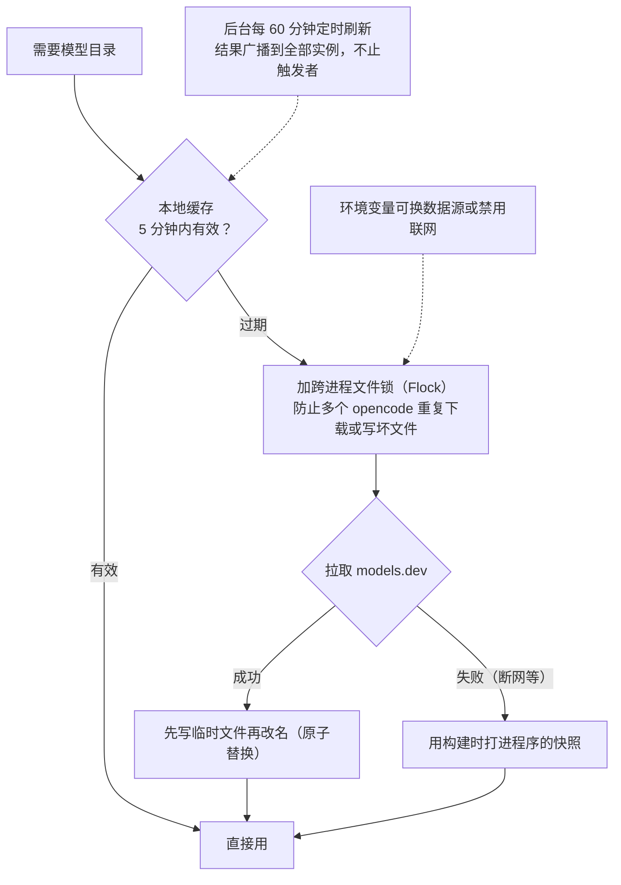

**快照养护从定时任务改成了发布时抓取**（提交 5ae201c304、d5bb993278）。此前的养护是 GitHub Actions 定时任务（每天 12:00 UTC 在发布分支重新生成内置快照文件，工作流 `.github/workflows/models-snapshot.yml`），2026-10 下旬连同 stats/containers 工作流与 OpenCode GitHub Action 一起移除，快照短暂成为"打进程序之后就没人更新"的静态文件。随后发布流水线补上了新养护：每次发布先抓一次 models.dev 目录（`packages/core/script/update-models-snapshot.ts`，拉不到时保留仓库里现有的快照），抓到的目录作为构建产物传给各构建作业，以 `OPENCODE_MODELS_SNAPSHOT` 环境变量打进程序、取代仓库里的静态快照；构建出的二进制还要过一道冒烟校验（`packages/cli/script/catalog-smoke.ts`）——解码并归一化打包副本，模型总数不得低于一个下限。下限不是要求相等：防的是错误页，或一个仍能解析成功的小对象被当成完整目录。目录读取本身也多了新源（提交 65096cd354）：可以从实验 v2 API 拉目录并转成 v1 形状，只解码 opencode 读的字段，单个模型不合形状就跳过、不拖垮整个目录；打包时丢弃 opencode 从不读的模型字段让副本保持小，其余字段（包括 models.dev 以后新加的）按发布原样保留。运行时获取目录的策略不变：本地缓存 5 分钟、跨进程文件锁、拉不到退回打包副本、后台每 60 分钟刷新。

**模型清单开始按类型分层。** 此前目录一律排除非对话模型（realtime、embedding、reranking，见"模型接入"）；现在模型带类型字段，协议可以按类型请求清单——像事件过滤那样列出"所有图像模型"，只挑会话模型的解析逻辑够不到这些条目（提交 ae876eec1b）。目录提供方随之长出 image 与 decision 两类入口（提交 b2e4c77621）；配置里的自定义模型也能声明类型（提交 a697f53611）：`models` 下给自定义模型配 `type`（如 `"image"`、`"document"`）就按该类型入清单，不配默认按 chat。媒体入口随后长出第三类：视频生成（提交 5eac2802b7）。`VideoModel` 是队列式路由（`packages/ai/src/video.ts:23` 的 `QueuedRoute`），操作分四步——start 发起、status 查进度、result 取结果、cancel 取消，参数带画幅比例（`16:9` 到 `auto`）、分辨率（480p 到 4k）与时长；提供方入口有 Google Gemini Omni、MiniMax、Seedance（火山引擎与 BytePlus）、OpenRouter、xAI 各一套协议模块，早先的 Veo 与 Runway 两套旧协议移除（提交 85a043926a）。MiniMax 的文本生成视频请求没带画幅比例时补一个默认值，不再被服务商以缺参数拒绝（提交 d33b578333）。模型请求的传输也补了一块：提供方可以配客户端证书（提交 908d140231）——`withTls` 把 `http.tls` 配置经 CurrentTls 服务附加到每个模型请求（`packages/ai/src/route/executor.ts:268-269`），只加在提供方请求的发送处，经同一执行器的普通下载不携带证书。

**stats 包**是它家云上的统计服务（嵌套的小 monorepo，分 app/core/server），查询用的是 Cloudflare 的 R2 SQL 服务，有两处讲究的代码（`packages/stats/core/src/r2-sql.ts`）：查询按游标分页（每页 1 万行，超了报错而不是默默截断）；每页的获取单独包了重试，注释写得很直白："只重试这一页；一次瞬时超时不该丢掉整个展示窗口的回填"。重试条件精确到错误码：R2 的临时错误码 40005、HTTP 429、以及一切 5xx 才重试，最多 2 次、间隔从 5 秒起指数增长；语法错误、认证错误一律立刻失败。

Claude Agent 提供方随后补上了账户轮换（提交 789f310a4a、3f51686f20）。`configDir` 设置允许指定多个 Claude 配置目录，这些目录传进 worker 与同步记录，会话文件按目录归属读取；配置目录不少于两个且没有 API key/token 时，按会话记住上次成功的目录，请求遇到限额且尚未输出任何内容时切到下一个目录重试，已经输出过的请求不再重试（避免重复输出）；侧调用沿用父会话的目录、不移动父会话，目录顺序从会话记录的位置开始环形轮转（`packages/core/src/plugin/provider/claude-agent/claude/accounts.ts:20`、`:72`）。轮换的前提是"限额错误发生在输出之前"才安全，所以首批消息必须缓冲；多目录带来多份会话文件的同步成本。模型 ID 的可用性也保留了（提交 908ea3f0e0）：Claude Code 改名后旧 ID 不删除，标记为 hidden 并以 deprecated 状态保留，已有会话继续可用，同一 `resolvedModel` 的新旧 ID 共享上下文窗口。会话删除时中断对应 Claude 进程与 idle 计时器并移除持久记录（提交 aaa9bff2a3），启动等待从 30 秒提高到 60 秒（提交 6baeebfec0）。

Google Interactions 协议支持跨请求续写（提交 d20509de54）：服务端可能返回 `requires_continuation` 与 `continuation_token`，客户端带同一个 token 重新发起流式请求；每一跳的输出块 ID 加 hop 前缀避免冲突；用量按跳聚合，输入只取首跳（上下文被重复计费），输出与思考 token 求和，provider metadata 里记录 `requests` 与各跳原始总量；连续三次无进展的重连后放弃，与 Google 官方 SDK 的行为一致（`packages/ai/src/protocols/google-interactions.ts:33`、`:427`）。同一条路径随后补上 safety settings、Gemma 4 的 thinking variants 与 Office 文档 MIME 类型（提交 7b6b2858d9、9d754e3e13、5db6221502）。

模型目录的选型多了一条依据（提交 ec5461ed17）：models.dev 的 `recommended_api` 在旗标后启用，模型声明了推荐 API 且该 API 可加载时优先选它，Vertex 除外（location 与 Express Mode 需要单独处理）；内置快照按"是否使用推荐 API"分两份缓存，因为解码成本高且一个隔离运行时可能承载多个项目位置。`models` 工具的筛选也修准了（提交 8c08e834c8）：浏览时只隐藏同族的旧版本，同一天发布、同族的兄弟型号（不计费版与计费版）都保留，带查询词的搜索不隐藏任何命中。

## 事件与存储

### 事件：类型即文档

几十个包之间怎么知道"发生了什么"？靠事件（event）：某处发生了事就广播一条，关心的包自己响应。事件多了会乱（重名、格式不一），OpenCode 的做法是把**所有事件类型集中登记在 schema 包的事件清单里**（`schema/src/event-manifest.ts`），按领域分类：会话、权限、LSP、MCP、界面、文件系统监视等二十多组。类型即文档，其他包引用时编译器直接检查字段。

清单里有一条关键的分界：**持久事件（durable）与瞬时事件分开**。持久事件要保存下来（会话消息、状态变更），每条带有序号（seq）和聚合根 ID（aggregateID），可以按序回放重建状态（这个思路叫事件溯源，event sourcing：不存"当前状态"，存"发生过哪些事"，状态是回放算出来的）；瞬时事件广播完就丢。该存的不存会丢数据，不该存的瞎存会撑爆存储，这条分界必须显式划出来。

事件发布有统一出口（`event-v2-bridge.ts`）：发布时自动附上"发生在哪个目录、哪个工作区"的位置信息，订阅方可以只订阅自己关心的范围；同时转发给全局总线，推送给各个界面。终端界面就是靠这条总线活的：收到"工具开始执行"就画进度条，收到"权限询问"就弹确认框，收到"消息部件更新"就刷新文字。持久事件额外带序号，界面断线重连后按序补齐错过的状态即可，不用整页重拉。

### 事件流：编码一次，独立队列

事件流送出到 HTTP 客户端这一段做过一次重做（有专门的设计决策记录）。旧做法的问题在规模上去之后才暴露：以前每个打开的事件连接各自做一遍"过滤公开事件、按 schema 编码、JSON 序列化、装 SSE 帧"（SSE 是服务器向浏览器单向推流的标准格式），N 个终端界面连着，同一个事件就要完整编码 N 遍。重做后服务器级只留一条编码通道：事件进来，过滤、编码、装帧各做一次，产出一份不可变的帧字符串，同时递给每个连接自己的队列。每个连接的队列独立有界（容量 4096 帧）：谁读得太慢塞满了自己的队列，就只断谁（连接收到溢出错误被掐断），事件照常发给其余连接，发布方绝不被慢客户端拖住。按设计记录里的基准，50 个客户端时每事件处理耗时从 554 毫秒降到 12 毫秒（约省 97.8%）。还有一条善后规则：一条公共事件编码失败，记日志、断开当前所有连接、跳过这条坏事件、feed 继续可用——宁可让客户端全体重连，也不留"某些客户端悄悄缺了一块"的静默空洞。

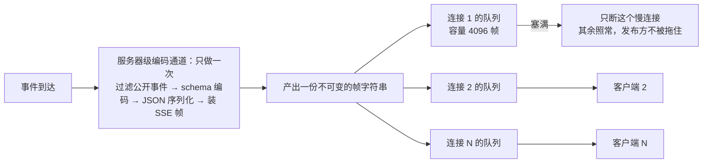

### 追踪：一次请求一条 trace，一个回合一条 trace

事件之外的另一路观测是分布式追踪（trace，把一次工作经过的每一步记成有层级关系的 span，串成一条可以整体回看的轨迹）。开关是环境变量 `OTEL_EXPORTER_OTLP_ENDPOINT`（OTLP 是 OpenTelemetry 的导出协议）：不设就没有追踪层、零开销（`packages/util/src/observability/otlp.ts:74-75`）；设了之后 span 经 OTLP/HTTP 发往该端点的 `/v1/traces`（`:93-101`），日志也可以发往 `/v1/logs`（`:67`）。

根 trace 有两类，划分的依据是"谁该为一段耗时负责"。每条 HTTP 请求一条：进程启动的上下文与路由构建都特意摘掉父 span（span 即追踪里的一段耗时区间，trace 由多段 span 串成；`withoutParentSpan`，`packages/server/src/process.ts`、`fetch.ts:43-46`）——否则每个请求、每个会话回合都会挂在启动那一条 trace 下面，整个进程的一生挤成一根不可读的长条。每个会话回合一条：回合的执行循环（drain，把会话待处理输入取出来跑的那个循环）自带根 span，不管唤醒它的是哪个 fiber（`packages/core/src/session/runner/llm.ts:63-64`），span 上带会话 ID（`llm.ts:438`）。属性沿用生成式 AI 的语义约定（gen_ai.* 前缀）：LLM 步记提供方与模型（`step.ts:78-79`），结束时记完成原因、输入输出与缓存读取的 token 数、首字耗时（`step.ts:184-191`）；工具 span 记工具名、调用 ID 与会话 ID（`packages/core/src/tool.ts`）。同一次提交还做了一遍降噪，删掉 LLM 事件转发包装这类纯噪声 span（`session/runner/publish-llm-event.ts`）。有了每回合一条的 trace，"这一个回合慢在哪"从推断变成了翻记录。trace 的覆盖面随后补了两块（提交 cb79aef052）：LLM 步把重试轮次写进 span 属性 `opencode.retry.attempt`（`packages/core/src/session/runner/step.ts:82`），步结束补记缓存写入 token 与步骤成本 `opencode.usage.cost_usd`（`step.ts:196`、`:264`）——一次失败之后重试了几次、每步花了多少钱，翻记录就能看到。shell、工具与模型流的 span 也带上了会话、agent 与命令标签（提交 adb0053d09），一条 trace 里的每段 span 都能按会话或命令归组。

存储与协议正确性这一轮五笔。助手消息更新避开 SQLite 的 `->` 运算符、改用 `json_extract`，兼容 macOS 12 自带的 3.37（提交 811cdb8c27，`packages/core/src/session/projector.ts:678`、`:693`），并在 `packages/core/AGENTS.md` 里记下 SQLite 版本下限。压缩保留尾部的额度改成每条消息加一再加总，允许从任意消息开始、不再强制限定到 user 消息边界（提交 ad8858de43，`packages/core/src/session/compaction.ts:1031`）。goal 提醒改插在索引 1、即压缩摘要之后，不再放在尾部——此前每一步都把它往尾部推一次，等于每一步都移动缓存断点（提交 9ae270fe29）。媒体 blob 统一保留 7 天、每小时清理一次（提交 8c0be712aa，`packages/core/src/blob-store.ts:28`、`:92`）。异步迭代器先检查取消再取队列，源已完成时取消也能生效（提交 b8cbd0e43c，`packages/client/src/shared-events.ts:136`）。

### 存储：SQLite 与媒体去重

**存储**统一为 SQLite（`core/database/`，用 drizzle 做类型安全的查询），打开时设置 WAL 模式（一种让读写并发更好的 SQLite 配置）、忙等待超时、外键约束，再执行版本化迁移；数据库路径按安装渠道（stable/beta/dev）隔离，避免不同版本的库互相污染。旧版存储（"一个对象一个 JSON 文件"，`storage/storage.ts`）已在 v2 合流中移除。中断与写入的相互作用修过一个死锁（提交 c6056f3931）：SQLite 连接由一把单许可信号量守着，此前"取得许可"与"登记释放"分两步走，两步之间被中断会泄漏许可、后续所有写入排队卡死；Effect 升到 4.1.0 后用 `takeScoped` 把两步合成不可中断的一步（`packages/core/src/database/sqlite.workerd.ts:181-182`）。打开数据库时的 WAL 检查点（checkpoint，把预写日志合并回主库文件的操作）也去掉了（提交 fc30827099）——打开应当只打开，代价高昂的合并留在它本来发生的地方。

会话里的媒体（图片、音频这类附件）有了专门的去重存储：内容按哈希寻址进一张 blob 表，消息里只放 `media:<hash>` 引用——同一张图被引用多少次都只存一份（`packages/core/src/session/blob.ts`，提交 70c69f06f9）；写入走 `experimental.media_blob` 开关、默认关闭（提交 e12fad949b）。blob 存储留下一道后续问题：消息里只有 `media:` 引用，字节在服务器上，客户端得有地方取。实验端点 `GET /api/experimental/media/:hash` 补上了这一步（提交 e928d4ffa1），配 opt-in 的 `experimental-media-uri` 能力——客户端声明这个能力后，会话消息里的文件保持 `media:` 引用、按哈希取回字节；客户端拿到的引用还可以作为附件送回（`packages/core/src/session/prompt.ts:165`）。不开能力、或会话位置没开 `media_blob` 时照旧内联。同一次清理还删掉了从未启用的 `session_pending` 表，并把历史压缩的边界固定下来（提交 44fc9d2a65）。

**会话历史有了全文索引**（提交 b8fe9ac67f）。索引由 SQLite 触发器维护：`session_search_source` 视图集中定义"哪些消息类型的哪些文本进入索引"，写入源表时触发器重新索引，不需要任何进程跟随——提取规则只存在一处，任何进程写入都不会漏索引（`packages/core/src/session/search-index.ts:22`、`:27`）。`compact` 布局用 contentless FTS5 按 rowid 删除（需要 SQLite 3.43 及以上），更老的 SQLite（例如 macOS 13 自带版本）退回 `text` 布局、把索引文本另存一份，体积约为三倍；单列最多索引 64 KB。首次构建分块进行，每块之间暂停 5 毫秒，遇 busy 重试，游标持久化，失败的行单独重试、最多连续三次后判定为数据库问题（`search-build.ts:22`）。索引之上是查询层与两个工具（提交 8e1c6a43a2）：`opencode.session.search` 按词命中数与稀有度排序，支持短语、前缀与 AND/OR/NOT，每个会话最多返回 3 段、每段前后各 120 字符；`opencode.session.read` 以 messageID 为锚点向两侧或单侧分页，`full` 才展开工具输入输出与系统消息（`packages/core/src/tool/plugin/session-search.ts:14`）。`sqlite_fts` 随后从"仅显式开启"名单移出，`local` 与 `dev` 渠道默认开启，release 渠道仍默认关闭（提交 09bfa6041d）；`experimental.part_rows` 的默认值从 false 改为 true，助手每个部件单独写一行，整消息重写路径保留为退出开关、读取路径同时兼容两种布局（提交 c0aeddbef0）。代价是首次建库要扫描全部历史、旧 SQLite 需要三倍空间，索引版本升级时整体重建。

### 部件表：session_part

消息的存储结构也拆出了一层。此前部件埋在消息的 JSON 大字段里，"清空某个旧工具的输出"这种部件级操作，得把整条消息的大 JSON 读出来、改一个字段、再写回去。部件不再埋在大字段里，而是各占一行进独立的 `session_part` 表（提交 c1b5f1b416，迁移 `20261029002625_session_part`，主键是消息 ID 加序号，另带会话 ID、类型、工具调用 ID）。写历史时投影器把每个部件写成一行，读历史时按序号装回各条消息的 `content`；没有部件的旧行保留内联内容原样可读，老数据不用迁移（`packages/core/src/session/history.ts:94-95` 的注释）。压缩"清空某个旧工具输出"这类部件级操作，动的从此是表里的一行，而不是整条消息的大 JSON。分叉会话走了另一头：复制父会话消息时把表里的部件读出来、内联进分叉自己的消息 JSON，读起来与父会话一致（`packages/core/src/session/projector.ts:194` 的注释）——分叉是复制不是引用，不共享父会话的部件表。写入路径最近又优化了一层（提交 6000b7c51b）：此前每个部件事件都要把整条消息重写一遍，现在助手部件各写自己的行（实验开关 `experimental.part_rows`，默认关）——部件级更新只动一行，高频流式输出不再反复重写消息行。写入、读取、分叉三条路径合起来看：

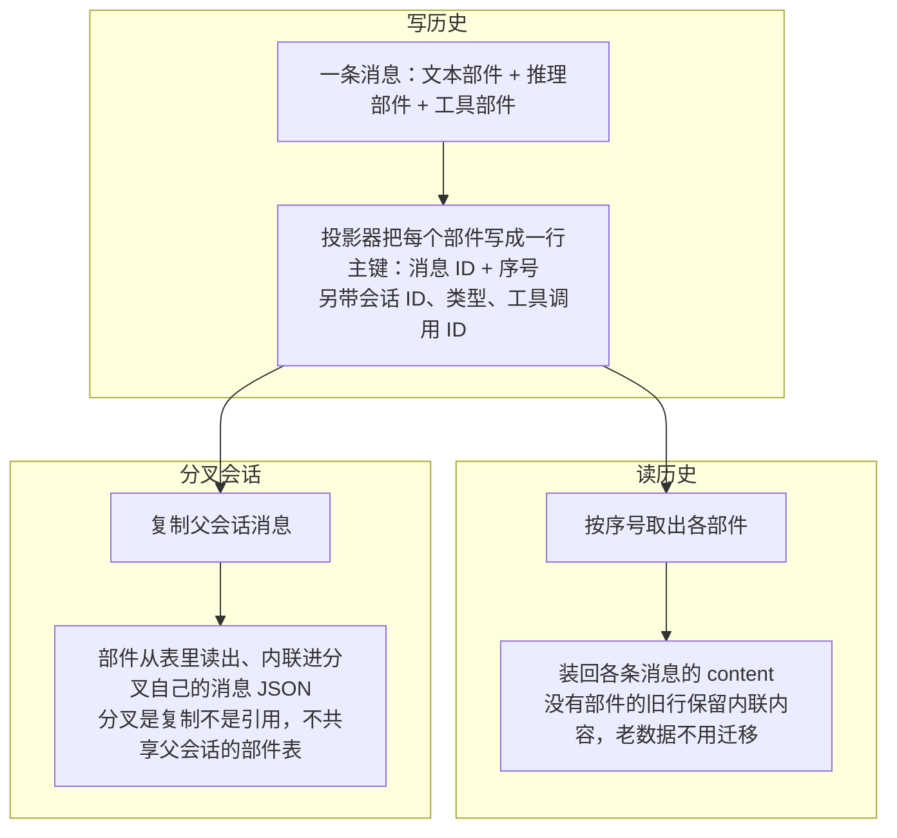

### 定时任务：时间也是事件源

时间也成了一种会触发会话的事件源（实验性，`experimental.automations` 开关，提交 4585c316c3 引入，62d06fab22 重写为 automations 并沿用至今）。它解决的问题：有些活不需要人盯着——"半小时后提醒我看看测试结束没有"、"每天早上构建一遍"，这些都应该由系统到点自己发起。`packages/core/src/automation.ts` 把自动化存进 SQLite 表（迁移 `20261116043204_automation`）：一条自动化指定何时（`trigger`：`at` 某个时刻或一段时长后、只跑一次；`every` 固定间隔；`cron` 表达式；或 `event`——已连接的 MCP 服务器声明推送投递时按服务器与事件名订阅，需要 `mcp_events` 开着；计时类都可带 IANA 时区，`packages/schema/src/automation.ts:37-56`）、做什么（`action` 二选一：`prompt` 一段提示词，或 `code` 一段无模型的代码）、投给哪个会话，可选 `expires` 到点停与每次运行收到的 `args`。

到点触发就是向目标会话以 `steer` 投递方式发一条提示（`automation.ts:484-485`）：消息 ID 由自动化 ID 与第几次运行推出（`msg_<自动化ID>_<次数>`，`:449`），崩溃后重试与此前的受理对得上、不会重复投递；晚于到期 60 秒以上的触发标记为 late（`:123` 的 `LATE_AFTER`）。`prompt` 动作的目标可以选：默认发给创建它的会话，`to: { session: "ses_..." }` 发给另一个既有会话，`to: { subagent: "<agent>" }` 每次运行派一个子会话去执行、结束不回报父会话（子会话 ID 以 `ses_aut_` 开头，`automation.ts:82`）。周期任务错过的时间槽不补发——`every` 与 `cron` 保持相位、跳过所有错过的槽（`:183`、`:189` 的注释），提示词失败的任务 5 分钟后再试（`:133` 的 `FAILED_RETRY`）。`event` 触发器的订阅在中断后从保存的 cursor 请求重放；出现缺口、重连后没有重放 cursor、载荷不合事件类型声明或移交被拒，自动化就暂停——投递不保证恰好一次，早前运行的工具副作用不回滚。

这个功能仍标着实验性：flag 注册表键 `automations`（旧配置里的 `schedules` 经别名表仍可读，`packages/schema/src/config/flag.ts` 的 `aliases`），默认值随渠道——本地与 dev 构建默认开，release 构建默认关。所在位置没开开关的自动化到点不运行，标成 disabled、一小时后再看（`:131` 的 `DISABLED_RETRY`）——为什么隔这么久，注释交代了原因：读开关本身会唤醒自动化所在的项目位置，每个周期都查就等于逼着所有位置常驻；行里的到期时间原样保留，开关重新打开后按错过的时间槽追上（`:579` 的注释）。

全部状态在表里，触发循环就不必绑在某个特殊进程上：每个 server 进程都跑一份调度器（`opencode serve`、`--standalone`、被嵌入的服务皆然，`packages/server/src/process.ts:118-119`），至少每 30 秒重读一次表（`:128` 的 `MAX_SLEEP`），时钟跳变与丢失的唤醒都能被追上；共享同一数据库的进程靠 SQLite 租约选主，至多一个活跃的 leader（`:127` 的 `LEADER_KEY`），租约 60 秒过期（`LEADER_TTL` 定为两个 `MAX_SLEEP`），每轮运行前先按次认领——租约可能在一次检查与一次运行之间换手，认领发生在运行前而不是 tick 开始时（`:565-567` 的注释）。

自动化的事件 watch 随后补了四处。单个超大事件不再把 watch 置成暂停，而是记 `last_outcome: "skipped"`、推进游标、清空重试时间（提交 562e55a048）：原来 16 KiB 的检查从事件解析处移到提示词渲染处、统一按 32 KiB 上限处理。目录关掉自动化当作暂停计时器处理（提交 735f272bc6）：停止 watch 时写入"一小时后重试"、清空游标，定时核对只拾取到期的行，并额外检查已打开的 watch 是否遇到目录开关变化；重新打开时从当前时刻继续，关闭期间的事件不补跑。插件可以创建、列出、删除自动化（提交 26f4041911）：可见性判定从服务端处理器下沉到自动化服务，目录关闭返回禁用错误，目录已删除仍可见以便删除，创建附带"无人值守"权限标注。自动化里跑的 shell 命令超时后直接终止而不是转后台（提交 e1fb08afc5）：工具上下文新增 automation 标记，"超时转后台"只在前台且非自动化时为真，自动化分支停掉命令并返回工具失败，不创建后台任务。

自动化随后长出第二种动作（提交 b7f0b90dc0）：`type: "shell"` 在创建时用与 shell 工具相同的权限构造（`ShellPermissions.requests`）逐条询问一次，不保存规则；运行时不再复检权限，并强制把 command、cwd、shell 覆盖回存储值，`timeout = 0`（`packages/core/src/automation/shell.ts:16`、`:60`）。设计动机很直接：无人值守触发时没有人可以回答权限问题，所以把授权前移到创建时刻；代价是创建后不能改命令，只能暂停或删除，运行期也没有二次拦截。管理工具收进 `automation` 命名空间（`automation.create/list/pause/resume/delete`，提交 2002222d13），Code Mode 里的调用路径随之变化。"授权会话已移动"的检查换成目标目录存在性检查（提交 0f0d168877）：目录不存在时暂停自动化并说明原因，同时去掉 `late` 结果，Automation Code Mode 的禁用工具清单缩小、放开 rename 与 worktree 操作。

`code` 动作的静态扫描器升级为 `scanProgram`（提交 1f926188ac）：除了静态 `tools.x.y()` 调用，还记录对 `fetch`、`Bun` 等全局的引用、成员使用与字面量模块加载，并能区分局部变量遮蔽（`packages/codemode/src/codemode/scan.ts:27`）。自动化在创建时据此解析出真实权限动作（`read`、`edit`、`webfetch` 等），一次性授权，运行时给脚本完整的会话工具集；20 次调用的上限移除，保留 30 秒与 32 KB 输出限制。脚本扫描结果按源码文本缓存 16 条，避免每次运行重扫；扫描器必须跟上语言边界的语法变化，任何静态分析看不到的动态访问都会在创建时被拒绝。开关也从 `experimental.automations` 与 `experimental.schedules` 迁到顶层配置 `automations`（默认开启），旧键经配置归一化诊断标记为 removed 并升级为警告（提交 cb82da7cde）。过期的自动化（停机、重试错过的时间槽）不再运行（`:567`）。一次性的 `at` 执行完毕即终态。

到点不一定要唤醒会话。重写前的 `if`/`until` 条件（shell 或 code 检查）收敛成了动作本身的一种：`code` 动作在受限的 Code Mode 运行时里跑一段 JavaScript——不调模型、没有网络，`tools.<路径>(...)` 形式的工具调用由静态扫描从语法树里提取（`packages/codemode/src/codemode/scan.ts`），上限 30 秒、20 次工具调用、32KB 输出（`packages/core/src/automation/code.ts:18-22`）。程序拿到 `input = { state, now, runs, args }`（`state` 上次运行留下的状态，初始 null；`event` 触发器另有 `input.event = { id, timestamp, data }`，data 按事件类型声明的 payloadSchema 校验），返回任意组合：`state`（下次运行的 JSON 状态）、`done: true`（停止）、至多一条 `send`（`send.prompt` 以 steer 投给会话，可带 `to` 派子会话）；省略 `send` 就是安静检查，被拒的 send 不提交 state 与 done（`packages/schema/src/automation.ts:169` 的说明）。

code 动作是无人值守跑的，围栏因此格外紧，有两条值得记：一批工具在代码里直接禁止（`packages/core/src/automation/code.ts:38-51` 的 `FORBIDDEN_TOOLS`）——shell（批准它等于批准任何命令）、automation 的四个管理工具（检查不能自己再造或改动自动化）、改会话与动 worktree 的工具；建任务时逐个授权，授权不保存——"总是允许"会存成项目级放行，而无人值守的运行一次点击换不来永久通行（`packages/core/src/automation/code.ts:117` 的注释）。失败处理分层：提示词失败 5 分钟后重试；代码失败 1 分钟后重试、连续 3 次失败暂停（`packages/core/src/automation/code.ts` 的 `CODE_FAILED_RETRY` 与 `MAX_CODE_FAILURES`，`automation.ts:134-135`）；节奏底线是 `prompt` 动作最短间隔 1 分钟、`code` 动作 15 秒（`packages/core/src/automation.ts:122-123`）。重复自动化可以带 `expires`（一个时刻、挂钟时间或"8 小时后"这类写法）到点自动停。管理面是五个工具——`automation_create`、`automation_list`、`automation_pause`、`automation_resume`、`automation_delete`（`packages/core/src/plugin/command/automation.txt`），取代重写前的 schedule 工具与 `/schedule` 命令；`automation_list` 显示名字、触发器、状态与下次触发时间。一个自动化从建到停的完整生命周期是：

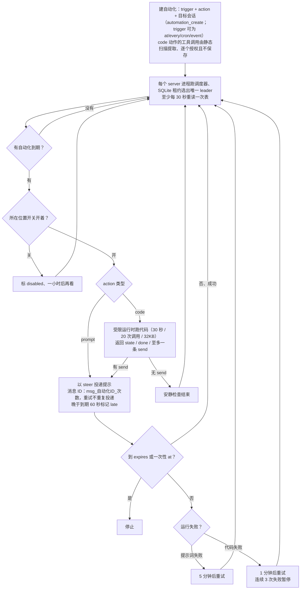

## 本地服务与多端接入

OpenCode 的核心逻辑跑在一个本地 HTTP 服务里（`server/server.ts`）：默认端口 4096，被占用就自动回退到随机端口；接口用 Effect 的 HttpApi 定义，能自动生成 OpenAPI 文档（一份机器可读的接口说明书）；配 WebSocket（长连接推送事件）和 mDNS（局域网服务发现，可选）。HTTP 接口的一个时序坑也补上了（提交 75dbf5b8bc）：`GET /api/skill` 处理器先等插件激活完成再列技能（`packages/server/src/handlers/skill.ts:10`；等待上限 5 秒、超时返回 503，`packages/server/src/location.ts:36-47`）——启动早期来取技能清单的客户端不再拿到一张空表。处理器内部的缺陷（defect，程序运行中的意外失败）也有了下限（提交 0fad04b3d5）：Effect 对没有对应响应的失败回答一个空的 500，客户端只知道出错了、不知道为什么；新中间件只替换这种空响应的正文——能归类的存储故障给人话，按 SQLite 结果码翻译成"存储被另一个进程占用""存储已满""存储已损坏"这类不提数据库引擎名的提示（`packages/core/src/database/storage-failure.ts`），其余缺陷给一个 `err_xxxxxxxx` 引用、拿它去服务器日志里找完整现场（`packages/server/src/middleware/defect-response.ts`）。配套一处事务回滚的归因修正：存储已满、读写错误这类错误之后 SQLite 往往已经自己回滚了整个事务，处理器随后补做的 rollback 无事可做、自己也会失败——此时上报事务体原本的错误，不报 rollback 的错误（`packages/core/src/database/drizzle/effect-sqlite/session.ts`）。

这个服务就是"总插座"。终端界面、桌面应用、网页版都是它的客户端，第三方开发者用 `sdk`/`client` 包（由 protocol 自动生成，改了协议跑一遍生成命令即可）也能接。插件拿到的 `client` 同样指向这个服务，也就是插件和界面站在同一个接入面上，能力对等。这个"核心服务化、界面皆客户端"的结构，是多端一致的关键。桌面端有**设备配对**：两台设备经远程访问配对后互相可见，iOS 上发起的语音委托会以 Voice 消息的形态出现在会话里（提交 165cd2e832 与 PR 54426）。

`opencode run` 的非交互路径整体重写过（提交 a950fa2741）：旧的 V1 桥接层删除，非交互处理直连 client 事件流；随 run 启动的服务器私有于本次运行、MCP 输入请求归属本 run（`packages/cli/src/run/noninteractive.ts:24-42`）；非交互环境无法提问或请求权限时，改为自动取消并把原因注入给模型让其继续（`:55-58` 的两条反馈文案），SIGINT/SIGTERM 经 AbortSignal 级联取消会话与后台任务。

### 终端守护进程：process-daemon

终端进程另有一套专门的守护进程服务（`packages/process-daemon`，原独立的 opencode-pty 仓库并入 monorepo，提交 76e1f5b0cc、f4ecbf31f3）。它解决的问题是：终端子进程（PTY，伪终端，让程序以为自己跑在真实终端里）生命周期长、状态复杂，放在界面进程里跟着界面一起死不合适——界面关了再开，终端里跑着的构建不能也跟着没。所以由一个独立守护进程持有终端子进程并维护权威的终端状态，每个终端有独立的阻塞 I/O 与 actor 线程——一个终端卡住不拖累服务和其他终端。

接入走一条私有的本地字节流（Unix socket 或 Windows 命名管道）加一份原子注册文件：socket 落在仅属主可进的私有目录，默认在 /tmp 下、可用 `OPENCODE_PTY_SOCKET_DIR` 挪走；清扫其他实例遗留的 socket 时，优先按对方注册文件里登记的路径找，且只删属于当前用户的（提交 5f394f64fc）。订阅一个终端的输出流改为阻塞等待事件，不再每 100 毫秒醒来轮询一次；守护进程被要求关停时，阻塞中的空闲订阅仍会被唤醒并正常关流（提交 f5cac1277c）。主循环也不再空转：Unix 上守护进程在监听 socket 与一对私有唤醒 socket 上 `poll(2)` 睡眠，直到有连接到达、停止或所有权变更把它叫醒、所有权到期、或两秒的安全网到时；Windows 仍按固定间隔轮询，每 25 毫秒一次（`packages/process-daemon/README.md:70-71`、`src/transport/windows.rs:42`，提交 0610a81fc3、86ce19d96e）。停止与所有权的变更统一经 Control 通道走（提交 f0160a1262），所有权状态区分"已拥有"与"等待中"两相、共用代数与截止时间（`src/ownership.rs`）。

守护进程如今也接得住**不需要终端的进程**：创建请求带 `mode` 字段（`packages/process-daemon/src/service.rs:43` 的 `ProcessMode`，默认 pty），选 `pipe` 时子进程以独立进程组运行、stdin 直接关闭、stdout 与 stderr 合并进同一根管道保住输出顺序，只支持输出、重放、订阅与终止（提交 394d49d487，PR 60697）。没有 PTY 可依赖，安全性靠三条设计（`packages/process-daemon/src/service/pipe.rs:1-15`）：等待者用 `WNOWAIT` 观察退出、让子进程保持僵尸直到关停——僵尸在，PID 与进程组 ID 就不会被复用，之后清理进程组永远不会误杀无关进程（`pipe.rs:293-299`）；子进程退出后读侧只再读一秒（`DRAIN_AFTER_EXIT`，`pipe.rs:37`）就停，不等于可能永不到来的 EOF——`cmd &` 或构建服务器留下的后代还握着管道时不会被挂死；读侧同时轮询一根取消管道，关停不会等一个离开进程组的后代仍持有的管道。配套 SIGTERM/SIGINT 下干净停止（提交 805a42ffaa，PR 60691）。Windows 上的 pipe 进程改为先以挂起状态创建、加入作业对象（job object，Windows 把一组进程当整体管理的机制）后再恢复运行（提交 773b9d0ec2）——外部作业对象拒绝接收时，不再留下作业管不到的后代进程。协议升到 v8（提交 9b86075195，发布 0.5.0）后 pipe 进程成为一等公民：PTY 与 pipe 统一用一份 `ProcessInfo` 描述（模式、pid、工作目录、组 ID、输出偏移），新增按模式过滤的 `list`、按 ID 的 `get` 与 `create_pipe` 端点（`packages/process-daemon/SPEC.md:109`、`:125`、`:135`）；pipe 的输出唯一副本是磁盘上的一个文件——打开前校验、拒绝符号链接；写文件失败置 `pipe.output_error` 而进程不中断；子进程环境严格等于传入的 env，不继承守护进程环境、不附加 TERM。

终端从属于会话，生命周期跟着会话走：创建持久终端必须给一个真实存在的目录——PTY 库原本会在目录无效时悄悄退回用户主目录，现在直接报错（`packages/core/src/persistent-pty/index.ts:184-192`，提交 756f832902）；会话被删除时，它名下的终端一并移除（提交 06bf854d0c）。客户端一侧，持久终端的协议处理抽成了共享实现（`packages/client/src/solid/pty.ts`），TUI 的终端面板等界面共用同一份（提交 067b741783）。终端现在也可以有名字：持久终端支持重命名（`packages/core/src/persistent-pty/index.ts:285-290` 的 `rename`），新标题经协议存到守护进程；对面的守护进程太旧、不支持这项能力时明确报 UnsupportedError，不悄悄忽略（提交 65c0d83f4d）。桌面应用同期把自带终端挪到持久 PTY 上（提交 ef712d3a78），与 TUI 共用同一套实现和生命周期，桌面侧净删约 1600 行。

桌面应用自带一个浏览器面板（提交 cd0d037d68）：Electron 的 `WebContentsView` 承载页面（`packages/gui-plugins/src/browser/chromium.ts:346`），按会话分区，profile 持久化登录态并加载扩展（`packages/gui-plugins/src/browser/profile/index.ts:251`）；自建一套 `chrome.*` 子集给扩展用（action、contextMenus、cookies、notifications、popup、preload、match-pattern），页面内的权限请求、弹窗、HTTP 认证、媒体设备与下载都走统一的提示状态机，artifact 预览走受限的 `file:` 协议，agent 触发的页面操作把标签提到前台并套用激活延迟防护（提示出现后的 500 毫秒内点击会被吞掉）。界限也写明了：`file:` 协议在会话分区内被整体拒绝，页面权限默认拒绝、只有站点授权表里列出的能力才放行。

标签的生命周期随后逐步补齐。本地浏览历史与地址栏补全（提交 bf683129fa）：历史存在应用数据目录的 `node:sqlite`（WAL、`secure_delete`、页数上限、按访问次数与时间淘汰最旧），导入时复制浏览器数据库快照再读，兼容 Chromium（`urls`，以 1601 年为起点的微秒）、Firefox（`places.sqlite`）与 Safari（以 2001 年为起点的秒数），过滤子框架与隐藏记录。标签页保存到会话（提交 2701a89260）：最多 50 个会话、图标小于 6 KB 才保存，应用重开时先按保存内容画出标签与标题，页面自己报告后再替换，加载期间保留占位。新标签插在来源标签之后而非追加到末尾（提交 80d7c17d8e），中键点击在后台新标签打开（提交 5fe4c38b96），标签条显示各站点的 favicon（提交 98b11bc92d）。页面进程结束的原因记进 `page-log.ts`（崩溃、被杀、导航、OOM，提交 2c4352b415），面板关闭时同时记录保留了多少标签，便于区分"用户关的"和"进程没了"。打开失败不再回滚标签（提交 34411562e4）：只要失败不是"页面真的结束"，标签保留并把 tabID 交给 agent 继续 wait/reload/close。标签条坚持保留全部已开标签（提交 1bd37e7903）：新增 `closing` 集合记录"用户已请求关闭但桌面尚未确认"的标签，期间任何清单都不能把它放回；新增 `strip.read` 与清单里的 `stored` 字段，把宿主布局丢失的标签按原位置补回。把登录复制到远端服务器的页面也不再卡住应用（提交 46f56ea2d0）：复制浏览器的登录态到另一台服务器的页面时，读写跨进程完成，界面线程不被拖住。

### 一个被拆掉的能力：会话分享

一个被拆掉的能力：会话分享（把一次会话发布成公开链接）的后端已于 2026-10-15 下线（提交 9e68770074），随后剩余的分享端点与旧的分享存储也删除（提交 50c5fceea1、f2a34141b3），`/share` 命令不再出现在命令文档里。会话数据库里的 `share_url` 列还在（`packages/core/src/session/sql.ts`），只是没有东西再往里写。提交说明没有给出下线理由；从结构上看，公开分享需要一套托管存储和访问控制，是云端面上独立的一块，这是旁观者的推断，不是项目的表态。

## 设计原则

把前面的机制放在一起，能看出几条贯穿的设计判断：

- **核心定接口，边缘可替换**。模型、编辑器、语言理解、外部工具，四个方向各有标准接口（AI SDK 适配器、ACP、LSP、MCP/PluginModule）。OpenCode 自己只做"电网"，发电的活留给标准另一端的专家。
- **安全决策交给规则表，不交给模型**。权限的三值判断（allow/deny/ask）、"后写的规则生效"、命令前缀归约，全是确定性代码。模型可以建议，但不能自己批准自己。
- **分层单向依赖**。Schema 与 Core/Protocol 平级、共同指向 Server 的硬规定，用短期的"改代码要跨几个包"换长期的"内部升级不连累外部"。
- **资源留余量**。上下文永远给输出留 2 万 token；压缩先修剪再摘要、保留最近原文；数据库用 WAL。都是"不把资源用到 100%"的思路。
- **自动化管"跟着外部世界变"的事**。模型清单、快照、统计，全部交给定时任务和缓存策略，人只定规则。

## 可复用的做法

- **修 bug 必配测试**。一个 ACP 修复（恢复会话选项与推理边界）的同一个提交里带了近 300 行新测试，把出问题的场景固定进测试，防止回归。
- **重试三要素**：先分类（瞬时故障才重试，判断标准写成显式的错误码条件）、粒度要小（只重试失败的那一页，不推倒整个流程）、要有上限和退避（次数封顶、间隔递增加抖动）。
- **配置报错的用户体验**：支持注释、报错精确到行列并画出原文、自动补 `$schema` 让编辑器参与校验。工具的体验一半藏在配置体验里。
- **定时任务的克制**：没变化就安静退出、并发排队不互砍、推送前先同步、用独立机器人身份提交。自动化的"署名"要和人分开。
- **加自定义 HTTP 头要成对管理**：往下游请求里加的每个内部标记头，都要想清楚在哪个环节删掉，别把内部信息漏给第三方。
- **把团队规范写给 AI 看**：`AGENTS.md` 同时约束人和 AI（分支命名、提交格式、代码风格、依赖方向），这份文件本身就是可以抄的作业。
- **调试输出也要脱敏**：`debug config` 命令打印配置时按字段名打码——名字命中 api key、secret、password、token 这类模式的值一律换成 `***`，URL 里内嵌的用户名密码或含敏感参数名也一样处理；只动展示用的输出，运行时真实配置保持原样。展示层和配置层分开，调试工具本身不变成泄密渠道。
- **编码一次，独立队列**。事件广播这类一对多场景，把"过滤、编码、装帧"提到服务器级只做一次，每个连接持一个独立的有界队列；谁超限只断谁，生产者永不被慢客户端拖住。配一个基准数字（50 客户端 -97.8%）和一条"宁可全体重连、不留静默缺口"的失败处理，比任何"高性能"宣传都具体。
- **策略文档反向读**。普通配置按"越具体越优先"合并，策略语句却把文档顺序反过来应用（用户全局最后），用读取顺序表达"仓库改不动用户的全局禁令"。优先级不必总是"更具体的赢"，要看谁需要否决谁。
- **把否掉的方案留档**。目录变换的设计记录完整保存了被否方案（插件改全量配置）的流程图和代价分析。评审的价值一半在被否掉的那一半里，留着它能少走回头路。

## 修订记录

- 2026-09-21 初版：基于 dev 分支 commit `17b7678` 完整成文（学习日志自 `193de13` 起跟踪至 `d870e22`）。
- 2026-09-24 基于 commit 82d4c89 补充：`debug config` 输出凭据脱敏（字段名命中敏感模式或 URL 内嵌凭据一律打码，只动展示层不动真实配置）；同期模型目录跟进 GPT-6 Sol/Luna、Grok 4.7 等新模型支持（日常体现，未单列正文）。
- 2026-10-11 基于 commit 7b3d4ce3a7 补充：v2 分支整体合入 dev（5caf1f9f6f "promote v2 to dev"，约 1.9 万条提交、近 8000 个文件），仓库进入 2.0 系列——主包 `opencode` 拆散并入 `core`（现 35 包），依赖规定改为 Schema → Core/Protocol → Server（Protocol 与 Core 平级）；新增 v2 会话契约小节（收件箱准入与 steer/queue 投递、写前执行声明与启动恢复、一步多物理尝试、指令按内容寻址的值增量）；事件流改单次编码加每连接 4096 帧独立队列（50 客户端编码耗时约 -97.8%）；权限体系外新增 `experimental.policies` 策略层（provider.use/tool.use/integration.use，用户全局覆盖仓库、组织托管最终权力）；工具契约重写（output/content/metadata 三值、作用域化注册、注册表统一截断）；插件引入目录变换模型；旧 JSON 文件存储移除、`tool/registry.ts` 等旧路径失效已注明。
- 2026-10-14 基于 commit 46e4695b 补充：回复截断自动续答（输出顶到 token 上限时续发请求接回剩余部分、Gemini 拆段回复续接）；提供方级 compatibility 兼容选项并迁移 setCacheKey，Anthropic 缓存断点可用 compatibility.cacheFormat 配置；应用内 auto-accept 权限改为按项目设置、可覆盖全局默认；server 插件获得 credential.activate 凭据激活入口；发布 v2.0.28，发行渠道新增 WinGet 与 ARM64。
- 2026-10-17 基于 commit 07bbd0fd16 补充：策略配置转正（顶层 policies，experimental.policies 弃用）；插件可发起权限请求（assert，与内置同一通道）；模型推理档位从配置读取；桌面设备配对（远程访问）与 iOS 语音委托以 Voice 消息显示；TUI 新设计实验、diff 侧栏默认打开、/copy 复制最后一条助手消息、逐回合变更文件摘要；发布 v2.0.29 至 v2.0.32。
- 2026-10-20 基于 commit d85746a054 补充：压缩改为总结整个对话（总结请求前缀与普通请求一致以复用 prompt cache）、自动压缩余量提至 15% 且至少 16k token 吸收单步暴涨；图片裁剪决策跨请求保持稳定；已保存权限可编辑；todowrite 以实验开关恢复；会话归档恢复、Windows 持久 PTY、Gemini Live 临时令牌。
- 2026-10-20 结构重组：改为 pi.md 同款的问题主线结构——主轴定为"自己不发电，做电网"（四个标准接口方向）；LSP 与 ACP 归并为"标准协议"一节；"更新记录"更名"修订记录"；正文时间线叙事收敛为现状描述，演进历史归修订记录。
- 2026-10-21 基于 commit 86a0950c61 补充：项目位置按活动卸载（experimental.location_idle_timeout 默认 60 分钟、运行中会话与后台任务保持加载）；Code Mode 自带解释器的 promise 语义修正（每个 job 跑到完成、工具调用仍并发）与运行时跨执行复用；赠送额度错误类型化（provider.free-limit 带 retryAfterMs，TUI 显示重置时间）；models.dev 目录刷新广播到全部实例；提供方 streamUsage 兼容开关与 store 字段按提供方发送；会话分享后端 10-15 下线、本轮删尽端点与旧存储；发布 v2.1.0、v2.1.1（内部重构：provider-context 改名 native、会话旧 schema 分离到 session-legacy，笔记正文未受影响）。
- 2026-10-22 基于 commit f0200df8e6 补充：提供方 baseURL 覆盖目录里全部模型端点（按模型配置仍优先）；OPENCODE_DISABLE_FREE_MODELS 隐藏不收费模型；缓存断点默认放法（工具定义末尾、首尾系统部件、对话尾部，四断点限额，跳过 compaction/effort 部件）与按上游区别对待（网关上游免断点、Gemini 只认最后一个、Qwen 忽略工具断点）；压缩摘要输出上限与正常回合同规则并保底 32000 token；会话标题用 small 模型或更低推理档位；retryAfterMs 对任何带该字段的提供方错误传递；发布 v2.1.2。
- 2026-10-23 基于 commit 6102079a0e 补充：实验性后台压缩摘要（precompute_compaction：用量到上限 85% 且至少 64k token 时后台预总结"最新响应之前的前缀"以命中缓存，自动压缩到点换入现成的，连败 2 次停开）；摘要转录放不下时从最旧轮次逐级缩短、最新轮次只缩短不省略；client MCP（客户端应用自己跑 MCP 服务器、opencode 经入站 WebSocket 连接且传输不外拨、connectClientMcp 助手、TUI open_terminal 实验走此路）。
- 2026-10-24 基于 commit df6fb9a460 补充：ChatGPT 上下文上限拆成独立提供方插件（openai-context-caps：272k 默认、gpt-6.1-sol 500k）；模型目录排除 realtime/embedding/reranking 三类非对话模型；实验开关 precompute_compaction 更名 background_compaction（正文已随改）；会话转录保留逻辑从 TUI 挪到共享 client 层、后台回合重新填充的非保留会话参与驱逐；MCP 服务器关机并行停止、初始对账不再重复启动已启动的服务器。
- 2026-10-25 基于 commit 13a615b902 补充：费用与额度成为一等数据（四协议记录厂商上报费用；Console 接入拉取滚动/周/月三窗口额度表与按模型花费；budget exceeded、usage limit 等错误单独归类；TUI 显示限额与会话零花费时的 Go 额度；额度数据不进消息与会话记录）；GPT-Live 经 Console 连接提供、不需用户自己的 OpenAI key；插件激活前每步与每次工具调用等待激活完成；MCP 单个畸形工具跳过不再拖垮整台服务器；工具 schema 转换与 prompt hook 模型解析各做一次、git 发现按指纹缓存（性能）。
- 2026-10-26 基于 commit 01cd723db9 补充：会话媒体按内容寻址存入 blob 表（media:<hash> 引用去重，写入走 experimental.media_blob 开关默认关闭）；删除从未启用的 session_pending 表并固定历史压缩边界；正文改写一处变动：models-snapshot CI 工作流连同 stats/containers 工作流与 OpenCode GitHub Action 一并移除（5ae201c304），快照成为打进程序的静态文件、源码注释仍指向已不存在的刷新脚本。另记小项：agent 与 provider 列表等待插件就绪（61163cb134）、断线期间错过的运行中会话补注册（f6991636a5）、目录更新仅在内容变化时发布（01cd723db9）、不持久的事件跳过编码（2d91ed57ae）、CLI 关闭带 10 秒期限（b6cbbd7646）。
- 2026-10-26 基于 commit 01cd723db9 补充：一次请求的完整路径节新增端到端流程图（收件箱挂号与投递、步内重试、压缩触发；内容取自正文已有机制，不引入新事实）。
- 2026-10-27 基于 commit 82b572439c 补充：快照养护回归自动化（d5bb993278 发布流水线每次发布抓一次 models.dev 目录打进程序、冒烟校验打包副本可解码且模型数不低于下限——正文改写 2026-10-26 行"没有自动化"的说法），目录可从实验 v2 API 读取（65096cd354，只解码读的字段、坏模型跳过、打包丢弃不读字段）；可配置缓存寿命（cache: { ttl } 自动放置外加 models.dev duration 格式的寿命，Anthropic/Meta 放每个 cache_control 标记、忽略内联标记的协议走请求级选项）；模型清单按类型分层（协议按类型列模型 ae876eec1b、目录提供方 image/decision 入口 b2e4c77621、自定义模型可声明类型 a697f53611）；LLM 流可选原始提供方帧事件（includeRaw: true，93701210bd）；实验媒体端点 GET /api/experimental/media/:hash 与 experimental-media-uri 能力（e928d4ffa1）；实验 Extraction API（Cloudflare Clairic，从文本读类型化值，b21b21babb）；ChatGPT 登录目录加 GPT-6.1 Terra（4e982c0814）。
- 2026-10-27 文体修订：按"段落以问题为单位"的标准改写正文——变更清单式、时间线串联的段落改为问题立意（提交号降为注脚），过长段落按主题拆分；不引入新事实，机制描述与引用保持原状。
- 2026-10-28 基于 commit 14e378b679 补充：Code Mode 调度层重做（解释器与内置对象改纯生成器加单条任务队列、fiber-per-async-call 移除、Effect 限三个文件并用 lint 钉边界）与程序卡死诊断（错误指到永不落定的那个 await）；终端守护进程 opencode-pty 并入 monorepo 为 process-daemon（私有 socket 目录可挪位、清遗留 socket 按注册路径且只删本用户的；订阅改阻塞等事件、不再 100 毫秒轮询）。另记小项：429 限流不再被正文措辞误判为上下文溢出（618b890667）；webfetch 的 URL 规则套到重定向目标上（17837a20d6）；提示词缓存设置不进模型变体（变体设置类型只带 compaction/encoding，24bf4d488a）；移除从未启用的 ManagedPolicy 服务（d78b817631）与 legacy Console 配置路径（5e31344455）；快照兼容 split-index 仓库（1ed00ce62d）、快照捕获合并去重（cdaba26fa5）；应用侧精修群（artifact 预览与文件动作 b3de41a572、模型徽章去掉悬浮详情 2cc6d4f051、工具元数据非对象不崩 3a409f42f5、悬浮提示后位置快捷键仍可用 3f74f03f2e、会话 UI 细节 432d870b02、320445aa09）。
- 2026-10-29 基于 commit 77a0fd6f3b 补充：定时任务（实验性 experimental.schedules，schedule.ts 存 SQLite 表，when 为 in/at/every/cron 带时区，到点以 steer 投递提示、消息 ID 由任务与次数推出、错过的槽不补发、失败 5 分钟重试、只有受管服务进程跑触发循环且至少 30 秒重读一次）；freeform 工具（单一必填字符串参数写成原始文本或按 regex/lark 文法，OpenAI Responses 与 Chat Completions 作 custom tool 发送、无回退）；Code Mode 扩展全局可返回 Effect（before 钩子放行后启动、依赖并入运行时环境）、before 钩子先于宿主调用、search 可 await/链式、解析错误带位置与提示；主请求输出上限留窗口 1% 余量而压缩请求不留；process-daemon 主循环 poll 等待而非轮询、Windows 25 毫秒、停止与所有权经 Control；元信息块"笔记基准"自 82b572439c 补齐到当前基准。另记小项：subagent 工具说明告知可向运行中的 subagent 发后续消息（0e102908e3）；/reload 重载配置（35a4a6876d）；实验性 SDK 方法归到 client.experimental（9a9386edbc）；app 可选 experimental-media-uri 且草稿媒体字节留在本地（f822b107e9）；后台 shell 的输出可从 pill 查看（97fd7acc41）；长用户消息可折叠（实验设置，651032bc27）；迁移的 V1 主题按新设计排布（b7992598be）；ai 包：OpenRouter/DigitalOcean/Venice 的 Responses 路线（dd35fbc2f4）、移除 fal/Black Forest Labs/Replicate/Stability（dfa63293df）、MiniMax 图像生成（7461d15208）、provider model() 设置可选（0416987a6c）、Promise 客户端暴露压缩（ced73dc0f6）、默认请求内联图片字节（506ac20c80）、移除捆绑的 cohere/vercel/perplexity SDK（fc6922f6b8）；process-daemon 发布 0.3.2（4d33928e25）。
- 2026-10-30 基于 commit a070e11643 补充：/goal 目标循环（评审提示词只认对话内证据、不认助手自称完成，判决 done/continue/blocked/paused/wait，最多 50 轮、连续 3 轮无工具调用、等后台 30 分钟三道上限，状态存插件存储分叉不继承、记进程启动 ID 重启后回 paused，写前重读防覆盖用户指令）；内置图像生成工具 experimental_image_generate（后台任务式、有可用图像模型才注册并随目录重评、配置字段降为偏好、说明要求未被要求先询问）；定时任务条件检查（if/until 条件，shell 条件按退出码或输出判定，code 条件在受限 Code Mode 运行时静态扫描工具调用并建任务时授权、授权不保存，排程类工具在检查代码中禁止，检查连续失败暂停、坏检查立即暂停，创建入口扩为 agent 工具、/schedule 命令与实验 API）；shell 命令分析换成手写解析器（tree-sitter WASM 依赖删除，正文陈旧引用 permission/arity.ts 随改 shell/parse.ts），参数中间的文件重定向、PowerShell 方法调用与动态目录变化纳入权限扫描；策略动作从三类拆为七种（新增 integration.connect、integration.use 限定到集成账号，mcp/skill/plugin.use 拆分、旧前缀写法解码时自动转换）；部件存储拆出 session_part 表（读历史按序号装回、旧行内联可读、分叉时内联复制）；持久终端生命周期（cwd 必须真实存在否则报错、会话删除连带移除终端、客户端协议抽共享实现）。另记小项：MCP 工具失败保留权限原因与用户反馈（b653a6260f）；Code Mode execute 进度最多每 100 毫秒一发（b6f82bf15e）；告知 Code Mode 模型内置工具保持在顶层（aaa0d7c8f6）、for...in 遍历继承的可枚举键（ecc075a043）；fork/导入会话的媒体字节也存 blob（510aa79d07）；会话记录最近一次执行开始时间（d500927b9d）；插件服务器事件流跟随端点（5c0376f949）；Codex 登录目录提供 gpt-image-2（d142014e41）；OpenRouter 图像编辑按输入引用发送（27641b362e）、图像尺寸按各家协议期望发送（78c31ea68c）；TUI 存储图像按引用加载（84aed13ac8）；image job 通知带任务 ID（28a3974efc）；发布 v2.2.1、v2.2.2，process-daemon 发布 0.3.3、0.4.0。
- 2026-10-30 结构重构：按特性端到端的标准重写全文——每个机制补问题引子与完整执行路径，新增收件箱与执行声明、目标循环、压缩三级减负、后台预计算摘要、权限询问流程、策略与权限双层把关、模型目录获取、事件流编码分发、部件表读写、定时任务生命周期等十余张 Mermaid 图；机制描述与引用保持原状，不引入新事实。
- 2026-10-31 基于 commit 958f965d35 补充：Claude Agent 提供方（f29e281322，PR 58782：经 Claude Agent SDK 驱动本机 claude、用户自己的 Claude Code 登录、系统提示词沿用 Claude Code 加 opencode 指令叠加、工具以 mcp__opencode__ 前缀 MCP 桥接、每会话长驻进程空闲 5 分钟停、老版本查出即报错）；实验 artifacts 工具组（8f0fc21e71，PR 60351：标题加文件映射加入口文件的工件，create/read/update/delete 四工具，提供方接口四个操作各是一个 Effect、内置 local 可插拔）；定时任务触发循环改为每个 server 进程都跑加 KV 租约选主（60 秒过期、20 秒续期，正文随改"受管服务进程"旧表述与三处漂移行号），experimental.schedules 默认改回关（da87c475a7，关着位置的任务标 disabled 一小时后再看、到期时间保留）；压缩提示词上限取输入窗口与上下文窗口较小者（cb1e58fe44）、compaction.buffer 接受百分比写法（6700dd87b5）；思考块重放不再降级成正文（822594b9ae，PR 60498：要求签名的丢弃、qwen/minimax 按原样发、Gemini 固定标记顶替、Mistral prefix 标末条）；后台任务恢复标记从 KV 搬进专用 job 表（664c8f0990，迁移 20261030054400_job）；Code Mode 的 fetch 过 webfetch 同一套权限（bdca40ac0e）；持久终端可重命名（65c0d83f4d）、桌面终端迁移持久 PTY（ef712d3a78，桌面侧净删约 1600 行）；stdio MCP 自行分帧、单条 16 MiB 上限（1a443ae42a）。另记小项：bash 工具名别名到 shell（ea982d7d8f）；ai 对象统一 Promise 与 Effect 两个入口（f0944f027b）；本地配置可覆盖 Console 下发的提供方（5759491ca0）；AI 错误保留 partial 输出（2d96b0f69f）；插件提供的模型变体得以保留（8f11d59d4c）；loopback 请求不走环境代理（78dda62d88）；发布 v2.2.3、v2.2.4。
- 2026-11-01 基于 commit cec637385c 补充：追踪可观测性（OTEL_EXPORTER_OTLP_ENDPOINT 打开后经 OTLP/HTTP 导出 /v1/traces 与 /v1/logs，每条 HTTP 请求与每个会话回合各有一条根 trace——启动上下文摘掉父 span、回合 drain 自带根 span 并带会话 ID，LLM 步与工具 span 带 gen_ai.* 属性，顺带删噪声 span；事件与存储节新增"追踪"小节）；会话保活 warming 插件（默认关，interval 可设 auto 按模型 cache.ttl 的九成定时发保活请求、无 ttl 不预热，保活请求不准入不写历史不派工具）；MCP 工具校验整段重做（打补丁关掉 SDK 的清单校验、自检四条后拷贝成自己的 Tool 形状、顶层 inputSchema 补 type、清单绕 SDK 缓存、SEP-2243 的 -32020 重列重试一次；修正 10-30 的"MCP SDK 自己都会拒绝"表述与失效引用）；MCP 启动宽限 2 秒（awaitStartup 并发等仍在连接的服务器、McpTool.flush 每次模型请求前追平注册表）；修正 import 映射表表述（实为 #sqlite 而非 #db，workerd/bun/node 三条件；Bun 与 Node 用 Effect 官方 SQLite 客户端套 Layer.orDie）；修正"19 个 @ai-sdk/* 适配器"表述（核心只依赖 3 个 @ai-sdk 包，会话调用走自研 @opencode/ai LLMClient，main 主轴与模型接入两处）；freeform 的 README 引用行号随上游漂移修正（84-103 → 89-109）；指令纯重排静默更新（同组同内容只顺序变时 changed 可不产出文本、提交照发增量不带正文、不再以缺陷失败）；位置活动把开着的 PTY 与客户端 MCP WebSocket 计入、位置关停 socket 以 1012 关闭；Effect 4.1.0 升级修 SQLite 中断死锁（takeScoped 一步完成）；ai 包群（Azure Messages for Foundry Claude 走 x-api-key、apiKey:false 免密钥提供方、结构化输出进 generate/stream/loop、截断先报 token limit、Gemini MALFORMED_FUNCTION_CALL 归可恢复 incomplete-stream、每协议命名方法）。另记小项：synthetic/compact 端点不再拉起会话位置（1d479d7642）；CLI 支持带可选值的 flag（173f6c6dce）；VS Code 改发 V2 mention 语法（500b101e66）；provider 发现共享缓存（a66964ee9f）；已删除的项目目录不再保存或解除归档（dc4775a64d）；可选监视目录缺失不再刷错误日志（ed892fbd37）；写文件避免冗余读与错误 span（a1b616b3b9）；模型目录获取 span 不因 304 命中失败（d50d485842）；节流的项目活动更新跳过后台任务与 span（df832cb2ca）；JSON Schema codec 缓存改 WeakMap（c22c270121）；发布 v2.2.5（4878a0e30f）。
- 2026-11-02 基于 commit 8bca532929 补充：Console 工作区 Library 把指令与技能经目录变换下发到本地（指令整包、技能只到版本清单并后台并发 8 下载、失败逐个跳过、组织 integration.use: deny 连 Library 一起扣下，288fa12843，PR 60401）；技能支持内存中的 skill:// URI（内存文件表替代磁盘扫描、内置技能假路径换真 URI、read 工具先过 skill 权限再按归一化 URI 过 read 权限，69269e4ebe，PR 60921）；AIError 的 status/code/isRetryable/retryAfterMs 四个 getter 与 providerCodes 厂商错误码提取（97a71f0cc6，PR 60808）；warming 保活可按提供方或模型的 cache.warming 覆盖顶层设置、无效设置退回顶层、提示词只在顶层（296074aab2，PR 60025）；ai 包流事件修正（provider-error/tool-error 事件删除改走失败通道与错误形态 tool-result、finish 带末条消息与累加 usage、新增 ai.collect，core 步溢出改判流失败原因，01276f9061，PR 60812）与工具循环拆成 loop.ts 纯函数并由测试固定步语义（length 截断不续跑、answerTool 即步终、providerExecuted 跳过、非法 JSON 以空对象重放、toolChoice 只作用首步，f4ec1532f0，PR 61005）；ai.request 返回纯对象（a24a239456，PR 60968）；溢出触发的压缩第一轮即折成文本、不再原样重发被拒对话（6597f6cd6c，PR 61015）；Claude Agent 关掉非流式与 refusal 两个 fallback（5e066ac922、4f3156ab3c，PR 61067、PR 61069）并把 rate_limit_event 的套餐用量带进步的 providerMetadata（c8a473bead，PR 60879）；行号随上游漂移批量修正（provider-error.ts、ai README freeform、cache-policy.ts、step.ts 三处、compaction.ts 七处、prompt.ts、warming 五处）。另记小项：npm 方式升级加 --allow-scripts 让 postinstall 照跑（8c750e3750，PR 51554）；app 输入框空回车不再打断会话（84f66054b4，PR 60977）；"OpenCode Zen" 文案更名 "OpenCode Models"（2347bc87fa）；旧站点页面 302 到 Console、robots.txt 列 sitemap 等站点改动不涉正文（8bca532929、e99d66515d）。
- 2026-11-03 基于 commit 1bf08ae46a 补充：process-daemon 无 PTY 模式（mode: pipe 独立进程组、stdin 关闭、stdout/stderr 合一根管道保序、只支持输出/重放/订阅/终止，WNOWAIT 留僵尸防 PID 复用误杀、退出后只再读一秒不等于后代 EOF、同轮询取消管道，394d49d487、805a42ffaa，正文终端守护进程小节扩一段）；Code Mode 按 Node 模块名导入宿主全局（node: 前缀等价裸名、fs/promises/url/util/buffer 别名、默认导入绑模块本身、函数对象的可达函数全是入口，adcfc83d19）；webfetch 权限两处做实——规则对规范化 URL 匹配（HTTPS://EVIL.COM 命中小写规则、无效 URL 直接报错 805a4b8200）、重定向逐跳过 deny 规则带 redirectedFrom（b5b9bddb54），正文 Code Mode 节融入。另记小项：opencode run --archived（d074773174）；MCP server 无效 URL 标记为失败（0d73f08f28）；Cohere 流提前结束重试（3f3ee9e5f0）；Console 技能下载复用、失败保留已有技能（21e66f21c7）；未知事件警告记真实插件 ID（94f3386a90）；新步开始跳过解码已完成助手（260a87d957）；ai 响应 fold 内部化、不再每块拷贝事件（056d5f0343）；大量删除重复代码的 refactor 未逐一列出。
- 2026-11-04 基于 commit 69ef55f02b 补充：ai 包消息模型按角色拆成 System/User/Assistant/Tool 四类、各角色内容部件集合收窄（0988cb8366、e387bde030，PR 61195、PR 61196）；headers/fetch/超时统一为 TransportOptions 一层、路由默认值继承之（8b038f672b，PR 60970）；文件输入接受 bytes/URL/data URL/base64 字符串并按 magic bytes 嗅探媒体类型（c3c5531679，PR 60963）；Gemini 工具调用 prompt token 计入计费输入、续传段不重复累加（d1dec5a576，PR 61484）；实验性 job 列表端点带状态与恢复方式（bde737f4d5，PR 60698）与未完成助手消息的 stale 工具调用检测不再载全会话（5c4983d5e2，PR 61421）。另记小项：Console 配置与技能抓取跨项目共享（ccbcd96082）；stats 同步迁上 Cloudflare Workflows（156bb61010）；GUI 插件可加色彩主题、面板可调侧栏尺寸（4dd7b2662c、69ef55f02b）；TUI 可设发送后保持滚动位置（bea50be4b6）；问题到达时已打开的对话框保持焦点（1e322a3a01）。
- 2026-11-05 基于 commit c777f9a24e 补充（104 个非 merge 提交，大量为界面状态机化重构）：后台压缩改固定提前量触发（PRECOMPUTE_LEAD 60k token 且不超压缩周期一半、缓存寿命剩至少 30 秒才启动、换入尾部至多 budget 40%，a0c6df8fde，正文背景压缩段改写）；部件行存储写路径优化（assistant part 各写一行、事件级更新不再重写整条消息、experimental.part_rows 默认关，6000b7c51b，正文部件表段补一句）；可移植生成参数扁平化（八参数置顶、GENERATION_KEYS 拆分 provider 专属选项，9a3f03e5c5，正文 ai 包段补一句）；MCP 连接跨位置共享（experimental pool: true）、stdio 服务器无视版本探测回退 legacy、调用方中断时连接流程走完收尾（33d52e6011、64ca766ff7、88cc1e71af，正文 MCP 段补两句）。另记小项：语音通话与窗口插件激活收敛为单一状态机（71f1ad16e4、9ff07c0d3a）；工作区文件读取与目录列取遇读中变更重读（c777f9a24e、e42ac691d5）；zsh 重复 q 参数冻结 shell 扫描修复（e0300a9bfc）；TUI 会话标题带换行不再崩溃（65f646f8d7）；文件预览把 Markdown frontmatter 显示为属性列表（a3bcf75042）；导出文件名对长会话标题截短（ded4c290d8）；app 与 desktop 的显式状态机化重构数十笔未逐一列出。
- 2026-11-07 基于 commit 64f2403ffa 补充（267 个非 merge 提交，其中约 130 笔为 app/desktop 界面状态机化延续、约 60 笔为 opencode.ai 网站生产化迁移，均不逐一列出）：Code Mode 字节码 VM 引擎（CodeMode.make engine:"vm" 与 AST 解释器并存、experimental.codemode_vm 选择引擎、运行时按清单各自缓存、program.suspend 字节快照挂起恢复，ffde0f7d47、7f321ab0b4、33f94fce96，正文 Code Mode 节扩段）；feature flag 统一注册表（flag.ts 收五项、OPENCODE_FLAGS 环境变量 -key/all 语法、all_flags 穿透项目级、渠道默认开闭，66b25c2bfc、aff43234c8，正文配置系统节扩段）；供应商主机不可达独立重试调度（五个网络错误码、1 小时窗口 30 秒间隔上限、不占通用额度、超时类三次上限，20c94b79f1，正文重试节扩段）；webfetch 规则改按 URL 原样匹配剥 fragment（取代 805a4b8200 的归一化匹配，e803323c13，正文 Code Mode 节改写）；session_move 离开项目走外部目录审批（0dffb96c4b，正文权限节补段）；process-daemon 协议 v8（PTY 与 pipe 统一 ProcessInfo、list/get/create_pipe 端点、pipe 输出在磁盘上的唯一副本、写入失败置 output_error 不中断，9b86075195，正文守护进程小节补句）；opencode run 非交互重写去 V1 桥（standalone 服务器私有、权限/提问自动取消注入反馈、AbortSignal 级联，a950fa2741，正文本地服务节补段）；Console 依赖松绑（技能与 web 搜索重定向手动跟随上限 5 跳、配置请求 5 秒超时、提示前不等 Console，7e42be4248、3346049996、e9540d35d4，正文模型接入节扩段）；MCP 启动等待统一固定 2 秒上限（893e8dc43f、5de6a1399d，正文行号与表述随改）。另记小项：自定义提供方模型限制字段可选（4e9c00aa9a）；Copilot 不再注入 anthropic-beta（2f31b3d52c）；agent 描述以方括号标签开头不再被 frontmatter 清洗丢弃（64f2403ffa）；ai 包模型与路由默认值改模型选项、端点支持标志移入模型能力（e6e6a5152b、e90f8d406f，11-04 已记同主线）；web 应用与 PWA 原地更新状态机（4fa365faf5）；app 提示词历史扩到近期 100 条、总上限 200（a884e040c9）；粘贴图片字节驻留内存防临时文件被删（0e655ff2a2）；server 文件读取显式下载头（b3b02ae092）；ACP 关闭不再留未提示新会话（9c68159b92）；子会话 transcript 跳转（2658ec02c8）；表单对话框打开时 ctrl+z 可挂起（c999e81dc1）。
- 2026-11-08 基于 commit 3bf90a2406 补充（56 个非 merge 提交，约 25 笔为官网与 Data 站界面迭代、3 笔为 Console 模型目录增删，均不逐一列出）：Code Mode 幂等与持久化工具、安全挂起（Tool.idempotent 挂起改 queued 同键重跑不计上限、Tool.durable 三段式 start/wait/cancel、调用键 runId:callId、扩展 snapshot 钩子保存宿主函数、lossy 判定收紧、durable 调用失配报 SnapshotError，c33eaa170e，正文 Code Mode 节扩段）；codemode_vm 迁入 flag 注册表、dev 构建默认开启（07f492b048，正文 Code Mode 与配置系统两处表述随改）；Console 指令与技能改独立端点（/api/v2/instructions 与 /api/v2/skills、404 或非 SSO 403 视为空、失败保留旧清单、下载端点随改，21bf6b493b，正文 Console Library 段改写）；trace 记重试轮次与步骤成本（opencode.retry.attempt、缓存写入 token、opencode.usage.cost_usd，cb79aef052，正文可观测节补句）；skill.list 等插件激活（5 秒上限 503，75dbf5b8bc，正文本地服务节补段）；全新建库导入旧 auth.json（478de99765，正文配置系统节扩段）；旧版模型引用保留内联 variant（12b6efad8b，正文配置系统节扩段）；agent/command markdown 发现跳过 node_modules、解析失败带路径警告（6a89e9f287、21ec64ac9f、b2b5da600e，正文配置系统节扩段）；MCP prompts 刷新失败保留旧清单（c72ce6cf82，正文 MCP 段补句）。另记小项：会话标题过滤 commentary 块（8bad789e11）；Windows Store PowerShell 多行命令经 readLink 解析（145e948159）；插件安装失败透出 git 错误（f9c9234364）；TUI 导出存工作目录（cdd413cd20）、打开菜单精确匹配子会话（4094ce182d）。其余提交以官网/Data 站界面、strobe 基准版本与文案为主。
- 2026-11-09 基于 commit dc71d5f94b 补充（32 个非 merge 提交，site 官网界面与文案 13 笔、strobe 基准 4 笔、desktop 3 笔、docs 3 笔不计入正文）：Console 事件 watch 唤醒本地会话（x-opencode-event-watches 响应头、全位置共享 WebSocket 租约 9.5 分钟 4401 立即重连、静默 11 分钟判断线、steer 合成消息唤醒加事件确认上限 1000、watch/unwatch/events 三工具与 shell 输出自动挂 watch、STREAK_LIMIT=5 防两个 agent 互唤醒、频道跟帖按可能无关叙述、删除标记 72 小时，fa928beb84、a98e3fa7a1、1284450a03，正文 Console Library 段后扩两段）；Console 配置与指令/技能独立缓存条目、清单失败不连坐策略、两清单并发拉取（6e96c5bbbc、d0a84fc273，正文同段补句）；Code Mode 目录增量更新点名变更、部分目录新增签名共享 UPDATE_BUDGET=1000、search 指引只发一次（61045f1a46，正文 Code Mode 节扩段）；MCP 调用跳过服务器自报 outputSchema 校验（10bc5cbebb，正文 MCP 段补句）；构建元信息必需服务化、flag 渠道默认不再静默回退 release（e42d622a75，正文配置节补句）；v1 迁移保留 provider baseURL（a687c047af，正文配置节补句）。另记小项：shell 退出与超时消息带退出码（信号按 128+N 读）与加时重跑建议、zsh 未匹配 glob 加 nomatch 透传（ece56ca584）；Console 模型目录增删 Frantic Ferret Free（cf3381e0d4、fe0a88ce3f）；desktop 打开路径失败报错（088682cb1e）、侧栏最后标签关闭滑出（ff4a652d1b）、review 快捷键恢复（dc71d5f94b）。
- 2026-11-10 基于 commit 06aa6da22e 补充（93 个非 merge 提交，site 官网生产化约 15 笔、strobe 基准 4 笔、UI/TUI 界面约 12 笔、docs 5 笔、CI/依赖与去环重构约 10 笔不计入正文）：Copilot 走原生 ai 协议并新增 experimental.model.resolve 钩子与 Copilot Auto 路由（会话级路由缓存、session token 解锁选择与折扣、同提供方限定、标题不路由、失败 5 分钟回退重试，37729b1df1、4de7680c3b、f29228b003，正文模型接入节扩段）；Claude Agent 指令/工具变化不打断 parked turn、被移除工具就地应答、后台压缩不停会话（993a280887、51ce52546c，正文 Claude Agent 段扩句）；cache warming 运行时重写（每会话独占 loop、auto 读 cache.ttl 取九成、间隔从请求发出算、ping 等请求结束、写大于读即停，df54d0cddf、039765b033、f7a0684bee、183007831d，正文 warming 段扩段）；MCP OAuth 凭据统一刷新与跨进程锁、临时失败回 503 保凭据（94ee60df53、66071f9edd、2a9a3ed97c，正文 MCP 段扩句）；Console watch 两道限流（10 分钟 5 次与提示后 20 次、CI 事件只计后者）、console_watches flag 门控、工具描述补 PR checks 与自写操作实话（5fde43180d、3dc79ab657、3d5ac2dce5，正文 watch 段扩段）；ACP 支持 _session/steering 扩展方法（894e30395c，正文 ACP 节补句）；v1 迁移保留目录能力、登出清远端配置（782650b036、550bf20cb8，正文配置节补句）；追踪 span 带会话/agent/命令标签（adb0053d09，正文追踪节补句）。另记小项：ai 包嵌入模型四笔（OpenAI embeddings 协议、Vertex predict、Google embedContent、统一入口，d8e30c0c62、5bc39c7024、fc7e9223de、9e2f9311ae）；ChatGPT workspace 用量限额不再重试（71f3696424）；请求处理器不等插件、managed policy 端点临时恢复等待（bcaf561d94、374c97b57e）；session generate 返回 usage 并计入成本（28928c397f、df53325a12）；credential.updated 事件说明哪个凭据变了（6aef6aa81e）；Cloudflare AI Gateway 发 gatewayApiKey（c3eadb976a）；ai decisions 支持谓词标准（fee1ca5aa9）；tail 工具从文件尾读并建议相近文件名（7d5b722508）；experimental.model.resolve 原地编辑（b88b867b6e）；MCP SDK 升 2.4.0（5b6f8d1bf1）。
- 2026-11-16 基于 commit c5e741e787 补充（252 个非 merge 提交，strobe 基准 15 笔、site 官网与桌面/移动 UI 约 60 笔、CI/发布约 12 笔、docs 8 笔不计入正文）：subagent 工具一律后台运行（立即返回会话 ID、subagent 每次空闲时向父会话投递汇报、挂着后台工作的报告保持 running、重启唤醒先数清尝试，66e2fb94b1、609ee05a23、91dccad1eb、1ef44331df，正文工具清单节扩段）；shell 超时到点前台转后台、后台停止、默认 2 分钟、会话 ID 注入 OPENCODE_SESSION_ID（b80a3891a4、73abe63ac2、5bf661138b，正文同段）；Code Mode 删 AST 解释器只留字节码 VM 并扁平化源码（72616be4db、a73657f3f9，正文 Code Mode 节四处改写为现状）、search 排序换字段加权 BM25 加短名偏好（59ed43f0b8）；MCP 客户端接事件流与 watch_mcp_event 唤醒工具（断流 1/2/4 秒重开、封顶三次、数据 16 KiB 上限，6b1db2759a、2c1e17b581、eb670f1e98，正文 MCP 段扩段）；视频生成毕业为正式 API（VideoModel 队列路由 start/status/result/cancel、五家协议入口、Veo 与 Runway 移除，5eac2802b7、85a043926a）与提供方客户端证书（908d140231），正文模型清单段扩段；Code Mode 工具按模型支持自动 freeform（53f2d631df）；freeform 段与工具清单段的 task 名修正为 subagent。另记小项：生成状态归一为 running/completed/error（aa2960fa26）；工具输出契约字符串化——edit 摘要、write 确认、skill 返回目录与内容、patch 返回空结构化输出（fe35524411、b6ed77e474、9070bff302、f1bbaea632）；fork 的会话注入 fork-notice 合成消息说明后台工作归属与共享文件的分寸（e56eff2bc0，packages/core/src/plugin/fork-notice.ts）；Claude Agent 模型不再回退 200k 上下文（6c5ef96af4）、提示词或工具变化时丢弃过期 thinking（8921769577）；LM Studio decision 模型（33432347ce、52c27fd816、05b32ea324）；模型请求携带提供方客户端证书之外的执行器服务化（908d140231 同族）；重启后直接驱动的子会话恢复（a1aa513f78）；MCP OAuth 服务器改写 127.0.0.1 时用 localhost 重定向（6b8c796eeb）；中断时保留已完成的流与干净重试（eccfb829bd）；超时 shell 默认转后台的停止语义（73abe63ac2 同族）；process-daemon Windows pipe 模式与发布 0.5.1、0.5.2（15235f7530、61325d17dd、532d099c2d）；本地 Windows shell 命令进 process-daemon（63dd3f1c6c、d4bcde9121）；Console 指令与技能仅在配置声明时拉取（d4ea024c4c）；watch 拒绝时如实上报（63b42f6f02）；发布 v2.2.6、v2.2.7、v2.3.0。
- 2026-11-17 基于 commit fd9137efec 补充（37 个非 merge 提交，app/desktop 界面若干笔不计入正文）：full_codemode 旗标（注册表首个 opt-in-only：all 通配与 all_flags 跳过、任何构建默认关，7745079647）与开启后 shell 移入 Code Mode（tools.shell 在 execute 内调用、顶层不再单独列出、code 条件禁 shell，73de67fcd2，正文 Code Mode 节扩段）；后台压缩转正为默认行为（background_compaction 退出注册表、precompute 更名 background 默认开、换入判定不再核对模型与指令、窗口未知模型也预计算、自动压缩显示为安静分隔线，edd88bd3fe，正文背景压缩段改写与配置节随改）；HTTP 中间件按调用作用域生效、覆盖媒体操作的提交/轮询/取结果/取消（367d24b70a，正文模型接入节扩段）；存储缺陷可读 500（结果码翻译人话提示、err 引用查日志）与事务回滚归因修正（0fad04b3d5，正文本地服务节扩段）；ACP 后台 shell 唤醒回合流式（9e48e80fa5，正文 ACP 节扩段）；shell 解析器按方言处理 ANSI-C 未知转义（6a2300da32，正文权限节补句）；reasoning_details/opaque 按模型声明字段决定重放（07965844a5，正文思考块段后扩段）。
- 2026-11-18 基于 commit 9cfff5f24d 补充（93 个非 merge 提交，app/desktop/site/docs/CI 若干笔不计入正文）：定时任务重写为 automations（schedule.ts 与 check.ts 删除，automation.ts 承接：触发器加 event（MCP 推送订阅、cursor 重放、缺口暂停）、动作二选一 prompt（可发本会话/别的会话/每次派不回报的子会话）或 code（30 秒/20 次调用/32KB、state/done/send、被拒 send 不提交状态）、FORBIDDEN_TOOLS 围栏与授权不保存延续、flag 键改名 schedules→automations 走 aliases，62d06fab22，正文定时任务节按现状改写含图）；会话中途工具变化（系统消息携带 Message.tools 标记按消息顺序先删后加、协议按能力原位发送或折叠进顶层、缓存取舍，49b94635ff，正文工具系统节扩段）；full_codemode 路线铺满（read/edit/write/patch 以 codemode+pinned 注册、grep/glob/webfetch 不再注册、websearch 可调、Node path 进全局、慢脚本转后台 job、shell 唯一且 pinned 注明，c658753fdb、edd81e580a、e40057ab84、cbfd30e520、18503ee942、bb9d4e3562、6c5ad7d907、30654dae6c、301ab45538，正文 Code Mode 节扩段）；codemode 包语言层拆分（src/language/ 独立、正文九处旧路径与行号随改）与宿主边界一批（宿主函数调回宿主与全局可构造、宿主调用参数丢函数 await promise、未知工具 promise 改拒绝、按运行挑扩展子集、扩展指名加载其 globals 的模块、Buffer、同步全局阻塞 Effect，b9029e64a0、e92fbcfba1、b24d599d33、2b5ea4977f、f0def1f86f、9cfff5f24d、eaa6075572、042badd23f，正文扩段；快照 lossy 判定随拆分消失改写为现状：无钩子扩展的宿主函数恢复即报错）；指令发现支持 CLAUDE.md 回退与开关收敛（7828491cc9、bd115fdac8，正文 Claude Agent 段后扩段）；插件更新（Settings › Extensions 检查安装、更新发现保留到清单一致、plugin.list readiness 一进一出，b03809b2d7、cb41d3da12、133f24a4d3、ea79f69bcf、7bec1e6b35，正文插件系统节扩段）；flag 注册表七项更新为八项（automations、video_generate 入列，正文随改）；GPT-6.2 Sol/Astra 进 ChatGPT 目录（b7340e6415）、ChatGPT sharing 保障改读存储凭据（3f19c92afd）、wellknown 单源不可达跳过（5cdf288a8c），正文模型接入与配置节补句。另记小项：webfetch 输出去掉 url 与 format（d9d0a46d46）；websearch 结果简化（8a30e585a6）；Environment.Files 支持 append（64630cfd65）；ripgrep 文件搜索含隐藏文件（ecd2cf2f6f）与 grep 非 UTF-8 匹配保留（ca8a517814）；坏缓存的 project id 忽略（3d321762ac）；@opencode/pty 钉 0.6.0 用协议 9（a9e910d2d4）；视频生成异步 API 磁盘媒体（9f807c7777）；Code Mode 目录描述截断 200→500、调用独立 ID、改名工具尊重与 structured output、search 纯字符串、null 结果行清理（a0777f3182、43406d468d、e0ab9b0ebc、18c9da079e、df46f6931d、d54fe2628d，正文目录段随改）；read 工具结构化输出简化（2cb1818d01）；长消息折叠进 Timeline 偏好（4048ff9fee）；TUI 导出对话框选保存位置（0a72d0dc15）。
- 2026-11-19 基于 commit 49cbcd8c0c 补充（44 个非 merge 提交，app/desktop/site/console docs 约 18 笔不计入正文）：opt-in-only 旗标类别取消、full_codemode 在 dev 构建默认开（77b322ceae，正文 Code Mode 节与配置节两处改写）；Bun.file/Bun.write/Bun.Glob 进 Code Mode 并告知模型（2f20ba65b7、7667ec4020，正文扩段）；工具与 Code Mode 放置按会话模型选、codemode.pinned 判定（007afb1b0c，正文扩段）；import 拒绝说明原因（db8730ebcd，正文扩段）；后台 Code Mode 脚本呈现与后台 shell 一致（6fcf38838b，正文扩句）；watch_mcp_event 更名 list_mcp_events 并改职责为列事件选触发器、调用加权限、成员自己事件标注来自你（a0fdbf9b91、70fe3b6d0d，正文 MCP 段改写）；Copilot 凭据换 COPILOT_GITHUB_TOKEN（910c423e48）、ChatGPT 登录下 Astra 保持 272k（ef9aab240d）、Responses 系统提示词改 developer 消息发送以保缓存（7ca7b3feba、de291ab7b1）、HTTP 超时补齐所有请求（73215c55eb）、自定义工具调用后 WebSocket 续接保持（a40c6d7f68，正文模型接入节扩段）；文件路径权限规则 macOS 大小写不敏感（79bd2c6f11，正文权限节补句）；配置只在输入变化时重载（3aaac77313，正文配置节补句）；服务器处理器不再等插件激活（ce7b4252d8）、GUI 插件声明图标（22377659a8，正文插件节补句）；打开数据库跳过 WAL checkpoint（fc30827099，正文存储节补句）；持久视频任务（1950fb8fe4）与实验视频生成工具（49cbcd8c0c）。另记小项：FIFO 附件拒绝且不阻塞（ae88eb6a7a）；桌面端缺 app-update.yml 时禁用更新器（0b87612685）；@opentui/keymap 分发命令快捷键（cf9d13072c）；侧栏实验性 tab 组（63bfe62c91）与 Consolidated 导航实验、Projects 侧栏模式移除（723e0a9105、789f80b45d）；timeline 长行折行与行中途移除崩溃修复（363217b2c4、792cf31f7f）；bundled models.dev 目录例行更新（102efff30e）。
- 2026-11-20 基于 commit 11883188a6 补充（73 个非 merge 提交，TUI 9 笔与 web 前端约 11 笔界面迭代不计入正文）：环境（environment）获得 ID、文件标识改为环境加路径，文件/shell/搜索/媒体/Code Mode 工具与 formatter 全部按路径所属环境执行（a48ff45c50、1c90a3ea9e、47fcf735fa、011f9043e8、eb452cd278、df313c5209、3508a0e31a、a105f58280、2e7eabc592，正文执行的统一封装节扩段）；machine 驱动层与机器清单入库（6e6cd0cf5f、bf00f52937，同段）；edit/patch 拒绝重写非合法 UTF-8 文件（b4d81f04ad，同段）；todo 重新成为唯一 opt-in-only 旗标、注册表八项（56dc95bff5，正文 flag 段改写）；Code Mode 过 test262 用例八笔（d3f6559d93、1626bbc54e、6fbc0af624、7c2fd929fa、a21895aee6、277c9a4439、10e5856f05、ca729da9a5）、直接工具隐藏按模型统一（fb40f64d0c）、前台等待 2 分钟转后台（a41a53505b，正文 Code Mode 节三处补句）；app 把 Code Mode 脚本与 subagent 后台工作合成"运行中的工作"展示（f15ed39165）与运行中工具的进度元数据随消息读取（99952796f1，正文 subagent 段补句）；Console watch 静默 30 分钟重唤醒（88ca792e02）与 unattended 越过 20 次限（e090ace288，正文 Console watch 段补句）；name@latest 插件自动更新（c4df872944，正文插件节补句）；登出远端吊销 ChatGPT 凭据（53212a6125）与 service set 敏感值不进日志（9fd74ebdb7，正文配置凭据段补句）；cyber_policy 与 Gemini 条款拒绝归为内容策略（bca1def93b、a8dbca1065，正文错误分类段补句）；MiniMax 文本视频默认画幅比例（d33b578333，正文视频段补句）；Windows pipe 挂起创建再加入作业对象（773b9d0ec2，正文 process-daemon 段补句）。另记小项：shell 输出目录被删后按命令重建（c740f6dcb2）；git diff 尊重用户 checkout 的换行符与符号链接配置（0a297bf15d）；free-tier 统计排除自定义模型（d9463aaa14）；job 列表加载期间到达的事件不再丢（dfc06f7764）；TUI 九笔（新版设计默认开启且新主题更名 opencode 4f98dcbcbf、OpenTUI 0.9.0 4c5298bce4、composer picker 加 Scripts 标签页 b9a2dc32cb 等）。
- 2026-11-21 基于 commit 1bd37e7903 补充（113 个非 merge 提交，实质 100 笔；CI 2 笔、纯测试 4 笔、纯文案 3 笔、文档与生成物 2 笔、依赖版本与内部重构 2 笔不计入正文）：远程机器链路整组（`name:/abs` 路径语法与 machines 指令注入、`~` 指向远端 home、Ed25519 家目录身份与一次性邀请、Noise XX 握手与身份签名、分帧与每 2^20 条换钥、服务端 WebSocket 端点、machine 增删查命令、allow 规则按机器隔离，0071deec8c、f898eaeaa1、5d429b952d、88ebea163a、6e924965c6、08c4798423、352c3df480、d9eb208a22、6f9d6cf575、32330f55b5、b5424afe62，正文工具系统节扩段）；Code Mode 七笔（解释器外置 psychoscript、timeout 与 background 转后台 job、文件差异收集与运行中重投影、强模型分支删除、session 工具改名、Bun.Glob 权限动作改 read，eb2dfb2638、a5fc5fd93d、8a1501ca5e、e86058a790、4390284d4d、8e50929d0d、4122af0206，正文 Code Mode 节扩段）；自动化五笔（shell 动作创建时授权、automation 命名空间、目录存在性检查、scanProgram 扫描器与 20 次上限移除、开关迁到顶层配置，b7f0b90dc0、2002222d13、0f0d168877、1f926188ac、cb82da7cde，正文定时任务节扩段）；会话全文索引与查询工具（触发器维护的 FTS5、compact 与 text 两种布局、分块构建、search/read 工具、渠道默认值与 part_rows 默认值，b8fe9ac67f、8e1c6a43a2、09bfa6041d、c0aeddbef0，正文存储节扩段）；非用户输入标记统一与时间线 facts（background-result 四种来源、system-update 标签、facts 驱动的计数与放置，e51247f626、c98608c513、07c2502525、fe8def6854，正文会话与上下文节扩段）；home 目录记忆工作区（memory/docs/scripts 三个文件夹作为 LocalSource、闲置时每日一次的维护会话与保守边界，16bbbe635c、55c6827566）；桌面浏览器面板十一笔（WebContentsView 与 chrome 子集、本地历史导入、标签保存与恢复、新标签位置与中键打开、favicon、page-log、closing 集合与 stored 补回，cd0d037d68、bf683129fa、2701a89260、80d7c17d8e、5fe4c38b96、98b11bc92d、2c4352b415、bfee96a859、34411562e4、1bd37e7903，正文本地服务节扩两段）；Claude Agent 多配置目录轮换与模型 ID 保留（789f310a4a、3f51686f20、908ea3f0e0、aaa9bff2a3、6baeebfec0）与 Google Interactions 续写及配套三笔（d20509de54、7b6b2858d9、9d754e3e13、5db6221502）与目录推荐 API 及 models 工具筛选（ec5461ed17、8c08e834c8，正文模型接入节扩三段）；MCP 协议协商 auto（bda12b51d7，正文 MCP 段扩句）；插件自动更新范围与周期（db2d889c0e、2c9060237f，正文插件系统节扩段）；配置 project_overlay 与旗标解析及两处格式修正（4cca18d804、7aed488e41、f00f28ded2，正文配置系统节扩段）。另记：工具重放时只对未声明的名字替换非法字符（58f0af713d）；`sampledChecksum` 采样点改为覆盖文件尾部（20f6dda107）；进程守护在刷新失败时返回缓存信息（f8738a13bb）；会话已运行在所选代理上时不发布切换事件（c18c9236f7）；安装脚本改用 shell 预开文件兼容 snap 的私有 /tmp（8b36735d51）；PR 与推送监视插件改读新字段名（ab0e644838）；焦点环十笔与模型选择器大目录性能（f502a6e6cc、7f90d8d201、c1a6e6f0ea、7afef17923、b958fc84d7、e440d29274、10e26d9d6c、57f5670971、8b30f8c7b6、494e8b6154、bf006b5e4f）；子会话权限请求只轮询运行中的会话（f0df6070f9）；子路径部署与鼠标侧键（a96327d3e8、13efefcfd3）。
- 2026-11-22 基于 commit 9a2f16d165 补充（38 个非 merge 提交，实质 30 笔；文档 3 笔、纯测试 3 笔与无关重构 2 笔不计入正文）：配对机器免审批并移除"allow 必须写出机器名"的约束（44593c514e）、`machine.list` 工具（5ca87b9dda）、Iroh 机器链路（cfbf3f7171）、远端进程接收输入且错误分流（5a4f3bc5ad）、机器路径语法集中与错误消息与 `--server` 与连接方式展示（4d4a95a323、f8d34e1116、b3b30005e4、cfb1b4afbc，正文权限与策略节改写并扩段）；扫描器无法分析的 shell 命令按 deny 规则拒绝或请求最大范围授权（291c51b704，正文 ask 段扩段）；shell 结构化结果说明无退出码原因（dcb24c74dc）；顶层 Code Mode 调用记为 execute 程序（2ae1910140，正文 Code Mode 节扩句）；浏览器登录复制到远端页面不阻塞界面（46f56ea2d0）；工作目录解析收敛成一个函数（e8b8ebda2c）。另记：OpenCode Go 经 OpenCode 连接接入（8bf0903016）；到机器的字节转换加速（e31eb1ebc1）；桌面端九笔与 Windows 平台细节（toast 上限与撤回 375f654e6d、0bc9ccf55d、任务栏计数与闪烁与进度 7f513b15b7、844a6aa6fe、edacc8686a、跳转列表 b00b733f07、窗口位置恢复 3aff591323、睡眠后事件流重同步 32ae019771、深链重开 b310a05b54、Windows Terminal 与已安装应用 f05c0fdc06、标题栏按钮对比色 ba5bbef82c、首窗口焦点 55b127bff4、文件拖出 176db8d456）；应用侧 ⌘⇧S 归档（889ab114b6）、高文件差异折叠（204af946ba）、侧标签保留（0811b42484）。
- 2026-11-23 基于 commit 030e8d75d3 补充（36 个非 merge 提交，实质 19 笔；文档 4 笔、测试 3 笔、依赖与维护 3 笔、纯重构 7 笔不计入正文）：Rust 原生客户端 `packages/cli-rs`（crate 分层、服务端四级解析、命令树与帮助逐字节对照、事件流批合并与有界队列、client-local 文件与 `cli.json` 注释保留、store 的修订号增量、插件跑在 Bun 进程与 Luau 支持、parity 快照，6b1df0cceb 与后续八笔 cli-rs 重构，正文仓库分工节扩段）；ChatGPT 套餐模型清单与语音模型改从 models.dev 读取（43b1015f57、387140811c、342839461a）与刷新令牌被拒时提示重连（5310e42203，正文模型接入节扩段）；read 工具跳读块递增与工具结果字段顺序与环境能力查询（4332e24fad、5756d59a68、d03cb4a024、cf2d028d82，正文工具系统节扩段）；MCP Events beta 投递与 Console watch 限额告知（1645a8aa5a、8a836dd924，正文 MCP 段扩段）；Code Mode pinned 工具完整描述与错位工具调用集中处理（4c7ef3e128、9aaa33013b，正文 Code Mode 节扩句）。另记：会话 UI 显示搜索或列目录所在的文件夹（066336864f）；数据看板周视图与昨日排行（1a215a4b20、ee5fe34e13、f3aef0ba25、e1cffae53b）；收件箱侧栏列出草稿（030e8d75d3）；Windows AppUserModelID 隔离（a946e848e6）；命令的接入口类型化（73a0eae88d、942af1fb8b）。
- 2026-11-24 基于 commit c7d0d38027 补充：会话工作目录、整体禁用判定改顺序折叠、自动化四处边界、模型服务档位与协议扁平化、Code Mode 本地接口、存储与协议正确性五处（75 条提交，版本、文档、测试与界面微调 26 条不入正文）。
