# OpenCode

| 源仓库 | [anomalyco/opencode](https://github.com/anomalyco/opencode) |
|---|---|
| 协议 | MIT |
| 主语言 | TypeScript |
| 笔记基准 | commit `958f965d35`（2026-10-31） |

OpenCode 是一个开源的 AI 编码 agent（agent 指能自己连续做事的 AI 助手：读代码、改文件、跑命令、反复检查，而不是一问一答）。它用 TypeScript 写成，跑在 Bun（一个比 Node.js 更快的 JavaScript 运行环境）上，代码在一个 monorepo（单仓库多包，一个仓库里管着 35 个相对独立的小包）里，仓库处于 2.1 系列。你可以把它理解成 Cursor、Claude Code 的同类，但有两点不同：第一，它不绑定任何模型厂商，OpenAI、Anthropic、DeepSeek、本地模型都能接；第二，整个项目 MIT 协议开源，核心逻辑全部可读。

这份笔记按问题组织，不按 OpenCode 的开发时间线：每个问题讲清它现在是怎么解的、为什么这么解、代价是什么。项目演进过程放在文末修订记录里。2026 年 10 月，开发已久的 v2 分支整体合入 dev 主干（约 1.9 万条提交、近 8000 个文件），仓库进入 2.0 系列，下文提到文件路径时以 v2 合流后的现状为准。笔记起于 dev 分支 commit `17b7678`（2026-09-21），跟进到 commit `958f965d35`（2026-10-31）。

## 它要解决什么问题

AI 写代码这件事，难点从来不只是"模型够不够聪明"，还有一圈工程问题：

- **模型锁定**。今天最强的模型和明年最强的模型往往不是同一家。工具如果绑死一家，用户就被绑死了。OpenCode 把"接模型"做成标准接口，模型可以随时换。
- **安全**。AI 要帮你改文件、跑命令，就意味着它有能力删你的数据、执行危险操作。谁来决定"这件事 AI 能不能做"？OpenCode 的答案是一张明确的权限规则表（见"权限与策略"一节），而不是让模型自己判断。
- **生态**。编辑器、语言服务、外部工具，每个领域都有成熟标准。OpenCode 不重造这些轮子，而是把标准接进来：编辑器对接走 ACP 协议，代码理解走 LSP 协议，外部工具走 MCP 协议。
- **多端一致**。同一个核心，要有终端界面、桌面应用、网页版，还要能给第三方程序当后端。OpenCode 的做法是把核心逻辑放进一个本地 HTTP 服务，所有界面都是这个服务的客户端。

剩下的部分（上下文太长怎么办、配置怎么合并、事件怎么广播）都是围绕这四个问题长出来的，后面的章节逐个展开。

## 仓库怎么分工

仓库根目录的 `packages/` 下有 35 个包，按职责可以分成四组：

| 分组 | 包 | 干什么 |
|---|---|---|
| 四层骨架 | `schema`、`core`、`protocol`、`server` | 公开数据形状与持久事件、运行时与持久化（会话、工具、权限、MCP、插件、文件系统、终端都在这）、HTTP API 定义、HTTP 服务 |
| 界面 | `tui`、`desktop`、`web`、`app`、`ui`、`session-ui`、`storybook`、`theme` | 终端界面、桌面应用、网页、共享组件与主题 |
| 模型与能力 | `ai`、`codemode`、`containers`、`plugin`、`plugin-browser`、`gui-extensions`、`function` | 模型调用适配、代码执行模式、容器、插件体系 |
| 接入与周边 | `cli`、`client`、`sdk`、`console`、`stats`、`enterprise`、`identity`、`httpapi-codegen`、`http-recorder`、`effect-drizzle-sqlite`、`util` 等 | 命令行入口、生成的客户端库、云上控制台与统计、身份、代码生成与开发工具 |

HTTP API 的规模有一份专门的审计文档可作参照：一次清点共 139 个端点（点对点的接口条目），分十组覆盖配置、凭据、会话生命周期、执行、权限、文件系统、终端、事件等。

值得单独说的是 TUI（终端图形界面，用字符在命令行里画出窗口、菜单、输入框）的实现：`packages/tui` 依赖 `@opentui/solid` 和 `solid-js`，也就是用 SolidJS（一个类似 React 的界面框架）来写终端界面。写法和网页开发一样是声明式的，只是渲染目标从浏览器换成了终端。

### 单向依赖

项目的 `AGENTS.md`（给 AI 和贡献者看的仓库说明书）里有一条硬规定，现在的原文意思是：

> 运行时依赖方向从 Schema 指向 Core 和 Protocol，再从 Core 和 Protocol 指向 Server。Client 的运行时代码可以依赖 Schema 和 Protocol，但绝不能依赖 Core 或 Server；`sdk` 包把 Client、Core、Server 组合起来。

翻译成大白话。把这四个包想成一家餐厅：**Schema** 是菜单上的菜品规格（纯数据定义，说清"一条会话长什么样、一条消息有哪些字段"，不含任何行为）；**Core** 是后厨（真正干活的地方，agent 循环、工具执行都在这里）；**Protocol** 是点菜的话术规范（约定怎么传递信息）；**Server** 是前厅（把后厨的能力通过 HTTP 服务暴露出去）。**Client** 是来吃饭的客人（各个界面和第三方程序）。依赖方向画出来是这样：

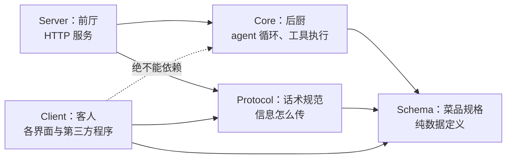

规定说的是：客人只能照着话术规范和菜单点菜，不能冲进后厨自己动手。这样有两个好处：后厨怎么改造升级（重构、换实现），客人完全不受影响；客人再多、再杂，也弄不坏内部结构。这条规定在 v2 合流中改过一次方向：旧版是"Schema → Core → Protocol → Server"一条线，话术规范建在后厨之上；现在 Protocol 和 Core 平级，各自只依赖 Schema，再共同被 Server 依赖——放到餐厅比方里，话术规范不再依赖后厨的做法，只对着菜单规格写。这意味着对外接口契约与内部实现从此可以各自演进，改后厨不必动话术；把"接口稳定"直接写进依赖图，比口头承诺可靠。这种"分层 + 单向依赖"是大型项目防止腐化的基本手段，OpenCode 用明文规定加代码评审把它落实了。

### 技术栈里的 Effect

代码里到处是 `Effect.gen(function* () { ... yield* something ... })`。Effect 是一个 TypeScript 库，把异步操作、错误处理、依赖注入都变成可以组合的"效果描述"：程序先写出"要做什么"的清单，再由运行器统一执行。第一次读会不习惯，有个简单的读法：把 `yield*` 当成 `await`，把 `Effect.gen` 当成一个大的 `async` 函数，语义八九不离十。OpenCode 用它换来了几样东西：错误必须被显式处理（漏处理编译器会提醒）、重试和超时是可组合的积木（后文的重试代码会看到）、服务之间的依赖关系由 Layer（层的声明）统一管理，每个文件末尾的 `node = LayerNode.make({...deps: [...]})` 就是在声明"我这个服务需要谁"。

### 服务实例：一个进程管多个项目

代码里到处能看到 `InstanceState.make(...)` 和 `ctx.directory`，这是一个值得单独解释的概念：OpenCode 的核心服务（配置、agent 列表、LSP 客户端、权限状态等）不是全局唯一一份，而是按"实例"（instance，即一个工作目录）各存一份状态。同一个进程可以同时服务多个项目目录，每个目录有自己的配置合并结果、自己的 agent、自己的语言服务器进程，切换目录拿的是另一套实例状态，互不串味。这也解释了为什么事件发布要附带目录信息：订阅方靠它区分"这件事发生在哪个项目"。

实例不是永驻的。一个项目位置（location，即一个被打开的工作目录）在没有会话活动时会被卸载——它的配置、agent、语言服务器进程等服务全部释放，下次用到再加载。空闲多久卸载由 `experimental.location_idle_timeout` 控制（`packages/core/src/location-activity.ts`，提交 d898c048ae）：接受 `"2 hours"` 这类时长写法，默认 60 分钟，设为 `false` 永不卸载，项目配置可以覆盖全局值。正在运行的会话和后台任务（background job）都算活动，位置因此保持加载，任务不会跑到一半被卸载（提交 89d996c2c5）。一个进程开过的项目越多，不回收就越像内存泄漏；按活动回收是"一个进程管多个项目"必须配套的另一半。

可移植性上还有个小细节：数据库模块通过 import 映射表（`#db`）区分运行环境，Bun 下用 `bun:sqlite`，Node 下回退到 Node 内置的 `node:sqlite` 模块，同一套代码两种运行时都能跑。

### 分支与协作约定

默认分支是 `dev` 而不是 `main`，日常开发都在 `dev` 上，发布走稳定分支。提交信息要求 conventional commits 格式（`type(scope): summary`，比如 `fix(tui): simplify thinking toggle styling`）。`AGENTS.md` 还规定了相当细的代码风格：能写在一个函数里就不拆、不预先抽只调用一次的辅助函数、尽量不用 `try/catch` 和 `any`、优先用 `Bun.file()` 这类原生 API、不给导入起别名、不用星号导入。这份文件本身就是"AI 时代工程规范"的一个样本：把团队约定写成文档，人和 AI 都照着执行。

## 主轴：自己不发电，做电网

OpenCode 自己不发电，它做电网。发电厂（模型服务商、第三方能力）五花八门，但只要按插座标准接入，就能用。这条主轴落在四个方向的标准接口上：

- **接模型**走 Vercel AI SDK 的适配器体系（19 个 `@ai-sdk/*` 适配器加 `openai-compatible` 保底，见"模型接入"）；
- **编辑器对接**走 ACP 协议（见"标准协议"）；
- **代码理解**走 LSP 协议（见"标准协议"）；
- **外部工具**走 MCP 协议，扩展行为走 PluginModule 插件接口（见"插件系统"）。

单向依赖规定是这个主轴的架构化：接口契约（Protocol、Schema）与内部实现（Core）平级解耦，"接口稳定"写进依赖图。本地 HTTP 服务是总插座：所有界面、第三方程序、插件都站在同一个接入面上，能力对等。核心自己保留的只有两样必须自己做的决定：权限规则表（安全决策不交给模型）和会话运行时（收件箱、持久事件）。

代价也要说清：Effect 的抽象对新手门槛不低，代码里 `Layer`、`yield*`、`Schema` 叠在一起，贡献者要先过一道学习关；35 个包的 monorepo 对小贡献者也不友好，改一个界面问题可能要在四个包里理解一遍依赖。这是"大而全的开放平台"路线必然的成本，OpenCode 用详尽的 `AGENTS.md` 和自动生成代码来对冲，但门槛仍然存在。

## Agent 循环

### 一次请求的完整路径

先给一张路线图，后面各节都在这条路径上。用户在界面输入一句话之后：

1. 界面（TUI、桌面、编辑器）把请求发给本地 HTTP 服务（编辑器也可以走 ACP 协议）；
2. 服务里的 SessionPrompt（`session/prompt.ts`，一千六百多行，会话的总指挥）接单：`prompt`（普通提问）、`shell`（直接跑命令）、`command`（执行自定义斜杠命令模板）、`cancel`（打断）各有入口；
3. 它把系统提示词、历史消息、当前 agent 的工具清单组装好，交给 SessionProcessor 调用模型，底层走 Vercel AI SDK 和对应的 provider 适配器；
4. 模型回复说"我要调某个工具"时，请求回到工具注册表，先过权限检查，再执行，再截断输出，结果追加进消息列表，然后再次请求模型；
5. 这个"模型与工具来回"的循环持续到模型给出最终回答；期间 token 计数累计，接近上限就触发压缩。

理解这条链，很多问题就能对号入座：权限在第 4 步执行前检查，压缩在第 5 步计数超限时介入，重试发生在第 3 步的模型请求失败之后。这条链是初版文档成文时的样子；v2 合流后入口换了机制（输入先过收件箱，见下节），核心循环的思路没变，相关代码从旧主包挪进了 `packages/core/src/session/`。把 v2 的收件箱准入也接上，完整路径是：

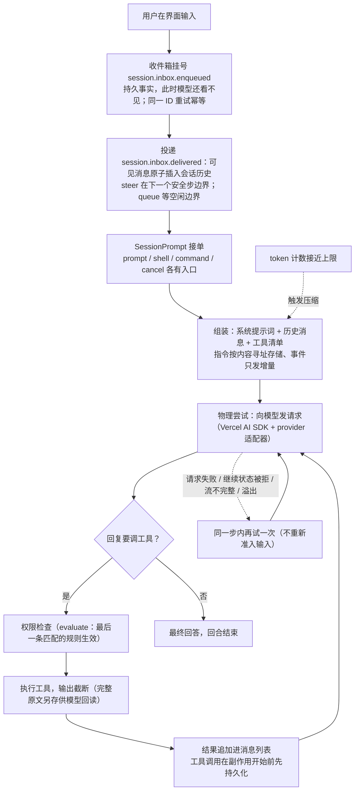

### v2 会话契约：收件箱、执行声明与指令增量

v2 合流带来一套成文的会话契约（`specs/v2/session.md`，开篇说明它是"难以从单个源码文件还原的行为的权威描述"）。四个新概念值得端到端讲清。

**收件箱准入：先挂号，再看病。** v2 里 `Session.prompt(...)` 不再把用户输入直接送进执行，而是先发布一条持久的收件箱事实（`session.inbox.enqueued`），在数据库里投影成一行收件箱条目；此时这条输入**模型还看不见**。真正"投递"（`session.inbox.delivered`）时才原子地把可见消息插进会话历史。就像医院先挂号再叫号：挂号了不代表马上就诊，但号不会丢。为什么要绕这一道？因为"用户说了什么"是要永久保留的事实，而"模型正在处理什么"是随时可能被打断的现场；把两件事拆开，输入在任何时刻都不会因为程序崩溃而丢。收件箱条目带 ID，拿同一个 ID 重试是幂等的（第一次准入算数，重发的载荷被忽略），跨会话或跨类型复用 ID 直接报错。投递分两种模式：`steer`（插话，默认）在下一个"安全步边界"按顺序投递；`queue`（排队）等会话空闲的边界才投递，空闲时插话仍然优先。手动压缩和会话搬移也走同一条收件箱，做成"控制条目"，并且控制条目是投递边界——排在它后面的插话不许越过它先走。一次输入从进门到被模型看见，走的是这条路：

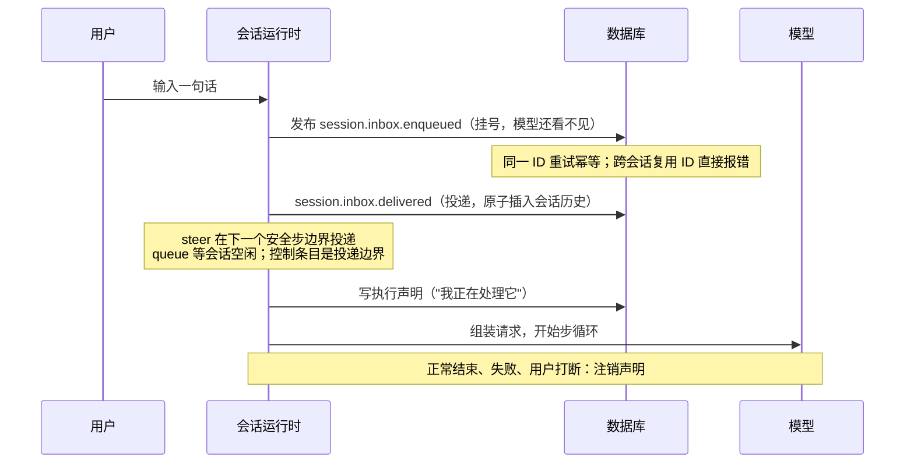

**执行声明：崩溃后知道谁没干完。** 执行是进程本地的，按会话 ID 键控。一段忙碌期开始时先写一条"执行声明"（write-ahead claim，先写一张"我正在处理它"的凭证再干活）：正常结束、失败、用户打断都会注销声明，而进程崩溃会让声明留下来。下次启动时，恢复程序看到未注销的声明，就把对应的顶层会话从持久历史里恢复起来（恢复尝试有次数上限）。规格把边界说得毫不含糊：恢复不保证外部效果恰好发生一次（被打断的工具调用可能已经生效过），启动时会先把上一进程遗留的"还在执行中"的工具调用投影结算为失败，绝不重放说不清的副作用；明确的唤醒不等于崩溃恢复，恢复只由声明驱动。崩溃与恢复的完整过程是：

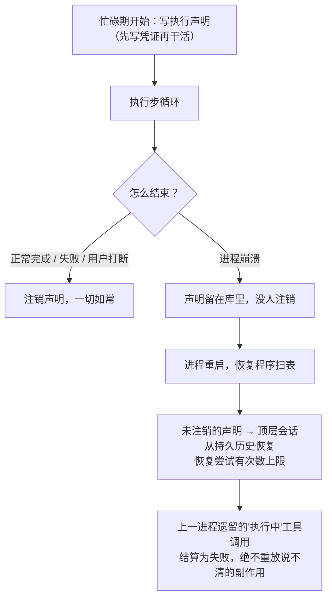

声明的另一头是后台任务：后台 shell、subagent、图片生成这类活儿同样要跨进程接续。它们的恢复标记原先记在通用的 KV 表里，现在搬进专用的 `job` 表（迁移 `20261030054400_job`，提交 664c8f0990），重启后的接续读取也走这张表。

**一步可能有多次物理尝试；指令是值增量。** 每一步（Step，一次"模型与工具的往返"）大多数时候就是一次对模型的物理请求，但通用重试、继续状态被拒、不完整的流续传、溢出触发的压缩，都可以在不重新准入输入的情况下再试一次；工具调用在副作用开始前先持久化，工具调用 ID 只在一步内唯一，所以持久事件还要带上它所属的助手消息 ID。指令（发给模型的那些"提示词素材"：内置说明、发现的技能指引、引用、MCP 指引）按内容寻址存储——正文以哈希为键只存一份，事件里只发"哪些键变了"的增量；每次模型请求前并发读一遍所有指令源、原子提交一个增量；压缩结束开启新的指令世代（epoch，一个版本区间，跨压缩推进），分叉的会话拿父会话最新值当基线。规格专门强调"没有指令注册表"：指令不是一份固定名单，而是值加增量的流。

**回合结束不一定是终点：`/goal` 的目标循环。** 斜杠命令 `/goal <目标>` 给会话立一个目标。它解决的问题是：模型答完一轮就停，多步任务常常差最后一口气——用户要么盯着屏幕反复说"继续"，要么任务悄悄烂尾。目标循环的做法是会话空闲后由一套评审机制决定要不要接着干（提交 8de0323975，实现在 `packages/core/src/plugin/goal.ts`，以内部插件身份注册）。评审提示词先把身份划清：明确要求模型"停止扮演助手、只当评审、不许调用任何工具"，只拿对话里已有的证据——工具结果、命令输出、文件内容——核对目标是否达成，"助手自称做完了"不算证据；目标文本包在 `<untrusted_objective>` 标签里当数据看待，里面若藏着"该怎么评判"的指令一律忽略。评审回一行 JSON 判决：`done`（达成）、`continue`（附下一步）、`blocked`（需要用户介入，比如缺决定、缺凭据、缺手工步骤）、`paused`（用户要求停）、`wait`（后台工作没汇报完）。判 `continue` 就注入续跑提示接着干，外面套三道上限防失控：最多 50 轮、连续 3 轮没有任何工具调用算停滞、等后台工作最多 30 分钟就暂停（`goal.ts:16-19`）。几个状态细节都朝着"不悄悄失控"设计：目标状态存会话的插件存储，分叉或子会话不继承；状态里记着一个进程启动 ID，上一个进程立的目标重启后回到 paused，不会自己悄悄续跑（`goal.ts:22-23`）；循环写状态前先重读一遍，期间用户敲的 `/goal pause`、`clear` 或新目标赢过循环自己的写入（`goal.ts:61`）；评审请求太大可以压缩一次再评，第二轮还溢出就暂停。整个循环从头到尾是：

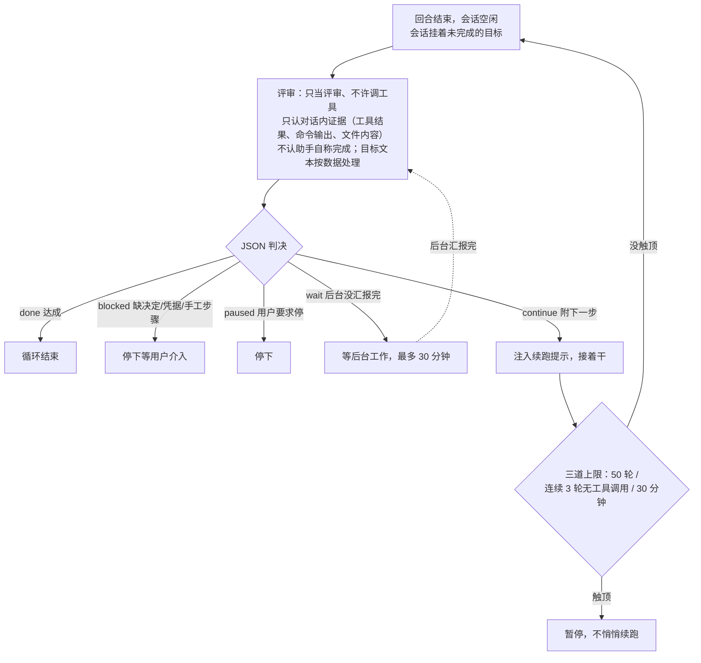

## 会话与上下文

先说数据的形状。一次会话（session）下面是消息（message），消息下面是部件（part）：一条助手消息可能同时包含文本部件、推理部件（模型"思考"过程的文字）、若干工具调用部件；一条用户消息可能带文件附件部件。每个部件有自己的 ID 和状态，工具部件就分 pending（进行中）、completed、error 三态，还记录耗时和截断标记。压缩时"清空某个旧工具的输出"，动的就是单个工具部件的状态字段，消息骨架不动。要回看任何一个动作的来龙去脉，顺着部件查就行。

### 内置 agent

OpenCode 里"agent"指一套带独立系统提示词和权限配置的运行身份。内置七个（`packages/opencode/src/agent/agent.ts`）：

- **build**：默认身份，按配置的权限干活，能读能写能跑命令。
- **plan**：只读模式，禁止所有编辑工具，适合先看代码、做计划。唯一例外是允许写计划文件本身（`.opencode/plans/*.md` 和全局计划目录）。
- **general**：子任务执行者，处理多步骤任务，可以并行派多个。
- **explore**：快速探索代码库的只读 subagent，只放开 grep、glob、read、webfetch 这类检索工具。
- **compaction**、**title**、**summary**：三个隐藏身份，分别负责压缩历史、起会话标题、生成摘要，它们的权限是"全部拒绝"，也就是只能生成文本，碰不了任何工具。起标题这种小活不动用主模型的推理档位：title 没有单独配模型时，先找该提供方的 small 模型，用它最低的推理档位；没有 small 模型就用主模型本身、但取比会话所选更低的档位——`none`、`minimal` 一定是减少推理，`low` 在默认不推理的模型上反而会打开推理，所以只在它排在会话所选档位之下时才用（`packages/core/src/session/context.ts:98-109`、`:191-200`）。

用户可以在配置里定义自己的 agent，也可以用 `/agents` 命令让模型根据一句话描述自动生成一个（`agent.ts` 里的 `generate` 方法）。

### 上下文空间：永远给输出留位置

模型一次能读的内容有上限，叫上下文窗口（以 token 计，token 是模型处理文字的基本单位，大约一个汉字或半个英文单词）。对话越长越接近上限，但有个容易被忽略的细节：模型回答时还要**输出**内容，如果历史记录把窗口塞满，模型连写答案的地方都没有了。

`session/overflow.ts` 里的 `usable` 函数专门算"还能用多少"：

```
可用空间 = 上下文上限 − 预留量
```

预留量取"配置值"或"2 万 token 与该模型最大输出长度的较小者"。还有一层细节：如果模型单独标注了输入上限（`limit.input`），就用输入上限减预留量；没有标注才用总上下文减输出空间。不同模型的限制写法不一样，计算要按模型实际给的字段来，不能一套公式套所有模型。

当已用 token 数超过可用空间（`isOverflow`），就触发压缩。

给输出留位置的另一端是**请求时的输出上限**：`session/model-request.ts` 的 `outputLimit` 把一次请求的 `maxTokens` 按"窗口减去已量得的输入、再减去带估计误差的估计输入"算出剩余空间。主请求（primary）现在再留窗口 1% 的余量（`WINDOW_HEADROOM = 0.01`）——模型服务商数出来的 token 总比客户端多几个（聊天模板、工具 schema），严格的服务商会拒绝"输入加输出超过窗口"的请求；压缩请求不留这份余量，因为它的摘要按自己的预留空间定尺寸（提交 da702a85a6）。

### 压缩：分层的减负

对话长到快撑爆上下文窗口时怎么办？把历史整个删掉会丢任务线索，原样全发又会超限。OpenCode 的答案是把"减负"拆成三级，从轻到重逐级用（`session/compaction.ts`）：

1. **修剪（prune）旧工具输出**。工具输出（比如整个文件的内容、命令的全部打印）是上下文里最占地方的部分。从最近的对话往前数，保留最近 4 万 token 的工具输出不动，更早的只留"调用记录"、清空"输出内容"，并在消息上做个标记（`time.compacted`）。`skill` 工具的输出受保护不被清理；累计能清出 2 万 token 以上才真正动手，清不出就不值得折腾。
2. **保留最近对话（tail）**。压缩时不是把全部历史都变成摘要，而是留一段最近的原文：默认保留量在 2000 到 15000 token 之间，取"可用空间的 25%"与这个区间的交集。放不下一整个回合（turn，一次用户提问到模型答完）时，还会在回合内部找一条消息边界切开，尽量填满保留额度。
3. **生成摘要**。剩下的历史被序列化成纯文本（用户消息、助手回复、推理过程、工具调用与结果各有固定格式），连同上一轮摘要一起交给 compaction agent，产出新摘要替换原文。压缩完成后，如果设置了自动续跑，系统会把被压缩打断的那条用户消息重新放回对话（图片等大附件换成占位文本），让任务接着走。

这一整套对应的配置项都在 `compaction` 命名空间下：可以关闭自动压缩、调整保留量；自动压缩的触发余量本身也能配（`compaction.buffer`），接受 `"20%"` 这类百分比写法或直接的 token 数——百分比按模型的窗口换算成 token，0% 或不小于窗口的设置在配置归一化时直接判无效（提交 6700dd87b5）。压缩请求自己的尺寸也有一道上限：摘要请求的提示词最多占"输入窗口与上下文窗口里较小的那个"（`packages/core/src/session/compaction.ts:1152-1158`，提交 cb1e58fe44）——目录或配置覆盖偶尔把输入上限报得比上下文窗口还大，而上下文窗口还要装下模型的回复，照抄大数请求就发不出去了。三级减负从头到尾串起来是：

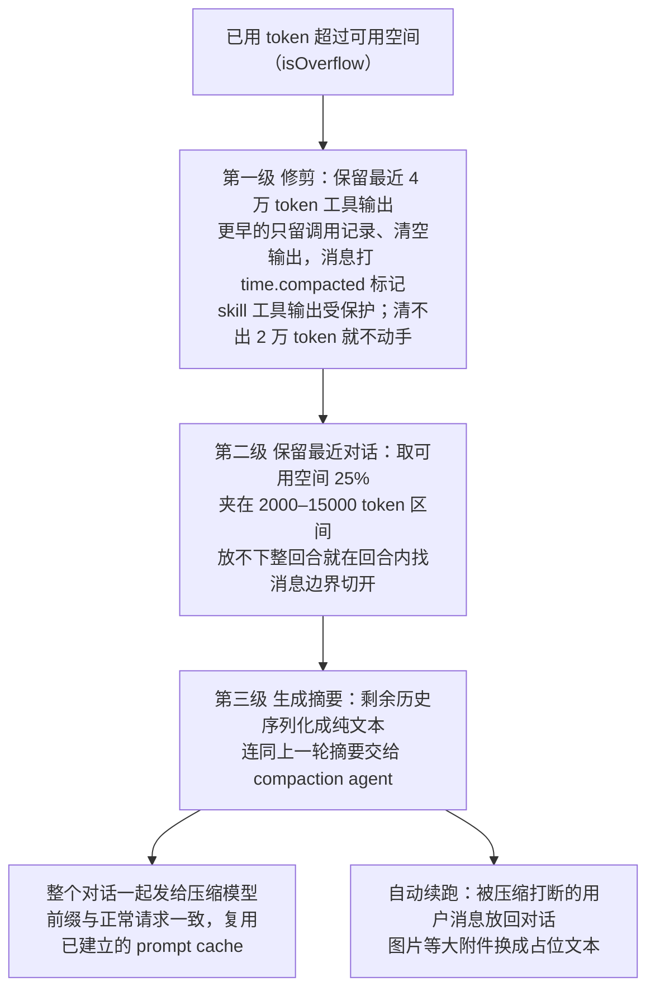

**总结整个对话，动机是保住提示词缓存**（2026-10-20，提交 fd6589239e）。提示词缓存（prompt cache，模型服务商提供的机制：请求开头那段和上次一模一样，就直接复用上次的计算结果，费用低）省钱的条件是前缀逐字节相同。现在的做法是把**整个对话**（包括保留的尾部）一起发给压缩模型（`packages/core/src/session/compaction.ts`，`prepare(context, context.messages, budget)`），而不是只把较老的部分发去总结、尾部留在旁边。代码注释把理由说得很直白：总结请求的前缀与正常请求完全一致（`[system][S1 + "E9 E10"][E11 … E18][E19][prompt]`），前缀不变，**总结请求就能复用正常请求已经建立的那份 prompt cache**；旧做法在尾部之前切开，缓存断点落在摘要请求自己的路上。配套把自动压缩的触发余量从 10% 提到 15%，且至少保留 16k token（`RESERVE_SHARE = 0.15`）：多出来的余量用于吸收单步 token 的暴涨——真实会话里单步最多涨过约 22k token（p99）——一步跨过触发线时，整个对话仍能原样发出、照常命中缓存，而不是被迫立刻压缩把前缀打碎。摘要的输出上限按正常回合的规则算（估算 token 时留同样的安全余量），再加一道保底：余量会把接近目标的摘要压到最小输出，所以摘要至少拿到 32000 token（`SUMMARY_OUTPUT_FLOOR`）与不计余量时剩余空间两者的较小者（`packages/core/src/session/compaction.ts:105`、`:880-893`，提交 6709f5646d）。

**图片裁剪的决策跨请求稳定，理由同样是缓存**（2026-10-20，提交 d9fe53e926）。上下文超限时系统会裁剪历史里的图片附件（图片是上下文里的大户），裁剪决策保持稳定——同一张图不会被这轮裁掉、下轮又放回来（`packages/core/src/session/model-request.ts`）。一旦放回来，请求前缀就变了，缓存前功尽弃。和压缩那条合起来看，opencode 把"缓存利用"从提示词组装一路贯彻到了资源裁剪：凡是会出现在请求前缀里的东西，跨请求就得长得一样。

**摘要可以在后台提前算，自动压缩到点直接换入（实验开关 `background_compaction`，提交 6a5973d263）。** 自动压缩有个体验代价：到点触发时用户要干等一份摘要从零写出来。既然用量涨到 85% 时就能预见到压缩快来了，为什么不让摘要提前在后台算好？做法：上下文用量到达压缩上限的 85%（`PRECOMPUTE_RATIO`，`packages/core/src/session/compaction.ts:147`）且实测 prompt token 至少 64k 时，系统在后台把"最新一条响应之前的前缀"总结成一份现成摘要。选那个前缀有个讲究：它正是服务端刚处理过的部分，总结请求直接读到它的缓存（`compaction.ts:322-324`）。自动压缩到期时不再从零等一份摘要：正在写的就等它写完，写完了直接换入，换入不了才按老办法当场总结（`compaction.ts:47`、`:380-381`）；连续失败 2 次后到下次压缩前不再开新的（`compaction.ts:156`）——开关的配置说明里直说"没被用上的后台摘要照样花 token"，所以太小的对话（不足 64k）不预计算，浪费大于收益。配套一笔在摘要请求自己的转录组装上（提交 ac68d6a929）：放不下一整份转录时，从最旧的轮次开始逐级缩短——先砍工具输出，整轮省略是最后手段；最新的轮次只缩短、绝不省略，摘要最需要的正是最新内容（`compaction.ts:655-657`、`:713`）。预计算和换入的完整过程：

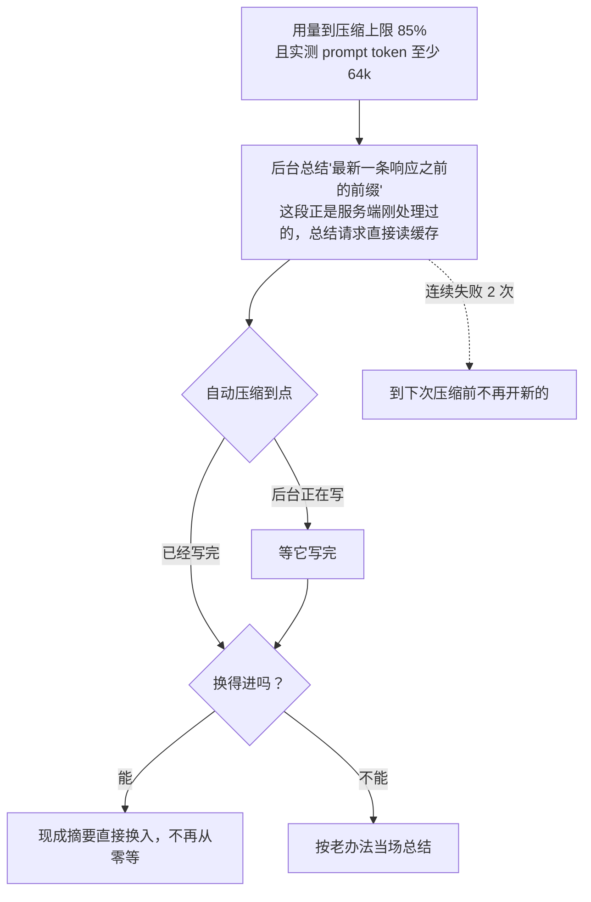

### 请求级重试：挑着重试

模型请求失败很常见（限流、网络抖动、服务商过载），`session/retry.ts` 有一套完整的重试策略，三个要点：

- **分清哪些错误值得重试**。代码里列了一组正则模式：429（请求太多）、5xx（服务端错误）、网络中断、超时、"容量不足"这类才重试；写错参数、认证失败这类不重试。
- **尊重服务端的指示**。如果响应带了 `Retry-After` 或 `Retry-After-Ms` 头（服务商告诉你"过多久再来"），优先按它说的等。
- **退避加抖动**。没有指示时，首次等 2 秒，每次翻倍，最多重试 5 次；再叠加 25% 的随机抖动（jitter，故意加点随机量），避免大量客户端在同一时刻一起重试，把刚缓过来的服务又压垮。

分类还要防一种张冠李戴：服务商把"每分钟 token 限流"报成 429，正文里又带着"too many tokens"这类字样（Cerebras 的实际报文就是如此），错误分类器按正文措辞把它判成了上下文溢出——溢出会触发压缩，可真正的病因是限流，压缩救不了，白白多压一次。现在带 429 状态码的错误不再做溢出正文匹配，一律按限流走重试（提交 618b890667）：同一个词组，在不同状态码下含义不同，分类先看状态码再看措辞。

## 工具系统

工具（tool）是模型能调用的动作：读文件、写文件、跑命令、搜网页。v2 把工具契约写成了一份规格（`specs/v2/tools.md`）：一个工具就是 `Tool.make({...})` 造出的一个结构化值——说明、输入 schema、输出 schema、执行函数写在一起。一次工具响应可以带三个值：`output` 是过了 schema 校验的机器值，专给 Code Mode（让模型写一段代码、在代码里连续调用工具的执行方式，省得每个动作都单独请求一轮模型）用；`content` 是给模型看的文本，持久保存；`metadata` 是给界面的小份 JSON。注册按名字且带作用域：同一名字后注册的生效，一个注册被关闭就露出它的上一任，像一层层覆盖的透明片。每次调用的上下文带持久身份（会话 ID、agent、助手消息 ID、调用 ID），由会话运行器提供、注册表不猜。输出截断归注册表管：只量文本部分，超限按"头一段、省略标记、尾一段"切，完整原文放进托管存储、给模型一个有界的预览；元数据单独限量，不留给工具当绕过截断的暗道。内置工具和插件工具走同一个构造器，但权限不同：内置（和受信任的位置插件）捕获受信任的服务，主动向权限服务发起请求；规格原话是"共享工具类型不等于同等权限"。

工具参数还可以不走 JSON：恰好只有一个必填字符串参数的工具可以设 `freeform`，模型把这个参数直接写成原始文本——不受约束的 `text`，或者匹配一个 `regex` / `lark` 文法的文本（`packages/ai/README.md:84-103`，提交 45713a326c）。为什么要多这条路？工具参数默认是 JSON，模型写 JSON 时转义、引号、换行都容易出错，写一段原始代码或命令反而更自然。OpenAI 的 Responses 与 Chat Completions 及复用它们的提供方把它作为 custom tool 发送，其他协议照发普通 JSON 工具；没有任何检查或回退——模型不接受 custom tool 就收到提供方的错误，所以只对确认支持的模型设置。调用、工具输入事件、结果与历史始终用对象形式（README 的例子是 `{ code }`），过去的调用按当前请求里的声明方式重放，同一份历史有没有 `freeform` 都能用。

### Code Mode：模型写代码，解释器执行

Code Mode 让模型写一段 JavaScript，在一段受控的运行时里连续调用工具，省得每个动作都单独请求一轮模型。跑这段代码用的不是宿主的 JavaScript 引擎直接执行，而是 `packages/codemode` 里自带的一个解释器——支持哪些语法和内置对象列在 `interpreter-support.md` 里，不在清单上的就是不支持。为什么放着现成的引擎不用、要自己写解释器？因为模型写的代码要受控：不能让它访问任意网络、任意文件，工具调用要逐个过权限。宿主引擎给不了这种细粒度的控制点，自带的解释器才有。这话有个现成的例子：解释器里的 `fetch` 也要过权限——按 webfetch 工具的同一套规则检查 URL（`packages/core/src/codemode/fetch.ts:24-27`，注释写明"在 webfetch 被拒的 URL 在这里同样被拒"），被拒时把用户附的那句反馈原样作为错误信息带给程序；读本地文件的 `file:` 地址则直接报错（提交 bdca40ac0e）。

代价是要自己实现 JavaScript 的运行语义，promise（异步结果的占位对象）这块最近修了一处：解释器现在保证**每个 job 跑到完成**——两个 await 之间的代码、以及一个异步函数到它第一个 await 之前的函数体，在另一个 job 开始之前执行完，调度器抢占长 job 时也不例外；工具调用仍然并发（`packages/codemode/src/interpreter/promises.ts`，提交 3b593dd5d2）。宿主引擎里这是理所当然的微任务语义，自己写解释器就得自己保证。另一处是成本：codemode 运行时跨执行复用，不再每次工具调用都重建（`packages/core/src/codemode/tool.ts`，提交 6ec56821d6）；配套修了一批内置方法的边角语义（`Uint8Array.from` 的映射函数、字节比较不做类型转换、`flatMap` 跳过空位、非整数进制截断，提交 db45c950a9）。

自己当运行时，卡住的现场也在自己手里。一段程序等不到结果、停着不动时，错误信息现在直接指出是哪一个 await 永远不会落定——await 表达式挂起时把自己的源码位置一并交给调度器，报错能落到具体那一行（提交 2ed57439da）。支撑它的调度层同期换了骨架（提交 e26f85bcd3）：此前每个异步调用起一根 fiber（Effect 框架里的轻量执行单元），现在求值器与内置对象改成纯生成器加单条任务队列——解释器的每一步是生成器交出的中间状态，`runner.ts` 里的队列决定下一个跑哪个 job；宿主工作用 `runner.host` 发起、要等结果用 `runner.blocking`，Effect 只允许出现在 runner、execute、extensions 三个文件里，这条边界用 lint 规则钉死。调度收拢到一处，"每个 job 跑到完成"那类语义才有唯一的执行点可守。

扩展暴露给程序的全局函数也能返回 Effect（`packages/codemode/README.md`，提交 a882cf98a0）：一个全局可以返回普通值、Promise 或 Effect；Effect 只在 `extension.before` 钩子放行这次调用之后才启动，它的依赖像工具的依赖一样并入运行时环境，宿主因此能按执行提供服务——比如把发起调用的会话用 `Effect.provideService(Session, session)` 交进去，全局函数在里面先做授权检查再去取网页。钩子的次序随之定死：扩展的 before 钩子先于宿主调用执行（提交 1c49e51303）。两处使用体验：`search` 可以像 Promise 一样 await 或链式调用（提交 711802c3a3）；程序的语法错误报出位置与提示，而不是一句笼统的解析失败（提交 c96d200de8）。

### 内置工具清单与图像生成

内置的工具可以按名字对上（旧注册表 `tool/registry.ts` 的清单，v2 后由核心注册同名单）：`bash`（跑 shell 命令）、`read`、`grep`、`glob`（按文件名模式找文件）、`edit`、`write`、`apply_patch`（打补丁方式改文件）、`webfetch`（抓网页）、`websearch`、`todowrite`（记任务清单，曾被移除，2026-10-20 以实验开关恢复，提交 8f7db12b2a）、`task`（派 subagent）、`skill`（调用技能）、`question`（向用户提问）等。两个按情况启用的细节：

- OpenAI 的 GPT 系模型习惯用 `apply_patch` 的方式改文件，其他模型用 `edit`/`write`。注册表按模型 ID 自动切换（`gpt-` 开头且不是 `gpt-4` 的用 patch）。
- `websearch` 只对特定模型服务商开放。

内置清单里还添了一个会自己跑后台的：`experimental_image_generate`，生成或编辑图片（提交 89f3ac108f）。它解决的问题：生成图片要等几十秒，如果工具调用一直挂着，模型和用户都得干等。做法是把工具调用改成"后台任务式"——一次端到端的调用流程是：模型给出一段描述加最多 8 张参考图（本地路径或 http(s) URL，单张上限 20MB），调用立即返回一个任务 ID，图片在后台生成、写好后自动通知会话并附保存路径——工具说明里明确要求模型等待期间不要轮询、不要睡眠、不要反复检查文件。可用性跟着模型目录走：有可用的图像模型才注册，目录一变就重新评估（`packages/core/src/tool/plugin/image-generate.ts:232-234`），所以它不需要单独的开关；配置里的 `experimental.image_generate` 只承担偏好（比如默认模型），不配就选"会话所属提供方里最新的图像模型，否则所有可用里最新的"（`image-generate.ts:387`）。说明文字同时约束模型的行为分寸：只在用户要求做图或改图时调用，觉得配图有帮助但用户没提，先问再做，别自作主张生成（提交 372d0d5510）。

清单外还有一组实验工具：artifacts（提交 8f0fc21e71，PR 60351）。一个 artifact（工件）是一组带标题的 UTF-8 文件——比如一个 `index.html` 配 `assets/app.js` 的小网页——外加一个入口文件（默认按 `index.html`、`index.md`、唯一文件取）。模型经四个工具操作它：创建、读取、更新、删除，ID 形如 `art_...`（`packages/core/src/tool/plugin/artifact.ts`）。文件落到哪由"提供方"决定：每个提供方实现同一个接口（`packages/core/src/artifact.ts:54-63`）——`create`、`read`、`update`、`delete` 四个操作各自是一个 Effect，外加 ID、名字、能力声明和给模型看的提示词；注册表按 ID 存放提供方、默认用哪个可选（`artifact.ts:157-158`），内置一个 `local`（`artifact.ts:32`），插件侧也有对应的 artifact 接口，别的后端可以照着接。工具输入里还能为单次请求临时指定提供方，不动默认值。

### 执行的统一封装与自定义工具

所有工具的执行被统一包了一层（旧主包的 `wrap` 函数，语义保留在 v2 契约里），做两件事：

1. **参数校验**。模型传来的参数先过类型检查，不合格就抛 `InvalidArgumentsError`，错误信息是写给模型看的："这个工具被用错误的参数调用了，请重写输入"。模型收到后会自己修正重试。
2. **输出截断**。工具输出超过长度上限时自动截断，完整内容另存为文件、把路径附在结果里，模型之后还可以去读。这个存放截断文件的目录，连同技能（skill）目录一起，被内置权限规则列为"允许跨目录读取"，模型回头去取完整输出时不会被外部目录规则拦住。截断行为按当前 agent 的配置来。

工具也可以扩展：把 `.ts` 或 `.js` 文件放进项目的 `.opencode/tool/` 目录，导出一个符合接口的对象，就成为一个自定义工具；插件也能注册工具，还能通过 `tool.definition` 钩子改任何工具的说明和参数定义。

## 权限与策略

"这件事 AI 能不能做"由一张规则表决定，核心是 `permission/index.ts` 里的 `evaluate` 函数：

```
evaluate(permission, pattern, ...rulesets) → { action: "allow" | "deny" | "ask" }
```

三个输入：**permission** 是想干什么（如 `edit`、`bash`、`read`）；**pattern** 是在哪个范围上干（如文件路径、命令前缀）；**rulesets** 是若干条规则，每条形如"什么权限 + 什么模式 → 怎么处理"。函数在所有规则里找匹配的，关键实现是 `findLast`：**从后往前找，最后一条匹配的规则生效**。这相当于给规则定了优先级，写在后面的覆盖写在前面的。为什么这样定？因为例外条款总是后补的：先有默认允许，后来发现某类文件危险，补一条例外——按书写顺序定优先级，例外自然压过默认。于是可以这么用：先写一条宽松的（"读任何文件都允许"），后面跟一条例外（"读 `*.env` 要询问"），例外自然压过默认。

### ask：把决定权交还用户

`ask` 是这个系统最有意思的部分。需要询问时，权限服务创建一条待决请求（pending），通过事件广播给界面，然后**挂起等待**；用户在界面上选择后调用 `reply`，可选三种答复：`once`（这次放行）、`always`（本次会话内这类操作都放行，实现是往已批准列表里追加一条 allow 规则）、`reject`（拒绝，可附带一句反馈给模型）。有两个贴心的连带处理：拒绝一条请求时，同一会话里其他还在等待的请求也会一起取消（用户已经表达了"停下"的意图）；选择"总是允许"时，其他等待中、能被新规则放行的请求会被一起放行，不用逐个再点。从工具请求执行到放行或拒绝，完整走一遍是：

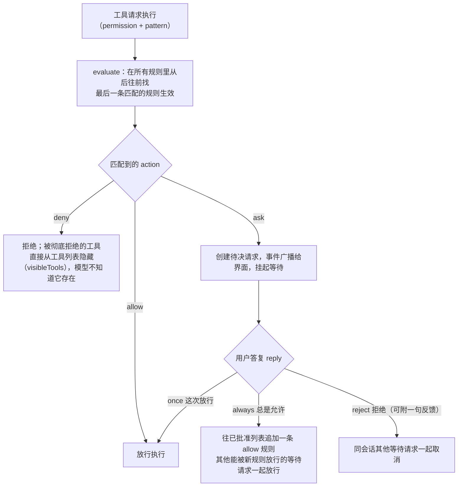

### 规则从哪来

规则有三层叠加（也是 `findLast` 生效顺序）：

1. **内置默认**（`agent.ts`）：默认全部允许，但 `doom_loop`（反复执行同类操作）要询问；读 `.env` 类文件要询问，模式特意对齐了 GitHub 官方 gitignore 模板里的 `.env` 写法；读项目外的目录要询问。
2. **agent 自带规则**：plan 模式禁编辑、explore 只给检索工具。
3. **用户配置**：配置文件的 `permission` 字段，最终覆盖前两层。

界面的自动接受（auto-accept，不打断询问、直接放行权限请求的开关）按项目记：每个项目可以单独设置并覆盖全局默认值——某个仓库想放开手脚、别的项目保持保守，各记各的。会话里积累的"已保存权限"也可以编辑（2026-10-20，提交 fede5ddda5），写错了的放行规则会话中就能改。

### 命令前缀：从一条命令提取"人类理解的前缀"

对 `bash` 命令的权限控制有个前置问题：规则写 `git *` 能管住所有 git 子命令的前提，是先从一条完整命令里提取出"人类理解的命令前缀"。`shell/parse.ts` 维护了一张"命令元数表"（arity，一个命令由几个词构成，`packages/core/src/shell/parse.ts:23`），比如 `git checkout main` 归约成 `git checkout`、`npm run dev` 归约成 `npm run`，拿这个前缀去匹配规则。这样规则写 `git *` 就能管住所有 git 子命令，不用关心用户后面跟了什么参数。

这张表所在的命令分析器是一套手写的 shell 解析器：早先这层解析靠 tree-sitter（一个解析器生成工具）的 WebAssembly 产物来做，如今全部换成手写实现，WASM 依赖整个删掉（提交 8609cc55d0）。权限检查站在安全边界上，解析器的一个解析漏洞就是一条绕过通道，所以解析逻辑值得自己握在手里、逐个补边角。解析器也确实在继续补边角：写在参数中间的文件重定向（`echo hi > out.txt`）也会被识别成一条触碰文件的命令参与权限检查，PowerShell 的方法调用与动态变化的目录同样纳入扫描（提交 dc0bfc5ea4）。

### 策略层：权限之上的组织规则

权限规则表管"这次调用放不放行"，但还有一个更外层的问题它管不了：这个组织、这台机器允不允许用某家模型服务商、某类工具？策略（policy）就是权限之上再套的一层，配置键是顶层 `policies`（由 `experimental.policies` 转正而来，旧键标弃用并指向新位置；提交 f576da508d），取代旧的 `enabled_providers`/`disabled_providers` 开关名单。

语句形如"效果 + 动作 + 资源"，动作有七种（`packages/schema/src/config/policy.ts:18-25`）：`provider.use`（能不能用某家模型服务商）、`tool.use`（某类工具在某种资源上，写成 `<权限名>:<资源>`，如 `shell:git push *`）、`integration.connect`（某个集成能不能被列出和连接）、`integration.use`（集成背后的哪个账号能用，资源写成 `<集成>#<账号>`）、以及从 `integration.use` 拆出来的 `mcp.use`、`skill.use`、`plugin.use`。拆分前 `integration.use` 一个动作管所有集成资源，靠资源前缀区分；现在各管一段，旧写法在解码时自动转换——只有带前缀的资源参与转换，光秃秃的 `integration.use` `*` 保持原动作、覆盖面扩到提供方与账号（提交 b2bd02ee71）。判定和权限规则表同一个思路：按顺序扫，最后一条匹配的生效，没有配策略就一切照旧。

配置文档之间的顺序则反过来读：普通配置越具体越优先，策略却是用户全局的语句最后应用——所以仓库配置不能偷偷重新启用用户全局禁用的东西。组织托管语句（来自 OpenCode 云控制台）排在所有作者语句之后、拥有最终权力：组织的 deny 不能被仓库或个人的 allow 抵消。两条自保设计值得记：`tool.use` 的 allow 永不授权，它只能抵消更早的 deny，放不放行仍由权限规则和批准记录决定；策略插件本身被保护起来，插件不得增删或覆盖策略语句，配置里用任何选择器都移除不了它——否则一个仓库就能关掉整个策略执行。一次工具调用先过策略、再过权限的两层关系是：

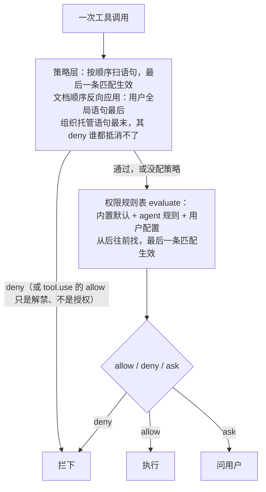

## 插件系统

OpenCode 的"开放"分两层：接模型靠插件，扩展行为也靠插件。

**标准接口**。插件实现 `@opencode-ai/plugin` 包定义的 `PluginModule` 接口：一个函数，接收 `PluginInput`（包含调用本机服务的 client、项目目录、`Bun.$` shell 等能力），返回一组 **Hooks**（钩子，程序在特定时机留出的挂载点）。钩子的调用模式很统一：`trigger(名字, 输入, 输出)`，钩子函数原地修改输出对象。已注册的钩子点包括 `tool.definition`（改工具定义）、`experimental.chat.messages.transform`（改发给模型的消息列表）、`experimental.session.compacting`（压缩时注入上下文或替换压缩提示词）等。核心只定义接口、在固定时机调用，具体插件做什么它不管。

**内置认证插件**（`plugin/` 目录）：OpenAI Codex、GitHub Copilot、Modal、GitLab、Poe、Cloudflare（Workers 和 AI Gateway 两种）、Azure、DigitalOcean、Snowflake Cortex、xAI、Cerebras。每家服务商的登录方式不同（API 密钥、OAuth 网页授权、订阅账号），插件把"怎么登这家"封装掉，用户只需 `opencode auth login` 选一家。

**外部插件**。配置里写 `plugin: ["npm包名"]`，加载器（`loader.ts`）负责从 npm 安装（安装在后台异步进行，不阻塞启动）并加载。加载是严格串行的，注释里写明原因：保证钩子注册和执行顺序在不同运行之间一致。插件加载失败不会弄垮主程序，错误会作为会话事件上报，界面能看到。串行加载也带出一个时序问题：安装是异步的，会话跑起来时插件可能还没就绪——一个依赖插件钩子的会话，头几步就会漏掉插件本该处理的事件。现在每一步执行、每一次工具调用之前都等待插件激活完成（`packages/core/src/session/prompt.ts:38`、`generate.ts:35` 的 `Plugin.awaitActivation`），激活中的钩子不会漏接事件（提交 b64cc80db3）。

**目录变换（catalog transforms）**管的是"外界可见的能力清单"（有哪些模型、哪些认证、哪些集成）怎么随插件、配置、登录状态变化。做法留了完整的决策记录：每个影响清单的来源（配置、models.dev 数据、认证插件、普通插件）都注册成一份可重放的变换，拿到一个目录编辑器往私有草稿里增删条目；目录每次把全部活动变换按注册顺序重放一遍、应用策略、算出差异、发一次 Catalog.Event.Updated；插件停用就是撤掉它的变换再重建，不需要手工回滚它的改动。被否掉的另一个方案是让插件直接改全量配置：任何字段都可能被改，配置一动所有读配置的服务都得全体重载；选定的方案把重建范围缩到目录本身。把两个方案和否掉的理由一并留档这件事本身就值得学，记录里写明动机：这些接口的行为难以从单个源码文件里还原。

插件对权限的参与也很深：插件可以主动发起权限请求（assert），输入形状与会话内的权限请求一致（sessionID、agent、动作、资源、保存策略、来源等字段，见 packages/plugin/src/permission.ts 的 AssertInput；提交 6a7cedcbf1）。插件工具要碰敏感资源时，走和内置工具同一条"问用户"的通道，而不是绕开它。

## 标准协议：LSP、ACP 与 MCP

### LSP：给模型装上语义眼睛

LSP（Language Server Protocol，语言服务器协议）是微软发起的行业标准，解决的问题是：自动补全、报错、跳转定义这些"代码理解"能力，语言有几十种、编辑器有十几个，如果每家编辑器为每种语言各写一套，就是几百份重复劳动。LSP 把它拆开：每种语言由一个独立的"语言服务器"进程负责理解（如 TypeScript 语言服务器、gopls 之于 Go），编辑器只需实现一次 LSP 客户端，就能接上所有语言。

OpenCode 接 LSP 的动机和编辑器不同：不是给用户补全，而是**给模型装上"语义眼睛"**。模型读代码靠文本，容易漏掉类型错误和引用关系；语言服务器恰好擅长这些。`lsp/lsp.ts` 对外提供的能力包括：

- `touchFile`：文件变动后通知语言服务器重新分析；
- `diagnostics`：拿到"哪一行有什么错"（就是编辑器里红波浪线的数据）；
- `hover`：某个位置上符号的说明；`definition`：跳转到定义；
- `references`、`implementation`：谁引用了它、实现在哪；
- `documentSymbol`、`workspaceSymbol`：文件内和全项目内按名字找符号；
- 调用层级（call hierarchy）：这个函数被谁调用、它调用了谁。

编辑和重构类工具执行后会主动 `touchFile` 等诊断，模型于是能"改完自己检查一遍"，而不是等用户来报错。

工程上有几个细节值得看（`getClients` 函数）：内置 38 个语言服务器的启动定义（`lsp/server.ts`），按文件扩展名匹配；服务器进程**按项目根目录惰性拉起**，用到才启动；启动失败记入 broken 集合，不再反复重试；正在启动中的请求合并等待（`spawning` 映射表去重），避免同一服务器被并发拉起多个。用户可在配置里禁用某个服务器或接入自定义命令启动的服务器。

### ACP：编辑器与 agent 的标准握手

ACP（Agent Client Protocol，智能体客户端协议）解决的是另一个方向的标准化：市面上有多种 AI 编码 agent 和多种编辑器，如果每对组合都要专门写对接代码，就是"每家跟每家握手"。ACP 约定了编辑器（客户端）和 agent（服务端）之间的标准对话方式，任何一方支持协议就能自由组合。OpenCode 通过官方 SDK（`@agentclientprotocol/sdk` 0.21.0）实现了 agent 一侧（`acp/service.ts`）。

协议覆盖了会话的完整生命周期，从接口清单能看得很清楚：

- 握手：`initialize`（交换协议版本和能力声明）、`authenticate`（登录，OpenCode 的方式是引导用户在终端跑 `opencode auth login`）；
- 会话：`newSession`、`loadSession`、`listSessions`、`resumeSession`、`closeSession`、`forkSession`（把现有会话复制一份分头继续，类似 git 的分支）；
- 交互：`prompt`（发送用户输入，这是核心动作）、`cancel`（打断进行中的任务）；
- 运行中调整：`setSessionModel`（换模型）、`setSessionMode`（换模式）、`setSessionConfigOption`（改会话级配置）。

初始化时的能力声明也值得一看：支持加载历史会话、支持 HTTP 和 SSE 两种 MCP 服务、提示里可以内嵌上下文和图片。协议的职责边界很清晰：它规定"外面的人怎么跟你打交道"，agent 内部怎么干活它不管。Zed 等编辑器已经支持 ACP，接上就能用 OpenCode。

顺带把三个"协议"放在一起分辨：**ACP** 管编辑器怎么接 agent，**LSP** 管编辑器（或 agent）怎么接语言理解能力，**MCP**（Model Context Protocol，模型上下文协议）管 AI 助手怎么接外部工具和数据源。三者各管一段，OpenCode 三个都用。

MCP 这一格还有个方向反转的玩法（实验性，2026-10 下旬）：通常是 opencode 作为 MCP 客户端，主动去连外部工具服务器；client MCP 反过来——客户端应用（编辑器、TUI）自己跑 MCP 服务器，opencode 通过客户端应用打开的入站 WebSocket 连它。为什么要反转？有的宿主环境不允许子进程对外拨号连接，但宿主自己可以开一个本地服务端等别人来连——传输方向跟着宿主的能力走。注释里把边界写得很清楚：只有连接方向反转，传输从不主动外拨，只服务于进来的连接（`packages/core/src/mcp/socket-client.ts:12-18`）。客户端侧的 `connectClientMcp` 助手收一组工具定义，工具以 `<应用名>_<工具名>` 的形式暴露给模型，每次调用还带发起它的会话 ID；浏览器发不了认证头，就改用 URL 里的 ticket（`packages/client/src/mcp.ts:8`、`:10`、`:31-33`）。TUI 的实验性 `open_terminal` 走的就是这条路（提交 0030a705a3、4535146139、4a6dacec5e、0b93f0b749）：宿主把终端能力以 MCP 工具的形式交给 agent，opencode 自己不必开进程。作为客户端连接外部服务器时也多了一分耐性：单个工具的 schema 畸形（MCP SDK 自己都会拒绝的那种）时，记一条警告、跳过这个工具，服务器上其余正常的工具照常加载（`packages/core/src/mcp/client.ts:67`、`:210`，提交 2dc8db4a9d）——一个坏工具不再拖垮整台服务器。stdio 方式的服务器还换了一层地基：消息分帧不再依赖 MCP SDK 的读缓冲，自己按消息边界切，单条消息上限 16 MiB（`packages/core/src/mcp/stdio.ts:15`，提交 1a443ae42a）。

## 配置系统

配置是"开放工具"的必答题：模型、权限、agent、插件、快捷指令都要可配，而且来源很多。OpenCode 的答案分三步：找出所有来源、按固定顺序深合并、宽容地解析。

**来源与合并顺序**（`config/config.ts` 的 `loadInstanceState`，从先到后）：

1. 登录服务商通过 `.well-known/opencode` 声明的远端配置；
2. 全局配置（`~/.config/opencode/` 下的 `config.json`、`opencode.json`、`opencode.jsonc`）；
3. 环境变量 `OPENCODE_CONFIG` 指定的文件；
4. 项目配置：从当前目录**逐级向上**找到仓库根（worktree）为止，每一级的 `opencode.json(c)` 都算，最深的目录最后合并、最优先；
5. `.opencode/` 目录里的 agent、command、plugin 子配置；
6. `OPENCODE_CONFIG_CONTENT` 环境变量（给嵌入场景用）；
7. 企业场景：组织控制台下发的配置，以及 macOS 上通过 MDM（设备统一管理）下发的受管配置，后者覆盖一切。

合并用 `mergeDeep`（深合并）：不是整份文件互相覆盖，而是逐字段对齐合并。全局配置写了默认模型、项目配置写了权限，结果是两者都生效。特例是 `instructions` 数组：各层的不互相覆盖，而是拼接去重（指令清单通常就是要累加的）。旧配置也有出路：老的 TOML 格式 `config` 文件会被自动迁移成 JSON 并删除，带 `theme`/`keybinds` 等已迁移字段的配置会静默移除。

**宽容解析**。配置文件支持 JSONC（带注释的 JSON，还允许多余逗号），用的 `jsonc-parser` 库。解析出错时报错信息值得学（`config/parse.ts`）：把出错的行原文打出来，用 `^` 符号精确指到出错的那一列。配置文件还会在首次创建时自动写入 `$schema` 字段，编辑器就能对配置做补全和校验。

配置系统的本质是解决"多个来源说了算"的冲突，清晰的合并顺序加宽容的解析，决定了用户是愿意配置还是被配置劝退。

## 模型接入与数据更新

**接模型**用 Vercel AI SDK（一个统一的模型调用库），依赖里有 19 个 `@ai-sdk/*` 适配器（Anthropic、OpenAI、Google、Bedrock、Azure、Groq、Mistral、xAI 等），加上 `openai-compatible` 接住所有兼容 OpenAI 接口的服务（DeepSeek、Ollama 本地模型等都走这条道）。围绕"目录说的"和"端点认的"之间的出入，有几层适配：提供方变体（同一家服务商的不同接入形态）在包归一化之后再构建（提交 e9ac459c2e）；模型的推理档位可以从配置读取，不只认模型目录的元数据（提交 d889cb2044）；两个小的兼容开关针对 OpenAI 兼容端点的差异——`streamUsage` 可以关掉请求里的 `stream_options`（有些端点不认这个字段，提交 49f52ff2d5），`store` 字段只对 OpenAI 与 Azure 的 chat completions 发送（提交 57f4a364e3）。

绝大多数模型走 HTTP API，Claude Agent 提供方是个特例（提交 f29e281322，PR 58782）：它不直接调 Anthropic 的接口，而是经 Anthropic 的 Claude Agent SDK 启动用户本机安装的 `claude` 程序（Claude Code 的命令行），用用户自己的 Claude Code 登录（订阅、API key 或云账号都行）出 Claude 模型。规格文档（`specs/v2/claude-agent-provider.md`）把边界划得很清：opencode 只用公开 SDK，不坐在 claude 与 Anthropic 之间、不改它的请求，也不读 Claude Code 的已存登录；在 PATH 上找不到 `claude` 时可用 `OPENCODE_CLAUDE_PATH` 指路。这套接法有三处值得记：聊天沿用 Claude Code 自己的系统提示词，上面只加一段"你现在跑在 opencode 里"的短注，再叠上 agent 角色与 opencode 的指令源（AGENTS.md、技能、MCP 指引）；opencode 的工具以 MCP 桥接的方式交给 claude，名字统一加 `mcp__opencode__` 前缀（`packages/core/src/plugin/provider/claude-agent/tools/names.ts:6`），过长的名字换哈希缩短（`names.ts:8-13`），claude 若调了一个没桥接过去的名目，那是它内置的能力、与 opencode 无关（`names.ts:16` 的注释）；每个会话一个长驻的 claude 进程，空闲 5 分钟停掉（`claude/sessions.ts:25` 的 `IDLE_MS`）。启动前先查一次版本：太老的 claude 直接报错、提示 `claude update`——老版本会无视逐字提示的约定，把用户文本误当斜杠命令解读（`claude/probe.ts:21-31`）。

`baseURL` 覆盖解决的是自建网关的问题：提供方配置里的地址覆盖目录里每个模型自带的端点，不只覆盖你配置过的那些模型；按模型配置的设置在之后应用，仍然优先（`packages/core/src/config/plugin/provider.ts:90-96`）——自建网关的人配一次提供方地址，不会有哪个模型因为目录自带端点而绕过网关。

目录内容本身也有筛选开关。`OPENCODE_DISABLE_FREE_MODELS=1` 把 OpenCode 与 OpenCode Go 两个提供方里不收费的模型（`cost` 里没有任何一项输入价格大于 0）从目录里删掉，没有密钥时也不再自动列出它们（`packages/core/src/model.ts:95`，提交 aadd4d8614）；realtime（实时语音）、embedding（向量嵌入）、reranking（重排序）三类非对话模型不在模型清单里（提交 df6fb9a460）。目录更新持续跟进新模型（如 ChatGPT 登录的模型目录加入 GPT-6.1 Terra，提交 4e982c0814）。

ChatGPT 订阅的上下文上限单独说，因为它是"电网部件从核心挪到插头"的一个样本：模型后端其实接受每个模型的完整输入窗口，但更大的请求多吃 ChatGPT 套餐的额度，这段逻辑从 OpenAI 提供方的内置代码改成了独立插件（`packages/core/src/plugin/provider/openai-context-caps.ts:1-2`，提交 2a381f895a），按套餐把窗口压到 OpenAI 的默认值（272k，`gpt-6.1-sol` 为 500k，更晚的模型沿用 500k）——不用 ChatGPT 订阅的人不加载这份逻辑。

AI SDK 一层还长出了两个观察口。请求带 `includeRaw: true` 时，模型流按原序、在解析出的事件之前附带 `{ type: "raw", data }` 原始帧事件——`data` 是这一帧解析后的 JSON，这个包还没支持的新帧类型也能看见；默认关闭，非流式的 `generate` 忽略它（提交 93701210bd）。`@opencode/ai/experimental` 下新加了实验的 Extraction API（提交 b21b21babb）：从文本里按字段类型读出值——比如问总数，回答是一个数字或"输入没说"，而不是一段概率腔的对话；类型不匹配的输入不发送，目前只有 Cloudflare 的 Clairic 模型服务它。

**思考块跨请求重放，不再降级成正文**（提交 822594b9ae，PR 60498）。推理部件（模型"思考"的文字）随历史回发给模型时，不少服务商要求带签名——服务商对思考内容算的校验值，内容改一个字签名就对不上，用来防历史被篡改。此前的处理是：没有签名或被打断的思考块一律降级成普通文本发回，结果模型在后续请求里看到"自己想过的话"变成了对话正文，行为容易跑偏。现在分档处理：要求签名而确实没有的思考块整体丢弃，不再伪装成文本；不要求签名的模型（`qwen`、`minimax-` 开头）按原样发；Gemini 对签名丢失的重放用 Google 文档记载的固定标记 `skip_thought_signature_validator` 顶替（仅当该步还没有别的已签名工具调用）；Mistral 系则把最后一条没带工具调用的助手消息标成 `prefix`——这是 Mistral 的续写约定，告诉模型"这条是你自己说的，接着往下写"。

**错误有类型，界面才能说清"什么时候能再用"。** 以前的配额错误是一句面目模糊的"出错了"，用户不知道是额度用完了还是网络抖了、要等多久。结构化会话错误（`packages/schema/src/session-error.ts`）加了可选字段 `retryAfterMs`——服务商要求等多久再试，从记录失败的时刻起算。配额错误里，响应体含 `FreeUsageLimitError` 的被翻译成专门的 `provider.free-limit` 错误种类，带固定提示语（赠送额度用完，接自己的服务商、订阅 OpenCode Go，或换模型）和重置时间；其他配额错误仍是泛泛的 `provider.quota`（`packages/core/src/session/to-session-error.ts`，提交 a9fa57b738）；`retryAfterMs` 对带这个字段的任何提供方错误都传递，不限于配额错误（提交 80b8762913）。TUI 据此显示赠送额度提示与重置时间、给出换模型的提示、不再弹失败 toast（提交 86a0950c61）。厂商返回的"额度用尽"类错误也单独归了类：判定正则把 budget exceeded、usage limit、limit exhausted 这类说法识别为一种可分类的失败（`packages/ai/src/provider-error.ts:180`），不再是面目模糊的未知错误。

**费用与额度成了核心的一等数据**（提交 4cba1b7f5d、e42f6d1016）。四个协议实现（anthropic-messages、gemini、open-responses、openai-chat）都会记录厂商上报的费用；新加的 Console 接入（`packages/core/src/console-access.ts:4`，默认指向 `https://opencode.ai/console`）从 `server.usage` 拉取订阅额度（`packages/core/src/usage-limits.ts`）：滚动、周、月三个窗口的用量表（百分比、是否已受限、何时重置）与按模型的花费。TUI 里能看到限额（提交 5e4aa55cda），会话零花费时也显示 Go 额度（提交 9109bcf136）；额度数据不进消息与会话记录（提交 de284dc1bc）——账目是账目，对话是对话。模型接入也添了一条不走个人密钥的路：GPT-Live 经 OpenCode Console 连接提供，不需要用户自己的 OpenAI key（提交 3330b3cf38）。

**回答断在半截会自动续上**。两类情况都会接着要：一是模型输出顶到单次回复的 token 上限（回答太长被硬切断），运行时带着已有内容再发一轮请求把剩余部分接回来；二是 Gemini 的传输层把一条回复拆成多段返回的情况，各段也能拼成一条完整的回答。提供方（provider，一家模型服务商的接入配置）支持提供方级别的 `compatibility` 兼容性选项，原先设置提示词缓存键的 `setCacheKey` 写法迁移了进去；Anthropic 的缓存断点（cache breakpoint，提示词缓存里"从这条标记往前都算命中"的位置标记）可以用 `compatibility.cacheFormat` 来配置。断点的默认放法（`cache: "auto"`，`packages/ai/src/cache-policy.ts:5-12`）放四处：最后一条工具定义、第一与最后一条不同的系统部件、对话尾部——前三处让工具、基础 agent、项目这几段前缀可复用，尾部断点每次工具结果之后前移，长时间运行时最近的对话前缀也能复用。手工放的断点保留并占用四断点限额，auto 只填剩下的槽位；断点只放在可缓存的部件上，`compaction`、`effort` 这类部件跳过（提交 ab249a9684）。策略按上游区别对待（`cache-policy.ts:58-60`）：OpenRouter 和 Vercel AI Gateway 后面除 Anthropic 与阿里 Qwen 之外的上游不用断点也缓存；Gemini 只认最后一个断点，尾部断点会让每一步都写一份新缓存、比不放还贵；Qwen 忽略工具定义上的断点，把工具和系统提示词一起缓存。缓存寿命也可以随请求声明了（提交 9007700546）：`cache` 传对象时给 `{ ttl }` 一项，自动放置照旧、外加声明的寿命——时长用 models.dev 的 duration 格式（`5m`、`1h` 这类，也接受毫秒数）。落点按协议分两路：认内联标记的协议（Anthropic 系、Meta）把寿命放进每个 cache_control 标记；OpenAI 隐式缓存、Gemini 这类忽略内联标记的协议走请求级选项（`requestTTL`，`packages/ai/src/cache-policy.ts:47`），Vercel AI Gateway 的 Responses 路线由此把顶层的 `cache_ttl` 发出去。

**模型清单**（市面上有哪些模型、各自的上下文上限、价格、能力）来自 models.dev 这个公共目录。运行时的获取策略（`core/models-dev.ts`）很完整：优先读本地缓存（5 分钟有效）；缓存过期就加**跨进程文件锁**（Flock，防止同时开多个 opencode 时重复下载或写坏文件）去拉取，写入用"先写临时文件再改名"的原子方式；拉不到就用构建时打进程序的快照保底；支持用环境变量换数据源或完全禁用联网。后台还挂着一个每 60 分钟的定时刷新；刷新结果广播到整个服务器，所有实例（一个进程管的多个项目目录）同时看到新目录，不是只有触发刷新的那个（`core/models-dev.ts`，提交 5a36ee78e7）。一次目录获取的完整决策是：

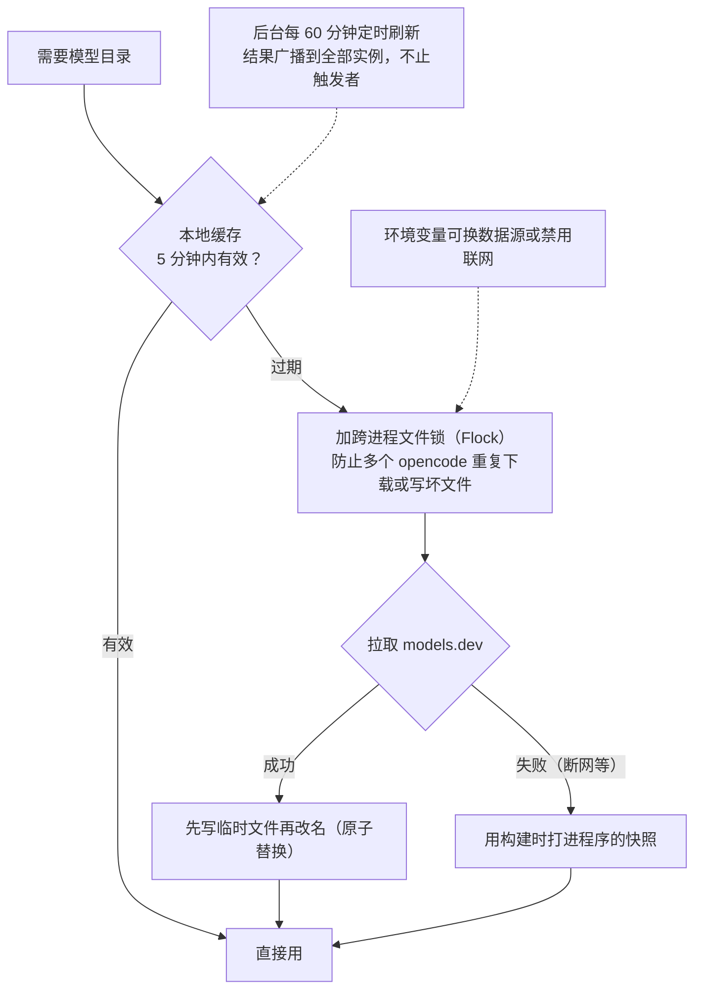

**快照养护从定时任务改成了发布时抓取**（提交 5ae201c304、d5bb993278）。此前的养护是 GitHub Actions 定时任务（每天 12:00 UTC 在发布分支重新生成内置快照文件，工作流 `.github/workflows/models-snapshot.yml`），2026-10 下旬连同 stats/containers 工作流与 OpenCode GitHub Action 一起移除，快照短暂成为"打进程序之后就没人更新"的静态文件。随后发布流水线补上了新养护：每次发布先抓一次 models.dev 目录（`packages/core/script/update-models-snapshot.ts`，拉不到时保留仓库里现有的快照），抓到的目录作为构建产物传给各构建作业，以 `OPENCODE_MODELS_SNAPSHOT` 环境变量打进程序、取代仓库里的静态快照；构建出的二进制还要过一道冒烟校验（`packages/cli/script/catalog-smoke.ts`）——解码并归一化打包副本，模型总数不得低于一个下限。下限不是要求相等：防的是错误页，或一个仍能解析成功的小对象被当成完整目录。目录读取本身也多了新源（提交 65096cd354）：可以从实验 v2 API 拉目录并转成 v1 形状，只解码 opencode 读的字段，单个模型不合形状就跳过、不拖垮整个目录；打包时丢弃 opencode 从不读的模型字段让副本保持小，其余字段（包括 models.dev 以后新加的）按发布原样保留。运行时获取目录的策略不变：本地缓存 5 分钟、跨进程文件锁、拉不到退回打包副本、后台每 60 分钟刷新。

**模型清单开始按类型分层。** 此前目录一律排除非对话模型（realtime、embedding、reranking，见"模型接入"）；现在模型带类型字段，协议可以按类型请求清单——像事件过滤那样列出"所有图像模型"，只挑会话模型的解析逻辑够不到这些条目（提交 ae876eec1b）。目录提供方随之长出 image 与 decision 两类入口（提交 b2e4c77621）；配置里的自定义模型也能声明类型（提交 a697f53611）：`models` 下给自定义模型配 `type`（如 `"image"`、`"document"`）就按该类型入清单，不配默认按 chat。

**stats 包**是它家云上的统计服务（嵌套的小 monorepo，分 app/core/server），查询用的是 Cloudflare 的 R2 SQL 服务，有两处讲究的代码（`packages/stats/core/src/r2-sql.ts`）：查询按游标分页（每页 1 万行，超了报错而不是默默截断）；每页的获取单独包了重试，注释写得很直白："只重试这一页；一次瞬时超时不该丢掉整个展示窗口的回填"。重试条件精确到错误码：R2 的临时错误码 40005、HTTP 429、以及一切 5xx 才重试，最多 2 次、间隔从 5 秒起指数增长；语法错误、认证错误一律立刻失败。

## 事件与存储

### 事件：类型即文档

几十个包之间怎么知道"发生了什么"？靠事件（event）：某处发生了事就广播一条，关心的包自己响应。事件多了会乱（重名、格式不一），OpenCode 的做法是把**所有事件类型集中登记在 schema 包的事件清单里**（`schema/src/event-manifest.ts`），按领域分类：会话、权限、LSP、MCP、界面、文件系统监视等二十多组。类型即文档，其他包引用时编译器直接检查字段。

清单里有一条关键的分界：**持久事件（durable）与瞬时事件分开**。持久事件要保存下来（会话消息、状态变更），每条带有序号（seq）和聚合根 ID（aggregateID），可以按序回放重建状态（这个思路叫事件溯源，event sourcing：不存"当前状态"，存"发生过哪些事"，状态是回放算出来的）；瞬时事件广播完就丢。该存的不存会丢数据，不该存的瞎存会撑爆存储，这条分界必须显式划出来。

事件发布有统一出口（`event-v2-bridge.ts`）：发布时自动附上"发生在哪个目录、哪个工作区"的位置信息，订阅方可以只订阅自己关心的范围；同时转发给全局总线，推送给各个界面。终端界面就是靠这条总线活的：收到"工具开始执行"就画进度条，收到"权限询问"就弹确认框，收到"消息部件更新"就刷新文字。持久事件额外带序号，界面断线重连后按序补齐错过的状态即可，不用整页重拉。

### 事件流：编码一次，独立队列

事件流送出到 HTTP 客户端这一段做过一次重做（有专门的设计决策记录）。旧做法的问题在规模上去之后才暴露：以前每个打开的事件连接各自做一遍"过滤公开事件、按 schema 编码、JSON 序列化、装 SSE 帧"（SSE 是服务器向浏览器单向推流的标准格式），N 个终端界面连着，同一个事件就要完整编码 N 遍。重做后服务器级只留一条编码通道：事件进来，过滤、编码、装帧各做一次，产出一份不可变的帧字符串，同时递给每个连接自己的队列。每个连接的队列独立有界（容量 4096 帧）：谁读得太慢塞满了自己的队列，就只断谁（连接收到溢出错误被掐断），事件照常发给其余连接，发布方绝不被慢客户端拖住。按设计记录里的基准，50 个客户端时每事件处理耗时从 554 毫秒降到 12 毫秒（约省 97.8%）。还有一条善后规则：一条公共事件编码失败，记日志、断开当前所有连接、跳过这条坏事件、feed 继续可用——宁可让客户端全体重连，也不留"某些客户端悄悄缺了一块"的静默空洞。

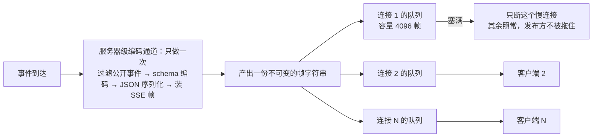

### 存储：SQLite 与媒体去重

**存储**统一为 SQLite（`core/database/`，用 drizzle 做类型安全的查询），打开时设置 WAL 模式（一种让读写并发更好的 SQLite 配置）、忙等待超时、外键约束，再执行版本化迁移；数据库路径按安装渠道（stable/beta/dev）隔离，避免不同版本的库互相污染。旧版存储（"一个对象一个 JSON 文件"，`storage/storage.ts`）已在 v2 合流中移除。

会话里的媒体（图片、音频这类附件）有了专门的去重存储：内容按哈希寻址进一张 blob 表，消息里只放 `media:<hash>` 引用——同一张图被引用多少次都只存一份（`packages/core/src/session/blob.ts`，提交 70c69f06f9）；写入走 `experimental.media_blob` 开关、默认关闭（提交 e12fad949b）。blob 存储留下一道后续问题：消息里只有 `media:` 引用，字节在服务器上，客户端得有地方取。实验端点 `GET /api/experimental/media/:hash` 补上了这一步（提交 e928d4ffa1），配 opt-in 的 `experimental-media-uri` 能力——客户端声明这个能力后，会话消息里的文件保持 `media:` 引用、按哈希取回字节；客户端拿到的引用还可以作为附件送回（`packages/core/src/session/prompt.ts:163`）。不开能力、或会话位置没开 `media_blob` 时照旧内联。同一次清理还删掉了从未启用的 `session_pending` 表，并把历史压缩的边界固定下来（提交 44fc9d2a65）。

### 部件表：session_part

消息的存储结构也拆出了一层。此前部件埋在消息的 JSON 大字段里，"清空某个旧工具的输出"这种部件级操作，得把整条消息的大 JSON 读出来、改一个字段、再写回去。部件不再埋在大字段里，而是各占一行进独立的 `session_part` 表（提交 c1b5f1b416，迁移 `20261029002625_session_part`，主键是消息 ID 加序号，另带会话 ID、类型、工具调用 ID）。写历史时投影器把每个部件写成一行，读历史时按序号装回各条消息的 `content`；没有部件的旧行保留内联内容原样可读，老数据不用迁移（`packages/core/src/session/history.ts:94-95` 的注释）。压缩"清空某个旧工具输出"这类部件级操作，动的从此是表里的一行，而不是整条消息的大 JSON。分叉会话走了另一头：复制父会话消息时把表里的部件读出来、内联进分叉自己的消息 JSON，读起来与父会话一致（`packages/core/src/session/projector.ts:194` 的注释）——分叉是复制不是引用，不共享父会话的部件表。写入、读取、分叉三条路径合起来看：

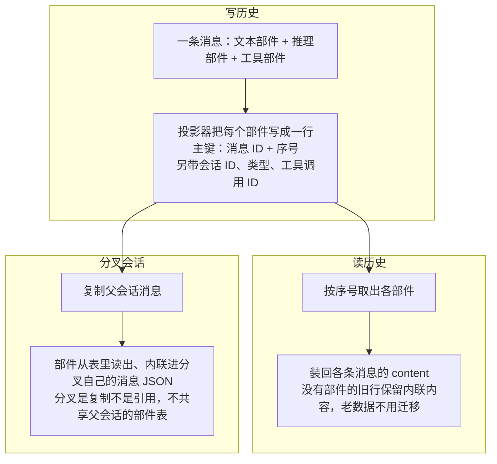

### 定时任务：时间也是事件源

时间也成了一种会触发会话的事件源（实验性，`experimental.schedules` 开关，提交 4585c316c3）。它解决的问题：有些活不需要人盯着——"半小时后提醒我看看测试跑完没有"、"每天早上跑一遍构建"，这些都应该由系统到点自己发起。`packages/core/src/schedule.ts` 把定时任务存进一张 SQLite 表（迁移 `20261026223005_schedule`）：一条任务指定何时（`when`：`in` 一段时长后、`at` 某个时刻、`every` 固定间隔、`cron` 表达式，可带 IANA 时区，`packages/schema/src/schedule.ts:38-49`）、做什么（`action.prompt`，一段提示词）、投给哪个会话，可选结束时刻与剩余次数。

到点触发就是向该会话以 `steer` 投递方式发一条提示（`schedule.ts:266-272`）：消息 ID 由任务 ID 与第几次运行推出（`msg_<任务ID>_<次数>`），崩溃后重试与此前的受理对得上、不会重复投递；晚于到期 60 秒以上的触发标记为 late。周期任务错过的时间槽不补发——`every` 保持相位、跳过所有错过的槽（`schedule.ts:150`），提示词失败的任务 5 分钟后再试。

这个功能仍标着实验性，且默认关：配置里要写 `experimental.schedules: true` 才启用（`schedule.ts:216-225` 判断严格等于 `true`；提交 da87c475a7 把默认改回关，恢复 opt-in 语义）。所在位置没开开关的任务到点不投递，标成 disabled、一小时后再看——为什么隔这么久，注释交代了原因：读开关本身会把任务的会话位置拉起来，每个周期都查就等于逼着所有位置常驻；行里的到期时间原样保留，开关重新打开后按错过的时间槽追上（`schedule.ts:450-455`）。

全部状态在表里，触发循环就不必绑在某个特殊进程上：每个 server 进程都跑一份循环（`opencode serve`、`--standalone`、被嵌入的服务皆然，`packages/server/src/process.ts:114-115`），至少每 30 秒重读一次表，时钟跳变与丢失的唤醒都能被追上；共享同一数据库的进程靠 KV 表里的一行租约选主，至多一个活跃的 leader（`schedule.ts:75-77`），租约 60 秒过期、持有者每 20 秒续期（`schedule.ts:95-97`、`:593`），每轮触发前先确认自己仍是 leader（`schedule.ts:450`），没抢到的进程这一轮空手而归。一次性的 `in`/`at` 任务跑完即终态。

到点不一定要唤醒会话：任务可以带 `if` 条件（到点先查，通过才投递提示）和 `until` 条件（满足即停，`packages/schema/src/schedule.ts:136-137`）。`shell` 条件跑一条命令，按退出码或输出判定，可选 `is`/`matches`/`changes` 三种谓词之一，输出截到 32KB、30 秒超时（`packages/core/src/schedule/check.ts:11-12`；条件机制由提交 c784d17b83 引入）。`code` 条件在受限的 Code Mode 运行时里跑一段代码：不调模型、没有网络，`tools.<路径>(...)` 形式的工具调用由静态扫描从语法树里提取、建任务时就逐个授权（`packages/schema/src/schedule.ts:86-95` 的文档注释，提交 c24c5af3d8）；程序拿到 `state`（上次检查留下的状态，初始 null）、`now`、`runs`，返回布尔或 `{ wake, state?, message? }`。

定时检查是无人值守跑的，围栏因此格外紧，有两条值得记：排程类工具（建/停/续/删任务、改会话、动 worktree）在检查代码里直接禁止，检查不能自己再造任务（`check.ts:20-29`）；建任务时的授权不保存——"总是允许"会存成项目级放行，而定时检查是无人值守跑的，一次点击换不来永久通行（`check.ts:237`）。检查连续失败会计数并暂停任务，语法错误、未知工具这类"检查本身坏了"的失败更是立即暂停（提交 055a2a9c13）；带检查的任务最短间隔 15 秒，不带检查的 1 分钟（`packages/core/src/schedule.ts:88-89`）。创建入口从配置一侧扩到三处：agent 的 schedule 工具、`/schedule` 斜杠命令、实验 HTTP API（提交 fbb47c995e）。一个任务从建到停的完整生命周期是：

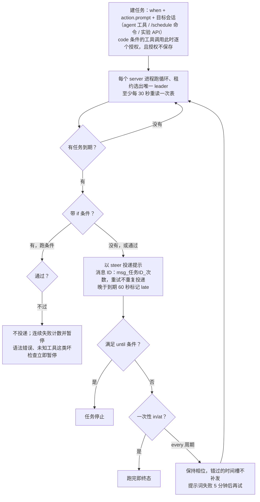

## 本地服务与多端接入

OpenCode 的核心逻辑跑在一个本地 HTTP 服务里（`server/server.ts`）：默认端口 4096，被占用就自动回退到随机端口；接口用 Effect 的 HttpApi 定义，能自动生成 OpenAPI 文档（一份机器可读的接口说明书）；配 WebSocket（长连接推送事件）和 mDNS（局域网服务发现，可选）。

这个服务就是"总插座"。终端界面、桌面应用、网页版都是它的客户端，第三方开发者用 `sdk`/`client` 包（由 protocol 自动生成，改了协议跑一遍生成命令即可）也能接。插件拿到的 `client` 同样指向这个服务，也就是插件和界面站在同一个接入面上，能力对等。这个"核心服务化、界面皆客户端"的结构，是多端一致的关键。桌面端有**设备配对**：两台设备经远程访问配对后互相可见，iOS 上发起的语音委托会以 Voice 消息的形态出现在会话里（提交 165cd2e832 与 PR 54426）。

### 终端守护进程：process-daemon

终端进程另有一套专门的守护进程服务（`packages/process-daemon`，原独立的 opencode-pty 仓库并入 monorepo，提交 76e1f5b0cc、f4ecbf31f3）。它解决的问题是：终端子进程（PTY，伪终端，让程序以为自己跑在真实终端里）生命周期长、状态复杂，放在界面进程里跟着界面一起死不合适——界面关了再开，终端里跑着的构建不能也跟着没。所以由一个独立守护进程持有终端子进程并维护权威的终端状态，每个终端有独立的阻塞 I/O 与 actor 线程——一个终端卡住不拖累服务和其他终端。

接入走一条私有的本地字节流（Unix socket 或 Windows 命名管道）加一份原子注册文件：socket 落在仅属主可进的私有目录，默认在 /tmp 下、可用 `OPENCODE_PTY_SOCKET_DIR` 挪走；清扫其他实例遗留的 socket 时，优先按对方注册文件里登记的路径找，且只删属于当前用户的（提交 5f394f64fc）。订阅一个终端的输出流改为阻塞等待事件，不再每 100 毫秒醒来轮询一次；守护进程被要求关停时，阻塞中的空闲订阅仍会被唤醒并正常关流（提交 f5cac1277c）。主循环也不再空转：Unix 上守护进程在监听 socket 与一对私有唤醒 socket 上 `poll(2)` 睡眠，直到有连接到达、停止或所有权变更把它叫醒、所有权到期、或两秒的安全网到时；Windows 仍按固定间隔轮询，每 25 毫秒一次（`packages/process-daemon/README.md:70-71`、`src/transport/windows.rs:42`，提交 0610a81fc3、86ce19d96e）。停止与所有权的变更统一经 Control 通道走（提交 f0160a1262），所有权状态区分"已拥有"与"等待中"两相、共用代数与截止时间（`src/ownership.rs`）。

终端从属于会话，生命周期跟着会话走：创建持久终端必须给一个真实存在的目录——PTY 库原本会在目录无效时悄悄退回用户主目录，现在直接报错（`packages/core/src/persistent-pty/index.ts:184-192`，提交 756f832902）；会话被删除时，它名下的终端一并移除（提交 06bf854d0c）。客户端一侧，持久终端的协议处理抽成了共享实现（`packages/client/src/solid/pty.ts`），TUI 的终端面板等界面共用同一份（提交 067b741783）。终端现在也可以有名字：持久终端支持重命名（`packages/core/src/persistent-pty/index.ts:285-290` 的 `rename`），新标题经协议存到守护进程；对面的守护进程太旧、不支持这项能力时明确报 UnsupportedError，不悄悄忽略（提交 65c0d83f4d）。桌面应用同期把自带终端挪到持久 PTY 上（提交 ef712d3a78），与 TUI 共用同一套实现和生命周期，桌面侧净删约 1600 行。

### 一个被拆掉的能力：会话分享

一个被拆掉的能力：会话分享（把一次会话发布成公开链接）的后端已于 2026-10-15 下线（提交 9e68770074），随后剩余的分享端点与旧的分享存储也删除（提交 50c5fceea1、f2a34141b3），`/share` 命令不再出现在命令文档里。会话数据库里的 `share_url` 列还在（`packages/core/src/session/sql.ts`），只是没有东西再往里写。提交说明没有给出下线理由；从结构上看，公开分享需要一套托管存储和访问控制，是云端面上独立的一块，这是旁观者的推断，不是项目的表态。

## 设计原则

把前面的机制放在一起，能看出几条贯穿的设计判断：

- **核心定接口，边缘可替换**。模型、编辑器、语言理解、外部工具，四个方向各有标准接口（AI SDK 适配器、ACP、LSP、MCP/PluginModule）。OpenCode 自己只做"电网"，发电的活留给标准另一端的专家。
- **安全决策交给规则表，不交给模型**。权限的三值判断（allow/deny/ask）、"后写的规则生效"、命令前缀归约，全是确定性代码。模型可以建议，但不能自己批准自己。
- **分层单向依赖**。Schema 与 Core/Protocol 平级、共同指向 Server 的硬规定，用短期的"改代码要跨几个包"换长期的"内部升级不连累外部"。
- **资源留余量**。上下文永远给输出留 2 万 token；压缩先修剪再摘要、保留最近原文；数据库用 WAL。都是"不把资源用到 100%"的思路。
- **自动化管"跟着外部世界变"的事**。模型清单、快照、统计，全部交给定时任务和缓存策略，人只定规则。

## 可复用的做法

- **修 bug 必配测试**。一个 ACP 修复（恢复会话选项与推理边界）的同一个提交里带了近 300 行新测试，把出问题的场景固定进测试，防止回归。
- **重试三要素**：先分类（瞬时故障才重试，判断标准写成显式的错误码条件）、粒度要小（只重试失败的那一页，不推倒整个流程）、要有上限和退避（次数封顶、间隔递增加抖动）。
- **配置报错的用户体验**：支持注释、报错精确到行列并画出原文、自动补 `$schema` 让编辑器参与校验。工具的体验一半藏在配置体验里。
- **定时任务的克制**：没变化就安静退出、并发排队不互砍、推送前先同步、用独立机器人身份提交。自动化的"署名"要和人分开。
- **加自定义 HTTP 头要成对管理**：往下游请求里加的每个内部标记头，都要想清楚在哪个环节删掉，别把内部信息漏给第三方。
- **把团队规范写给 AI 看**：`AGENTS.md` 同时约束人和 AI（分支命名、提交格式、代码风格、依赖方向），这份文件本身就是可以抄的作业。
- **调试输出也要脱敏**：`debug config` 命令打印配置时按字段名打码——名字命中 api key、secret、password、token 这类模式的值一律换成 `***`，URL 里内嵌的用户名密码或含敏感参数名也一样处理；只动展示用的输出，运行时真实配置保持原样。展示层和配置层分开，调试工具本身不变成泄密渠道。
- **编码一次，独立队列**。事件广播这类一对多场景，把"过滤、编码、装帧"提到服务器级只做一次，每个连接持一个独立的有界队列；谁超限只断谁，生产者永不被慢客户端拖住。配一个基准数字（50 客户端 -97.8%）和一条"宁可全体重连、不留静默缺口"的失败处理，比任何"高性能"宣传都具体。
- **策略文档反向读**。普通配置按"越具体越优先"合并，策略语句却把文档顺序反过来应用（用户全局最后），用读取顺序表达"仓库改不动用户的全局禁令"。优先级不必总是"更具体的赢"，要看谁需要否决谁。
- **把否掉的方案留档**。目录变换的设计记录完整保存了被否方案（插件改全量配置）的流程图和代价分析。评审的价值一半在被否掉的那一半里，留着它能少走回头路。

## 修订记录

- 2026-09-21 初版：基于 dev 分支 commit `17b7678` 完整成文（学习日志自 `193de13` 起跟踪至 `d870e22`）。
- 2026-09-24 基于 commit 82d4c89 补充：`debug config` 输出凭据脱敏（字段名命中敏感模式或 URL 内嵌凭据一律打码，只动展示层不动真实配置）；同期模型目录跟进 GPT-6 Sol/Luna、Grok 4.7 等新模型支持（日常体现，未单列正文）。
- 2026-10-11 基于 commit 7b3d4ce3a7 补充：v2 分支整体合入 dev（5caf1f9f6f "promote v2 to dev"，约 1.9 万条提交、近 8000 个文件），仓库进入 2.0 系列——主包 `opencode` 拆散并入 `core`（现 35 包），依赖规定改为 Schema → Core/Protocol → Server（Protocol 与 Core 平级）；新增 v2 会话契约小节（收件箱准入与 steer/queue 投递、写前执行声明与启动恢复、一步多物理尝试、指令按内容寻址的值增量）；事件流改单次编码加每连接 4096 帧独立队列（50 客户端编码耗时约 -97.8%）；权限体系外新增 `experimental.policies` 策略层（provider.use/tool.use/integration.use，用户全局覆盖仓库、组织托管最终权力）；工具契约重写（output/content/metadata 三值、作用域化注册、注册表统一截断）；插件引入目录变换模型；旧 JSON 文件存储移除、`tool/registry.ts` 等旧路径失效已注明。
- 2026-10-14 基于 commit 46e4695b 补充：回复截断自动续答（输出顶到 token 上限时续发请求接回剩余部分、Gemini 拆段回复续接）；提供方级 compatibility 兼容选项并迁移 setCacheKey，Anthropic 缓存断点可用 compatibility.cacheFormat 配置；应用内 auto-accept 权限改为按项目设置、可覆盖全局默认；server 插件获得 credential.activate 凭据激活入口；发布 v2.0.28，发行渠道新增 WinGet 与 ARM64。
- 2026-10-17 基于 commit 07bbd0fd16 补充：策略配置转正（顶层 policies，experimental.policies 弃用）；插件可发起权限请求（assert，与内置同一通道）；模型推理档位从配置读取；桌面设备配对（远程访问）与 iOS 语音委托以 Voice 消息显示；TUI 新设计实验、diff 侧栏默认打开、/copy 复制最后一条助手消息、逐回合变更文件摘要；发布 v2.0.29 至 v2.0.32。
- 2026-10-20 基于 commit d85746a054 补充：压缩改为总结整个对话（总结请求前缀与普通请求一致以复用 prompt cache）、自动压缩余量提至 15% 且至少 16k token 吸收单步暴涨；图片裁剪决策跨请求保持稳定；已保存权限可编辑；todowrite 以实验开关恢复；会话归档恢复、Windows 持久 PTY、Gemini Live 临时令牌。
- 2026-10-20 结构重组：改为 pi.md 同款的问题主线结构——主轴定为"自己不发电，做电网"（四个标准接口方向）；LSP 与 ACP 归并为"标准协议"一节；"更新记录"更名"修订记录"；正文时间线叙事收敛为现状描述，演进历史归修订记录。
- 2026-10-21 基于 commit 86a0950c61 补充：项目位置按活动卸载（experimental.location_idle_timeout 默认 60 分钟、运行中会话与后台任务保持加载）；Code Mode 自带解释器的 promise 语义修正（每个 job 跑到完成、工具调用仍并发）与运行时跨执行复用；赠送额度错误类型化（provider.free-limit 带 retryAfterMs，TUI 显示重置时间）；models.dev 目录刷新广播到全部实例；提供方 streamUsage 兼容开关与 store 字段按提供方发送；会话分享后端 10-15 下线、本轮删尽端点与旧存储；发布 v2.1.0、v2.1.1（内部重构：provider-context 改名 native、会话旧 schema 分离到 session-legacy，笔记正文未受影响）。
- 2026-10-22 基于 commit f0200df8e6 补充：提供方 baseURL 覆盖目录里全部模型端点（按模型配置仍优先）；OPENCODE_DISABLE_FREE_MODELS 隐藏不收费模型；缓存断点默认放法（工具定义末尾、首尾系统部件、对话尾部，四断点限额，跳过 compaction/effort 部件）与按上游区别对待（网关上游免断点、Gemini 只认最后一个、Qwen 忽略工具断点）；压缩摘要输出上限与正常回合同规则并保底 32000 token；会话标题用 small 模型或更低推理档位；retryAfterMs 对任何带该字段的提供方错误传递；发布 v2.1.2。
- 2026-10-23 基于 commit 6102079a0e 补充：实验性后台压缩摘要（precompute_compaction：用量到上限 85% 且至少 64k token 时后台预总结"最新响应之前的前缀"以命中缓存，自动压缩到点换入现成的，连败 2 次停开）；摘要转录放不下时从最旧轮次逐级缩短、最新轮次只缩短不省略；client MCP（客户端应用自己跑 MCP 服务器、opencode 经入站 WebSocket 连接且传输不外拨、connectClientMcp 助手、TUI open_terminal 实验走此路）。
- 2026-10-24 基于 commit df6fb9a460 补充：ChatGPT 上下文上限拆成独立提供方插件（openai-context-caps：272k 默认、gpt-6.1-sol 500k）；模型目录排除 realtime/embedding/reranking 三类非对话模型；实验开关 precompute_compaction 更名 background_compaction（正文已随改）；会话转录保留逻辑从 TUI 挪到共享 client 层、后台回合重新填充的非保留会话参与驱逐；MCP 服务器关机并行停止、初始对账不再重复启动已启动的服务器。
- 2026-10-25 基于 commit 13a615b902 补充：费用与额度成为一等数据（四协议记录厂商上报费用；Console 接入拉取滚动/周/月三窗口额度表与按模型花费；budget exceeded、usage limit 等错误单独归类；TUI 显示限额与会话零花费时的 Go 额度；额度数据不进消息与会话记录）；GPT-Live 经 Console 连接提供、不需用户自己的 OpenAI key；插件激活前每步与每次工具调用等待激活完成；MCP 单个畸形工具跳过不再拖垮整台服务器；工具 schema 转换与 prompt hook 模型解析各做一次、git 发现按指纹缓存（性能）。
- 2026-10-26 基于 commit 01cd723db9 补充：会话媒体按内容寻址存入 blob 表（media:<hash> 引用去重，写入走 experimental.media_blob 开关默认关闭）；删除从未启用的 session_pending 表并固定历史压缩边界；正文改写一处变动：models-snapshot CI 工作流连同 stats/containers 工作流与 OpenCode GitHub Action 一并移除（5ae201c304），快照成为打进程序的静态文件、源码注释仍指向已不存在的刷新脚本。另记小项：agent 与 provider 列表等待插件就绪（61163cb134）、断线期间错过的运行中会话补注册（f6991636a5）、目录更新仅在内容变化时发布（01cd723db9）、不持久的事件跳过编码（2d91ed57ae）、CLI 关闭带 10 秒期限（b6cbbd7646）。
- 2026-10-26 基于 commit 01cd723db9 补充：一次请求的完整路径节新增端到端流程图（收件箱挂号与投递、步内重试、压缩触发；内容取自正文已有机制，不引入新事实）。
- 2026-10-27 基于 commit 82b572439c 补充：快照养护回归自动化（d5bb993278 发布流水线每次发布抓一次 models.dev 目录打进程序、冒烟校验打包副本可解码且模型数不低于下限——正文改写 2026-10-26 行"没有自动化"的说法），目录可从实验 v2 API 读取（65096cd354，只解码读的字段、坏模型跳过、打包丢弃不读字段）；可配置缓存寿命（cache: { ttl } 自动放置外加 models.dev duration 格式的寿命，Anthropic/Meta 放每个 cache_control 标记、忽略内联标记的协议走请求级选项）；模型清单按类型分层（协议按类型列模型 ae876eec1b、目录提供方 image/decision 入口 b2e4c77621、自定义模型可声明类型 a697f53611）；LLM 流可选原始提供方帧事件（includeRaw: true，93701210bd）；实验媒体端点 GET /api/experimental/media/:hash 与 experimental-media-uri 能力（e928d4ffa1）；实验 Extraction API（Cloudflare Clairic，从文本读类型化值，b21b21babb）；ChatGPT 登录目录加 GPT-6.1 Terra（4e982c0814）。
- 2026-10-27 文体修订：按"段落以问题为单位"的标准改写正文——变更清单式、时间线串联的段落改为问题立意（提交号降为注脚），过长段落按主题拆分；不引入新事实，机制描述与引用保持原状。
- 2026-10-28 基于 commit 14e378b679 补充：Code Mode 调度层重做（解释器与内置对象改纯生成器加单条任务队列、fiber-per-async-call 移除、Effect 限三个文件并用 lint 钉边界）与程序卡死诊断（错误指到永不落定的那个 await）；终端守护进程 opencode-pty 并入 monorepo 为 process-daemon（私有 socket 目录可挪位、清遗留 socket 按注册路径且只删本用户的；订阅改阻塞等事件、不再 100 毫秒轮询）。另记小项：429 限流不再被正文措辞误判为上下文溢出（618b890667）；webfetch 的 URL 规则套到重定向目标上（17837a20d6）；提示词缓存设置不进模型变体（变体设置类型只带 compaction/encoding，24bf4d488a）；移除从未启用的 ManagedPolicy 服务（d78b817631）与 legacy Console 配置路径（5e31344455）；快照兼容 split-index 仓库（1ed00ce62d）、快照捕获合并去重（cdaba26fa5）；应用侧精修群（artifact 预览与文件动作 b3de41a572、模型徽章去掉悬浮详情 2cc6d4f051、工具元数据非对象不崩 3a409f42f5、悬浮提示后位置快捷键仍可用 3f74f03f2e、会话 UI 细节 432d870b02、320445aa09）。
- 2026-10-29 基于 commit 77a0fd6f3b 补充：定时任务（实验性 experimental.schedules，schedule.ts 存 SQLite 表，when 为 in/at/every/cron 带时区，到点以 steer 投递提示、消息 ID 由任务与次数推出、错过的槽不补发、失败 5 分钟重试、只有受管服务进程跑触发循环且至少 30 秒重读一次）；freeform 工具（单一必填字符串参数写成原始文本或按 regex/lark 文法，OpenAI Responses 与 Chat Completions 作 custom tool 发送、无回退）；Code Mode 扩展全局可返回 Effect（before 钩子放行后启动、依赖并入运行时环境）、before 钩子先于宿主调用、search 可 await/链式、解析错误带位置与提示；主请求输出上限留窗口 1% 余量而压缩请求不留；process-daemon 主循环 poll 等待而非轮询、Windows 25 毫秒、停止与所有权经 Control；元信息块"笔记基准"自 82b572439c 补齐到当前基准。另记小项：subagent 工具说明告知可向运行中的 subagent 发后续消息（0e102908e3）；/reload 重载配置（35a4a6876d）；实验性 SDK 方法归到 client.experimental（9a9386edbc）；app 可选 experimental-media-uri 且草稿媒体字节留在本地（f822b107e9）；后台 shell 的输出可从 pill 查看（97fd7acc41）；长用户消息可折叠（实验设置，651032bc27）；迁移的 V1 主题按新设计排布（b7992598be）；ai 包：OpenRouter/DigitalOcean/Venice 的 Responses 路线（dd35fbc2f4）、移除 fal/Black Forest Labs/Replicate/Stability（dfa63293df）、MiniMax 图像生成（7461d15208）、provider model() 设置可选（0416987a6c）、Promise 客户端暴露压缩（ced73dc0f6）、默认请求内联图片字节（506ac20c80）、移除捆绑的 cohere/vercel/perplexity SDK（fc6922f6b8）；process-daemon 发布 0.3.2（4d33928e25）。
- 2026-10-30 基于 commit a070e11643 补充：/goal 目标循环（评审提示词只认对话内证据、不认助手自称完成，判决 done/continue/blocked/paused/wait，最多 50 轮、连续 3 轮无工具调用、等后台 30 分钟三道上限，状态存插件存储分叉不继承、记进程启动 ID 重启后回 paused，写前重读防覆盖用户指令）；内置图像生成工具 experimental_image_generate（后台任务式、有可用图像模型才注册并随目录重评、配置字段降为偏好、说明要求未被要求先询问）；定时任务条件检查（if/until 条件，shell 条件按退出码或输出判定，code 条件在受限 Code Mode 运行时静态扫描工具调用并建任务时授权、授权不保存，排程类工具在检查代码中禁止，检查连续失败暂停、坏检查立即暂停，创建入口扩为 agent 工具、/schedule 命令与实验 API）；shell 命令分析换成手写解析器（tree-sitter WASM 依赖删除，正文陈旧引用 permission/arity.ts 随改 shell/parse.ts），参数中间的文件重定向、PowerShell 方法调用与动态目录变化纳入权限扫描；策略动作从三类拆为七种（新增 integration.connect、integration.use 限定到集成账号，mcp/skill/plugin.use 拆分、旧前缀写法解码时自动转换）；部件存储拆出 session_part 表（读历史按序号装回、旧行内联可读、分叉时内联复制）；持久终端生命周期（cwd 必须真实存在否则报错、会话删除连带移除终端、客户端协议抽共享实现）。另记小项：MCP 工具失败保留权限原因与用户反馈（b653a6260f）；Code Mode execute 进度最多每 100 毫秒一发（b6f82bf15e）；告知 Code Mode 模型内置工具保持在顶层（aaa0d7c8f6）、for...in 遍历继承的可枚举键（ecc075a043）；fork/导入会话的媒体字节也存 blob（510aa79d07）；会话记录最近一次执行开始时间（d500927b9d）；插件服务器事件流跟随端点（5c0376f949）；Codex 登录目录提供 gpt-image-2（d142014e41）；OpenRouter 图像编辑按输入引用发送（27641b362e）、图像尺寸按各家协议期望发送（78c31ea68c）；TUI 存储图像按引用加载（84aed13ac8）；image job 通知带任务 ID（28a3974efc）；发布 v2.2.1、v2.2.2，process-daemon 发布 0.3.3、0.4.0。
- 2026-10-30 结构重构：按特性端到端的标准重写全文——每个机制补问题引子与完整执行路径，新增收件箱与执行声明、目标循环、压缩三级减负、后台预计算摘要、权限询问流程、策略与权限双层把关、模型目录获取、事件流编码分发、部件表读写、定时任务生命周期等十余张 Mermaid 图；机制描述与引用保持原状，不引入新事实。
- 2026-10-31 基于 commit 958f965d35 补充：Claude Agent 提供方（f29e281322，PR 58782：经 Claude Agent SDK 驱动本机 claude、用户自己的 Claude Code 登录、系统提示词沿用 Claude Code 加 opencode 指令叠加、工具以 mcp__opencode__ 前缀 MCP 桥接、每会话长驻进程空闲 5 分钟停、老版本查出即报错）；实验 artifacts 工具组（8f0fc21e71，PR 60351：标题加文件映射加入口文件的工件，create/read/update/delete 四工具，提供方接口四个操作各是一个 Effect、内置 local 可插拔）；定时任务触发循环改为每个 server 进程都跑加 KV 租约选主（60 秒过期、20 秒续期，正文随改"受管服务进程"旧表述与三处漂移行号），experimental.schedules 默认改回关（da87c475a7，关着位置的任务标 disabled 一小时后再看、到期时间保留）；压缩提示词上限取输入窗口与上下文窗口较小者（cb1e58fe44）、compaction.buffer 接受百分比写法（6700dd87b5）；思考块重放不再降级成正文（822594b9ae，PR 60498：要求签名的丢弃、qwen/minimax 按原样发、Gemini 固定标记顶替、Mistral prefix 标末条）；后台任务恢复标记从 KV 搬进专用 job 表（664c8f0990，迁移 20261030054400_job）；Code Mode 的 fetch 过 webfetch 同一套权限（bdca40ac0e）；持久终端可重命名（65c0d83f4d）、桌面终端迁移持久 PTY（ef712d3a78，桌面侧净删约 1600 行）；stdio MCP 自行分帧、单条 16 MiB 上限（1a443ae42a）。另记小项：bash 工具名别名到 shell（ea982d7d8f）；ai 对象统一 Promise 与 Effect 两个入口（f0944f027b）；本地配置可覆盖 Console 下发的提供方（5759491ca0）；AI 错误保留 partial 输出（2d96b0f69f）；插件提供的模型变体得以保留（8f11d59d4c）；loopback 请求不走环境代理（78dda62d88）；发布 v2.2.3、v2.2.4。
