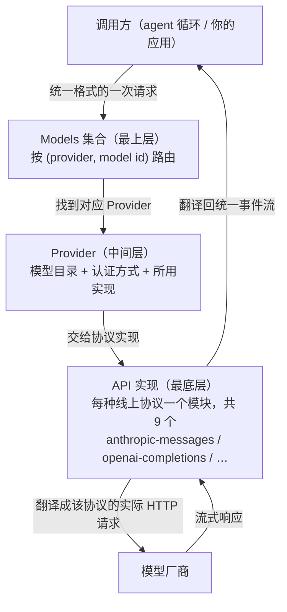
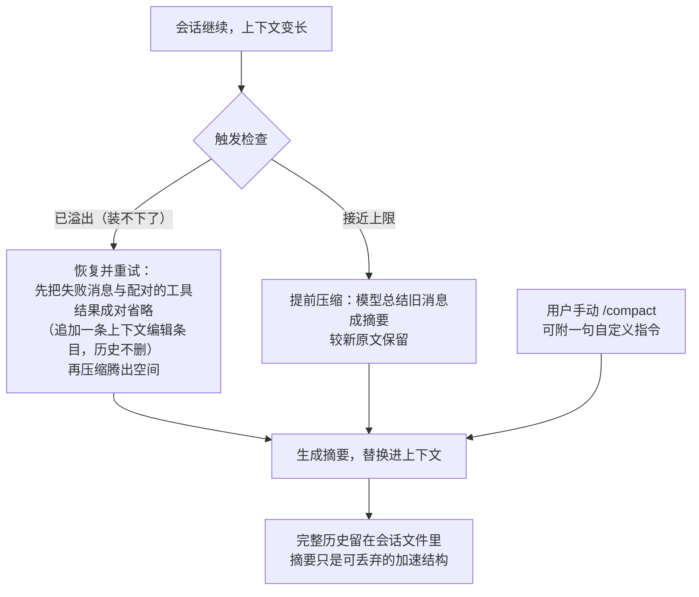
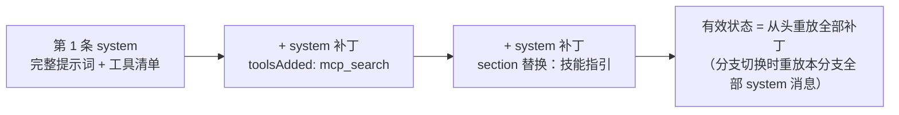
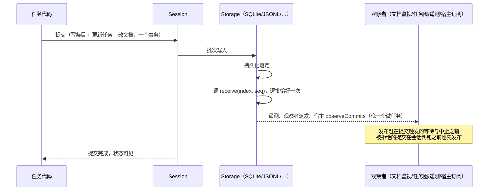
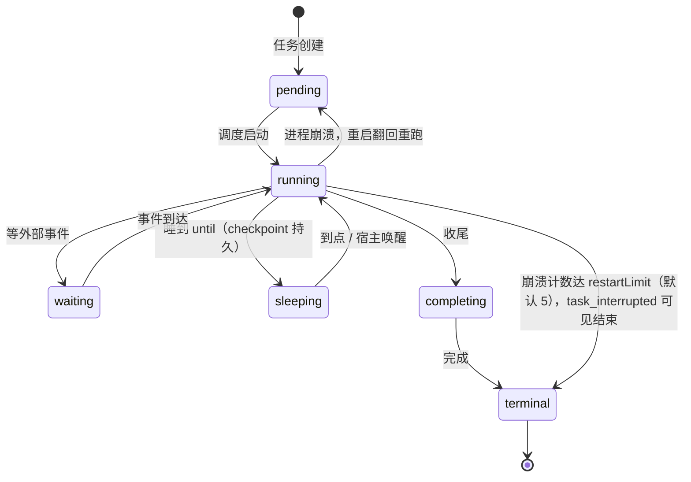
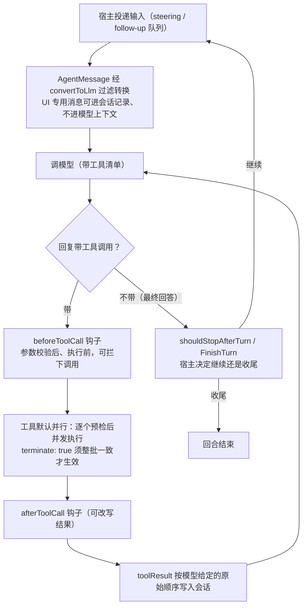
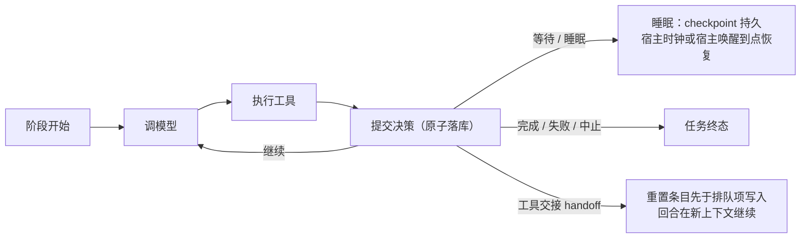
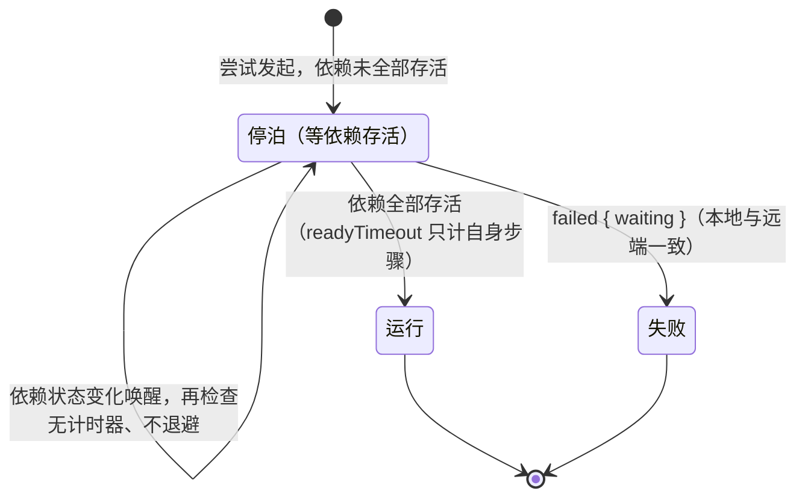
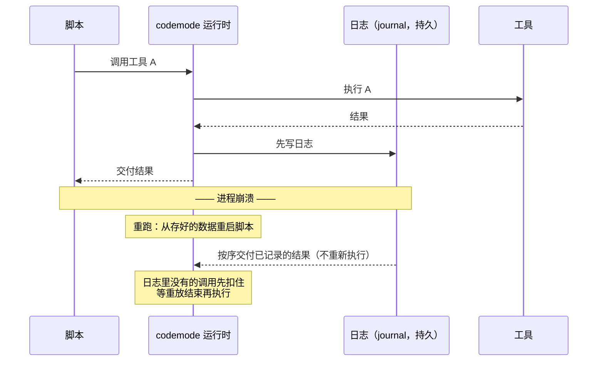

# Pi

| 源仓库 | [earendil-works/pi](https://github.com/earendil-works/pi) |
|---|---|
| 协议 | MIT |
| 主语言 | TypeScript |
| 笔记基准 | commit `d57c2d21`（2026-11-05） |

Pi 是 earendil-works 开源的 AI agent 工具包，TypeScript 写的，monorepo（一个仓库里放多个软件包）组织在 `packages/` 下，现在 12 个包，GitHub 上 star 数很高（旧笔记记录为 10.8 万）。它最出名的产品是 `pi` 这个终端编码 agent——在命令行里对话、读写代码的 AI 助手，同类有 codex、opencode、Claude Code。但它的定位不止于此，README 里的词是 "agent harness"（套件/外壳），意思是给你一套搭 agent 的现成骨架：从统一大模型接口、agent 运行时、终端界面库，到持久化运行时，一层一层都能单独拿出来用。

这份笔记按问题组织，不按 pi 的开发时间线：每个问题讲清 pi 现在是怎么解的、为什么这么解、代价是什么。讲法上，每个特性都从"它面对什么情况"讲起，把一次调用、一次提交、一次崩溃恢复从头走到尾，让不了解这个项目的人也能顺着读完。项目演进过程放在文末修订记录里。笔记起于 commit `c7cdb46`（2026-09-21），跟进到 commit `d57c2d21`（2026-11-05）。

## 它要解决什么问题

做一个编码 agent，绕不开四件事：接模型、跑工具循环、做终端界面、存会话。市面上每个产品都自己造一遍轮子，而且造法互相不兼容。pi 的做法是把这四件事拆成独立的库，每一层都能单独用：只想要"一套代码调所有大模型"，用 `pi-ai`；想要"能调工具、能出流式事件的 agent 引擎"，用 `pi-agent-core`；想要终端里的 AI 编程助手，装 `pi-coding-agent`，也就是 `pi` 命令；想自己写界面，用 `pi-tui`。

同时它对"agent 该长什么样"有一套明确的态度：核心保持极简，别人家内置的功能——subagent（派出去干子任务的独立 agent 实例）、计划模式、权限弹窗、记忆——它一概不做，改用扩展机制让你自己搭，或者"让 pi 自己给自己写扩展"。这个取舍是否合理见仁见智，但好处很具体：核心代码少、行为可预期、想改哪里都有明确的挂载点。

## 12 个包怎么分工

| 包 | 一句话职责 | 成熟度 |
|---|---|---|
| `ai` (pi-ai) | 统一多厂商大模型 API | 核心，已发布 |
| `schema` (pi-schema) | 无依赖的 JSON Schema 构建器与无 eval 的校验器，也能为 TypeBox 写的 schema 推静态类型 | 已被 ai、agent、durable、chord 采用 |
| `agent` (pi-agent-core) | agent 循环与工具调用（瘦身后只剩 Agent、循环、代理流和类型） | 核心，已发布 |
| `coding-agent` (pi-coding-agent) | `pi` 命令本身：交互式编码 agent CLI | 核心，已发布 |
| `tui` (pi-tui) | 终端 UI 库，特色是差分渲染 | 核心，已发布 |
| `telemetry` (pi-telemetry) | 与厂商无关的可观测性契约 | 已发布 |
| `durable` (pi-durable) | 持久化的会话/任务/文档运行时（内部代号 Pico） | 演进中 |
| `env` (pi-env) | SSH 远程执行环境，配一个 Rust 守护进程 | 新独立 |
| `chord` | 应用组合运行时 | 独立项目，只依赖 pi-schema 与 pi-telemetry |
| `codemode` | 沙箱化的 JavaScript 执行环境，脚本唯一的能力是调用注入的工具 | 服务于 coding-agent |
| `mcp` | 独立的 MCP 客户端包 | 服务于 coding-agent |
| `evals` | Pi 编码 agent 的行为评测 | 内部工具 |

包之间的依赖是单向的，下层不知道上层的存在：coding-agent 指向 agent-core 再指向 ai；durable 引用 chord 的类型与 delta、ai 的类型；chord 只依赖 schema 与 telemetry；telemetry 被 ai 和 agent-core 引用，自己不依赖它们。`schema` 包给的是"底下再垫一层"：自己无任何依赖，位置在 pi-ai 与 chord 之下、两者互为兄弟。切换已经完成（提交 6536f801、be039fb3，决定记录 `packages/chord/docs/decisions.md:2130-2139`）：ai、agent-core、durable 与 chord 的运行时依赖里都是 `@earendil-works/pi-schema`（各自 `package.json` 的 dependencies），TypeBox 在 pi-ai 退为开发依赖（`packages/ai/package.json:104`），主入口也不再再导出 `Type`/`Static`/`TSchema`。这意味着你在 `pi-ai` 里改一个协议实现，不用关心上面两层会受什么影响——它们只用统一的接口。有两个边界值得单独说：chord 的运行时只依赖自己的 delta 模块与 Node/浏览器内置能力，外加这两个 Pi 包（`packages/chord/docs/spec.md:6`），任何应用都能拿去用；agent-core 在 2026-10-01 做过一次大瘦身，实验性 harness、会话存储、压缩、技能全移出去了，包里只剩 `Agent`、循环、代理流和类型——连 SQLite 后端都单独分包过，就是为了不拖上需要编译本地 C 代码的原生依赖，如今这个顾虑随存储一并移交 durable。这种"每个包各管一摊、依赖只朝一个方向流"的布局，跟 opencode 的 monorepo 思路一致，是大型 TypeScript 项目的常见章法。

## 主轴：进程随时会死，任务怎么接着跑

大多数 agent 项目没有认真对待一个问题：进程死了，任务怎么办。常见的场景是：任务跑一半终端关了、机器休眠了、部署重启了，回来发现活儿没了。聊天式的 agent 无所谓，用户重开一个会话就行。但 pi 的定位是 harness，给长跑的 agent 搭骨架：一个自主任务可能跑几个小时、几天，中间宿主进程因为部署、崩溃、休眠随时消失。这时问题就来了：活干到哪了？从哪接着干？"三小时后重试"这种等待谁来记得？进程都不在了，谁负责叫醒它？

pi 对这个问题给出了一条贯穿全部包的答案：**把执行过程变成提交日志**。agent 的每一步——一条输入、一次工具调用、一个任务状态变更——都作为不可变条目原子地写进存储；进程回来后重放日志，就知道从哪继续。这个决策派生出几件事：等待本身是持久状态（任务带着检查点睡在数据库里，进程死了也不丢）；定时可以外包给宿主（Cloudflare 的 alarm 这类机制负责按点唤醒）；连 trace——一次执行的观测轨迹——也随任务持久化，崩溃不断链。"持久化与恢复"一节是这条主轴的完整展开，其余各节讲到的机制（流式响应怎么存、压缩怎么触发、定时怎么外包）都可以回溯到这条主轴上。

## 模型接入

先看一次最普通的调用：你的程序想问模型一句话，从发起到拿到回答，中间要经过什么。LLM（Large Language Model，大语言模型）就是 ChatGPT、Claude、Gemini 背后的模型，麻烦在于每家的调用接口都不一样：请求格式不同、流式返回的事件不同、参数名不同。直接对接意味着换一家模型就重写一遍调用代码。pi-ai 的解法是三层抽象，一次请求从上到下穿过它们：

最底层的每个协议模块只导出 `stream` 和 `streamSimple` 两个函数，职责单一：把统一格式翻译成该协议的实际请求，再把厂商的流式响应翻译回统一的事件流。中间层的 Provider 是一个运行时单元，拥有三样东西：模型目录（这家有哪些模型、各自什么参数）、认证方式（怎么证明"你有权调用"）、所用实现（走上面哪个协议模块）。最上层的 Models 注册多个 provider，按 `(provider, model id)` 路由每次请求。这个结构就像万能转换插头：你手上是各国插头（各家 API），墙上是一个统一插座（pi-ai 的统一格式），中间每种插座标准配一个转换头。换模型改一行配置，业务代码不动。

分层之外，这个库更值得看的是对协议差异的处理。"兼容 OpenAI 协议"只是大体兼容，细节千差万别：有的服务器不认识 `developer` 角色，有的不支持 `reasoning_effort` 参数，思考模式的参数格式有十来种写法（光 `thinkingFormat` 一项就列出 openai、deepseek、qwen、zai 等十余种）。pi-ai 把这些差异收敛成一个 `compat` 标志对象，对已知厂商按 baseUrl 自动检测，未知端点允许手工覆盖。这是"统一接口"落地的真实成本所在：它没有假装各家差异能被一个漂亮接口吸收，而是把真实差异显式建模成配置——抽象统一的那部分，把不统一的暴露出来。

其他几个设计点，按一次调用会碰到的顺序展开：

- **流式事件是一条统一的序列**：`start → text_delta / thinking_delta / toolcall_delta… → done`。工具调用的参数边到边解析（partial JSON，参数还没到齐就开始解析已到的部分），UI 可以在参数没到齐时就显示"正在写哪个文件"。解析本身换成了专门的增量解析器（提交 f715a15c，修 #9265）：`StreamingJsonParser` 与 `ToolCallArgumentsStream`（`packages/ai/src/utils/streaming-json.ts:109`、`:452`）把每个参数增量只读一次，成本与总长度成线性；解析状态（半截 JSON、参数草稿、流序号）不再挂在消息内容块上；九个协议实现、pi-messages 与 faux provider 全部走它。错误约定也定死了：流开始后不抛异常，失败（包括用户取消）一律以 `error` 事件和最终消息的 `stopReason` 传达，已生成的部分照常保留，还能接回上下文继续问。调用方因此不用在"流式读取"和"异常捕获"两套逻辑之间反复横跳。
- **模型目录是生成物**：`models.generated.ts` 由脚本从各家上游拉数据生成，人不能手改，要改就改生成脚本。目录里带价格、上下文窗口、能力标记。
- **目录里的模型分三类**，`type` 字段决定它能用在哪种操作上：聊天模型（`type` 可省略）走流式对话；`type: "image"` 生成图片；`type: "classifier"` 是分类模型，接收结构化的 JSON 状态（可以附带图片），回答一个或多个类型化的问题，走 TypeSafe 的 System One、Cloudflare Workers AI、OpenAI Decisions 这类分类接口，不走聊天 API（`packages/ai/README.md:305`、`:893`）。图片按各家的线上形式发——TypeSafe 用带 opt-in 头的资产、Clef 用 data URL、OpenRouter 用状态里的 `image_url` 部分，由 `SystemOneCompat` 的 `imageInput` 与 `sendImageOptInHeader` 两个标志选择（`packages/ai/src/providers/compat-schema.ts:535-543`，提交 7f225f2）。
- **认证解析有优先级**：显式传入的 key 最优先，其次是存储的凭证，最后才是环境变量。存储的凭证"拥有"它的厂商：刷新失败不会悄悄退回环境变量里的旧 key——凭证归属的边界到此为止，不共享。目录更新持续跟进新模型（如 GPT-6.1 Terra，提交 363ad78b）；对外部输入的防线也在加严（提交 89c921d8）：不可信 URL、终端文本与流式数据各自收紧了处理。
- **思考等级定了七档统一刻度**（`off` 到 `max`），`thinkingLevelMap` 负责翻译成各家的真实参数，不支持的档位标 `null`。
- **约束采样**（constrained sampling，让服务商在生成时就强制参数符合 schema）分两级：`strict: 'prefer'` 支持就用、不支持退回普通调用；`'require'` 不支持就报错。后者把"参数格式错误"从运行时问题变成了配置问题。
- **工具参数到了本地先转换再校验，校验引擎是 pi-schema**：模型给出的参数常常"长得像"但类型不对——把 `"3.5"` 当数字发来、给可选属性传 `null`。pi-ai 对每个工具的 schema 只编译一次、按 schema 对象缓存，编译时打开 coercion（强制转换：先把这类值转成 schema 想要的类型，再做检查），悬空的 `$ref` 只拒绝那一处、不让整个工具失效（`packages/ai/src/utils/validation.ts:15`）。转换只拷贝有变动的路径、从不改写输入，规则按三段走：丢掉可选属性上的 `null`，再套移植自 TypeBox `Value.Convert` 的规则，最后按 `type` 做原始转换（`packages/schema/src/coerce.ts:1-3`）。`Tool.parameters` 因此接受任何 JSON Schema 对象——pi-schema 的构建器、TypeBox 写的 schema、MCP 服务器给的纯 JSON Schema 都行（`packages/ai/src/types.ts:768-771`），MCP 工具从此也享受同样的转换，此前只有 TypeBox 构建的 schema 才有。代价是 TypeBox 特有的 `Type.Refine`、Codec、注册格式与按正则匹配属性名不再作用于工具参数（`packages/coding-agent/docs/extensions.md:172` 起列了清单）。类型层另有一手：pi-schema 的 `Static` 读 TypeBox 1.x 挂在 schema 对象上的 `'~kind'`、`'~optional'` 等记号反推静态类型，全程不 import TypeBox（`packages/schema/src/typebox-static.ts:1-2`），所以内置工具继续用 TypeBox 写 schema 也拿得到参数类型（`packages/coding-agent/src/core/tools/bash.ts:5`），常见 kind 之外的 Enum、Tuple、Intersect 推成 `unknown`。
- **请求头合并有一条固定的顺序链**：provider 认证头 → 模型元数据头 → 调用方显式头 → `transformHeaders` 回调最后说了算。客户端身份（`ClientIdentity`）是这条链最底下的默认值，上面任何一层配置的头都能覆盖它：`userAgent` 三选一——`detailed`（默认，发 `pi/<版本> (<平台>; <运行时>; <架构>)`）、`short`（只发 `pi`）、自定义字符串；`attribution`（归属，告诉厂商是哪个应用在调用）按厂商映射成各家的头——OpenRouter 收 `HTTP-Referer`、`X-OpenRouter-Title`、`X-OpenRouter-Categories`，NVIDIA NIM 收 `X-BILLING-INVOKE-ORIGIN`，OpenCode 收 `x-opencode-client`。pi-ai 自身默认不发归属头；pi-agent-core 和 durable（`HarnessOptions.identity`）默认发 pi 自己的 `PI_ATTRIBUTION`（`packages/ai/src/utils/identity.ts:24`），传 `attribution: null` 关掉；GitHub Copilot、Anthropic OAuth 这类自带固定客户端身份的厂商不受影响（`packages/ai/README.md:445-454`）。调试还有个 `onPayload` 回调，能看到发给厂商的原始载荷。
- **测试不花真钱**：faux provider 是一个内存里的假厂商，可以编排"先思考、再调工具、再回答"的脚本化响应，整条 agent 链路的测试不碰真实 API。
- **请求体积超限的判定不靠猜**（2026-10-20，提交 73f8de8）：判断"请求是否超出厂商允许的体积"，以前靠 token 数启发式，但各家实际上限不一致，估不准；现在收到 HTTP 413 一律判请求体积超限，触发上下文压缩后重试——与其猜，不如等厂商明确告知超限再处理。

虚拟模型（实验性）把"选哪个模型"也变成了扩展点：扩展用 `pi.registerVirtualModel()` 注册一个目录条目，它自己不连任何服务商，每个请求来时才挑一个物理模型和思考档位。"计划用强模型、实现用便宜模型""上下文变大就换大窗口"这类路由策略，由此是几十行扩展代码的事。上下文限制、压缩预留、图片尺寸都按实际路由到的物理模型计算——虚拟名字背后干活的是谁，账就算在谁头上。

## 上下文管理

### 压缩

模型的上下文窗口有上限（一次能"看"多少内容，按 token 计，token 是模型处理文字的基本单位），会话太长就装不下。压缩是标准解法：让模型把较早的消息总结成一段摘要，保留较新的原文。pi 有两层实现，先看产品层（`pi` 命令里的完整流程）：

手动 `/compact` 可以附一句自定义指令指定摘要侧重点；拆分回合时给前半段单独生成的前缀摘要也用同一句指令（`packages/coding-agent/src/core/compaction/compaction.ts:1078-1080`）。自动模式默认开，两种触发——上下文溢出时（恢复并重试）和接近上限时（提前压缩）。溢出恢复有一条配对规则：失败的那条助手消息和回答它工具调用的工具结果要一起从模型上下文里省略。为什么必须成对？厂商要求对话里的工具调用和工具结果一一对应，只省略助手消息、留下没有配对的工具结果，厂商会拒绝之后的每一个请求（`packages/coding-agent/src/core/agent-session.ts:1239-1272`）。配对关系在投影出的上下文里查找，当前运行和恢复后的会话走同一段逻辑。省略本身不是删除，而是追加一条"上下文编辑"条目（`appendContextEdit(entryId, null)`），历史仍然完整。

运行时层（durable）多了两条触发路径——手动、后台、阻塞、溢出四条；多个压缩请求并发时用 stale 规则裁决，过期的摘要请求直接作废；`beforeCompact` 钩子让扩展在压缩前介入；阻塞压缩失败判运行失败，不悄悄吞掉。压缩配置可以按模型覆盖（`compaction.modelOverrides`）——大上下文模型和小模型各用各的阈值与范围。

压缩有一条明确的立场：**摘要有损，历史无损**。摘要是可以丢弃的加速结构，完整历史永远在会话文件里，随时回看；切分支时被放弃的路径生成 `branch_summary` 条目留档。2026-10-18 起，压缩期间的等待本身也是持久过程——generation 重试轮询与压缩重试都走持久睡眠（见"持久化与恢复"），进程死了醒来接着等。

### 构造：系统提示词与消息注入

发给模型的每一轮请求都由三部分拼成：系统提示词（开头的固定指令，告诉模型"你是谁、能用什么工具"）、历史消息、本轮输入。pi 对其中最容易变的部分——系统提示词——有一套独特的存法。

**可重放的补丁序列。** 会话第一条 system 消息带完整提示词和工具清单，之后的变更——换了模型、加载了技能、增删了工具——都以 system 消息的形式追加，每条只记差异（`sections` 按名字替换小节，`toolsAdded`/`toolsRemoved` 记增删）。要得到任意时刻的有效提示词，按顺序重放即可，不需要单独存"当前状态"：

状态即历史，可审计、可回溯，天然适合追加式存储。恢复会话或用 `/tree` 切到别的分支时，当前工具清单就是把这条分支上全部 system 消息（含压缩之前的，压缩快照本来就由它们推导）重放一遍得到的。分支从没增删过的扩展工具，视为分支记录工具清单之后才注册的，按新注册工具的规则激活（声明 `defaultActive: false` 的除外）；分支删过的工具保持停用；清单里有但还没注册的工具（比如 MCP 服务器还在连接）等它注册时再激活（`packages/coding-agent/src/core/agent-session.ts:1830-1860`）。

配套一条权威性规则：发给模型的请求上下文，以会话状态的投影（projection，从会话事件推导出的当前状态视图）为唯一来源。请求内容可能来自对话历史、系统提示词、工具结果、中途插话，各处自己拼就会出现"各说各话"，pi 让它只有一个出处。同时上下文编辑只允许追加——不能改写或删除已经发出去的内容，保证"发给模型的东西"和"会话记录"永远对得上。

投影之后组装成各厂商的消息序列，这一步也有踩坑记录：会话中途的 system 更新，落点原本定在"下一条 assistant 消息转换成内容块"的检查之前——那条消息转换不出任何块时（空文本，或另一个模型的纯推理回复），更新被挤到 user 消息前面，角色交替被破坏，Anthropic 直接以 400 拒绝请求。修复是让 system 更新越过被丢弃的 assistant 消息再落位（提交 3bc6eeb）。

往消息流里插东西有三条路：应用自定义的消息类型经 `convertToLlm` 转换边界决定进不进模型上下文；扩展注入的消息以 `custom_message` 条目进上下文（扩展私有状态用 `custom` 条目，不进）；用户在 agent 干活时插话分两条队列——steering 消息当前工具批次跑完就注入（拍肩膀改方向），follow-up 消息等全部干完才注入（"干完这单再说"的排队需求）。文件层面，AGENTS.md 从全局、父目录、当前目录逐级拼接，系统提示词可以用 `.pi/SYSTEM.md` 整体替换、`APPEND_SYSTEM.md` 追加。

### 缓存利用

提示词缓存（prompt cache）是厂商按请求前缀复用计算结果来降价提速的机制：两次请求的开头部分一模一样，第二次就不用重新计算这部分，又快又便宜。反过来，只要请求开头有一处不同（哪怕一个字段顺序），缓存就作废，这部分要重新计算、按正常价格计费。pi 的处理原则：**凡是会破坏请求前缀稳定性的因素，都固定下来**，落在五个动作上：

- 会话 ID 保持稳定，支持的厂商可以做缓存亲和（同一会话的路由到同一缓存），token 花费显著下降；`Usage` 把 cacheRead/cacheWrite 分开统计，页脚常驻显示缓存命中率。
- 会话中途的工具变更按厂商能力走三条路，目标都是顶层工具清单不动（`packages/ai/README.md`、`packages/ai/src/utils/transcript.ts`）。Anthropic 走 inline tools beta：新增工具按值定义在 `tool_addition` 块里，删除是 `tool_removal` 引用，顶层清单只放初始工具加一个固定的延迟占位。OpenAI Responses 上支持 `additional_tools` 的模型（像 Codex 那样）把每个工具都声明在 `additional_tools` 条目里：初始工具放在输入开头的一条里，之后的新增和重定义挂在各自的消息上，没有顶层工具清单；后面的条目可以替换前面条目里的同名定义，但不能替换顶层工具、也不能删工具——于是删除以一段文字公告，之后的更新重述哪些工具仍不可用，调用已删工具在执行时失败（提交 caa6967）。只支持 tool search 的 Responses 模型和支持中途加工具的 Kimi 模型，把新工具锚定在它们出现的那条消息上；一次删除或重声明把到那一刻的工具状态上移进顶层清单一次，后续加载仍锚定在原处，而不是第一次删除之后每次加载都重发当前清单。其余模型一律在顶层发当前清单。这是 codex `incremental_tools` 的客户端镜像：服务端把工具定义放进历史、只发增量，客户端就得知道怎么把增删表达成不打碎前缀的形式。
- OpenAI GPT-6 路线上，同会话内调整思考等级保留前缀缓存（PR 10930）。
- Anthropic 的 message threads beta（服务端替你存着对话、请求只发增量）在会话 ID 已设置且缓存开启时启用：pi 仍构建完整请求、与上一次比对，只有更早部分没变才只发新增部分（`packages/ai/src/api/anthropic-messages.ts:896`，beta 标记 `:1403`）；默认只对 api.anthropic.com 的 anthropic 提供方开启——会把未知字段丢掉的网关弄丢对话，`compat.supportsMessageThreads` 可覆盖；服务端拒绝续传时换一个新线程重发全量，其他错误对整个会话关掉 threads；`StreamOptions.disableContinuation` 显式关闭，缓存 warmer 就用它（提交 a758f3ae）。
- 会话树本身缓存友好：按 `id/parentId` 从当前叶子到根重放，同一路径的请求前缀天然一致。
- 自家内存也做缓存：durable 的 `runtime.context()` 把每个会话最近读取的范围和派生视图驻留内存，后续读取只扫描新提交的条目，不为每次模型请求重读整份转录；闲会话按 `contextRetentionMs`（默认十分钟）释放。

## 持久化与恢复

现在展开主轴。pi 的 durable 里，会话（conversation）是可以 fork 的对话范围；条目（entry）是不可变的记录；任务（task）是挂在会话上的持久状态机，比如"这个子任务跑到哪一步了"；文档（document）是可变的 JSON 状态。

系统的第一规则：**Session 的每次提交，原子地写入不可变的条目、完整的任务记录和被跟踪的文档；只有已提交的状态对外可见**。规范性设计文档在 `docs/pico-v5.md`。这句话展开是一组硬性约束：提交要么全可见要么全不可见；外部副作用（发请求、跑命令）不放进提交事务；条目和 ID 一旦提交就不可变、不复用；共享的可变状态更新必须包在事务回调里（`view.change(ctx, (draft) => {...})`），多进程多视图之间不会看到"改了一半"的中间状态。

一次提交从发生到被各方看见，走的是同一条固定路径：

其中最严格的一条：**提交后如果存储写入失败，这个 Session 直接判死**——不再发布任何内容，必须重新打开。多数系统遇到这种情况会选择重试或降级，pi 选择让会话显式失败，理由是"存了一半"的状态才是真正的灾难源：你不知道哪些数据可信。配套规则是存储错误一律判会话失败、Harness 不做重试；听者和上报回调的错误就地拦下、单独报告，不波及会话本身——底层存不下数据，上层就该立刻知道。发布路径也考虑到了观测自身的故障：抛错的遥测适配器记为 `host_error` 而不是让提交失败——观测通道自己坏了，不该连累业务提交（提交 8b0caefc）。

### 会话的两种持久形态

产品层的会话是一棵存在 JSONL（JSON Lines，一行一条 JSON）里的树：每条记录有 `id` 和 `parentId`，条目类型分工明确——`message` 对话、`compaction` 压缩、`branch_summary` 分支摘要、`custom`/`custom_message` 扩展状态与注入消息、`label` 书签。重建上下文时从当前叶子往回走到根，取这条路径上的条目再应用最新压缩记录，旧版本自动迁移。`/tree` 命令打开会话树，从任何历史节点继续，等于 git 的"回到某个 commit 另开分支"，但全程在同一个文件里，历史不丢。分支、回溯、书签全部是纯数据操作——比"每次快照整个会话"和"只存线性日志"都干净。

流式响应也能存：pi-ai 的消息帧编码器（`AssistantMessageFrameEncoder`）把一条流式响应压缩成可持久化的帧序列，配套一个纯函数 reducer 能从帧重建完整消息。流式过程中断后恢复，靠的就是它。流式内容写入存储的节奏也可以调（提交 6c2fd73b）：提交可以标记为延迟持久（`{ persistence: { kind: "deferred", withinMs? } }`，`packages/durable/src/types.ts:1071`）。满足条件的提交（写的是已存在的会话文档、历史取最新、分支取初始）先在内存里生效、监视方立刻看得见，写入存储的动作推迟到下一次读写该文档、文档离开内存、会话关闭，或至多 `withinMs`——默认 `settings.progress.persistWithinMs`，1000 毫秒（`packages/durable/src/harness/agent.ts:37`）。`subscribeCommits()` 的订阅方只在真正存储之后才见到这些提交，见到的就是存储的那一份；内存侧的观察者看到的仍是即时发布。这是一笔拿崩溃窗口换吞吐的交易：32 路流的 SQLite 压测里，存储事务从每秒 562 次降到 99 次，磁盘写入从 14.3 MB/s 降到 4.9 MB/s，单核 CPU 占用从 29% 降到 22%；代价是崩溃最多丢约 1 秒已流出的内容。生成阶段的部分节流与工具输出节流都用了它。

### 存在哪：一排可替换的后端

durable 的后端有一排，都实现同一个 `Storage` 接口（`packages/durable/README.md:763-767`）：

| 后端 | 适合什么场景 |
|---|---|
| 内存 | 什么都不持久化，测试用 |
| SQLite | 默认的长跑选择：版本化迁移、基准测试，表可加前缀做命名空间化让多实例共用一个文件；WAL 模式（一种让读写并发更好的 SQLite 配置）配 `synchronous = NORMAL`，提交能扛住进程崩溃，但断电或宿主机故障可能丢最新一笔 |
| JSONL | 按行追加，适合小规模、可整目录拷贝的部署；整份历史同时留在内存里，长跑 agent 该用 SQLite |
| IndexedDB | 浏览器专用，`IndexedDbStorage.open(name)` 把全部数据放进一个 IndexedDB 数据库，同一时刻只能有一个持有者，README 要求在它的整个生命周期内持有一把 Web Lock，而不是在多个标签页或 worker 里竞争打开，需要长期保留时调 `navigator.storage.persist()` |
| Cloudflare Durable Object | 提交就是它的存储事务，支持边缘部署 |
| StoreStorage（实验） | 跑在下一代 Chord（v2）store 之上（导出名 `@earendil-works/pi-durable/storage/store`，源码在 `packages/durable/src/storage/store/`，导出声明见 `packages/durable/package.json:87-89`），过的是同一套一致性测试套件（`npm run test:store`），是 Chord v2 与 durable 对齐的产物，见"特色模块"的 chord 一节 |

JSONL 的回收机制有个关键设计：清理不再需要的任务文档、只留当前版本 base 时，不是想删就删，而是以**已提交的标记**授权——只有提交确认过的记录才能清理，清理前先刷主文件保证标记不丢；刷写失败就跳过回收，但绝不让已发布的提交失败。破坏性操作的授权始终挂在事务边界上。

SQLite 驱动住在 chord 里（`@earendil-works/chord/sqlite`），目前只有驱动，没有复制（把一份数据库的变更连续送到另一处副本）。复制试过两条路，HEAD 都不含。一条是按 SQLite 页复制：独占操作 `NodeSqliteDatabase.exclusive()`、复制连接包装器、WAL 读取器、页校验和、段容器（提交 48c8f32、4759f09），提交 89e3095 整体移除，说明里给的理由是会话同步要复制的是 pi-durable 的提交而不是 SQLite 页，这些部件没有使用者。另一条就是按提交日志复制存储（4c25119，给各后端加导出接口、`sync/` 下放日志与复制存储），同日回退（cae9fd2）。主轴说进程随时会死，存储在别处有副本是顺着这条路往下走的方向；按 89e3095 的说明，方向已从页级改成提交级，但 HEAD 里还没有可用的实现。

所有后端必须过同一套**一致性测试套件**（随 `/testing` 导出）：外部实现跑一遍就知道行为对不对，不用自己重新发明检查清单，也不用逐条读文档猜语义。文档存储是版本化的——原子基础版本（base）加 delta 增量，可历史读取、可回收、可索引查询。`checkpointWhen` 谓词是文档定义的必填项（2026-10-19 起，提交 5c1736f）：每个文档必须显式声明"什么时候可以打快照"，没有隐式默认——压实策略错了的代价是性能或正确性，这种决策不该由默认值替作者做主。

接口契约本身也在收紧（提交 92ab536），并在 10 月末换了一次形状（提交 e5c6182b）：`Storage.commit` 的签名现在是 `commit(batches, receive, context)`（`packages/durable/src/types.ts:1341-1347`）——一次调用可以带多个批次；在全部批次都持久之后、下一次提交开始之前，存储对每个持久了的批次按序同步调用一次 `receive(index, seq)` 作为持久化回执，类型注释写明"回执不是发布，Session 之后再发布"。调用成功时返回持久批次数与拒绝原因（如有）；连接丢失这类"结果未知"的情况以拒绝收尾，此前已发出的 `receive` 调用仍然算数（IndexedDB 实现在 `storage/indexeddb.ts:420`、`:441`）。内存视图的采用由存储落定精确驱动：内存里看得见的状态，一定是存储已经承认的状态。

这次换签名是为了 group commit（成组提交）：此前每个提交的回调、结算、存储往返都串行持在变更锁上，一次工具调用要做 12 次存储往返时，吞吐被往返延迟固定（4 毫秒往返约 27 runs/s）。现在一个存储调用还没返回时，新到的提交攒成一批一起发出，每个提交仍有独立的序号、按到达行序发布；发布严格按行序走，任务跑到碰到"还有未发布写者"的键才让出（`packages/durable/src/session/writer.ts:97-120`、`:71-81`）。调度器的决策区跟着改了规矩：读到未发布写者的键，就等发布完重跑；只有"干净读"（没碰任何未发布键）的决策才落库生效（`packages/durable/src/harness/scheduler.ts:280-282`）——决策不能建立在别的进程还没看见的状态上。作者报告在 128 会话、4 毫秒往返的压测里吞吐从约 5 升到约 440 runs/s（`packages/durable/docs/group-commit.md`，数字未独立复测）。成组提交随后向下长进两层。chord store 的事务层把排在运行中提交步骤后面的提交并进下一步的后端事务：各提交保留自己的 step、序号、outbox 写入与收养，按队列顺序执行，元数据只写一次；组里有一个被拒绝就整组回滚、已准入的提交单独重跑（提交 8889e623，决定记录 S18）。SQLite 后端给了对应实现：一次成组提交先预读全部批次的检查状态，在内存里逐个对照前一批留下的状态（同样的前缀停止拒绝，不再用 savepoint），按表写出接受的批次——小行拼成一个 JSON 数组参数交给 `json_each` 展开、大文本行逐列绑定在 100 个参数以内；远程 SQLite 的一组提交从每批约八次往返降到几次，本地组也更快（提交 fabf916f，与 MemoryStorage 做随机差分测试佐证等价）。

### 崩溃后怎么恢复

提交模型保证了恢复的起点：只有已提交的状态可见，进程重启后重放日志就是完整事实。在此之上有三套机制，先看任务状态机怎么转：

第一，任务状态机是显式的，六态：pending / running / waiting / sleeping / completing / terminal（packages/durable/src/types.ts:599-659）。进程崩溃时正在跑的任务，`Harness.open` 时翻回 pending 重跑。但这里有个陷阱：任务代码本身有 bug 时，会"重启→重跑→再崩"无限循环，而每次重跑都可能产生新的副作用。pi 的解法是崩溃循环有硬性上限（提交 a30c2a8）：给上次崩溃时正在跑的任务记 `restarts` 计数，达到 `settings.restartLimit`（默认 5，harness/agent.ts:57-61）就不再重跑。触顶后的处置后来换过一种形态：最初是"停车"——任务停驻为 blocked，等人显式调用 retryTask() 才恢复；现在改为**可见地结束**（提交 b3a29f11）——任务以明确的失败结果收场（工具调用返回错误结果、压缩报 compactionFailure、运行以 `runFailure` 的 `restart_limit` 结束、扩展类型的任务记为 faulted），并上报 `task_interrupted`（`types.ts:157-183`）；要再跑就重新提交，而不是从一个需要人记得的停驻态里捞回来。宿主死亡时进行中的请求与轮询也计入同一套重试策略：进行中的那次算一次失败尝试，走同样的退避、保留已完成的部分，醒来后继续轮询同一个延迟句柄；重试用尽，运行以 `runFailure` 的 `interrupted` 收场——"进程死过"在任务记录里留下的是次数与原因，而不是一个查无对证的中断。

第二，**等待是持久状态**（提交 f75b324）。sleeping 状态的结构是 `{ status: "sleeping", checkpoint, until }`（types.ts:622-631）：任务睡到 Harness 时钟到达 `until`，从 checkpoint 恢复；睡眠期间不持有任何调用句柄，deadline 存进 SQLite，进程重启后依然有效。这跟普通的 `sleep` 有本质区别——以前的 `runtime.sleep` 是进程内概念，进程一死睡眠就丢。"三小时后重试"在长跑 agent 里是常见需求，值得一个专门的状态。

第三，**时间可以外包给宿主**（timers.ts，79 行）。进程都不在了，到点谁来叫醒？`HarnessOptions.setTimer` 让宿主接管全部定时，`onWake` 与 `Harness.wake()` 让宿主自己唤醒进程，`scheduler.resume()`（harness/scheduler.ts:423-427）把到期的 sleeping 任务变回可运行——宿主可以用 Cloudflare Durable Object 的 alarm 接管所有定时。默认实现 `nativeTimer` 包 setTimeout，超长延迟分步等待（单次上限约 24.8 天，setTimeout 本身的硬性上限）。timers.ts:10 有一个 Cloudflare Workers 特判：在 Workers 里，一个挂着回调的定时器会让 Durable Object 无法休眠、持续计费，所以"只负责释放内存"的后台定时器在 Workers 里直接拒绝。`hostTimers()` 把宿主的定时器分两类：foreground 的（负责调节或恢复工作）宿主拒绝时退回 setTimeout 并上报一次；background 的（只释放内存）宿主拒绝就放弃——两类定时器的必要性不同，API 上就分开了。

### 在哪跑：可替换的执行环境

工具干活的环境被抽象成 `ExecutionEnv` 接口：位置式读文件（不跟符号链接）、分页列目录、不经 shell 的 argv 数组执行、目录监视（网络文件系统自动退到轮询）、伪终端（pty，vim 这类全屏交互程序因此能用，Unix 专用）、整棵文件树列举。贯穿的关键词是**有界**：读工具一次遍历定位行段、shell 输出只保留尾部窗口并报告准确的跳过计数、进度提交节流可配置。read 工具读图片返回图片块加说明，限额取会话模型自己的设置；图片必须整体读，读的途中文件变了就整张重读——跟可以边长边读的文本文件不同，这条边界写进了接口语义。扩展经 `pi.exec` 跑命令也有同样的边界（`packages/coding-agent/src/core/exec.ts`）：输出上限 `maxBuffer` 默认取 256 MiB 与运行时字符串上限中较小的一个（`exec.ts:10`），非法的显式上限在启动命令之前就拒绝；输出超限时命令被终止，结果带 `truncated: true`、`killed: true` 与非零退出码（`exec.ts:37-39`），输出管道随之关闭，免得命令的后代进程把调用方挂住，不完整的 UTF-8 尾字节丢弃；无视 SIGTERM 的子进程会升级到 SIGKILL。

环境可以搬到别的机器：pi-env 包把执行环境放到 SSH 远端（`RemoteExecutionEnv`，结果语义与本地一致，靠一个 Rust 守护进程支撑，覆盖四大平台）。验证方式是 `packages/durable/test-workers/` 用 Cloudflare 官方运行时 workerd 跑真实的 Durable Object 唤醒测试（提交 ea7c648）——测试环境和目标宿主一致，模拟环境全绿不代表真机能过。

远端守护进程自己被终止时，它起的命令不能变成没人管的进程（提交 b6d5c2ec）。此前 `Connection.close()` 结束标准输入后立刻发 SIGTERM，守护进程不处理这个信号、死在"输入结束就清理全部命令"的逻辑之前，运行中的命令被过继给 init（Linux 里收养失去父进程的进程的系统进程）；现在守护进程在启动任何线程之前阻塞 SIGTERM、SIGINT、SIGHUP，在自己的线程上等待它们（`packages/env/daemon/src/sys/unix.rs:286-302`），退出前杀掉它启动的每一个进程组——协议文档把"连接断开或守护进程停止即停止远程命令"写成了保证（`packages/env/docs/protocol.md:65-66`）；Windows 上由 job object 随守护进程一起杀命令。辅助线程起不来的情况也有了明确的失败形状（提交 92c1da1f）：容器的 cgroup `TasksMax` 或 `RLIMIT_NPROC` 触顶时 `thread::spawn` 会 panic，exec 请求收不到回复、cancel 与 kill 无人接、子进程继续跑；现在改用返回 `io::Result` 的 `thread::Builder::spawn`，失败即停止、中断已起的读取线程、杀进程组、回收子进程，以 `spawn_error` 回复（`packages/env/daemon/src/exec.rs:279`）。守护进程也学会养长驻程序了（提交 9c9ce854）：新的 process 操作用管道接管一个程序的 stdin、stdout、stderr，给"在标准输入输出上说协议"的程序用（典型如 MCP 服务器）——`processWrite` 与 `processCloseStdin` 按到达顺序写 stdin，输出按流给原始字节，取消或连接断开就杀进程组；`hello` 在 features 里报告该能力，客户端入口是 `openProcess()`（`packages/env/src/process.ts:81`）。Windows 上顺带修了一个老毛病：子进程管道的读写此前是同步阻塞调用，后代进程握着管道不放时 exec 的读取线程就永远卡住；现在读写各跑各的 overlapped 操作、每 100 毫秒看一眼停止标记。进程的启动、回收、argv 解析与目标查找在 exec、pty、process 三种操作之间共享，进程程序退出时它留下的运行物也会被杀掉（提交 032656b6）。

## 安全与审批

pi 在这个问题上的选择是公开承认"不做"。README 原话：Pi 不包含内置权限系统来限制文件系统、进程、网络或凭证的访问，默认以启动它的那个用户和进程的权限运行。`docs/security.md` 把理由讲得很直白：进程内做一半的沙箱，容易被误解成安全边界，而它其实还依赖宿主 shell、文件系统、包管理器、凭证和扩展代码；真正的隔离只能来自操作系统层或虚拟化/容器边界。

替代方案给得很全（`docs/containerization.md`），四种容器化模式：Gondolin 扩展（只把内置工具和 `!` 命令路由进本地 Linux 微虚拟机，pi 本体和模型凭证留在宿主机）、纯 Docker（最简单，但 API key 也进了容器）、OpenShell（策略控制的沙箱，文件/进程/网络/凭证/推理调用都可设策略）、Docker Sandboxes（凭证不进容器：容器里放占位符，出口代理替换成真值）。这跟很多产品"内置审批弹窗、命令名单"的做法形成对照：内置护栏开箱省心，但边界模糊；外置边界要求使用者有安全意识，但程序简单透明、隔离强度高。两条路线各有道理，pi 的做法是把选择、理由、替代方案全部写进文档——包括坦承"来自仓库文件的提示注入（藏在文档或代码注释里诱导模型干坏事的文本）是本地 agent 的预期风险，pi 无法可靠防止"。防不住的明说，方案给全，剩下交给使用者判断。

它做的唯一一道守卫是**项目信任**：启动时发现项目里有会自动执行的本地资源（`.pi/` 配置、扩展、技能），而你没有对这个目录做过决定，pi 会先问一句"信任这个项目吗"，决定存在 `~/.pi/agent/trust.json`。定位是输入加载守卫——防陌生仓库偷改配置，不是沙箱。已保存的决定优先于自动信任：项目里没有任何需要信任的资源时，此前"不信任"的决定会被跳过、`ctx.isProjectTrusted()` 照样返回 true，现在以保存的决定为准（提交 31ade0e0）。连接外部工具时的身份校验做得很细：OAuth（开放授权协议）凭证按服务器名加网址分开存（同一个网址的不同服务器可以登不同账号）、RFC 9207（一项规定授权响应必须带签发者标识的标准）的 `iss` 参数校验防授权响应冒名，连服务器元数据都没发现的情况下 `iss` 一律拒绝，不给冒名者留模糊地带。

## 扩展机制

扩展机制是"核心极简"策略能成立的前提。扩展就是一个导出默认工厂函数的 TypeScript 文件（用 jiti 加载，免预编译），能做的事覆盖 agent 的各个接入口：

| 接入口 | 扩展能做什么 |
|---|---|
| 工具 | 注册工具，或整个替换内置工具；可声明 deferred（延迟加载）与 `structuredOutputSchema` |
| 模型 | 注册模型厂商和虚拟模型 |
| 交互 | 注册 `/命令`、快捷键、CLI 参数 |
| 生命周期 | 订阅全部事件，可以在 `tool_call` 事件里拦下危险命令，自己实现权限门 |
| 界面 | 提供完整自定义的 TUI 组件 |
| 存储 | 把状态写进会话文件并控制渲染 |

理论上没有"核心做得到而扩展做不到"的墙，这是策略成立的前提。官方例子从权限门、git 检查点、路径保护（禁止写 `.env`），到自定义压缩、MCP 集成、SSH 远程执行，还有等结果时玩 Doom 的。分发走包清单：`package.json` 里加个 `pi` 字段声明扩展、技能、模板、主题的目录，`pi install npm:...` 或 `pi install git:...` 就能装。临时挂载的 `-e` 源不再"装一次用到底"：不固定版本的 npm 源在每次加载时查一次新版本（离线除外），有新版就按 `name@latest` 或配置的规格重装，刷新失败保留缓存里的安装；固定到分支引用的 git 源同样刷新，只有已经检出的提交哈希才跳过（提交 cd6a8f7f、bec60c54）。git 源的更新也不再被一个占用的文件卡死：Windows 上另一个 pi 会话占着扩展的原生模块时 `git clean` 会失败，此前更新直接中止、留下"代码已切新 commit、依赖还是旧的"的中间态；现在失败只发一条"文件可能被另一个 pi 会话占用"的警告，照常安装新 commit 的依赖，并保留 `.pi-update-incomplete` 标记让下次更新重试清理（`packages/coding-agent/src/core/package-manager.ts:2092-2118`，提交 e3da248e）。`pi update --extensions` 还有一处注册表缓存不同步：`npm view` 与 `npm install` 各读各的缓存文档，发布后短时间内前者报新版、后者装旧版，装完版本没变时现在给出警告（提交 0d23d534）。`pi update` 现在打印实际变化：逐包列出版本从什么变成什么（npm 比安装前后的 package.json 版本，git 比提交哈希），没有变化就明说已是最新（提交 342514bd，PR 11707）；只有这次检查过的包才参与"已是最新"的结论，没查的不算（提交 806cdd68，PR 11711）。技能（skills）遵循 Agent Skills 标准（agentskills.io），本质是按需加载的说明文档。`/reload` 不退出进程重载键位、扩展、技能、主题。扩展弹出的对话框（select/confirm/input/editor，以及内联的 `custom()` 组件）在编辑器槽位里是一个栈：第二个对话框弹出时不再顶掉第一个，关掉可见的那个就回到前一个，从 custom 组件内部再开对话框也能用；此前第二个会替换可见的那个，被替换的 promise 永远挂着不结束（`interactive-mode.ts`，提交 3884756）。扩展代码里 `import` 的 `@earendil-works/pi-ai` 也不是裸包：加载器把它解析到一份"扩展视图"模块——兼容入口（核心入口的严格超集）之外，仍再导出 TypeBox 的 `Type`、`Static`、`TSchema` 与 `StringEnum`；pi-ai 主入口已不再再导出 TypeBox，老扩展靠这份视图不用改一行（`packages/coding-agent/src/core/extensions/loader.ts:92-96`，提交 6536f801）。

MCP（Model Context Protocol，连接外部工具的行业标准协议）的转变说明了这条原则怎么落地。初版连 MCP 都不带，理由是这类功能"正确做法不止一种"，与其替你选一种，不如留好挂载点。到 2026-10 前后，MCP 成为内置能力：全局 `mcp.json` 注册服务器，stdio（标准输入输出）或 streamable HTTP 连接，工具和资源直接进模型上下文。原则本身没变，成本判断变了："不做的成本"超过"做的成本"时再动手。subagent、计划模式、待办清单、后台 shell 到今天仍然不在默认清单里。MCP 的实现也从 coding-agent 拆进了独立的 `packages/mcp`，服务端应用可以直接复用。OAuth 登录拆成两半：`startMcpSignIn` 发起、`completeMcpSignIn` 完成，中间隔着一次回调——回调路由、粘贴的跳转地址或本机回环监听都能接（`packages/mcp/src/oauth/sign-in.ts:76`，提交 bb266bf3）；`authorizeMcp` 增加 `refreshOnly`——刷新失败不再顺带注册客户端、也不顶掉进行中登录的 PKCE 校验值，刷新优先用存储的客户端（提交 797e122c）。传输侧，`PipeTransport` 支持"程序由调用方自己启动"的 stdio 连接，与 `StdioTransport` 共享换行分帧与 stderr 尾巴（`packages/mcp/src/transports/lines.ts`），并接受 pi-env 的 RemoteProcess 作为对端——p2 因此能在远程执行环境上跑 stdio MCP 服务器（提交 c158fa2e）。卫生项：`maxMessageBytes` 也作用于 Streamable HTTP 的 JSON 响应（提交 4a8b60bc），超限的 SSE 响应流直接取消（提交 f4098474），服务器已退出时关闭 stdio 会清理子进程（提交 42849bb8）；工具命名、schema、输出上限与配置 helper 在各接入方之间共享（提交 76c040a2）。

工具多到不适合全量出现在模型面前时，有两条现成的路：延迟加载（工具注册标记 deferred，不主动提供，直到 modelTools 指名，支持增删）和检索（`tool_search` 扩展，BM25 按词频打分的关键词检索，模型先搜再取）。检索的排序在 10 月末定形为多字段 BM25 排序器，规则三级（提交 cc44fa21、e033f255）：查询恰好是某个工具的全名（或 `名字__` 前缀）时，该工具直接排第一；否则先比匹配到的查询词个数——不管词命中在名字还是描述上，匹配更多词的排前面；词数相同再比 BM25 分数。分值上工具名一个词的权重约是描述里一个词的三倍（按逆文档频率加权，`packages/coding-agent/src/extensions/tool-search/tool.ts:179`），命名空间字段权重减半且不参与按长度归一（`:245-247`）。分词对非 ASCII 文本走 `Intl.Segmenter` 的词级切分，中文这类无空格语言因此能命中；纯 ASCII 仍走按空格切分的快路径（提交 79006f06，PR 11037，`tool.ts:76-92`）。durable 侧的 `tool_search` 与 codemode 的 `searchTools()` 持有同一份排序器并保持同步（`packages/durable/src/search.ts:1-3`，提交 c7372af4）。给程序用的接入形态也齐全：交互 TUI、`-p` 打印模式（可接管道）、`--mode json`（事件按 JSON 行输出）、`--mode rpc`（stdin/stdout 的 JSONL 帧，供非 Node 语言集成）、SDK（`createAgentSession` 把整个编码 agent 嵌进你自己的应用）。

## 并发与多任务

pi 的多任务长在 durable 的任务系统上，核心是结构化并发（structured concurrency：子任务的生死严格框在父任务的生命周期内）。任务显式归属成树——每个任务归属一个会话或另一个任务，父任务被中止时子任务先停；等待原语显式选 `failFast`（一个失败全体失败）或 `allSettled`（等全部结束），没有默认的模糊行为。任务本身是有阶段的持久状态机：`defineTask` 声明阶段表，每个阶段一次调用、一次决策提交，返回类型化的下一状态。

核心能力是**工具可以调工具**（2026-10-09 起）：`ToolExecutionApi.executeTool()` 让一个工具在执行中把另一个工具当作独立的 pi.tool 子任务跑起来，任务归调用者所有、按键挂接，重启后能安全地重新接上；结果存进调用者自己的嵌套结果文档，直到整个调用结算。工具可以声明 `structuredOutputSchema`，产出经校验的结构化输出。`pi.live.nestedTools` 面板能看到每次嵌套调用跑了什么、结果是什么。这个能力加上持久化，"subagent" 就不是产品功能，而是任务系统的自然形态。

调度器有三个细节。一是状态按活的工作定界（2026-10-11）：以前每条见过的会话归属边都记到进程结束，现在只有下方还有活任务时才保留归属链——活父任务下 1 万个已结束的 subagent 循环，需要记的归属边从 10001 条降到 1 条。二是空闲检查与唤醒不再随会话数变贵（提交 35dfa757）：此前每个改动了任务的提交之后，调度器要重查每一个保有上下文缓存的会话，`wake()` 则扫全部活任务找最早醒的；现在提交只重查上方有任务变化的会话链，空闲上下文的过期改走按首次空闲时刻排序的索引（`packages/durable/src/harness/scheduler.ts:318-321`），过期与"找下一个"都不必扫全表，`wake()` 直接从睡眠集合取最早的那个（`:522-527`）。作者报告 2048 个会话的压测吞吐从约 100 升到 805 runs/s（提交说明数字，未独立复测）。三是任务图（taskGraph）对外可见，访问方式是订阅：`watchTaskGraph()`（`packages/durable/src/harness/harness.ts:364`）推送任务图的变化流，节点带 blocked 属性，谁卡住了、为什么一眼可见；配合 `settings.afterFailedRun`（任务失败后，排在它后面的输入保留、继续还是撤回）和会话 fork（分支带自己的任务和文档独立演化），多任务的可观测和可处置都齐了。

多进程还有一个单向场景：一个进程驱动会话，另一个只看。`HarnessOptions.readOnly`（提交 be14d97）把 Harness 打开成只读查看器，典型用途是设备上的一份同步副本、只作展示。打开时正在跑的任务直接按已提交接纳——翻回 pending 重跑是驱动那头的事；带写的提交在到达存储之前就被 `ReadOnlySession` 错误拒绝（`packages/durable/src/errors.ts:52`），resume 与一切会启动任务的调用同样拒绝（`packages/durable/src/harness/types.ts:666-670`、`scheduler.ts:230-233`）。

## 可观测性

2026-10-18 起遥测是 pi 的正式能力，从契约到存储是贯通的一条线。基础件（`packages/telemetry`）有三个选择：传播协议不透明（`TelemetryCarrier` 就是 `Record<string, string>`，不绑定 W3C traceparent 之类的具体格式）；span 链接是一等公民（span 是一次有起止的操作记录，链接把相关的 span 连起来）；声明式 schema 加编译期类型检查——`defineTelemetrySchema`（telemetry/src/index.ts:108）声明 span、事件、指标的属性类型、必选性、枚举值，属性用错名字或枚举值在编译期就报错。遥测字段打错名字通常要到线上看数据时才发现，编译期拦下来成本低得多。配套的适配器一致性测试套件：任何人写 OpenTelemetry/Sentry 适配器，跑同一套测试即验证。

durable 的遥测词汇有一条写在注释里的原则："IDs address durable records, never content"——遥测只带任务 ID、提交 ID 这类记录标识，绝不携带对话内容。两个 span 的边界划得很清楚：`pi.durable.submit`（提交的准入与落库）和 `pi.durable.phase`（一次任务阶段调用及其决策提交），后者描述明确写了"绝不是一次等待或重启"——等待与重启不是执行，不产生 span。pi-ai 侧的事件只有 `first_chunk` 和 `block`，绝不按 delta 记——一个长回复按 delta 记就是上万条事件。span 的定义粒度、事件的记录粒度，是遥测系统最容易失控的两个地方，pi 在 schema 里就限死了。

遥测和主轴在这里汇合：trace 上下文直接持久化，任务记录里存 `trace: TelemetryCarrier`（types.ts:648），进程重启后恢复的任务依然留在原来的 trace 里，崩溃不断链。存储侧有共享的 `TelemetryStore` 接口，实现落在 `@earendil-works/chord/telemetry-sqlite`（指标按序列每 10 秒聚合、1 秒批量刷写带保留策略、有界队列溢出丢弃并计数），`/render` 子路径配了 trace 渲染器，轨迹能直接画出来看。产品面上，`pi` 的页脚常驻 token 与缓存进出量、缓存命中率、花费、上下文占用，成本统计把助手回复、工具汇报的用量、摘要开销都算在内——agent 帮你花钱，账要让你看见。成本数字还标了出处（提交 7c22a93）：`Usage.cost.totalFromProvider` 区分 total 是服务商标出的账单，还是按目录费率估算的——目录估算与没有这个字段都算"非服务商报的"，两处用量合并时只有两边都是服务商报的，合计才保持这个标记。

## 记忆系统

pi 没有内置记忆系统，而且是明确地没有。按它的原则，记什么、什么时候召回、怎么注入上下文，正确做法远没有收敛，一层都不做。它给到应用层的挂载点是 durable 的文档：版本化、可 fork、可查询的持久状态存储——存储骨架给到为止，策略完全留给扩展和应用。对照本笔记覆盖的其他项目：hermes 把经验自动沉淀成记忆和技能，openclaw 把记忆做成独占插件槽，两者都替使用者做了策略选择；pi 把选择留给你。三种立场没有高下，但如果你想自己设计记忆方案，pi 提供的存储地基最完整。

## Agent Loop

agent-core 的核心是 agent 循环：模型回复 → 带工具调用就执行工具 → 结果塞回上下文 → 再问模型 → 重复，直到给出不带工具调用的最终回答。设计目标是循环做到最小、决策点全部外露。从一条输入进来到回合结束，完整走一遍是这样：

几个关键设计，按数据经过的顺序说。内外两种消息类型，一道转换边界：agent 内部用 `AgentMessage`（可以是应用自定义类型），模型只认识标准三种，`convertToLlm` 负责过滤转换——UI 专用的消息可以进会话记录但不进模型上下文。工具执行默认并行：先逐个预检，再并发执行，事件按完成顺序发，但写进会话的 toolResult 按模型给定的原始顺序排列——漏了这个约定，上下文重放就对不上。决策点全部外露为钩子：`beforeToolCall`（参数校验后、执行前，可拦下调用）、`afterToolCall`（执行后可改写结果）、`shouldStopAfterTurn` 和 `FinishTurn`（回合结束后由宿主决定继续还是收尾）。提前收尾有 terminate 约定：工具结果可带 `terminate: true` 表示"这批工具跑完不用再问模型了"，整批一致才生效，混批照常继续——防止误触发。

API 分高低两层：`agentLoop()` 是纯函数式的低层循环，`Agent` 类是高层封装，消息处理作为屏障（等处理完才进工具预检），还管 steering/follow-up 队列。应用想加自定义消息类型不用改库——TypeScript 的 declaration merging 给 `AgentMessage` 联合类型补一个成员，运行时行为在 `convertToLlm` 同一处对齐。

durable 的任务阶段（phase）调用在循环外又包一层：每次"调模型、执行工具、提交决策"是一个阶段，阶段结束时的决策（继续、等待、睡眠、完成、失败、中止）原子落库——循环就这样接进了持久化主轴。

工具交接（handoff，一个工具控制声明"接下来换一份新上下文继续跑"）与终止的先后也定了规矩（提交 38ff9917）：交接的重置条目先于所有排队项写入（`packages/durable/src/harness/generation.ts:730`），排队的写入与被选中的 steering 消息因此落进交接后的新上下文，而不是丢在旧的一份里；回合在新上下文继续跑。请求模型时的思考档位也进了持久记录（提交 d5b3de22）：任务检查点新增可选的 `thinkingLevel` 字段（旧版本的检查点没有它），durable 在发出请求时把这一档记到助手消息上——与 agent-core 循环的行为对齐，恢复重跑时能看到"当时要的是哪一档"。

durable 给一次运行的"能跑多久、怎么续、什么时候拒"各定了一条规矩。回合上限存在会话上：`agent.maxTurns` 与模型设置一样由子会话与分叉继承（`packages/durable/docs/spec.md:556-599`），一次运行的工具轮次超过它就以 `runFailure` 结束，宿主从 `pi.live.runFailure` 得知原因——带坏工具的运行不会无限转下去。续跑有正式入口：`{ type: "continue" }` 提交（`packages/durable/src/types.ts:573`）让空闲会话不带用户消息、就着现有上下文再跑，回合额度重新计满（`spec.md:381-388`）；它从不排队，运行中再提一个 continue 直接抛 `ConversationBusy`，答案已经给出后再提则无事可答、不发模型请求就结束（示例 `packages/durable/test/examples/33-turn-limit-and-continue.ts`）。不想让一次输入意外拉起运行的宿主，可以给输入标 `whenIdle: "reject"`：会话没有运行时以 `ConversationIdle` 拒绝且不写任何记录（`spec.md:2865`、`:2880`），有运行时 `whenBusy: "steer"` 照常转向。准入也可以放进宿主自己的事务：`Conversation.submit(tx, draft)` 在调用方的提交里完成准入并返回提交 ID（提交 cc9c5231），宿主的校验、业务写入与"这次输入已受理"要么一起持久、要么一起不持久；准入必须发生在该提交第一次写表之前、每个提交至多一次，违者在所有路径上抛 `ReadAfterWrite`，别的会话或包装过的事务一律拒绝。

生成阶段的钩子表也补齐了（`spec.md:3294-3300`）：`afterTool` 对每个工具任务的结果走替换链（`spec.md:3371`），`afterTools` 与 `afterRun` 是全体观察者，`beforeCompact` 以第一个作出的决定为准。钩子清单里又添了一层（提交 d280e1ff，PR 11619）：`beforeProviderRequest` 在 pi-ai 把请求翻译成某个厂商的格式之后、真正发出之前触发，钩子可以整体替换这一次的请求体（`packages/durable/src/harness/types.ts:975-984`，挂载点在 `generation.ts:295`、`:669`）。它与 `beforeRequest` 分属两层——后者在消息层动对话内容，前者在请求体层动厂商自有格式，比如 Anthropic 的 `thinking.display` 这类 pi-ai 参数里没有的字段；请求体的形状随 `model.api` 变，钩子要先看 API 类型再动手。替换只对本次请求生效，同一次尝试内因网络错误重发时会拿新请求体再过一遍钩子链。模型调了清单之外的工具、或运行时解析不到实现时，这次调用以带 `tool_unavailable` 诊断的错误工具结果收场、运行继续，模型可以对错误作出反应（`spec.md:966-969`）。`afterRun` 能在运行答完之后以 `runEndTask` 申请持久任务（提交 7e15f960）：答案先提交、输入先结算，生成阶段才在 finish 阶段把这些任务作为子任务创建、在 drain 阶段等它们到终态——`pi.live.run` 因此在它们结束前保持忙碌，Stop 连它们一起中止，崩溃后照常恢复，排队的输入要等它们结束才投递。钩子与任务读历史有了不随压缩变化的基准：`HookApi.entry()`/`entries()` 与 `TaskRuntime.entries()` 读会话的原始提交历史（`spec.md:2151-2152`、`:3316-3317`），压缩从不改动条目序列，以条目 ID 为界的区间在压缩前后、重跑时读到同样的内容（`spec.md:3414`）。

## 特色模块

以下几个包相对固定问题是 pi 的特色项，也是它作为一套可复用库最独特的部分。

### pi-tui：终端界面与差分渲染

pi-tui 是支撑 `pi` 全部交互的终端 UI 框架。核心抽象小到一句话：组件就是"给我宽度，还你若干行文本"——`render(width): string[]`，可选加键盘、鼠标、缓存失效三个方法。终端界面卡顿的根源是终端 I/O 慢，全屏重画会闪，所以它的特色是差分渲染：每次刷新只重画变化的行，所有更新包在"同步输出"控制序列（CSI 2026）里让终端把一帧当原子操作呈现。一帧从头到尾经过三棵结构、三种成本：

三件事配在一起：布局便宜（每帧重算）、渲染昂贵（叶子缓存）、落屏最贵（只写变化行）。任何频繁刷新的界面都适用这套成本分层。流式输出是"渲染昂贵"这一层压力最大的场景：write 工具每来一段增量，已经稳定的前缀行会被重新做语法高亮；一条正在流式生成的助手消息，整条 Markdown 每帧全部重渲染。pi 的做法是让每一层各自记住上一次的结果（提交 0f21a331，修 #10971）。`CodeHighlighter` 由每个拥有者（write 行、codemode 渲染器）各持一个，核对代码文本、语言、全局主题、已注册语法数四项都没变就直接还上次的高亮——语法数这一项是因为延迟加载的语法到达后会改变嵌入代码块的高亮结果，而渲染器自己分不清"主题变了"和普通重画（`packages/coding-agent/src/modes/interactive/theme/theme.ts:961-975`、`packages/coding-agent/src/core/tools/renderers/write.ts:33`）。`Markdown` 组件把上一次渲染的顶层块按源文本为键弱引用地存着：流式时只有最后一块在变，重渲染只处理那一块，resize 后也能复用（`packages/tui/src/components/markdown.ts:296-300`）；含引用链接定义的文本除外，同一段源文本会因定义位置渲染出不同结果。助手消息组件按（内容类型，序号）复用上一次的 `Markdown` 实例，流式时只 `setText` 不重建组件（`packages/coding-agent/src/modes/interactive/components/assistant-message.ts:123-130`）；`Text.setText()` 收到相同文本直接返回，折行结果保住（`packages/tui/src/components/text.ts:25-28`）。这些块缓存都持弱引用，只为流式、resize 这类突发的连续重渲染服务，事后可以被回收。主题从终端自己的前景/背景/ANSI 调色板推导整套配色（OKLab 亮度、WCAG 2 对比度），启动不等待——界面先以灰度跑起来，颜色应答到了再上色。退出有一道保底：TUI 会给终端打开鼠标上报、焦点事件、括号粘贴、Kitty 键盘协议、备用屏幕这些模式，正常 `stop()` 会逐一关掉；进程没走 `stop()` 就退出（抛了未捕获异常、被 `process.exit` 直接结束）时，注册在进程退出上的回退会同步写出这几项的重置序列（`packages/tui/src/tui.ts`，提交 9df819d）——否则用户回到 shell 会发现鼠标滚轮在打乱码、粘贴的文本多了首尾标记字符。

### chord：应用组合运行时

chord 解决的问题：一个功能（比如"显示 agent 正在做什么"）要同时活在多个环境（后台工作进程、终端 UI、远程网页），怎么把一个插件拆成几瓣、各瓣跑到各自该在的进程里、还能互相调用同步状态。现在的实现（chord2）是契约、对象、单元、根、插件、热重载，连接方式有内存、IPC（进程间通信）、WebSocket（双向长连接协议）三种链路。核心积木是复制状态：生产方在被跟踪的状态对象上改数据并发布，改动记成基于路径的操作批量发出，调用方收到完整不可变值或增量，更新包在事务回调里——和 durable 的提交是同一条纪律。供应链纪律：打包器"从不安装依赖、从不执行包的生命周期脚本"，外部依赖一律外置，加载时由宿主解析。契约与消息的 schema 走 pi-schema（提交 be039fb3）：每个契约只编译一次、数据缓存在 WeakMap 里（`packages/chord/src/contracts/contract.ts:138`），契约描述用 pi-schema 的构建器写成，帮助函数是构建器之上的短别名、保持契约指纹时的形状不变（`packages/chord/src/contracts/schema.ts:1-3`）。切换的硬约束是线上数据不能变：契约指纹（fingerprint，契约 JSON 的哈希）与已存数据逐字节一致，用旧 TypeBox 代码写出的 store 直接能读。两处行为随之改变（`packages/chord/CHANGELOG.md:42`）：补默认值与去掉未知字段此前只对 TypeBox 构建的 schema 生效，现在按形状对任何 JSON Schema 生效；`format` 不再参与校验、只作注解——`str({ format: "email" })` 接受 `"nope"`，要查格式在 handler 里自己查。

"被跟踪的状态"的监听一侧在 2026-10 下旬收敛成两个接口（提交 a2fd25f、5e106ab、42cb822）：`Watchable`（`packages/chord/src/watch.ts:37`）是"可以监听的值"的通用契约——当前值加一个 `watch(context)` 方法，返回的句柄先吐当前值、之后每个变更一帧；`NativeWatchable`（`watch.ts:48`）是进程内版，值可以是任意对象（错误和函数都行），变更按对象身份判断、不走差量操作。两套句柄的生命周期只有一份实现（`Watch` 与 `NativeWatch`，`watch.ts:263`、`:293`），结束原因枚举得清清楚楚：主动停止、监听方取消、源被废弃、源关闭、监听器抛错、源失败（`watch.ts:16-30` 附近）；durable 的监听改用这套共享实现，不再各写一份。

监听方处理不过来也有安排：`Watch` 的监听器还在忙上一次回调、或尚未启动时，后续帧排队进 `PendingOps`（`packages/chord/src/delta/pending.ts:51`）；积压超过 `MAX_PENDING_OPS`（10,000 条操作，`pending.ts:12`）后，队列里只留一条"用当前值整体替换"（`PendingTake` 的 `replace` 分支，`pending.ts:9`）。监听器空出来时只收到一次调用——最新值加折叠后的操作（溢出过的就是整体替换），此前"积满 100 帧并成一帧"的粗做法被它取代。进程内的 `NativeWatch` 不走这套排队，另收一个可选的 `replace()`；durable 侧的事件流保持顺序，文档、视图与任务图的监视做折叠（提交 d8d99950）。配套两条让"增量"更便宜：`appendText` 给字符串追加一条廉价的追加操作，durable 的部分提交从"重新赋值整条字符串"改为追加（提交 da412b03）；chord 的追加操作持有自己的文本切片，副本不再让整条持续变长的字符串留在内存里（提交 f715a15c）。

一份提交落库之后、各方看到之前，还有一条发布路径要定：谁先看到、谁后看到、观测自己坏了怎么办。这条路径的引入点在提交被存储承认的时刻——当时挂在 `adopt` 上（提交 8b0caefc）；接口换成多批 `receive` 后（提交 e5c6182b），发布由 Session 在回执之后按行序执行，存储还可选地提供自己的作用域让发布的标记与批次一起落地（`packages/durable/src/types.ts:1349-1353`）：遥测事件、durable 自己的观察者（文档监视、会话视图、任务图、调度器、等待）与宿主 `subscribeCommits` 的派发（晚一个微任务）都在这一处发出，赶在提交触发的每个等待与中止之前——监听方因此不会碰上"注册晚了、错过了开头"的问题；被存储拒绝的提交在会话判死之前也先发布，抛错的遥测适配器记为 `host_error` 而不是让提交失败——观测通道自己坏了，不该连累业务提交。变更的形状对应另一问：监听方怎么知道"源没了"？chord 的 watch 监听器改收一个变更对象 `{ value, ops, retired }`（native 版只有 `{ value }`），源的废弃从"监听到此为止"变成变更里的一个标志——关心这件事的监听方照常收到最后一帧，不需要另设通知通道；durable 的文档监视跟随文档的地址，任务文档的监视在其废弃调用之后结束。watch 之下垫了一层同步观察者（`observeDoc` / `observeConversation` / `observeTaskGraph`），上面的监视都建在它们之上。

失败本身也是一次变更——这是 watch 词汇的最后一个统一（提交 5f312dac）：监听器收到的调用带类型标签，正常变更 `{ kind: "value", value, ops, retired }`，失败 `{ kind: "failed", error }`；可恢复的失败不关监听，下一个值照常到达，只有不可恢复的失败才以对应类型的 `WatchEnd` 收尾，被中止的上下文以 `aborted` 结束。durable 一侧的观察者与报告随之共用同一套形状：观察者收 `advance(call, ctx)` 与 `end(end)`，报告带 `report.kind` 与 `report.error`，`subscribeCommits` 更名 `observeCommits`，`session_failed` 更名 `storage_failed`，压缩失败与压缩状态标明各自的触发者，文件监视以 `stop(ctx)` 结束——两套系统一套词汇，监听方不必为"值、失败、结束"各学一种回调形状。存储格式不变（pi.live 版本 2 带迁移）。

会话历史的读取也有了自己的窗口形状（提交 f3255de7）：`ConversationView.entries` 是感知分叉历史的窗口，带 `before` 指针；`conversation.watch(ctx, { from, min, max })` 与 `observeConversation` 收的就是这个窗口，`ConversationTranscript` 再把窗口合并进客户端的转录——带缺口标记，`loadEarlier` 向前加载、`fillGap` 补缺口、`resume` 续接。此前客户端要自己从提交流里拼会话历史，现在"取一段历史"与"监视一段历史"用同一套窗口参数表达。运行没能给出答案时，`pi.live.runFailure` 说明原因。旧的 `watchEvents` 事件通道整个移除，迁移指南写在变更日志里。

chord 的下一代（Chord v2）在同一个包里重造，如今已是包根的全部内容：入口 `packages/chord/src`、导出名 `@earendil-works/chord`；v1 已连同它的测试与文档从包里整体删除（提交 ed4f4884），还停在 v1 上的应用改为固定使用 npm 上的旧版本 `@earendil-works/chord@1.5.0`；它仍是实验品——每个切片都会改 API（提交 93029a0f）。它要解决的问题是**重载不重启**：插件的新代码在运行中的应用里接管，宿主（host，一个逻辑身份加一个世代号）继续活着，数据、打开的连接与进行中的工作尽量保住；重载是显式动作，保存文件不触发。设计规则收在 `packages/chord/docs/design.md`（决定的来龙去脉在同目录 decisions.md，切片计划在 slices.md）：每样东西恰好有一个属主对象，数据由属主持有、规则由属主的方法执行；工厂只声明、由 Chord 激活；操作系统级的资源只由拥有它的对象打开与关闭，别的插件要经属主的方法；一次调用出错的样子就是"断线"——不设请求号框架，引用由持有方自己重新拿。与 durable 的对齐是明文规则：凡是 Chord 与 durable 解决同一个问题的地方（提交、行、加载、存储错误、监听），用同一套规则与机制。

已经建成的切片里，两块最能说明方向。一是 durable 的存储搬到了 v2 的 store 上（切片 6b，提交 14b4c56e）：`StoreStorage` 过 durable 的存储一致性套件，store 因此有了属主命名与认领、单一 ID 分配器、三档历史（none / latest / rewindable）与按时间点读取、归档修订与批量应用；持久化任务以"记录加状态"存进属主的 store，重启时作为 durable 任务接续，中止也持久化；`self.follow` 把 durable 的同步观察者当作 Chord 的数据源。二是注册表（切片 8，提交 6eb99ad6）：`defineRegistry` 发一个共享令牌，每个宿主只有一个提供方（`host.serve(R, { compose, accepts })`），贡献可以来自插件的一瓣（facet）或宿主生命周期对象，按变更批次惰性组装，失败的条目出局、保留上一份好值，旧版本读者经 `accepts[old].value` 映射；`host.root` 给对象之外的代码一个调用作用域，在 settle、中止、关闭时封存。

切片 11 到 13 把 web、终端、主题与应用骨架补齐（提交 5bc41451、9823079a、072e413b）。web 表面：启动时从应用入口构建 base bundle，按内容哈希命名、永久服务；插件脚本各自注册再合并成一份，`WebScripts`/`TuiScripts` 展示当前集合；`startPage` 自带连接循环；插件可原地重载，新 base bundle 出现时整页重载。React 绑定五个：HostProvider、useHold、useWatch、useRegistry、useRefState。终端表面：`startTerminal` 的启动器支持令牌文件或设备配对登录，应用的终端代码固定跑在一个沙箱子进程里——用管道、空环境、`--permission` 不授予任何东西、无 SQLite、内置白名单、进程冻结；复制、打开、附着都要确认。主题成为注册表：每个属主一份 ThemeChoice，页面上是 CSS 变量、终端里按角色配色，插件构建可带 CSS modules。应用骨架走 `/app` 子路径（`packages/chord/package.json:79-82`）：`startApp` 与 `startWorker` 的固定布局、worker 种类、AppInfo/WorkerInfo；会话凭据三选（哈希令牌、滚动 cookie、bearer 令牌），属主走一次性链接、属主令牌文件或设备配对；文件按宿主分目录、有序分块上传；HTTP 默认拒绝，只有显式声明的公开路由与套接字对外。插件模型配套（`packages/chord/src/node/plugins/plugins.ts:146` 的 `createPlugins`）：插件导入的是应用的带版本 API——未列出的版本、其他种类的模块、混合版本与直接导入 Chord 本体都被拒绝；插件之间按根内相对路径或跨仓按包名（npm 或 git 钉版）引用；必需根、单文件插件、从 git/npm 安装、带替身（stub）件的测试入口各有规矩，作者文档在 plugin-authoring.md。

v2 的功能面在切片 11-13 之后继续长。查询上，`self.query(table, q, limit)` 让对象查询自己的表：对象上线前跑一次，之后每个触及该表的提交在 commit 步里再跑、只发布增量结果，插件重载时以最新查询结果替换对象（提交 2439933c）。界面上，应用套件补了消息与语言（i18n）：`defineMessages(命名空间, 目录)` 返回类型化的 `t()`，第一个目录给其余目录定类型——缺键、未知键、参数不对都是类型错误；`Translations` 注册表按贡献者收目录，每个命名空间加语言一份，缺键沿语言链（`pt-BR` 落到 `pt` 这类）向下回退；`LocaleChoice` 在服务端给每个主体记一份语言选择，页面与终端都跟着实时切换（提交 3d11c351）。健壮性上：要等对端回应才知道失败的错误改为立刻上报，不让调用方空等（提交 5bd014b1）；worker 链路在设备睡眠或断连后自动恢复（提交 9f7d909f），macOS 与 BSD 上残留的过期 worker 锁文件在启动时清掉（提交 7aed50ae）；`invalid`/`forbidden` 错误值有了导出，页面状态在插件重载后保留（提交 8f9446a0）。

仓库顶层多了 `apps/p2`：Pi Mobile on Chord v2，从 pi-private 仓库一次性导入（提交 05dc8d23）。README 的警告写得很直白：这是原型、很快会删，数据格式与 API 随时变，不要依赖它（提交 25011508）。p2 是 v2 的第一个真实用户，也反哺了基础件——pi-env 守护进程的管道进程操作就是它带出来的（见"持久化与恢复"一节）。

依赖模型已随切片 7a 建成（提交 339847eb，决定记录见 `packages/chord/docs/decisions.md`），它回答的问题是：A 引用了 B，B 的提供方没了或换了版本，A 现在算什么状态？答案是**未绑定**——引用的生命期可以长于它的提供方，提供方缺失、或版本不匹配时，引用处于未绑定（unbound）状态、等着名字出现（失败原因多了一种 `failed { waiting }`，本地与远端一律如此）。一次尝试在自己的依赖全部存活之前停泊：没有计时器、不退避，依赖的每次状态变化都唤醒它，`readyTimeout` 只对自己的步骤计时——"启动死锁"因此消失，请求只等宿主的发布，加载在宿主生命期对象的最初一批结果上就解析。getter 穿过等待、直到自己的 readyTimeout 到点；注册表的读者本身就是等待中的依赖，每个可用值都会唤醒它，参与组装的贡献离开时上一份好值随之丢弃。未绑定的 hold 计入保活、也会被撤销；重试把失败逐个转交给阻塞者（线路上带操作 ID 与已访问清单，每个操作只传一次）；"依赖截止时间"整个取消，远端尝试改为报告 `parked_long` 诊断。整个过程画出来是：

另一项决定换了词汇：placement 改为 hostAddress（提交 5ec24188）——每个 `remote()` 类型都必须声明宿主地址（类型与声明两级报错），"在这里"由地址单独决定，没有地址的宿主拒绝服务远端类型，hold 在线路上始终携带地址。

排期中的切片 7b（重载搬进内核）与 7c（Node 侧插件组件）已建成（提交 4b535d57、a14cdf90），"重载不重启"从内核规则到磁盘目录打通了。7b 的 `host.reload(facets, ctx, { failed })` 走固定的四段：先 staging（预演）——每个插件的新代码在"只记录不激活"的模式上各跑一遍，把要新建的对象、要改的规则记进各自的暂存表，不碰任何真实资源（`packages/chord/src/next/host/staging.ts`）；某个插件的新代码失败，保留它的旧代码、把依赖它的变更插件一并回退，重新预演直到收敛——这就是"全有或全无"的来由。预演通过后一次批量提交生效（`host.ts:611-634`），再逐个对象定去向：没在跑的重试创建、在跑但涉及操作系统资源或存储迁移的重启、其余原地换上新实例（`object.ts:717-722`），最后汇报结果。重载彼此串行；提交之后的取消不会回滚提交，错误里带 `committed` 标记说明哪些已生效（`host.ts:814-822`）。这一刀同时删掉了 member-source 与 keyed-members 两层旧间接层（约 489 行），引用直通对象实例成为唯一间接层。

7c 解决的是"插件从哪来"：Node 侧新增插件组件（`packages/chord/src/next-node/plugins/`），目录里每个含 `package.json` 的子目录是一个插件——`name` 即插件名，`dependencies` 打进 bundle，`peerDependencies` 视为宿主已有、不重复打进，`"chord": { "external": [...] }` 指定保持外置、加载时由宿主解析的包（`discover.ts:103-123`）。`plugins.load` 逐个构建并求值，失败的单个插件进 `failed` 列表、不阻塞其余插件；`plugins.reload` 对内容未变的插件复用原对象（内核只做纯替换），构建失败的插件以旧代码传入并上报失败，让内核的收敛规则看得见（`plugins.ts:230-268`）。配套的文件监视只标记不执行：插件代码待重建、依赖待安装、插件集合有变、宿主基础代码待重启，四类标记各带代数，防止上一轮监视的清理误伤新一轮变更（`watcher.ts:17-22`）。

切片 10 已建成（2026-10-31，提交 8959ad6e，规格 `packages/chord/docs/slice-10.md` 状态行明记 built），给 v2 加上了 HTTP 与 workers 两个 Node 侧组件。HTTP 核心回答的问题是"应用的 HTTP 接口能不能不绑死在某家服务器框架上"：`createHttp` 产出的组件只暴露一个 Web 标准的 fetch handler——Web `Request` 进、Web `Response` 出（`packages/chord/src/next-node/http/http.ts:90-96`），组件从不向调用方抛异常，一切失败都变成对应的错误应答；任何运行时的服务器都能挂它（README 给的形态是 `hono.all("/*", (c) => http.fetch(c.req.raw))`）。Chord 自带的 Node listener 是"简单路"：它是 `chord.http` 的宿主生命期原生对象，load 发布之后才开端口，重载永不关它。安全基线在任何插件代码运行之前生效——来源判定、对外来请求的 Fetch Metadata 检查、每个应答的默认安全头、每个响应一个新的 CSP script nonce；带转发头的请求只有经插件贡献的 relay 验证过才放行。origin 的来源也随之收紧：它只在 parent 与 route 链路上被读，child 链路（标签页、TUI）上带 origin 的消息是协议错误、直接关闭链路（`packages/chord/src/next/remote/host-link.ts:163-165`）——这是安全审计修出来的洞：此前每条链路都接受 origin，一个标签页能凭空造出 origins，每个 origin 各有自己的调用窗口与记录（`packages/chord/docs/next/decisions.md:2011-2018`）。workers 组件让插件代码跑进独立子进程，公开状态与私有诊断分两层：`workers.state` 里失败只带脱敏后的错误或固定消息（启动失败 `"worker failed to start"`、崩溃 `"worker exited (SIGSEGV)"`），state 里没有 stderr（`packages/chord/src/next-node/workers/workers.ts:44-50`、`:190-192`）；完整错误与 stderr 尾部只进服务端私有的 `worker_failed` 事件——此前的 `state.stderrTail` 会把子进程里的秘密泄漏给 guest（`decisions.md:2019-2024`）。worker 不自动重启：崩溃或启动失败都停在 failed，等持有者调 `retry` 或下一轮 rollout 再起。一条路由比裸 Node handler 约贵 20 微秒（预热后 12-13），拆账后约 5 微秒落在组件之外（Node 自身的事件循环调度）；拥有者评审后接受了这笔开销，换的是同一路由将来能搬到 hono、Express、Bun 与 Durable Objects（`decisions.md:2087-2091`）。worker 的代码基线也定了规则（提交 5ff8c027）：`createWorkers` 把 worker 入口用 esbuild 打包一次（Node 内置模块与已安装的包保持外置），每个 worker 从这份快照 fork——服务器运行期间对应用源码的修改，worker 只经重启才见到；打包器的输入清单被当作基线代码监视，应用据此决定开发时的重启时机。

### codemode：模型写代码、代码调工具

codemode 是沙箱化的 JavaScript 执行环境，规则只有一条：脚本唯一的能力是调用注入进来的工具。为什么要这么一个东西？模型逐个调用工具时，每调用一次就要等一轮模型响应；把工具交给一段脚本连续调用，一次模型响应就能完成一批操作，又省时间又省钱。沙箱可以跑在 worker 线程、调用者线程，或经 RPC 跑在另一个 isolate（独立运行实例）——`/cloudflare` 入口把沙箱做成远程 Durable Object，脚本永不占用调用者线程；`/portable` 入口不带 Node 依赖，浏览器和边缘环境都能用。纯计算脚本受中断额度约束，排空 promise 队列时也轮询，"从不让出"的死循环同样能被打断。

durable 侧的 codemode 把代码模式接上了主轴——脚本也要服从"重启能接着跑"。它是这样做到的：脚本确定性运行，每个工具调用的结果交付前先写入日志（journal），重跑时从存好的数据重启脚本、按序交付日志结果、日志里没有的调用先扣住等重放结束：

偏离（divergence）、模块版本或沙箱指纹变化、超过期限，都以存好的错误结束调用。coding-agent 侧跑脚本的 worker 线程有进程级上限，默认 2 个（`DEFAULT_MAX_CODEMODE_WORKERS`，`extensions/codemode/execute.ts:58`），`PI_CODEMODE_MAX_WORKERS` 环境变量可以调高，每次调用时现读，一个进程里跑很多会话的 SDK 宿主可以运行时设置；worker 满了的脚本按到达顺序排队等空位，而不是立刻失败——等待计入脚本自己的 `timeout_ms`、尊重 abort、单独封顶 60 秒（`CODEMODE_WORKER_WAIT_MS`，提交 885a564）。

### evals：文档也做评测

evals 是行为评测——用真实任务考察 agent 表现，不是玩具基准。方法上最有价值的是"文档提升评测"（docs lift eval）：把仓库搭成两份 Docker 镜像，一份带文档、一份删掉文档并从系统提示词移除文档路由段落，同一用例在两种镜像里各跑几遍，配对比较通过率差值就是文档对 agent 的贡献。实验纪律：容器里只给读写编辑和搜索工具、不给 shell；配对双方有一方缺失、重复或出错就不计入通过率；有被阻塞的配对时不公布总提升数字——宁可不给数，不给坏数。这套方法把"文档对 agent 有没有用"从主观感受变成可测量的指标。

### 已拆除的 server、protocol、client

这三个包曾组成一套实验性本地服务架构，2026-10-13 整体删除——durable 已用另一条路实现"会话活在后台、多端接入"，实验栈使命结束。它留下一条守则：当时的 client 刻意不自动重连、不重放请求，断线后由应用决定哪些操作安全可重做——网络故障时的"自动帮你重试"经常比失败本身更危险。

## 设计原则

- **凡"正确做法不止一种"的能力不进核心，以扩展挂载点代替**。每个"不做"都附理由和替代方案——无权限系统、不做沙箱、不做记忆，全是这个格式。这个策略的赌注是：挂载点足够好，官方不必亲自实现所有功能。对开源项目，明确说清楚不做什么，比堆功能更能建立信任。
- **文档的读者有两种：人和模型**。README 写着"可以读文档，也可以直接问 agent 让它解释自己"，extensions.md 第一行是"pi 能给自己写扩展，要什么直接开口"。把文档写成模型也能直接使用的形态，让 agent 当讲解员和装修工；evals 的 docs lift 实验进一步把文档质量变成被测量的对象。写文档、用文档、测文档，三件事在同一个项目里转起来了。
- **把真实会话当公共数据**。README 号召开发者分享真实工作场景的 agent 会话记录（发布到 Hugging Face 数据集），作者本人定期公开自己开发 pi 的全部会话：真实的任务、工具使用、失败与修复，比玩具基准更能推动改进。以"极简透明"为卖点的项目把自己的开发过程也公开，是言行一致。
- **把依赖变更当代码审查**（供应链加固）：直接依赖钉死精确版本，`min-release-age=2` 拒绝发布不满两天的版本（躲开"刚发布就被投毒"的高危窗口）；锁文件是权威，pre-commit 拦意外改动；CI 安装一律 `--ignore-scripts`（最常见的投毒入口）；发布前在仓库外隔离环境装一遍验证。单看每条都是小功夫，合起来是一堵墙。
- **规则先写给 agent 看**。根目录 `AGENTS.md` 同时约束人和 agent：代码风格（禁 `any`、禁动态 import）、测试纪律（不跑真实厂商 API）、git 纪律（多个 pi 会话可能同时在改这个仓库，禁止 `git add -A`、禁止强推，只提交自己改的文件）。这份文件的存在说明：项目的日常开发大量由编码 agent 完成，规则要先写给 agent 看。

## 可复用的做法

- 统一接口的诚实版本：抽象统一的那部分，把不统一的暴露为配置（compat 标志对象）。
- 状态即历史：系统提示词不存"当前状态"，存"每次变更"，重放即状态。可审计、可回溯、天然适合追加式存储。
- 会话树的 id/parentId 模型：分支、回溯、书签全部是纯数据操作，一个文件装下完整历史。
- 存储后端配一致性测试套件：把"实现应该有什么行为"写成可执行的测试，第三方实现跑一遍即验证——比一份容易被误读的文档强得多。
- 崩溃循环要有上限：崩溃恢复不是"一律重跑"，计数、可见地结束、重新提交，一套都不能少。
- 假 provider 测试法：整条链路的测试不碰真实 API，需要真实模型的评测单独隔离跑容器。
- 文档也做评测：配对实验量化文档贡献，让"文档写得好不好"从主观感受变成可测量指标。
- 运行时少一层工具：全仓库迁 TypeScript 7 后跑源码不经过 tsx，直接 `node --import` 挂解析钩子。构建链上能去掉的中间层就去掉，出问题时少一个"是工具的锅还是代码的锅"的排查环节。

## 修订记录

- 2026-09-21 初版：基于 commit c7cdb46 完整成文。吸收首日认识篇（架构三件套、无内置权限系统、供应链加固），扩充为 12 包全览与各子系统机制。
- 2026-09-22 基于 commit 1a584a7 补充：agent 会话上下文的权威投影与追加式编辑、可编程的回合结束决策点（FinishTurn）、chord 复制状态的事务化更新；模型目录新增 Grok 4.7 支持。
- 2026-09-23 基于 commit 9672462 补充：durable 新增 SQLite 存储后端（版本化迁移、一致性测试、基准）与版本化文档存储（原子基础版本、历史读取、回收、索引化查询）。
- 2026-09-24 基于 commit b455975 补充：durable 新增第二个存储后端 JSONL（含 sidecar 回收：任务文档清理与只留当前 base，以已提交标记授权、回收前先刷主文件），一致性测试套件导出供外部后端复用。
- 2026-09-25 基于 commit 5fd446c 补充：durable 会话层做实——原子 Session 事务、检查点、文档迁移、文档重放批量优化；chord 不可变 delta 跟踪器收敛为唯一实现并强制严格 JSON 校验。
- 2026-09-26 基于 commit d6af72e 补充：durable 新增会话文档 fork（后端按策略复制、所有权索引查询）与类型化 ID（branded type、显式所有权、任务成员关系不可变）；全仓库迁至 TypeScript 7 并以裸 node 跑源码（去 tsx 中间层）。
- 2026-09-27 基于 commit 2b0a123 补充：TUI 新增 system 默认主题——界面配色从终端报告的前景/背景/ANSI 调色板推导（OKLab 亮度、WCAG 2 对比度），启动不等待（灰度先跑、颜色到达再上色），ThemedText 组件保证文本颜色跟随主题重建。
- 2026-09-29 基于 commit cb7969d 补充：durable 补任务运行时（defineTask 阶段表、单一调度回调、commit 返回类型化下一状态）与 Harness 任务接口；coding-agent 新增实验性虚拟模型（扩展注册路由策略，按请求挑物理模型与思考档位）。
- 2026-09-30 基于 commit 1b34779 补充：durable 按设计文档分期落地 Package 16-18——第一次 coding-agent 工具回合（pi.tool/pi.post-tools 任务、四个内置工具）、pi.usage 用量记录与会话视图、会话中止与所有权级联（后台任务是级联边界）。
- 2026-10-01 基于 commit 17f3dcc 补充：durable 落地 Package 19-20——结构化并发（任务显式归属、waiting/completing 状态与 failFast/allSettled 等待、自底向上中止）与上下文压缩（手动/后台/阻塞/溢出四条触发路径、stale 规则裁决并发摘要、beforeCompact 钩子）；Node SQLite 存储改异步执行并按语句缓存编译结果。
- 2026-10-02 基于 commit 7fbbd5f 补充：durable 落地 Package 21-23——扩展注册表与每会话 pi.agent 文档（内置工具改扩展形态）、生命周期收尾纪律、taskGraph 任务图视图；实验性 durable TUI 编码 agent 与 client/server 移植；pi 发布 v1.0.0，agent-core 瘦身（实验性 harness 与 session-backends 包整体移除）；架构表补录 codemode/mcp 两包，修正 MCP 支持现状（mcp.json 内置、OAuth 凭证按服务器与网址分开存）。
- 2026-10-03 基于 commit a276dab 补充：pi-ai 切换 Anthropic inline tools beta（会话中途工具变更按值内联定义、顶层工具清单固定、同名重定义不再全量重发）；供应链策略调整——移除 npm shrinkwrap、传递依赖钉死移交 pi.dev 安装器 lockfile、npm audit 脚本化；codemode 脚本输出加上限（16 Mi 字符/10 万项）防 print 循环耗尽宿主内存。
- 2026-10-05 基于 commit b2b5c42 补充：durable 执行环境有了正式接口——FileSystem（openBinaryReader 位置读/openDirReader 分页目录/FileSystem.watch 原生或轮询监视）与 Shell（argv 数组免 shell 执行、流信息上报）、全链有界（scanLines 一次遍历定位行段、shell 输出尾部窗口带跳过计数、进度节流可配置）、环境一致性测试套件导出并跑通三平台。
- 2026-10-06 基于 commit 1cedd32 补充：新包 pi-env 让执行环境搬去 SSH 远端（RemoteExecutionEnv 语义与本地一致、Rust 守护进程覆盖四平台、三平台一致性测试矩阵）；durable 的 runtime.context() 把最近读取范围与派生视图驻留内存（闲会话按 contextRetentionMs 释放）、支持按较早条目读取上下文、新增 Cloudflare Durable Object SQLite 适配器；连发 v1.0.3/v1.0.4/v1.1.0；架构表补录 env 包。
- 2026-10-11 基于 commit ea448f45 补充：durable 嵌套工具调用（executeTool 派生归调用者所有的 pi.tool 子任务、嵌套结果文档、重启后可重挂接、abandonOnRestart）与结构化输出（structuredOutputSchema 校验、ToolExecutionResult.content 更名 output）；存储错误判会话失败且 Harness 不重试；read 工具支持图片（限额随模型、可选 Photon WASM 处理器、图片必须整体读）；调度器归属索引按活工作定界（1 万已结束循环的归属边 10001 条降为 1 条）且不再每轮遍历全部活任务；codemode 沙箱可经远程 Durable Object 跑在 Cloudflare Workers；coding-agent 发布配置 schema；MCP iss 校验收紧（未发现服务器元数据即拒绝）。
- 2026-10-14 基于 commit 3daa2028 补充：chord 包被 chord2 宿主运行时整体替换（契约/对象/单元/根/插件/热重载、内存与 IPC 与 WebSocket 链路、esbuild 换 typebox、流控与压缩帧等打磨）；实验性 server/protocol/client 三包与 coding-agent 实验服务栈整体删除（现 11 个包）；durable 新增代码模式（脚本以嵌套调用用工具、日志化结果重启可重放、偏离与沙箱指纹变化判错、store/load 随 fork）、延迟工具（deferred 注册加 modelTools 指名）与 tool_search 扩展；执行环境新增伪终端（pty/ptyWrite/ptyResize，Unix 专用）与 listFiles 树形列举；pi 发布 v1.2.0；杂项——会话文档缓存按使用定界（documentRetentionMs）、输入记为应用条目且仅展示的写入一次追加、图片预处理挪进 worker 线程、压缩摘要不再包含 thinking、阻塞压缩失败判运行失败、会话分享目的地可配置、OpenRouter 只列出密钥可用的模型、PI_CLIPBOARD_OSC52 强制 OSC 52 复制、修复工具调用参数里的非法 \u 转义。
- 2026-10-17 基于 commit 8efd314fa3 补充：chord 线上协议推进到 3 与 4（状态 init、类型化主体与契约放置、宿主生命周期类型检查、引用使用前状态补齐与订阅、绑定键规范化、形状帧去 codeVersion）；durable 支持命名空间化 SQLite 存储、按模型覆盖的压缩设置（compaction.modelOverrides）、函数形式的 HarnessOptions；pi-ai 的 GPT-6 思考等级切换保留提示词缓存、kimi-coding 改走 Chat Completions、NVIDIA 默认 Nemotron 3.5 Super VL；OutputBuffer/Progress 挪到 @earendil-works/chord/output；pi 发布 v1.3.0。
- 2026-10-20 基于 commit 73f8de80bc 补充：durable 升级为持久执行平台——睡眠成为持久状态（六态状态机、sleeping 带 checkpoint 与 until、deadline 存 SQLite 重启存活、schema v2 重建任务表迁移）、定时可外包宿主（HarnessOptions.setTimer/onWake、Harness.wake()、scheduler.resume()、Workers 里拒绝后台定时器的特判）、崩溃循环防护（重启计数达 restartLimit（默认 5）判 blocked 并上报 task_parked、retry() 清零恢复、ReportInfo 九类类型化上报、settings.afterFailedRun 决定失败后排队输入的去留、任务图节点带 blocked 属性）、workerd 真机测试套件（packages/durable/test-workers/）、SQLite 驱动挪至 chord/sqlite；checkpointWhen 成为 durable 文档定义必填（不再有默认值）；遥测体系落地（pi-telemetry 声明式 schema 与编译期类型检查、durable 的 DURABLE_TELEMETRY_SCHEMA 坚持只记记录标识不记内容、pi-ai 的 AI_TELEMETRY_SCHEMA 事件粒度停在块级、Context.telemetry 恒为 span、trace 上下文随任务记录持久化、chord/telemetry-sqlite 提供 TelemetryStore 存储与 trace 渲染器）；pi-ai 收到 HTTP 413 一律判请求体积超限并触发压缩重试。
- 2026-10-20 结构重组（三次）：第一次从"按包/子系统分节"改为"主轴问题 + 固定问题清单"；第二次改为设计规格形态（规则编号 + 现在时 + 取舍/验证）；第三次定为最终形态——问题主线的机制讲解：正文按问题组织，直接陈述机制、理由与客观对比，不带规则编号，不带个人化表述与评价性渲染；演进历史归修订记录。
- 2026-10-21 基于 commit bdd9f0399d 补充：pi-ai 在 OpenAI Responses 上用 additional_tools 保持提示词缓存（每个工具声明在 additional_tools 条目里、无顶层清单、删除以文字公告并由后续更新重述、调用已删工具执行时失败）与 tool-search/Kimi 路线的锚定规则（删除或重声明只上移顶层清单一次，增量工具公告只重述更早消息里的删除）；chord SQLite 新增 exclusive() 独占操作与尚未导出的复制连接包装器（关自动检查点、报告每个操作、检查点前钩子、关闭删 WAL）；codemode worker 默认 2 个、PI_CODEMODE_MAX_WORKERS 可调、满时按序排队最多 60 秒；扩展对话框在编辑器槽位成栈；TUI 进程未经 stop() 退出时同步重置终端模式。
- 2026-10-22 基于 commit 58c0b02ce5 补充：durable 新增浏览器后端 IndexedDbStorage（单一 IndexedDB 数据库、单持有者、建议 Web Lock 与 storage.persist）；pi-ai 收编客户端身份（ClientIdentity：User-Agent 三档、按厂商映射的归属头、PI_ATTRIBUTION 在 agent-core 与 durable 默认开而 pi-ai 默认关）；分类模型接受图片输入（SystemOneCompat 选线上形式）；溢出恢复把失败助手消息与其工具结果成对省略为追加的上下文编辑；恢复或 /tree 时分支没提过的扩展工具按新注册规则激活；/compact 自定义指令也作用于拆分回合的前缀摘要；pi 发布 v1.4.0。另记一笔正文已据此改写的变动：上轮写入的 chord SQLite 独占操作 exclusive() 与复制连接包装器（48c8f32）连同 WAL 读取器、页校验和、段容器（4759f09）已被 89e3095 移除（说明：会话同步复制 pi-durable 提交而非 SQLite 页），接替的"按提交日志复制存储"（4c25119）同日回退（cae9fd2），HEAD 不含任何复制实现。
- 2026-10-23 基于 commit 936e5f4 补充：只读 Harness（另一进程驱动、本进程只看的查看器，打开时在跑任务按已提交接纳，带写提交与 resume 在进存储前被 ReadOnlySession 拒绝）；Storage.commit 契约加 adopt 回调（批次落定后同步调用一次，内存采用由存储落定驱动）；Anthropic 会话中途 system 更新越过转换不出内容块的 assistant 消息落位（原落点破坏角色交替致 400）；成本合计区分服务商账单与目录估价（totalFromProvider）。另记一笔正文已据此改写的变动：92ab536 移除了 Harness.taskGraph() 直接读取（连同 Session.documentState、Conversation.viewState），任务图对外只剩 watchTaskGraph() 订阅，正文已改为订阅式描述。
- 2026-10-24 基于 commit 136b87e 补充：chord 监听侧收敛为 Watchable（JSON 值、按差量帧）与 NativeWatchable（进程内任意值、按对象身份）两个接口，Watch/NativeWatch 共享一份生命周期实现，durable 改用共享实现；fork 会话经单个文件描述符写入；Anthropic 每消息推理档位固定发低档顶层 effort；Gemini 工具 schema 保留 literal、const 按枚举发送；faux 缓存写入不再计入输入 token。
- 2026-10-25 基于 commit 38ff9917 补充：Watch 补上监听方处理不过来的安排（忙时帧排队进 PendingOps，上限 10,000 条、溢出后整体替换、空出来一次调用）；流式工具参数解析换专门增量解析器（每个增量只读一次、线性成本、九个协议统一使用，解析状态离开消息内容块）；提交可标记延迟持久（内存先生效、监视方立即可见、写入推迟至多 1 秒，32 路流存储事务 562/s→99/s，代价是崩溃丢约 1 秒流式内容）；工具交接的重置条目先于排队项写入、回合在新上下文继续；appendText 廉价追加通道、部分提交从重赋值改为追加、追加操作持有自己的文本切片；Kimi K3.1 Pro 归入 Kimi K3 家族。
- 2026-10-26 基于 commit d5b3de22 补充：durable 把请求的思考档位记进任务检查点与助手消息（检查点新增可选 thinkingLevel 字段，与 agent-core 循环对齐）。另记未入正文的小项：provider id 含斜杠时的 provider/id 引用解析修复（984cf664）；agent 目录为符号链接时 npm prefix 传真实路径（5f960a0e）；Windows 路径分隔符归一（0eea54f1）；pi-test.sh --no-env 清掉全部 provider 环境变量（911fbab3）。
- 2026-10-26 基于 commit d5b3de22 补充：Agent Loop 节新增端到端流程图与 durable 阶段决策图，持久化节新增任务六态状态图（内容取自正文已有机制，不引入新事实）。
- 2026-10-27 基于 commit 6c384aa3 补充：durable 的提交发布挪进 Storage.commit 的 adopt 内（遥测、观察者与宿主派发赶在等待与中止之前，被拒提交在判死前也发布，抛错的遥测记 host_error）；chord watch 监听器改收 { value, ops, retired } 变更对象（废弃是标志不是终点）、durable 文档监视跟随地址、watch 垫在同步观察者之上；模型目录加入 GPT-6.1 Terra；不可信 URL、终端文本与流式数据的处理收紧；工具搜索在查询恰好是工具名时把该工具排前（ae823bc0）。
- 2026-10-27 文体修订：按"段落以问题为单位"的标准改写正文——变更清单式、时间线串联的段落改为问题立意（提交号降为注脚），过长段落按主题拆分；不引入新事实，机制描述与引用保持原状。
- 2026-10-28 基于 commit 85c2ee3e 补充：崩溃循环触顶改为可见结束（task_parked/retryTask/block 移除，任务以工具错误、compactionFailure、runFailure restart_limit 或 faulted 收场并报 task_interrupted，状态图同步更新）；宿主死亡时进行中请求计一次重试尝试、重试用尽以 runFailure interrupted 结束；watch 词汇统一（监听调用带 kind 标签、可恢复失败不关监听、observeCommits/storage_failed 更名、观察者与报告共用一套形状）；会话历史窗口（ConversationView.entries 感知分叉带 before、conversation.watch 收窗口参数、ConversationTranscript 合并缺口转录、watchEvents 移除）；另记小项：LiteLLM 上下文溢出按错误识别（d3398f82）、chord SQLite 预编译语句缓存设上限（db14038b）、默认 openai 提供方定为 gpt-6.1-sol（f049787d）、会话记忆写失败时保持与文件一致（807a5c05）、GPT-5.4/5.5 工具改顶层声明（81d6759f）、SqliteExecutor.runCounted（8025c414）。
- 2026-10-29 基于 commit c466a359 补充：Chord v2 开工（packages/chord/src/next，重载不重启、单一属主、与 durable 对齐；切片 6b 的 StoreStorage 让 durable 存储跑在 v2 store 上并列入后端一排，切片 8 的注册表与 host.root）；durable 运行规矩（会话级 maxTurns、continue 提交、whenIdle reject、submit(tx, draft) 提交内准入）与生成钩子（afterTool 替换链、afterRun 申请 runEndTask、tool_unavailable 错误结果、entry/entries 读不随压缩变化的原始历史）；pi-env 守护进程被终止时杀掉自己的命令、线程起不来以 spawn_error 回复；pi.exec 输出上限 256 MiB；另记小项：pi-ai 模型目录改由每提供方一个 defineProvider() 定义文件加 models.dev v2 构建（2e0f175b）、OpenRouter ~anthropic 别名走 Anthropic Messages（44f6851b）、扩展 changelog（b4b72a35）、提示词模板文档评测（9628c848）、同一工具集重设时保持活跃工具顺序（b9e3eef6）、工具描述概括 union 与多行 codemode 输出类型（f6ee9ce9）、启动时工作目录被删报告而非崩溃（88ffcdc7）、stripAnsi 去私有参数 CSI（b5fc6dc8）、裸 URL 止于 CJK 标点（fa168515）、pi.live v3 迁移为缺 turns 的运行补 0（018fdcf4）、Delta tracker 不用 WeakRef（a9228305）。
- 2026-10-30 基于 commit f09d01b8 补充：Chord v2 切片 7a 建成依赖模型（引用长于提供方、未绑定等待、停泊无计时器、readyTimeout 只计自身步骤、启动死锁消失、注册表读者即等待依赖、重试经操作 ID 与已访问清单转交阻塞者、依赖截止时间取消改 parked_long）与 hostAddress 取代 placement（remote 类型必填宿主地址、无地址宿主拒绝远端类型）；临时 -e 扩展源按需刷新（未固定 npm 源查新重装、分支引用的 git 源同样刷新、更新后版本未变给警告）；项目信任已保存的决定优先于自动信任。另记小项：图片缩放取 PNG 与 JPEG 中较小者（e7a0df27）、智谱 1308 用量限错误不重试（c719d5b0）、ESC+Return 加原生 Shift 视作 Shift+Enter（86dc686c）、技能诊断标为 [Skill warnings]（f14813e9）、Windows 路径大小写不敏感比较（1be312b4）、SDK 流可代摘要解析认证（6fed3cfb）、常规模式不再写 OSC 133 提示标记（19ce8059）、Orca 终端识别为支持 Kitty 图片（f09d01b8）、折行边界去样式词后空格并在行尾重置删除线（2ce9d527）、Chord v2 切片 7b 排期与决定文档一批。
- 2026-10-30 结构重构：按端到端讲解的标准改写正文——每个特性从"面对什么情况"讲起，把一次调用、一次提交、一次崩溃恢复从头走到尾；新增模型接入分层流转图、压缩触发流程图、系统提示词重放图、一次提交时序图、存储后端表、扩展接入口表、TUI 三层成本图、Chord v2 停泊状态图、codemode 日志重放时序图；术语首现处补充解释；不引入新事实，机制描述与引用保持原状。
- 2026-10-31 基于 commit 918c6ffc 补充：Chord v2 切片 7b 重载进内核（staging 预演全有或全无、失败插件保留旧代码并回退依赖者、一次批量提交、对象按情况重试/重启/原地换实例、提交后取消不回滚并带 committed 标记、引用直通对象成为唯一间接层）与切片 7c 插件组件（package.json 声明 name/dependencies/peerDependencies/chord.external、逐插件构建求值失败进 failed 不阻塞其余、文件监视四类标记只标记不执行、切片 10 规格进评审）；Storage.commit 换多批签名并落地 group commit（一次多批、receive 逐批回执、按行序发布、调度器脏读等发布重跑只认干净读、作者报告 4ms 往返约 5→440 runs/s 未独立复测）；生成钩子新增 beforeProviderRequest（厂商请求体整体替换、与 beforeRequest 消息层分层、仅本次生效）；tool search 排序定形（全名直查第一、命中词数优先、名称约三倍权重、Intl.Segmenter 词级切分、durable 与 codemode 持同步副本）。另记小项：pi update 支持自更新命令配置（PI_SELF_UPDATE_COMMAND 环境变量与全局 settings 的 selfUpdateCommand，占位符填充，退出码不作数、以自身包版本或 PATH 里的 pi 为准，8bc94b19）；chord 输出清洗先整段删 ANSI 序列再删单字符（50d9f823）；codemode 的 tools.read() 支持 structuredOutputSchema 并可返回图片块（04414839）；env watch 的变更列表超帧上限（16MiB−64KiB）改发 overflow 事件而非失败（102d1287）。
- 2026-11-01 基于 commit 8ffea8a1 补充：新包 pi-schema（@earendil-works/pi-schema：无依赖的 JSON Schema 构建器加无 eval/new Function 的闭包编译校验器，动机是 TypeBox 难 treeshake、omptype 校验器用 new Function 在 CSP 下不可用；官方测试套件 2222/2223，3200 个 schema 占 7.9 MB；pi-ai 与 chord 都还没切换，包计数随改 12 个）；Chord v2 切片 10 建成 HTTP 与 workers（HTTP 核心是 Web 标准 fetch handler 可挂 hono/Express、自带 Node listener 为宿主生命期原生对象且重载不关、安全基线默认开加每响应新 CSP nonce、origin 只认 relay 而 child 链路带 origin 即协议错误关闭链路、worker 公开错误脱敏且 state 无 stderr 私有 worker_failed 带全量、worker 不自动重启等 retry 或 rollout、路由开销约 20µs 被拥有者接受）；durable 调度器空闲检查与 wake() 去掉逐提交全量扫描（提交只重查受影响的会话链、空闲过期走 idleSince 有序索引、wake 取睡眠集合最早值，2048 会话 100→805 runs/s 未独立复测）；git 源更新 clean 失败不再中止（发警告照装依赖、留 .pi-update-incomplete 标记重试，e3da248e）。另记小项：系统提示词收紧省 token（705d047c）；移除带漏洞的依赖链（shx 换 Node 脚本、sandbox 原生示例废弃、minimatch 升 11、node-forge 链清零，b4c2e92a）；chord 插件模型提案与 API 版本导入路径决定已定代码未建（0baf611f）。
- 2026-11-02 基于 commit b556cfe5 补充：pi-schema 接管工具参数校验（pi-ai、agent-core、durable 的运行时依赖去掉 TypeBox，TypeBox 退为 pi-ai 开发依赖、主入口不再再导出；校验器按 schema 对象编译一次并开 coercion 三段转换、悬空 $ref 只拒该处，Tool.parameters 接受任意 JSON Schema 对象、MCP 纯 JSON Schema 工具也得到转换，TypeBox 的 Refine/Codec/注册格式/正则属性名不再生效；扩展 import 的 pi-ai 解析到扩展视图模块保留 TypeBox 再导出、老扩展零改动；Static 读 '~kind' 记号为 TypeBox schema 推类型，6536f801、6291b9bc）；chord 切到 pi-schema（契约指纹与存量数据逐字节不变、默认值与去未知字段对任意 JSON Schema 生效、format 降为注解，be039fb3）；TUI 流式渲染缓存（CodeHighlighter 四项依赖自检、Markdown 顶层块按源文本弱引用缓存、助手消息按槽位复用实例、Text.setText 同文本早退，0f21a331，修 #10971）；包分工表与依赖段按现状改写（chord 只依赖 pi-schema 与 pi-telemetry，去掉未能在仓库里核对到出处的"不是 Pi 包"声明），compat-schema.ts 引用随上游漂移修正（524-532 → 535-543）。另记小项：chord 路由解析出的宿主在复查之前先准入，中继被释放或 principal 被拒时只让中继方失败、不再让已 spawn 的宿主链路无人读到超时（c09c98d7，spec.md:282）；pi-schema 基准扩到 ata-validator/Ajv/Zod（无 eval 下 ata 退到解释器慢 4-35 倍、Ajv 直接 EvalError 编译失败、pi-schema 内存 7.1 MB 全场最小，作者报告未独立复测，a6bde34b）；chord 决定记录新增 schema 切换条目（消息经 pi-schema 校验每条约 +10 到 +100 ns，2c8d1feb）与设计文档措辞对齐（错误路径改为 JSON Pointer，b556cfe5）。
- 2026-11-03 基于 commit 3c7a9ca0e7 补充：Chord v2 切片 11-13 与 v2 成包根（正文改写"下一代"段、新增切片 11-13 段、六处路径随迁移修正——src/next→src、schema.ts 与 contract.ts 在 old/、docs/next→docs、CHANGELOG format 条目移至 :27）；pi update 打印实际变化（逐包版本前后、npm 比安装前后 package.json、git 比哈希，只有检查过的包参与"已是最新"结论，342514bd、806cdd68）。另记小项：OpenRouter 输入超计留余量——OpenRouter 自家 tokenizer 数输入比服务商高至 12%、pi 原只留 4,096 余量，输出上限贴近窗口的模型被打 400 还被误当上下文溢出触发压缩（窗口才用 20%），现默认留估计输入 15%、贴近整窗至少保 32,768 输出、小窗口只留固定余量并封顶输出（0a4fad54，issue 10497）；Anthropic 非严格工具 schema 保留根 $defs 与 definitions（属性 $ref 此前悬空、Claude 产出错误参数、部分网关直接拒，其他根关键字仍不带——Anthropic 对根 anyOf/oneOf/allOf 打 400，4a6a58eb，issue 9557）；分支摘要（/tree summarize）输入应用 context_edit——此前从原始会话条目取数、忽略 context_edit，摘要器又收到已隐藏的失败尝试（d0fe2130，PR 11680）；GitHub Copilot 目录加 microsoft-decision-1 分类器（0ec20e15）；OpenCode Zen 与 Go Claude 模型发 drop_block（9ee7586a）；目录服务无版本重定向（62752fd4）；发布不含 Chord 示例依赖（513f6f1c）；示例 59-chat 消息进表（3c7a9ca0）；发布 v1.5.0。
- 2026-11-04 基于 commit 676af1d7 补充：Chord v1 整体删除（"下一代"段改写为包根仅剩 v2、停在 v1 的应用钉 npm 旧版 1.5.0，ed4f4884；两处 v1 路径引用随删改指 contracts/contract.ts:138，CHANGELOG format 条目 :27→:42）；chord v2 近期演进（self.query 自表增量查询 2439933c、应用套件 i18n 3d11c351、会等待的错误即时上报 5bd014b1、worker 链路睡眠后恢复 9f7d909f 与过期锁清理 7aed50ae、invalid/forbidden 导出与页面状态跨重载 8f9446a0）与 apps/p2 原型导入（05dc8d23、25011508）；Anthropic message threads beta（会话 ID 加缓存开启时只发增量、服务端拒绝续传换线程重发全量、compat.supportsMessageThreads 兼容门、disableContinuation，a758f3ae）；MCP 实现拆进独立 packages/mcp（OAuth 登录两段式与 refreshOnly 刷新 bb266bf3、797e122c，PipeTransport 接受 pi-env RemoteProcess c158fa2e，maxMessageBytes 作用 Streamable HTTP JSON 响应 4a8b60bc，超限 SSE 流取消 f4098474，stdio 退出清理 42849bb8，共享 helper 76c040a2）；pi-env 守护进程管道进程操作（长驻程序管道接管、processWrite 顺序喂、断连杀进程组、Windows overlapped 修读取卡死，9c9ce854、032656b6）。另记小项：grep 上下文行改从 ripgrep 取不读匹配文件（8da141c2）；find/ls 上限边界（676af1d7）；已启动的 RPC/print 关机跑完、重复信号才强制退出（ace560c3）；RPC 模式处理空闲 shutdown（1708b478）；Codex SSE 重试退避后移除 abort 监听器（90b42bca）；schema 相对根 $id 只应用一次（2bd2c2d0）；hideThinkingBlock 作用 TUI 思考视图（a7a75a9d）。
- 2026-11-05 基于 commit d57c2d21 补充（90 个非 merge 提交）：成组提交向下长进两层（chord store 事务层把排队提交并进下一步后端事务——各自保留 step/seq/outbox 写入按队列序、元数据一次写入、一票拒绝整组回滚已准入者单独重跑、series/export/replay 与空提交结束一组、COMMIT 后抛出即停 store，8889e623 决定 S18；SqliteStorage 按表成批写入——预读检查状态内存对照、小行 json_each 数组参数、大文本行 100 参数内逐列绑定、远程组提交从每批约八次往返降为几次、对 MemoryStorage 随机差分测试，fabf916f，正文持久化组提交段扩一段）；chord worker 基线代码规则（createWorkers 打包 worker 入口一次、每个 worker 从快照 fork、运行中改源码只经重启生效、bundle 输入清单作基线监视，5ff8c027，正文 chord 切片 10 段补一句）。另记 apps/p2 原型演进（正文不录——README 明言原型随时会删）：terminal 工具上线（tmux 风格 argv、code mode only，47005dbe；archiving 经 viewer 协议关闭过期 host 的终端，617d0ef5；owner 起始回合的限制经决定撤销、guest 回合恢复可用，2b78884e 被 d57c2d21 整体回退）；工具声明调用者与位置（P2Tool 带 origin 与 scope、worker 注册表 guardTool 每次调用前检查、回合来源读 run 输入、agent 写入的输入记写入回合来源，07c9e5b6）；<sender> 块进模型、对等消息记 p2.peer-message 条目、旧 speaker 读取器移除（43fb4e31）；工件在工具调用点内联渲染（04f672a1）；粘贴图片、MCP OAuth 登录与 MCP 面板、/tree 忙时切分支且 subagent 报告到提问分支、subagent 可用 code mode（707888ec、386db613、0c5b7ee3、474416d7）。另记小项：coding-agent 默认模型换到同价或更低价的新模型、Anthropic 默认 Claude Opus 5.5（d84123b3、b425754a）；read 工具流式返回不整载文件（3a7bb6f4）；schema 校验器在对象与数组循环内联 const/enum/类型列表/边界/pattern 检查（20c637b1）；Tx.submission(id) 按 ID 读提交记录（9ca15920）；OAuth 刷新保存完成后进程再退出（b2cb6292）；bash 超时后 shell 已退出时报退出码（06aa6563）；目录刷新保持模型选择器选中项（df0d88aa）；截断文本不劈开代理对（9e870f6f）；TUI 崩溃带堆栈上报与 bundle 命名 sourceURL 缩短堆栈（80cb316c、4bb837c9）；TUI 转录渲染在自己的回调同步中不再错乱（6bfea62e）；变量懒导入按模块 URL 解析（5c6ce2b3）。
