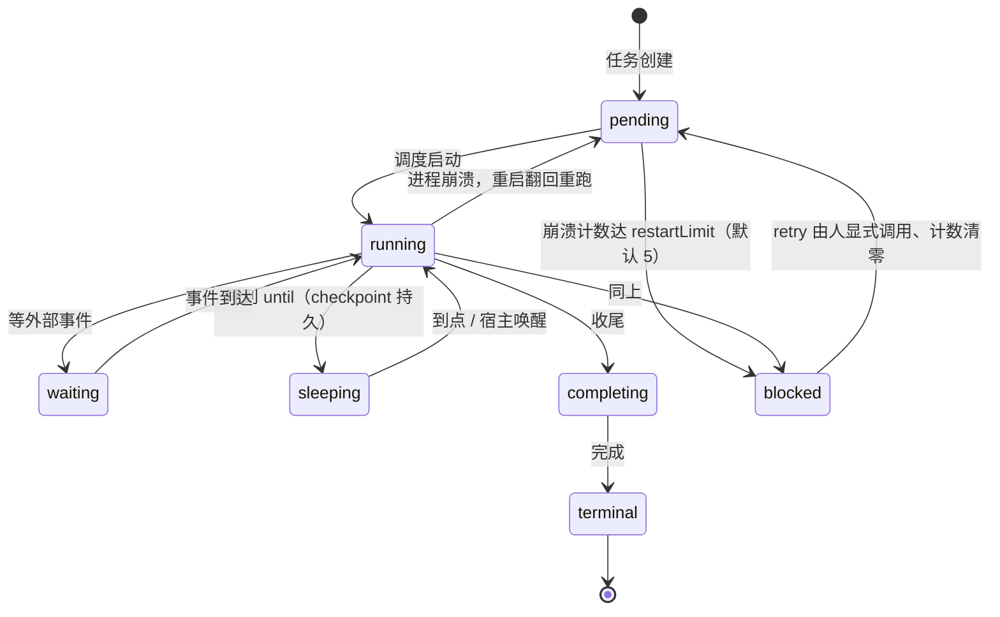
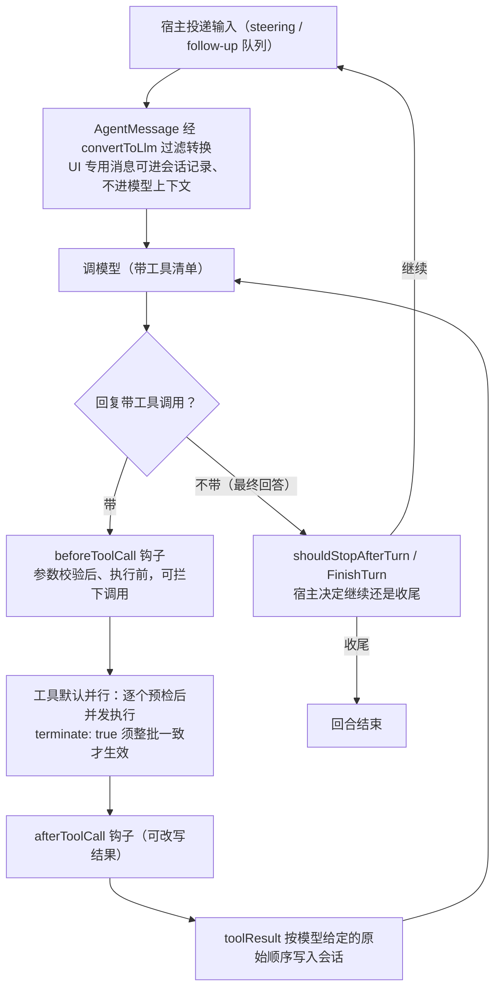
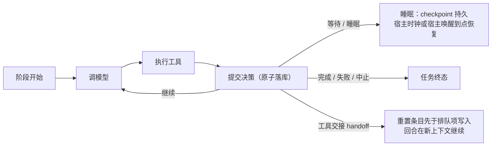

# Pi

| 源仓库 | [earendil-works/pi](https://github.com/earendil-works/pi) |
|---|---|
| 协议 | MIT |
| 主语言 | TypeScript |
| 笔记基准 | commit `d5b3de22`（2026-10-26） |

Pi 是 earendil-works 开源的 AI agent 工具包，TypeScript 写的，monorepo（一个仓库里放多个软件包）组织在 `packages/` 下，现在 11 个包，GitHub 上 star 数很高（旧笔记记录为 10.8 万）。它最出名的产品是 `pi` 这个终端编码 agent——在命令行里对话、读写代码的 AI 助手，同类有 codex、opencode、Claude Code。但它的定位不止于此，README 里的词是 "agent harness"（套件/外壳），意思是给你一套搭 agent 的现成骨架：从统一大模型接口、agent 运行时、终端界面库，到持久化运行时，一层一层都能单独拿出来用。

这份笔记按问题组织，不按 pi 的开发时间线：每个问题讲清 pi 现在是怎么解的、为什么这么解、代价是什么。项目演进过程放在文末修订记录里。笔记起于 commit `c7cdb46`（2026-09-21），跟进到 commit `d5b3de22`（2026-10-26）。

## 它要解决什么问题

做一个编码 agent，绕不开四件事：接模型、跑工具循环、做终端界面、存会话。市面上每个产品都自己造一遍轮子，而且造法互相不兼容。pi 的做法是把这四件事拆成独立的库，每一层都能单独用：只想要"一套代码调所有大模型"，用 `pi-ai`；想要"能调工具、能出流式事件的 agent 引擎"，用 `pi-agent-core`；想要终端里的 AI 编程助手，装 `pi-coding-agent`，也就是 `pi` 命令；想自己写界面，用 `pi-tui`。

同时它对"agent 该长什么样"有一套明确的态度：核心保持极简，别人家内置的功能——子 agent、计划模式、权限弹窗、记忆——它一概不做，改用扩展机制让你自己搭，或者"让 pi 自己给自己写扩展"。这个取舍是否合理见仁见智，但好处很具体：核心代码少、行为可预期、想改哪里都有明确的挂载点。

## 11 个包怎么分工

| 包 | 一句话职责 | 成熟度 |
|---|---|---|
| `ai` (pi-ai) | 统一多厂商大模型 API | 核心，已发布 |
| `agent` (pi-agent-core) | agent 循环与工具调用（瘦身后只剩 Agent、循环、代理流和类型） | 核心，已发布 |
| `coding-agent` (pi-coding-agent) | `pi` 命令本身：交互式编码 agent CLI | 核心，已发布 |
| `tui` (pi-tui) | 终端 UI 库，特色是差分渲染 | 核心，已发布 |
| `telemetry` (pi-telemetry) | 与厂商无关的可观测性契约 | 已发布 |
| `durable` (pi-durable) | 持久化的会话/任务/文档运行时（内部代号 Pico） | 演进中 |
| `env` (pi-env) | SSH 远程执行环境，配一个 Rust 守护进程 | 新独立 |
| `chord` | 应用组合运行时 | 独立项目，不依赖任何 Pi 包 |
| `codemode` | 沙箱化的 JavaScript 执行环境，脚本唯一的能力是调用注入的工具 | 服务于 coding-agent |
| `mcp` | 独立的 MCP 客户端包 | 服务于 coding-agent |
| `evals` | Pi 编码 agent 的行为评测 | 内部工具 |

依赖是单向的，下层不知道上层的存在：coding-agent 指向 agent-core 再指向 ai；durable 引用 chord 的类型与 delta、ai 的类型；chord 谁也不依赖；telemetry 被 ai 和 agent-core 引用，自己不依赖它们。有两个边界：chord 明确声明"不是 Pi 包"，任何应用都能拿去用；agent-core 在 2026-10-01 做过一次大瘦身，实验性 harness、会话存储、压缩、技能全移出去了，包里只剩 `Agent`、循环、代理流和类型——连 SQLite 后端都单独分包过，就是为了不拖上需要编译本地 C 代码的原生依赖，如今这个顾虑随存储一并移交 durable。这种"每个包各管一摊、依赖只朝一个方向流"的布局，跟 opencode 的 monorepo 思路一致，是大型 TypeScript 项目的常见章法。

## 主轴：进程随时会死，任务怎么接着跑

大多数 agent 项目没有认真对待一个问题：进程死了，任务怎么办。常见的场景是：任务跑一半终端关了、机器休眠了、部署重启了，回来发现活儿没了。聊天式的 agent 无所谓，用户重开一个会话就行。但 pi 的定位是 harness，给长跑的 agent 搭骨架：一个自主任务可能跑几个小时、几天，中间宿主进程因为部署、崩溃、休眠随时消失。这时问题就来了：活干到哪了？从哪接着干？"三小时后重试"这种等待谁来记得？进程都不在了，谁负责叫醒它？

pi 对这个问题给出了一条贯穿全部包的答案：**把执行过程变成提交日志**。agent 的每一步——一条输入、一次工具调用、一个任务状态变更——都作为不可变条目原子地写进存储；进程回来后重放日志，就知道从哪继续。这个决策派生出几件事：等待本身是持久状态（任务带着检查点睡在数据库里，进程死了也不丢）；定时可以外包给宿主（Cloudflare 的 alarm 这类机制负责按点唤醒）；连 trace——一次执行的观测轨迹——也随任务持久化，崩溃不断链。"持久化与恢复"一节是这条主轴的完整展开。

## 模型接入

LLM（Large Language Model，大语言模型）就是 ChatGPT、Claude、Gemini 背后的模型。麻烦在于每家的调用接口都不一样：请求格式不同、流式返回的事件不同、参数名不同。pi-ai 的解法是三层抽象。最底层是 API 实现，每种"线上协议"一个模块，共 9 个（anthropic-messages、openai-completions、openai-responses 等），每个模块只导出 `stream` 和 `streamSimple` 两个函数，把统一格式翻译成该协议的实际请求。中间层是 Provider（提供商），一个运行时单元，拥有三样东西：模型目录、认证方式、所用实现。最上层是 Models 集合，注册多个 provider，按 `(provider, model id)` 路由每次请求。这个结构就像万能转换插头：你手上是各国插头（各家 API），墙上是一个统一插座（pi-ai 的统一格式），中间每种插座标准配一个转换头。换模型改一行配置，业务代码不动。

分层之外，这个库更值得看的是对协议差异的处理。"兼容 OpenAI 协议"只是大体兼容，细节千差万别：有的服务器不认识 `developer` 角色，有的不支持 `reasoning_effort` 参数，思考模式的参数格式有十来种写法（光 `thinkingFormat` 一项就列出 openai、deepseek、qwen、zai 等十余种）。pi-ai 把这些差异收敛成一个 `compat` 标志对象，对已知厂商按 baseUrl 自动检测，未知端点允许手工覆盖。这是"统一接口"落地的真实成本所在：它没有假装各家差异能被一个漂亮接口吸收，而是把真实差异显式建模成配置——抽象统一的那部分，把不统一的暴露出来。

其他几个设计点：

- 流式事件统一成一条序列：`start → text_delta / thinking_delta / toolcall_delta… → done`，工具调用的参数边到边解析（partial JSON），UI 可以在参数没到齐时就显示"正在写哪个文件"。解析本身换成了专门的增量解析器（提交 f715a15c，修 #9265）：`StreamingJsonParser` 与 `ToolCallArgumentsStream`（`packages/ai/src/utils/streaming-json.ts:109`、`:452`）把每个参数增量只读一次，成本与总长度成线性；解析状态（半截 JSON、参数草稿、流序号）不再挂在消息内容块上；九个协议实现、pi-messages 与 faux provider 全部走它。错误约定：流开始后不抛异常，失败（包括用户取消）一律以 `error` 事件和最终消息的 `stopReason` 传达，已生成的部分照常保留，还能接回上下文继续问。调用方因此不用在"流式读取"和"异常捕获"两套逻辑之间反复横跳。
- 模型目录是生成物：`models.generated.ts` 由脚本从各家上游拉数据生成，人不能手改，要改就改生成脚本。目录里带价格、上下文窗口、能力标记。
- 目录里的模型分三类，`type` 字段决定它能用在哪种操作上：聊天模型（`type` 可省略）走流式对话；`type: "image"` 生成图片；`type: "classifier"` 是分类模型，接收结构化的 JSON 状态（可以附带图片），回答一个或多个类型化的问题，走 TypeSafe 的 System One、Cloudflare Workers AI、OpenAI Decisions 这类分类接口，不走聊天 API（`packages/ai/README.md:305`、`:893`）。图片按各家的线上形式发——TypeSafe 用带 opt-in 头的资产、Clef 用 data URL、OpenRouter 用状态里的 `image_url` 部分，由 `SystemOneCompat` 的 `imageInput` 与 `sendImageOptInHeader` 两个标志选择（`packages/ai/src/providers/compat-schema.ts:524-532`，提交 7f225f2）。
- 认证解析有优先级：显式传入的 key 最优先，其次是存储的凭证，最后才是环境变量。存储的凭证"拥有"它的厂商：刷新失败不会悄悄退回环境变量里的旧 key——凭证归属的边界到此为止，不共享。
- 思考等级定了七档统一刻度（`off` 到 `max`），`thinkingLevelMap` 负责翻译成各家的真实参数，不支持的档位标 `null`。
- 约束采样（constrained sampling，让服务商在生成时就强制参数符合 schema）分两级：`strict: 'prefer'` 支持就用、不支持退回普通调用；`'require'` 不支持就报错。后者把"参数格式错误"从运行时问题变成了配置问题。
- 请求头合并有一条固定的顺序链：provider 认证头 → 模型元数据头 → 调用方显式头 → `transformHeaders` 回调最后说了算。客户端身份（`ClientIdentity`）是这条链最底下的默认值，上面任何一层配置的头都能覆盖它：`userAgent` 三选一——`detailed`（默认，发 `pi/<版本> (<平台>; <运行时>; <架构>)`）、`short`（只发 `pi`）、自定义字符串；`attribution`（归属，告诉厂商是哪个应用在调用）按厂商映射成各家的头——OpenRouter 收 `HTTP-Referer`、`X-OpenRouter-Title`、`X-OpenRouter-Categories`，NVIDIA NIM 收 `X-BILLING-INVOKE-ORIGIN`，OpenCode 收 `x-opencode-client`。pi-ai 自身默认不发归属头；pi-agent-core 和 durable（`HarnessOptions.identity`）默认发 pi 自己的 `PI_ATTRIBUTION`（`packages/ai/src/utils/identity.ts:24`），传 `attribution: null` 关掉；GitHub Copilot、Anthropic OAuth 这类自带固定客户端身份的厂商不受影响（`packages/ai/README.md:445-454`）。调试还有个 `onPayload` 回调，能看到发给厂商的原始载荷。
- 测试用 faux provider：一个内存里的假厂商，可以编排"先思考、再调工具、再回答"的脚本化响应，整条 agent 链路的测试不花 API 费。
- 请求体积超限的判定（2026-10-20，提交 73f8de8）不靠估算：判断"请求是否超出厂商允许的体积"，以前靠 token 数启发式，但各家实际上限不一致，估不准；现在收到 HTTP 413 一律判请求体积超限，触发上下文压缩后重试——与其猜，不如等厂商明确告知超限再处理。

虚拟模型（实验性）把"选哪个模型"也变成了扩展点：扩展用 `pi.registerVirtualModel()` 注册一个目录条目，它自己不连任何服务商，每个请求来时才挑一个物理模型和思考档位。"计划用强模型、实现用便宜模型""上下文变大就换大窗口"这类路由策略，由此是几十行扩展代码的事。上下文限制、压缩预留、图片尺寸都按实际路由到的物理模型计算——虚拟名字背后干活的是谁，账就算在谁头上。

## 上下文管理

### 压缩

模型有上下文窗口上限（一次能"看"多少内容），会话太长就装不下，压缩就是让模型把较早的消息总结成一段摘要、保留较新的。pi 有两层实现。产品层：手动 `/compact`（可以附一句自定义指令指定摘要侧重点；拆分回合时给前半段单独生成的前缀摘要也用同一句指令，`packages/coding-agent/src/core/compaction/compaction.ts:1078-1080`），自动模式默认开，两种触发——上下文溢出时（恢复并重试）和接近上限时（提前压缩）。溢出恢复有一条配对规则：失败的那条助手消息和回答它工具调用的工具结果要一起从模型上下文里省略，配对关系在投影出的上下文里查找，当前运行和恢复后的会话走同一段逻辑；省略本身不是删除，而是追加一条"上下文编辑"条目（`appendContextEdit(entryId, null)`），历史仍然完整。只省略助手消息、留下没有配对的工具结果，厂商会拒绝之后的每一个请求（`packages/coding-agent/src/core/agent-session.ts:1239-1272`）。运行时层（durable）：手动、后台、阻塞、溢出四条触发路径；多个压缩请求并发时用 stale 规则裁决，过期的摘要请求直接作废；`beforeCompact` 钩子让扩展在压缩前介入；阻塞压缩失败判运行失败，不悄悄吞掉。压缩配置可以按模型覆盖（`compaction.modelOverrides`）——大上下文模型和小模型各用各的阈值与范围。

压缩有一条明确的立场：**摘要有损，历史无损**。摘要是可以丢弃的加速结构，完整历史永远在会话文件里，随时回看；切分支时被放弃的路径生成 `branch_summary` 条目留档。2026-10-18 起，压缩期间的等待本身也是持久过程——generation 重试轮询与压缩重试都走持久睡眠（见"持久化与恢复"），进程死了醒来接着等。

### 构造：系统提示词与消息注入

pi 对系统提示词的建模是**可重放的补丁序列**：会话第一条 system 消息带完整提示词和工具清单，之后的变更——换了模型、加载了技能、增删了工具——都以 system 消息的形式追加，每条只记差异（`sections` 按名字替换小节，`toolsAdded`/`toolsRemoved` 记增删）。要得到任意时刻的有效提示词，按顺序重放即可，不需要单独存"当前状态"。状态即历史，可审计、可回溯，天然适合追加式存储。恢复会话或用 `/tree` 切到别的分支时，当前工具清单就是把这条分支上全部 system 消息（含压缩之前的，压缩快照本来就由它们推导）重放一遍得到的。分支从没增删过的扩展工具，视为分支记录工具清单之后才注册的，按新注册工具的规则激活（声明 `defaultActive: false` 的除外）；分支删过的工具保持停用；清单里有但还没注册的工具（比如 MCP 服务器还在连接）等它注册时再激活（`packages/coding-agent/src/core/agent-session.ts:1830-1860`）。

配套一条权威性规则：发给模型的请求上下文，以会话状态的投影（projection，从会话事件推导出的当前状态视图）为唯一来源。请求内容可能来自对话历史、系统提示词、工具结果、中途插话，各处自己拼就会出现"各说各话"，pi 让它只有一个出处。同时上下文编辑只允许追加——不能改写或删除已经发出去的内容，保证"发给模型的东西"和"会话记录"永远对得上。

投影之后组装成各厂商的消息序列，这一步也有踩坑记录：会话中途的 system 更新，落点原本定在"下一条 assistant 消息转换成内容块"的检查之前——那条消息转换不出任何块时（空文本，或另一个模型的纯推理回复），更新被挤到 user 消息前面，角色交替被破坏，Anthropic 直接以 400 拒绝请求。修复是让 system 更新越过被丢弃的 assistant 消息再落位（提交 3bc6eeb）。

往消息流里插东西有三条路：应用自定义的消息类型经 `convertToLlm` 转换边界决定进不进模型上下文；扩展注入的消息以 `custom_message` 条目进上下文（扩展私有状态用 `custom` 条目，不进）；用户在 agent 干活时插话分两条队列——steering 消息当前工具批次跑完就注入（拍肩膀改方向），follow-up 消息等全部干完才注入（"干完这单再说"的排队需求）。文件层面，AGENTS.md 从全局、父目录、当前目录逐级拼接，系统提示词可以用 `.pi/SYSTEM.md` 整体替换、`APPEND_SYSTEM.md` 追加。

### 缓存利用

pi 对提示缓存（prompt cache，厂商按请求前缀复用计算结果来降价提速的机制）的处理原则：**凡是会破坏请求前缀稳定性的因素，都固定下来**，落在五个动作上：

- 会话 ID 保持稳定，支持的厂商可以做缓存亲和（同一会话的路由到同一缓存），token 花费显著下降；`Usage` 把 cacheRead/cacheWrite 分开统计，页脚常驻显示缓存命中率。
- 会话中途的工具变更按厂商能力走三条路，目标都是顶层工具清单不动（`packages/ai/README.md`、`packages/ai/src/utils/transcript.ts`）。Anthropic 走 inline tools beta：新增工具按值定义在 `tool_addition` 块里，删除是 `tool_removal` 引用，顶层清单只放初始工具加一个固定的延迟占位。OpenAI Responses 上支持 `additional_tools` 的模型（像 Codex 那样）把每个工具都声明在 `additional_tools` 条目里：初始工具放在输入开头的一条里，之后的新增和重定义挂在各自的消息上，没有顶层工具清单；后面的条目可以替换前面条目里的同名定义，但不能替换顶层工具、也不能删工具——于是删除以一段文字公告，之后的更新重述哪些工具仍不可用，调用已删工具在执行时失败（提交 caa6967）。只支持 tool search 的 Responses 模型和支持中途加工具的 Kimi 模型，把新工具锚定在它们出现的那条消息上；一次删除或重声明把到那一刻的工具状态上移进顶层清单一次，后续加载仍锚定在原处，而不是第一次删除之后每次加载都重发当前清单。其余模型一律在顶层发当前清单。这是 codex `incremental_tools` 的客户端镜像：服务端把工具定义放进历史、只发增量，客户端就得知道怎么把增删表达成不打碎前缀的形式。
- OpenAI GPT-6 路线上，同会话内调整思考等级保留前缀缓存（PR 10930）。
- 会话树本身缓存友好：按 `id/parentId` 从当前叶子到根重放，同一路径的请求前缀天然一致。
- 自家内存也做缓存：durable 的 `runtime.context()` 把每个会话最近读取的范围和派生视图驻留内存，后续读取只扫描新提交的条目，不为每次模型请求重读整份转录；闲会话按 `contextRetentionMs`（默认十分钟）释放。

## 持久化与恢复

现在展开主轴。pi 的 durable 里，会话（conversation）是可以 fork 的对话范围；条目（entry）是不可变的记录；任务（task）是挂在会话上的持久状态机，比如"这个子任务跑到哪一步了"；文档（document）是可变的 JSON 状态。

系统的第一规则：**Session 的每次提交，原子地写入不可变的条目、完整的任务记录和被跟踪的文档；只有已提交的状态对外可见**。规范性设计文档在 `docs/pico-v5.md`。这句话展开是一组硬性约束：提交要么全可见要么全不可见；外部副作用（发请求、跑命令）不放进提交事务；条目和 ID 一旦提交就不可变、不复用；共享的可变状态更新必须包在事务回调里（`view.change(ctx, (draft) => {...})`），多进程多视图之间不会看到"改了一半"的中间状态。

其中最严格的一条：**提交后如果存储写入失败，这个 Session 直接判死**——不再发布任何内容，必须重新打开。多数系统遇到这种情况会选择重试或降级，pi 选择让会话显式失败，理由是"存了一半"的状态才是真正的灾难源：你不知道哪些数据可信。配套规则是存储错误一律判会话失败、Harness 不做重试；听者和上报回调的错误就地拦下、单独报告，不波及会话本身——底层存不下数据，上层就该立刻知道。

### 会话的两种持久形态

产品层的会话是一棵存在 JSONL（JSON Lines，一行一条 JSON）里的树：每条记录有 `id` 和 `parentId`，条目类型分工明确——`message` 对话、`compaction` 压缩、`branch_summary` 分支摘要、`custom`/`custom_message` 扩展状态与注入消息、`label` 书签。重建上下文时从当前叶子往回走到根，取这条路径上的条目再应用最新压缩记录，旧版本自动迁移。`/tree` 命令打开会话树，从任何历史节点继续，等于 git 的"回到某个 commit 另开分支"，但全程在同一个文件里，历史不丢。分支、回溯、书签全部是纯数据操作——比"每次快照整个会话"和"只存线性日志"都干净。

流式响应也能存：pi-ai 的消息帧编码器（`AssistantMessageFrameEncoder`）把一条流式响应压缩成可持久化的帧序列，配套一个纯函数 reducer 能从帧重建完整消息。流式过程中断后恢复，靠的就是它。流式内容写入存储的节奏也可以调（提交 6c2fd73b）：提交可以标记为延迟持久（`{ persistence: { kind: "deferred", withinMs? } }`，`packages/durable/src/types.ts:1071`）。满足条件的提交（写的是已存在的会话文档、历史取最新、分支取初始）先在内存里生效、监视方立刻看得见，写入存储的动作推迟到下一次读写该文档、文档离开内存、会话关闭，或至多 `withinMs`——默认 `settings.progress.persistWithinMs`，1000 毫秒（`packages/durable/src/harness/agent.ts:37`）。`subscribeCommits()` 的订阅方只在真正存储之后才见到这些提交，见到的就是存储的那一份；内存侧的观察者看到的仍是即时发布。这是一笔拿崩溃窗口换吞吐的交易：32 路流的 SQLite 压测里，存储事务从每秒 562 次降到 99 次，磁盘写入从 14.3 MB/s 降到 4.9 MB/s，单核 CPU 占用从 29% 降到 22%；代价是崩溃最多丢约 1 秒已流出的内容。生成阶段的部分节流与工具输出节流都用了它。

### 存在哪：一排可替换的后端

durable 的后端有一排，都实现同一个 `Storage` 接口（`packages/durable/README.md:763-767`）：内存（什么都不持久化）；SQLite（版本化迁移、基准测试，表可加前缀做命名空间化让多实例共用一个文件；WAL 模式配 `synchronous = NORMAL`，提交能扛住进程崩溃，但断电或宿主机故障可能丢最新一笔）；JSONL（按行追加，适合小规模、可整目录拷贝的部署；整份历史同时留在内存里，长跑 agent 该用 SQLite）；IndexedDB（浏览器专用，`IndexedDbStorage.open(name)` 把全部数据放进一个 IndexedDB 数据库，同一时刻只能有一个持有者，README 要求在它的整个生命周期内持有一把 Web Lock，而不是在多个标签页或 worker 里竞争打开，需要长期保留时调 `navigator.storage.persist()`）；Cloudflare Durable Object（提交就是它的存储事务，支持边缘部署）。JSONL 的回收机制有个关键设计：清理不再需要的任务文档、只留当前版本 base 时，不是想删就删，而是以**已提交的标记**授权——只有提交确认过的记录才能清理，清理前先刷主文件保证标记不丢；刷写失败就跳过回收，但绝不让已发布的提交失败。破坏性操作的授权始终挂在事务边界上。

SQLite 驱动住在 chord 里（`@earendil-works/chord/sqlite`），目前只有驱动，没有复制（把一份数据库的变更连续送到另一处副本）。复制试过两条路，HEAD 都不含。一条是按 SQLite 页复制：独占操作 `NodeSqliteDatabase.exclusive()`、复制连接包装器、WAL 读取器、页校验和、段容器（提交 48c8f32、4759f09），提交 89e3095 整体移除，说明里给的理由是会话同步要复制的是 pi-durable 的提交而不是 SQLite 页，这些部件没有使用者。另一条就是按提交日志复制存储（4c25119，给各后端加导出接口、`sync/` 下放日志与复制存储），同日回退（cae9fd2）。主轴说进程随时会死，存储在别处有副本是顺着这条路往下走的方向；按 89e3095 的说明，方向已从页级改成提交级，但 HEAD 里还没有可用的实现。

所有后端必须过同一套**一致性测试套件**（随 `/testing` 导出）：外部实现跑一遍就知道行为对不对，不用自己重新发明检查清单，也不用逐条读文档猜语义。文档存储是版本化的——原子基础版本（base）加 delta 增量，可历史读取、可回收、可索引查询。`checkpointWhen` 谓词是文档定义的必填项（2026-10-19 起，提交 5c1736f）：每个文档必须显式声明"什么时候可以打快照"，没有隐式默认——压实策略错了的代价是性能或正确性，这种决策不该由默认值替作者做主。

接口契约本身也在收紧（提交 92ab536）：`Storage.commit` 要求调用方随批次传一个 `adopt(seq)` 回调，存储必须在批次已经持久、下一次提交开始之前同步调用它恰好一次，没有持久成功的提交不调用（`packages/durable/src/types.ts:1131-1136`，IndexedDB 实现在 `storage/indexeddb.ts:420`、`:441`）。内存视图的采用因此由存储落定精确驱动：内存里看得见的状态，一定是存储已经承认的状态。

### 崩溃后怎么恢复

提交模型保证了恢复的起点：只有已提交的状态可见，进程重启后重放日志就是完整事实。在此之上有三套机制。

第一，任务状态机是显式的，六态：pending / running / waiting / sleeping / completing / terminal（packages/durable/src/types.ts:599-643）。进程崩溃时正在跑的任务，`Harness.open` 时翻回 pending 重跑。但这里有个陷阱：任务代码本身有 bug 时，会"重启→重跑→再崩"无限循环。pi 的解法是崩溃循环有上限（提交 a30c2a8）：给上次崩溃时正在跑的任务记 `restarts` 计数，达到 `settings.restartLimit`（默认 5，harness/agent.ts:56-60）且未被请求中止的任务停驻为 blocked，上报 `task_parked`，错误消息直说"被切断 N 次没有进展；停驻直到 retryTask()"（scheduler.ts:406-412）；`retry()` 由人显式调用，清零计数恢复调度。判定留了余地：运行中、持有结果、被请求中止的任务永不判 blocked（scheduler.ts:448-453），每轮调度复查停驻任务（restartLimit 可能上调）。计数、停驻、人工恢复、复查，这一套缺一环都防不住无限循环。

第二，**等待是持久状态**（提交 f75b324）。sleeping 状态的结构是 `{ status: "sleeping", checkpoint, until }`（types.ts:622-631）：任务睡到 Harness 时钟到达 `until`，从 checkpoint 恢复；睡眠期间不持有任何调用句柄，deadline 存进 SQLite，进程重启后依然有效。这跟普通的 `sleep` 有本质区别——以前的 `runtime.sleep` 是进程内概念，进程一死睡眠就丢。"三小时后重试"在长跑 agent 里是常见需求，值得一个专门的状态。

第三，**时间可以外包给宿主**（timers.ts，79 行）。进程都不在了，到点谁来叫醒？`HarnessOptions.setTimer` 让宿主接管全部定时，`onWake` 与 `Harness.wake()` 让宿主自己唤醒进程，`scheduler.resume()`（harness/scheduler.ts:423-427）把到期的 sleeping 任务变回可运行——宿主可以用 Cloudflare Durable Object 的 alarm 接管所有定时。默认实现 `nativeTimer` 包 setTimeout，超长延迟分步等待（单次上限约 24.8 天，setTimeout 本身的硬性上限）。timers.ts:10 有一个 Cloudflare Workers 特判：在 Workers 里，一个挂着回调的定时器会让 Durable Object 无法休眠、持续计费，所以"只负责释放内存"的后台定时器在 Workers 里直接拒绝。`hostTimers()` 把宿主的定时器分两类：foreground 的（负责调节或恢复工作）宿主拒绝时退回 setTimeout 并上报一次；background 的（只释放内存）宿主拒绝就放弃——两类定时器的必要性不同，API 上就分开了。

### 在哪跑：可替换的执行环境

工具干活的环境被抽象成 `ExecutionEnv` 接口：位置式读文件（不跟符号链接）、分页列目录、不经 shell 的 argv 数组执行、目录监视（网络文件系统自动退到轮询）、伪终端（pty，vim 这类全屏交互程序因此能用，Unix 专用）、整棵文件树列举。贯穿的关键词是**有界**：读工具一次遍历定位行段、shell 输出只保留尾部窗口并报告准确的跳过计数、进度提交节流可配置。read 工具读图片返回图片块加说明，限额取会话模型自己的设置；图片必须整体读，读的途中文件变了就整张重读——跟可以边长边读的文本文件不同，这条边界写进了接口语义。

环境可以搬到别的机器：pi-env 包把执行环境放到 SSH 远端（`RemoteExecutionEnv`，结果语义与本地一致，靠一个 Rust 守护进程支撑，覆盖四大平台）。验证方式是 `packages/durable/test-workers/` 用 Cloudflare 官方运行时 workerd 跑真实的 Durable Object 唤醒测试（提交 ea7c648）——测试环境和目标宿主一致，模拟环境全绿不代表真机能过。

## 安全与审批

pi 在这个问题上的选择是公开承认"不做"。README 原话：Pi 不包含内置权限系统来限制文件系统、进程、网络或凭证的访问，默认以启动它的那个用户和进程的权限运行。`docs/security.md` 把理由讲得很直白：进程内做一半的沙箱，容易被误解成安全边界，而它其实还依赖宿主 shell、文件系统、包管理器、凭证和扩展代码；真正的隔离只能来自操作系统层或虚拟化/容器边界。

替代方案给得很全（`docs/containerization.md`），四种容器化模式：Gondolin 扩展（只把内置工具和 `!` 命令路由进本地 Linux 微虚拟机，pi 本体和模型凭证留在宿主机）、纯 Docker（最简单，但 API key 也进了容器）、OpenShell（策略控制的沙箱，文件/进程/网络/凭证/推理调用都可设策略）、Docker Sandboxes（凭证不进容器：容器里放占位符，出口代理替换成真值）。这跟很多产品"内置审批弹窗、命令名单"的做法形成对照：内置护栏开箱省心，但边界模糊；外置边界要求使用者有安全意识，但程序简单透明、隔离强度高。两条路线各有道理，pi 的做法是把选择、理由、替代方案全部写进文档——包括坦承"来自仓库文件的提示注入（藏在文档或代码注释里诱导模型干坏事的文本）是本地 agent 的预期风险，pi 无法可靠防止"。防不住的明说，方案给全，剩下交给使用者判断。

它做的唯一一道守卫是**项目信任**：启动时发现项目里有会自动执行的本地资源（`.pi/` 配置、扩展、技能），而你没有对这个目录做过决定，pi 会先问一句"信任这个项目吗"，决定存在 `~/.pi/agent/trust.json`。定位是输入加载守卫——防陌生仓库偷改配置，不是沙箱。连接外部工具时的身份校验做得很细：OAuth 凭证按服务器名加网址分开存（同一个网址的不同服务器可以登不同账号）、RFC 9207 的 `iss` 参数校验防授权响应冒名，连服务器元数据都没发现的情况下 `iss` 一律拒绝，不给冒名者留模糊地带。

## 扩展机制

扩展机制是"核心极简"策略能成立的前提。扩展就是一个导出默认工厂函数的 TypeScript 文件（用 jiti 加载，免预编译），能做的事覆盖 agent 的各个接入口：注册工具（或整个替换内置工具）、注册模型厂商和虚拟模型、注册 `/命令`/快捷键/CLI 参数、订阅全部生命周期事件（可以在 `tool_call` 事件里拦下危险命令，自己实现权限门）、提供完整自定义的 TUI 组件、把状态写进会话文件并控制渲染。理论上没有"核心做得到而扩展做不到"的墙，这是策略成立的前提。官方例子从权限门、git 检查点、路径保护（禁止写 `.env`），到自定义压缩、MCP 集成、SSH 远程执行，还有等结果时玩 Doom 的。分发走包清单：`package.json` 里加个 `pi` 字段声明扩展、技能、模板、主题的目录，`pi install npm:...` 或 `pi install git:...` 就能装。技能（skills）遵循 Agent Skills 标准（agentskills.io），本质是按需加载的说明文档。`/reload` 不退出进程重载键位、扩展、技能、主题。扩展弹出的对话框（select/confirm/input/editor，以及内联的 `custom()` 组件）在编辑器槽位里是一个栈：第二个对话框弹出时不再顶掉第一个，关掉可见的那个就回到前一个，从 custom 组件内部再开对话框也能用；此前第二个会替换可见的那个，被替换的 promise 永远挂着不结束（`interactive-mode.ts`，提交 3884756）。

MCP（Model Context Protocol，连接外部工具的行业标准协议）的转变说明了这条原则怎么落地。初版连 MCP 都不带，理由是这类功能"正确做法不止一种"，与其替你选一种，不如留好挂载点。到 2026-10 前后，MCP 成为内置能力：全局 `mcp.json` 注册服务器，stdio 或 streamable HTTP 连接，工具和资源直接进模型上下文。原则本身没变，成本判断变了："不做的成本"超过"做的成本"时再动手。子 agent、计划模式、待办清单、后台 shell 到今天仍然不在默认清单里。

工具多到不适合全量出现在模型面前时，有两条现成的路：延迟加载（工具注册标记 deferred，不主动提供，直到 modelTools 指名，支持增删）和检索（`tool_search` 扩展，BM25，模型先搜再取）。给程序用的接入形态也齐全：交互 TUI、`-p` 打印模式（可接管道）、`--mode json`（事件按 JSON 行输出）、`--mode rpc`（stdin/stdout 的 JSONL 帧，供非 Node 语言集成）、SDK（`createAgentSession` 把整个编码 agent 嵌进你自己的应用）。

## 并发与多任务

pi 的多任务长在 durable 的任务系统上，核心是结构化并发（structured concurrency：子任务的生死严格框在父任务的生命周期内）。任务显式归属成树——每个任务归属一个会话或另一个任务，父任务被中止时子任务先停；等待原语显式选 `failFast`（一个失败全体失败）或 `allSettled`（等全部结束），没有默认的模糊行为。任务本身是有阶段的持久状态机：`defineTask` 声明阶段表，每个阶段一次调用、一次决策提交，返回类型化的下一状态。

核心能力是**工具可以调工具**（2026-10-09 起）：`ToolExecutionApi.executeTool()` 让一个工具在执行中把另一个工具当作独立的 pi.tool 子任务跑起来，任务归调用者所有、按键挂接，重启后能安全地重新接上；结果存进调用者自己的嵌套结果文档，直到整个调用结算。工具可以声明 `structuredOutputSchema`，产出经校验的结构化输出。`pi.live.nestedTools` 面板能看到每次嵌套调用跑了什么、结果是什么。这个能力加上持久化，"subagent" 就不是产品功能，而是任务系统的自然形态。

调度器有两个细节。一是状态按活的工作定界（2026-10-11）：以前每条见过的会话归属边都记到进程结束，现在只有下方还有活任务时才保留归属链——活父任务下 1 万个已结束的 subagent 循环，需要记的归属边从 10001 条降到 1 条。二是任务图（taskGraph）对外可见，访问方式是订阅：`watchTaskGraph()`（`packages/durable/src/harness/harness.ts:364`）推送任务图的变化流，节点带 blocked 属性，谁卡住了、为什么一眼可见；配合 `settings.afterFailedRun`（任务失败后，排在它后面的输入保留、继续还是撤回）和会话 fork（分支带自己的任务和文档独立演化），多任务的可观测和可处置都齐了。

多进程还有一个单向场景：一个进程驱动会话，另一个只看。`HarnessOptions.readOnly`（提交 be14d97）把 Harness 打开成只读查看器，典型用途是设备上的一份同步副本、只作展示。打开时正在跑的任务直接按已提交接纳——翻回 pending 重跑是驱动那头的事；带写的提交在到达存储之前就被 `ReadOnlySession` 错误拒绝（`packages/durable/src/errors.ts:52`），resume 与一切会启动任务的调用同样拒绝（`packages/durable/src/harness/types.ts:666-670`、`scheduler.ts:230-233`）。

## 可观测性

2026-10-18 起遥测是 pi 的正式能力，从契约到存储是贯通的一条线。基础件（`packages/telemetry`）有三个选择：传播协议不透明（`TelemetryCarrier` 就是 `Record<string, string>`，不绑定 W3C traceparent 之类的具体格式）；span 链接是一等公民；声明式 schema 加编译期类型检查——`defineTelemetrySchema`（telemetry/src/index.ts:108）声明 span、事件、指标的属性类型、必选性、枚举值，属性用错名字或枚举值在编译期就报错。遥测字段打错名字通常要到线上看数据时才发现，编译期拦下来成本低得多。配套的适配器一致性测试套件：任何人写 OpenTelemetry/Sentry 适配器，跑同一套测试即验证。

durable 的遥测词汇有一条写在注释里的原则："IDs address durable records, never content"——遥测只带任务 ID、提交 ID 这类记录标识，绝不携带对话内容。两个 span 的边界划得很清楚：`pi.durable.submit`（提交的准入与落库）和 `pi.durable.phase`（一次任务阶段调用及其决策提交），后者描述明确写了"绝不是一次等待或重启"——等待与重启不是执行，不产生 span。pi-ai 侧的事件只有 `first_chunk` 和 `block`，绝不按 delta 记——一个长回复按 delta 记就是上万条事件。span 的定义粒度、事件的记录粒度，是遥测系统最容易失控的两个地方，pi 在 schema 里就限死了。

遥测和主轴在这里汇合：trace 上下文直接持久化，任务记录里存 `trace: TelemetryCarrier`（types.ts:648），进程重启后恢复的任务依然留在原来的 trace 里，崩溃不断链。存储侧有共享的 `TelemetryStore` 接口，实现落在 `@earendil-works/chord/telemetry-sqlite`（指标按序列每 10 秒聚合、1 秒批量刷写带保留策略、有界队列溢出丢弃并计数），`/render` 子路径配了 trace 渲染器，轨迹能直接画出来看。产品面上，`pi` 的页脚常驻 token 与缓存进出量、缓存命中率、花费、上下文占用，成本统计把助手回复、工具汇报的用量、摘要开销都算在内——agent 帮你花钱，账要让你看见。成本数字还标了出处（提交 7c22a93）：`Usage.cost.totalFromProvider` 区分 total 是服务商标出的账单，还是按目录费率估算的——目录估算与没有这个字段都算"非服务商报的"，两处用量合并时只有两边都是服务商报的，合计才保持这个标记。

## 记忆系统

pi 没有内置记忆系统，而且是明确地没有。按它的原则，记什么、什么时候召回、怎么注入上下文，正确做法远没有收敛，一层都不做。它给到应用层的挂载点是 durable 的文档：版本化、可 fork、可查询的持久状态存储——存储骨架给到为止，策略完全留给扩展和应用。对照本笔记覆盖的其他项目：hermes 把经验自动沉淀成记忆和技能，openclaw 把记忆做成独占插件槽，两者都替使用者做了策略选择；pi 把选择留给你。三种立场没有高下，但如果你想自己设计记忆方案，pi 提供的存储地基最完整。

## Agent Loop

agent-core 的核心是 agent 循环：模型回复 → 带工具调用就执行工具 → 结果塞回上下文 → 再问模型 → 重复，直到给出不带工具调用的最终回答。设计目标是循环做到最小、决策点全部外露。

几个关键设计。内外两种消息类型，一道转换边界：agent 内部用 `AgentMessage`（可以是应用自定义类型），模型只认识标准三种，`convertToLlm` 负责过滤转换——UI 专用的消息可以进会话记录但不进模型上下文。工具执行默认并行：先逐个预检，再并发执行，事件按完成顺序发，但写进会话的 toolResult 按模型给定的原始顺序排列——漏了这个约定，上下文重放就对不上。决策点全部外露为钩子：`beforeToolCall`（参数校验后、执行前，可拦下调用）、`afterToolCall`（执行后可改写结果）、`shouldStopAfterTurn` 和 `FinishTurn`（回合结束后由宿主决定继续还是收尾）。提前收尾有 terminate 约定：工具结果可带 `terminate: true` 表示"这批工具跑完不用再问模型了"，整批一致才生效，混批照常继续——防止误触发。

API 分高低两层：`agentLoop()` 是纯函数式的低层循环，`Agent` 类是高层封装，消息处理作为屏障（等处理完才进工具预检），还管 steering/follow-up 队列。应用想加自定义消息类型不用改库——TypeScript 的 declaration merging 给 `AgentMessage` 联合类型补一个成员，运行时行为在 `convertToLlm` 同一处对齐。durable 的任务阶段（phase）调用在循环外又包一层：每次"调模型、执行工具、提交决策"是一个阶段，阶段结束时的决策（继续、等待、睡眠、完成、失败、中止）原子落库——循环就这样接进了持久化主轴。工具交接（handoff，一个工具控制声明"接下来换一份新上下文继续跑"）与终止的先后也定了规矩（提交 38ff9917）：交接的重置条目先于所有排队项写入（`packages/durable/src/harness/generation.ts:730`），排队的写入与被选中的 steering 消息因此落进交接后的新上下文，而不是丢在旧的一份里；回合在新上下文继续跑。请求模型时的思考档位也进了持久记录（提交 d5b3de22）：任务检查点新增可选的 `thinkingLevel` 字段（旧版本的检查点没有它），durable 在发出请求时把这一档记到助手消息上——与 agent-core 循环的行为对齐，恢复重跑时能看到"当时要的是哪一档"。durable 侧的每个阶段与它的六种决策，是同一个循环的持久化视图：

## 特色模块

以下几个包相对固定问题是 pi 的特色项，也是它作为工具包最独特的部分。

### pi-tui：终端界面与差分渲染

pi-tui 是支撑 `pi` 全部交互的终端 UI 框架。核心抽象小到一句话：组件就是"给我宽度，还你若干行文本"——`render(width): string[]`，可选加键盘、鼠标、缓存失效三个方法。特色是差分渲染：每次刷新只重画变化的行（终端 I/O 慢，全屏重画会闪），所有更新包在"同步输出"控制序列（CSI 2026）里让终端把一帧当原子操作呈现。内部实现分两棵树：公开的组件树长存有状态，内部布局树（每个盒子的位置、裁剪区域）每帧重建、画完原子替换——重建便宜（纯几何计算），叶子组件（Markdown、文本、图片）自带按内容和宽度缓存的渲染结果。三件事配在一起：布局便宜（每帧重算）、渲染昂贵（叶子缓存）、落屏最贵（只写变化行）。任何频繁刷新的界面都适用这套成本分层。主题从终端自己的前景/背景/ANSI 调色板推导整套配色（OKLab 亮度、WCAG 2 对比度），启动不等待——界面先以灰度跑起来，颜色应答到了再上色。退出有一道保底：TUI 会给终端打开鼠标上报、焦点事件、括号粘贴、Kitty 键盘协议、备用屏幕这些模式，正常 `stop()` 会逐一关掉；进程没走 `stop()` 就退出（抛了未捕获异常、被 `process.exit` 直接结束）时，注册在进程退出上的回退会同步写出这几项的重置序列（`packages/tui/src/tui.ts`，提交 9df819d）——否则用户回到 shell 会发现鼠标滚轮在打乱码、粘贴的文本多了首尾标记字符。

### chord：应用组合运行时

chord 解决的问题：一个功能（比如"显示 agent 正在做什么"）要同时活在多个环境（后台工作进程、终端 UI、远程网页），怎么把一个插件拆成几瓣、各瓣跑到各自该在的进程里、还能互相调用同步状态。现在的实现（chord2）是契约、对象、单元、根、插件、热重载，连接方式有内存、IPC（进程间通信）、WebSocket 三种链路。核心积木是复制状态：生产方在被跟踪的状态对象上改数据并发布，改动记成基于路径的操作批量发出，调用方收到完整不可变值或增量，更新包在事务回调里——和 durable 的提交是同一条纪律。供应链纪律：打包器"从不安装依赖、从不执行包的生命周期脚本"，外部依赖一律外置，加载时由宿主解析。

"被跟踪的状态"的监听一侧在 2026-10 下旬收敛成两个接口（提交 a2fd25f、5e106ab、42cb822）：`Watchable`（`packages/chord/src/watch.ts:37`）是"可以监听的值"的通用契约——当前值加一个 `watch(context)` 方法，返回的句柄先吐当前值、之后每个变更一帧；`NativeWatchable`（`watch.ts:48`）是进程内版，值可以是任意对象（错误和函数都行），变更按对象身份判断、不走差量操作。两套句柄的生命周期只有一份实现（`Watch` 与 `NativeWatch`，`watch.ts:263`、`:293`），结束原因枚举得清清楚楚：主动停止、监听方取消、源被废弃、源关闭、监听器抛错、源失败（`watch.ts:16-30` 附近）；durable 的监听改用这套共享实现，不再各写一份。监听方处理不过来也有安排：`Watch` 的监听器还在忙上一次回调、或尚未启动时，后续帧排队进 `PendingOps`（`packages/chord/src/delta/pending.ts:51`）；积压超过 `MAX_PENDING_OPS`（10,000 条操作，`pending.ts:12`）后，队列里只留一条"用当前值整体替换"（`PendingTake` 的 `replace` 分支，`pending.ts:9`）。监听器空出来时只收到一次调用——最新值加折叠后的操作（溢出过的就是整体替换），此前"积满 100 帧并成一帧"的粗做法被它取代。进程内的 `NativeWatch` 不走这套排队，另收一个可选的 `replace()`；durable 侧的事件流保持顺序，文档、视图与任务图的监视做折叠（提交 d8d99950）。配套两条让"增量"更便宜：`appendText` 给字符串追加一条廉价的追加操作，durable 的部分提交从"重新赋值整条字符串"改为追加（提交 da412b03）；chord 的追加操作持有自己的文本切片，副本不再让整条持续变长的字符串留在内存里（提交 f715a15c）。

### codemode：模型写代码、代码调工具

codemode 是沙箱化的 JavaScript 执行环境，规则只有一条：脚本唯一的能力是调用注入进来的工具。沙箱可以跑在 worker 线程、调用者线程，或经 RPC 跑在另一个 isolate（独立运行实例）——`/cloudflare` 入口把沙箱做成远程 Durable Object，脚本永不占用调用者线程；`/portable` 入口不带 Node 依赖，浏览器和边缘环境都能用。纯计算脚本受中断额度约束，排空 promise 队列时也轮询，"从不让出"的死循环同样能被打断。durable 侧的 codemode 把代码模式接上了主轴：脚本确定性运行，每个工具调用的结果交付前先写入日志（journal），重跑时从存好的数据重启脚本、按序交付日志结果、日志里没有的调用先扣住等重放结束——脚本也服从"重启能接着跑"。偏离（divergence）、模块版本或沙箱指纹变化、超过期限，都以存好的错误结束调用。coding-agent 侧跑脚本的 worker 线程有进程级上限，默认 2 个（`DEFAULT_MAX_CODEMODE_WORKERS`，`extensions/codemode/execute.ts:58`），`PI_CODEMODE_MAX_WORKERS` 环境变量可以调高，每次调用时现读，一个进程里跑很多会话的 SDK 宿主可以运行时设置；worker 满了的脚本按到达顺序排队等空位，而不是立刻失败——等待计入脚本自己的 `timeout_ms`、尊重 abort、单独封顶 60 秒（`CODEMODE_WORKER_WAIT_MS`，提交 885a564）。

### evals：文档也做评测

evals 是行为评测——用真实任务考察 agent 表现，不是玩具基准。方法上最有价值的是"文档提升评测"（docs lift eval）：把仓库搭成两份 Docker 镜像，一份带文档、一份删掉文档并从系统提示词移除文档路由段落，同一用例在两种镜像里各跑几遍，配对比较通过率差值就是文档对 agent 的贡献。实验纪律：容器里只给读写编辑和搜索工具、不给 shell；配对双方有一方缺失、重复或出错就不计入通过率；有被阻塞的配对时不公布总提升数字——宁可不给数，不给坏数。这套方法把"文档对 agent 有没有用"从主观感受变成可测量的指标。

### 已拆除的 server、protocol、client

这三个包曾组成一套实验性本地服务架构，2026-10-13 整体删除——durable 已用另一条路实现"会话活在后台、多端接入"，实验栈使命结束。它留下一条守则：当时的 client 刻意不自动重连、不重放请求，断线后由应用决定哪些操作安全可重做——网络故障时的"自动帮你重试"经常比失败本身更危险。

## 设计原则

- **凡"正确做法不止一种"的能力不进核心，以扩展挂载点代替**。每个"不做"都附理由和替代方案——无权限系统、不做沙箱、不做记忆，全是这个格式。这个策略的赌注是：挂载点足够好，官方不必亲自实现所有功能。对开源项目，明确说清楚不做什么，比堆功能更能建立信任。
- **文档的读者有两种：人和模型**。README 写着"可以读文档，也可以直接问 agent 让它解释自己"，extensions.md 第一行是"pi 能给自己写扩展，要什么直接开口"。把文档写成模型也能直接使用的形态，让 agent 当讲解员和装修工；evals 的 docs lift 实验进一步把文档质量变成被测量的对象。写文档、用文档、测文档，三件事在同一个项目里转起来了。
- **把真实会话当公共数据**。README 号召开发者分享真实工作场景的 agent 会话记录（发布到 Hugging Face 数据集），作者本人定期公开自己开发 pi 的全部会话：真实的任务、工具使用、失败与修复，比玩具基准更能推动改进。以"极简透明"为卖点的项目把自己的开发过程也公开，是言行一致。
- **把依赖变更当代码审查**（供应链加固）：直接依赖钉死精确版本，`min-release-age=2` 拒绝发布不满两天的版本（躲开"刚发布就被投毒"的高危窗口）；锁文件是权威，pre-commit 拦意外改动；CI 安装一律 `--ignore-scripts`（最常见的投毒入口）；发布前在仓库外隔离环境装一遍验证。单看每条都是小功夫，合起来是一堵墙。
- **规则先写给 agent 看**。根目录 `AGENTS.md` 同时约束人和 agent：代码风格（禁 `any`、禁动态 import）、测试纪律（不跑真实厂商 API）、git 纪律（多个 pi 会话可能同时在改这个仓库，禁止 `git add -A`、禁止强推，只提交自己改的文件）。这份文件的存在说明：项目的日常开发大量由编码 agent 完成，规则要先写给 agent 看。

## 可复用的做法

- 统一接口的诚实版本：抽象统一的那部分，把不统一的暴露为配置（compat 标志对象）。
- 状态即历史：系统提示词不存"当前状态"，存"每次变更"，重放即状态。可审计、可回溯、天然适合追加式存储。
- 会话树的 id/parentId 模型：分支、回溯、书签全部是纯数据操作，一个文件装下完整历史。
- 存储后端配一致性测试套件：把"实现应该有什么行为"写成可执行的测试，第三方实现跑一遍即验证——比一份容易被误读的文档强得多。
- 崩溃循环要有上限：崩溃恢复不是"一律重跑"，计数、停驻、人工恢复、复查，一套都不能少。
- 假 provider 测试法：整条链路的测试不碰真实 API，需要真实模型的评测单独隔离跑容器。
- 文档也做评测：配对实验量化文档贡献，让"文档写得好不好"从主观感受变成可测量指标。
- 运行时少一层工具：全仓库迁 TypeScript 7 后跑源码不经过 tsx，直接 `node --import` 挂解析钩子。构建链上能去掉的中间层就去掉，出问题时少一个"是工具的锅还是代码的锅"的排查环节。

## 修订记录

- 2026-09-21 初版：基于 commit c7cdb46 完整成文。吸收首日认识篇（架构三件套、无内置权限系统、供应链加固），扩充为 12 包全览与各子系统机制。
- 2026-09-22 基于 commit 1a584a7 补充：agent 会话上下文的权威投影与追加式编辑、可编程的回合结束决策点（FinishTurn）、chord 复制状态的事务化更新；模型目录新增 Grok 4.7 支持。
- 2026-09-23 基于 commit 9672462 补充：durable 新增 SQLite 存储后端（版本化迁移、一致性测试、基准）与版本化文档存储（原子基础版本、历史读取、回收、索引化查询）。
- 2026-09-24 基于 commit b455975 补充：durable 新增第二个存储后端 JSONL（含 sidecar 回收：任务文档清理与只留当前 base，以已提交标记授权、回收前先刷主文件），一致性测试套件导出供外部后端复用。
- 2026-09-25 基于 commit 5fd446c 补充：durable 会话层做实——原子 Session 事务、检查点、文档迁移、文档重放批量优化；chord 不可变 delta 跟踪器收敛为唯一实现并强制严格 JSON 校验。
- 2026-09-26 基于 commit d6af72e 补充：durable 新增会话文档 fork（后端按策略复制、所有权索引查询）与类型化 ID（branded type、显式所有权、任务成员关系不可变）；全仓库迁至 TypeScript 7 并以裸 node 跑源码（去 tsx 中间层）。
- 2026-09-27 基于 commit 2b0a123 补充：TUI 新增 system 默认主题——界面配色从终端报告的前景/背景/ANSI 调色板推导（OKLab 亮度、WCAG 2 对比度），启动不等待（灰度先跑、颜色到达再上色），ThemedText 组件保证文本颜色跟随主题重建。
- 2026-09-29 基于 commit cb7969d 补充：coding-agent 新增实验性虚拟模型（扩展注册路由策略，按请求挑物理模型与思考档位）；durable 补任务运行时（defineTask 阶段表、单一调度回调、commit 返回类型化下一状态）与 Harness 任务接口。
- 2026-09-30 基于 commit 1b34779 补充：durable 按设计文档分期落地 Package 16-18——第一次 coding-agent 工具回合（pi.tool/pi.post-tools 任务、四个内置工具）、pi.usage 用量记录与会话视图、会话中止与所有权级联（后台任务是级联边界）。
- 2026-10-01 基于 commit 17f3dcc 补充：durable 落地 Package 19-20——结构化并发（任务显式归属、waiting/completing 状态与 failFast/allSettled 等待、自底向上中止）与上下文压缩（手动/后台/阻塞/溢出四条触发路径、stale 规则裁决并发摘要、beforeCompact 钩子）；Node SQLite 存储改异步执行并按语句缓存编译结果。
- 2026-10-02 基于 commit 7fbbd5f 补充：durable 落地 Package 21-23——扩展注册表与每会话 pi.agent 文档（内置工具改扩展形态）、生命周期收尾纪律、taskGraph 任务图视图；实验性 durable TUI 编码 agent 与 client/server 移植；pi 发布 v1.0.0，agent-core 瘦身（实验性 harness 与 session-backends 包整体移除）；架构表补录 codemode/mcp 两包，修正 MCP 支持现状（mcp.json 内置、OAuth 凭证按服务器与网址分开存）。
- 2026-10-03 基于 commit a276dab 补充：pi-ai 切换 Anthropic inline tools beta（会话中途工具变更按值内联定义、顶层工具清单固定、同名重定义不再全量重发）；供应链策略调整——移除 npm shrinkwrap、传递依赖钉死移交 pi.dev 安装器 lockfile、npm audit 脚本化；codemode 脚本输出加上限（16 Mi 字符/10 万项）防 print 循环耗尽宿主内存。
- 2026-10-05 基于 commit b2b5c42 补充：durable 执行环境有了正式接口——FileSystem（openBinaryReader 位置读/openDirReader 分页目录/FileSystem.watch 原生或轮询监视）与 Shell（argv 数组免 shell 执行、流信息上报）、全链有界（scanLines 一次遍历定位行段、shell 输出尾部窗口带跳过计数、进度节流可配置）、环境一致性测试套件导出并跑通三平台。
- 2026-10-06 基于 commit 1cedd32 补充：新包 pi-env 让执行环境搬去 SSH 远端（RemoteExecutionEnv 语义与本地一致、Rust 守护进程覆盖四平台、三平台一致性测试矩阵）；durable 的 runtime.context() 把最近读取范围与派生视图驻留内存（闲会话按 contextRetentionMs 释放）、支持按较早条目读取上下文、新增 Cloudflare Durable Object SQLite 适配器；连发 v1.0.3/v1.0.4/v1.1.0；架构表补录 env 包。
- 2026-10-11 基于 commit ea448f45 补充：durable 嵌套工具调用（executeTool 派生归调用者所有的 pi.tool 子任务、嵌套结果文档、重启后可重挂接、abandonOnRestart）与结构化输出（structuredOutputSchema 校验、ToolExecutionResult.content 更名 output）；存储错误判会话失败且 Harness 不重试；read 工具支持图片（限额随模型、可选 Photon WASM 处理器、图片必须整体读）；调度器归属索引按活工作定界（1 万已结束循环的归属边 10001 条降为 1 条）且不再每轮遍历全部活任务；codemode 沙箱可经远程 Durable Object 跑在 Cloudflare Workers；coding-agent 发布配置 schema；MCP iss 校验收紧（未发现服务器元数据即拒绝）。
- 2026-10-14 基于 commit 3daa2028 补充：chord 包被 chord2 宿主运行时整体替换（契约/对象/单元/根/插件/热重载、内存与 IPC 与 WebSocket 链路、esbuild 换 typebox、流控与压缩帧等打磨）；实验性 server/protocol/client 三包与 coding-agent 实验服务栈整体删除（现 11 个包）；durable 新增代码模式（脚本以嵌套调用用工具、日志化结果重启可重放、偏离与沙箱指纹变化判错、store/load 随 fork）、延迟工具（deferred 注册加 modelTools 指名）与 tool_search 扩展；执行环境新增伪终端（pty/ptyWrite/ptyResize，Unix 专用）与 listFiles 树形列举；pi 发布 v1.2.0；杂项——会话文档缓存按使用定界（documentRetentionMs）、输入记为应用条目且仅展示的写入一次追加、图片预处理挪进 worker 线程、压缩摘要不再包含 thinking、阻塞压缩失败判运行失败、会话分享目的地可配置、OpenRouter 只列出密钥可用的模型、PI_CLIPBOARD_OSC52 强制 OSC 52 复制、修复工具调用参数里的非法 \u 转义。
- 2026-10-17 基于 commit 8efd314fa3 补充：chord 线上协议推进到 3 与 4（状态 init、类型化主体与契约放置、宿主生命周期类型检查、引用使用前状态补齐与订阅、绑定键规范化、形状帧去 codeVersion）；durable 支持命名空间化 SQLite 存储、按模型覆盖的压缩设置（compaction.modelOverrides）、函数形式的 HarnessOptions；pi-ai 的 GPT-6 思考等级切换保留提示词缓存、kimi-coding 改走 Chat Completions、NVIDIA 默认 Nemotron 3.5 Super VL；OutputBuffer/Progress 挪到 @earendil-works/chord/output；pi 发布 v1.3.0。
- 2026-10-20 基于 commit 73f8de80bc 补充：durable 升级为持久执行平台——睡眠成为持久状态（六态状态机、sleeping 带 checkpoint 与 until、deadline 存 SQLite 重启存活、schema v2 重建任务表迁移）、定时可外包宿主（HarnessOptions.setTimer/onWake、Harness.wake()、scheduler.resume()、Workers 里拒绝后台定时器的特判）、崩溃循环防护（重启计数达 restartLimit（默认 5）判 blocked 并上报 task_parked、retry() 清零恢复、ReportInfo 九类类型化上报、settings.afterFailedRun 决定失败后排队输入的去留、任务图节点带 blocked 属性）、workerd 真机测试套件（packages/durable/test-workers/）、SQLite 驱动挪至 chord/sqlite；checkpointWhen 成为 durable 文档定义必填（不再有默认值）；遥测体系落地（pi-telemetry 声明式 schema 与编译期类型检查、durable 的 DURABLE_TELEMETRY_SCHEMA 坚持只记记录标识不记内容、pi-ai 的 AI_TELEMETRY_SCHEMA 事件粒度停在块级、Context.telemetry 恒为 span、trace 上下文随任务记录持久化、chord/telemetry-sqlite 提供 TelemetryStore 存储与 trace 渲染器）；pi-ai 收到 HTTP 413 一律判请求体积超限并触发压缩重试。
- 2026-10-20 结构重组（三次）：第一次从"按包/子系统分节"改为"主轴问题 + 固定问题清单"；第二次改为设计规格形态（规则编号 + 现在时 + 取舍/验证）；第三次定为最终形态——问题主线的机制讲解：正文按问题组织，直接陈述机制、理由与客观对比，不带规则编号，不带个人化表述与评价性渲染；演进历史归修订记录。
- 2026-10-21 基于 commit bdd9f0399d 补充：pi-ai 在 OpenAI Responses 上用 additional_tools 保持提示词缓存（每个工具声明在 additional_tools 条目里、无顶层清单、删除以文字公告并由后续更新重述、调用已删工具执行时失败）与 tool-search/Kimi 路线的锚定规则（删除或重声明只上移顶层清单一次，增量工具公告只重述更早消息里的删除）；chord SQLite 新增 exclusive() 独占操作与尚未导出的复制连接包装器（关自动检查点、报告每个操作、检查点前钩子、关闭删 WAL）；codemode worker 默认 2 个、PI_CODEMODE_MAX_WORKERS 可调、满时按序排队最多 60 秒；扩展对话框在编辑器槽位成栈；TUI 进程未经 stop() 退出时同步重置终端模式。
- 2026-10-22 基于 commit 58c0b02ce5 补充：durable 新增浏览器后端 IndexedDbStorage（单一 IndexedDB 数据库、单持有者、建议 Web Lock 与 storage.persist）；pi-ai 收编客户端身份（ClientIdentity：User-Agent 三档、按厂商映射的归属头、PI_ATTRIBUTION 在 agent-core 与 durable 默认开而 pi-ai 默认关）；分类模型接受图片输入（SystemOneCompat 选线上形式）；溢出恢复把失败助手消息与其工具结果成对省略为追加的上下文编辑；恢复或 /tree 时分支没提过的扩展工具按新注册规则激活；/compact 自定义指令也作用于拆分回合的前缀摘要；pi 发布 v1.4.0。另记一笔正文已据此改写的变动：上轮写入的 chord SQLite 独占操作 exclusive() 与复制连接包装器（48c8f32）连同 WAL 读取器、页校验和、段容器（4759f09）已被 89e3095 移除（说明：会话同步复制 pi-durable 提交而非 SQLite 页），接替的"按提交日志复制存储"（4c25119）同日回退（cae9fd2），HEAD 不含任何复制实现。
- 2026-10-23 基于 commit 936e5f4 补充：只读 Harness（另一进程驱动、本进程只看的查看器，打开时在跑任务按已提交接纳，带写提交与 resume 在进存储前被 ReadOnlySession 拒绝）；Storage.commit 契约加 adopt 回调（批次落定后同步调用一次，内存采用由存储落定驱动）；Anthropic 会话中途 system 更新越过转换不出内容块的 assistant 消息落位（原落点破坏角色交替致 400）；成本合计区分服务商账单与目录估价（totalFromProvider）。另记一笔正文已据此改写的变动：92ab536 移除了 Harness.taskGraph() 直接读取（连同 Session.documentState、Conversation.viewState），任务图对外只剩 watchTaskGraph() 订阅，正文已改为订阅式描述。
- 2026-10-24 基于 commit 136b87e 补充：chord 监听侧收敛为 Watchable（JSON 值、按差量帧）与 NativeWatchable（进程内任意值、按对象身份）两个接口，Watch/NativeWatch 共享一份生命周期实现，durable 改用共享实现；fork 会话经单个文件描述符写入；Anthropic 每消息推理档位固定发低档顶层 effort；Gemini 工具 schema 保留 literal、const 按枚举发送；faux 缓存写入不再计入输入 token。
- 2026-10-25 基于 commit 38ff9917 补充：Watch 补上监听方处理不过来的安排（忙时帧排队进 PendingOps，上限 10,000 条、溢出后整体替换、空出来一次调用）；流式工具参数解析换专门增量解析器（每个增量只读一次、线性成本、九个协议统一使用，解析状态离开消息内容块）；提交可标记延迟持久（内存先生效、监视方立即可见、写入推迟至多 1 秒，32 路流存储事务 562/s→99/s，代价是崩溃丢约 1 秒流式内容）；工具交接的重置条目先于排队项写入、回合在新上下文继续；appendText 廉价追加通道、部分提交从重赋值改为追加、追加操作持有自己的文本切片；Kimi K3.1 Pro 归入 Kimi K3 家族。
- 2026-10-26 基于 commit d5b3de22 补充：durable 把请求的思考档位记进任务检查点与助手消息（检查点新增可选 thinkingLevel 字段，与 agent-core 循环对齐）。另记未入正文的小项：provider id 含斜杠时的 provider/id 引用解析修复（984cf664）；agent 目录为符号链接时 npm prefix 传真实路径（5f960a0e）；Windows 路径分隔符归一（0eea54f1）；pi-test.sh --no-env 清掉全部 provider 环境变量（911fbab3）。
- 2026-10-26 基于 commit d5b3de22 补充：Agent Loop 节新增端到端流程图与 durable 阶段决策图，持久化节新增任务六态状态图（内容取自正文已有机制，不引入新事实）。
