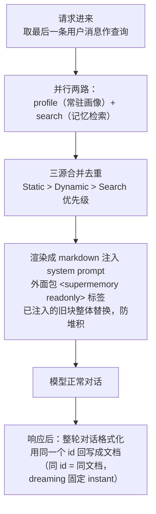

# Supermemory

| 源仓库 | [supermemoryai/supermemory](https://github.com/supermemoryai/supermemory) |
|---|---|
| 协议 | MIT |
| 主语言 | TypeScript |
| 笔记基准 | commit `a619e27`（2026-10-29） |

Supermemory 自我定位是"State-of-the-art memory and context engine for AI"（`README.md:10`），GitHub star 约 3.1 万，在记忆类项目里排前四。它卖两件事：记忆（从用户数据里形成可复用的用户画像和事实）和上下文（把相关内容压缩后注入模型上下文），README 里给出的指标是 "95% Recall@15 with a 99.4% context reduction"（`README.md:32-33`）。

读这份笔记前必须知道一个事实：**记忆引擎本体不在这个仓库里**。官方自托管文档写明："The SDKs and other components in the public repository are open source; the downloadable self-hosted server binary is built from a separate, non-public codebase"（`apps/docs/self-hosting/overview.mdx:20`）。仓库里开源的是三样东西：MCP 服务端全套源码（`apps/mcp`）、面向各 AI 框架的接入胶水（`packages/tools`）、引擎数据模型的类型镜像（`packages/validation`），外加一套非常细致的官方文档（`apps/docs`）。这决定了这篇笔记的读法：它一半讲代码，一半讲"从接口契约和数据模型反推引擎的设计判断"，每个论断会注明证据来自代码还是文档。

这份笔记按问题组织，不按 supermemory 的开发时间线：每个问题讲清 supermemory 现在是怎么解的、为什么这么解、代价是什么。项目演进过程放在文末修订记录里。笔记起于 commit `a619e27`（2026-10-29），跟进到 commit `a619e27`（2026-10-29）。

## 它要解决什么问题

记忆类产品要同时满足两种相互冲突的期待：写入立刻可查（用户刚说的话马上能被引用）和记忆质量高（从大量历史里提炼出的画像稳定、不碎片化）。前者要求写入快，后者要求加工慢——好画像需要把相关内容放在一起看，而不是逐条孤立处理。supermemory 的答案是把一次写入拆成两个阶段：第一阶段保证"可搜"（切块、嵌入、建索引，分钟级），第二阶段叫 dreaming（异步的记忆形成，把相关内容分批聚合后提炼），用户先得到能检索的内容，稍后得到成形的记忆。

第二个问题是接入。记忆能力要进模型应用，路径很多（MCP、框架中间件、SDK），每条路径都要解决同样几个问题：检索结果怎么注入提示词、注入多少、谁负责把对话回写。supermemory 在 `packages/tools` 里把这套接入逻辑做成了可复用的中间件，下文"检索与注入"一节展开——这是开源代码里信息密度最高的部分。

## 仓库怎么分工

Bun + Turbo 管理的 monorepo（`package.json:16` 用 Bun，不用 npm/pnpm）：

- `apps/mcp`——MCP 服务端（托管在 mcp.supermemory.ai），记忆操作的完整工具清单：搜记忆、查画像、加记忆、遗忘、列文档等。
- `packages/tools`——`@supermemory/tools`：AI SDK、OpenAI、Mastra、VoltAgent、Claude（memory tool 桥接）五个框架入口，核心是 `withSupermemory` 中间件。
- `packages/validation`——引擎内部数据模型的 Zod schema（TypeScript 的校验库定义）镜像。注意这是内部模型不是公共 API：里面有 v5 文档已弃用的字段名，读它时要当成"引擎存了什么"的参考，不当成"API 长什么样"的规范。
- `apps/docs`——文档站（Mintlify），本笔记的重要证据来源，标注"文档证据"处均出自这里。
- 其余：`apps/web`（跳转控制台的壳）、`packages/memory-graph`（图谱可视化组件）、五个 Python 集成包（构建在独立仓库）。

## 主轴：先可搜、后成忆——写入分两阶段

一次 `add` 请求进来，引擎按状态机推进（状态定义在代码里，`packages/validation/schemas.ts:26-36`）：`queued → extracting → chunking → embedding → indexing → done`（或 `failed`），每一步的起止和错误都有记录（`ProcessingStepSchema`，`schemas.ts:38-47`）。到 `done` 为止是第一阶段：内容完成切块和索引，用 `searchMode: "chunks"` 已经能查到原文（文档证据，`apps/docs/concepts/how-it-works.mdx:93-101`）。

第二阶段 dreaming 在文档 done 之后异步进行（文档证据，`how-it-works.mdx:115-126`）：引擎把相关内容分批聚合成"连贯单元"，喂给记忆模型提炼事实、更新用户画像、建图谱关系。两种模式：`dynamic`（默认，跨文档聚合，质量高但慢——新建的 namespace 可能几分钟内查不到任何记忆）和 `instant`（单文档立即提取，快但每文档多计一次操作费，`apps/docs/ingestion/add-memories.mdx:285-292`）。状态机对应多一个 `dreamingStatus` 字段（`apps/mcp/src/server/client/index.ts:38`）。

这个"两阶段"判断的工程含义值得展开：记忆形成需要跨文档视野，这是它无法做进同步请求里的根本原因（单文档的孤立提取产出的就是碎片）。代价是写入方要管理两个状态、轮询两次；supermemory 把这个复杂度显式暴露给调用方，而不是假装一次 add 全部完成。

写入还有一条产品级分叉：`taskType: "memory"`（默认，走完整记忆处理管道）和 `"superrag"`（只切块嵌入建索引，跳过记忆形成，价格 5 倍便宜）（文档证据，`apps/docs/concepts/super-rag.mdx:32-74`）。同一个引擎卖两种业务，按任务类型计费——"记忆"和"检索增强"在这里被明确当成两种产品。

## 数据模型

以下字段出自 `packages/validation/schemas.ts`（引擎内部模型的镜像，证据等级：代码但非 API 规范）：

- **Document**（`:61-101`）：原始内容、摘要、状态、处理元数据。有两个值得注意的细节：`contentHash`（内容哈希，支撑增量写入的变更检测）；`summaryEmbedding` 和 `summaryEmbeddingNew` **两份向量字段并存**（`:92-95`）——换嵌入模型时新旧两代向量共存，平滑迁移而不是停机重嵌。
- **Chunk**（`:106-124`）：文本块，向量字段同样新旧两代（`:115-120`），另有 `matryokshaEmbedding`（Matryoshka 嵌入，一种可截断的嵌套向量表示——同一向量取前一半维度也能用，检索时可按算力预算选精度）。
- **MemoryEntry**（`:242-279`）：一条记忆。除了内容和嵌入，有三个结构性设计：版本链（`version`/`parentMemoryId`/`rootMemoryId`/`isLatest`，`:250-253`）——记忆被修正时生成新版本挂到链上，检索默认只取 `isLatest`，历史可审计；关系字段（`memoryRelations`，取值 `updates`/`extends`/`derives`，`:239-256`）——记忆之间不是孤立的行，而是有"更新/扩展/派生"语义的边；遗忘字段（`isForgotten`/`forgetAfter`/`forgetReason`，`:262-266`）——软删除是数据模型的一部分。
- **Space**（`:218-237`）：隔离单元，通过 `containerTag` 与旧概念兼容。

## 检索与注入

检索 API：`POST /ns/{namespace}/search`（文档证据，`apps/docs/recall/search.mdx:57-61`）。关键参数：`searchMode` 默认 `hybrid`（记忆和原文块一起搜，可选只搜其一）；`threshold` 默认 0.3；`rerank` 支持 `order`（重排序，约加 100ms）和 `aggregate`（文档证据，`search.mdx:103-122,176-193`）；`rewriteQuery` 自动多路改写查询再合并；`filter` 是可嵌套到 5 层的元数据表达式（`:150-171`）；`include.forgotten` 可以把已遗忘的记忆显式召回（`:203`）。返回项带 `memory` 或 `chunk` 字段区分命中来源，图谱关系（parents/children/siblings）通过 `include.related` 带出。

开源代码里最有学习价值的是 `packages/tools` 的 `withSupermemory` 中间件——"带记忆的对话"完整流程，六步：

几个细节的用意：画像（profile）和检索并行，因为画像不依赖查询——"用户叫我什么名字"这种与查询语义无关的事实必须常驻上下文，不能指望检索命中（文档证据，`apps/docs/concepts/user-profiles.mdx:47-67`）；画像分 static（长期稳定）/dynamic（近期状态）两层，另有按主题的 buckets 第三轴（`:75-113`），两个维度独立演进；注入的内容放进固定标签并整体替换旧块，多轮对话不会重复堆叠记忆块（`packages/tools/src/shared/memory-context.ts:1-41`）；回写固定用 `dreaming: "instant"` 且重试次数显式设为 0（注释原话："Retrying a committed mutation can turn its success into a misleading not-found result"，`apps/mcp/src/server/client/index.ts:221-231`）——对话回写失败不重试，宁可丢一轮对话也不冒重复写入的风险。检索在关键路径上也不重试（`packages/tools/src/shared/memory-client.ts:39-43`），带超时中止。

中间件有三种模式：`profile`（只注入画像，最省）、`query`（画像加按查询检索）、`full`（文档证据，`packages/tools/src/vercel/middleware.ts:203-208`），按对话轮缓存避免工具调用轮重复检索（`middleware.ts:296-336`）。

## 更新与遗忘

- **更新**：同一个 `id` 重复 add，引擎只处理新增内容（增量）；发全文则由系统 diff（文档证据，`apps/docs/ingestion/add-memories.mdx:74-113`）。`documents.update()` 是全量替换、触发完整重处理，仅改元数据不触发（`:110-118`）。
- **文档删除的级联**：只允许删 `done` 或 `failed` 状态的文档；"Memories derived from a deleted document are forgotten"（`apps/docs/ingestion/document-operations.mdx:315`）——删原始内容，派生的记忆自动进入遗忘态。级联的具体实现在闭源侧，仓库里只有这条行为契约。
- **记忆遗忘是软删除**：`DELETE /memories` 把记忆标记为 forgotten，从检索中排除但保留，`include.forgotten` 可召回（`apps/docs/recall/memory-operations.mdx:49-94`）。语义化批量遗忘 `forgetMatching` 强制先 `dryRun: true` 预览、每批上限 100 条（`:98-104`）——"按描述删记忆"这种高危操作，把预览做成了必经步骤。
- 自动遗忘有三个触发口（文档证据，`apps/docs/concepts/graph-memory.mdx:136-141`）：到期（`forgetAfter`）、被新版本压制（版本链 `isLatest` 机制）、噪声过滤。

## 隔离与多租户

隔离主键是 namespace（v3/v4 时代叫 containerTag）：它在 API 里是 URL 路径的一段（`/ns/{namespace}/...`），一次请求只碰一个 namespace（文档证据，`apps/docs/concepts/container-tags.mdx:98-109`）。隔离强度值得注意：**每个 namespace 一个独立向量索引**，"no shared index to filter through, which is why isolation is strict rather than best-effort"（`:64`）——不是共享索引加过滤条件，而是物理分开，过滤永不跨界（`apps/docs/concepts/multi-tenancy.mdx:14-22`）。namespace 支持冒号分层（`org:acme:user:john`，`:74-94`），权限密钥可以限定不能跨 namespace（`how-it-works.mdx:164`）。MCP 侧的会话状态存在 Durable Object（Cloudflare 的有状态对象存储）里，按"组织 + 用户"键控（`apps/mcp/src/server/space-state.ts:1-27`）。

## 持久化与恢复

服务端队列的失败重试实现不可见（闭源），开源侧能确认的是状态契约：处理状态和 dreaming 状态分开跟踪、每步留痕。读路径的稳健性在开源代码里：检索超时即中止、写路径显式零重试（理由见上文）、只有普通文档读取用默认重试（`packages/tools/src/tools-shared.ts:26-29`）。

## 扩展机制

- **MCP**：`apps/mcp` 全套源码，工具覆盖增删查遗忘，按 namespace 隔离。
- **框架中间件**：`packages/tools` 五个入口，接入即得完整的记忆对话流程。
- **Claude 记忆桥**：`claude-memory.ts` 把 Claude 原生 memory tool 的文件操作映射成 Supermemory 文档——路径强制 `/memories/` 前缀、文件名用 `cm_` 前缀可逆编码成文档 id（`packages/tools/src/claude-memory.ts:63-98`）。一个"把别人家的记忆接口翻译到自己引擎上"的干净范例。
- **Connectors**：Google Drive、Gmail、Notion、GitHub 等 7 种数据源接入，OAuth 凭证存 Connection 模型（文档证据，`apps/docs/connectors/overview.mdx:7-12`）。
- **SMFS**（实验性）：把记忆容器挂载成文件系统，`grep` 默认变成语义检索（文档证据，`apps/docs/smfs/overview.mdx:5-27`）。

## 可观测性与评估

开源侧有两个可看的点。一是请求级计量模型：`ApiRequestSchema`（`packages/validation/schemas.ts:181-216`）记录每次请求的耗时、token 数，以及两个有意思的字段——`tokensSaved` 和 `costSavedUSD`（`:196-200`）：上下文压缩替用户省了多少钱被当成一等指标记录。"记忆系统的价值"在这里被换算成了可对账的数字。二是 MCP 的遥测设计：PostHog 上报用无身份的哈希 id、只报元数据事件、明确"不把身份内容序列化进遥测"（`apps/mcp/src/server/analytics.ts:8-37`）；自托管可设 `SUPERMEMORY_DISABLE_TELEMETRY=1` 关闭（文档证据，`self-hosting/overview.mdx:44`）。评测方面仓库带 LongMemEval/LoCoMo/ConvoMem 三个基准的说明文档（`apps/docs/memorybench/`），README 的分数声明出自这里。

## Agent Loop

没有。MCP 服务端是"每个 HTTP 请求新建一个服务实例、无协议会话"的无状态工具清单（`apps/mcp/README.md:8-10`）；`packages/tools` 只提供工具定义和中间件，全仓库没有自主循环或规划逻辑。所有"自动化"的感觉（dreaming 提取、图谱关系、自动遗忘）都在闭源服务端的处理管道里。

## 设计原则

- **异步形成记忆是对"质量"的诚实定价**。宁肯让调用方管理两个状态，也不在单文档同步路径里产碎片记忆；instant 模式存在但单独计费——质量默认值给高，速度明码标价。
- **隔离走物理分索引**。共享索引加过滤是主流做法，supermemory 选了每 namespace 一个索引：多花资源，换"过滤永不跨界"的确定性。合规敏感场景值得参考。
- **危险操作强制预览**。forgetMatching 必须先 dryRun；对话回写和关键路径检索零重试防重复。两处都是把"错了很麻烦"的操作默认挡在第一道。
- **开源接入层、闭源引擎**。引擎能力通过 MCP、中间件、文档三个面完整暴露，代码不开——这是商业记忆引擎的常见形态，仓库里那套接入层代码（注入、去重、回写、缓存）不依赖闭源部分，模式可以直接搬走自用。

## 可复用的做法

- **两阶段写入**（先索引后提炼）：任何"快速可用 + 高质量滞后"的需求都可以套：先交付便宜的那半（可检索），昂贵的加工异步补，状态分开暴露给调用方。
- **画像与检索并行、画像不依赖查询**（`packages/tools/src/shared/memory-client.ts:28,45-59`）：注入上下文时区分"与查询无关但必须常驻的事实"（画像）和"按查询捞取的内容"（检索），两条路并行取。只靠检索会丢掉语义不相关但重要的记忆。
- **注入块整体替换**（`shared/memory-context.ts:1-41`）：多轮对话反复注入记忆时，放进固定标签、每轮整体替换，是防止上下文重复堆积的最简单手段。
- **提交类操作零重试**（`client/index.ts:221-231`）：重试只该用于幂等操作；会改变状态的调用失败就失败，重试可能把"成功"变成"看起来失败实际成功两次"。
- **新旧两代向量并存**（`schemas.ts:92-95,115-120`）：换嵌入模型不停机的平滑迁移方案：双写、灰度切换、旧的等压缩期过后清理。
- **省下的钱当指标**（`schemas.ts:196-200`）：做上下文压缩或缓存的产品，把"替用户省了多少 token/费用"记成一等指标，价值汇报和容量规划都有据可依。

## 修订记录

- 2026-10-30 初版：基于 commit `a619e27` 完整成文。覆盖两阶段写入（索引先行、dreaming 异步成忆）、记忆版本链与关系边、withSupermemory 注入流程、namespace 物理隔离与遗忘契约；明确标注引擎本体闭源、各论断的证据来源（代码或文档）。
